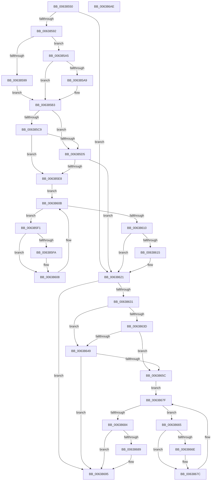

# DifObReleaseObjectSecurityWrapper

- RVA: `0x00638550`–`0x006386AF` (길이 `351` bytes)
- VA: `0x0000000140638550`
- 실행 섹션: `.text`
- PDB 이름 있음: `예`; PDB Function 태그: `아니요`
- unwind 정보 RVA: `0x00093E28`
- 디코드: `97`개 명령, `351/351` bytes 표시
- 미해석 바이트: `0` (있으면 어셈블리에 `.byte`로 보존)

> 이 문서는 커널 이미지의 기계어와 PDB 기호를 분석해 생성했습니다. 4번과 5번은 함수 원형과 자료형을 바이너리 사용 방식에서 추정한 C 해석이며 원본 소스 복구 결과는 아닙니다.

## 1. Dependencies

- 직접 호출 지점: **9**; 고유 호출 대상: **6**
- 직접 호출자로 확인된 함수: **0**
- RIP 상대 이미지 참조: **3**

### Outgoing calls
- `0x00638581` → [DifGetAPIThunkContextById](../49/DifGetAPIThunkContextById_function_00495A34.md) (function, `0x00495A34`)
- `0x006385A9` → [DifGetReturnAddressForWrappers](../4D/DifGetReturnAddressForWrappers_function_004D3C08.md) (function, `0x004D3C08`)
- `0x006385DC` → [ExAcquireRundownProtection](../21/ExAcquireRundownProtection_function_00216620.md) (function, `0x00216620`)
- `0x00638603` → [guard_dispatch_icall](../6B/guard_dispatch_icall_function_006BAAD0.md) (function, `0x006BAAD0`)
- `0x0063861C` → [ExReleaseRundownProtection](../34/ExReleaseRundownProtection_function_00349E80.md) (function, `0x00349E80`)
- `0x00638627` → [ObReleaseObjectSecurity](../../page/9D/ObReleaseObjectSecurity_function_009D77F0.md) (function, `0x009D77F0`)
- `0x00638650` → [ExAcquireRundownProtection](../21/ExAcquireRundownProtection_function_00216620.md) (function, `0x00216620`)
- `0x00638677` → [guard_dispatch_icall](../6B/guard_dispatch_icall_function_006BAAD0.md) (function, `0x006BAAD0`)
- `0x00638690` → [ExReleaseRundownProtection](../34/ExReleaseRundownProtection_function_00349E80.md) (function, `0x00349E80`)

### Direct callers
- 이 함수 시작 RVA로 연결되는 직접 call은 확인되지 않았습니다. 간접 호출은 완전히 역산할 수 없습니다.

### Static image references
- `0x006385BB` → RVA `0x00F048B8` (`.data`; read)
- `0x006385C9` → RVA `0x00F04980` (`.data`; read)
- `0x006385D5` → RVA `0x00F03E80` (`.data`; read)

## 2. Other-region calls and transfers

- 다른 실행 섹션으로 향하는 call: **1**
  - `0x00638627` → [ObReleaseObjectSecurity](../../page/9D/ObReleaseObjectSecurity_function_009D77F0.md) (`.text` → `PAGE`)
- 별도 외부 분기/꼬리 이동을 확인하지 못했습니다.

## 3. Assembly (complete function range)

```asm
00638550  4C 8B DC                        mov r11, rsp
00638553  49 89 5B 08                     mov qword ptr [r11 + 8], rbx
00638557  49 89 6B 10                     mov qword ptr [r11 + 0x10], rbp
0063855B  49 89 73 18                     mov qword ptr [r11 + 0x18], rsi
0063855F  57                              push rdi
00638560  41 56                           push r14
00638562  41 57                           push r15
00638564  48 83 EC 40                     sub rsp, 0x40
00638568  33 C0                           xor eax, eax
0063856A  0F 57 C0                        xorps xmm0, xmm0
0063856D  0F 11 44 24 20                  movups xmmword ptr [rsp + 0x20], xmm0
00638572  4C 8B F9                        mov r15, rcx
00638575  49 89 43 D8                     mov qword ptr [r11 - 0x28], rax
00638579  B9 C7 00 00 00                  mov ecx, 0xc7
0063857E  44 8A F2                        mov r14b, dl
00638581  E8 AE D4 E5 FF                  call 0x140495a34
00638586  48 8B F0                        mov rsi, rax
00638589  48 85 C0                        test rax, rax
0063858C  0F 84 8F 00 00 00               je 0x140638621
00638592  8B 40 0C                        mov eax, dword ptr [rax + 0xc]
00638595  A8 18                           test al, 0x18
00638597  74 0C                           je 0x1406385a5
00638599  48 8B 4C 24 58                  mov rcx, qword ptr [rsp + 0x58]
0063859E  48 89 4C 24 20                  mov qword ptr [rsp + 0x20], rcx
006385A3  EB 0E                           jmp 0x1406385b3
006385A5  A8 04                           test al, 4
006385A7  74 0A                           je 0x1406385b3
006385A9  E8 5A B6 E9 FF                  call 0x1404d3c08
006385AE  48 89 44 24 20                  mov qword ptr [rsp + 0x20], rax
006385B3  40 32 ED                        xor bpl, bpl
006385B6  4C 89 7C 24 30                  mov qword ptr [rsp + 0x30], r15
006385BB  40 38 2D F6 C2 8C 00            cmp byte ptr [rip + 0x8cc2f6], bpl
006385C2  44 88 74 24 28                  mov byte ptr [rsp + 0x28], r14b
006385C7  75 0C                           jne 0x1406385d5
006385C9  F7 05 AD C3 8C 00 00 08 00 00   test dword ptr [rip + 0x8cc3ad], 0x800
006385D3  74 13                           je 0x1406385e8
006385D5  48 8D 0D A4 B8 8C 00            lea rcx, [rip + 0x8cb8a4]
006385DC  E8 3F E0 BD FF                  call 0x140216620
006385E1  40 8A E8                        mov bpl, al
006385E4  84 C0                           test al, al
006385E6  74 39                           je 0x140638621
006385E8  48 8D 7E 20                     lea rdi, [rsi + 0x20]
006385EC  48 8B 1F                        mov rbx, qword ptr [rdi]
006385EF  EB 1A                           jmp 0x14063860b
006385F1  48 8D 43 F0                     lea rax, [rbx - 0x10]
006385F5  48 85 C0                        test rax, rax
006385F8  74 0E                           je 0x140638608
006385FA  48 8B 40 08                     mov rax, qword ptr [rax + 8]
006385FE  48 8D 4C 24 20                  lea rcx, [rsp + 0x20]
00638603  E8 C8 24 08 00                  call 0x1406baad0
00638608  48 8B 1B                        mov rbx, qword ptr [rbx]
0063860B  48 3B DF                        cmp rbx, rdi
0063860E  75 E1                           jne 0x1406385f1
00638610  40 84 ED                        test bpl, bpl
00638613  74 0C                           je 0x140638621
00638615  48 8D 0D 64 B8 8C 00            lea rcx, [rip + 0x8cb864]
0063861C  E8 5F 18 D1 FF                  call 0x140349e80
00638621  41 8A D6                        mov dl, r14b
00638624  49 8B CF                        mov rcx, r15
00638627  E8 C4 F1 39 00                  call 0x1409d77f0
0063862C  48 85 F6                        test rsi, rsi
0063862F  74 64                           je 0x140638695
00638631  40 32 FF                        xor dil, dil
00638634  40 38 3D 7D C2 8C 00            cmp byte ptr [rip + 0x8cc27d], dil
0063863B  75 0C                           jne 0x140638649
0063863D  F7 05 39 C3 8C 00 00 08 00 00   test dword ptr [rip + 0x8cc339], 0x800
00638647  74 13                           je 0x14063865c
00638649  48 8D 0D 30 B8 8C 00            lea rcx, [rip + 0x8cb830]
00638650  E8 CB DF BD FF                  call 0x140216620
00638655  40 8A F8                        mov dil, al
00638658  84 C0                           test al, al
0063865A  74 39                           je 0x140638695
0063865C  48 83 C6 30                     add rsi, 0x30
00638660  48 8B 1E                        mov rbx, qword ptr [rsi]
00638663  EB 1A                           jmp 0x14063867f
00638665  48 8D 43 F0                     lea rax, [rbx - 0x10]
00638669  48 85 C0                        test rax, rax
0063866C  74 0E                           je 0x14063867c
0063866E  48 8B 40 08                     mov rax, qword ptr [rax + 8]
00638672  48 8D 4C 24 20                  lea rcx, [rsp + 0x20]
00638677  E8 54 24 08 00                  call 0x1406baad0
0063867C  48 8B 1B                        mov rbx, qword ptr [rbx]
0063867F  48 3B DE                        cmp rbx, rsi
00638682  75 E1                           jne 0x140638665
00638684  40 84 FF                        test dil, dil
00638687  74 0C                           je 0x140638695
00638689  48 8D 0D F0 B7 8C 00            lea rcx, [rip + 0x8cb7f0]
00638690  E8 EB 17 D1 FF                  call 0x140349e80
00638695  48 8B 5C 24 60                  mov rbx, qword ptr [rsp + 0x60]
0063869A  48 8B 6C 24 68                  mov rbp, qword ptr [rsp + 0x68]
0063869F  48 8B 74 24 70                  mov rsi, qword ptr [rsp + 0x70]
006386A4  48 83 C4 40                     add rsp, 0x40
006386A8  41 5F                           pop r15
006386AA  41 5E                           pop r14
006386AC  5F                              pop rdi
006386AD  C3                              ret
006386AE  CC                              int3
```

## 4. C-style interpretation (structured pseudocode)

```c
__int64 __fastcall DifObReleaseObjectSecurityWrapper(__int64 a1, unsigned __int8 a2)
{
    __int64 result;
    __int64 v_rbp;
    __int64 v_rdi;
    __int64 v_rsi;
    __int64 v_rsp;
    unsigned __int64 v_stack_m28;
    unsigned __int8 v_stack_m30;
    unsigned __int64 v_stack_m38;
    unsigned __int64 v_stack_p0;
    unsigned __int64 v_stack_p10;
    unsigned __int64 v_stack_p18;
    unsigned __int64 v_stack_p8;

    *(unsigned __int64 *)(v_rsp + 8) = v_rbx;
    *(unsigned __int64 *)(v_rsp + 16) = v_rbp;
    *(unsigned __int64 *)(v_rsp + 24) = v_rsi;
    v_rsp = (v_rsp) - (64);
    result = 0;
    v_stack_m38 = v_xmm0;
    *(unsigned __int64 *)(v_rsp - 40) = 0;
    result = DifGetAPIThunkContextById(199, a2, a3, a4);
    if (result == 0) goto loc_00638621;
    if ((((unsigned __int8)((unsigned int)(*(unsigned int *)(result + 12)))) & (24)) == 0) goto loc_006385A5;
    v_stack_m38 = v_stack_p0;
    goto loc_006385B3;
loc_006385A5:
    result = (unsigned int)(*(unsigned int *)(result + 12));
    if ((((unsigned __int8)((unsigned int)(*(unsigned int *)(result + 12)))) & (4)) != 0) {
        result = DifGetReturnAddressForWrappers(v_stack_p0, a2, a3, a4);
        v_stack_m38 = result;
    }
    v_rbp = 0;
    v_stack_m28 = a1;
    v_stack_m30 = a2;
    if ((*(unsigned __int8 *)(v_rip + 9224950)) != 0) goto loc_006385D5;
    if (((*(unsigned int *)(v_rip + 9225133)) & (0x800ULL)) == 0) goto loc_006385E8;
loc_006385D5:
    result = ExAcquireRundownProtection(v_rip + 9222308, a2, a3, a4);
    if ((unsigned __int8)(result) == 0) goto loc_00638621;
loc_006385E8:
    goto loc_0063860B;
loc_006385F1:
    result = *(unsigned __int64 *)(result + 32) - 16;
    if (*(unsigned __int64 *)(result + 32) - 16 != 0) {
        result = *(unsigned __int64 *)(*(unsigned __int64 *)(result + 32) - 16 + 8);
        a1 = v_stack_m38;
        result = guard_dispatch_icall(a1, a2, a3, a4);
    }
loc_0063860B:
    if ((*(unsigned __int64 *)(*(unsigned __int64 *)(result + 32))) != (result + 32)) goto loc_006385F1;
    if ((unsigned __int8)((unsigned __int8)(result)) != 0) {
        a1 = v_rip + 9222244;
        result = ExReleaseRundownProtection(a1, a2, a3, a4);
    }
    result = ObReleaseObjectSecurity(a1, a2, a3, a4);
    if (result == 0) goto loc_00638695;
    v_rdi = 0;
    if ((*(unsigned __int8 *)(v_rip + 9224829)) != 0) goto loc_00638649;
    if (((*(unsigned int *)(v_rip + 9225017)) & (0x800ULL)) == 0) goto loc_0063865C;
loc_00638649:
    result = ExAcquireRundownProtection(v_rip + 9222192, a2, a3, a4);
    if ((unsigned __int8)(result) == 0) goto loc_00638695;
loc_0063865C:
    v_rsi = (result) + (48);
    goto loc_0063867F;
loc_00638665:
    result = *(unsigned __int64 *)(v_rsi) - 16;
    if (*(unsigned __int64 *)(v_rsi) - 16 != 0) {
        result = *(unsigned __int64 *)(*(unsigned __int64 *)(v_rsi) - 16 + 8);
        a1 = v_stack_m38;
        result = guard_dispatch_icall(a1, a2, a3, a4);
    }
loc_0063867F:
    if ((*(unsigned __int64 *)(*(unsigned __int64 *)(v_rsi))) != v_rsi) goto loc_00638665;
    if ((unsigned __int8)((unsigned __int8)(result)) != 0) {
        a1 = v_rip + 9222128;
        result = ExReleaseRundownProtection(a1, a2, a3, a4);
    }
    v_rsp = (v_rsp) + (64);
    return result;
}
```

## 5. (Beta) C Style

```c
int64_t DifObReleaseObjectSecurityWrapper(int64_t Arg1, uint8_t Arg2)
{
    int64_t result;
    int64_t local_rbp;
    int64_t local_rdi;
    int64_t local_rsi;
    int64_t local_rsp;
    uint64_t v_stack_m28;
    uint8_t v_stack_m30;
    uint64_t v_stack_m38;
    uint64_t v_stack_p0;
    uint64_t v_stack_p10;
    uint64_t v_stack_p18;
    uint64_t v_stack_p8;

    *(uint64_t *)(local_rsp + 0x8) = local_rbx;
    *(uint64_t *)(local_rsp + 0x10) = local_rbp;
    *(uint64_t *)(local_rsp + 0x18) = local_rsi;
    local_rsp = (local_rsp) - (64);
    result = 0;
    v_stack_m38 = v_xmm0;
    *(uint64_t *)(local_rsp - 0x28) = 0;
    result = DifGetAPIThunkContextById(199, Arg2, a3, a4);
    if (result == 0) goto loc_00638621;
    if ((((uint8_t)((uint32_t)(*(uint32_t *)(result + 0xC)))) & (24)) == 0) goto loc_006385A5;
    v_stack_m38 = v_stack_p0;
    goto loc_006385B3;
loc_006385A5:
    result = (uint32_t)(*(uint32_t *)(result + 0xC));
    if ((((uint8_t)((uint32_t)(*(uint32_t *)(result + 0xC)))) & (4)) != 0) {
        result = DifGetReturnAddressForWrappers(v_stack_p0, Arg2, a3, a4);
        v_stack_m38 = result;
    }
    local_rbp = 0;
    v_stack_m28 = Arg1;
    v_stack_m30 = Arg2;
    if ((*(uint8_t *)(v_rip + 0x8CC2F6)) != 0) goto loc_006385D5;
    if (((*(uint32_t *)(v_rip + 0x8CC3AD)) & (0x800ULL)) == 0) goto loc_006385E8;
loc_006385D5:
    result = ExAcquireRundownProtection(v_rip + 9222308, Arg2, a3, a4);
    if ((uint8_t)(result) == 0) goto loc_00638621;
loc_006385E8:
    goto loc_0063860B;
loc_006385F1:
    result = *(uint64_t *)(result + 0x20) - 16;
    if (*(uint64_t *)(result + 0x20) - 16 != 0) {
        result = *(uint64_t *)(*(uint64_t *)(result + 0x20) - 0x10 + 0x8);
        Arg1 = v_stack_m38;
        result = guard_dispatch_icall(Arg1, Arg2, a3, a4);
    }
loc_0063860B:
    if ((*(uint64_t *)(*(uint64_t *)(result + 0x20))) != (result + 32)) goto loc_006385F1;
    if ((uint8_t)((uint8_t)(result)) != 0) {
        Arg1 = v_rip + 9222244;
        result = ExReleaseRundownProtection(Arg1, Arg2, a3, a4);
    }
    result = ObReleaseObjectSecurity(Arg1, Arg2, a3, a4);
    if (result == 0) goto loc_00638695;
    local_rdi = 0;
    if ((*(uint8_t *)(v_rip + 0x8CC27D)) != 0) goto loc_00638649;
    if (((*(uint32_t *)(v_rip + 0x8CC339)) & (0x800ULL)) == 0) goto loc_0063865C;
loc_00638649:
    result = ExAcquireRundownProtection(v_rip + 9222192, Arg2, a3, a4);
    if ((uint8_t)(result) == 0) goto loc_00638695;
loc_0063865C:
    local_rsi = (result) + (48);
    goto loc_0063867F;
loc_00638665:
    result = *(uint64_t *)(local_rsi) - 16;
    if (*(uint64_t *)(local_rsi) - 16 != 0) {
        result = *(uint64_t *)(*(uint64_t *)(local_rsi) - 0x10 + 0x8);
        Arg1 = v_stack_m38;
        result = guard_dispatch_icall(Arg1, Arg2, a3, a4);
    }
loc_0063867F:
    if ((*(uint64_t *)(*(uint64_t *)(local_rsi))) != local_rsi) goto loc_00638665;
    if ((uint8_t)((uint8_t)(result)) != 0) {
        Arg1 = v_rip + 9222128;
        result = ExReleaseRundownProtection(Arg1, Arg2, a3, a4);
    }
    local_rsp = (local_rsp) + (64);
    return result;
}
```

## 6. Execution-region graph

[열기: 2D/3D 그래프와 함수 탐색 컨트롤 패널](../../../control-panel.html?section=text&rva=0x00638550&view=graph)

- 2D 그래프는 위에서 아래로 흐르고, 3D 그래프는 빈 공간을 드래그해 회전합니다. Shift+드래그는 이동, 휠은 확대·축소, 함수 노드 선택은 대상 보고서 이동입니다.

### Static fallback


