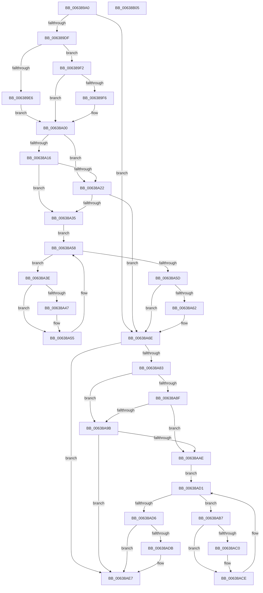

# DifObfReferenceObjectWithTagWrapper

- RVA: `0x006389A0`–`0x00638B06` (길이 `358` bytes)
- VA: `0x00000001406389A0`
- 실행 섹션: `.text`
- PDB 이름 있음: `예`; PDB Function 태그: `아니요`
- unwind 정보 RVA: `0x00093E28`
- 디코드: `98`개 명령, `358/358` bytes 표시
- 미해석 바이트: `0` (있으면 어셈블리에 `.byte`로 보존)

> 이 문서는 커널 이미지의 기계어와 PDB 기호를 분석해 생성했습니다. 4번과 5번은 함수 원형과 자료형을 바이너리 사용 방식에서 추정한 C 해석이며 원본 소스 복구 결과는 아닙니다.

## 1. Dependencies

- 직접 호출 지점: **9**; 고유 호출 대상: **6**
- 직접 호출자로 확인된 함수: **0**
- RIP 상대 이미지 참조: **3**

### Outgoing calls
- `0x006389CE` → [DifGetAPIThunkContextById](../49/DifGetAPIThunkContextById_function_00495A34.md) (function, `0x00495A34`)
- `0x006389F6` → [DifGetReturnAddressForWrappers](../4D/DifGetReturnAddressForWrappers_function_004D3C08.md) (function, `0x004D3C08`)
- `0x00638A29` → [ExAcquireRundownProtection](../21/ExAcquireRundownProtection_function_00216620.md) (function, `0x00216620`)
- `0x00638A50` → [guard_dispatch_icall](../6B/guard_dispatch_icall_function_006BAAD0.md) (function, `0x006BAAD0`)
- `0x00638A69` → [ExReleaseRundownProtection](../34/ExReleaseRundownProtection_function_00349E80.md) (function, `0x00349E80`)
- `0x00638A74` → [ObfReferenceObjectWithTag](../21/ObfReferenceObjectWithTag_function_00210710.md) (function, `0x00210710`)
- `0x00638AA2` → [ExAcquireRundownProtection](../21/ExAcquireRundownProtection_function_00216620.md) (function, `0x00216620`)
- `0x00638AC9` → [guard_dispatch_icall](../6B/guard_dispatch_icall_function_006BAAD0.md) (function, `0x006BAAD0`)
- `0x00638AE2` → [ExReleaseRundownProtection](../34/ExReleaseRundownProtection_function_00349E80.md) (function, `0x00349E80`)

### Direct callers
- 이 함수 시작 RVA로 연결되는 직접 call은 확인되지 않았습니다. 간접 호출은 완전히 역산할 수 없습니다.

### Static image references
- `0x00638A08` → RVA `0x00F048B8` (`.data`; read)
- `0x00638A16` → RVA `0x00F04980` (`.data`; read)
- `0x00638A22` → RVA `0x00F03E80` (`.data`; read)

## 2. Other-region calls and transfers

- 다른 실행 섹션으로 향하는 call: **0**
- 별도 외부 분기/꼬리 이동을 확인하지 못했습니다.

## 3. Assembly (complete function range)

```asm
006389A0  48 8B C4                        mov rax, rsp
006389A3  48 89 58 08                     mov qword ptr [rax + 8], rbx
006389A7  48 89 68 10                     mov qword ptr [rax + 0x10], rbp
006389AB  48 89 70 18                     mov qword ptr [rax + 0x18], rsi
006389AF  57                              push rdi
006389B0  41 56                           push r14
006389B2  41 57                           push r15
006389B4  48 83 EC 40                     sub rsp, 0x40
006389B8  0F 57 C0                        xorps xmm0, xmm0
006389BB  4C 8B F9                        mov r15, rcx
006389BE  B9 C3 00 00 00                  mov ecx, 0xc3
006389C3  44 8B F2                        mov r14d, edx
006389C6  0F 11 40 C8                     movups xmmword ptr [rax - 0x38], xmm0
006389CA  0F 11 40 D8                     movups xmmword ptr [rax - 0x28], xmm0
006389CE  E8 61 D0 E5 FF                  call 0x140495a34
006389D3  48 8B F0                        mov rsi, rax
006389D6  48 85 C0                        test rax, rax
006389D9  0F 84 8F 00 00 00               je 0x140638a6e
006389DF  8B 40 0C                        mov eax, dword ptr [rax + 0xc]
006389E2  A8 18                           test al, 0x18
006389E4  74 0C                           je 0x1406389f2
006389E6  48 8B 4C 24 58                  mov rcx, qword ptr [rsp + 0x58]
006389EB  48 89 4C 24 20                  mov qword ptr [rsp + 0x20], rcx
006389F0  EB 0E                           jmp 0x140638a00
006389F2  A8 04                           test al, 4
006389F4  74 0A                           je 0x140638a00
006389F6  E8 0D B2 E9 FF                  call 0x1404d3c08
006389FB  48 89 44 24 20                  mov qword ptr [rsp + 0x20], rax
00638A00  40 32 ED                        xor bpl, bpl
00638A03  4C 89 7C 24 30                  mov qword ptr [rsp + 0x30], r15
00638A08  40 38 2D A9 BE 8C 00            cmp byte ptr [rip + 0x8cbea9], bpl
00638A0F  44 89 74 24 28                  mov dword ptr [rsp + 0x28], r14d
00638A14  75 0C                           jne 0x140638a22
00638A16  F7 05 60 BF 8C 00 00 08 00 00   test dword ptr [rip + 0x8cbf60], 0x800
00638A20  74 13                           je 0x140638a35
00638A22  48 8D 0D 57 B4 8C 00            lea rcx, [rip + 0x8cb457]
00638A29  E8 F2 DB BD FF                  call 0x140216620
00638A2E  40 8A E8                        mov bpl, al
00638A31  84 C0                           test al, al
00638A33  74 39                           je 0x140638a6e
00638A35  48 8D 7E 20                     lea rdi, [rsi + 0x20]
00638A39  48 8B 1F                        mov rbx, qword ptr [rdi]
00638A3C  EB 1A                           jmp 0x140638a58
00638A3E  48 8D 43 F0                     lea rax, [rbx - 0x10]
00638A42  48 85 C0                        test rax, rax
00638A45  74 0E                           je 0x140638a55
00638A47  48 8B 40 08                     mov rax, qword ptr [rax + 8]
00638A4B  48 8D 4C 24 20                  lea rcx, [rsp + 0x20]
00638A50  E8 7B 20 08 00                  call 0x1406baad0
00638A55  48 8B 1B                        mov rbx, qword ptr [rbx]
00638A58  48 3B DF                        cmp rbx, rdi
00638A5B  75 E1                           jne 0x140638a3e
00638A5D  40 84 ED                        test bpl, bpl
00638A60  74 0C                           je 0x140638a6e
00638A62  48 8D 0D 17 B4 8C 00            lea rcx, [rip + 0x8cb417]
00638A69  E8 12 14 D1 FF                  call 0x140349e80
00638A6E  41 8B D6                        mov edx, r14d
00638A71  49 8B CF                        mov rcx, r15
00638A74  E8 97 7C BD FF                  call 0x140210710
00638A79  48 89 44 24 38                  mov qword ptr [rsp + 0x38], rax
00638A7E  48 85 F6                        test rsi, rsi
00638A81  74 64                           je 0x140638ae7
00638A83  40 32 FF                        xor dil, dil
00638A86  40 38 3D 2B BE 8C 00            cmp byte ptr [rip + 0x8cbe2b], dil
00638A8D  75 0C                           jne 0x140638a9b
00638A8F  F7 05 E7 BE 8C 00 00 08 00 00   test dword ptr [rip + 0x8cbee7], 0x800
00638A99  74 13                           je 0x140638aae
00638A9B  48 8D 0D DE B3 8C 00            lea rcx, [rip + 0x8cb3de]
00638AA2  E8 79 DB BD FF                  call 0x140216620
00638AA7  40 8A F8                        mov dil, al
00638AAA  84 C0                           test al, al
00638AAC  74 39                           je 0x140638ae7
00638AAE  48 83 C6 30                     add rsi, 0x30
00638AB2  48 8B 1E                        mov rbx, qword ptr [rsi]
00638AB5  EB 1A                           jmp 0x140638ad1
00638AB7  48 8D 43 F0                     lea rax, [rbx - 0x10]
00638ABB  48 85 C0                        test rax, rax
00638ABE  74 0E                           je 0x140638ace
00638AC0  48 8B 40 08                     mov rax, qword ptr [rax + 8]
00638AC4  48 8D 4C 24 20                  lea rcx, [rsp + 0x20]
00638AC9  E8 02 20 08 00                  call 0x1406baad0
00638ACE  48 8B 1B                        mov rbx, qword ptr [rbx]
00638AD1  48 3B DE                        cmp rbx, rsi
00638AD4  75 E1                           jne 0x140638ab7
00638AD6  40 84 FF                        test dil, dil
00638AD9  74 0C                           je 0x140638ae7
00638ADB  48 8D 0D 9E B3 8C 00            lea rcx, [rip + 0x8cb39e]
00638AE2  E8 99 13 D1 FF                  call 0x140349e80
00638AE7  48 8B 44 24 38                  mov rax, qword ptr [rsp + 0x38]
00638AEC  48 8B 5C 24 60                  mov rbx, qword ptr [rsp + 0x60]
00638AF1  48 8B 6C 24 68                  mov rbp, qword ptr [rsp + 0x68]
00638AF6  48 8B 74 24 70                  mov rsi, qword ptr [rsp + 0x70]
00638AFB  48 83 C4 40                     add rsp, 0x40
00638AFF  41 5F                           pop r15
00638B01  41 5E                           pop r14
00638B03  5F                              pop rdi
00638B04  C3                              ret
00638B05  CC                              int3
```

## 4. C-style interpretation (structured pseudocode)

```c
__int64 __fastcall DifObfReferenceObjectWithTagWrapper(__int64 a1, int a2)
{
    __int64 result;
    __int64 v_rbp;
    __int64 v_rdi;
    __int64 v_rsi;
    __int64 v_rsp;
    unsigned __int64 v_stack_m20;
    unsigned __int64 v_stack_m28;
    unsigned int v_stack_m30;
    unsigned __int64 v_stack_m38;
    unsigned __int64 v_stack_p0;
    unsigned __int64 v_stack_p10;
    unsigned __int64 v_stack_p18;
    unsigned __int64 v_stack_p8;

    *(unsigned __int64 *)(v_rsp + 8) = v_rbx;
    *(unsigned __int64 *)(v_rsp + 16) = v_rbp;
    *(unsigned __int64 *)(v_rsp + 24) = v_rsi;
    v_rsp = (v_rsp) - (64);
    *(unsigned __int64 *)(v_rsp - 56) = v_xmm0;
    *(unsigned __int64 *)(v_rsp - 40) = v_xmm0;
    result = DifGetAPIThunkContextById(195, a2, a3, a4);
    if (result == 0) goto loc_00638A6E;
    if ((((unsigned __int8)((unsigned int)(*(unsigned int *)(result + 12)))) & (24)) == 0) goto loc_006389F2;
    v_stack_m38 = v_stack_p0;
    goto loc_00638A00;
loc_006389F2:
    result = (unsigned int)(*(unsigned int *)(result + 12));
    if ((((unsigned __int8)((unsigned int)(*(unsigned int *)(result + 12)))) & (4)) != 0) {
        result = DifGetReturnAddressForWrappers(v_stack_p0, a2, a3, a4);
        v_stack_m38 = result;
    }
    v_rbp = 0;
    v_stack_m28 = a1;
    v_stack_m30 = (unsigned int)((unsigned int)(a2));
    if ((*(unsigned __int8 *)(v_rip + 9223849)) != 0) goto loc_00638A22;
    if (((*(unsigned int *)(v_rip + 9224032)) & (0x800ULL)) == 0) goto loc_00638A35;
loc_00638A22:
    result = ExAcquireRundownProtection(v_rip + 9221207, a2, a3, a4);
    if ((unsigned __int8)(result) == 0) goto loc_00638A6E;
loc_00638A35:
    goto loc_00638A58;
loc_00638A3E:
    result = *(unsigned __int64 *)(result + 32) - 16;
    if (*(unsigned __int64 *)(result + 32) - 16 != 0) {
        result = *(unsigned __int64 *)(*(unsigned __int64 *)(result + 32) - 16 + 8);
        a1 = v_stack_m38;
        result = guard_dispatch_icall(a1, a2, a3, a4);
    }
loc_00638A58:
    if ((*(unsigned __int64 *)(*(unsigned __int64 *)(result + 32))) != (result + 32)) goto loc_00638A3E;
    if ((unsigned __int8)((unsigned __int8)(result)) != 0) {
        a1 = v_rip + 9221143;
        result = ExReleaseRundownProtection(a1, a2, a3, a4);
    }
    result = ObfReferenceObjectWithTag(a1, (unsigned int)((unsigned int)((unsigned int)(a2))), a3, a4);
    v_stack_m20 = result;
    if (result == 0) goto loc_00638AE7;
    v_rdi = 0;
    if ((*(unsigned __int8 *)(v_rip + 9223723)) != 0) goto loc_00638A9B;
    if (((*(unsigned int *)(v_rip + 9223911)) & (0x800ULL)) == 0) goto loc_00638AAE;
loc_00638A9B:
    result = ExAcquireRundownProtection(v_rip + 9221086, (unsigned int)((unsigned int)((unsigned int)(a2))), a3, a4);
    if ((unsigned __int8)(result) == 0) goto loc_00638AE7;
loc_00638AAE:
    v_rsi = (result) + (48);
    goto loc_00638AD1;
loc_00638AB7:
    result = *(unsigned __int64 *)(v_rsi) - 16;
    if (*(unsigned __int64 *)(v_rsi) - 16 != 0) {
        result = *(unsigned __int64 *)(*(unsigned __int64 *)(v_rsi) - 16 + 8);
        a1 = v_stack_m38;
        result = guard_dispatch_icall(a1, (unsigned int)((unsigned int)((unsigned int)(a2))), a3, a4);
    }
loc_00638AD1:
    if ((*(unsigned __int64 *)(*(unsigned __int64 *)(v_rsi))) != v_rsi) goto loc_00638AB7;
    if ((unsigned __int8)((unsigned __int8)(result)) != 0) {
        a1 = v_rip + 9221022;
        result = ExReleaseRundownProtection(a1, (unsigned int)((unsigned int)((unsigned int)(a2))), a3, a4);
    }
    v_rsp = (v_rsp) + (64);
    return v_stack_m20;
}
```

## 5. (Beta) C Style

```c
int64_t DifObfReferenceObjectWithTagWrapper(int64_t Arg1, int32_t Arg2)
{
    int64_t result;
    int64_t local_rbp;
    int64_t local_rdi;
    int64_t local_rsi;
    int64_t local_rsp;
    uint64_t v_stack_m20;
    uint64_t v_stack_m28;
    uint32_t v_stack_m30;
    uint64_t v_stack_m38;
    uint64_t v_stack_p0;
    uint64_t v_stack_p10;
    uint64_t v_stack_p18;
    uint64_t v_stack_p8;

    *(uint64_t *)(local_rsp + 0x8) = local_rbx;
    *(uint64_t *)(local_rsp + 0x10) = local_rbp;
    *(uint64_t *)(local_rsp + 0x18) = local_rsi;
    local_rsp = (local_rsp) - (64);
    *(uint64_t *)(local_rsp - 0x38) = v_xmm0;
    *(uint64_t *)(local_rsp - 0x28) = v_xmm0;
    result = DifGetAPIThunkContextById(195, Arg2, a3, a4);
    if (result == 0) goto loc_00638A6E;
    if ((((uint8_t)((uint32_t)(*(uint32_t *)(result + 0xC)))) & (24)) == 0) goto loc_006389F2;
    v_stack_m38 = v_stack_p0;
    goto loc_00638A00;
loc_006389F2:
    result = (uint32_t)(*(uint32_t *)(result + 0xC));
    if ((((uint8_t)((uint32_t)(*(uint32_t *)(result + 0xC)))) & (4)) != 0) {
        result = DifGetReturnAddressForWrappers(v_stack_p0, Arg2, a3, a4);
        v_stack_m38 = result;
    }
    local_rbp = 0;
    v_stack_m28 = Arg1;
    v_stack_m30 = (uint32_t)((uint32_t)(Arg2));
    if ((*(uint8_t *)(v_rip + 0x8CBEA9)) != 0) goto loc_00638A22;
    if (((*(uint32_t *)(v_rip + 0x8CBF60)) & (0x800ULL)) == 0) goto loc_00638A35;
loc_00638A22:
    result = ExAcquireRundownProtection(v_rip + 9221207, Arg2, a3, a4);
    if ((uint8_t)(result) == 0) goto loc_00638A6E;
loc_00638A35:
    goto loc_00638A58;
loc_00638A3E:
    result = *(uint64_t *)(result + 0x20) - 16;
    if (*(uint64_t *)(result + 0x20) - 16 != 0) {
        result = *(uint64_t *)(*(uint64_t *)(result + 0x20) - 0x10 + 0x8);
        Arg1 = v_stack_m38;
        result = guard_dispatch_icall(Arg1, Arg2, a3, a4);
    }
loc_00638A58:
    if ((*(uint64_t *)(*(uint64_t *)(result + 0x20))) != (result + 32)) goto loc_00638A3E;
    if ((uint8_t)((uint8_t)(result)) != 0) {
        Arg1 = v_rip + 9221143;
        result = ExReleaseRundownProtection(Arg1, Arg2, a3, a4);
    }
    result = ObfReferenceObjectWithTag(Arg1, (uint32_t)((uint32_t)((uint32_t)(Arg2))), a3, a4);
    v_stack_m20 = result;
    if (result == 0) goto loc_00638AE7;
    local_rdi = 0;
    if ((*(uint8_t *)(v_rip + 0x8CBE2B)) != 0) goto loc_00638A9B;
    if (((*(uint32_t *)(v_rip + 0x8CBEE7)) & (0x800ULL)) == 0) goto loc_00638AAE;
loc_00638A9B:
    result = ExAcquireRundownProtection(v_rip + 9221086, (uint32_t)((uint32_t)((uint32_t)(Arg2))), a3, a4);
    if ((uint8_t)(result) == 0) goto loc_00638AE7;
loc_00638AAE:
    local_rsi = (result) + (48);
    goto loc_00638AD1;
loc_00638AB7:
    result = *(uint64_t *)(local_rsi) - 16;
    if (*(uint64_t *)(local_rsi) - 16 != 0) {
        result = *(uint64_t *)(*(uint64_t *)(local_rsi) - 0x10 + 0x8);
        Arg1 = v_stack_m38;
        result = guard_dispatch_icall(Arg1, (uint32_t)((uint32_t)((uint32_t)(Arg2))), a3, a4);
    }
loc_00638AD1:
    if ((*(uint64_t *)(*(uint64_t *)(local_rsi))) != local_rsi) goto loc_00638AB7;
    if ((uint8_t)((uint8_t)(result)) != 0) {
        Arg1 = v_rip + 9221022;
        result = ExReleaseRundownProtection(Arg1, (uint32_t)((uint32_t)((uint32_t)(Arg2))), a3, a4);
    }
    local_rsp = (local_rsp) + (64);
    return v_stack_m20;
}
```

## 6. Execution-region graph

[열기: 2D/3D 그래프와 함수 탐색 컨트롤 패널](../../../control-panel.html?section=text&rva=0x006389A0&view=graph)

- 2D 그래프는 위에서 아래로 흐르고, 3D 그래프는 빈 공간을 드래그해 회전합니다. Shift+드래그는 이동, 휠은 확대·축소, 함수 노드 선택은 대상 보고서 이동입니다.

### Static fallback


