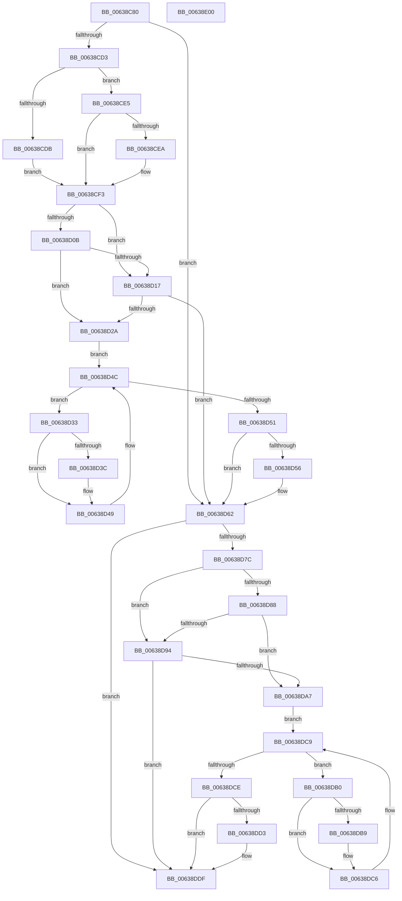

# DifPoCallDriverWrapper

- RVA: `0x00638C80`–`0x00638E01` (길이 `385` bytes)
- VA: `0x0000000140638C80`
- 실행 섹션: `.text`
- PDB 이름 있음: `예`; PDB Function 태그: `아니요`
- unwind 정보 RVA: `0x000D2C68`
- 디코드: `111`개 명령, `385/385` bytes 표시
- 미해석 바이트: `0` (있으면 어셈블리에 `.byte`로 보존)

> 이 문서는 커널 이미지의 기계어와 PDB 기호를 분석해 생성했습니다. 4번과 5번은 함수 원형과 자료형을 바이너리 사용 방식에서 추정한 C 해석이며 원본 소스 복구 결과는 아닙니다.

## 1. Dependencies

- 직접 호출 지점: **9**; 고유 호출 대상: **5**
- 직접 호출자로 확인된 함수: **0**
- RIP 상대 이미지 참조: **3**

### Outgoing calls
- `0x00638CC2` → [DifGetAPIThunkContextById](../49/DifGetAPIThunkContextById_function_00495A34.md) (function, `0x00495A34`)
- `0x00638CEA` → [DifGetReturnAddressForWrappers](../4D/DifGetReturnAddressForWrappers_function_004D3C08.md) (function, `0x004D3C08`)
- `0x00638D1E` → [ExAcquireRundownProtection](../21/ExAcquireRundownProtection_function_00216620.md) (function, `0x00216620`)
- `0x00638D44` → [guard_dispatch_icall](../6B/guard_dispatch_icall_function_006BAAD0.md) (function, `0x006BAAD0`)
- `0x00638D5D` → [ExReleaseRundownProtection](../34/ExReleaseRundownProtection_function_00349E80.md) (function, `0x00349E80`)
- `0x00638D6F` → [guard_dispatch_icall](../6B/guard_dispatch_icall_function_006BAAD0.md) (function, `0x006BAAD0`)
- `0x00638D9B` → [ExAcquireRundownProtection](../21/ExAcquireRundownProtection_function_00216620.md) (function, `0x00216620`)
- `0x00638DC1` → [guard_dispatch_icall](../6B/guard_dispatch_icall_function_006BAAD0.md) (function, `0x006BAAD0`)
- `0x00638DDA` → [ExReleaseRundownProtection](../34/ExReleaseRundownProtection_function_00349E80.md) (function, `0x00349E80`)

### Direct callers
- 이 함수 시작 RVA로 연결되는 직접 call은 확인되지 않았습니다. 간접 호출은 완전히 역산할 수 없습니다.

### Static image references
- `0x00638CFA` → RVA `0x00F048B8` (`.data`; read)
- `0x00638D0B` → RVA `0x00F04980` (`.data`; read)
- `0x00638D17` → RVA `0x00F03E80` (`.data`; read)

## 2. Other-region calls and transfers

- 다른 실행 섹션으로 향하는 call: **0**
- 별도 외부 분기/꼬리 이동을 확인하지 못했습니다.

## 3. Assembly (complete function range)

```asm
00638C80  48 8B C4                        mov rax, rsp
00638C83  48 89 58 08                     mov qword ptr [rax + 8], rbx
00638C87  48 89 70 10                     mov qword ptr [rax + 0x10], rsi
00638C8B  48 89 78 18                     mov qword ptr [rax + 0x18], rdi
00638C8F  4C 89 48 20                     mov qword ptr [rax + 0x20], r9
00638C93  55                              push rbp
00638C94  41 54                           push r12
00638C96  41 55                           push r13
00638C98  41 56                           push r14
00638C9A  41 57                           push r15
00638C9C  48 8B EC                        mov rbp, rsp
00638C9F  48 83 EC 50                     sub rsp, 0x50
00638CA3  0F 57 C0                        xorps xmm0, xmm0
00638CA6  33 C0                           xor eax, eax
00638CA8  4C 8B E9                        mov r13, rcx
00638CAB  48 89 45 F0                     mov qword ptr [rbp - 0x10], rax
00638CAF  B9 C2 00 00 00                  mov ecx, 0xc2
00638CB4  4D 8B F8                        mov r15, r8
00638CB7  0F 11 45 D0                     movups xmmword ptr [rbp - 0x30], xmm0
00638CBB  4C 8B E2                        mov r12, rdx
00638CBE  0F 11 45 E0                     movups xmmword ptr [rbp - 0x20], xmm0
00638CC2  E8 6D CD E5 FF                  call 0x140495a34
00638CC7  4C 8B F0                        mov r14, rax
00638CCA  48 85 C0                        test rax, rax
00638CCD  0F 84 8F 00 00 00               je 0x140638d62
00638CD3  8B 48 0C                        mov ecx, dword ptr [rax + 0xc]
00638CD6  F6 C1 18                        test cl, 0x18
00638CD9  74 0A                           je 0x140638ce5
00638CDB  48 8B 4D 28                     mov rcx, qword ptr [rbp + 0x28]
00638CDF  48 89 4D D0                     mov qword ptr [rbp - 0x30], rcx
00638CE3  EB 0E                           jmp 0x140638cf3
00638CE5  F6 C1 04                        test cl, 4
00638CE8  74 09                           je 0x140638cf3
00638CEA  E8 19 AF E9 FF                  call 0x1404d3c08
00638CEF  48 89 45 D0                     mov qword ptr [rbp - 0x30], rax
00638CF3  40 32 F6                        xor sil, sil
00638CF6  4C 89 6D E8                     mov qword ptr [rbp - 0x18], r13
00638CFA  40 38 35 B7 BB 8C 00            cmp byte ptr [rip + 0x8cbbb7], sil
00638D01  4C 89 65 E0                     mov qword ptr [rbp - 0x20], r12
00638D05  4C 89 7D D8                     mov qword ptr [rbp - 0x28], r15
00638D09  75 0C                           jne 0x140638d17
00638D0B  F7 05 6B BC 8C 00 00 08 00 00   test dword ptr [rip + 0x8cbc6b], 0x800
00638D15  74 13                           je 0x140638d2a
00638D17  48 8D 0D 62 B1 8C 00            lea rcx, [rip + 0x8cb162]
00638D1E  E8 FD D8 BD FF                  call 0x140216620
00638D23  40 8A F0                        mov sil, al
00638D26  84 C0                           test al, al
00638D28  74 38                           je 0x140638d62
00638D2A  49 8D 7E 20                     lea rdi, [r14 + 0x20]
00638D2E  48 8B 1F                        mov rbx, qword ptr [rdi]
00638D31  EB 19                           jmp 0x140638d4c
00638D33  48 8D 43 F0                     lea rax, [rbx - 0x10]
00638D37  48 85 C0                        test rax, rax
00638D3A  74 0D                           je 0x140638d49
00638D3C  48 8B 40 08                     mov rax, qword ptr [rax + 8]
00638D40  48 8D 4D D0                     lea rcx, [rbp - 0x30]
00638D44  E8 87 1D 08 00                  call 0x1406baad0
00638D49  48 8B 1B                        mov rbx, qword ptr [rbx]
00638D4C  48 3B DF                        cmp rbx, rdi
00638D4F  75 E2                           jne 0x140638d33
00638D51  40 84 F6                        test sil, sil
00638D54  74 0C                           je 0x140638d62
00638D56  48 8D 0D 23 B1 8C 00            lea rcx, [rip + 0x8cb123]
00638D5D  E8 1E 11 D1 FF                  call 0x140349e80
00638D62  48 8B 45 48                     mov rax, qword ptr [rbp + 0x48]
00638D66  4D 8B C7                        mov r8, r15
00638D69  49 8B D4                        mov rdx, r12
00638D6C  49 8B CD                        mov rcx, r13
00638D6F  E8 5C 1D 08 00                  call 0x1406baad0
00638D74  89 45 F0                        mov dword ptr [rbp - 0x10], eax
00638D77  4D 85 F6                        test r14, r14
00638D7A  74 63                           je 0x140638ddf
00638D7C  40 32 FF                        xor dil, dil
00638D7F  40 38 3D 32 BB 8C 00            cmp byte ptr [rip + 0x8cbb32], dil
00638D86  75 0C                           jne 0x140638d94
00638D88  F7 05 EE BB 8C 00 00 08 00 00   test dword ptr [rip + 0x8cbbee], 0x800
00638D92  74 13                           je 0x140638da7
00638D94  48 8D 0D E5 B0 8C 00            lea rcx, [rip + 0x8cb0e5]
00638D9B  E8 80 D8 BD FF                  call 0x140216620
00638DA0  40 8A F8                        mov dil, al
00638DA3  84 C0                           test al, al
00638DA5  74 38                           je 0x140638ddf
00638DA7  49 8D 76 30                     lea rsi, [r14 + 0x30]
00638DAB  48 8B 1E                        mov rbx, qword ptr [rsi]
00638DAE  EB 19                           jmp 0x140638dc9
00638DB0  48 8D 43 F0                     lea rax, [rbx - 0x10]
00638DB4  48 85 C0                        test rax, rax
00638DB7  74 0D                           je 0x140638dc6
00638DB9  48 8B 40 08                     mov rax, qword ptr [rax + 8]
00638DBD  48 8D 4D D0                     lea rcx, [rbp - 0x30]
00638DC1  E8 0A 1D 08 00                  call 0x1406baad0
00638DC6  48 8B 1B                        mov rbx, qword ptr [rbx]
00638DC9  48 3B DE                        cmp rbx, rsi
00638DCC  75 E2                           jne 0x140638db0
00638DCE  40 84 FF                        test dil, dil
00638DD1  74 0C                           je 0x140638ddf
00638DD3  48 8D 0D A6 B0 8C 00            lea rcx, [rip + 0x8cb0a6]
00638DDA  E8 A1 10 D1 FF                  call 0x140349e80
00638DDF  8B 45 F0                        mov eax, dword ptr [rbp - 0x10]
00638DE2  4C 8D 5C 24 50                  lea r11, [rsp + 0x50]
00638DE7  49 8B 5B 30                     mov rbx, qword ptr [r11 + 0x30]
00638DEB  49 8B 73 38                     mov rsi, qword ptr [r11 + 0x38]
00638DEF  49 8B 7B 40                     mov rdi, qword ptr [r11 + 0x40]
00638DF3  49 8B E3                        mov rsp, r11
00638DF6  41 5F                           pop r15
00638DF8  41 5E                           pop r14
00638DFA  41 5D                           pop r13
00638DFC  41 5C                           pop r12
00638DFE  5D                              pop rbp
00638DFF  C3                              ret
00638E00  CC                              int3
```

## 4. C-style interpretation (structured pseudocode)

```c
__int64 __fastcall DifPoCallDriverWrapper(__int64 a1, __int64 a2, __int64 a3, __int64 a4)
{
    __int64 result;
    __int64 v_rdi;
    __int64 v_rsi;
    __int64 v_rsp;
    unsigned __int64 v_stack_m28;
    unsigned __int64 v_stack_m38;
    unsigned __int64 v_stack_m40;
    unsigned __int64 v_stack_m48;
    unsigned __int64 v_stack_m50;
    unsigned __int64 v_stack_m58;
    unsigned __int64 v_stack_p0;
    unsigned __int64 v_stack_p20;

    *(unsigned __int64 *)(v_rsp + 8) = v_rbx;
    *(unsigned __int64 *)(v_rsp + 16) = v_rsi;
    *(unsigned __int64 *)(v_rsp + 24) = v_rdi;
    *(unsigned __int64 *)(v_rsp + 32) = a4;
    v_rsp = (v_rsp) - (80);
    result = 0;
    v_stack_m38 = 0;
    v_stack_m58 = v_xmm0;
    v_stack_m48 = v_xmm0;
    result = DifGetAPIThunkContextById(194, a2, a3, a4);
    if (result == 0) goto loc_00638D62;
    if ((((unsigned __int8)((unsigned int)(*(unsigned int *)(result + 12)))) & (24)) == 0) goto loc_00638CE5;
    v_stack_m58 = v_stack_p0;
    goto loc_00638CF3;
loc_00638CE5:
    if ((((unsigned __int8)(v_stack_p0)) & (4)) != 0) {
        result = DifGetReturnAddressForWrappers(v_stack_p0, a2, a3, a4);
        v_stack_m58 = result;
    }
    v_rsi = 0;
    v_stack_m40 = a1;
    v_stack_m48 = a2;
    v_stack_m50 = a3;
    if ((*(unsigned __int8 *)(v_rip + 9223095)) != 0) goto loc_00638D17;
    if (((*(unsigned int *)(v_rip + 9223275)) & (0x800ULL)) == 0) goto loc_00638D2A;
loc_00638D17:
    result = ExAcquireRundownProtection(v_rip + 9220450, a2, a3, a4);
    if ((unsigned __int8)(result) == 0) goto loc_00638D62;
loc_00638D2A:
    goto loc_00638D4C;
loc_00638D33:
    result = *(unsigned __int64 *)(result + 32) - 16;
    if (*(unsigned __int64 *)(result + 32) - 16 != 0) {
        result = *(unsigned __int64 *)(*(unsigned __int64 *)(result + 32) - 16 + 8);
        a1 = v_stack_m58;
        result = guard_dispatch_icall(a1, a2, a3, a4);
    }
loc_00638D4C:
    if ((*(unsigned __int64 *)(*(unsigned __int64 *)(result + 32))) != (result + 32)) goto loc_00638D33;
    if ((unsigned __int8)((unsigned __int8)(result)) != 0) {
        a1 = v_rip + 9220387;
        result = ExReleaseRundownProtection(a1, a2, a3, a4);
    }
    result = guard_dispatch_icall(a1, a2, a3, a4);
    v_stack_m38 = (unsigned int)(result);
    if (result == 0) goto loc_00638DDF;
    v_rdi = 0;
    if ((*(unsigned __int8 *)(v_rip + 9222962)) != 0) goto loc_00638D94;
    if (((*(unsigned int *)(v_rip + 9223150)) & (0x800ULL)) == 0) goto loc_00638DA7;
loc_00638D94:
    result = ExAcquireRundownProtection(v_rip + 9220325, a2, a3, a4);
    if ((unsigned __int8)(result) == 0) goto loc_00638DDF;
loc_00638DA7:
    goto loc_00638DC9;
loc_00638DB0:
    result = *(unsigned __int64 *)(result + 48) - 16;
    if (*(unsigned __int64 *)(result + 48) - 16 != 0) {
        result = *(unsigned __int64 *)(*(unsigned __int64 *)(result + 48) - 16 + 8);
        a1 = v_stack_m58;
        result = guard_dispatch_icall(a1, a2, a3, a4);
    }
loc_00638DC9:
    if ((*(unsigned __int64 *)(*(unsigned __int64 *)(result + 48))) != (result + 48)) goto loc_00638DB0;
    if ((unsigned __int8)((unsigned __int8)(result)) != 0) {
        a1 = v_rip + 9220262;
        result = ExReleaseRundownProtection(a1, a2, a3, a4);
    }
    return (unsigned int)(v_stack_m38);
}
```

## 5. (Beta) C Style

```c
int64_t DifPoCallDriverWrapper(int64_t Arg1, int64_t Arg2, int64_t Arg3, int64_t Arg4)
{
    int64_t result;
    int64_t local_rdi;
    int64_t local_rsi;
    int64_t local_rsp;
    uint64_t v_stack_m28;
    uint64_t v_stack_m38;
    uint64_t v_stack_m40;
    uint64_t v_stack_m48;
    uint64_t v_stack_m50;
    uint64_t v_stack_m58;
    uint64_t v_stack_p0;
    uint64_t v_stack_p20;

    *(uint64_t *)(local_rsp + 0x8) = local_rbx;
    *(uint64_t *)(local_rsp + 0x10) = local_rsi;
    *(uint64_t *)(local_rsp + 0x18) = local_rdi;
    *(uint64_t *)(local_rsp + 0x20) = Arg4;
    local_rsp = (local_rsp) - (80);
    result = 0;
    v_stack_m38 = 0;
    v_stack_m58 = v_xmm0;
    v_stack_m48 = v_xmm0;
    result = DifGetAPIThunkContextById(194, Arg2, Arg3, Arg4);
    if (result == 0) goto loc_00638D62;
    if ((((uint8_t)((uint32_t)(*(uint32_t *)(result + 0xC)))) & (24)) == 0) goto loc_00638CE5;
    v_stack_m58 = v_stack_p0;
    goto loc_00638CF3;
loc_00638CE5:
    if ((((uint8_t)(v_stack_p0)) & (4)) != 0) {
        result = DifGetReturnAddressForWrappers(v_stack_p0, Arg2, Arg3, Arg4);
        v_stack_m58 = result;
    }
    local_rsi = 0;
    v_stack_m40 = Arg1;
    v_stack_m48 = Arg2;
    v_stack_m50 = Arg3;
    if ((*(uint8_t *)(v_rip + 0x8CBBB7)) != 0) goto loc_00638D17;
    if (((*(uint32_t *)(v_rip + 0x8CBC6B)) & (0x800ULL)) == 0) goto loc_00638D2A;
loc_00638D17:
    result = ExAcquireRundownProtection(v_rip + 9220450, Arg2, Arg3, Arg4);
    if ((uint8_t)(result) == 0) goto loc_00638D62;
loc_00638D2A:
    goto loc_00638D4C;
loc_00638D33:
    result = *(uint64_t *)(result + 0x20) - 16;
    if (*(uint64_t *)(result + 0x20) - 16 != 0) {
        result = *(uint64_t *)(*(uint64_t *)(result + 0x20) - 0x10 + 0x8);
        Arg1 = v_stack_m58;
        result = guard_dispatch_icall(Arg1, Arg2, Arg3, Arg4);
    }
loc_00638D4C:
    if ((*(uint64_t *)(*(uint64_t *)(result + 0x20))) != (result + 32)) goto loc_00638D33;
    if ((uint8_t)((uint8_t)(result)) != 0) {
        Arg1 = v_rip + 9220387;
        result = ExReleaseRundownProtection(Arg1, Arg2, Arg3, Arg4);
    }
    result = guard_dispatch_icall(Arg1, Arg2, Arg3, Arg4);
    v_stack_m38 = (uint32_t)(result);
    if (result == 0) goto loc_00638DDF;
    local_rdi = 0;
    if ((*(uint8_t *)(v_rip + 0x8CBB32)) != 0) goto loc_00638D94;
    if (((*(uint32_t *)(v_rip + 0x8CBBEE)) & (0x800ULL)) == 0) goto loc_00638DA7;
loc_00638D94:
    result = ExAcquireRundownProtection(v_rip + 9220325, Arg2, Arg3, Arg4);
    if ((uint8_t)(result) == 0) goto loc_00638DDF;
loc_00638DA7:
    goto loc_00638DC9;
loc_00638DB0:
    result = *(uint64_t *)(result + 0x30) - 16;
    if (*(uint64_t *)(result + 0x30) - 16 != 0) {
        result = *(uint64_t *)(*(uint64_t *)(result + 0x30) - 0x10 + 0x8);
        Arg1 = v_stack_m58;
        result = guard_dispatch_icall(Arg1, Arg2, Arg3, Arg4);
    }
loc_00638DC9:
    if ((*(uint64_t *)(*(uint64_t *)(result + 0x30))) != (result + 48)) goto loc_00638DB0;
    if ((uint8_t)((uint8_t)(result)) != 0) {
        Arg1 = v_rip + 9220262;
        result = ExReleaseRundownProtection(Arg1, Arg2, Arg3, Arg4);
    }
    return (uint32_t)(v_stack_m38);
}
```

## 6. Execution-region graph

[열기: 2D/3D 그래프와 함수 탐색 컨트롤 패널](../../../control-panel.html?section=text&rva=0x00638C80&view=graph)

- 2D 그래프는 위에서 아래로 흐르고, 3D 그래프는 빈 공간을 드래그해 회전합니다. Shift+드래그는 이동, 휠은 확대·축소, 함수 노드 선택은 대상 보고서 이동입니다.

### Static fallback


