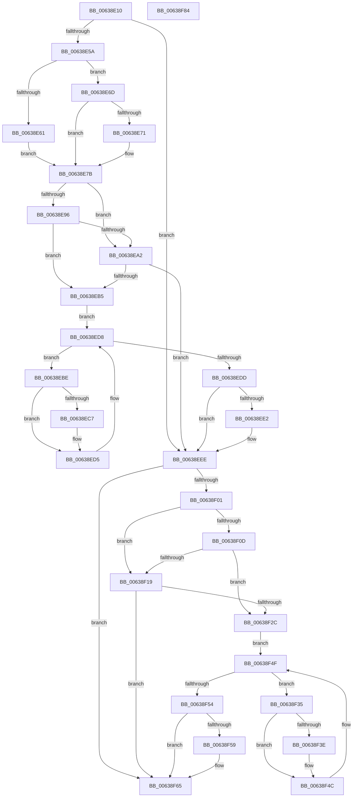

# DifPoFxActivateComponentWrapper

- RVA: `0x00638E10`–`0x00638F85` (길이 `373` bytes)
- VA: `0x0000000140638E10`
- 실행 섹션: `.text`
- PDB 이름 있음: `예`; PDB Function 태그: `아니요`
- unwind 정보 RVA: `0x0008A668`
- 디코드: `102`개 명령, `373/373` bytes 표시
- 미해석 바이트: `0` (있으면 어셈블리에 `.byte`로 보존)

> 이 문서는 커널 이미지의 기계어와 PDB 기호를 분석해 생성했습니다. 4번과 5번은 함수 원형과 자료형을 바이너리 사용 방식에서 추정한 C 해석이며 원본 소스 복구 결과는 아닙니다.

## 1. Dependencies

- 직접 호출 지점: **9**; 고유 호출 대상: **6**
- 직접 호출자로 확인된 함수: **0**
- RIP 상대 이미지 참조: **3**

### Outgoing calls
- `0x00638E49` → [DifGetAPIThunkContextById](../49/DifGetAPIThunkContextById_function_00495A34.md) (function, `0x00495A34`)
- `0x00638E71` → [DifGetReturnAddressForWrappers](../4D/DifGetReturnAddressForWrappers_function_004D3C08.md) (function, `0x004D3C08`)
- `0x00638EA9` → [ExAcquireRundownProtection](../21/ExAcquireRundownProtection_function_00216620.md) (function, `0x00216620`)
- `0x00638ED0` → [guard_dispatch_icall](../6B/guard_dispatch_icall_function_006BAAD0.md) (function, `0x006BAAD0`)
- `0x00638EE9` → [ExReleaseRundownProtection](../34/ExReleaseRundownProtection_function_00349E80.md) (function, `0x00349E80`)
- `0x00638EF7` → [PoFxActivateComponent](../2D/PoFxActivateComponent_function_002D9D30.md) (function, `0x002D9D30`)
- `0x00638F20` → [ExAcquireRundownProtection](../21/ExAcquireRundownProtection_function_00216620.md) (function, `0x00216620`)
- `0x00638F47` → [guard_dispatch_icall](../6B/guard_dispatch_icall_function_006BAAD0.md) (function, `0x006BAAD0`)
- `0x00638F60` → [ExReleaseRundownProtection](../34/ExReleaseRundownProtection_function_00349E80.md) (function, `0x00349E80`)

### Direct callers
- 이 함수 시작 RVA로 연결되는 직접 call은 확인되지 않았습니다. 간접 호출은 완전히 역산할 수 없습니다.

### Static image references
- `0x00638E83` → RVA `0x00F048B8` (`.data`; read)
- `0x00638E96` → RVA `0x00F04980` (`.data`; read)
- `0x00638EA2` → RVA `0x00F03E80` (`.data`; read)

## 2. Other-region calls and transfers

- 다른 실행 섹션으로 향하는 call: **0**
- 별도 외부 분기/꼬리 이동을 확인하지 못했습니다.

## 3. Assembly (complete function range)

```asm
00638E10  4C 8B DC                        mov r11, rsp
00638E13  49 89 5B 08                     mov qword ptr [r11 + 8], rbx
00638E17  49 89 6B 10                     mov qword ptr [r11 + 0x10], rbp
00638E1B  49 89 73 18                     mov qword ptr [r11 + 0x18], rsi
00638E1F  49 89 7B 20                     mov qword ptr [r11 + 0x20], rdi
00638E23  41 54                           push r12
00638E25  41 56                           push r14
00638E27  41 57                           push r15
00638E29  48 83 EC 40                     sub rsp, 0x40
00638E2D  33 C0                           xor eax, eax
00638E2F  0F 57 C0                        xorps xmm0, xmm0
00638E32  0F 11 44 24 20                  movups xmmword ptr [rsp + 0x20], xmm0
00638E37  4C 8B E1                        mov r12, rcx
00638E3A  49 89 43 D8                     mov qword ptr [r11 - 0x28], rax
00638E3E  B9 C1 00 00 00                  mov ecx, 0xc1
00638E43  45 8B F0                        mov r14d, r8d
00638E46  44 8B FA                        mov r15d, edx
00638E49  E8 E6 CB E5 FF                  call 0x140495a34
00638E4E  48 8B F0                        mov rsi, rax
00638E51  48 85 C0                        test rax, rax
00638E54  0F 84 94 00 00 00               je 0x140638eee
00638E5A  8B 40 0C                        mov eax, dword ptr [rax + 0xc]
00638E5D  A8 18                           test al, 0x18
00638E5F  74 0C                           je 0x140638e6d
00638E61  48 8B 4C 24 58                  mov rcx, qword ptr [rsp + 0x58]
00638E66  48 89 4C 24 20                  mov qword ptr [rsp + 0x20], rcx
00638E6B  EB 0E                           jmp 0x140638e7b
00638E6D  A8 04                           test al, 4
00638E6F  74 0A                           je 0x140638e7b
00638E71  E8 92 AD E9 FF                  call 0x1404d3c08
00638E76  48 89 44 24 20                  mov qword ptr [rsp + 0x20], rax
00638E7B  40 32 ED                        xor bpl, bpl
00638E7E  4C 89 64 24 30                  mov qword ptr [rsp + 0x30], r12
00638E83  40 38 2D 2E BA 8C 00            cmp byte ptr [rip + 0x8cba2e], bpl
00638E8A  44 89 7C 24 2C                  mov dword ptr [rsp + 0x2c], r15d
00638E8F  44 89 74 24 28                  mov dword ptr [rsp + 0x28], r14d
00638E94  75 0C                           jne 0x140638ea2
00638E96  F7 05 E0 BA 8C 00 00 08 00 00   test dword ptr [rip + 0x8cbae0], 0x800
00638EA0  74 13                           je 0x140638eb5
00638EA2  48 8D 0D D7 AF 8C 00            lea rcx, [rip + 0x8cafd7]
00638EA9  E8 72 D7 BD FF                  call 0x140216620
00638EAE  40 8A E8                        mov bpl, al
00638EB1  84 C0                           test al, al
00638EB3  74 39                           je 0x140638eee
00638EB5  48 8D 7E 20                     lea rdi, [rsi + 0x20]
00638EB9  48 8B 1F                        mov rbx, qword ptr [rdi]
00638EBC  EB 1A                           jmp 0x140638ed8
00638EBE  48 8D 43 F0                     lea rax, [rbx - 0x10]
00638EC2  48 85 C0                        test rax, rax
00638EC5  74 0E                           je 0x140638ed5
00638EC7  48 8B 40 08                     mov rax, qword ptr [rax + 8]
00638ECB  48 8D 4C 24 20                  lea rcx, [rsp + 0x20]
00638ED0  E8 FB 1B 08 00                  call 0x1406baad0
00638ED5  48 8B 1B                        mov rbx, qword ptr [rbx]
00638ED8  48 3B DF                        cmp rbx, rdi
00638EDB  75 E1                           jne 0x140638ebe
00638EDD  40 84 ED                        test bpl, bpl
00638EE0  74 0C                           je 0x140638eee
00638EE2  48 8D 0D 97 AF 8C 00            lea rcx, [rip + 0x8caf97]
00638EE9  E8 92 0F D1 FF                  call 0x140349e80
00638EEE  45 8B C6                        mov r8d, r14d
00638EF1  41 8B D7                        mov edx, r15d
00638EF4  49 8B CC                        mov rcx, r12
00638EF7  E8 34 0E CA FF                  call 0x1402d9d30
00638EFC  48 85 F6                        test rsi, rsi
00638EFF  74 64                           je 0x140638f65
00638F01  40 32 FF                        xor dil, dil
00638F04  40 38 3D AD B9 8C 00            cmp byte ptr [rip + 0x8cb9ad], dil
00638F0B  75 0C                           jne 0x140638f19
00638F0D  F7 05 69 BA 8C 00 00 08 00 00   test dword ptr [rip + 0x8cba69], 0x800
00638F17  74 13                           je 0x140638f2c
00638F19  48 8D 0D 60 AF 8C 00            lea rcx, [rip + 0x8caf60]
00638F20  E8 FB D6 BD FF                  call 0x140216620
00638F25  40 8A F8                        mov dil, al
00638F28  84 C0                           test al, al
00638F2A  74 39                           je 0x140638f65
00638F2C  48 83 C6 30                     add rsi, 0x30
00638F30  48 8B 1E                        mov rbx, qword ptr [rsi]
00638F33  EB 1A                           jmp 0x140638f4f
00638F35  48 8D 43 F0                     lea rax, [rbx - 0x10]
00638F39  48 85 C0                        test rax, rax
00638F3C  74 0E                           je 0x140638f4c
00638F3E  48 8B 40 08                     mov rax, qword ptr [rax + 8]
00638F42  48 8D 4C 24 20                  lea rcx, [rsp + 0x20]
00638F47  E8 84 1B 08 00                  call 0x1406baad0
00638F4C  48 8B 1B                        mov rbx, qword ptr [rbx]
00638F4F  48 3B DE                        cmp rbx, rsi
00638F52  75 E1                           jne 0x140638f35
00638F54  40 84 FF                        test dil, dil
00638F57  74 0C                           je 0x140638f65
00638F59  48 8D 0D 20 AF 8C 00            lea rcx, [rip + 0x8caf20]
00638F60  E8 1B 0F D1 FF                  call 0x140349e80
00638F65  48 8B 5C 24 60                  mov rbx, qword ptr [rsp + 0x60]
00638F6A  48 8B 6C 24 68                  mov rbp, qword ptr [rsp + 0x68]
00638F6F  48 8B 74 24 70                  mov rsi, qword ptr [rsp + 0x70]
00638F74  48 8B 7C 24 78                  mov rdi, qword ptr [rsp + 0x78]
00638F79  48 83 C4 40                     add rsp, 0x40
00638F7D  41 5F                           pop r15
00638F7F  41 5E                           pop r14
00638F81  41 5C                           pop r12
00638F83  C3                              ret
00638F84  CC                              int3
```

## 4. C-style interpretation (structured pseudocode)

```c
__int64 __fastcall DifPoFxActivateComponentWrapper(__int64 a1, int a2, int a3)
{
    __int64 result;
    __int64 v_rbp;
    __int64 v_rdi;
    __int64 v_rsi;
    __int64 v_rsp;
    unsigned __int64 v_stack_m28;
    unsigned int v_stack_m2C;
    unsigned int v_stack_m30;
    unsigned __int64 v_stack_m38;
    unsigned __int64 v_stack_p0;
    unsigned __int64 v_stack_p10;
    unsigned __int64 v_stack_p18;
    unsigned __int64 v_stack_p20;
    unsigned __int64 v_stack_p8;

    *(unsigned __int64 *)(v_rsp + 8) = v_rbx;
    *(unsigned __int64 *)(v_rsp + 16) = v_rbp;
    *(unsigned __int64 *)(v_rsp + 24) = v_rsi;
    *(unsigned __int64 *)(v_rsp + 32) = v_rdi;
    v_rsp = (v_rsp) - (64);
    result = 0;
    v_stack_m38 = v_xmm0;
    *(unsigned __int64 *)(v_rsp - 40) = 0;
    result = DifGetAPIThunkContextById(193, a2, a3, a4);
    if (result == 0) goto loc_00638EEE;
    if ((((unsigned __int8)((unsigned int)(*(unsigned int *)(result + 12)))) & (24)) == 0) goto loc_00638E6D;
    v_stack_m38 = v_stack_p0;
    goto loc_00638E7B;
loc_00638E6D:
    result = (unsigned int)(*(unsigned int *)(result + 12));
    if ((((unsigned __int8)((unsigned int)(*(unsigned int *)(result + 12)))) & (4)) != 0) {
        result = DifGetReturnAddressForWrappers(v_stack_p0, a2, a3, a4);
        v_stack_m38 = result;
    }
    v_rbp = 0;
    v_stack_m28 = a1;
    v_stack_m2C = (unsigned int)((unsigned int)(a2));
    v_stack_m30 = (unsigned int)((unsigned int)(a3));
    if ((*(unsigned __int8 *)(v_rip + 9222702)) != 0) goto loc_00638EA2;
    if (((*(unsigned int *)(v_rip + 9222880)) & (0x800ULL)) == 0) goto loc_00638EB5;
loc_00638EA2:
    result = ExAcquireRundownProtection(v_rip + 9220055, a2, a3, a4);
    if ((unsigned __int8)(result) == 0) goto loc_00638EEE;
loc_00638EB5:
    goto loc_00638ED8;
loc_00638EBE:
    result = *(unsigned __int64 *)(result + 32) - 16;
    if (*(unsigned __int64 *)(result + 32) - 16 != 0) {
        result = *(unsigned __int64 *)(*(unsigned __int64 *)(result + 32) - 16 + 8);
        a1 = v_stack_m38;
        result = guard_dispatch_icall(a1, a2, a3, a4);
    }
loc_00638ED8:
    if ((*(unsigned __int64 *)(*(unsigned __int64 *)(result + 32))) != (result + 32)) goto loc_00638EBE;
    if ((unsigned __int8)((unsigned __int8)(result)) != 0) {
        a1 = v_rip + 9219991;
        result = ExReleaseRundownProtection(a1, a2, a3, a4);
    }
    result = PoFxActivateComponent(a1, (unsigned int)((unsigned int)((unsigned int)(a2))), (unsigned int)((unsigned int)((unsigned int)(a3))), a4);
    if (result == 0) goto loc_00638F65;
    v_rdi = 0;
    if ((*(unsigned __int8 *)(v_rip + 9222573)) != 0) goto loc_00638F19;
    if (((*(unsigned int *)(v_rip + 9222761)) & (0x800ULL)) == 0) goto loc_00638F2C;
loc_00638F19:
    result = ExAcquireRundownProtection(v_rip + 9219936, (unsigned int)((unsigned int)((unsigned int)(a2))), (unsigned int)((unsigned int)((unsigned int)(a3))), a4);
    if ((unsigned __int8)(result) == 0) goto loc_00638F65;
loc_00638F2C:
    v_rsi = (result) + (48);
    goto loc_00638F4F;
loc_00638F35:
    result = *(unsigned __int64 *)(v_rsi) - 16;
    if (*(unsigned __int64 *)(v_rsi) - 16 != 0) {
        result = *(unsigned __int64 *)(*(unsigned __int64 *)(v_rsi) - 16 + 8);
        a1 = v_stack_m38;
        result = guard_dispatch_icall(a1, (unsigned int)((unsigned int)((unsigned int)(a2))), (unsigned int)((unsigned int)((unsigned int)(a3))), a4);
    }
loc_00638F4F:
    if ((*(unsigned __int64 *)(*(unsigned __int64 *)(v_rsi))) != v_rsi) goto loc_00638F35;
    if ((unsigned __int8)((unsigned __int8)(result)) != 0) {
        a1 = v_rip + 9219872;
        result = ExReleaseRundownProtection(a1, (unsigned int)((unsigned int)((unsigned int)(a2))), (unsigned int)((unsigned int)((unsigned int)(a3))), a4);
    }
    v_rsp = (v_rsp) + (64);
    return result;
}
```

## 5. (Beta) C Style

```c
int64_t DifPoFxActivateComponentWrapper(int64_t Arg1, int32_t Arg2, int32_t Arg3)
{
    int64_t result;
    int64_t local_rbp;
    int64_t local_rdi;
    int64_t local_rsi;
    int64_t local_rsp;
    uint64_t v_stack_m28;
    uint32_t v_stack_m2C;
    uint32_t v_stack_m30;
    uint64_t v_stack_m38;
    uint64_t v_stack_p0;
    uint64_t v_stack_p10;
    uint64_t v_stack_p18;
    uint64_t v_stack_p20;
    uint64_t v_stack_p8;

    *(uint64_t *)(local_rsp + 0x8) = local_rbx;
    *(uint64_t *)(local_rsp + 0x10) = local_rbp;
    *(uint64_t *)(local_rsp + 0x18) = local_rsi;
    *(uint64_t *)(local_rsp + 0x20) = local_rdi;
    local_rsp = (local_rsp) - (64);
    result = 0;
    v_stack_m38 = v_xmm0;
    *(uint64_t *)(local_rsp - 0x28) = 0;
    result = DifGetAPIThunkContextById(193, Arg2, Arg3, a4);
    if (result == 0) goto loc_00638EEE;
    if ((((uint8_t)((uint32_t)(*(uint32_t *)(result + 0xC)))) & (24)) == 0) goto loc_00638E6D;
    v_stack_m38 = v_stack_p0;
    goto loc_00638E7B;
loc_00638E6D:
    result = (uint32_t)(*(uint32_t *)(result + 0xC));
    if ((((uint8_t)((uint32_t)(*(uint32_t *)(result + 0xC)))) & (4)) != 0) {
        result = DifGetReturnAddressForWrappers(v_stack_p0, Arg2, Arg3, a4);
        v_stack_m38 = result;
    }
    local_rbp = 0;
    v_stack_m28 = Arg1;
    v_stack_m2C = (uint32_t)((uint32_t)(Arg2));
    v_stack_m30 = (uint32_t)((uint32_t)(Arg3));
    if ((*(uint8_t *)(v_rip + 0x8CBA2E)) != 0) goto loc_00638EA2;
    if (((*(uint32_t *)(v_rip + 0x8CBAE0)) & (0x800ULL)) == 0) goto loc_00638EB5;
loc_00638EA2:
    result = ExAcquireRundownProtection(v_rip + 9220055, Arg2, Arg3, a4);
    if ((uint8_t)(result) == 0) goto loc_00638EEE;
loc_00638EB5:
    goto loc_00638ED8;
loc_00638EBE:
    result = *(uint64_t *)(result + 0x20) - 16;
    if (*(uint64_t *)(result + 0x20) - 16 != 0) {
        result = *(uint64_t *)(*(uint64_t *)(result + 0x20) - 0x10 + 0x8);
        Arg1 = v_stack_m38;
        result = guard_dispatch_icall(Arg1, Arg2, Arg3, a4);
    }
loc_00638ED8:
    if ((*(uint64_t *)(*(uint64_t *)(result + 0x20))) != (result + 32)) goto loc_00638EBE;
    if ((uint8_t)((uint8_t)(result)) != 0) {
        Arg1 = v_rip + 9219991;
        result = ExReleaseRundownProtection(Arg1, Arg2, Arg3, a4);
    }
    result = PoFxActivateComponent(Arg1, (uint32_t)((uint32_t)((uint32_t)(Arg2))), (uint32_t)((uint32_t)((uint32_t)(Arg3))), a4);
    if (result == 0) goto loc_00638F65;
    local_rdi = 0;
    if ((*(uint8_t *)(v_rip + 0x8CB9AD)) != 0) goto loc_00638F19;
    if (((*(uint32_t *)(v_rip + 0x8CBA69)) & (0x800ULL)) == 0) goto loc_00638F2C;
loc_00638F19:
    result = ExAcquireRundownProtection(v_rip + 9219936, (uint32_t)((uint32_t)((uint32_t)(Arg2))), (uint32_t)((uint32_t)((uint32_t)(Arg3))), a4);
    if ((uint8_t)(result) == 0) goto loc_00638F65;
loc_00638F2C:
    local_rsi = (result) + (48);
    goto loc_00638F4F;
loc_00638F35:
    result = *(uint64_t *)(local_rsi) - 16;
    if (*(uint64_t *)(local_rsi) - 16 != 0) {
        result = *(uint64_t *)(*(uint64_t *)(local_rsi) - 0x10 + 0x8);
        Arg1 = v_stack_m38;
        result = guard_dispatch_icall(Arg1, (uint32_t)((uint32_t)((uint32_t)(Arg2))), (uint32_t)((uint32_t)((uint32_t)(Arg3))), a4);
    }
loc_00638F4F:
    if ((*(uint64_t *)(*(uint64_t *)(local_rsi))) != local_rsi) goto loc_00638F35;
    if ((uint8_t)((uint8_t)(result)) != 0) {
        Arg1 = v_rip + 9219872;
        result = ExReleaseRundownProtection(Arg1, (uint32_t)((uint32_t)((uint32_t)(Arg2))), (uint32_t)((uint32_t)((uint32_t)(Arg3))), a4);
    }
    local_rsp = (local_rsp) + (64);
    return result;
}
```

## 6. Execution-region graph

[열기: 2D/3D 그래프와 함수 탐색 컨트롤 패널](../../../control-panel.html?section=text&rva=0x00638E10&view=graph)

- 2D 그래프는 위에서 아래로 흐르고, 3D 그래프는 빈 공간을 드래그해 회전합니다. Shift+드래그는 이동, 휠은 확대·축소, 함수 노드 선택은 대상 보고서 이동입니다.

### Static fallback


