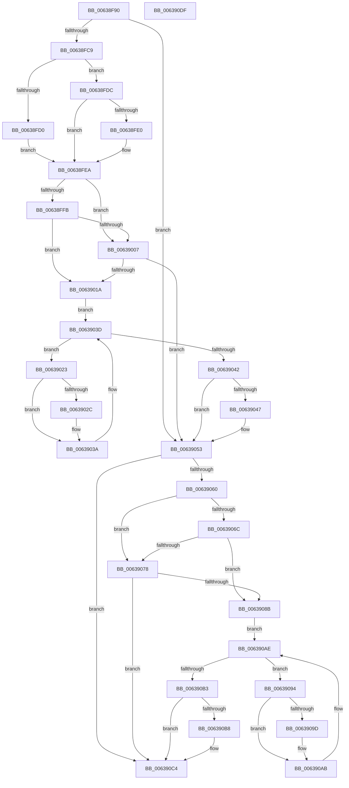

# DifPoFxCompleteDevicePowerNotRequiredWrapper

- RVA: `0x00638F90`–`0x006390E0` (길이 `336` bytes)
- VA: `0x0000000140638F90`
- 실행 섹션: `.text`
- PDB 이름 있음: `예`; PDB Function 태그: `아니요`
- unwind 정보 RVA: `0x0005D7BC`
- 디코드: `90`개 명령, `336/336` bytes 표시
- 미해석 바이트: `0` (있으면 어셈블리에 `.byte`로 보존)

> 이 문서는 커널 이미지의 기계어와 PDB 기호를 분석해 생성했습니다. 4번과 5번은 함수 원형과 자료형을 바이너리 사용 방식에서 추정한 C 해석이며 원본 소스 복구 결과는 아닙니다.

## 1. Dependencies

- 직접 호출 지점: **9**; 고유 호출 대상: **6**
- 직접 호출자로 확인된 함수: **0**
- RIP 상대 이미지 참조: **3**

### Outgoing calls
- `0x00638FB8` → [DifGetAPIThunkContextById](../49/DifGetAPIThunkContextById_function_00495A34.md) (function, `0x00495A34`)
- `0x00638FE0` → [DifGetReturnAddressForWrappers](../4D/DifGetReturnAddressForWrappers_function_004D3C08.md) (function, `0x004D3C08`)
- `0x0063900E` → [ExAcquireRundownProtection](../21/ExAcquireRundownProtection_function_00216620.md) (function, `0x00216620`)
- `0x00639035` → [guard_dispatch_icall](../6B/guard_dispatch_icall_function_006BAAD0.md) (function, `0x006BAAD0`)
- `0x0063904E` → [ExReleaseRundownProtection](../34/ExReleaseRundownProtection_function_00349E80.md) (function, `0x00349E80`)
- `0x00639056` → [PoFxCompleteDevicePowerNotRequired](../4A/PoFxCompleteDevicePowerNotRequired_function_004A3BE0.md) (function, `0x004A3BE0`)
- `0x0063907F` → [ExAcquireRundownProtection](../21/ExAcquireRundownProtection_function_00216620.md) (function, `0x00216620`)
- `0x006390A6` → [guard_dispatch_icall](../6B/guard_dispatch_icall_function_006BAAD0.md) (function, `0x006BAAD0`)
- `0x006390BF` → [ExReleaseRundownProtection](../34/ExReleaseRundownProtection_function_00349E80.md) (function, `0x00349E80`)

### Direct callers
- 이 함수 시작 RVA로 연결되는 직접 call은 확인되지 않았습니다. 간접 호출은 완전히 역산할 수 없습니다.

### Static image references
- `0x00638FF2` → RVA `0x00F048B8` (`.data`; read)
- `0x00638FFB` → RVA `0x00F04980` (`.data`; read)
- `0x00639007` → RVA `0x00F03E80` (`.data`; read)

## 2. Other-region calls and transfers

- 다른 실행 섹션으로 향하는 call: **0**
- 별도 외부 분기/꼬리 이동을 확인하지 못했습니다.

## 3. Assembly (complete function range)

```asm
00638F90  48 8B C4                        mov rax, rsp
00638F93  48 89 58 08                     mov qword ptr [rax + 8], rbx
00638F97  48 89 68 10                     mov qword ptr [rax + 0x10], rbp
00638F9B  48 89 70 18                     mov qword ptr [rax + 0x18], rsi
00638F9F  48 89 78 20                     mov qword ptr [rax + 0x20], rdi
00638FA3  41 56                           push r14
00638FA5  48 83 EC 30                     sub rsp, 0x30
00638FA9  48 8B E9                        mov rbp, rcx
00638FAC  0F 57 C0                        xorps xmm0, xmm0
00638FAF  B9 C0 00 00 00                  mov ecx, 0xc0
00638FB4  0F 11 40 E8                     movups xmmword ptr [rax - 0x18], xmm0
00638FB8  E8 77 CA E5 FF                  call 0x140495a34
00638FBD  48 8B F8                        mov rdi, rax
00638FC0  48 85 C0                        test rax, rax
00638FC3  0F 84 8A 00 00 00               je 0x140639053
00638FC9  8B 40 0C                        mov eax, dword ptr [rax + 0xc]
00638FCC  A8 18                           test al, 0x18
00638FCE  74 0C                           je 0x140638fdc
00638FD0  48 8B 4C 24 38                  mov rcx, qword ptr [rsp + 0x38]
00638FD5  48 89 4C 24 20                  mov qword ptr [rsp + 0x20], rcx
00638FDA  EB 0E                           jmp 0x140638fea
00638FDC  A8 04                           test al, 4
00638FDE  74 0A                           je 0x140638fea
00638FE0  E8 23 AC E9 FF                  call 0x1404d3c08
00638FE5  48 89 44 24 20                  mov qword ptr [rsp + 0x20], rax
00638FEA  40 32 F6                        xor sil, sil
00638FED  48 89 6C 24 28                  mov qword ptr [rsp + 0x28], rbp
00638FF2  40 38 35 BF B8 8C 00            cmp byte ptr [rip + 0x8cb8bf], sil
00638FF9  75 0C                           jne 0x140639007
00638FFB  F7 05 7B B9 8C 00 00 08 00 00   test dword ptr [rip + 0x8cb97b], 0x800
00639005  74 13                           je 0x14063901a
00639007  48 8D 0D 72 AE 8C 00            lea rcx, [rip + 0x8cae72]
0063900E  E8 0D D6 BD FF                  call 0x140216620
00639013  40 8A F0                        mov sil, al
00639016  84 C0                           test al, al
00639018  74 39                           je 0x140639053
0063901A  4C 8D 77 20                     lea r14, [rdi + 0x20]
0063901E  49 8B 1E                        mov rbx, qword ptr [r14]
00639021  EB 1A                           jmp 0x14063903d
00639023  48 8D 43 F0                     lea rax, [rbx - 0x10]
00639027  48 85 C0                        test rax, rax
0063902A  74 0E                           je 0x14063903a
0063902C  48 8B 40 08                     mov rax, qword ptr [rax + 8]
00639030  48 8D 4C 24 20                  lea rcx, [rsp + 0x20]
00639035  E8 96 1A 08 00                  call 0x1406baad0
0063903A  48 8B 1B                        mov rbx, qword ptr [rbx]
0063903D  49 3B DE                        cmp rbx, r14
00639040  75 E1                           jne 0x140639023
00639042  40 84 F6                        test sil, sil
00639045  74 0C                           je 0x140639053
00639047  48 8D 0D 32 AE 8C 00            lea rcx, [rip + 0x8cae32]
0063904E  E8 2D 0E D1 FF                  call 0x140349e80
00639053  48 8B CD                        mov rcx, rbp
00639056  E8 85 AB E6 FF                  call 0x1404a3be0
0063905B  48 85 FF                        test rdi, rdi
0063905E  74 64                           je 0x1406390c4
00639060  40 32 F6                        xor sil, sil
00639063  40 38 35 4E B8 8C 00            cmp byte ptr [rip + 0x8cb84e], sil
0063906A  75 0C                           jne 0x140639078
0063906C  F7 05 0A B9 8C 00 00 08 00 00   test dword ptr [rip + 0x8cb90a], 0x800
00639076  74 13                           je 0x14063908b
00639078  48 8D 0D 01 AE 8C 00            lea rcx, [rip + 0x8cae01]
0063907F  E8 9C D5 BD FF                  call 0x140216620
00639084  40 8A F0                        mov sil, al
00639087  84 C0                           test al, al
00639089  74 39                           je 0x1406390c4
0063908B  48 83 C7 30                     add rdi, 0x30
0063908F  48 8B 1F                        mov rbx, qword ptr [rdi]
00639092  EB 1A                           jmp 0x1406390ae
00639094  48 8D 43 F0                     lea rax, [rbx - 0x10]
00639098  48 85 C0                        test rax, rax
0063909B  74 0E                           je 0x1406390ab
0063909D  48 8B 40 08                     mov rax, qword ptr [rax + 8]
006390A1  48 8D 4C 24 20                  lea rcx, [rsp + 0x20]
006390A6  E8 25 1A 08 00                  call 0x1406baad0
006390AB  48 8B 1B                        mov rbx, qword ptr [rbx]
006390AE  48 3B DF                        cmp rbx, rdi
006390B1  75 E1                           jne 0x140639094
006390B3  40 84 F6                        test sil, sil
006390B6  74 0C                           je 0x1406390c4
006390B8  48 8D 0D C1 AD 8C 00            lea rcx, [rip + 0x8cadc1]
006390BF  E8 BC 0D D1 FF                  call 0x140349e80
006390C4  48 8B 5C 24 40                  mov rbx, qword ptr [rsp + 0x40]
006390C9  48 8B 6C 24 48                  mov rbp, qword ptr [rsp + 0x48]
006390CE  48 8B 74 24 50                  mov rsi, qword ptr [rsp + 0x50]
006390D3  48 8B 7C 24 58                  mov rdi, qword ptr [rsp + 0x58]
006390D8  48 83 C4 30                     add rsp, 0x30
006390DC  41 5E                           pop r14
006390DE  C3                              ret
006390DF  CC                              int3
```

## 4. C-style interpretation (structured pseudocode)

```c
__int64 __fastcall DifPoFxCompleteDevicePowerNotRequiredWrapper(__int64 a1)
{
    __int64 result;
    __int64 v_rdi;
    __int64 v_rsi;
    __int64 v_rsp;
    unsigned __int64 v_stack_m10;
    unsigned __int64 v_stack_m18;
    unsigned __int64 v_stack_p0;
    unsigned __int64 v_stack_p10;
    unsigned __int64 v_stack_p18;
    unsigned __int64 v_stack_p20;
    unsigned __int64 v_stack_p8;

    *(unsigned __int64 *)(v_rsp + 8) = v_rbx;
    *(unsigned __int64 *)(v_rsp + 16) = v_rbp;
    *(unsigned __int64 *)(v_rsp + 24) = v_rsi;
    *(unsigned __int64 *)(v_rsp + 32) = v_rdi;
    v_rsp = (v_rsp) - (48);
    *(unsigned __int64 *)(v_rsp - 24) = v_xmm0;
    result = DifGetAPIThunkContextById(192, a2, a3, a4);
    if (result == 0) goto loc_00639053;
    if ((((unsigned __int8)((unsigned int)(*(unsigned int *)(result + 12)))) & (24)) == 0) goto loc_00638FDC;
    v_stack_m18 = v_stack_p0;
    goto loc_00638FEA;
loc_00638FDC:
    result = (unsigned int)(*(unsigned int *)(result + 12));
    if ((((unsigned __int8)((unsigned int)(*(unsigned int *)(result + 12)))) & (4)) != 0) {
        result = DifGetReturnAddressForWrappers(v_stack_p0, a2, a3, a4);
        v_stack_m18 = result;
    }
    v_rsi = 0;
    v_stack_m10 = a1;
    if ((*(unsigned __int8 *)(v_rip + 9222335)) != 0) goto loc_00639007;
    if (((*(unsigned int *)(v_rip + 9222523)) & (0x800ULL)) == 0) goto loc_0063901A;
loc_00639007:
    result = ExAcquireRundownProtection(v_rip + 9219698, a2, a3, a4);
    if ((unsigned __int8)(result) == 0) goto loc_00639053;
loc_0063901A:
    goto loc_0063903D;
loc_00639023:
    result = *(unsigned __int64 *)(result + 32) - 16;
    if (*(unsigned __int64 *)(result + 32) - 16 != 0) {
        result = *(unsigned __int64 *)(*(unsigned __int64 *)(result + 32) - 16 + 8);
        a1 = v_stack_m18;
        result = guard_dispatch_icall(a1, a2, a3, a4);
    }
loc_0063903D:
    if ((*(unsigned __int64 *)(*(unsigned __int64 *)(result + 32))) != (result + 32)) goto loc_00639023;
    if ((unsigned __int8)((unsigned __int8)(result)) != 0) {
        a1 = v_rip + 9219634;
        result = ExReleaseRundownProtection(a1, a2, a3, a4);
    }
    result = PoFxCompleteDevicePowerNotRequired(a1, a2, a3, a4);
    if (result == 0) goto loc_006390C4;
    v_rsi = 0;
    if ((*(unsigned __int8 *)(v_rip + 9222222)) != 0) goto loc_00639078;
    if (((*(unsigned int *)(v_rip + 9222410)) & (0x800ULL)) == 0) goto loc_0063908B;
loc_00639078:
    result = ExAcquireRundownProtection(v_rip + 9219585, a2, a3, a4);
    if ((unsigned __int8)(result) == 0) goto loc_006390C4;
loc_0063908B:
    v_rdi = (result) + (48);
    goto loc_006390AE;
loc_00639094:
    result = *(unsigned __int64 *)(v_rdi) - 16;
    if (*(unsigned __int64 *)(v_rdi) - 16 != 0) {
        result = *(unsigned __int64 *)(*(unsigned __int64 *)(v_rdi) - 16 + 8);
        a1 = v_stack_m18;
        result = guard_dispatch_icall(a1, a2, a3, a4);
    }
loc_006390AE:
    if ((*(unsigned __int64 *)(*(unsigned __int64 *)(v_rdi))) != v_rdi) goto loc_00639094;
    if ((unsigned __int8)((unsigned __int8)(result)) != 0) {
        a1 = v_rip + 9219521;
        result = ExReleaseRundownProtection(a1, a2, a3, a4);
    }
    v_rsp = (v_rsp) + (48);
    return result;
}
```

## 5. (Beta) C Style

```c
int64_t DifPoFxCompleteDevicePowerNotRequiredWrapper(int64_t Arg1)
{
    int64_t result;
    int64_t local_rdi;
    int64_t local_rsi;
    int64_t local_rsp;
    uint64_t v_stack_m10;
    uint64_t v_stack_m18;
    uint64_t v_stack_p0;
    uint64_t v_stack_p10;
    uint64_t v_stack_p18;
    uint64_t v_stack_p20;
    uint64_t v_stack_p8;

    *(uint64_t *)(local_rsp + 0x8) = local_rbx;
    *(uint64_t *)(local_rsp + 0x10) = local_rbp;
    *(uint64_t *)(local_rsp + 0x18) = local_rsi;
    *(uint64_t *)(local_rsp + 0x20) = local_rdi;
    local_rsp = (local_rsp) - (48);
    *(uint64_t *)(local_rsp - 0x18) = v_xmm0;
    result = DifGetAPIThunkContextById(192, a2, a3, a4);
    if (result == 0) goto loc_00639053;
    if ((((uint8_t)((uint32_t)(*(uint32_t *)(result + 0xC)))) & (24)) == 0) goto loc_00638FDC;
    v_stack_m18 = v_stack_p0;
    goto loc_00638FEA;
loc_00638FDC:
    result = (uint32_t)(*(uint32_t *)(result + 0xC));
    if ((((uint8_t)((uint32_t)(*(uint32_t *)(result + 0xC)))) & (4)) != 0) {
        result = DifGetReturnAddressForWrappers(v_stack_p0, a2, a3, a4);
        v_stack_m18 = result;
    }
    local_rsi = 0;
    v_stack_m10 = Arg1;
    if ((*(uint8_t *)(v_rip + 0x8CB8BF)) != 0) goto loc_00639007;
    if (((*(uint32_t *)(v_rip + 0x8CB97B)) & (0x800ULL)) == 0) goto loc_0063901A;
loc_00639007:
    result = ExAcquireRundownProtection(v_rip + 9219698, a2, a3, a4);
    if ((uint8_t)(result) == 0) goto loc_00639053;
loc_0063901A:
    goto loc_0063903D;
loc_00639023:
    result = *(uint64_t *)(result + 0x20) - 16;
    if (*(uint64_t *)(result + 0x20) - 16 != 0) {
        result = *(uint64_t *)(*(uint64_t *)(result + 0x20) - 0x10 + 0x8);
        Arg1 = v_stack_m18;
        result = guard_dispatch_icall(Arg1, a2, a3, a4);
    }
loc_0063903D:
    if ((*(uint64_t *)(*(uint64_t *)(result + 0x20))) != (result + 32)) goto loc_00639023;
    if ((uint8_t)((uint8_t)(result)) != 0) {
        Arg1 = v_rip + 9219634;
        result = ExReleaseRundownProtection(Arg1, a2, a3, a4);
    }
    result = PoFxCompleteDevicePowerNotRequired(Arg1, a2, a3, a4);
    if (result == 0) goto loc_006390C4;
    local_rsi = 0;
    if ((*(uint8_t *)(v_rip + 0x8CB84E)) != 0) goto loc_00639078;
    if (((*(uint32_t *)(v_rip + 0x8CB90A)) & (0x800ULL)) == 0) goto loc_0063908B;
loc_00639078:
    result = ExAcquireRundownProtection(v_rip + 9219585, a2, a3, a4);
    if ((uint8_t)(result) == 0) goto loc_006390C4;
loc_0063908B:
    local_rdi = (result) + (48);
    goto loc_006390AE;
loc_00639094:
    result = *(uint64_t *)(local_rdi) - 16;
    if (*(uint64_t *)(local_rdi) - 16 != 0) {
        result = *(uint64_t *)(*(uint64_t *)(local_rdi) - 0x10 + 0x8);
        Arg1 = v_stack_m18;
        result = guard_dispatch_icall(Arg1, a2, a3, a4);
    }
loc_006390AE:
    if ((*(uint64_t *)(*(uint64_t *)(local_rdi))) != local_rdi) goto loc_00639094;
    if ((uint8_t)((uint8_t)(result)) != 0) {
        Arg1 = v_rip + 9219521;
        result = ExReleaseRundownProtection(Arg1, a2, a3, a4);
    }
    local_rsp = (local_rsp) + (48);
    return result;
}
```

## 6. Execution-region graph

[열기: 2D/3D 그래프와 함수 탐색 컨트롤 패널](../../../control-panel.html?section=text&rva=0x00638F90&view=graph)

- 2D 그래프는 위에서 아래로 흐르고, 3D 그래프는 빈 공간을 드래그해 회전합니다. Shift+드래그는 이동, 휠은 확대·축소, 함수 노드 선택은 대상 보고서 이동입니다.

### Static fallback


