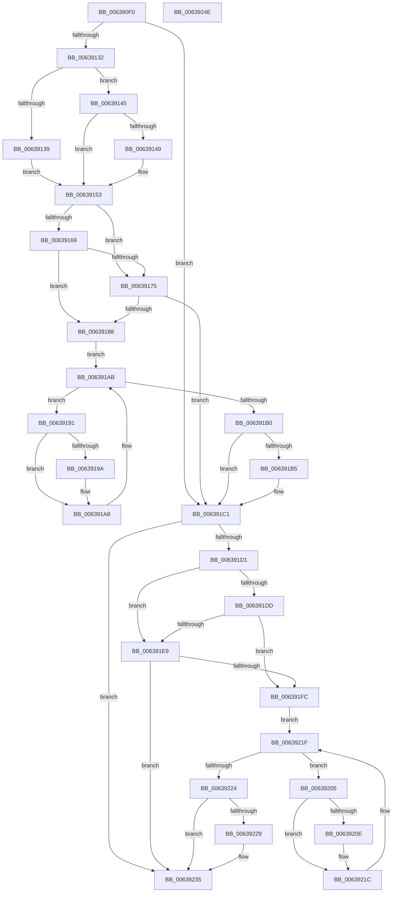

# DifPoFxCompleteIdleConditionWrapper

- RVA: `0x006390F0`–`0x0063924F` (길이 `351` bytes)
- VA: `0x00000001406390F0`
- 실행 섹션: `.text`
- PDB 이름 있음: `예`; PDB Function 태그: `아니요`
- unwind 정보 RVA: `0x00093E28`
- 디코드: `97`개 명령, `351/351` bytes 표시
- 미해석 바이트: `0` (있으면 어셈블리에 `.byte`로 보존)

> 이 문서는 커널 이미지의 기계어와 PDB 기호를 분석해 생성했습니다. 4번과 5번은 함수 원형과 자료형을 바이너리 사용 방식에서 추정한 C 해석이며 원본 소스 복구 결과는 아닙니다.

## 1. Dependencies

- 직접 호출 지점: **9**; 고유 호출 대상: **6**
- 직접 호출자로 확인된 함수: **0**
- RIP 상대 이미지 참조: **3**

### Outgoing calls
- `0x00639121` → [DifGetAPIThunkContextById](../49/DifGetAPIThunkContextById_function_00495A34.md) (function, `0x00495A34`)
- `0x00639149` → [DifGetReturnAddressForWrappers](../4D/DifGetReturnAddressForWrappers_function_004D3C08.md) (function, `0x004D3C08`)
- `0x0063917C` → [ExAcquireRundownProtection](../21/ExAcquireRundownProtection_function_00216620.md) (function, `0x00216620`)
- `0x006391A3` → [guard_dispatch_icall](../6B/guard_dispatch_icall_function_006BAAD0.md) (function, `0x006BAAD0`)
- `0x006391BC` → [ExReleaseRundownProtection](../34/ExReleaseRundownProtection_function_00349E80.md) (function, `0x00349E80`)
- `0x006391C7` → [PoFxCompleteIdleCondition](../46/PoFxCompleteIdleCondition_function_00461CC0.md) (function, `0x00461CC0`)
- `0x006391F0` → [ExAcquireRundownProtection](../21/ExAcquireRundownProtection_function_00216620.md) (function, `0x00216620`)
- `0x00639217` → [guard_dispatch_icall](../6B/guard_dispatch_icall_function_006BAAD0.md) (function, `0x006BAAD0`)
- `0x00639230` → [ExReleaseRundownProtection](../34/ExReleaseRundownProtection_function_00349E80.md) (function, `0x00349E80`)

### Direct callers
- 이 함수 시작 RVA로 연결되는 직접 call은 확인되지 않았습니다. 간접 호출은 완전히 역산할 수 없습니다.

### Static image references
- `0x0063915B` → RVA `0x00F048B8` (`.data`; read)
- `0x00639169` → RVA `0x00F04980` (`.data`; read)
- `0x00639175` → RVA `0x00F03E80` (`.data`; read)

## 2. Other-region calls and transfers

- 다른 실행 섹션으로 향하는 call: **0**
- 별도 외부 분기/꼬리 이동을 확인하지 못했습니다.

## 3. Assembly (complete function range)

```asm
006390F0  4C 8B DC                        mov r11, rsp
006390F3  49 89 5B 08                     mov qword ptr [r11 + 8], rbx
006390F7  49 89 6B 10                     mov qword ptr [r11 + 0x10], rbp
006390FB  49 89 73 18                     mov qword ptr [r11 + 0x18], rsi
006390FF  57                              push rdi
00639100  41 56                           push r14
00639102  41 57                           push r15
00639104  48 83 EC 40                     sub rsp, 0x40
00639108  33 C0                           xor eax, eax
0063910A  0F 57 C0                        xorps xmm0, xmm0
0063910D  0F 11 44 24 20                  movups xmmword ptr [rsp + 0x20], xmm0
00639112  4C 8B F9                        mov r15, rcx
00639115  49 89 43 D8                     mov qword ptr [r11 - 0x28], rax
00639119  B9 BF 00 00 00                  mov ecx, 0xbf
0063911E  44 8B F2                        mov r14d, edx
00639121  E8 0E C9 E5 FF                  call 0x140495a34
00639126  48 8B F0                        mov rsi, rax
00639129  48 85 C0                        test rax, rax
0063912C  0F 84 8F 00 00 00               je 0x1406391c1
00639132  8B 40 0C                        mov eax, dword ptr [rax + 0xc]
00639135  A8 18                           test al, 0x18
00639137  74 0C                           je 0x140639145
00639139  48 8B 4C 24 58                  mov rcx, qword ptr [rsp + 0x58]
0063913E  48 89 4C 24 20                  mov qword ptr [rsp + 0x20], rcx
00639143  EB 0E                           jmp 0x140639153
00639145  A8 04                           test al, 4
00639147  74 0A                           je 0x140639153
00639149  E8 BA AA E9 FF                  call 0x1404d3c08
0063914E  48 89 44 24 20                  mov qword ptr [rsp + 0x20], rax
00639153  40 32 ED                        xor bpl, bpl
00639156  4C 89 7C 24 30                  mov qword ptr [rsp + 0x30], r15
0063915B  40 38 2D 56 B7 8C 00            cmp byte ptr [rip + 0x8cb756], bpl
00639162  44 89 74 24 28                  mov dword ptr [rsp + 0x28], r14d
00639167  75 0C                           jne 0x140639175
00639169  F7 05 0D B8 8C 00 00 08 00 00   test dword ptr [rip + 0x8cb80d], 0x800
00639173  74 13                           je 0x140639188
00639175  48 8D 0D 04 AD 8C 00            lea rcx, [rip + 0x8cad04]
0063917C  E8 9F D4 BD FF                  call 0x140216620
00639181  40 8A E8                        mov bpl, al
00639184  84 C0                           test al, al
00639186  74 39                           je 0x1406391c1
00639188  48 8D 7E 20                     lea rdi, [rsi + 0x20]
0063918C  48 8B 1F                        mov rbx, qword ptr [rdi]
0063918F  EB 1A                           jmp 0x1406391ab
00639191  48 8D 43 F0                     lea rax, [rbx - 0x10]
00639195  48 85 C0                        test rax, rax
00639198  74 0E                           je 0x1406391a8
0063919A  48 8B 40 08                     mov rax, qword ptr [rax + 8]
0063919E  48 8D 4C 24 20                  lea rcx, [rsp + 0x20]
006391A3  E8 28 19 08 00                  call 0x1406baad0
006391A8  48 8B 1B                        mov rbx, qword ptr [rbx]
006391AB  48 3B DF                        cmp rbx, rdi
006391AE  75 E1                           jne 0x140639191
006391B0  40 84 ED                        test bpl, bpl
006391B3  74 0C                           je 0x1406391c1
006391B5  48 8D 0D C4 AC 8C 00            lea rcx, [rip + 0x8cacc4]
006391BC  E8 BF 0C D1 FF                  call 0x140349e80
006391C1  41 8B D6                        mov edx, r14d
006391C4  49 8B CF                        mov rcx, r15
006391C7  E8 F4 8A E2 FF                  call 0x140461cc0
006391CC  48 85 F6                        test rsi, rsi
006391CF  74 64                           je 0x140639235
006391D1  40 32 FF                        xor dil, dil
006391D4  40 38 3D DD B6 8C 00            cmp byte ptr [rip + 0x8cb6dd], dil
006391DB  75 0C                           jne 0x1406391e9
006391DD  F7 05 99 B7 8C 00 00 08 00 00   test dword ptr [rip + 0x8cb799], 0x800
006391E7  74 13                           je 0x1406391fc
006391E9  48 8D 0D 90 AC 8C 00            lea rcx, [rip + 0x8cac90]
006391F0  E8 2B D4 BD FF                  call 0x140216620
006391F5  40 8A F8                        mov dil, al
006391F8  84 C0                           test al, al
006391FA  74 39                           je 0x140639235
006391FC  48 83 C6 30                     add rsi, 0x30
00639200  48 8B 1E                        mov rbx, qword ptr [rsi]
00639203  EB 1A                           jmp 0x14063921f
00639205  48 8D 43 F0                     lea rax, [rbx - 0x10]
00639209  48 85 C0                        test rax, rax
0063920C  74 0E                           je 0x14063921c
0063920E  48 8B 40 08                     mov rax, qword ptr [rax + 8]
00639212  48 8D 4C 24 20                  lea rcx, [rsp + 0x20]
00639217  E8 B4 18 08 00                  call 0x1406baad0
0063921C  48 8B 1B                        mov rbx, qword ptr [rbx]
0063921F  48 3B DE                        cmp rbx, rsi
00639222  75 E1                           jne 0x140639205
00639224  40 84 FF                        test dil, dil
00639227  74 0C                           je 0x140639235
00639229  48 8D 0D 50 AC 8C 00            lea rcx, [rip + 0x8cac50]
00639230  E8 4B 0C D1 FF                  call 0x140349e80
00639235  48 8B 5C 24 60                  mov rbx, qword ptr [rsp + 0x60]
0063923A  48 8B 6C 24 68                  mov rbp, qword ptr [rsp + 0x68]
0063923F  48 8B 74 24 70                  mov rsi, qword ptr [rsp + 0x70]
00639244  48 83 C4 40                     add rsp, 0x40
00639248  41 5F                           pop r15
0063924A  41 5E                           pop r14
0063924C  5F                              pop rdi
0063924D  C3                              ret
0063924E  CC                              int3
```

## 4. C-style interpretation (structured pseudocode)

```c
__int64 __fastcall DifPoFxCompleteIdleConditionWrapper(__int64 a1, int a2)
{
    __int64 result;
    __int64 v_rbp;
    __int64 v_rdi;
    __int64 v_rsi;
    __int64 v_rsp;
    unsigned __int64 v_stack_m28;
    unsigned int v_stack_m30;
    unsigned __int64 v_stack_m38;
    unsigned __int64 v_stack_p0;
    unsigned __int64 v_stack_p10;
    unsigned __int64 v_stack_p18;
    unsigned __int64 v_stack_p8;

    *(unsigned __int64 *)(v_rsp + 8) = v_rbx;
    *(unsigned __int64 *)(v_rsp + 16) = v_rbp;
    *(unsigned __int64 *)(v_rsp + 24) = v_rsi;
    v_rsp = (v_rsp) - (64);
    result = 0;
    v_stack_m38 = v_xmm0;
    *(unsigned __int64 *)(v_rsp - 40) = 0;
    result = DifGetAPIThunkContextById(191, a2, a3, a4);
    if (result == 0) goto loc_006391C1;
    if ((((unsigned __int8)((unsigned int)(*(unsigned int *)(result + 12)))) & (24)) == 0) goto loc_00639145;
    v_stack_m38 = v_stack_p0;
    goto loc_00639153;
loc_00639145:
    result = (unsigned int)(*(unsigned int *)(result + 12));
    if ((((unsigned __int8)((unsigned int)(*(unsigned int *)(result + 12)))) & (4)) != 0) {
        result = DifGetReturnAddressForWrappers(v_stack_p0, a2, a3, a4);
        v_stack_m38 = result;
    }
    v_rbp = 0;
    v_stack_m28 = a1;
    v_stack_m30 = (unsigned int)((unsigned int)(a2));
    if ((*(unsigned __int8 *)(v_rip + 9221974)) != 0) goto loc_00639175;
    if (((*(unsigned int *)(v_rip + 9222157)) & (0x800ULL)) == 0) goto loc_00639188;
loc_00639175:
    result = ExAcquireRundownProtection(v_rip + 9219332, a2, a3, a4);
    if ((unsigned __int8)(result) == 0) goto loc_006391C1;
loc_00639188:
    goto loc_006391AB;
loc_00639191:
    result = *(unsigned __int64 *)(result + 32) - 16;
    if (*(unsigned __int64 *)(result + 32) - 16 != 0) {
        result = *(unsigned __int64 *)(*(unsigned __int64 *)(result + 32) - 16 + 8);
        a1 = v_stack_m38;
        result = guard_dispatch_icall(a1, a2, a3, a4);
    }
loc_006391AB:
    if ((*(unsigned __int64 *)(*(unsigned __int64 *)(result + 32))) != (result + 32)) goto loc_00639191;
    if ((unsigned __int8)((unsigned __int8)(result)) != 0) {
        a1 = v_rip + 9219268;
        result = ExReleaseRundownProtection(a1, a2, a3, a4);
    }
    result = PoFxCompleteIdleCondition(a1, (unsigned int)((unsigned int)((unsigned int)(a2))), a3, a4);
    if (result == 0) goto loc_00639235;
    v_rdi = 0;
    if ((*(unsigned __int8 *)(v_rip + 9221853)) != 0) goto loc_006391E9;
    if (((*(unsigned int *)(v_rip + 9222041)) & (0x800ULL)) == 0) goto loc_006391FC;
loc_006391E9:
    result = ExAcquireRundownProtection(v_rip + 9219216, (unsigned int)((unsigned int)((unsigned int)(a2))), a3, a4);
    if ((unsigned __int8)(result) == 0) goto loc_00639235;
loc_006391FC:
    v_rsi = (result) + (48);
    goto loc_0063921F;
loc_00639205:
    result = *(unsigned __int64 *)(v_rsi) - 16;
    if (*(unsigned __int64 *)(v_rsi) - 16 != 0) {
        result = *(unsigned __int64 *)(*(unsigned __int64 *)(v_rsi) - 16 + 8);
        a1 = v_stack_m38;
        result = guard_dispatch_icall(a1, (unsigned int)((unsigned int)((unsigned int)(a2))), a3, a4);
    }
loc_0063921F:
    if ((*(unsigned __int64 *)(*(unsigned __int64 *)(v_rsi))) != v_rsi) goto loc_00639205;
    if ((unsigned __int8)((unsigned __int8)(result)) != 0) {
        a1 = v_rip + 9219152;
        result = ExReleaseRundownProtection(a1, (unsigned int)((unsigned int)((unsigned int)(a2))), a3, a4);
    }
    v_rsp = (v_rsp) + (64);
    return result;
}
```

## 5. (Beta) C Style

```c
int64_t DifPoFxCompleteIdleConditionWrapper(int64_t Arg1, int32_t Arg2)
{
    int64_t result;
    int64_t local_rbp;
    int64_t local_rdi;
    int64_t local_rsi;
    int64_t local_rsp;
    uint64_t v_stack_m28;
    uint32_t v_stack_m30;
    uint64_t v_stack_m38;
    uint64_t v_stack_p0;
    uint64_t v_stack_p10;
    uint64_t v_stack_p18;
    uint64_t v_stack_p8;

    *(uint64_t *)(local_rsp + 0x8) = local_rbx;
    *(uint64_t *)(local_rsp + 0x10) = local_rbp;
    *(uint64_t *)(local_rsp + 0x18) = local_rsi;
    local_rsp = (local_rsp) - (64);
    result = 0;
    v_stack_m38 = v_xmm0;
    *(uint64_t *)(local_rsp - 0x28) = 0;
    result = DifGetAPIThunkContextById(191, Arg2, a3, a4);
    if (result == 0) goto loc_006391C1;
    if ((((uint8_t)((uint32_t)(*(uint32_t *)(result + 0xC)))) & (24)) == 0) goto loc_00639145;
    v_stack_m38 = v_stack_p0;
    goto loc_00639153;
loc_00639145:
    result = (uint32_t)(*(uint32_t *)(result + 0xC));
    if ((((uint8_t)((uint32_t)(*(uint32_t *)(result + 0xC)))) & (4)) != 0) {
        result = DifGetReturnAddressForWrappers(v_stack_p0, Arg2, a3, a4);
        v_stack_m38 = result;
    }
    local_rbp = 0;
    v_stack_m28 = Arg1;
    v_stack_m30 = (uint32_t)((uint32_t)(Arg2));
    if ((*(uint8_t *)(v_rip + 0x8CB756)) != 0) goto loc_00639175;
    if (((*(uint32_t *)(v_rip + 0x8CB80D)) & (0x800ULL)) == 0) goto loc_00639188;
loc_00639175:
    result = ExAcquireRundownProtection(v_rip + 9219332, Arg2, a3, a4);
    if ((uint8_t)(result) == 0) goto loc_006391C1;
loc_00639188:
    goto loc_006391AB;
loc_00639191:
    result = *(uint64_t *)(result + 0x20) - 16;
    if (*(uint64_t *)(result + 0x20) - 16 != 0) {
        result = *(uint64_t *)(*(uint64_t *)(result + 0x20) - 0x10 + 0x8);
        Arg1 = v_stack_m38;
        result = guard_dispatch_icall(Arg1, Arg2, a3, a4);
    }
loc_006391AB:
    if ((*(uint64_t *)(*(uint64_t *)(result + 0x20))) != (result + 32)) goto loc_00639191;
    if ((uint8_t)((uint8_t)(result)) != 0) {
        Arg1 = v_rip + 9219268;
        result = ExReleaseRundownProtection(Arg1, Arg2, a3, a4);
    }
    result = PoFxCompleteIdleCondition(Arg1, (uint32_t)((uint32_t)((uint32_t)(Arg2))), a3, a4);
    if (result == 0) goto loc_00639235;
    local_rdi = 0;
    if ((*(uint8_t *)(v_rip + 0x8CB6DD)) != 0) goto loc_006391E9;
    if (((*(uint32_t *)(v_rip + 0x8CB799)) & (0x800ULL)) == 0) goto loc_006391FC;
loc_006391E9:
    result = ExAcquireRundownProtection(v_rip + 9219216, (uint32_t)((uint32_t)((uint32_t)(Arg2))), a3, a4);
    if ((uint8_t)(result) == 0) goto loc_00639235;
loc_006391FC:
    local_rsi = (result) + (48);
    goto loc_0063921F;
loc_00639205:
    result = *(uint64_t *)(local_rsi) - 16;
    if (*(uint64_t *)(local_rsi) - 16 != 0) {
        result = *(uint64_t *)(*(uint64_t *)(local_rsi) - 0x10 + 0x8);
        Arg1 = v_stack_m38;
        result = guard_dispatch_icall(Arg1, (uint32_t)((uint32_t)((uint32_t)(Arg2))), a3, a4);
    }
loc_0063921F:
    if ((*(uint64_t *)(*(uint64_t *)(local_rsi))) != local_rsi) goto loc_00639205;
    if ((uint8_t)((uint8_t)(result)) != 0) {
        Arg1 = v_rip + 9219152;
        result = ExReleaseRundownProtection(Arg1, (uint32_t)((uint32_t)((uint32_t)(Arg2))), a3, a4);
    }
    local_rsp = (local_rsp) + (64);
    return result;
}
```

## 6. Execution-region graph

[열기: 2D/3D 그래프와 함수 탐색 컨트롤 패널](../../../control-panel.html?section=text&rva=0x006390F0&view=graph)

- 2D 그래프는 위에서 아래로 흐르고, 3D 그래프는 빈 공간을 드래그해 회전합니다. Shift+드래그는 이동, 휠은 확대·축소, 함수 노드 선택은 대상 보고서 이동입니다.

### Static fallback


