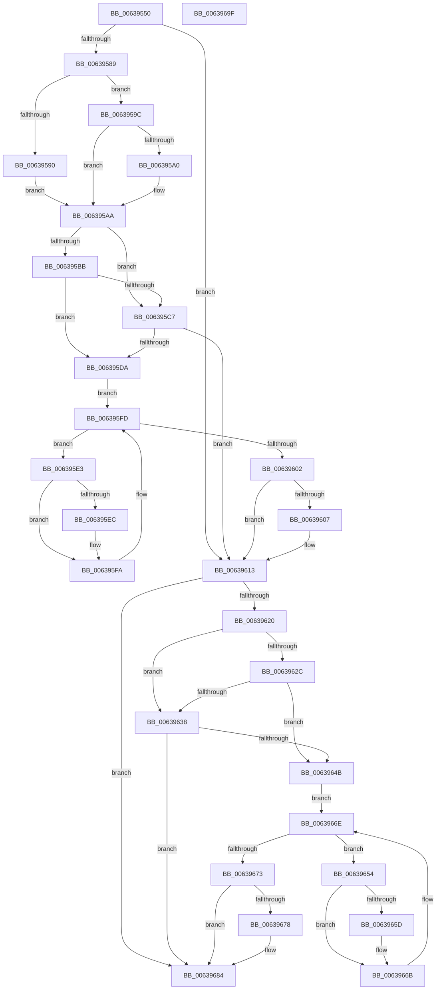

# DifPoFxNotifySurprisePowerOnWrapper

- RVA: `0x00639550`–`0x006396A0` (길이 `336` bytes)
- VA: `0x0000000140639550`
- 실행 섹션: `.text`
- PDB 이름 있음: `예`; PDB Function 태그: `아니요`
- unwind 정보 RVA: `0x0005D7BC`
- 디코드: `90`개 명령, `336/336` bytes 표시
- 미해석 바이트: `0` (있으면 어셈블리에 `.byte`로 보존)

> 이 문서는 커널 이미지의 기계어와 PDB 기호를 분석해 생성했습니다. 4번과 5번은 함수 원형과 자료형을 바이너리 사용 방식에서 추정한 C 해석이며 원본 소스 복구 결과는 아닙니다.

## 1. Dependencies

- 직접 호출 지점: **9**; 고유 호출 대상: **6**
- 직접 호출자로 확인된 함수: **0**
- RIP 상대 이미지 참조: **3**

### Outgoing calls
- `0x00639578` → [DifGetAPIThunkContextById](../49/DifGetAPIThunkContextById_function_00495A34.md) (function, `0x00495A34`)
- `0x006395A0` → [DifGetReturnAddressForWrappers](../4D/DifGetReturnAddressForWrappers_function_004D3C08.md) (function, `0x004D3C08`)
- `0x006395CE` → [ExAcquireRundownProtection](../21/ExAcquireRundownProtection_function_00216620.md) (function, `0x00216620`)
- `0x006395F5` → [guard_dispatch_icall](../6B/guard_dispatch_icall_function_006BAAD0.md) (function, `0x006BAAD0`)
- `0x0063960E` → [ExReleaseRundownProtection](../34/ExReleaseRundownProtection_function_00349E80.md) (function, `0x00349E80`)
- `0x00639616` → [PoFxNotifySurprisePowerOn](../26/PoFxNotifySurprisePowerOn_function_0026E620.md) (function, `0x0026E620`)
- `0x0063963F` → [ExAcquireRundownProtection](../21/ExAcquireRundownProtection_function_00216620.md) (function, `0x00216620`)
- `0x00639666` → [guard_dispatch_icall](../6B/guard_dispatch_icall_function_006BAAD0.md) (function, `0x006BAAD0`)
- `0x0063967F` → [ExReleaseRundownProtection](../34/ExReleaseRundownProtection_function_00349E80.md) (function, `0x00349E80`)

### Direct callers
- 이 함수 시작 RVA로 연결되는 직접 call은 확인되지 않았습니다. 간접 호출은 완전히 역산할 수 없습니다.

### Static image references
- `0x006395B2` → RVA `0x00F048B8` (`.data`; read)
- `0x006395BB` → RVA `0x00F04980` (`.data`; read)
- `0x006395C7` → RVA `0x00F03E80` (`.data`; read)

## 2. Other-region calls and transfers

- 다른 실행 섹션으로 향하는 call: **0**
- 별도 외부 분기/꼬리 이동을 확인하지 못했습니다.

## 3. Assembly (complete function range)

```asm
00639550  48 8B C4                        mov rax, rsp
00639553  48 89 58 08                     mov qword ptr [rax + 8], rbx
00639557  48 89 68 10                     mov qword ptr [rax + 0x10], rbp
0063955B  48 89 70 18                     mov qword ptr [rax + 0x18], rsi
0063955F  48 89 78 20                     mov qword ptr [rax + 0x20], rdi
00639563  41 56                           push r14
00639565  48 83 EC 30                     sub rsp, 0x30
00639569  48 8B E9                        mov rbp, rcx
0063956C  0F 57 C0                        xorps xmm0, xmm0
0063956F  B9 BC 00 00 00                  mov ecx, 0xbc
00639574  0F 11 40 E8                     movups xmmword ptr [rax - 0x18], xmm0
00639578  E8 B7 C4 E5 FF                  call 0x140495a34
0063957D  48 8B F8                        mov rdi, rax
00639580  48 85 C0                        test rax, rax
00639583  0F 84 8A 00 00 00               je 0x140639613
00639589  8B 40 0C                        mov eax, dword ptr [rax + 0xc]
0063958C  A8 18                           test al, 0x18
0063958E  74 0C                           je 0x14063959c
00639590  48 8B 4C 24 38                  mov rcx, qword ptr [rsp + 0x38]
00639595  48 89 4C 24 20                  mov qword ptr [rsp + 0x20], rcx
0063959A  EB 0E                           jmp 0x1406395aa
0063959C  A8 04                           test al, 4
0063959E  74 0A                           je 0x1406395aa
006395A0  E8 63 A6 E9 FF                  call 0x1404d3c08
006395A5  48 89 44 24 20                  mov qword ptr [rsp + 0x20], rax
006395AA  40 32 F6                        xor sil, sil
006395AD  48 89 6C 24 28                  mov qword ptr [rsp + 0x28], rbp
006395B2  40 38 35 FF B2 8C 00            cmp byte ptr [rip + 0x8cb2ff], sil
006395B9  75 0C                           jne 0x1406395c7
006395BB  F7 05 BB B3 8C 00 00 08 00 00   test dword ptr [rip + 0x8cb3bb], 0x800
006395C5  74 13                           je 0x1406395da
006395C7  48 8D 0D B2 A8 8C 00            lea rcx, [rip + 0x8ca8b2]
006395CE  E8 4D D0 BD FF                  call 0x140216620
006395D3  40 8A F0                        mov sil, al
006395D6  84 C0                           test al, al
006395D8  74 39                           je 0x140639613
006395DA  4C 8D 77 20                     lea r14, [rdi + 0x20]
006395DE  49 8B 1E                        mov rbx, qword ptr [r14]
006395E1  EB 1A                           jmp 0x1406395fd
006395E3  48 8D 43 F0                     lea rax, [rbx - 0x10]
006395E7  48 85 C0                        test rax, rax
006395EA  74 0E                           je 0x1406395fa
006395EC  48 8B 40 08                     mov rax, qword ptr [rax + 8]
006395F0  48 8D 4C 24 20                  lea rcx, [rsp + 0x20]
006395F5  E8 D6 14 08 00                  call 0x1406baad0
006395FA  48 8B 1B                        mov rbx, qword ptr [rbx]
006395FD  49 3B DE                        cmp rbx, r14
00639600  75 E1                           jne 0x1406395e3
00639602  40 84 F6                        test sil, sil
00639605  74 0C                           je 0x140639613
00639607  48 8D 0D 72 A8 8C 00            lea rcx, [rip + 0x8ca872]
0063960E  E8 6D 08 D1 FF                  call 0x140349e80
00639613  48 8B CD                        mov rcx, rbp
00639616  E8 05 50 C3 FF                  call 0x14026e620
0063961B  48 85 FF                        test rdi, rdi
0063961E  74 64                           je 0x140639684
00639620  40 32 F6                        xor sil, sil
00639623  40 38 35 8E B2 8C 00            cmp byte ptr [rip + 0x8cb28e], sil
0063962A  75 0C                           jne 0x140639638
0063962C  F7 05 4A B3 8C 00 00 08 00 00   test dword ptr [rip + 0x8cb34a], 0x800
00639636  74 13                           je 0x14063964b
00639638  48 8D 0D 41 A8 8C 00            lea rcx, [rip + 0x8ca841]
0063963F  E8 DC CF BD FF                  call 0x140216620
00639644  40 8A F0                        mov sil, al
00639647  84 C0                           test al, al
00639649  74 39                           je 0x140639684
0063964B  48 83 C7 30                     add rdi, 0x30
0063964F  48 8B 1F                        mov rbx, qword ptr [rdi]
00639652  EB 1A                           jmp 0x14063966e
00639654  48 8D 43 F0                     lea rax, [rbx - 0x10]
00639658  48 85 C0                        test rax, rax
0063965B  74 0E                           je 0x14063966b
0063965D  48 8B 40 08                     mov rax, qword ptr [rax + 8]
00639661  48 8D 4C 24 20                  lea rcx, [rsp + 0x20]
00639666  E8 65 14 08 00                  call 0x1406baad0
0063966B  48 8B 1B                        mov rbx, qword ptr [rbx]
0063966E  48 3B DF                        cmp rbx, rdi
00639671  75 E1                           jne 0x140639654
00639673  40 84 F6                        test sil, sil
00639676  74 0C                           je 0x140639684
00639678  48 8D 0D 01 A8 8C 00            lea rcx, [rip + 0x8ca801]
0063967F  E8 FC 07 D1 FF                  call 0x140349e80
00639684  48 8B 5C 24 40                  mov rbx, qword ptr [rsp + 0x40]
00639689  48 8B 6C 24 48                  mov rbp, qword ptr [rsp + 0x48]
0063968E  48 8B 74 24 50                  mov rsi, qword ptr [rsp + 0x50]
00639693  48 8B 7C 24 58                  mov rdi, qword ptr [rsp + 0x58]
00639698  48 83 C4 30                     add rsp, 0x30
0063969C  41 5E                           pop r14
0063969E  C3                              ret
0063969F  CC                              int3
```

## 4. C-style interpretation (structured pseudocode)

```c
__int64 __fastcall DifPoFxNotifySurprisePowerOnWrapper(__int64 a1)
{
    __int64 result;
    __int64 v_rdi;
    __int64 v_rsi;
    __int64 v_rsp;
    unsigned __int64 v_stack_m10;
    unsigned __int64 v_stack_m18;
    unsigned __int64 v_stack_p0;
    unsigned __int64 v_stack_p10;
    unsigned __int64 v_stack_p18;
    unsigned __int64 v_stack_p20;
    unsigned __int64 v_stack_p8;

    *(unsigned __int64 *)(v_rsp + 8) = v_rbx;
    *(unsigned __int64 *)(v_rsp + 16) = v_rbp;
    *(unsigned __int64 *)(v_rsp + 24) = v_rsi;
    *(unsigned __int64 *)(v_rsp + 32) = v_rdi;
    v_rsp = (v_rsp) - (48);
    *(unsigned __int64 *)(v_rsp - 24) = v_xmm0;
    result = DifGetAPIThunkContextById(188, a2, a3, a4);
    if (result == 0) goto loc_00639613;
    if ((((unsigned __int8)((unsigned int)(*(unsigned int *)(result + 12)))) & (24)) == 0) goto loc_0063959C;
    v_stack_m18 = v_stack_p0;
    goto loc_006395AA;
loc_0063959C:
    result = (unsigned int)(*(unsigned int *)(result + 12));
    if ((((unsigned __int8)((unsigned int)(*(unsigned int *)(result + 12)))) & (4)) != 0) {
        result = DifGetReturnAddressForWrappers(v_stack_p0, a2, a3, a4);
        v_stack_m18 = result;
    }
    v_rsi = 0;
    v_stack_m10 = a1;
    if ((*(unsigned __int8 *)(v_rip + 9220863)) != 0) goto loc_006395C7;
    if (((*(unsigned int *)(v_rip + 9221051)) & (0x800ULL)) == 0) goto loc_006395DA;
loc_006395C7:
    result = ExAcquireRundownProtection(v_rip + 9218226, a2, a3, a4);
    if ((unsigned __int8)(result) == 0) goto loc_00639613;
loc_006395DA:
    goto loc_006395FD;
loc_006395E3:
    result = *(unsigned __int64 *)(result + 32) - 16;
    if (*(unsigned __int64 *)(result + 32) - 16 != 0) {
        result = *(unsigned __int64 *)(*(unsigned __int64 *)(result + 32) - 16 + 8);
        a1 = v_stack_m18;
        result = guard_dispatch_icall(a1, a2, a3, a4);
    }
loc_006395FD:
    if ((*(unsigned __int64 *)(*(unsigned __int64 *)(result + 32))) != (result + 32)) goto loc_006395E3;
    if ((unsigned __int8)((unsigned __int8)(result)) != 0) {
        a1 = v_rip + 9218162;
        result = ExReleaseRundownProtection(a1, a2, a3, a4);
    }
    result = PoFxNotifySurprisePowerOn(a1, a2, a3, a4);
    if (result == 0) goto loc_00639684;
    v_rsi = 0;
    if ((*(unsigned __int8 *)(v_rip + 9220750)) != 0) goto loc_00639638;
    if (((*(unsigned int *)(v_rip + 9220938)) & (0x800ULL)) == 0) goto loc_0063964B;
loc_00639638:
    result = ExAcquireRundownProtection(v_rip + 9218113, a2, a3, a4);
    if ((unsigned __int8)(result) == 0) goto loc_00639684;
loc_0063964B:
    v_rdi = (result) + (48);
    goto loc_0063966E;
loc_00639654:
    result = *(unsigned __int64 *)(v_rdi) - 16;
    if (*(unsigned __int64 *)(v_rdi) - 16 != 0) {
        result = *(unsigned __int64 *)(*(unsigned __int64 *)(v_rdi) - 16 + 8);
        a1 = v_stack_m18;
        result = guard_dispatch_icall(a1, a2, a3, a4);
    }
loc_0063966E:
    if ((*(unsigned __int64 *)(*(unsigned __int64 *)(v_rdi))) != v_rdi) goto loc_00639654;
    if ((unsigned __int8)((unsigned __int8)(result)) != 0) {
        a1 = v_rip + 9218049;
        result = ExReleaseRundownProtection(a1, a2, a3, a4);
    }
    v_rsp = (v_rsp) + (48);
    return result;
}
```

## 5. (Beta) C Style

```c
int64_t DifPoFxNotifySurprisePowerOnWrapper(int64_t Arg1)
{
    int64_t result;
    int64_t local_rdi;
    int64_t local_rsi;
    int64_t local_rsp;
    uint64_t v_stack_m10;
    uint64_t v_stack_m18;
    uint64_t v_stack_p0;
    uint64_t v_stack_p10;
    uint64_t v_stack_p18;
    uint64_t v_stack_p20;
    uint64_t v_stack_p8;

    *(uint64_t *)(local_rsp + 0x8) = local_rbx;
    *(uint64_t *)(local_rsp + 0x10) = local_rbp;
    *(uint64_t *)(local_rsp + 0x18) = local_rsi;
    *(uint64_t *)(local_rsp + 0x20) = local_rdi;
    local_rsp = (local_rsp) - (48);
    *(uint64_t *)(local_rsp - 0x18) = v_xmm0;
    result = DifGetAPIThunkContextById(188, a2, a3, a4);
    if (result == 0) goto loc_00639613;
    if ((((uint8_t)((uint32_t)(*(uint32_t *)(result + 0xC)))) & (24)) == 0) goto loc_0063959C;
    v_stack_m18 = v_stack_p0;
    goto loc_006395AA;
loc_0063959C:
    result = (uint32_t)(*(uint32_t *)(result + 0xC));
    if ((((uint8_t)((uint32_t)(*(uint32_t *)(result + 0xC)))) & (4)) != 0) {
        result = DifGetReturnAddressForWrappers(v_stack_p0, a2, a3, a4);
        v_stack_m18 = result;
    }
    local_rsi = 0;
    v_stack_m10 = Arg1;
    if ((*(uint8_t *)(v_rip + 0x8CB2FF)) != 0) goto loc_006395C7;
    if (((*(uint32_t *)(v_rip + 0x8CB3BB)) & (0x800ULL)) == 0) goto loc_006395DA;
loc_006395C7:
    result = ExAcquireRundownProtection(v_rip + 9218226, a2, a3, a4);
    if ((uint8_t)(result) == 0) goto loc_00639613;
loc_006395DA:
    goto loc_006395FD;
loc_006395E3:
    result = *(uint64_t *)(result + 0x20) - 16;
    if (*(uint64_t *)(result + 0x20) - 16 != 0) {
        result = *(uint64_t *)(*(uint64_t *)(result + 0x20) - 0x10 + 0x8);
        Arg1 = v_stack_m18;
        result = guard_dispatch_icall(Arg1, a2, a3, a4);
    }
loc_006395FD:
    if ((*(uint64_t *)(*(uint64_t *)(result + 0x20))) != (result + 32)) goto loc_006395E3;
    if ((uint8_t)((uint8_t)(result)) != 0) {
        Arg1 = v_rip + 9218162;
        result = ExReleaseRundownProtection(Arg1, a2, a3, a4);
    }
    result = PoFxNotifySurprisePowerOn(Arg1, a2, a3, a4);
    if (result == 0) goto loc_00639684;
    local_rsi = 0;
    if ((*(uint8_t *)(v_rip + 0x8CB28E)) != 0) goto loc_00639638;
    if (((*(uint32_t *)(v_rip + 0x8CB34A)) & (0x800ULL)) == 0) goto loc_0063964B;
loc_00639638:
    result = ExAcquireRundownProtection(v_rip + 9218113, a2, a3, a4);
    if ((uint8_t)(result) == 0) goto loc_00639684;
loc_0063964B:
    local_rdi = (result) + (48);
    goto loc_0063966E;
loc_00639654:
    result = *(uint64_t *)(local_rdi) - 16;
    if (*(uint64_t *)(local_rdi) - 16 != 0) {
        result = *(uint64_t *)(*(uint64_t *)(local_rdi) - 0x10 + 0x8);
        Arg1 = v_stack_m18;
        result = guard_dispatch_icall(Arg1, a2, a3, a4);
    }
loc_0063966E:
    if ((*(uint64_t *)(*(uint64_t *)(local_rdi))) != local_rdi) goto loc_00639654;
    if ((uint8_t)((uint8_t)(result)) != 0) {
        Arg1 = v_rip + 9218049;
        result = ExReleaseRundownProtection(Arg1, a2, a3, a4);
    }
    local_rsp = (local_rsp) + (48);
    return result;
}
```

## 6. Execution-region graph

[열기: 2D/3D 그래프와 함수 탐색 컨트롤 패널](../../../control-panel.html?section=text&rva=0x00639550&view=graph)

- 2D 그래프는 위에서 아래로 흐르고, 3D 그래프는 빈 공간을 드래그해 회전합니다. Shift+드래그는 이동, 휠은 확대·축소, 함수 노드 선택은 대상 보고서 이동입니다.

### Static fallback


