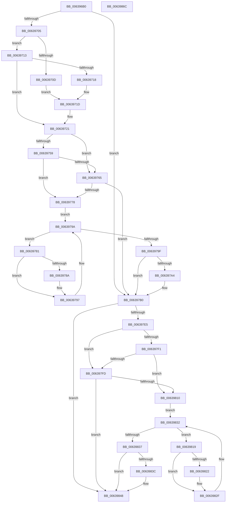

# DifPoFxPowerControlWrapper

- RVA: `0x006396B0`–`0x0063986D` (길이 `445` bytes)
- VA: `0x00000001406396B0`
- 실행 섹션: `.text`
- PDB 이름 있음: `예`; PDB Function 태그: `아니요`
- unwind 정보 RVA: `0x000D2C00`
- 디코드: `123`개 명령, `445/445` bytes 표시
- 미해석 바이트: `0` (있으면 어셈블리에 `.byte`로 보존)

> 이 문서는 커널 이미지의 기계어와 PDB 기호를 분석해 생성했습니다. 4번과 5번은 함수 원형과 자료형을 바이너리 사용 방식에서 추정한 C 해석이며 원본 소스 복구 결과는 아닙니다.

## 1. Dependencies

- 직접 호출 지점: **10**; 고유 호출 대상: **7**
- 직접 호출자로 확인된 함수: **0**
- RIP 상대 이미지 참조: **3**

### Outgoing calls
- `0x006396EA` → [memset](../6C/memset_function_006C6C40.md) (function, `0x006C6C40`)
- `0x006396F4` → [DifGetAPIThunkContextById](../49/DifGetAPIThunkContextById_function_00495A34.md) (function, `0x00495A34`)
- `0x00639718` → [DifGetReturnAddressForWrappers](../4D/DifGetReturnAddressForWrappers_function_004D3C08.md) (function, `0x004D3C08`)
- `0x0063976C` → [ExAcquireRundownProtection](../21/ExAcquireRundownProtection_function_00216620.md) (function, `0x00216620`)
- `0x00639792` → [guard_dispatch_icall](../6B/guard_dispatch_icall_function_006BAAD0.md) (function, `0x006BAAD0`)
- `0x006397AB` → [ExReleaseRundownProtection](../34/ExReleaseRundownProtection_function_00349E80.md) (function, `0x00349E80`)
- `0x006397D8` → [PoFxPowerControl](../4B/PoFxPowerControl_function_004B2E70.md) (function, `0x004B2E70`)
- `0x00639804` → [ExAcquireRundownProtection](../21/ExAcquireRundownProtection_function_00216620.md) (function, `0x00216620`)
- `0x0063982A` → [guard_dispatch_icall](../6B/guard_dispatch_icall_function_006BAAD0.md) (function, `0x006BAAD0`)
- `0x00639843` → [ExReleaseRundownProtection](../34/ExReleaseRundownProtection_function_00349E80.md) (function, `0x00349E80`)

### Direct callers
- 이 함수 시작 RVA로 연결되는 직접 call은 확인되지 않았습니다. 간접 호출은 완전히 역산할 수 없습니다.

### Static image references
- `0x00639728` → RVA `0x00F048B8` (`.data`; read)
- `0x00639759` → RVA `0x00F04980` (`.data`; read)
- `0x00639765` → RVA `0x00F03E80` (`.data`; read)

## 2. Other-region calls and transfers

- 다른 실행 섹션으로 향하는 call: **0**
- 별도 외부 분기/꼬리 이동을 확인하지 못했습니다.

## 3. Assembly (complete function range)

```asm
006396B0  48 8B C4                        mov rax, rsp
006396B3  48 89 58 10                     mov qword ptr [rax + 0x10], rbx
006396B7  48 89 70 18                     mov qword ptr [rax + 0x18], rsi
006396BB  48 89 78 20                     mov qword ptr [rax + 0x20], rdi
006396BF  48 89 48 08                     mov qword ptr [rax + 8], rcx
006396C3  55                              push rbp
006396C4  41 54                           push r12
006396C6  41 55                           push r13
006396C8  41 56                           push r14
006396CA  41 57                           push r15
006396CC  48 8D 68 B9                     lea rbp, [rax - 0x47]
006396D0  48 81 EC 90 00 00 00            sub rsp, 0x90
006396D7  4C 8B EA                        mov r13, rdx
006396DA  48 8D 4D CF                     lea rcx, [rbp - 0x31]
006396DE  33 D2                           xor edx, edx
006396E0  4D 8B E0                        mov r12, r8
006396E3  4D 8B F9                        mov r15, r9
006396E6  44 8D 42 48                     lea r8d, [rdx + 0x48]
006396EA  E8 51 D5 08 00                  call 0x1406c6c40
006396EF  B9 BB 00 00 00                  mov ecx, 0xbb
006396F4  E8 3B C3 E5 FF                  call 0x140495a34
006396F9  4C 8B F0                        mov r14, rax
006396FC  48 85 C0                        test rax, rax
006396FF  0F 84 AB 00 00 00               je 0x1406397b0
00639705  8B 48 0C                        mov ecx, dword ptr [rax + 0xc]
00639708  F6 C1 18                        test cl, 0x18
0063970B  74 06                           je 0x140639713
0063970D  48 8B 45 47                     mov rax, qword ptr [rbp + 0x47]
00639711  EB 0A                           jmp 0x14063971d
00639713  F6 C1 04                        test cl, 4
00639716  74 09                           je 0x140639721
00639718  E8 EB A4 E9 FF                  call 0x1404d3c08
0063971D  48 89 45 CF                     mov qword ptr [rbp - 0x31], rax
00639721  48 8B 45 4F                     mov rax, qword ptr [rbp + 0x4f]
00639725  40 32 F6                        xor sil, sil
00639728  40 38 35 89 B1 8C 00            cmp byte ptr [rip + 0x8cb189], sil
0063972F  48 89 45 07                     mov qword ptr [rbp + 7], rax
00639733  48 8B 45 6F                     mov rax, qword ptr [rbp + 0x6f]
00639737  48 89 45 E7                     mov qword ptr [rbp - 0x19], rax
0063973B  48 8B 45 77                     mov rax, qword ptr [rbp + 0x77]
0063973F  48 89 45 DF                     mov qword ptr [rbp - 0x21], rax
00639743  48 8B 45 7F                     mov rax, qword ptr [rbp + 0x7f]
00639747  48 89 45 D7                     mov qword ptr [rbp - 0x29], rax
0063974B  4C 89 6D FF                     mov qword ptr [rbp - 1], r13
0063974F  4C 89 65 F7                     mov qword ptr [rbp - 9], r12
00639753  4C 89 7D EF                     mov qword ptr [rbp - 0x11], r15
00639757  75 0C                           jne 0x140639765
00639759  F7 05 1D B2 8C 00 00 08 00 00   test dword ptr [rip + 0x8cb21d], 0x800
00639763  74 13                           je 0x140639778
00639765  48 8D 0D 14 A7 8C 00            lea rcx, [rip + 0x8ca714]
0063976C  E8 AF CE BD FF                  call 0x140216620
00639771  40 8A F0                        mov sil, al
00639774  84 C0                           test al, al
00639776  74 38                           je 0x1406397b0
00639778  49 8D 7E 20                     lea rdi, [r14 + 0x20]
0063977C  48 8B 1F                        mov rbx, qword ptr [rdi]
0063977F  EB 19                           jmp 0x14063979a
00639781  48 8D 43 F0                     lea rax, [rbx - 0x10]
00639785  48 85 C0                        test rax, rax
00639788  74 0D                           je 0x140639797
0063978A  48 8B 40 08                     mov rax, qword ptr [rax + 8]
0063978E  48 8D 4D CF                     lea rcx, [rbp - 0x31]
00639792  E8 39 13 08 00                  call 0x1406baad0
00639797  48 8B 1B                        mov rbx, qword ptr [rbx]
0063979A  48 3B DF                        cmp rbx, rdi
0063979D  75 E2                           jne 0x140639781
0063979F  40 84 F6                        test sil, sil
006397A2  74 0C                           je 0x1406397b0
006397A4  48 8D 0D D5 A6 8C 00            lea rcx, [rip + 0x8ca6d5]
006397AB  E8 D0 06 D1 FF                  call 0x140349e80
006397B0  48 8B 45 7F                     mov rax, qword ptr [rbp + 0x7f]
006397B4  4D 8B CF                        mov r9, r15
006397B7  48 8B 4D 4F                     mov rcx, qword ptr [rbp + 0x4f]
006397BB  4D 8B C4                        mov r8, r12
006397BE  48 89 44 24 30                  mov qword ptr [rsp + 0x30], rax
006397C3  49 8B D5                        mov rdx, r13
006397C6  48 8B 45 77                     mov rax, qword ptr [rbp + 0x77]
006397CA  48 89 44 24 28                  mov qword ptr [rsp + 0x28], rax
006397CF  48 8B 45 6F                     mov rax, qword ptr [rbp + 0x6f]
006397D3  48 89 44 24 20                  mov qword ptr [rsp + 0x20], rax
006397D8  E8 93 96 E7 FF                  call 0x1404b2e70
006397DD  89 45 0F                        mov dword ptr [rbp + 0xf], eax
006397E0  4D 85 F6                        test r14, r14
006397E3  74 63                           je 0x140639848
006397E5  40 32 FF                        xor dil, dil
006397E8  40 38 3D C9 B0 8C 00            cmp byte ptr [rip + 0x8cb0c9], dil
006397EF  75 0C                           jne 0x1406397fd
006397F1  F7 05 85 B1 8C 00 00 08 00 00   test dword ptr [rip + 0x8cb185], 0x800
006397FB  74 13                           je 0x140639810
006397FD  48 8D 0D 7C A6 8C 00            lea rcx, [rip + 0x8ca67c]
00639804  E8 17 CE BD FF                  call 0x140216620
00639809  40 8A F8                        mov dil, al
0063980C  84 C0                           test al, al
0063980E  74 38                           je 0x140639848
00639810  49 8D 76 30                     lea rsi, [r14 + 0x30]
00639814  48 8B 1E                        mov rbx, qword ptr [rsi]
00639817  EB 19                           jmp 0x140639832
00639819  48 8D 43 F0                     lea rax, [rbx - 0x10]
0063981D  48 85 C0                        test rax, rax
00639820  74 0D                           je 0x14063982f
00639822  48 8B 40 08                     mov rax, qword ptr [rax + 8]
00639826  48 8D 4D CF                     lea rcx, [rbp - 0x31]
0063982A  E8 A1 12 08 00                  call 0x1406baad0
0063982F  48 8B 1B                        mov rbx, qword ptr [rbx]
00639832  48 3B DE                        cmp rbx, rsi
00639835  75 E2                           jne 0x140639819
00639837  40 84 FF                        test dil, dil
0063983A  74 0C                           je 0x140639848
0063983C  48 8D 0D 3D A6 8C 00            lea rcx, [rip + 0x8ca63d]
00639843  E8 38 06 D1 FF                  call 0x140349e80
00639848  8B 45 0F                        mov eax, dword ptr [rbp + 0xf]
0063984B  4C 8D 9C 24 90 00 00 00         lea r11, [rsp + 0x90]
00639853  49 8B 5B 38                     mov rbx, qword ptr [r11 + 0x38]
00639857  49 8B 73 40                     mov rsi, qword ptr [r11 + 0x40]
0063985B  49 8B 7B 48                     mov rdi, qword ptr [r11 + 0x48]
0063985F  49 8B E3                        mov rsp, r11
00639862  41 5F                           pop r15
00639864  41 5E                           pop r14
00639866  41 5D                           pop r13
00639868  41 5C                           pop r12
0063986A  5D                              pop rbp
0063986B  C3                              ret
0063986C  CC                              int3
```

## 4. C-style interpretation (structured pseudocode)

```c
__int64 __fastcall DifPoFxPowerControlWrapper(__int64 a1, __int64 a2, __int64 a3, __int64 a4)
{
    __int64 result;
    __int64 v_rdi;
    __int64 v_rsi;
    __int64 v_rsp;
    unsigned __int64 v_stack_m28;
    unsigned __int64 v_stack_m88;
    unsigned __int64 v_stack_m90;
    unsigned __int64 v_stack_m98;

    *(unsigned __int64 *)(v_rsp + 16) = v_rbx;
    *(unsigned __int64 *)(v_rsp + 24) = v_rsi;
    *(unsigned __int64 *)(v_rsp + 32) = v_rdi;
    *(unsigned __int64 *)(v_rsp + 8) = a1;
    v_rsp = (v_rsp) - (144);
    a2 = 0;
    result = memset(v_rsp - 71 - 49, a2, a2 + 72, a4);
    result = DifGetAPIThunkContextById(187, a2, a2 + 72, a4);
    if (result == 0) goto loc_006397B0;
    if ((((unsigned __int8)((unsigned int)(*(unsigned int *)(result + 12)))) & (24)) == 0) goto loc_00639713;
    goto loc_0063971D;
loc_00639713:
    if ((((unsigned __int8)((unsigned int)(*(unsigned int *)(result + 12)))) & (4)) == 0) goto loc_00639721;
    result = DifGetReturnAddressForWrappers((unsigned int)(*(unsigned int *)(result + 12)), a2, a2 + 72, a4);
loc_0063971D:
    *(unsigned __int64 *)(v_rsp - 71 - 49) = result;
loc_00639721:
    v_rsi = 0;
    *(unsigned __int64 *)(v_rsp - 71 + 7) = *(unsigned __int64 *)(v_rsp - 71 + 79);
    *(unsigned __int64 *)(v_rsp - 71 - 25) = *(unsigned __int64 *)(v_rsp - 71 + 111);
    *(unsigned __int64 *)(v_rsp - 71 - 33) = *(unsigned __int64 *)(v_rsp - 71 + 119);
    *(unsigned __int64 *)(v_rsp - 71 - 41) = *(unsigned __int64 *)(v_rsp - 71 + 127);
    *(unsigned __int64 *)(v_rsp - 71 - 1) = 0;
    *(unsigned __int64 *)(v_rsp - 71 - 9) = a3;
    *(unsigned __int64 *)(v_rsp - 71 - 17) = a4;
    if ((*(unsigned __int8 *)(v_rip + 9220489)) != 0) goto loc_00639765;
    if (((*(unsigned int *)(v_rip + 9220637)) & (0x800ULL)) == 0) goto loc_00639778;
loc_00639765:
    result = ExAcquireRundownProtection(v_rip + 9217812, a2, a2 + 72, a4);
    if ((unsigned __int8)(result) == 0) goto loc_006397B0;
loc_00639778:
    goto loc_0063979A;
loc_00639781:
    result = *(unsigned __int64 *)(result + 32) - 16;
    if (*(unsigned __int64 *)(result + 32) - 16 != 0) {
        result = *(unsigned __int64 *)(*(unsigned __int64 *)(result + 32) - 16 + 8);
        a1 = v_rsp - 71 - 49;
        result = guard_dispatch_icall(a1, a2, a2 + 72, a4);
    }
loc_0063979A:
    if ((*(unsigned __int64 *)(*(unsigned __int64 *)(result + 32))) != (result + 32)) goto loc_00639781;
    if ((unsigned __int8)((unsigned __int8)(result)) != 0) {
        a1 = v_rip + 9217749;
        result = ExReleaseRundownProtection(a1, a2, a2 + 72, a4);
    }
    v_stack_m88 = *(unsigned __int64 *)(v_rsp - 71 + 127);
    v_stack_m90 = *(unsigned __int64 *)(v_rsp - 71 + 119);
    v_stack_m98 = *(unsigned __int64 *)(v_rsp - 71 + 111);
    result = PoFxPowerControl(*(unsigned __int64 *)(v_rsp - 71 + 79), 0, a3, a4);
    *(unsigned int *)(v_rsp - 71 + 15) = (unsigned int)(result);
    if (result == 0) goto loc_00639848;
    v_rdi = 0;
    if ((*(unsigned __int8 *)(v_rip + 9220297)) != 0) goto loc_006397FD;
    if (((*(unsigned int *)(v_rip + 9220485)) & (0x800ULL)) == 0) goto loc_00639810;
loc_006397FD:
    result = ExAcquireRundownProtection(v_rip + 9217660, 0, a3, a4);
    if ((unsigned __int8)(result) == 0) goto loc_00639848;
loc_00639810:
    goto loc_00639832;
loc_00639819:
    result = *(unsigned __int64 *)(result + 48) - 16;
    if (*(unsigned __int64 *)(result + 48) - 16 != 0) {
        result = *(unsigned __int64 *)(*(unsigned __int64 *)(result + 48) - 16 + 8);
        a1 = v_rsp - 71 - 49;
        result = guard_dispatch_icall(a1, 0, a3, a4);
    }
loc_00639832:
    if ((*(unsigned __int64 *)(*(unsigned __int64 *)(result + 48))) != (result + 48)) goto loc_00639819;
    if ((unsigned __int8)((unsigned __int8)(result)) != 0) {
        a1 = v_rip + 9217597;
        result = ExReleaseRundownProtection(a1, 0, a3, a4);
    }
    return (unsigned int)(*(unsigned int *)(v_rsp - 71 + 15));
}
```

## 5. (Beta) C Style

```c
int64_t DifPoFxPowerControlWrapper(int64_t Arg1, int64_t Arg2, int64_t Arg3, int64_t Arg4)
{
    int64_t result;
    int64_t local_rdi;
    int64_t local_rsi;
    int64_t local_rsp;
    uint64_t v_stack_m28;
    uint64_t v_stack_m88;
    uint64_t v_stack_m90;
    uint64_t v_stack_m98;

    *(uint64_t *)(local_rsp + 0x10) = local_rbx;
    *(uint64_t *)(local_rsp + 0x18) = local_rsi;
    *(uint64_t *)(local_rsp + 0x20) = local_rdi;
    *(uint64_t *)(local_rsp + 0x8) = Arg1;
    local_rsp = (local_rsp) - (144);
    Arg2 = 0;
    result = memset(local_rsp - 71 - 49, Arg2, Arg2 + 72, Arg4);
    result = DifGetAPIThunkContextById(187, Arg2, Arg2 + 72, Arg4);
    if (result == 0) goto loc_006397B0;
    if ((((uint8_t)((uint32_t)(*(uint32_t *)(result + 0xC)))) & (24)) == 0) goto loc_00639713;
    goto loc_0063971D;
loc_00639713:
    if ((((uint8_t)((uint32_t)(*(uint32_t *)(result + 0xC)))) & (4)) == 0) goto loc_00639721;
    result = DifGetReturnAddressForWrappers((uint32_t)(*(uint32_t *)(result + 0xC)), Arg2, Arg2 + 72, Arg4);
loc_0063971D:
    *(uint64_t *)(local_rsp - 0x47 - 0x31) = result;
loc_00639721:
    local_rsi = 0;
    *(uint64_t *)(local_rsp - 0x47 + 0x7) = *(uint64_t *)(local_rsp - 0x47 + 0x4F);
    *(uint64_t *)(local_rsp - 0x47 - 0x19) = *(uint64_t *)(local_rsp - 0x47 + 0x6F);
    *(uint64_t *)(local_rsp - 0x47 - 0x21) = *(uint64_t *)(local_rsp - 0x47 + 0x77);
    *(uint64_t *)(local_rsp - 0x47 - 0x29) = *(uint64_t *)(local_rsp - 0x47 + 0x7F);
    *(uint64_t *)(local_rsp - 0x47 - 0x1) = 0;
    *(uint64_t *)(local_rsp - 0x47 - 0x9) = Arg3;
    *(uint64_t *)(local_rsp - 0x47 - 0x11) = Arg4;
    if ((*(uint8_t *)(v_rip + 0x8CB189)) != 0) goto loc_00639765;
    if (((*(uint32_t *)(v_rip + 0x8CB21D)) & (0x800ULL)) == 0) goto loc_00639778;
loc_00639765:
    result = ExAcquireRundownProtection(v_rip + 9217812, Arg2, Arg2 + 72, Arg4);
    if ((uint8_t)(result) == 0) goto loc_006397B0;
loc_00639778:
    goto loc_0063979A;
loc_00639781:
    result = *(uint64_t *)(result + 0x20) - 16;
    if (*(uint64_t *)(result + 0x20) - 16 != 0) {
        result = *(uint64_t *)(*(uint64_t *)(result + 0x20) - 0x10 + 0x8);
        Arg1 = local_rsp - 71 - 49;
        result = guard_dispatch_icall(Arg1, Arg2, Arg2 + 72, Arg4);
    }
loc_0063979A:
    if ((*(uint64_t *)(*(uint64_t *)(result + 0x20))) != (result + 32)) goto loc_00639781;
    if ((uint8_t)((uint8_t)(result)) != 0) {
        Arg1 = v_rip + 9217749;
        result = ExReleaseRundownProtection(Arg1, Arg2, Arg2 + 72, Arg4);
    }
    v_stack_m88 = *(uint64_t *)(local_rsp - 0x47 + 0x7F);
    v_stack_m90 = *(uint64_t *)(local_rsp - 0x47 + 0x77);
    v_stack_m98 = *(uint64_t *)(local_rsp - 0x47 + 0x6F);
    result = PoFxPowerControl(*(uint64_t *)(local_rsp - 0x47 + 0x4F), 0, Arg3, Arg4);
    *(uint32_t *)(local_rsp - 0x47 + 0xF) = (uint32_t)(result);
    if (result == 0) goto loc_00639848;
    local_rdi = 0;
    if ((*(uint8_t *)(v_rip + 0x8CB0C9)) != 0) goto loc_006397FD;
    if (((*(uint32_t *)(v_rip + 0x8CB185)) & (0x800ULL)) == 0) goto loc_00639810;
loc_006397FD:
    result = ExAcquireRundownProtection(v_rip + 9217660, 0, Arg3, Arg4);
    if ((uint8_t)(result) == 0) goto loc_00639848;
loc_00639810:
    goto loc_00639832;
loc_00639819:
    result = *(uint64_t *)(result + 0x30) - 16;
    if (*(uint64_t *)(result + 0x30) - 16 != 0) {
        result = *(uint64_t *)(*(uint64_t *)(result + 0x30) - 0x10 + 0x8);
        Arg1 = local_rsp - 71 - 49;
        result = guard_dispatch_icall(Arg1, 0, Arg3, Arg4);
    }
loc_00639832:
    if ((*(uint64_t *)(*(uint64_t *)(result + 0x30))) != (result + 48)) goto loc_00639819;
    if ((uint8_t)((uint8_t)(result)) != 0) {
        Arg1 = v_rip + 9217597;
        result = ExReleaseRundownProtection(Arg1, 0, Arg3, Arg4);
    }
    return (uint32_t)(*(uint32_t *)(local_rsp - 0x47 + 0xF));
}
```

## 6. Execution-region graph

[열기: 2D/3D 그래프와 함수 탐색 컨트롤 패널](../../../control-panel.html?section=text&rva=0x006396B0&view=graph)

- 2D 그래프는 위에서 아래로 흐르고, 3D 그래프는 빈 공간을 드래그해 회전합니다. Shift+드래그는 이동, 휠은 확대·축소, 함수 노드 선택은 대상 보고서 이동입니다.

### Static fallback


