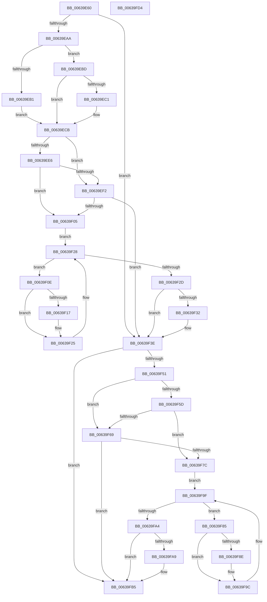

# DifPoFxSetComponentWakeWrapper

- RVA: `0x00639E60`–`0x00639FD5` (길이 `373` bytes)
- VA: `0x0000000140639E60`
- 실행 섹션: `.text`
- PDB 이름 있음: `예`; PDB Function 태그: `아니요`
- unwind 정보 RVA: `0x0008A668`
- 디코드: `102`개 명령, `373/373` bytes 표시
- 미해석 바이트: `0` (있으면 어셈블리에 `.byte`로 보존)

> 이 문서는 커널 이미지의 기계어와 PDB 기호를 분석해 생성했습니다. 4번과 5번은 함수 원형과 자료형을 바이너리 사용 방식에서 추정한 C 해석이며 원본 소스 복구 결과는 아닙니다.

## 1. Dependencies

- 직접 호출 지점: **9**; 고유 호출 대상: **6**
- 직접 호출자로 확인된 함수: **0**
- RIP 상대 이미지 참조: **3**

### Outgoing calls
- `0x00639E99` → [DifGetAPIThunkContextById](../49/DifGetAPIThunkContextById_function_00495A34.md) (function, `0x00495A34`)
- `0x00639EC1` → [DifGetReturnAddressForWrappers](../4D/DifGetReturnAddressForWrappers_function_004D3C08.md) (function, `0x004D3C08`)
- `0x00639EF9` → [ExAcquireRundownProtection](../21/ExAcquireRundownProtection_function_00216620.md) (function, `0x00216620`)
- `0x00639F20` → [guard_dispatch_icall](../6B/guard_dispatch_icall_function_006BAAD0.md) (function, `0x006BAAD0`)
- `0x00639F39` → [ExReleaseRundownProtection](../34/ExReleaseRundownProtection_function_00349E80.md) (function, `0x00349E80`)
- `0x00639F47` → [PoFxSetComponentWake](../5D/PoFxSetComponentWake_function_005D2150.md) (function, `0x005D2150`)
- `0x00639F70` → [ExAcquireRundownProtection](../21/ExAcquireRundownProtection_function_00216620.md) (function, `0x00216620`)
- `0x00639F97` → [guard_dispatch_icall](../6B/guard_dispatch_icall_function_006BAAD0.md) (function, `0x006BAAD0`)
- `0x00639FB0` → [ExReleaseRundownProtection](../34/ExReleaseRundownProtection_function_00349E80.md) (function, `0x00349E80`)

### Direct callers
- 이 함수 시작 RVA로 연결되는 직접 call은 확인되지 않았습니다. 간접 호출은 완전히 역산할 수 없습니다.

### Static image references
- `0x00639ED3` → RVA `0x00F048B8` (`.data`; read)
- `0x00639EE6` → RVA `0x00F04980` (`.data`; read)
- `0x00639EF2` → RVA `0x00F03E80` (`.data`; read)

## 2. Other-region calls and transfers

- 다른 실행 섹션으로 향하는 call: **0**
- 별도 외부 분기/꼬리 이동을 확인하지 못했습니다.

## 3. Assembly (complete function range)

```asm
00639E60  4C 8B DC                        mov r11, rsp
00639E63  49 89 5B 08                     mov qword ptr [r11 + 8], rbx
00639E67  49 89 6B 10                     mov qword ptr [r11 + 0x10], rbp
00639E6B  49 89 73 18                     mov qword ptr [r11 + 0x18], rsi
00639E6F  49 89 7B 20                     mov qword ptr [r11 + 0x20], rdi
00639E73  41 54                           push r12
00639E75  41 56                           push r14
00639E77  41 57                           push r15
00639E79  48 83 EC 40                     sub rsp, 0x40
00639E7D  33 C0                           xor eax, eax
00639E7F  0F 57 C0                        xorps xmm0, xmm0
00639E82  0F 11 44 24 20                  movups xmmword ptr [rsp + 0x20], xmm0
00639E87  4C 8B E1                        mov r12, rcx
00639E8A  49 89 43 D8                     mov qword ptr [r11 - 0x28], rax
00639E8E  B9 B6 00 00 00                  mov ecx, 0xb6
00639E93  45 8A F0                        mov r14b, r8b
00639E96  44 8B FA                        mov r15d, edx
00639E99  E8 96 BB E5 FF                  call 0x140495a34
00639E9E  48 8B F0                        mov rsi, rax
00639EA1  48 85 C0                        test rax, rax
00639EA4  0F 84 94 00 00 00               je 0x140639f3e
00639EAA  8B 40 0C                        mov eax, dword ptr [rax + 0xc]
00639EAD  A8 18                           test al, 0x18
00639EAF  74 0C                           je 0x140639ebd
00639EB1  48 8B 4C 24 58                  mov rcx, qword ptr [rsp + 0x58]
00639EB6  48 89 4C 24 20                  mov qword ptr [rsp + 0x20], rcx
00639EBB  EB 0E                           jmp 0x140639ecb
00639EBD  A8 04                           test al, 4
00639EBF  74 0A                           je 0x140639ecb
00639EC1  E8 42 9D E9 FF                  call 0x1404d3c08
00639EC6  48 89 44 24 20                  mov qword ptr [rsp + 0x20], rax
00639ECB  40 32 ED                        xor bpl, bpl
00639ECE  4C 89 64 24 30                  mov qword ptr [rsp + 0x30], r12
00639ED3  40 38 2D DE A9 8C 00            cmp byte ptr [rip + 0x8ca9de], bpl
00639EDA  44 89 7C 24 2C                  mov dword ptr [rsp + 0x2c], r15d
00639EDF  44 88 74 24 28                  mov byte ptr [rsp + 0x28], r14b
00639EE4  75 0C                           jne 0x140639ef2
00639EE6  F7 05 90 AA 8C 00 00 08 00 00   test dword ptr [rip + 0x8caa90], 0x800
00639EF0  74 13                           je 0x140639f05
00639EF2  48 8D 0D 87 9F 8C 00            lea rcx, [rip + 0x8c9f87]
00639EF9  E8 22 C7 BD FF                  call 0x140216620
00639EFE  40 8A E8                        mov bpl, al
00639F01  84 C0                           test al, al
00639F03  74 39                           je 0x140639f3e
00639F05  48 8D 7E 20                     lea rdi, [rsi + 0x20]
00639F09  48 8B 1F                        mov rbx, qword ptr [rdi]
00639F0C  EB 1A                           jmp 0x140639f28
00639F0E  48 8D 43 F0                     lea rax, [rbx - 0x10]
00639F12  48 85 C0                        test rax, rax
00639F15  74 0E                           je 0x140639f25
00639F17  48 8B 40 08                     mov rax, qword ptr [rax + 8]
00639F1B  48 8D 4C 24 20                  lea rcx, [rsp + 0x20]
00639F20  E8 AB 0B 08 00                  call 0x1406baad0
00639F25  48 8B 1B                        mov rbx, qword ptr [rbx]
00639F28  48 3B DF                        cmp rbx, rdi
00639F2B  75 E1                           jne 0x140639f0e
00639F2D  40 84 ED                        test bpl, bpl
00639F30  74 0C                           je 0x140639f3e
00639F32  48 8D 0D 47 9F 8C 00            lea rcx, [rip + 0x8c9f47]
00639F39  E8 42 FF D0 FF                  call 0x140349e80
00639F3E  45 8A C6                        mov r8b, r14b
00639F41  41 8B D7                        mov edx, r15d
00639F44  49 8B CC                        mov rcx, r12
00639F47  E8 04 82 F9 FF                  call 0x1405d2150
00639F4C  48 85 F6                        test rsi, rsi
00639F4F  74 64                           je 0x140639fb5
00639F51  40 32 FF                        xor dil, dil
00639F54  40 38 3D 5D A9 8C 00            cmp byte ptr [rip + 0x8ca95d], dil
00639F5B  75 0C                           jne 0x140639f69
00639F5D  F7 05 19 AA 8C 00 00 08 00 00   test dword ptr [rip + 0x8caa19], 0x800
00639F67  74 13                           je 0x140639f7c
00639F69  48 8D 0D 10 9F 8C 00            lea rcx, [rip + 0x8c9f10]
00639F70  E8 AB C6 BD FF                  call 0x140216620
00639F75  40 8A F8                        mov dil, al
00639F78  84 C0                           test al, al
00639F7A  74 39                           je 0x140639fb5
00639F7C  48 83 C6 30                     add rsi, 0x30
00639F80  48 8B 1E                        mov rbx, qword ptr [rsi]
00639F83  EB 1A                           jmp 0x140639f9f
00639F85  48 8D 43 F0                     lea rax, [rbx - 0x10]
00639F89  48 85 C0                        test rax, rax
00639F8C  74 0E                           je 0x140639f9c
00639F8E  48 8B 40 08                     mov rax, qword ptr [rax + 8]
00639F92  48 8D 4C 24 20                  lea rcx, [rsp + 0x20]
00639F97  E8 34 0B 08 00                  call 0x1406baad0
00639F9C  48 8B 1B                        mov rbx, qword ptr [rbx]
00639F9F  48 3B DE                        cmp rbx, rsi
00639FA2  75 E1                           jne 0x140639f85
00639FA4  40 84 FF                        test dil, dil
00639FA7  74 0C                           je 0x140639fb5
00639FA9  48 8D 0D D0 9E 8C 00            lea rcx, [rip + 0x8c9ed0]
00639FB0  E8 CB FE D0 FF                  call 0x140349e80
00639FB5  48 8B 5C 24 60                  mov rbx, qword ptr [rsp + 0x60]
00639FBA  48 8B 6C 24 68                  mov rbp, qword ptr [rsp + 0x68]
00639FBF  48 8B 74 24 70                  mov rsi, qword ptr [rsp + 0x70]
00639FC4  48 8B 7C 24 78                  mov rdi, qword ptr [rsp + 0x78]
00639FC9  48 83 C4 40                     add rsp, 0x40
00639FCD  41 5F                           pop r15
00639FCF  41 5E                           pop r14
00639FD1  41 5C                           pop r12
00639FD3  C3                              ret
00639FD4  CC                              int3
```

## 4. C-style interpretation (structured pseudocode)

```c
__int64 __fastcall DifPoFxSetComponentWakeWrapper(__int64 a1, int a2, unsigned __int8 a3)
{
    __int64 result;
    __int64 v_rbp;
    __int64 v_rdi;
    __int64 v_rsi;
    __int64 v_rsp;
    unsigned __int64 v_stack_m28;
    unsigned int v_stack_m2C;
    unsigned __int8 v_stack_m30;
    unsigned __int64 v_stack_m38;
    unsigned __int64 v_stack_p0;
    unsigned __int64 v_stack_p10;
    unsigned __int64 v_stack_p18;
    unsigned __int64 v_stack_p20;
    unsigned __int64 v_stack_p8;

    *(unsigned __int64 *)(v_rsp + 8) = v_rbx;
    *(unsigned __int64 *)(v_rsp + 16) = v_rbp;
    *(unsigned __int64 *)(v_rsp + 24) = v_rsi;
    *(unsigned __int64 *)(v_rsp + 32) = v_rdi;
    v_rsp = (v_rsp) - (64);
    result = 0;
    v_stack_m38 = v_xmm0;
    *(unsigned __int64 *)(v_rsp - 40) = 0;
    result = DifGetAPIThunkContextById(182, a2, a3, a4);
    if (result == 0) goto loc_00639F3E;
    if ((((unsigned __int8)((unsigned int)(*(unsigned int *)(result + 12)))) & (24)) == 0) goto loc_00639EBD;
    v_stack_m38 = v_stack_p0;
    goto loc_00639ECB;
loc_00639EBD:
    result = (unsigned int)(*(unsigned int *)(result + 12));
    if ((((unsigned __int8)((unsigned int)(*(unsigned int *)(result + 12)))) & (4)) != 0) {
        result = DifGetReturnAddressForWrappers(v_stack_p0, a2, a3, a4);
        v_stack_m38 = result;
    }
    v_rbp = 0;
    v_stack_m28 = a1;
    v_stack_m2C = (unsigned int)((unsigned int)(a2));
    v_stack_m30 = a3;
    if ((*(unsigned __int8 *)(v_rip + 9218526)) != 0) goto loc_00639EF2;
    if (((*(unsigned int *)(v_rip + 9218704)) & (0x800ULL)) == 0) goto loc_00639F05;
loc_00639EF2:
    result = ExAcquireRundownProtection(v_rip + 9215879, a2, a3, a4);
    if ((unsigned __int8)(result) == 0) goto loc_00639F3E;
loc_00639F05:
    goto loc_00639F28;
loc_00639F0E:
    result = *(unsigned __int64 *)(result + 32) - 16;
    if (*(unsigned __int64 *)(result + 32) - 16 != 0) {
        result = *(unsigned __int64 *)(*(unsigned __int64 *)(result + 32) - 16 + 8);
        a1 = v_stack_m38;
        result = guard_dispatch_icall(a1, a2, a3, a4);
    }
loc_00639F28:
    if ((*(unsigned __int64 *)(*(unsigned __int64 *)(result + 32))) != (result + 32)) goto loc_00639F0E;
    if ((unsigned __int8)((unsigned __int8)(result)) != 0) {
        a1 = v_rip + 9215815;
        result = ExReleaseRundownProtection(a1, a2, a3, a4);
    }
    result = PoFxSetComponentWake(a1, (unsigned int)((unsigned int)((unsigned int)(a2))), a3, a4);
    if (result == 0) goto loc_00639FB5;
    v_rdi = 0;
    if ((*(unsigned __int8 *)(v_rip + 9218397)) != 0) goto loc_00639F69;
    if (((*(unsigned int *)(v_rip + 9218585)) & (0x800ULL)) == 0) goto loc_00639F7C;
loc_00639F69:
    result = ExAcquireRundownProtection(v_rip + 9215760, (unsigned int)((unsigned int)((unsigned int)(a2))), a3, a4);
    if ((unsigned __int8)(result) == 0) goto loc_00639FB5;
loc_00639F7C:
    v_rsi = (result) + (48);
    goto loc_00639F9F;
loc_00639F85:
    result = *(unsigned __int64 *)(v_rsi) - 16;
    if (*(unsigned __int64 *)(v_rsi) - 16 != 0) {
        result = *(unsigned __int64 *)(*(unsigned __int64 *)(v_rsi) - 16 + 8);
        a1 = v_stack_m38;
        result = guard_dispatch_icall(a1, (unsigned int)((unsigned int)((unsigned int)(a2))), a3, a4);
    }
loc_00639F9F:
    if ((*(unsigned __int64 *)(*(unsigned __int64 *)(v_rsi))) != v_rsi) goto loc_00639F85;
    if ((unsigned __int8)((unsigned __int8)(result)) != 0) {
        a1 = v_rip + 9215696;
        result = ExReleaseRundownProtection(a1, (unsigned int)((unsigned int)((unsigned int)(a2))), a3, a4);
    }
    v_rsp = (v_rsp) + (64);
    return result;
}
```

## 5. (Beta) C Style

```c
int64_t DifPoFxSetComponentWakeWrapper(int64_t Arg1, int32_t Arg2, uint8_t Arg3)
{
    int64_t result;
    int64_t local_rbp;
    int64_t local_rdi;
    int64_t local_rsi;
    int64_t local_rsp;
    uint64_t v_stack_m28;
    uint32_t v_stack_m2C;
    uint8_t v_stack_m30;
    uint64_t v_stack_m38;
    uint64_t v_stack_p0;
    uint64_t v_stack_p10;
    uint64_t v_stack_p18;
    uint64_t v_stack_p20;
    uint64_t v_stack_p8;

    *(uint64_t *)(local_rsp + 0x8) = local_rbx;
    *(uint64_t *)(local_rsp + 0x10) = local_rbp;
    *(uint64_t *)(local_rsp + 0x18) = local_rsi;
    *(uint64_t *)(local_rsp + 0x20) = local_rdi;
    local_rsp = (local_rsp) - (64);
    result = 0;
    v_stack_m38 = v_xmm0;
    *(uint64_t *)(local_rsp - 0x28) = 0;
    result = DifGetAPIThunkContextById(182, Arg2, Arg3, a4);
    if (result == 0) goto loc_00639F3E;
    if ((((uint8_t)((uint32_t)(*(uint32_t *)(result + 0xC)))) & (24)) == 0) goto loc_00639EBD;
    v_stack_m38 = v_stack_p0;
    goto loc_00639ECB;
loc_00639EBD:
    result = (uint32_t)(*(uint32_t *)(result + 0xC));
    if ((((uint8_t)((uint32_t)(*(uint32_t *)(result + 0xC)))) & (4)) != 0) {
        result = DifGetReturnAddressForWrappers(v_stack_p0, Arg2, Arg3, a4);
        v_stack_m38 = result;
    }
    local_rbp = 0;
    v_stack_m28 = Arg1;
    v_stack_m2C = (uint32_t)((uint32_t)(Arg2));
    v_stack_m30 = Arg3;
    if ((*(uint8_t *)(v_rip + 0x8CA9DE)) != 0) goto loc_00639EF2;
    if (((*(uint32_t *)(v_rip + 0x8CAA90)) & (0x800ULL)) == 0) goto loc_00639F05;
loc_00639EF2:
    result = ExAcquireRundownProtection(v_rip + 9215879, Arg2, Arg3, a4);
    if ((uint8_t)(result) == 0) goto loc_00639F3E;
loc_00639F05:
    goto loc_00639F28;
loc_00639F0E:
    result = *(uint64_t *)(result + 0x20) - 16;
    if (*(uint64_t *)(result + 0x20) - 16 != 0) {
        result = *(uint64_t *)(*(uint64_t *)(result + 0x20) - 0x10 + 0x8);
        Arg1 = v_stack_m38;
        result = guard_dispatch_icall(Arg1, Arg2, Arg3, a4);
    }
loc_00639F28:
    if ((*(uint64_t *)(*(uint64_t *)(result + 0x20))) != (result + 32)) goto loc_00639F0E;
    if ((uint8_t)((uint8_t)(result)) != 0) {
        Arg1 = v_rip + 9215815;
        result = ExReleaseRundownProtection(Arg1, Arg2, Arg3, a4);
    }
    result = PoFxSetComponentWake(Arg1, (uint32_t)((uint32_t)((uint32_t)(Arg2))), Arg3, a4);
    if (result == 0) goto loc_00639FB5;
    local_rdi = 0;
    if ((*(uint8_t *)(v_rip + 0x8CA95D)) != 0) goto loc_00639F69;
    if (((*(uint32_t *)(v_rip + 0x8CAA19)) & (0x800ULL)) == 0) goto loc_00639F7C;
loc_00639F69:
    result = ExAcquireRundownProtection(v_rip + 9215760, (uint32_t)((uint32_t)((uint32_t)(Arg2))), Arg3, a4);
    if ((uint8_t)(result) == 0) goto loc_00639FB5;
loc_00639F7C:
    local_rsi = (result) + (48);
    goto loc_00639F9F;
loc_00639F85:
    result = *(uint64_t *)(local_rsi) - 16;
    if (*(uint64_t *)(local_rsi) - 16 != 0) {
        result = *(uint64_t *)(*(uint64_t *)(local_rsi) - 0x10 + 0x8);
        Arg1 = v_stack_m38;
        result = guard_dispatch_icall(Arg1, (uint32_t)((uint32_t)((uint32_t)(Arg2))), Arg3, a4);
    }
loc_00639F9F:
    if ((*(uint64_t *)(*(uint64_t *)(local_rsi))) != local_rsi) goto loc_00639F85;
    if ((uint8_t)((uint8_t)(result)) != 0) {
        Arg1 = v_rip + 9215696;
        result = ExReleaseRundownProtection(Arg1, (uint32_t)((uint32_t)((uint32_t)(Arg2))), Arg3, a4);
    }
    local_rsp = (local_rsp) + (64);
    return result;
}
```

## 6. Execution-region graph

[열기: 2D/3D 그래프와 함수 탐색 컨트롤 패널](../../../control-panel.html?section=text&rva=0x00639E60&view=graph)

- 2D 그래프는 위에서 아래로 흐르고, 3D 그래프는 빈 공간을 드래그해 회전합니다. Shift+드래그는 이동, 휠은 확대·축소, 함수 노드 선택은 대상 보고서 이동입니다.

### Static fallback


