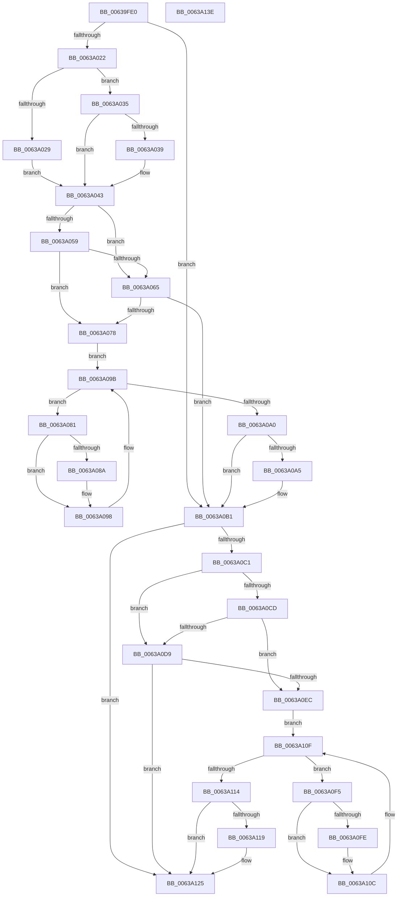

# DifPoFxSetDeviceIdleTimeoutWrapper

- RVA: `0x00639FE0`–`0x0063A13F` (길이 `351` bytes)
- VA: `0x0000000140639FE0`
- 실행 섹션: `.text`
- PDB 이름 있음: `예`; PDB Function 태그: `아니요`
- unwind 정보 RVA: `0x00093E28`
- 디코드: `97`개 명령, `351/351` bytes 표시
- 미해석 바이트: `0` (있으면 어셈블리에 `.byte`로 보존)

> 이 문서는 커널 이미지의 기계어와 PDB 기호를 분석해 생성했습니다. 4번과 5번은 함수 원형과 자료형을 바이너리 사용 방식에서 추정한 C 해석이며 원본 소스 복구 결과는 아닙니다.

## 1. Dependencies

- 직접 호출 지점: **9**; 고유 호출 대상: **6**
- 직접 호출자로 확인된 함수: **0**
- RIP 상대 이미지 참조: **3**

### Outgoing calls
- `0x0063A011` → [DifGetAPIThunkContextById](../49/DifGetAPIThunkContextById_function_00495A34.md) (function, `0x00495A34`)
- `0x0063A039` → [DifGetReturnAddressForWrappers](../4D/DifGetReturnAddressForWrappers_function_004D3C08.md) (function, `0x004D3C08`)
- `0x0063A06C` → [ExAcquireRundownProtection](../21/ExAcquireRundownProtection_function_00216620.md) (function, `0x00216620`)
- `0x0063A093` → [guard_dispatch_icall](../6B/guard_dispatch_icall_function_006BAAD0.md) (function, `0x006BAAD0`)
- `0x0063A0AC` → [ExReleaseRundownProtection](../34/ExReleaseRundownProtection_function_00349E80.md) (function, `0x00349E80`)
- `0x0063A0B7` → [PoFxSetDeviceIdleTimeout](../4A/PoFxSetDeviceIdleTimeout_function_004A5C10.md) (function, `0x004A5C10`)
- `0x0063A0E0` → [ExAcquireRundownProtection](../21/ExAcquireRundownProtection_function_00216620.md) (function, `0x00216620`)
- `0x0063A107` → [guard_dispatch_icall](../6B/guard_dispatch_icall_function_006BAAD0.md) (function, `0x006BAAD0`)
- `0x0063A120` → [ExReleaseRundownProtection](../34/ExReleaseRundownProtection_function_00349E80.md) (function, `0x00349E80`)

### Direct callers
- 이 함수 시작 RVA로 연결되는 직접 call은 확인되지 않았습니다. 간접 호출은 완전히 역산할 수 없습니다.

### Static image references
- `0x0063A04B` → RVA `0x00F048B8` (`.data`; read)
- `0x0063A059` → RVA `0x00F04980` (`.data`; read)
- `0x0063A065` → RVA `0x00F03E80` (`.data`; read)

## 2. Other-region calls and transfers

- 다른 실행 섹션으로 향하는 call: **0**
- 별도 외부 분기/꼬리 이동을 확인하지 못했습니다.

## 3. Assembly (complete function range)

```asm
00639FE0  4C 8B DC                        mov r11, rsp
00639FE3  49 89 5B 08                     mov qword ptr [r11 + 8], rbx
00639FE7  49 89 6B 10                     mov qword ptr [r11 + 0x10], rbp
00639FEB  49 89 73 18                     mov qword ptr [r11 + 0x18], rsi
00639FEF  57                              push rdi
00639FF0  41 56                           push r14
00639FF2  41 57                           push r15
00639FF4  48 83 EC 40                     sub rsp, 0x40
00639FF8  33 C0                           xor eax, eax
00639FFA  0F 57 C0                        xorps xmm0, xmm0
00639FFD  0F 11 44 24 20                  movups xmmword ptr [rsp + 0x20], xmm0
0063A002  4C 8B F9                        mov r15, rcx
0063A005  49 89 43 D8                     mov qword ptr [r11 - 0x28], rax
0063A009  B9 B5 00 00 00                  mov ecx, 0xb5
0063A00E  4C 8B F2                        mov r14, rdx
0063A011  E8 1E BA E5 FF                  call 0x140495a34
0063A016  48 8B F0                        mov rsi, rax
0063A019  48 85 C0                        test rax, rax
0063A01C  0F 84 8F 00 00 00               je 0x14063a0b1
0063A022  8B 40 0C                        mov eax, dword ptr [rax + 0xc]
0063A025  A8 18                           test al, 0x18
0063A027  74 0C                           je 0x14063a035
0063A029  48 8B 4C 24 58                  mov rcx, qword ptr [rsp + 0x58]
0063A02E  48 89 4C 24 20                  mov qword ptr [rsp + 0x20], rcx
0063A033  EB 0E                           jmp 0x14063a043
0063A035  A8 04                           test al, 4
0063A037  74 0A                           je 0x14063a043
0063A039  E8 CA 9B E9 FF                  call 0x1404d3c08
0063A03E  48 89 44 24 20                  mov qword ptr [rsp + 0x20], rax
0063A043  40 32 ED                        xor bpl, bpl
0063A046  4C 89 7C 24 30                  mov qword ptr [rsp + 0x30], r15
0063A04B  40 38 2D 66 A8 8C 00            cmp byte ptr [rip + 0x8ca866], bpl
0063A052  4C 89 74 24 28                  mov qword ptr [rsp + 0x28], r14
0063A057  75 0C                           jne 0x14063a065
0063A059  F7 05 1D A9 8C 00 00 08 00 00   test dword ptr [rip + 0x8ca91d], 0x800
0063A063  74 13                           je 0x14063a078
0063A065  48 8D 0D 14 9E 8C 00            lea rcx, [rip + 0x8c9e14]
0063A06C  E8 AF C5 BD FF                  call 0x140216620
0063A071  40 8A E8                        mov bpl, al
0063A074  84 C0                           test al, al
0063A076  74 39                           je 0x14063a0b1
0063A078  48 8D 7E 20                     lea rdi, [rsi + 0x20]
0063A07C  48 8B 1F                        mov rbx, qword ptr [rdi]
0063A07F  EB 1A                           jmp 0x14063a09b
0063A081  48 8D 43 F0                     lea rax, [rbx - 0x10]
0063A085  48 85 C0                        test rax, rax
0063A088  74 0E                           je 0x14063a098
0063A08A  48 8B 40 08                     mov rax, qword ptr [rax + 8]
0063A08E  48 8D 4C 24 20                  lea rcx, [rsp + 0x20]
0063A093  E8 38 0A 08 00                  call 0x1406baad0
0063A098  48 8B 1B                        mov rbx, qword ptr [rbx]
0063A09B  48 3B DF                        cmp rbx, rdi
0063A09E  75 E1                           jne 0x14063a081
0063A0A0  40 84 ED                        test bpl, bpl
0063A0A3  74 0C                           je 0x14063a0b1
0063A0A5  48 8D 0D D4 9D 8C 00            lea rcx, [rip + 0x8c9dd4]
0063A0AC  E8 CF FD D0 FF                  call 0x140349e80
0063A0B1  49 8B D6                        mov rdx, r14
0063A0B4  49 8B CF                        mov rcx, r15
0063A0B7  E8 54 BB E6 FF                  call 0x1404a5c10
0063A0BC  48 85 F6                        test rsi, rsi
0063A0BF  74 64                           je 0x14063a125
0063A0C1  40 32 FF                        xor dil, dil
0063A0C4  40 38 3D ED A7 8C 00            cmp byte ptr [rip + 0x8ca7ed], dil
0063A0CB  75 0C                           jne 0x14063a0d9
0063A0CD  F7 05 A9 A8 8C 00 00 08 00 00   test dword ptr [rip + 0x8ca8a9], 0x800
0063A0D7  74 13                           je 0x14063a0ec
0063A0D9  48 8D 0D A0 9D 8C 00            lea rcx, [rip + 0x8c9da0]
0063A0E0  E8 3B C5 BD FF                  call 0x140216620
0063A0E5  40 8A F8                        mov dil, al
0063A0E8  84 C0                           test al, al
0063A0EA  74 39                           je 0x14063a125
0063A0EC  48 83 C6 30                     add rsi, 0x30
0063A0F0  48 8B 1E                        mov rbx, qword ptr [rsi]
0063A0F3  EB 1A                           jmp 0x14063a10f
0063A0F5  48 8D 43 F0                     lea rax, [rbx - 0x10]
0063A0F9  48 85 C0                        test rax, rax
0063A0FC  74 0E                           je 0x14063a10c
0063A0FE  48 8B 40 08                     mov rax, qword ptr [rax + 8]
0063A102  48 8D 4C 24 20                  lea rcx, [rsp + 0x20]
0063A107  E8 C4 09 08 00                  call 0x1406baad0
0063A10C  48 8B 1B                        mov rbx, qword ptr [rbx]
0063A10F  48 3B DE                        cmp rbx, rsi
0063A112  75 E1                           jne 0x14063a0f5
0063A114  40 84 FF                        test dil, dil
0063A117  74 0C                           je 0x14063a125
0063A119  48 8D 0D 60 9D 8C 00            lea rcx, [rip + 0x8c9d60]
0063A120  E8 5B FD D0 FF                  call 0x140349e80
0063A125  48 8B 5C 24 60                  mov rbx, qword ptr [rsp + 0x60]
0063A12A  48 8B 6C 24 68                  mov rbp, qword ptr [rsp + 0x68]
0063A12F  48 8B 74 24 70                  mov rsi, qword ptr [rsp + 0x70]
0063A134  48 83 C4 40                     add rsp, 0x40
0063A138  41 5F                           pop r15
0063A13A  41 5E                           pop r14
0063A13C  5F                              pop rdi
0063A13D  C3                              ret
0063A13E  CC                              int3
```

## 4. C-style interpretation (structured pseudocode)

```c
__int64 __fastcall DifPoFxSetDeviceIdleTimeoutWrapper(__int64 a1, __int64 a2)
{
    __int64 result;
    __int64 v_rbp;
    __int64 v_rdi;
    __int64 v_rsi;
    __int64 v_rsp;
    unsigned __int64 v_stack_m28;
    unsigned __int64 v_stack_m30;
    unsigned __int64 v_stack_m38;
    unsigned __int64 v_stack_p0;
    unsigned __int64 v_stack_p10;
    unsigned __int64 v_stack_p18;
    unsigned __int64 v_stack_p8;

    *(unsigned __int64 *)(v_rsp + 8) = v_rbx;
    *(unsigned __int64 *)(v_rsp + 16) = v_rbp;
    *(unsigned __int64 *)(v_rsp + 24) = v_rsi;
    v_rsp = (v_rsp) - (64);
    result = 0;
    v_stack_m38 = v_xmm0;
    *(unsigned __int64 *)(v_rsp - 40) = 0;
    result = DifGetAPIThunkContextById(181, a2, a3, a4);
    if (result == 0) goto loc_0063A0B1;
    if ((((unsigned __int8)((unsigned int)(*(unsigned int *)(result + 12)))) & (24)) == 0) goto loc_0063A035;
    v_stack_m38 = v_stack_p0;
    goto loc_0063A043;
loc_0063A035:
    result = (unsigned int)(*(unsigned int *)(result + 12));
    if ((((unsigned __int8)((unsigned int)(*(unsigned int *)(result + 12)))) & (4)) != 0) {
        result = DifGetReturnAddressForWrappers(v_stack_p0, a2, a3, a4);
        v_stack_m38 = result;
    }
    v_rbp = 0;
    v_stack_m28 = a1;
    v_stack_m30 = a2;
    if ((*(unsigned __int8 *)(v_rip + 9218150)) != 0) goto loc_0063A065;
    if (((*(unsigned int *)(v_rip + 9218333)) & (0x800ULL)) == 0) goto loc_0063A078;
loc_0063A065:
    result = ExAcquireRundownProtection(v_rip + 9215508, a2, a3, a4);
    if ((unsigned __int8)(result) == 0) goto loc_0063A0B1;
loc_0063A078:
    goto loc_0063A09B;
loc_0063A081:
    result = *(unsigned __int64 *)(result + 32) - 16;
    if (*(unsigned __int64 *)(result + 32) - 16 != 0) {
        result = *(unsigned __int64 *)(*(unsigned __int64 *)(result + 32) - 16 + 8);
        a1 = v_stack_m38;
        result = guard_dispatch_icall(a1, a2, a3, a4);
    }
loc_0063A09B:
    if ((*(unsigned __int64 *)(*(unsigned __int64 *)(result + 32))) != (result + 32)) goto loc_0063A081;
    if ((unsigned __int8)((unsigned __int8)(result)) != 0) {
        a1 = v_rip + 9215444;
        result = ExReleaseRundownProtection(a1, a2, a3, a4);
    }
    result = PoFxSetDeviceIdleTimeout(a1, a2, a3, a4);
    if (result == 0) goto loc_0063A125;
    v_rdi = 0;
    if ((*(unsigned __int8 *)(v_rip + 9218029)) != 0) goto loc_0063A0D9;
    if (((*(unsigned int *)(v_rip + 9218217)) & (0x800ULL)) == 0) goto loc_0063A0EC;
loc_0063A0D9:
    result = ExAcquireRundownProtection(v_rip + 9215392, a2, a3, a4);
    if ((unsigned __int8)(result) == 0) goto loc_0063A125;
loc_0063A0EC:
    v_rsi = (result) + (48);
    goto loc_0063A10F;
loc_0063A0F5:
    result = *(unsigned __int64 *)(v_rsi) - 16;
    if (*(unsigned __int64 *)(v_rsi) - 16 != 0) {
        result = *(unsigned __int64 *)(*(unsigned __int64 *)(v_rsi) - 16 + 8);
        a1 = v_stack_m38;
        result = guard_dispatch_icall(a1, a2, a3, a4);
    }
loc_0063A10F:
    if ((*(unsigned __int64 *)(*(unsigned __int64 *)(v_rsi))) != v_rsi) goto loc_0063A0F5;
    if ((unsigned __int8)((unsigned __int8)(result)) != 0) {
        a1 = v_rip + 9215328;
        result = ExReleaseRundownProtection(a1, a2, a3, a4);
    }
    v_rsp = (v_rsp) + (64);
    return result;
}
```

## 5. (Beta) C Style

```c
int64_t DifPoFxSetDeviceIdleTimeoutWrapper(int64_t Arg1, int64_t Arg2)
{
    int64_t result;
    int64_t local_rbp;
    int64_t local_rdi;
    int64_t local_rsi;
    int64_t local_rsp;
    uint64_t v_stack_m28;
    uint64_t v_stack_m30;
    uint64_t v_stack_m38;
    uint64_t v_stack_p0;
    uint64_t v_stack_p10;
    uint64_t v_stack_p18;
    uint64_t v_stack_p8;

    *(uint64_t *)(local_rsp + 0x8) = local_rbx;
    *(uint64_t *)(local_rsp + 0x10) = local_rbp;
    *(uint64_t *)(local_rsp + 0x18) = local_rsi;
    local_rsp = (local_rsp) - (64);
    result = 0;
    v_stack_m38 = v_xmm0;
    *(uint64_t *)(local_rsp - 0x28) = 0;
    result = DifGetAPIThunkContextById(181, Arg2, a3, a4);
    if (result == 0) goto loc_0063A0B1;
    if ((((uint8_t)((uint32_t)(*(uint32_t *)(result + 0xC)))) & (24)) == 0) goto loc_0063A035;
    v_stack_m38 = v_stack_p0;
    goto loc_0063A043;
loc_0063A035:
    result = (uint32_t)(*(uint32_t *)(result + 0xC));
    if ((((uint8_t)((uint32_t)(*(uint32_t *)(result + 0xC)))) & (4)) != 0) {
        result = DifGetReturnAddressForWrappers(v_stack_p0, Arg2, a3, a4);
        v_stack_m38 = result;
    }
    local_rbp = 0;
    v_stack_m28 = Arg1;
    v_stack_m30 = Arg2;
    if ((*(uint8_t *)(v_rip + 0x8CA866)) != 0) goto loc_0063A065;
    if (((*(uint32_t *)(v_rip + 0x8CA91D)) & (0x800ULL)) == 0) goto loc_0063A078;
loc_0063A065:
    result = ExAcquireRundownProtection(v_rip + 9215508, Arg2, a3, a4);
    if ((uint8_t)(result) == 0) goto loc_0063A0B1;
loc_0063A078:
    goto loc_0063A09B;
loc_0063A081:
    result = *(uint64_t *)(result + 0x20) - 16;
    if (*(uint64_t *)(result + 0x20) - 16 != 0) {
        result = *(uint64_t *)(*(uint64_t *)(result + 0x20) - 0x10 + 0x8);
        Arg1 = v_stack_m38;
        result = guard_dispatch_icall(Arg1, Arg2, a3, a4);
    }
loc_0063A09B:
    if ((*(uint64_t *)(*(uint64_t *)(result + 0x20))) != (result + 32)) goto loc_0063A081;
    if ((uint8_t)((uint8_t)(result)) != 0) {
        Arg1 = v_rip + 9215444;
        result = ExReleaseRundownProtection(Arg1, Arg2, a3, a4);
    }
    result = PoFxSetDeviceIdleTimeout(Arg1, Arg2, a3, a4);
    if (result == 0) goto loc_0063A125;
    local_rdi = 0;
    if ((*(uint8_t *)(v_rip + 0x8CA7ED)) != 0) goto loc_0063A0D9;
    if (((*(uint32_t *)(v_rip + 0x8CA8A9)) & (0x800ULL)) == 0) goto loc_0063A0EC;
loc_0063A0D9:
    result = ExAcquireRundownProtection(v_rip + 9215392, Arg2, a3, a4);
    if ((uint8_t)(result) == 0) goto loc_0063A125;
loc_0063A0EC:
    local_rsi = (result) + (48);
    goto loc_0063A10F;
loc_0063A0F5:
    result = *(uint64_t *)(local_rsi) - 16;
    if (*(uint64_t *)(local_rsi) - 16 != 0) {
        result = *(uint64_t *)(*(uint64_t *)(local_rsi) - 0x10 + 0x8);
        Arg1 = v_stack_m38;
        result = guard_dispatch_icall(Arg1, Arg2, a3, a4);
    }
loc_0063A10F:
    if ((*(uint64_t *)(*(uint64_t *)(local_rsi))) != local_rsi) goto loc_0063A0F5;
    if ((uint8_t)((uint8_t)(result)) != 0) {
        Arg1 = v_rip + 9215328;
        result = ExReleaseRundownProtection(Arg1, Arg2, a3, a4);
    }
    local_rsp = (local_rsp) + (64);
    return result;
}
```

## 6. Execution-region graph

[열기: 2D/3D 그래프와 함수 탐색 컨트롤 패널](../../../control-panel.html?section=text&rva=0x00639FE0&view=graph)

- 2D 그래프는 위에서 아래로 흐르고, 3D 그래프는 빈 공간을 드래그해 회전합니다. Shift+드래그는 이동, 휠은 확대·축소, 함수 노드 선택은 대상 보고서 이동입니다.

### Static fallback


