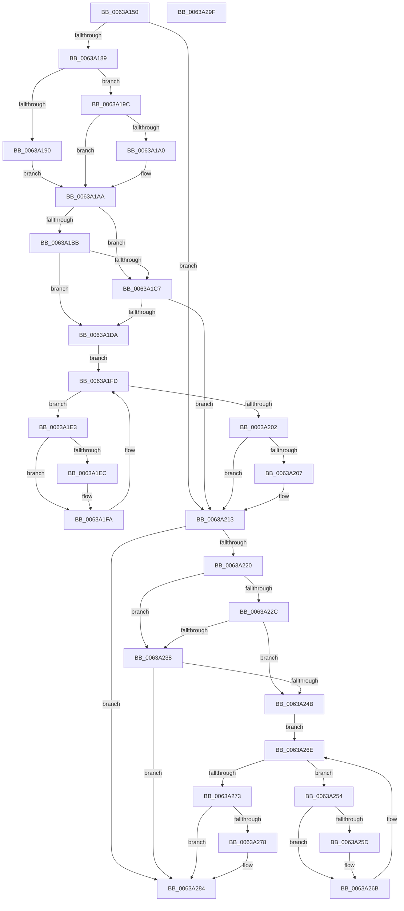

# DifPoFxStartDevicePowerManagementWrapper

- RVA: `0x0063A150`–`0x0063A2A0` (길이 `336` bytes)
- VA: `0x000000014063A150`
- 실행 섹션: `.text`
- PDB 이름 있음: `예`; PDB Function 태그: `아니요`
- unwind 정보 RVA: `0x0005D7BC`
- 디코드: `90`개 명령, `336/336` bytes 표시
- 미해석 바이트: `0` (있으면 어셈블리에 `.byte`로 보존)

> 이 문서는 커널 이미지의 기계어와 PDB 기호를 분석해 생성했습니다. 4번과 5번은 함수 원형과 자료형을 바이너리 사용 방식에서 추정한 C 해석이며 원본 소스 복구 결과는 아닙니다.

## 1. Dependencies

- 직접 호출 지점: **9**; 고유 호출 대상: **6**
- 직접 호출자로 확인된 함수: **0**
- RIP 상대 이미지 참조: **3**

### Outgoing calls
- `0x0063A178` → [DifGetAPIThunkContextById](../49/DifGetAPIThunkContextById_function_00495A34.md) (function, `0x00495A34`)
- `0x0063A1A0` → [DifGetReturnAddressForWrappers](../4D/DifGetReturnAddressForWrappers_function_004D3C08.md) (function, `0x004D3C08`)
- `0x0063A1CE` → [ExAcquireRundownProtection](../21/ExAcquireRundownProtection_function_00216620.md) (function, `0x00216620`)
- `0x0063A1F5` → [guard_dispatch_icall](../6B/guard_dispatch_icall_function_006BAAD0.md) (function, `0x006BAAD0`)
- `0x0063A20E` → [ExReleaseRundownProtection](../34/ExReleaseRundownProtection_function_00349E80.md) (function, `0x00349E80`)
- `0x0063A216` → [PoFxStartDevicePowerManagement](../4B/PoFxStartDevicePowerManagement_function_004B5740.md) (function, `0x004B5740`)
- `0x0063A23F` → [ExAcquireRundownProtection](../21/ExAcquireRundownProtection_function_00216620.md) (function, `0x00216620`)
- `0x0063A266` → [guard_dispatch_icall](../6B/guard_dispatch_icall_function_006BAAD0.md) (function, `0x006BAAD0`)
- `0x0063A27F` → [ExReleaseRundownProtection](../34/ExReleaseRundownProtection_function_00349E80.md) (function, `0x00349E80`)

### Direct callers
- 이 함수 시작 RVA로 연결되는 직접 call은 확인되지 않았습니다. 간접 호출은 완전히 역산할 수 없습니다.

### Static image references
- `0x0063A1B2` → RVA `0x00F048B8` (`.data`; read)
- `0x0063A1BB` → RVA `0x00F04980` (`.data`; read)
- `0x0063A1C7` → RVA `0x00F03E80` (`.data`; read)

## 2. Other-region calls and transfers

- 다른 실행 섹션으로 향하는 call: **0**
- 별도 외부 분기/꼬리 이동을 확인하지 못했습니다.

## 3. Assembly (complete function range)

```asm
0063A150  48 8B C4                        mov rax, rsp
0063A153  48 89 58 08                     mov qword ptr [rax + 8], rbx
0063A157  48 89 68 10                     mov qword ptr [rax + 0x10], rbp
0063A15B  48 89 70 18                     mov qword ptr [rax + 0x18], rsi
0063A15F  48 89 78 20                     mov qword ptr [rax + 0x20], rdi
0063A163  41 56                           push r14
0063A165  48 83 EC 30                     sub rsp, 0x30
0063A169  48 8B E9                        mov rbp, rcx
0063A16C  0F 57 C0                        xorps xmm0, xmm0
0063A16F  B9 B4 00 00 00                  mov ecx, 0xb4
0063A174  0F 11 40 E8                     movups xmmword ptr [rax - 0x18], xmm0
0063A178  E8 B7 B8 E5 FF                  call 0x140495a34
0063A17D  48 8B F8                        mov rdi, rax
0063A180  48 85 C0                        test rax, rax
0063A183  0F 84 8A 00 00 00               je 0x14063a213
0063A189  8B 40 0C                        mov eax, dword ptr [rax + 0xc]
0063A18C  A8 18                           test al, 0x18
0063A18E  74 0C                           je 0x14063a19c
0063A190  48 8B 4C 24 38                  mov rcx, qword ptr [rsp + 0x38]
0063A195  48 89 4C 24 20                  mov qword ptr [rsp + 0x20], rcx
0063A19A  EB 0E                           jmp 0x14063a1aa
0063A19C  A8 04                           test al, 4
0063A19E  74 0A                           je 0x14063a1aa
0063A1A0  E8 63 9A E9 FF                  call 0x1404d3c08
0063A1A5  48 89 44 24 20                  mov qword ptr [rsp + 0x20], rax
0063A1AA  40 32 F6                        xor sil, sil
0063A1AD  48 89 6C 24 28                  mov qword ptr [rsp + 0x28], rbp
0063A1B2  40 38 35 FF A6 8C 00            cmp byte ptr [rip + 0x8ca6ff], sil
0063A1B9  75 0C                           jne 0x14063a1c7
0063A1BB  F7 05 BB A7 8C 00 00 08 00 00   test dword ptr [rip + 0x8ca7bb], 0x800
0063A1C5  74 13                           je 0x14063a1da
0063A1C7  48 8D 0D B2 9C 8C 00            lea rcx, [rip + 0x8c9cb2]
0063A1CE  E8 4D C4 BD FF                  call 0x140216620
0063A1D3  40 8A F0                        mov sil, al
0063A1D6  84 C0                           test al, al
0063A1D8  74 39                           je 0x14063a213
0063A1DA  4C 8D 77 20                     lea r14, [rdi + 0x20]
0063A1DE  49 8B 1E                        mov rbx, qword ptr [r14]
0063A1E1  EB 1A                           jmp 0x14063a1fd
0063A1E3  48 8D 43 F0                     lea rax, [rbx - 0x10]
0063A1E7  48 85 C0                        test rax, rax
0063A1EA  74 0E                           je 0x14063a1fa
0063A1EC  48 8B 40 08                     mov rax, qword ptr [rax + 8]
0063A1F0  48 8D 4C 24 20                  lea rcx, [rsp + 0x20]
0063A1F5  E8 D6 08 08 00                  call 0x1406baad0
0063A1FA  48 8B 1B                        mov rbx, qword ptr [rbx]
0063A1FD  49 3B DE                        cmp rbx, r14
0063A200  75 E1                           jne 0x14063a1e3
0063A202  40 84 F6                        test sil, sil
0063A205  74 0C                           je 0x14063a213
0063A207  48 8D 0D 72 9C 8C 00            lea rcx, [rip + 0x8c9c72]
0063A20E  E8 6D FC D0 FF                  call 0x140349e80
0063A213  48 8B CD                        mov rcx, rbp
0063A216  E8 25 B5 E7 FF                  call 0x1404b5740
0063A21B  48 85 FF                        test rdi, rdi
0063A21E  74 64                           je 0x14063a284
0063A220  40 32 F6                        xor sil, sil
0063A223  40 38 35 8E A6 8C 00            cmp byte ptr [rip + 0x8ca68e], sil
0063A22A  75 0C                           jne 0x14063a238
0063A22C  F7 05 4A A7 8C 00 00 08 00 00   test dword ptr [rip + 0x8ca74a], 0x800
0063A236  74 13                           je 0x14063a24b
0063A238  48 8D 0D 41 9C 8C 00            lea rcx, [rip + 0x8c9c41]
0063A23F  E8 DC C3 BD FF                  call 0x140216620
0063A244  40 8A F0                        mov sil, al
0063A247  84 C0                           test al, al
0063A249  74 39                           je 0x14063a284
0063A24B  48 83 C7 30                     add rdi, 0x30
0063A24F  48 8B 1F                        mov rbx, qword ptr [rdi]
0063A252  EB 1A                           jmp 0x14063a26e
0063A254  48 8D 43 F0                     lea rax, [rbx - 0x10]
0063A258  48 85 C0                        test rax, rax
0063A25B  74 0E                           je 0x14063a26b
0063A25D  48 8B 40 08                     mov rax, qword ptr [rax + 8]
0063A261  48 8D 4C 24 20                  lea rcx, [rsp + 0x20]
0063A266  E8 65 08 08 00                  call 0x1406baad0
0063A26B  48 8B 1B                        mov rbx, qword ptr [rbx]
0063A26E  48 3B DF                        cmp rbx, rdi
0063A271  75 E1                           jne 0x14063a254
0063A273  40 84 F6                        test sil, sil
0063A276  74 0C                           je 0x14063a284
0063A278  48 8D 0D 01 9C 8C 00            lea rcx, [rip + 0x8c9c01]
0063A27F  E8 FC FB D0 FF                  call 0x140349e80
0063A284  48 8B 5C 24 40                  mov rbx, qword ptr [rsp + 0x40]
0063A289  48 8B 6C 24 48                  mov rbp, qword ptr [rsp + 0x48]
0063A28E  48 8B 74 24 50                  mov rsi, qword ptr [rsp + 0x50]
0063A293  48 8B 7C 24 58                  mov rdi, qword ptr [rsp + 0x58]
0063A298  48 83 C4 30                     add rsp, 0x30
0063A29C  41 5E                           pop r14
0063A29E  C3                              ret
0063A29F  CC                              int3
```

## 4. C-style interpretation (structured pseudocode)

```c
__int64 __fastcall DifPoFxStartDevicePowerManagementWrapper(__int64 a1)
{
    __int64 result;
    __int64 v_rdi;
    __int64 v_rsi;
    __int64 v_rsp;
    unsigned __int64 v_stack_m10;
    unsigned __int64 v_stack_m18;
    unsigned __int64 v_stack_p0;
    unsigned __int64 v_stack_p10;
    unsigned __int64 v_stack_p18;
    unsigned __int64 v_stack_p20;
    unsigned __int64 v_stack_p8;

    *(unsigned __int64 *)(v_rsp + 8) = v_rbx;
    *(unsigned __int64 *)(v_rsp + 16) = v_rbp;
    *(unsigned __int64 *)(v_rsp + 24) = v_rsi;
    *(unsigned __int64 *)(v_rsp + 32) = v_rdi;
    v_rsp = (v_rsp) - (48);
    *(unsigned __int64 *)(v_rsp - 24) = v_xmm0;
    result = DifGetAPIThunkContextById(180, a2, a3, a4);
    if (result == 0) goto loc_0063A213;
    if ((((unsigned __int8)((unsigned int)(*(unsigned int *)(result + 12)))) & (24)) == 0) goto loc_0063A19C;
    v_stack_m18 = v_stack_p0;
    goto loc_0063A1AA;
loc_0063A19C:
    result = (unsigned int)(*(unsigned int *)(result + 12));
    if ((((unsigned __int8)((unsigned int)(*(unsigned int *)(result + 12)))) & (4)) != 0) {
        result = DifGetReturnAddressForWrappers(v_stack_p0, a2, a3, a4);
        v_stack_m18 = result;
    }
    v_rsi = 0;
    v_stack_m10 = a1;
    if ((*(unsigned __int8 *)(v_rip + 9217791)) != 0) goto loc_0063A1C7;
    if (((*(unsigned int *)(v_rip + 9217979)) & (0x800ULL)) == 0) goto loc_0063A1DA;
loc_0063A1C7:
    result = ExAcquireRundownProtection(v_rip + 9215154, a2, a3, a4);
    if ((unsigned __int8)(result) == 0) goto loc_0063A213;
loc_0063A1DA:
    goto loc_0063A1FD;
loc_0063A1E3:
    result = *(unsigned __int64 *)(result + 32) - 16;
    if (*(unsigned __int64 *)(result + 32) - 16 != 0) {
        result = *(unsigned __int64 *)(*(unsigned __int64 *)(result + 32) - 16 + 8);
        a1 = v_stack_m18;
        result = guard_dispatch_icall(a1, a2, a3, a4);
    }
loc_0063A1FD:
    if ((*(unsigned __int64 *)(*(unsigned __int64 *)(result + 32))) != (result + 32)) goto loc_0063A1E3;
    if ((unsigned __int8)((unsigned __int8)(result)) != 0) {
        a1 = v_rip + 9215090;
        result = ExReleaseRundownProtection(a1, a2, a3, a4);
    }
    result = PoFxStartDevicePowerManagement(a1, a2, a3, a4);
    if (result == 0) goto loc_0063A284;
    v_rsi = 0;
    if ((*(unsigned __int8 *)(v_rip + 9217678)) != 0) goto loc_0063A238;
    if (((*(unsigned int *)(v_rip + 9217866)) & (0x800ULL)) == 0) goto loc_0063A24B;
loc_0063A238:
    result = ExAcquireRundownProtection(v_rip + 9215041, a2, a3, a4);
    if ((unsigned __int8)(result) == 0) goto loc_0063A284;
loc_0063A24B:
    v_rdi = (result) + (48);
    goto loc_0063A26E;
loc_0063A254:
    result = *(unsigned __int64 *)(v_rdi) - 16;
    if (*(unsigned __int64 *)(v_rdi) - 16 != 0) {
        result = *(unsigned __int64 *)(*(unsigned __int64 *)(v_rdi) - 16 + 8);
        a1 = v_stack_m18;
        result = guard_dispatch_icall(a1, a2, a3, a4);
    }
loc_0063A26E:
    if ((*(unsigned __int64 *)(*(unsigned __int64 *)(v_rdi))) != v_rdi) goto loc_0063A254;
    if ((unsigned __int8)((unsigned __int8)(result)) != 0) {
        a1 = v_rip + 9214977;
        result = ExReleaseRundownProtection(a1, a2, a3, a4);
    }
    v_rsp = (v_rsp) + (48);
    return result;
}
```

## 5. (Beta) C Style

```c
int64_t DifPoFxStartDevicePowerManagementWrapper(int64_t Arg1)
{
    int64_t result;
    int64_t local_rdi;
    int64_t local_rsi;
    int64_t local_rsp;
    uint64_t v_stack_m10;
    uint64_t v_stack_m18;
    uint64_t v_stack_p0;
    uint64_t v_stack_p10;
    uint64_t v_stack_p18;
    uint64_t v_stack_p20;
    uint64_t v_stack_p8;

    *(uint64_t *)(local_rsp + 0x8) = local_rbx;
    *(uint64_t *)(local_rsp + 0x10) = local_rbp;
    *(uint64_t *)(local_rsp + 0x18) = local_rsi;
    *(uint64_t *)(local_rsp + 0x20) = local_rdi;
    local_rsp = (local_rsp) - (48);
    *(uint64_t *)(local_rsp - 0x18) = v_xmm0;
    result = DifGetAPIThunkContextById(180, a2, a3, a4);
    if (result == 0) goto loc_0063A213;
    if ((((uint8_t)((uint32_t)(*(uint32_t *)(result + 0xC)))) & (24)) == 0) goto loc_0063A19C;
    v_stack_m18 = v_stack_p0;
    goto loc_0063A1AA;
loc_0063A19C:
    result = (uint32_t)(*(uint32_t *)(result + 0xC));
    if ((((uint8_t)((uint32_t)(*(uint32_t *)(result + 0xC)))) & (4)) != 0) {
        result = DifGetReturnAddressForWrappers(v_stack_p0, a2, a3, a4);
        v_stack_m18 = result;
    }
    local_rsi = 0;
    v_stack_m10 = Arg1;
    if ((*(uint8_t *)(v_rip + 0x8CA6FF)) != 0) goto loc_0063A1C7;
    if (((*(uint32_t *)(v_rip + 0x8CA7BB)) & (0x800ULL)) == 0) goto loc_0063A1DA;
loc_0063A1C7:
    result = ExAcquireRundownProtection(v_rip + 9215154, a2, a3, a4);
    if ((uint8_t)(result) == 0) goto loc_0063A213;
loc_0063A1DA:
    goto loc_0063A1FD;
loc_0063A1E3:
    result = *(uint64_t *)(result + 0x20) - 16;
    if (*(uint64_t *)(result + 0x20) - 16 != 0) {
        result = *(uint64_t *)(*(uint64_t *)(result + 0x20) - 0x10 + 0x8);
        Arg1 = v_stack_m18;
        result = guard_dispatch_icall(Arg1, a2, a3, a4);
    }
loc_0063A1FD:
    if ((*(uint64_t *)(*(uint64_t *)(result + 0x20))) != (result + 32)) goto loc_0063A1E3;
    if ((uint8_t)((uint8_t)(result)) != 0) {
        Arg1 = v_rip + 9215090;
        result = ExReleaseRundownProtection(Arg1, a2, a3, a4);
    }
    result = PoFxStartDevicePowerManagement(Arg1, a2, a3, a4);
    if (result == 0) goto loc_0063A284;
    local_rsi = 0;
    if ((*(uint8_t *)(v_rip + 0x8CA68E)) != 0) goto loc_0063A238;
    if (((*(uint32_t *)(v_rip + 0x8CA74A)) & (0x800ULL)) == 0) goto loc_0063A24B;
loc_0063A238:
    result = ExAcquireRundownProtection(v_rip + 9215041, a2, a3, a4);
    if ((uint8_t)(result) == 0) goto loc_0063A284;
loc_0063A24B:
    local_rdi = (result) + (48);
    goto loc_0063A26E;
loc_0063A254:
    result = *(uint64_t *)(local_rdi) - 16;
    if (*(uint64_t *)(local_rdi) - 16 != 0) {
        result = *(uint64_t *)(*(uint64_t *)(local_rdi) - 0x10 + 0x8);
        Arg1 = v_stack_m18;
        result = guard_dispatch_icall(Arg1, a2, a3, a4);
    }
loc_0063A26E:
    if ((*(uint64_t *)(*(uint64_t *)(local_rdi))) != local_rdi) goto loc_0063A254;
    if ((uint8_t)((uint8_t)(result)) != 0) {
        Arg1 = v_rip + 9214977;
        result = ExReleaseRundownProtection(Arg1, a2, a3, a4);
    }
    local_rsp = (local_rsp) + (48);
    return result;
}
```

## 6. Execution-region graph

[열기: 2D/3D 그래프와 함수 탐색 컨트롤 패널](../../../control-panel.html?section=text&rva=0x0063A150&view=graph)

- 2D 그래프는 위에서 아래로 흐르고, 3D 그래프는 빈 공간을 드래그해 회전합니다. Shift+드래그는 이동, 휠은 확대·축소, 함수 노드 선택은 대상 보고서 이동입니다.

### Static fallback


