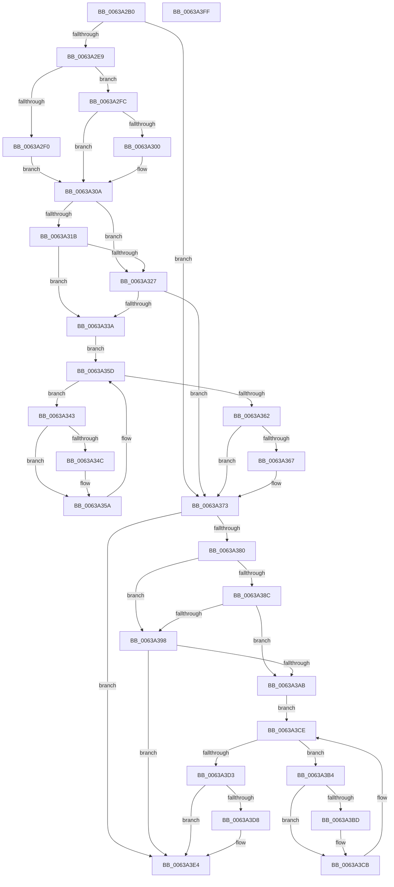

# DifPoFxUnregisterDeviceWrapper

- RVA: `0x0063A2B0`–`0x0063A400` (길이 `336` bytes)
- VA: `0x000000014063A2B0`
- 실행 섹션: `.text`
- PDB 이름 있음: `예`; PDB Function 태그: `아니요`
- unwind 정보 RVA: `0x0005D7BC`
- 디코드: `90`개 명령, `336/336` bytes 표시
- 미해석 바이트: `0` (있으면 어셈블리에 `.byte`로 보존)

> 이 문서는 커널 이미지의 기계어와 PDB 기호를 분석해 생성했습니다. 4번과 5번은 함수 원형과 자료형을 바이너리 사용 방식에서 추정한 C 해석이며 원본 소스 복구 결과는 아닙니다.

## 1. Dependencies

- 직접 호출 지점: **9**; 고유 호출 대상: **6**
- 직접 호출자로 확인된 함수: **0**
- RIP 상대 이미지 참조: **3**

### Outgoing calls
- `0x0063A2D8` → [DifGetAPIThunkContextById](../49/DifGetAPIThunkContextById_function_00495A34.md) (function, `0x00495A34`)
- `0x0063A300` → [DifGetReturnAddressForWrappers](../4D/DifGetReturnAddressForWrappers_function_004D3C08.md) (function, `0x004D3C08`)
- `0x0063A32E` → [ExAcquireRundownProtection](../21/ExAcquireRundownProtection_function_00216620.md) (function, `0x00216620`)
- `0x0063A355` → [guard_dispatch_icall](../6B/guard_dispatch_icall_function_006BAAD0.md) (function, `0x006BAAD0`)
- `0x0063A36E` → [ExReleaseRundownProtection](../34/ExReleaseRundownProtection_function_00349E80.md) (function, `0x00349E80`)
- `0x0063A376` → [PoFxUnregisterDevice](../../page/A8/PoFxUnregisterDevice_function_00A8AB20.md) (function, `0x00A8AB20`)
- `0x0063A39F` → [ExAcquireRundownProtection](../21/ExAcquireRundownProtection_function_00216620.md) (function, `0x00216620`)
- `0x0063A3C6` → [guard_dispatch_icall](../6B/guard_dispatch_icall_function_006BAAD0.md) (function, `0x006BAAD0`)
- `0x0063A3DF` → [ExReleaseRundownProtection](../34/ExReleaseRundownProtection_function_00349E80.md) (function, `0x00349E80`)

### Direct callers
- 이 함수 시작 RVA로 연결되는 직접 call은 확인되지 않았습니다. 간접 호출은 완전히 역산할 수 없습니다.

### Static image references
- `0x0063A312` → RVA `0x00F048B8` (`.data`; read)
- `0x0063A31B` → RVA `0x00F04980` (`.data`; read)
- `0x0063A327` → RVA `0x00F03E80` (`.data`; read)

## 2. Other-region calls and transfers

- 다른 실행 섹션으로 향하는 call: **1**
  - `0x0063A376` → [PoFxUnregisterDevice](../../page/A8/PoFxUnregisterDevice_function_00A8AB20.md) (`.text` → `PAGE`)
- 별도 외부 분기/꼬리 이동을 확인하지 못했습니다.

## 3. Assembly (complete function range)

```asm
0063A2B0  48 8B C4                        mov rax, rsp
0063A2B3  48 89 58 08                     mov qword ptr [rax + 8], rbx
0063A2B7  48 89 68 10                     mov qword ptr [rax + 0x10], rbp
0063A2BB  48 89 70 18                     mov qword ptr [rax + 0x18], rsi
0063A2BF  48 89 78 20                     mov qword ptr [rax + 0x20], rdi
0063A2C3  41 56                           push r14
0063A2C5  48 83 EC 30                     sub rsp, 0x30
0063A2C9  48 8B E9                        mov rbp, rcx
0063A2CC  0F 57 C0                        xorps xmm0, xmm0
0063A2CF  B9 B3 00 00 00                  mov ecx, 0xb3
0063A2D4  0F 11 40 E8                     movups xmmword ptr [rax - 0x18], xmm0
0063A2D8  E8 57 B7 E5 FF                  call 0x140495a34
0063A2DD  48 8B F8                        mov rdi, rax
0063A2E0  48 85 C0                        test rax, rax
0063A2E3  0F 84 8A 00 00 00               je 0x14063a373
0063A2E9  8B 40 0C                        mov eax, dword ptr [rax + 0xc]
0063A2EC  A8 18                           test al, 0x18
0063A2EE  74 0C                           je 0x14063a2fc
0063A2F0  48 8B 4C 24 38                  mov rcx, qword ptr [rsp + 0x38]
0063A2F5  48 89 4C 24 20                  mov qword ptr [rsp + 0x20], rcx
0063A2FA  EB 0E                           jmp 0x14063a30a
0063A2FC  A8 04                           test al, 4
0063A2FE  74 0A                           je 0x14063a30a
0063A300  E8 03 99 E9 FF                  call 0x1404d3c08
0063A305  48 89 44 24 20                  mov qword ptr [rsp + 0x20], rax
0063A30A  40 32 F6                        xor sil, sil
0063A30D  48 89 6C 24 28                  mov qword ptr [rsp + 0x28], rbp
0063A312  40 38 35 9F A5 8C 00            cmp byte ptr [rip + 0x8ca59f], sil
0063A319  75 0C                           jne 0x14063a327
0063A31B  F7 05 5B A6 8C 00 00 08 00 00   test dword ptr [rip + 0x8ca65b], 0x800
0063A325  74 13                           je 0x14063a33a
0063A327  48 8D 0D 52 9B 8C 00            lea rcx, [rip + 0x8c9b52]
0063A32E  E8 ED C2 BD FF                  call 0x140216620
0063A333  40 8A F0                        mov sil, al
0063A336  84 C0                           test al, al
0063A338  74 39                           je 0x14063a373
0063A33A  4C 8D 77 20                     lea r14, [rdi + 0x20]
0063A33E  49 8B 1E                        mov rbx, qword ptr [r14]
0063A341  EB 1A                           jmp 0x14063a35d
0063A343  48 8D 43 F0                     lea rax, [rbx - 0x10]
0063A347  48 85 C0                        test rax, rax
0063A34A  74 0E                           je 0x14063a35a
0063A34C  48 8B 40 08                     mov rax, qword ptr [rax + 8]
0063A350  48 8D 4C 24 20                  lea rcx, [rsp + 0x20]
0063A355  E8 76 07 08 00                  call 0x1406baad0
0063A35A  48 8B 1B                        mov rbx, qword ptr [rbx]
0063A35D  49 3B DE                        cmp rbx, r14
0063A360  75 E1                           jne 0x14063a343
0063A362  40 84 F6                        test sil, sil
0063A365  74 0C                           je 0x14063a373
0063A367  48 8D 0D 12 9B 8C 00            lea rcx, [rip + 0x8c9b12]
0063A36E  E8 0D FB D0 FF                  call 0x140349e80
0063A373  48 8B CD                        mov rcx, rbp
0063A376  E8 A5 07 45 00                  call 0x140a8ab20
0063A37B  48 85 FF                        test rdi, rdi
0063A37E  74 64                           je 0x14063a3e4
0063A380  40 32 F6                        xor sil, sil
0063A383  40 38 35 2E A5 8C 00            cmp byte ptr [rip + 0x8ca52e], sil
0063A38A  75 0C                           jne 0x14063a398
0063A38C  F7 05 EA A5 8C 00 00 08 00 00   test dword ptr [rip + 0x8ca5ea], 0x800
0063A396  74 13                           je 0x14063a3ab
0063A398  48 8D 0D E1 9A 8C 00            lea rcx, [rip + 0x8c9ae1]
0063A39F  E8 7C C2 BD FF                  call 0x140216620
0063A3A4  40 8A F0                        mov sil, al
0063A3A7  84 C0                           test al, al
0063A3A9  74 39                           je 0x14063a3e4
0063A3AB  48 83 C7 30                     add rdi, 0x30
0063A3AF  48 8B 1F                        mov rbx, qword ptr [rdi]
0063A3B2  EB 1A                           jmp 0x14063a3ce
0063A3B4  48 8D 43 F0                     lea rax, [rbx - 0x10]
0063A3B8  48 85 C0                        test rax, rax
0063A3BB  74 0E                           je 0x14063a3cb
0063A3BD  48 8B 40 08                     mov rax, qword ptr [rax + 8]
0063A3C1  48 8D 4C 24 20                  lea rcx, [rsp + 0x20]
0063A3C6  E8 05 07 08 00                  call 0x1406baad0
0063A3CB  48 8B 1B                        mov rbx, qword ptr [rbx]
0063A3CE  48 3B DF                        cmp rbx, rdi
0063A3D1  75 E1                           jne 0x14063a3b4
0063A3D3  40 84 F6                        test sil, sil
0063A3D6  74 0C                           je 0x14063a3e4
0063A3D8  48 8D 0D A1 9A 8C 00            lea rcx, [rip + 0x8c9aa1]
0063A3DF  E8 9C FA D0 FF                  call 0x140349e80
0063A3E4  48 8B 5C 24 40                  mov rbx, qword ptr [rsp + 0x40]
0063A3E9  48 8B 6C 24 48                  mov rbp, qword ptr [rsp + 0x48]
0063A3EE  48 8B 74 24 50                  mov rsi, qword ptr [rsp + 0x50]
0063A3F3  48 8B 7C 24 58                  mov rdi, qword ptr [rsp + 0x58]
0063A3F8  48 83 C4 30                     add rsp, 0x30
0063A3FC  41 5E                           pop r14
0063A3FE  C3                              ret
0063A3FF  CC                              int3
```

## 4. C-style interpretation (structured pseudocode)

```c
__int64 __fastcall DifPoFxUnregisterDeviceWrapper(__int64 a1)
{
    __int64 result;
    __int64 v_rdi;
    __int64 v_rsi;
    __int64 v_rsp;
    unsigned __int64 v_stack_m10;
    unsigned __int64 v_stack_m18;
    unsigned __int64 v_stack_p0;
    unsigned __int64 v_stack_p10;
    unsigned __int64 v_stack_p18;
    unsigned __int64 v_stack_p20;
    unsigned __int64 v_stack_p8;

    *(unsigned __int64 *)(v_rsp + 8) = v_rbx;
    *(unsigned __int64 *)(v_rsp + 16) = v_rbp;
    *(unsigned __int64 *)(v_rsp + 24) = v_rsi;
    *(unsigned __int64 *)(v_rsp + 32) = v_rdi;
    v_rsp = (v_rsp) - (48);
    *(unsigned __int64 *)(v_rsp - 24) = v_xmm0;
    result = DifGetAPIThunkContextById(179, a2, a3, a4);
    if (result == 0) goto loc_0063A373;
    if ((((unsigned __int8)((unsigned int)(*(unsigned int *)(result + 12)))) & (24)) == 0) goto loc_0063A2FC;
    v_stack_m18 = v_stack_p0;
    goto loc_0063A30A;
loc_0063A2FC:
    result = (unsigned int)(*(unsigned int *)(result + 12));
    if ((((unsigned __int8)((unsigned int)(*(unsigned int *)(result + 12)))) & (4)) != 0) {
        result = DifGetReturnAddressForWrappers(v_stack_p0, a2, a3, a4);
        v_stack_m18 = result;
    }
    v_rsi = 0;
    v_stack_m10 = a1;
    if ((*(unsigned __int8 *)(v_rip + 9217439)) != 0) goto loc_0063A327;
    if (((*(unsigned int *)(v_rip + 9217627)) & (0x800ULL)) == 0) goto loc_0063A33A;
loc_0063A327:
    result = ExAcquireRundownProtection(v_rip + 9214802, a2, a3, a4);
    if ((unsigned __int8)(result) == 0) goto loc_0063A373;
loc_0063A33A:
    goto loc_0063A35D;
loc_0063A343:
    result = *(unsigned __int64 *)(result + 32) - 16;
    if (*(unsigned __int64 *)(result + 32) - 16 != 0) {
        result = *(unsigned __int64 *)(*(unsigned __int64 *)(result + 32) - 16 + 8);
        a1 = v_stack_m18;
        result = guard_dispatch_icall(a1, a2, a3, a4);
    }
loc_0063A35D:
    if ((*(unsigned __int64 *)(*(unsigned __int64 *)(result + 32))) != (result + 32)) goto loc_0063A343;
    if ((unsigned __int8)((unsigned __int8)(result)) != 0) {
        a1 = v_rip + 9214738;
        result = ExReleaseRundownProtection(a1, a2, a3, a4);
    }
    result = PoFxUnregisterDevice(a1, a2, a3, a4);
    if (result == 0) goto loc_0063A3E4;
    v_rsi = 0;
    if ((*(unsigned __int8 *)(v_rip + 9217326)) != 0) goto loc_0063A398;
    if (((*(unsigned int *)(v_rip + 9217514)) & (0x800ULL)) == 0) goto loc_0063A3AB;
loc_0063A398:
    result = ExAcquireRundownProtection(v_rip + 9214689, a2, a3, a4);
    if ((unsigned __int8)(result) == 0) goto loc_0063A3E4;
loc_0063A3AB:
    v_rdi = (result) + (48);
    goto loc_0063A3CE;
loc_0063A3B4:
    result = *(unsigned __int64 *)(v_rdi) - 16;
    if (*(unsigned __int64 *)(v_rdi) - 16 != 0) {
        result = *(unsigned __int64 *)(*(unsigned __int64 *)(v_rdi) - 16 + 8);
        a1 = v_stack_m18;
        result = guard_dispatch_icall(a1, a2, a3, a4);
    }
loc_0063A3CE:
    if ((*(unsigned __int64 *)(*(unsigned __int64 *)(v_rdi))) != v_rdi) goto loc_0063A3B4;
    if ((unsigned __int8)((unsigned __int8)(result)) != 0) {
        a1 = v_rip + 9214625;
        result = ExReleaseRundownProtection(a1, a2, a3, a4);
    }
    v_rsp = (v_rsp) + (48);
    return result;
}
```

## 5. (Beta) C Style

```c
int64_t DifPoFxUnregisterDeviceWrapper(int64_t Arg1)
{
    int64_t result;
    int64_t local_rdi;
    int64_t local_rsi;
    int64_t local_rsp;
    uint64_t v_stack_m10;
    uint64_t v_stack_m18;
    uint64_t v_stack_p0;
    uint64_t v_stack_p10;
    uint64_t v_stack_p18;
    uint64_t v_stack_p20;
    uint64_t v_stack_p8;

    *(uint64_t *)(local_rsp + 0x8) = local_rbx;
    *(uint64_t *)(local_rsp + 0x10) = local_rbp;
    *(uint64_t *)(local_rsp + 0x18) = local_rsi;
    *(uint64_t *)(local_rsp + 0x20) = local_rdi;
    local_rsp = (local_rsp) - (48);
    *(uint64_t *)(local_rsp - 0x18) = v_xmm0;
    result = DifGetAPIThunkContextById(179, a2, a3, a4);
    if (result == 0) goto loc_0063A373;
    if ((((uint8_t)((uint32_t)(*(uint32_t *)(result + 0xC)))) & (24)) == 0) goto loc_0063A2FC;
    v_stack_m18 = v_stack_p0;
    goto loc_0063A30A;
loc_0063A2FC:
    result = (uint32_t)(*(uint32_t *)(result + 0xC));
    if ((((uint8_t)((uint32_t)(*(uint32_t *)(result + 0xC)))) & (4)) != 0) {
        result = DifGetReturnAddressForWrappers(v_stack_p0, a2, a3, a4);
        v_stack_m18 = result;
    }
    local_rsi = 0;
    v_stack_m10 = Arg1;
    if ((*(uint8_t *)(v_rip + 0x8CA59F)) != 0) goto loc_0063A327;
    if (((*(uint32_t *)(v_rip + 0x8CA65B)) & (0x800ULL)) == 0) goto loc_0063A33A;
loc_0063A327:
    result = ExAcquireRundownProtection(v_rip + 9214802, a2, a3, a4);
    if ((uint8_t)(result) == 0) goto loc_0063A373;
loc_0063A33A:
    goto loc_0063A35D;
loc_0063A343:
    result = *(uint64_t *)(result + 0x20) - 16;
    if (*(uint64_t *)(result + 0x20) - 16 != 0) {
        result = *(uint64_t *)(*(uint64_t *)(result + 0x20) - 0x10 + 0x8);
        Arg1 = v_stack_m18;
        result = guard_dispatch_icall(Arg1, a2, a3, a4);
    }
loc_0063A35D:
    if ((*(uint64_t *)(*(uint64_t *)(result + 0x20))) != (result + 32)) goto loc_0063A343;
    if ((uint8_t)((uint8_t)(result)) != 0) {
        Arg1 = v_rip + 9214738;
        result = ExReleaseRundownProtection(Arg1, a2, a3, a4);
    }
    result = PoFxUnregisterDevice(Arg1, a2, a3, a4);
    if (result == 0) goto loc_0063A3E4;
    local_rsi = 0;
    if ((*(uint8_t *)(v_rip + 0x8CA52E)) != 0) goto loc_0063A398;
    if (((*(uint32_t *)(v_rip + 0x8CA5EA)) & (0x800ULL)) == 0) goto loc_0063A3AB;
loc_0063A398:
    result = ExAcquireRundownProtection(v_rip + 9214689, a2, a3, a4);
    if ((uint8_t)(result) == 0) goto loc_0063A3E4;
loc_0063A3AB:
    local_rdi = (result) + (48);
    goto loc_0063A3CE;
loc_0063A3B4:
    result = *(uint64_t *)(local_rdi) - 16;
    if (*(uint64_t *)(local_rdi) - 16 != 0) {
        result = *(uint64_t *)(*(uint64_t *)(local_rdi) - 0x10 + 0x8);
        Arg1 = v_stack_m18;
        result = guard_dispatch_icall(Arg1, a2, a3, a4);
    }
loc_0063A3CE:
    if ((*(uint64_t *)(*(uint64_t *)(local_rdi))) != local_rdi) goto loc_0063A3B4;
    if ((uint8_t)((uint8_t)(result)) != 0) {
        Arg1 = v_rip + 9214625;
        result = ExReleaseRundownProtection(Arg1, a2, a3, a4);
    }
    local_rsp = (local_rsp) + (48);
    return result;
}
```

## 6. Execution-region graph

[열기: 2D/3D 그래프와 함수 탐색 컨트롤 패널](../../../control-panel.html?section=text&rva=0x0063A2B0&view=graph)

- 2D 그래프는 위에서 아래로 흐르고, 3D 그래프는 빈 공간을 드래그해 회전합니다. Shift+드래그는 이동, 휠은 확대·축소, 함수 노드 선택은 대상 보고서 이동입니다.

### Static fallback


