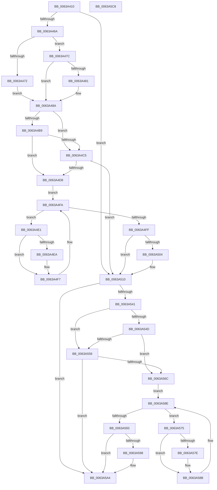

# DifPoRequestPowerIrpWrapper

- RVA: `0x0063A410`–`0x0063A5C9` (길이 `441` bytes)
- VA: `0x000000014063A410`
- 실행 섹션: `.text`
- PDB 이름 있음: `예`; PDB Function 태그: `아니요`
- unwind 정보 RVA: `0x000BC530`
- 디코드: `123`개 명령, `441/441` bytes 표시
- 미해석 바이트: `0` (있으면 어셈블리에 `.byte`로 보존)

> 이 문서는 커널 이미지의 기계어와 PDB 기호를 분석해 생성했습니다. 4번과 5번은 함수 원형과 자료형을 바이너리 사용 방식에서 추정한 C 해석이며 원본 소스 복구 결과는 아닙니다.

## 1. Dependencies

- 직접 호출 지점: **9**; 고유 호출 대상: **6**
- 직접 호출자로 확인된 함수: **0**
- RIP 상대 이미지 참조: **3**

### Outgoing calls
- `0x0063A459` → [DifGetAPIThunkContextById](../49/DifGetAPIThunkContextById_function_00495A34.md) (function, `0x00495A34`)
- `0x0063A481` → [DifGetReturnAddressForWrappers](../4D/DifGetReturnAddressForWrappers_function_004D3C08.md) (function, `0x004D3C08`)
- `0x0063A4CC` → [ExAcquireRundownProtection](../21/ExAcquireRundownProtection_function_00216620.md) (function, `0x00216620`)
- `0x0063A4F2` → [guard_dispatch_icall](../6B/guard_dispatch_icall_function_006BAAD0.md) (function, `0x006BAAD0`)
- `0x0063A50B` → [ExReleaseRundownProtection](../34/ExReleaseRundownProtection_function_00349E80.md) (function, `0x00349E80`)
- `0x0063A534` → [PopRequestPowerIrp](../27/PopRequestPowerIrp_function_00270ED4.md) (function, `0x00270ED4`)
- `0x0063A560` → [ExAcquireRundownProtection](../21/ExAcquireRundownProtection_function_00216620.md) (function, `0x00216620`)
- `0x0063A586` → [guard_dispatch_icall](../6B/guard_dispatch_icall_function_006BAAD0.md) (function, `0x006BAAD0`)
- `0x0063A59F` → [ExReleaseRundownProtection](../34/ExReleaseRundownProtection_function_00349E80.md) (function, `0x00349E80`)

### Direct callers
- 이 함수 시작 RVA로 연결되는 직접 call은 확인되지 않았습니다. 간접 호출은 완전히 역산할 수 없습니다.

### Static image references
- `0x0063A491` → RVA `0x00F048B8` (`.data`; read)
- `0x0063A4B9` → RVA `0x00F04980` (`.data`; read)
- `0x0063A4C5` → RVA `0x00F03E80` (`.data`; read)

## 2. Other-region calls and transfers

- 다른 실행 섹션으로 향하는 call: **0**
- 별도 외부 분기/꼬리 이동을 확인하지 못했습니다.

## 3. Assembly (complete function range)

```asm
0063A410  48 8B C4                        mov rax, rsp
0063A413  48 89 58 10                     mov qword ptr [rax + 0x10], rbx
0063A417  48 89 70 18                     mov qword ptr [rax + 0x18], rsi
0063A41B  48 89 78 20                     mov qword ptr [rax + 0x20], rdi
0063A41F  48 89 48 08                     mov qword ptr [rax + 8], rcx
0063A423  55                              push rbp
0063A424  41 54                           push r12
0063A426  41 55                           push r13
0063A428  41 56                           push r14
0063A42A  41 57                           push r15
0063A42C  48 8B EC                        mov rbp, rsp
0063A42F  48 81 EC 80 00 00 00            sub rsp, 0x80
0063A436  0F 57 C0                        xorps xmm0, xmm0
0063A439  33 C0                           xor eax, eax
0063A43B  B9 B2 00 00 00                  mov ecx, 0xb2
0063A440  48 89 45 F0                     mov qword ptr [rbp - 0x10], rax
0063A444  0F 11 45 C0                     movups xmmword ptr [rbp - 0x40], xmm0
0063A448  4D 8B E1                        mov r12, r9
0063A44B  41 8B D8                        mov ebx, r8d
0063A44E  0F 11 45 D0                     movups xmmword ptr [rbp - 0x30], xmm0
0063A452  44 8A EA                        mov r13b, dl
0063A455  0F 11 45 E0                     movups xmmword ptr [rbp - 0x20], xmm0
0063A459  E8 D6 B5 E5 FF                  call 0x140495a34
0063A45E  4C 8B F8                        mov r15, rax
0063A461  48 85 C0                        test rax, rax
0063A464  0F 84 A6 00 00 00               je 0x14063a510
0063A46A  8B 48 0C                        mov ecx, dword ptr [rax + 0xc]
0063A46D  F6 C1 18                        test cl, 0x18
0063A470  74 0A                           je 0x14063a47c
0063A472  48 8B 4D 28                     mov rcx, qword ptr [rbp + 0x28]
0063A476  48 89 4D C0                     mov qword ptr [rbp - 0x40], rcx
0063A47A  EB 0E                           jmp 0x14063a48a
0063A47C  F6 C1 04                        test cl, 4
0063A47F  74 09                           je 0x14063a48a
0063A481  E8 82 97 E9 FF                  call 0x1404d3c08
0063A486  48 89 45 C0                     mov qword ptr [rbp - 0x40], rax
0063A48A  48 8B 45 30                     mov rax, qword ptr [rbp + 0x30]
0063A48E  45 32 F6                        xor r14b, r14b
0063A491  44 38 35 20 A4 8C 00            cmp byte ptr [rip + 0x8ca420], r14b
0063A498  48 89 45 E8                     mov qword ptr [rbp - 0x18], rax
0063A49C  48 8B 45 50                     mov rax, qword ptr [rbp + 0x50]
0063A4A0  48 89 45 D0                     mov qword ptr [rbp - 0x30], rax
0063A4A4  48 8B 45 58                     mov rax, qword ptr [rbp + 0x58]
0063A4A8  48 89 45 C8                     mov qword ptr [rbp - 0x38], rax
0063A4AC  44 88 6D E4                     mov byte ptr [rbp - 0x1c], r13b
0063A4B0  89 5D E0                        mov dword ptr [rbp - 0x20], ebx
0063A4B3  4C 89 65 D8                     mov qword ptr [rbp - 0x28], r12
0063A4B7  75 0C                           jne 0x14063a4c5
0063A4B9  F7 05 BD A4 8C 00 00 08 00 00   test dword ptr [rip + 0x8ca4bd], 0x800
0063A4C3  74 13                           je 0x14063a4d8
0063A4C5  48 8D 0D B4 99 8C 00            lea rcx, [rip + 0x8c99b4]
0063A4CC  E8 4F C1 BD FF                  call 0x140216620
0063A4D1  44 8A F0                        mov r14b, al
0063A4D4  84 C0                           test al, al
0063A4D6  74 38                           je 0x14063a510
0063A4D8  49 8D 77 20                     lea rsi, [r15 + 0x20]
0063A4DC  48 8B 3E                        mov rdi, qword ptr [rsi]
0063A4DF  EB 19                           jmp 0x14063a4fa
0063A4E1  48 8D 47 F0                     lea rax, [rdi - 0x10]
0063A4E5  48 85 C0                        test rax, rax
0063A4E8  74 0D                           je 0x14063a4f7
0063A4EA  48 8B 40 08                     mov rax, qword ptr [rax + 8]
0063A4EE  48 8D 4D C0                     lea rcx, [rbp - 0x40]
0063A4F2  E8 D9 05 08 00                  call 0x1406baad0
0063A4F7  48 8B 3F                        mov rdi, qword ptr [rdi]
0063A4FA  48 3B FE                        cmp rdi, rsi
0063A4FD  75 E2                           jne 0x14063a4e1
0063A4FF  45 84 F6                        test r14b, r14b
0063A502  74 0C                           je 0x14063a510
0063A504  48 8D 0D 75 99 8C 00            lea rcx, [rip + 0x8c9975]
0063A50B  E8 70 F9 D0 FF                  call 0x140349e80
0063A510  48 8B 45 58                     mov rax, qword ptr [rbp + 0x58]
0063A514  4D 8B CC                        mov r9, r12
0063A517  48 8B 4D 30                     mov rcx, qword ptr [rbp + 0x30]
0063A51B  44 8B C3                        mov r8d, ebx
0063A51E  48 89 44 24 30                  mov qword ptr [rsp + 0x30], rax
0063A523  41 8A D5                        mov dl, r13b
0063A526  48 8B 45 50                     mov rax, qword ptr [rbp + 0x50]
0063A52A  C6 44 24 28 00                  mov byte ptr [rsp + 0x28], 0
0063A52F  48 89 44 24 20                  mov qword ptr [rsp + 0x20], rax
0063A534  E8 9B 69 C3 FF                  call 0x140270ed4
0063A539  89 45 F0                        mov dword ptr [rbp - 0x10], eax
0063A53C  4D 85 FF                        test r15, r15
0063A53F  74 63                           je 0x14063a5a4
0063A541  40 32 FF                        xor dil, dil
0063A544  40 38 3D 6D A3 8C 00            cmp byte ptr [rip + 0x8ca36d], dil
0063A54B  75 0C                           jne 0x14063a559
0063A54D  F7 05 29 A4 8C 00 00 08 00 00   test dword ptr [rip + 0x8ca429], 0x800
0063A557  74 13                           je 0x14063a56c
0063A559  48 8D 0D 20 99 8C 00            lea rcx, [rip + 0x8c9920]
0063A560  E8 BB C0 BD FF                  call 0x140216620
0063A565  40 8A F8                        mov dil, al
0063A568  84 C0                           test al, al
0063A56A  74 38                           je 0x14063a5a4
0063A56C  49 8D 77 30                     lea rsi, [r15 + 0x30]
0063A570  48 8B 1E                        mov rbx, qword ptr [rsi]
0063A573  EB 19                           jmp 0x14063a58e
0063A575  48 8D 43 F0                     lea rax, [rbx - 0x10]
0063A579  48 85 C0                        test rax, rax
0063A57C  74 0D                           je 0x14063a58b
0063A57E  48 8B 40 08                     mov rax, qword ptr [rax + 8]
0063A582  48 8D 4D C0                     lea rcx, [rbp - 0x40]
0063A586  E8 45 05 08 00                  call 0x1406baad0
0063A58B  48 8B 1B                        mov rbx, qword ptr [rbx]
0063A58E  48 3B DE                        cmp rbx, rsi
0063A591  75 E2                           jne 0x14063a575
0063A593  40 84 FF                        test dil, dil
0063A596  74 0C                           je 0x14063a5a4
0063A598  48 8D 0D E1 98 8C 00            lea rcx, [rip + 0x8c98e1]
0063A59F  E8 DC F8 D0 FF                  call 0x140349e80
0063A5A4  8B 45 F0                        mov eax, dword ptr [rbp - 0x10]
0063A5A7  4C 8D 9C 24 80 00 00 00         lea r11, [rsp + 0x80]
0063A5AF  49 8B 5B 38                     mov rbx, qword ptr [r11 + 0x38]
0063A5B3  49 8B 73 40                     mov rsi, qword ptr [r11 + 0x40]
0063A5B7  49 8B 7B 48                     mov rdi, qword ptr [r11 + 0x48]
0063A5BB  49 8B E3                        mov rsp, r11
0063A5BE  41 5F                           pop r15
0063A5C0  41 5E                           pop r14
0063A5C2  41 5D                           pop r13
0063A5C4  41 5C                           pop r12
0063A5C6  5D                              pop rbp
0063A5C7  C3                              ret
0063A5C8  CC                              int3
```

## 4. C-style interpretation (structured pseudocode)

```c
__int64 __fastcall DifPoRequestPowerIrpWrapper(__int64 a1, unsigned __int8 a2, int a3, __int64 a4, __int64 a5, __int64 a6)
{
    __int64 result;
    __int64 v_r14;
    __int64 v_rdi;
    __int64 v_rsp;
    unsigned __int64 v_stack_m28;
    unsigned __int64 v_stack_m38;
    unsigned __int64 v_stack_m40;
    unsigned __int8 v_stack_m44;
    unsigned __int64 v_stack_m48;
    unsigned __int64 v_stack_m50;
    unsigned __int64 v_stack_m58;
    unsigned __int64 v_stack_m60;
    unsigned __int64 v_stack_m68;
    unsigned __int64 v_stack_m78;
    unsigned __int8 v_stack_m80;
    unsigned __int64 v_stack_m88;
    unsigned __int64 v_stack_p0;
    unsigned __int64 v_stack_p8;

    *(unsigned __int64 *)(v_rsp + 16) = v_rbx;
    *(unsigned __int64 *)(v_rsp + 24) = v_rsi;
    *(unsigned __int64 *)(v_rsp + 32) = v_rdi;
    *(unsigned __int64 *)(v_rsp + 8) = a1;
    v_rsp = (v_rsp) - (128);
    result = 0;
    v_stack_m38 = 0;
    v_stack_m68 = v_xmm0;
    v_stack_m58 = v_xmm0;
    v_stack_m48 = v_xmm0;
    result = DifGetAPIThunkContextById(178, a2, a3, a4);
    if (result == 0) goto loc_0063A510;
    if ((((unsigned __int8)((unsigned int)(*(unsigned int *)(result + 12)))) & (24)) == 0) goto loc_0063A47C;
    v_stack_m68 = v_stack_p0;
    goto loc_0063A48A;
loc_0063A47C:
    if ((((unsigned __int8)(v_stack_p0)) & (4)) != 0) {
        result = DifGetReturnAddressForWrappers(v_stack_p0, a2, a3, a4);
        v_stack_m68 = result;
    }
    v_r14 = 0;
    v_stack_m40 = v_stack_p8;
    v_stack_m58 = a5;
    v_stack_m60 = a6;
    v_stack_m44 = a2;
    v_stack_m48 = (unsigned int)((unsigned int)(a3));
    v_stack_m50 = a4;
    if ((*(unsigned __int8 *)(v_rip + 9217056)) != 0) goto loc_0063A4C5;
    if (((*(unsigned int *)(v_rip + 9217213)) & (0x800ULL)) == 0) goto loc_0063A4D8;
loc_0063A4C5:
    result = ExAcquireRundownProtection(v_rip + 9214388, a2, a3, a4);
    if ((unsigned __int8)(result) == 0) goto loc_0063A510;
loc_0063A4D8:
    goto loc_0063A4FA;
loc_0063A4E1:
    result = *(unsigned __int64 *)(result + 32) - 16;
    if (*(unsigned __int64 *)(result + 32) - 16 != 0) {
        result = *(unsigned __int64 *)(*(unsigned __int64 *)(result + 32) - 16 + 8);
        a1 = v_stack_m68;
        result = guard_dispatch_icall(a1, a2, a3, a4);
    }
loc_0063A4FA:
    if ((*(unsigned __int64 *)(*(unsigned __int64 *)(result + 32))) != (result + 32)) goto loc_0063A4E1;
    if ((unsigned __int8)((unsigned __int8)(result)) != 0) {
        a1 = v_rip + 9214325;
        result = ExReleaseRundownProtection(a1, a2, a3, a4);
    }
    v_stack_m78 = a6;
    v_stack_m80 = 0;
    v_stack_m88 = a5;
    result = PopRequestPowerIrp(v_stack_p8, a2, (unsigned int)((unsigned int)((unsigned int)(a3))), a4);
    v_stack_m38 = (unsigned int)(result);
    if (result == 0) goto loc_0063A5A4;
    v_rdi = 0;
    if ((*(unsigned __int8 *)(v_rip + 9216877)) != 0) goto loc_0063A559;
    if (((*(unsigned int *)(v_rip + 9217065)) & (0x800ULL)) == 0) goto loc_0063A56C;
loc_0063A559:
    result = ExAcquireRundownProtection(v_rip + 9214240, a2, (unsigned int)((unsigned int)((unsigned int)(a3))), a4);
    if ((unsigned __int8)(result) == 0) goto loc_0063A5A4;
loc_0063A56C:
    goto loc_0063A58E;
loc_0063A575:
    result = *(unsigned __int64 *)(result + 48) - 16;
    if (*(unsigned __int64 *)(result + 48) - 16 != 0) {
        result = *(unsigned __int64 *)(*(unsigned __int64 *)(result + 48) - 16 + 8);
        a1 = v_stack_m68;
        result = guard_dispatch_icall(a1, a2, (unsigned int)((unsigned int)((unsigned int)(a3))), a4);
    }
loc_0063A58E:
    if ((*(unsigned __int64 *)(*(unsigned __int64 *)(result + 48))) != (result + 48)) goto loc_0063A575;
    if ((unsigned __int8)((unsigned __int8)(result)) != 0) {
        a1 = v_rip + 9214177;
        result = ExReleaseRundownProtection(a1, a2, (unsigned int)((unsigned int)((unsigned int)(a3))), a4);
    }
    return (unsigned int)(v_stack_m38);
}
```

## 5. (Beta) C Style

```c
int64_t DifPoRequestPowerIrpWrapper(int64_t Arg1, uint8_t Arg2, int32_t Arg3, int64_t Arg4, int64_t Arg5, int64_t Arg6)
{
    int64_t result;
    int64_t local_r14;
    int64_t local_rdi;
    int64_t local_rsp;
    uint64_t v_stack_m28;
    uint64_t v_stack_m38;
    uint64_t v_stack_m40;
    uint8_t v_stack_m44;
    uint64_t v_stack_m48;
    uint64_t v_stack_m50;
    uint64_t v_stack_m58;
    uint64_t v_stack_m60;
    uint64_t v_stack_m68;
    uint64_t v_stack_m78;
    uint8_t v_stack_m80;
    uint64_t v_stack_m88;
    uint64_t v_stack_p0;
    uint64_t v_stack_p8;

    *(uint64_t *)(local_rsp + 0x10) = local_rbx;
    *(uint64_t *)(local_rsp + 0x18) = local_rsi;
    *(uint64_t *)(local_rsp + 0x20) = local_rdi;
    *(uint64_t *)(local_rsp + 0x8) = Arg1;
    local_rsp = (local_rsp) - (128);
    result = 0;
    v_stack_m38 = 0;
    v_stack_m68 = v_xmm0;
    v_stack_m58 = v_xmm0;
    v_stack_m48 = v_xmm0;
    result = DifGetAPIThunkContextById(178, Arg2, Arg3, Arg4);
    if (result == 0) goto loc_0063A510;
    if ((((uint8_t)((uint32_t)(*(uint32_t *)(result + 0xC)))) & (24)) == 0) goto loc_0063A47C;
    v_stack_m68 = v_stack_p0;
    goto loc_0063A48A;
loc_0063A47C:
    if ((((uint8_t)(v_stack_p0)) & (4)) != 0) {
        result = DifGetReturnAddressForWrappers(v_stack_p0, Arg2, Arg3, Arg4);
        v_stack_m68 = result;
    }
    local_r14 = 0;
    v_stack_m40 = v_stack_p8;
    v_stack_m58 = Arg5;
    v_stack_m60 = Arg6;
    v_stack_m44 = Arg2;
    v_stack_m48 = (uint32_t)((uint32_t)(Arg3));
    v_stack_m50 = Arg4;
    if ((*(uint8_t *)(v_rip + 0x8CA420)) != 0) goto loc_0063A4C5;
    if (((*(uint32_t *)(v_rip + 0x8CA4BD)) & (0x800ULL)) == 0) goto loc_0063A4D8;
loc_0063A4C5:
    result = ExAcquireRundownProtection(v_rip + 9214388, Arg2, Arg3, Arg4);
    if ((uint8_t)(result) == 0) goto loc_0063A510;
loc_0063A4D8:
    goto loc_0063A4FA;
loc_0063A4E1:
    result = *(uint64_t *)(result + 0x20) - 16;
    if (*(uint64_t *)(result + 0x20) - 16 != 0) {
        result = *(uint64_t *)(*(uint64_t *)(result + 0x20) - 0x10 + 0x8);
        Arg1 = v_stack_m68;
        result = guard_dispatch_icall(Arg1, Arg2, Arg3, Arg4);
    }
loc_0063A4FA:
    if ((*(uint64_t *)(*(uint64_t *)(result + 0x20))) != (result + 32)) goto loc_0063A4E1;
    if ((uint8_t)((uint8_t)(result)) != 0) {
        Arg1 = v_rip + 9214325;
        result = ExReleaseRundownProtection(Arg1, Arg2, Arg3, Arg4);
    }
    v_stack_m78 = Arg6;
    v_stack_m80 = 0;
    v_stack_m88 = Arg5;
    result = PopRequestPowerIrp(v_stack_p8, Arg2, (uint32_t)((uint32_t)((uint32_t)(Arg3))), Arg4);
    v_stack_m38 = (uint32_t)(result);
    if (result == 0) goto loc_0063A5A4;
    local_rdi = 0;
    if ((*(uint8_t *)(v_rip + 0x8CA36D)) != 0) goto loc_0063A559;
    if (((*(uint32_t *)(v_rip + 0x8CA429)) & (0x800ULL)) == 0) goto loc_0063A56C;
loc_0063A559:
    result = ExAcquireRundownProtection(v_rip + 9214240, Arg2, (uint32_t)((uint32_t)((uint32_t)(Arg3))), Arg4);
    if ((uint8_t)(result) == 0) goto loc_0063A5A4;
loc_0063A56C:
    goto loc_0063A58E;
loc_0063A575:
    result = *(uint64_t *)(result + 0x30) - 16;
    if (*(uint64_t *)(result + 0x30) - 16 != 0) {
        result = *(uint64_t *)(*(uint64_t *)(result + 0x30) - 0x10 + 0x8);
        Arg1 = v_stack_m68;
        result = guard_dispatch_icall(Arg1, Arg2, (uint32_t)((uint32_t)((uint32_t)(Arg3))), Arg4);
    }
loc_0063A58E:
    if ((*(uint64_t *)(*(uint64_t *)(result + 0x30))) != (result + 48)) goto loc_0063A575;
    if ((uint8_t)((uint8_t)(result)) != 0) {
        Arg1 = v_rip + 9214177;
        result = ExReleaseRundownProtection(Arg1, Arg2, (uint32_t)((uint32_t)((uint32_t)(Arg3))), Arg4);
    }
    return (uint32_t)(v_stack_m38);
}
```

## 6. Execution-region graph

[열기: 2D/3D 그래프와 함수 탐색 컨트롤 패널](../../../control-panel.html?section=text&rva=0x0063A410&view=graph)

- 2D 그래프는 위에서 아래로 흐르고, 3D 그래프는 빈 공간을 드래그해 회전합니다. Shift+드래그는 이동, 휠은 확대·축소, 함수 노드 선택은 대상 보고서 이동입니다.

### Static fallback


