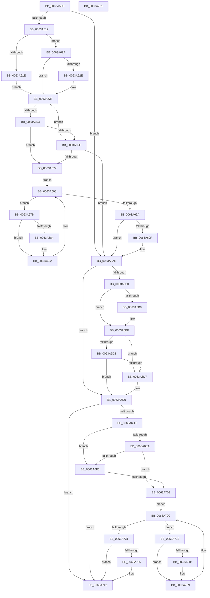

# DifProbeForReadWrapper

- RVA: `0x0063A5D0`–`0x0063A762` (길이 `402` bytes)
- VA: `0x000000014063A5D0`
- 실행 섹션: `.text`
- PDB 이름 있음: `예`; PDB Function 태그: `아니요`
- unwind 정보 RVA: `0x000886A4`
- 디코드: `111`개 명령, `402/402` bytes 표시
- 미해석 바이트: `0` (있으면 어셈블리에 `.byte`로 보존)

> 이 문서는 커널 이미지의 기계어와 PDB 기호를 분석해 생성했습니다. 4번과 5번은 함수 원형과 자료형을 바이너리 사용 방식에서 추정한 C 해석이며 원본 소스 복구 결과는 아닙니다.

## 1. Dependencies

- 직접 호출 지점: **9**; 고유 호출 대상: **6**
- 직접 호출자로 확인된 함수: **0**
- RIP 상대 이미지 참조: **3**

### Outgoing calls
- `0x0063A606` → [DifGetAPIThunkContextById](../49/DifGetAPIThunkContextById_function_00495A34.md) (function, `0x00495A34`)
- `0x0063A62E` → [DifGetReturnAddressForWrappers](../4D/DifGetReturnAddressForWrappers_function_004D3C08.md) (function, `0x004D3C08`)
- `0x0063A666` → [ExAcquireRundownProtection](../21/ExAcquireRundownProtection_function_00216620.md) (function, `0x00216620`)
- `0x0063A68D` → [guard_dispatch_icall](../6B/guard_dispatch_icall_function_006BAAD0.md) (function, `0x006BAAD0`)
- `0x0063A6A6` → [ExReleaseRundownProtection](../34/ExReleaseRundownProtection_function_00349E80.md) (function, `0x00349E80`)
- `0x0063A6B9` → [ExRaiseDatatypeMisalignment](../../page/89/ExRaiseDatatypeMisalignment_function_00899FD0.md) (function, `0x00899FD0`)
- `0x0063A6FD` → [ExAcquireRundownProtection](../21/ExAcquireRundownProtection_function_00216620.md) (function, `0x00216620`)
- `0x0063A724` → [guard_dispatch_icall](../6B/guard_dispatch_icall_function_006BAAD0.md) (function, `0x006BAAD0`)
- `0x0063A73D` → [ExReleaseRundownProtection](../34/ExReleaseRundownProtection_function_00349E80.md) (function, `0x00349E80`)

### Direct callers
- 이 함수 시작 RVA로 연결되는 직접 call은 확인되지 않았습니다. 간접 호출은 완전히 역산할 수 없습니다.

### Static image references
- `0x0063A640` → RVA `0x00F048B8` (`.data`; read)
- `0x0063A653` → RVA `0x00F04980` (`.data`; read)
- `0x0063A65F` → RVA `0x00F03E80` (`.data`; read)

## 2. Other-region calls and transfers

- 다른 실행 섹션으로 향하는 call: **1**
  - `0x0063A6B9` → [ExRaiseDatatypeMisalignment](../../page/89/ExRaiseDatatypeMisalignment_function_00899FD0.md) (`.text` → `PAGE`)
- 별도 외부 분기/꼬리 이동을 확인하지 못했습니다.

## 3. Assembly (complete function range)

```asm
0063A5D0  48 8B C4                        mov rax, rsp
0063A5D3  48 89 58 08                     mov qword ptr [rax + 8], rbx
0063A5D7  48 89 68 10                     mov qword ptr [rax + 0x10], rbp
0063A5DB  48 89 70 18                     mov qword ptr [rax + 0x18], rsi
0063A5DF  48 89 78 20                     mov qword ptr [rax + 0x20], rdi
0063A5E3  41 55                           push r13
0063A5E5  41 56                           push r14
0063A5E7  41 57                           push r15
0063A5E9  48 83 EC 40                     sub rsp, 0x40
0063A5ED  0F 57 C0                        xorps xmm0, xmm0
0063A5F0  48 8B F9                        mov rdi, rcx
0063A5F3  B9 B1 00 00 00                  mov ecx, 0xb1
0063A5F8  45 8B E8                        mov r13d, r8d
0063A5FB  0F 11 40 C8                     movups xmmword ptr [rax - 0x38], xmm0
0063A5FF  4C 8B FA                        mov r15, rdx
0063A602  0F 11 40 D8                     movups xmmword ptr [rax - 0x28], xmm0
0063A606  E8 29 B4 E5 FF                  call 0x140495a34
0063A60B  48 8B F0                        mov rsi, rax
0063A60E  48 85 C0                        test rax, rax
0063A611  0F 84 94 00 00 00               je 0x14063a6ab
0063A617  8B 40 0C                        mov eax, dword ptr [rax + 0xc]
0063A61A  A8 18                           test al, 0x18
0063A61C  74 0C                           je 0x14063a62a
0063A61E  48 8B 4C 24 58                  mov rcx, qword ptr [rsp + 0x58]
0063A623  48 89 4C 24 20                  mov qword ptr [rsp + 0x20], rcx
0063A628  EB 0E                           jmp 0x14063a638
0063A62A  A8 04                           test al, 4
0063A62C  74 0A                           je 0x14063a638
0063A62E  E8 D5 95 E9 FF                  call 0x1404d3c08
0063A633  48 89 44 24 20                  mov qword ptr [rsp + 0x20], rax
0063A638  40 32 ED                        xor bpl, bpl
0063A63B  48 89 7C 24 38                  mov qword ptr [rsp + 0x38], rdi
0063A640  40 38 2D 71 A2 8C 00            cmp byte ptr [rip + 0x8ca271], bpl
0063A647  4C 89 7C 24 30                  mov qword ptr [rsp + 0x30], r15
0063A64C  44 89 6C 24 28                  mov dword ptr [rsp + 0x28], r13d
0063A651  75 0C                           jne 0x14063a65f
0063A653  F7 05 23 A3 8C 00 00 08 00 00   test dword ptr [rip + 0x8ca323], 0x800
0063A65D  74 13                           je 0x14063a672
0063A65F  48 8D 0D 1A 98 8C 00            lea rcx, [rip + 0x8c981a]
0063A666  E8 B5 BF BD FF                  call 0x140216620
0063A66B  40 8A E8                        mov bpl, al
0063A66E  84 C0                           test al, al
0063A670  74 39                           je 0x14063a6ab
0063A672  4C 8D 76 20                     lea r14, [rsi + 0x20]
0063A676  49 8B 1E                        mov rbx, qword ptr [r14]
0063A679  EB 1A                           jmp 0x14063a695
0063A67B  48 8D 43 F0                     lea rax, [rbx - 0x10]
0063A67F  48 85 C0                        test rax, rax
0063A682  74 0E                           je 0x14063a692
0063A684  48 8B 40 08                     mov rax, qword ptr [rax + 8]
0063A688  48 8D 4C 24 20                  lea rcx, [rsp + 0x20]
0063A68D  E8 3E 04 08 00                  call 0x1406baad0
0063A692  48 8B 1B                        mov rbx, qword ptr [rbx]
0063A695  49 3B DE                        cmp rbx, r14
0063A698  75 E1                           jne 0x14063a67b
0063A69A  40 84 ED                        test bpl, bpl
0063A69D  74 0C                           je 0x14063a6ab
0063A69F  48 8D 0D DA 97 8C 00            lea rcx, [rip + 0x8c97da]
0063A6A6  E8 D5 F7 D0 FF                  call 0x140349e80
0063A6AB  4D 85 FF                        test r15, r15
0063A6AE  74 29                           je 0x14063a6d9
0063A6B0  41 8D 4D FF                     lea ecx, [r13 - 1]
0063A6B4  48 85 CF                        test rdi, rcx
0063A6B7  74 06                           je 0x14063a6bf
0063A6B9  E8 12 F9 25 00                  call 0x140899fd0
0063A6BE  CC                              int3
0063A6BF  4A 8D 04 3F                     lea rax, [rdi + r15]
0063A6C3  48 B9 00 00 FF FF FF 7F 00 00   movabs rcx, 0x7fffffff0000
0063A6CD  48 3B C1                        cmp rax, rcx
0063A6D0  77 05                           ja 0x14063a6d7
0063A6D2  48 3B C7                        cmp rax, rdi
0063A6D5  73 02                           jae 0x14063a6d9
0063A6D7  8A 01                           mov al, byte ptr [rcx]
0063A6D9  48 85 F6                        test rsi, rsi
0063A6DC  74 64                           je 0x14063a742
0063A6DE  40 32 FF                        xor dil, dil
0063A6E1  40 38 3D D0 A1 8C 00            cmp byte ptr [rip + 0x8ca1d0], dil
0063A6E8  75 0C                           jne 0x14063a6f6
0063A6EA  F7 05 8C A2 8C 00 00 08 00 00   test dword ptr [rip + 0x8ca28c], 0x800
0063A6F4  74 13                           je 0x14063a709
0063A6F6  48 8D 0D 83 97 8C 00            lea rcx, [rip + 0x8c9783]
0063A6FD  E8 1E BF BD FF                  call 0x140216620
0063A702  40 8A F8                        mov dil, al
0063A705  84 C0                           test al, al
0063A707  74 39                           je 0x14063a742
0063A709  48 83 C6 30                     add rsi, 0x30
0063A70D  48 8B 1E                        mov rbx, qword ptr [rsi]
0063A710  EB 1A                           jmp 0x14063a72c
0063A712  48 8D 43 F0                     lea rax, [rbx - 0x10]
0063A716  48 85 C0                        test rax, rax
0063A719  74 0E                           je 0x14063a729
0063A71B  48 8B 40 08                     mov rax, qword ptr [rax + 8]
0063A71F  48 8D 4C 24 20                  lea rcx, [rsp + 0x20]
0063A724  E8 A7 03 08 00                  call 0x1406baad0
0063A729  48 8B 1B                        mov rbx, qword ptr [rbx]
0063A72C  48 3B DE                        cmp rbx, rsi
0063A72F  75 E1                           jne 0x14063a712
0063A731  40 84 FF                        test dil, dil
0063A734  74 0C                           je 0x14063a742
0063A736  48 8D 0D 43 97 8C 00            lea rcx, [rip + 0x8c9743]
0063A73D  E8 3E F7 D0 FF                  call 0x140349e80
0063A742  48 8B 5C 24 60                  mov rbx, qword ptr [rsp + 0x60]
0063A747  48 8B 6C 24 68                  mov rbp, qword ptr [rsp + 0x68]
0063A74C  48 8B 74 24 70                  mov rsi, qword ptr [rsp + 0x70]
0063A751  48 8B 7C 24 78                  mov rdi, qword ptr [rsp + 0x78]
0063A756  48 83 C4 40                     add rsp, 0x40
0063A75A  41 5F                           pop r15
0063A75C  41 5E                           pop r14
0063A75E  41 5D                           pop r13
0063A760  C3                              ret
0063A761  CC                              int3
```

## 4. C-style interpretation (structured pseudocode)

```c
__int64 __fastcall DifProbeForReadWrapper(__int64 a1, __int64 a2, int a3)
{
    __int64 result;
    __int64 v_rbp;
    __int64 v_rdi;
    __int64 v_rsi;
    __int64 v_rsp;
    unsigned __int64 v_stack_m20;
    unsigned __int64 v_stack_m28;
    unsigned int v_stack_m30;
    unsigned __int64 v_stack_m38;
    unsigned __int64 v_stack_p0;
    unsigned __int64 v_stack_p10;
    unsigned __int64 v_stack_p18;
    unsigned __int64 v_stack_p20;
    unsigned __int64 v_stack_p8;

    *(unsigned __int64 *)(v_rsp + 8) = v_rbx;
    *(unsigned __int64 *)(v_rsp + 16) = v_rbp;
    *(unsigned __int64 *)(v_rsp + 24) = v_rsi;
    *(unsigned __int64 *)(v_rsp + 32) = v_rdi;
    v_rsp = (v_rsp) - (64);
    *(unsigned __int64 *)(v_rsp - 56) = v_xmm0;
    *(unsigned __int64 *)(v_rsp - 40) = v_xmm0;
    result = DifGetAPIThunkContextById(177, a2, a3, a4);
    if (result == 0) goto loc_0063A6AB;
    if ((((unsigned __int8)((unsigned int)(*(unsigned int *)(result + 12)))) & (24)) == 0) goto loc_0063A62A;
    v_stack_m38 = v_stack_p0;
    goto loc_0063A638;
loc_0063A62A:
    result = (unsigned int)(*(unsigned int *)(result + 12));
    if ((((unsigned __int8)((unsigned int)(*(unsigned int *)(result + 12)))) & (4)) != 0) {
        result = DifGetReturnAddressForWrappers(v_stack_p0, a2, a3, a4);
        v_stack_m38 = result;
    }
    v_rbp = 0;
    v_stack_m20 = a1;
    v_stack_m28 = a2;
    v_stack_m30 = (unsigned int)((unsigned int)(a3));
    if ((*(unsigned __int8 *)(v_rip + 9216625)) != 0) goto loc_0063A65F;
    if (((*(unsigned int *)(v_rip + 9216803)) & (0x800ULL)) == 0) goto loc_0063A672;
loc_0063A65F:
    result = ExAcquireRundownProtection(v_rip + 9213978, a2, a3, a4);
    if ((unsigned __int8)(result) == 0) goto loc_0063A6AB;
loc_0063A672:
    goto loc_0063A695;
loc_0063A67B:
    result = *(unsigned __int64 *)(result + 32) - 16;
    if (*(unsigned __int64 *)(result + 32) - 16 != 0) {
        result = *(unsigned __int64 *)(*(unsigned __int64 *)(result + 32) - 16 + 8);
        a1 = v_stack_m38;
        result = guard_dispatch_icall(a1, a2, a3, a4);
    }
loc_0063A695:
    if ((*(unsigned __int64 *)(*(unsigned __int64 *)(result + 32))) != (result + 32)) goto loc_0063A67B;
    if ((unsigned __int8)((unsigned __int8)(result)) != 0) {
        a1 = v_rip + 9213914;
        result = ExReleaseRundownProtection(a1, a2, a3, a4);
    }
    if (a2 == 0) goto loc_0063A6D9;
    if (((a1) & ((unsigned int)(a3) - 1)) != 0) {
        result = ExRaiseDatatypeMisalignment((unsigned int)(a3) - 1, a2, a3, a4);
    }
    if ((a1 + a2 * 1) > ((unsigned int)(a3) - 1)) goto loc_0063A6D7;
    result = a1 + a2 * 1;
    if ((a1 + a2 * 1) < a1) {
        result = *(unsigned __int8 *)((unsigned int)(a3) - 1);
    }
    if (result == 0) goto loc_0063A742;
    v_rdi = 0;
    if ((*(unsigned __int8 *)(v_rip + 9216464)) != 0) goto loc_0063A6F6;
    if (((*(unsigned int *)(v_rip + 9216652)) & (0x800ULL)) == 0) goto loc_0063A709;
loc_0063A6F6:
    result = ExAcquireRundownProtection(v_rip + 9213827, a2, a3, a4);
    if ((unsigned __int8)(result) == 0) goto loc_0063A742;
loc_0063A709:
    v_rsi = (result) + (48);
    goto loc_0063A72C;
loc_0063A712:
    result = *(unsigned __int64 *)(v_rsi) - 16;
    if (*(unsigned __int64 *)(v_rsi) - 16 != 0) {
        result = *(unsigned __int64 *)(*(unsigned __int64 *)(v_rsi) - 16 + 8);
        a1 = v_stack_m38;
        result = guard_dispatch_icall(a1, a2, a3, a4);
    }
loc_0063A72C:
    if ((*(unsigned __int64 *)(*(unsigned __int64 *)(v_rsi))) != v_rsi) goto loc_0063A712;
    if ((unsigned __int8)((unsigned __int8)(result)) != 0) {
        a1 = v_rip + 9213763;
        result = ExReleaseRundownProtection(a1, a2, a3, a4);
    }
    v_rsp = (v_rsp) + (64);
    return result;
}
```

## 5. (Beta) C Style

```c
int64_t DifProbeForReadWrapper(int64_t Arg1, int64_t Arg2, void *Arg3)
{
    uint8_t *arg3 = (uint8_t *)Arg3;

    int64_t result;
    int64_t local_rbp;
    int64_t local_rdi;
    int64_t local_rsi;
    int64_t local_rsp;
    uint64_t v_stack_m20;
    uint64_t v_stack_m28;
    uint32_t v_stack_m30;
    uint64_t v_stack_m38;
    uint64_t v_stack_p0;
    uint64_t v_stack_p10;
    uint64_t v_stack_p18;
    uint64_t v_stack_p20;
    uint64_t v_stack_p8;

    *(uint64_t *)(local_rsp + 0x8) = local_rbx;
    *(uint64_t *)(local_rsp + 0x10) = local_rbp;
    *(uint64_t *)(local_rsp + 0x18) = local_rsi;
    *(uint64_t *)(local_rsp + 0x20) = local_rdi;
    local_rsp = (local_rsp) - (64);
    *(uint64_t *)(local_rsp - 0x38) = v_xmm0;
    *(uint64_t *)(local_rsp - 0x28) = v_xmm0;
    result = DifGetAPIThunkContextById(177, Arg2, Arg3, a4);
    if (result == 0) goto loc_0063A6AB;
    if ((((uint8_t)((uint32_t)(*(uint32_t *)(result + 0xC)))) & (24)) == 0) goto loc_0063A62A;
    v_stack_m38 = v_stack_p0;
    goto loc_0063A638;
loc_0063A62A:
    result = (uint32_t)(*(uint32_t *)(result + 0xC));
    if ((((uint8_t)((uint32_t)(*(uint32_t *)(result + 0xC)))) & (4)) != 0) {
        result = DifGetReturnAddressForWrappers(v_stack_p0, Arg2, Arg3, a4);
        v_stack_m38 = result;
    }
    local_rbp = 0;
    v_stack_m20 = Arg1;
    v_stack_m28 = Arg2;
    v_stack_m30 = (uint32_t)((uint32_t)(Arg3));
    if ((*(uint8_t *)(v_rip + 0x8CA271)) != 0) goto loc_0063A65F;
    if (((*(uint32_t *)(v_rip + 0x8CA323)) & (0x800ULL)) == 0) goto loc_0063A672;
loc_0063A65F:
    result = ExAcquireRundownProtection(v_rip + 9213978, Arg2, Arg3, a4);
    if ((uint8_t)(result) == 0) goto loc_0063A6AB;
loc_0063A672:
    goto loc_0063A695;
loc_0063A67B:
    result = *(uint64_t *)(result + 0x20) - 16;
    if (*(uint64_t *)(result + 0x20) - 16 != 0) {
        result = *(uint64_t *)(*(uint64_t *)(result + 0x20) - 0x10 + 0x8);
        Arg1 = v_stack_m38;
        result = guard_dispatch_icall(Arg1, Arg2, Arg3, a4);
    }
loc_0063A695:
    if ((*(uint64_t *)(*(uint64_t *)(result + 0x20))) != (result + 32)) goto loc_0063A67B;
    if ((uint8_t)((uint8_t)(result)) != 0) {
        Arg1 = v_rip + 9213914;
        result = ExReleaseRundownProtection(Arg1, Arg2, Arg3, a4);
    }
    if (Arg2 == 0) goto loc_0063A6D9;
    if (((Arg1) & ((uint32_t)(Arg3) - 1)) != 0) {
        result = ExRaiseDatatypeMisalignment((uint32_t)(Arg3) - 1, Arg2, Arg3, a4);
    }
    if ((Arg1 + Arg2 * 1) > ((uint32_t)(Arg3) - 1)) goto loc_0063A6D7;
    result = Arg1 + Arg2 * 1;
    if ((Arg1 + Arg2 * 1) < Arg1) {
        result = *(uint8_t *)((uint32_t)(arg3) - 0x1);
    }
    if (result == 0) goto loc_0063A742;
    local_rdi = 0;
    if ((*(uint8_t *)(v_rip + 0x8CA1D0)) != 0) goto loc_0063A6F6;
    if (((*(uint32_t *)(v_rip + 0x8CA28C)) & (0x800ULL)) == 0) goto loc_0063A709;
loc_0063A6F6:
    result = ExAcquireRundownProtection(v_rip + 9213827, Arg2, Arg3, a4);
    if ((uint8_t)(result) == 0) goto loc_0063A742;
loc_0063A709:
    local_rsi = (result) + (48);
    goto loc_0063A72C;
loc_0063A712:
    result = *(uint64_t *)(local_rsi) - 16;
    if (*(uint64_t *)(local_rsi) - 16 != 0) {
        result = *(uint64_t *)(*(uint64_t *)(local_rsi) - 0x10 + 0x8);
        Arg1 = v_stack_m38;
        result = guard_dispatch_icall(Arg1, Arg2, Arg3, a4);
    }
loc_0063A72C:
    if ((*(uint64_t *)(*(uint64_t *)(local_rsi))) != local_rsi) goto loc_0063A712;
    if ((uint8_t)((uint8_t)(result)) != 0) {
        Arg1 = v_rip + 9213763;
        result = ExReleaseRundownProtection(Arg1, Arg2, Arg3, a4);
    }
    local_rsp = (local_rsp) + (64);
    return result;
}
```

### 관측된 메모리 오프셋

구조체 형식이 확인되지 않은 접근은 인자 기준의 오프셋으로만 기록했습니다.

| 기준 인자 | 오프셋 표현 | 폭 (bit) | 접근 |
|---|---:|---:|---|
| `Arg3` | `- 0x1` | `32` | `R` |

## 6. Execution-region graph

[열기: 2D/3D 그래프와 함수 탐색 컨트롤 패널](../../../control-panel.html?section=text&rva=0x0063A5D0&view=graph)

- 2D 그래프는 위에서 아래로 흐르고, 3D 그래프는 빈 공간을 드래그해 회전합니다. Shift+드래그는 이동, 휠은 확대·축소, 함수 노드 선택은 대상 보고서 이동입니다.

### Static fallback


