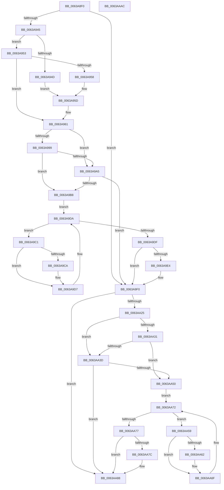

# DifPsCreateSystemThreadWrapper

- RVA: `0x0063A8F0`–`0x0063AAAD` (길이 `445` bytes)
- VA: `0x000000014063A8F0`
- 실행 섹션: `.text`
- PDB 이름 있음: `예`; PDB Function 태그: `아니요`
- unwind 정보 RVA: `0x000D2C00`
- 디코드: `123`개 명령, `445/445` bytes 표시
- 미해석 바이트: `0` (있으면 어셈블리에 `.byte`로 보존)

> 이 문서는 커널 이미지의 기계어와 PDB 기호를 분석해 생성했습니다. 4번과 5번은 함수 원형과 자료형을 바이너리 사용 방식에서 추정한 C 해석이며 원본 소스 복구 결과는 아닙니다.

## 1. Dependencies

- 직접 호출 지점: **10**; 고유 호출 대상: **7**
- 직접 호출자로 확인된 함수: **0**
- RIP 상대 이미지 참조: **3**

### Outgoing calls
- `0x0063A92A` → [memset](../6C/memset_function_006C6C40.md) (function, `0x006C6C40`)
- `0x0063A934` → [DifGetAPIThunkContextById](../49/DifGetAPIThunkContextById_function_00495A34.md) (function, `0x00495A34`)
- `0x0063A958` → [DifGetReturnAddressForWrappers](../4D/DifGetReturnAddressForWrappers_function_004D3C08.md) (function, `0x004D3C08`)
- `0x0063A9AC` → [ExAcquireRundownProtection](../21/ExAcquireRundownProtection_function_00216620.md) (function, `0x00216620`)
- `0x0063A9D2` → [guard_dispatch_icall](../6B/guard_dispatch_icall_function_006BAAD0.md) (function, `0x006BAAD0`)
- `0x0063A9EB` → [ExReleaseRundownProtection](../34/ExReleaseRundownProtection_function_00349E80.md) (function, `0x00349E80`)
- `0x0063AA18` → [PsCreateSystemThread](../../page/9E/PsCreateSystemThread_function_009ED0D0.md) (function, `0x009ED0D0`)
- `0x0063AA44` → [ExAcquireRundownProtection](../21/ExAcquireRundownProtection_function_00216620.md) (function, `0x00216620`)
- `0x0063AA6A` → [guard_dispatch_icall](../6B/guard_dispatch_icall_function_006BAAD0.md) (function, `0x006BAAD0`)
- `0x0063AA83` → [ExReleaseRundownProtection](../34/ExReleaseRundownProtection_function_00349E80.md) (function, `0x00349E80`)

### Direct callers
- 이 함수 시작 RVA로 연결되는 직접 call은 확인되지 않았습니다. 간접 호출은 완전히 역산할 수 없습니다.

### Static image references
- `0x0063A968` → RVA `0x00F048B8` (`.data`; read)
- `0x0063A999` → RVA `0x00F04980` (`.data`; read)
- `0x0063A9A5` → RVA `0x00F03E80` (`.data`; read)

## 2. Other-region calls and transfers

- 다른 실행 섹션으로 향하는 call: **1**
  - `0x0063AA18` → [PsCreateSystemThread](../../page/9E/PsCreateSystemThread_function_009ED0D0.md) (`.text` → `PAGE`)
- 별도 외부 분기/꼬리 이동을 확인하지 못했습니다.

## 3. Assembly (complete function range)

```asm
0063A8F0  48 8B C4                        mov rax, rsp
0063A8F3  48 89 58 10                     mov qword ptr [rax + 0x10], rbx
0063A8F7  48 89 70 18                     mov qword ptr [rax + 0x18], rsi
0063A8FB  48 89 78 20                     mov qword ptr [rax + 0x20], rdi
0063A8FF  48 89 48 08                     mov qword ptr [rax + 8], rcx
0063A903  55                              push rbp
0063A904  41 54                           push r12
0063A906  41 55                           push r13
0063A908  41 56                           push r14
0063A90A  41 57                           push r15
0063A90C  48 8D 68 B9                     lea rbp, [rax - 0x47]
0063A910  48 81 EC 90 00 00 00            sub rsp, 0x90
0063A917  44 8B EA                        mov r13d, edx
0063A91A  48 8D 4D CF                     lea rcx, [rbp - 0x31]
0063A91E  33 D2                           xor edx, edx
0063A920  4D 8B E0                        mov r12, r8
0063A923  4D 8B F9                        mov r15, r9
0063A926  44 8D 42 48                     lea r8d, [rdx + 0x48]
0063A92A  E8 11 C3 08 00                  call 0x1406c6c40
0063A92F  B9 AF 00 00 00                  mov ecx, 0xaf
0063A934  E8 FB B0 E5 FF                  call 0x140495a34
0063A939  4C 8B F0                        mov r14, rax
0063A93C  48 85 C0                        test rax, rax
0063A93F  0F 84 AB 00 00 00               je 0x14063a9f0
0063A945  8B 48 0C                        mov ecx, dword ptr [rax + 0xc]
0063A948  F6 C1 18                        test cl, 0x18
0063A94B  74 06                           je 0x14063a953
0063A94D  48 8B 45 47                     mov rax, qword ptr [rbp + 0x47]
0063A951  EB 0A                           jmp 0x14063a95d
0063A953  F6 C1 04                        test cl, 4
0063A956  74 09                           je 0x14063a961
0063A958  E8 AB 92 E9 FF                  call 0x1404d3c08
0063A95D  48 89 45 CF                     mov qword ptr [rbp - 0x31], rax
0063A961  48 8B 45 4F                     mov rax, qword ptr [rbp + 0x4f]
0063A965  40 32 F6                        xor sil, sil
0063A968  40 38 35 49 9F 8C 00            cmp byte ptr [rip + 0x8c9f49], sil
0063A96F  48 89 45 07                     mov qword ptr [rbp + 7], rax
0063A973  48 8B 45 6F                     mov rax, qword ptr [rbp + 0x6f]
0063A977  48 89 45 E7                     mov qword ptr [rbp - 0x19], rax
0063A97B  48 8B 45 77                     mov rax, qword ptr [rbp + 0x77]
0063A97F  48 89 45 DF                     mov qword ptr [rbp - 0x21], rax
0063A983  48 8B 45 7F                     mov rax, qword ptr [rbp + 0x7f]
0063A987  48 89 45 D7                     mov qword ptr [rbp - 0x29], rax
0063A98B  44 89 6D FF                     mov dword ptr [rbp - 1], r13d
0063A98F  4C 89 65 F7                     mov qword ptr [rbp - 9], r12
0063A993  4C 89 7D EF                     mov qword ptr [rbp - 0x11], r15
0063A997  75 0C                           jne 0x14063a9a5
0063A999  F7 05 DD 9F 8C 00 00 08 00 00   test dword ptr [rip + 0x8c9fdd], 0x800
0063A9A3  74 13                           je 0x14063a9b8
0063A9A5  48 8D 0D D4 94 8C 00            lea rcx, [rip + 0x8c94d4]
0063A9AC  E8 6F BC BD FF                  call 0x140216620
0063A9B1  40 8A F0                        mov sil, al
0063A9B4  84 C0                           test al, al
0063A9B6  74 38                           je 0x14063a9f0
0063A9B8  49 8D 7E 20                     lea rdi, [r14 + 0x20]
0063A9BC  48 8B 1F                        mov rbx, qword ptr [rdi]
0063A9BF  EB 19                           jmp 0x14063a9da
0063A9C1  48 8D 43 F0                     lea rax, [rbx - 0x10]
0063A9C5  48 85 C0                        test rax, rax
0063A9C8  74 0D                           je 0x14063a9d7
0063A9CA  48 8B 40 08                     mov rax, qword ptr [rax + 8]
0063A9CE  48 8D 4D CF                     lea rcx, [rbp - 0x31]
0063A9D2  E8 F9 00 08 00                  call 0x1406baad0
0063A9D7  48 8B 1B                        mov rbx, qword ptr [rbx]
0063A9DA  48 3B DF                        cmp rbx, rdi
0063A9DD  75 E2                           jne 0x14063a9c1
0063A9DF  40 84 F6                        test sil, sil
0063A9E2  74 0C                           je 0x14063a9f0
0063A9E4  48 8D 0D 95 94 8C 00            lea rcx, [rip + 0x8c9495]
0063A9EB  E8 90 F4 D0 FF                  call 0x140349e80
0063A9F0  48 8B 45 7F                     mov rax, qword ptr [rbp + 0x7f]
0063A9F4  4D 8B CF                        mov r9, r15
0063A9F7  48 8B 4D 4F                     mov rcx, qword ptr [rbp + 0x4f]
0063A9FB  4D 8B C4                        mov r8, r12
0063A9FE  48 89 44 24 30                  mov qword ptr [rsp + 0x30], rax
0063AA03  41 8B D5                        mov edx, r13d
0063AA06  48 8B 45 77                     mov rax, qword ptr [rbp + 0x77]
0063AA0A  48 89 44 24 28                  mov qword ptr [rsp + 0x28], rax
0063AA0F  48 8B 45 6F                     mov rax, qword ptr [rbp + 0x6f]
0063AA13  48 89 44 24 20                  mov qword ptr [rsp + 0x20], rax
0063AA18  E8 B3 26 3B 00                  call 0x1409ed0d0
0063AA1D  89 45 0F                        mov dword ptr [rbp + 0xf], eax
0063AA20  4D 85 F6                        test r14, r14
0063AA23  74 63                           je 0x14063aa88
0063AA25  40 32 FF                        xor dil, dil
0063AA28  40 38 3D 89 9E 8C 00            cmp byte ptr [rip + 0x8c9e89], dil
0063AA2F  75 0C                           jne 0x14063aa3d
0063AA31  F7 05 45 9F 8C 00 00 08 00 00   test dword ptr [rip + 0x8c9f45], 0x800
0063AA3B  74 13                           je 0x14063aa50
0063AA3D  48 8D 0D 3C 94 8C 00            lea rcx, [rip + 0x8c943c]
0063AA44  E8 D7 BB BD FF                  call 0x140216620
0063AA49  40 8A F8                        mov dil, al
0063AA4C  84 C0                           test al, al
0063AA4E  74 38                           je 0x14063aa88
0063AA50  49 8D 76 30                     lea rsi, [r14 + 0x30]
0063AA54  48 8B 1E                        mov rbx, qword ptr [rsi]
0063AA57  EB 19                           jmp 0x14063aa72
0063AA59  48 8D 43 F0                     lea rax, [rbx - 0x10]
0063AA5D  48 85 C0                        test rax, rax
0063AA60  74 0D                           je 0x14063aa6f
0063AA62  48 8B 40 08                     mov rax, qword ptr [rax + 8]
0063AA66  48 8D 4D CF                     lea rcx, [rbp - 0x31]
0063AA6A  E8 61 00 08 00                  call 0x1406baad0
0063AA6F  48 8B 1B                        mov rbx, qword ptr [rbx]
0063AA72  48 3B DE                        cmp rbx, rsi
0063AA75  75 E2                           jne 0x14063aa59
0063AA77  40 84 FF                        test dil, dil
0063AA7A  74 0C                           je 0x14063aa88
0063AA7C  48 8D 0D FD 93 8C 00            lea rcx, [rip + 0x8c93fd]
0063AA83  E8 F8 F3 D0 FF                  call 0x140349e80
0063AA88  8B 45 0F                        mov eax, dword ptr [rbp + 0xf]
0063AA8B  4C 8D 9C 24 90 00 00 00         lea r11, [rsp + 0x90]
0063AA93  49 8B 5B 38                     mov rbx, qword ptr [r11 + 0x38]
0063AA97  49 8B 73 40                     mov rsi, qword ptr [r11 + 0x40]
0063AA9B  49 8B 7B 48                     mov rdi, qword ptr [r11 + 0x48]
0063AA9F  49 8B E3                        mov rsp, r11
0063AAA2  41 5F                           pop r15
0063AAA4  41 5E                           pop r14
0063AAA6  41 5D                           pop r13
0063AAA8  41 5C                           pop r12
0063AAAA  5D                              pop rbp
0063AAAB  C3                              ret
0063AAAC  CC                              int3
```

## 4. C-style interpretation (structured pseudocode)

```c
__int64 __fastcall DifPsCreateSystemThreadWrapper(__int64 a1, int a2, __int64 a3, __int64 a4)
{
    __int64 result;
    __int64 v_rdi;
    __int64 v_rsi;
    __int64 v_rsp;
    unsigned __int64 v_stack_m28;
    unsigned __int64 v_stack_m88;
    unsigned __int64 v_stack_m90;
    unsigned __int64 v_stack_m98;

    *(unsigned __int64 *)(v_rsp + 16) = v_rbx;
    *(unsigned __int64 *)(v_rsp + 24) = v_rsi;
    *(unsigned __int64 *)(v_rsp + 32) = v_rdi;
    *(unsigned __int64 *)(v_rsp + 8) = a1;
    v_rsp = (v_rsp) - (144);
    a2 = 0;
    result = memset(v_rsp - 71 - 49, a2, a2 + 72, a4);
    result = DifGetAPIThunkContextById(175, a2, a2 + 72, a4);
    if (result == 0) goto loc_0063A9F0;
    if ((((unsigned __int8)((unsigned int)(*(unsigned int *)(result + 12)))) & (24)) == 0) goto loc_0063A953;
    goto loc_0063A95D;
loc_0063A953:
    if ((((unsigned __int8)((unsigned int)(*(unsigned int *)(result + 12)))) & (4)) == 0) goto loc_0063A961;
    result = DifGetReturnAddressForWrappers((unsigned int)(*(unsigned int *)(result + 12)), a2, a2 + 72, a4);
loc_0063A95D:
    *(unsigned __int64 *)(v_rsp - 71 - 49) = result;
loc_0063A961:
    v_rsi = 0;
    *(unsigned __int64 *)(v_rsp - 71 + 7) = *(unsigned __int64 *)(v_rsp - 71 + 79);
    *(unsigned __int64 *)(v_rsp - 71 - 25) = *(unsigned __int64 *)(v_rsp - 71 + 111);
    *(unsigned __int64 *)(v_rsp - 71 - 33) = *(unsigned __int64 *)(v_rsp - 71 + 119);
    *(unsigned __int64 *)(v_rsp - 71 - 41) = *(unsigned __int64 *)(v_rsp - 71 + 127);
    *(unsigned int *)(v_rsp - 71 - 1) = (unsigned int)((unsigned int)(a2));
    *(unsigned __int64 *)(v_rsp - 71 - 9) = a3;
    *(unsigned __int64 *)(v_rsp - 71 - 17) = a4;
    if ((*(unsigned __int8 *)(v_rip + 9215817)) != 0) goto loc_0063A9A5;
    if (((*(unsigned int *)(v_rip + 9215965)) & (0x800ULL)) == 0) goto loc_0063A9B8;
loc_0063A9A5:
    result = ExAcquireRundownProtection(v_rip + 9213140, a2, a2 + 72, a4);
    if ((unsigned __int8)(result) == 0) goto loc_0063A9F0;
loc_0063A9B8:
    goto loc_0063A9DA;
loc_0063A9C1:
    result = *(unsigned __int64 *)(result + 32) - 16;
    if (*(unsigned __int64 *)(result + 32) - 16 != 0) {
        result = *(unsigned __int64 *)(*(unsigned __int64 *)(result + 32) - 16 + 8);
        a1 = v_rsp - 71 - 49;
        result = guard_dispatch_icall(a1, a2, a2 + 72, a4);
    }
loc_0063A9DA:
    if ((*(unsigned __int64 *)(*(unsigned __int64 *)(result + 32))) != (result + 32)) goto loc_0063A9C1;
    if ((unsigned __int8)((unsigned __int8)(result)) != 0) {
        a1 = v_rip + 9213077;
        result = ExReleaseRundownProtection(a1, a2, a2 + 72, a4);
    }
    v_stack_m88 = *(unsigned __int64 *)(v_rsp - 71 + 127);
    v_stack_m90 = *(unsigned __int64 *)(v_rsp - 71 + 119);
    v_stack_m98 = *(unsigned __int64 *)(v_rsp - 71 + 111);
    result = PsCreateSystemThread(*(unsigned __int64 *)(v_rsp - 71 + 79), (unsigned int)((unsigned int)((unsigned int)(a2))), a3, a4);
    *(unsigned int *)(v_rsp - 71 + 15) = (unsigned int)(result);
    if (result == 0) goto loc_0063AA88;
    v_rdi = 0;
    if ((*(unsigned __int8 *)(v_rip + 9215625)) != 0) goto loc_0063AA3D;
    if (((*(unsigned int *)(v_rip + 9215813)) & (0x800ULL)) == 0) goto loc_0063AA50;
loc_0063AA3D:
    result = ExAcquireRundownProtection(v_rip + 9212988, (unsigned int)((unsigned int)((unsigned int)(a2))), a3, a4);
    if ((unsigned __int8)(result) == 0) goto loc_0063AA88;
loc_0063AA50:
    goto loc_0063AA72;
loc_0063AA59:
    result = *(unsigned __int64 *)(result + 48) - 16;
    if (*(unsigned __int64 *)(result + 48) - 16 != 0) {
        result = *(unsigned __int64 *)(*(unsigned __int64 *)(result + 48) - 16 + 8);
        a1 = v_rsp - 71 - 49;
        result = guard_dispatch_icall(a1, (unsigned int)((unsigned int)((unsigned int)(a2))), a3, a4);
    }
loc_0063AA72:
    if ((*(unsigned __int64 *)(*(unsigned __int64 *)(result + 48))) != (result + 48)) goto loc_0063AA59;
    if ((unsigned __int8)((unsigned __int8)(result)) != 0) {
        a1 = v_rip + 9212925;
        result = ExReleaseRundownProtection(a1, (unsigned int)((unsigned int)((unsigned int)(a2))), a3, a4);
    }
    return (unsigned int)(*(unsigned int *)(v_rsp - 71 + 15));
}
```

## 5. (Beta) C Style

```c
int64_t DifPsCreateSystemThreadWrapper(int64_t Arg1, int32_t Arg2, int64_t Arg3, int64_t Arg4)
{
    int64_t result;
    int64_t local_rdi;
    int64_t local_rsi;
    int64_t local_rsp;
    uint64_t v_stack_m28;
    uint64_t v_stack_m88;
    uint64_t v_stack_m90;
    uint64_t v_stack_m98;

    *(uint64_t *)(local_rsp + 0x10) = local_rbx;
    *(uint64_t *)(local_rsp + 0x18) = local_rsi;
    *(uint64_t *)(local_rsp + 0x20) = local_rdi;
    *(uint64_t *)(local_rsp + 0x8) = Arg1;
    local_rsp = (local_rsp) - (144);
    Arg2 = 0;
    result = memset(local_rsp - 71 - 49, Arg2, Arg2 + 72, Arg4);
    result = DifGetAPIThunkContextById(175, Arg2, Arg2 + 72, Arg4);
    if (result == 0) goto loc_0063A9F0;
    if ((((uint8_t)((uint32_t)(*(uint32_t *)(result + 0xC)))) & (24)) == 0) goto loc_0063A953;
    goto loc_0063A95D;
loc_0063A953:
    if ((((uint8_t)((uint32_t)(*(uint32_t *)(result + 0xC)))) & (4)) == 0) goto loc_0063A961;
    result = DifGetReturnAddressForWrappers((uint32_t)(*(uint32_t *)(result + 0xC)), Arg2, Arg2 + 72, Arg4);
loc_0063A95D:
    *(uint64_t *)(local_rsp - 0x47 - 0x31) = result;
loc_0063A961:
    local_rsi = 0;
    *(uint64_t *)(local_rsp - 0x47 + 0x7) = *(uint64_t *)(local_rsp - 0x47 + 0x4F);
    *(uint64_t *)(local_rsp - 0x47 - 0x19) = *(uint64_t *)(local_rsp - 0x47 + 0x6F);
    *(uint64_t *)(local_rsp - 0x47 - 0x21) = *(uint64_t *)(local_rsp - 0x47 + 0x77);
    *(uint64_t *)(local_rsp - 0x47 - 0x29) = *(uint64_t *)(local_rsp - 0x47 + 0x7F);
    *(uint32_t *)(local_rsp - 0x47 - 0x1) = (uint32_t)((uint32_t)(Arg2));
    *(uint64_t *)(local_rsp - 0x47 - 0x9) = Arg3;
    *(uint64_t *)(local_rsp - 0x47 - 0x11) = Arg4;
    if ((*(uint8_t *)(v_rip + 0x8C9F49)) != 0) goto loc_0063A9A5;
    if (((*(uint32_t *)(v_rip + 0x8C9FDD)) & (0x800ULL)) == 0) goto loc_0063A9B8;
loc_0063A9A5:
    result = ExAcquireRundownProtection(v_rip + 9213140, Arg2, Arg2 + 72, Arg4);
    if ((uint8_t)(result) == 0) goto loc_0063A9F0;
loc_0063A9B8:
    goto loc_0063A9DA;
loc_0063A9C1:
    result = *(uint64_t *)(result + 0x20) - 16;
    if (*(uint64_t *)(result + 0x20) - 16 != 0) {
        result = *(uint64_t *)(*(uint64_t *)(result + 0x20) - 0x10 + 0x8);
        Arg1 = local_rsp - 71 - 49;
        result = guard_dispatch_icall(Arg1, Arg2, Arg2 + 72, Arg4);
    }
loc_0063A9DA:
    if ((*(uint64_t *)(*(uint64_t *)(result + 0x20))) != (result + 32)) goto loc_0063A9C1;
    if ((uint8_t)((uint8_t)(result)) != 0) {
        Arg1 = v_rip + 9213077;
        result = ExReleaseRundownProtection(Arg1, Arg2, Arg2 + 72, Arg4);
    }
    v_stack_m88 = *(uint64_t *)(local_rsp - 0x47 + 0x7F);
    v_stack_m90 = *(uint64_t *)(local_rsp - 0x47 + 0x77);
    v_stack_m98 = *(uint64_t *)(local_rsp - 0x47 + 0x6F);
    result = PsCreateSystemThread(*(uint64_t *)(local_rsp - 0x47 + 0x4F), (uint32_t)((uint32_t)((uint32_t)(Arg2))), Arg3, Arg4);
    *(uint32_t *)(local_rsp - 0x47 + 0xF) = (uint32_t)(result);
    if (result == 0) goto loc_0063AA88;
    local_rdi = 0;
    if ((*(uint8_t *)(v_rip + 0x8C9E89)) != 0) goto loc_0063AA3D;
    if (((*(uint32_t *)(v_rip + 0x8C9F45)) & (0x800ULL)) == 0) goto loc_0063AA50;
loc_0063AA3D:
    result = ExAcquireRundownProtection(v_rip + 9212988, (uint32_t)((uint32_t)((uint32_t)(Arg2))), Arg3, Arg4);
    if ((uint8_t)(result) == 0) goto loc_0063AA88;
loc_0063AA50:
    goto loc_0063AA72;
loc_0063AA59:
    result = *(uint64_t *)(result + 0x30) - 16;
    if (*(uint64_t *)(result + 0x30) - 16 != 0) {
        result = *(uint64_t *)(*(uint64_t *)(result + 0x30) - 0x10 + 0x8);
        Arg1 = local_rsp - 71 - 49;
        result = guard_dispatch_icall(Arg1, (uint32_t)((uint32_t)((uint32_t)(Arg2))), Arg3, Arg4);
    }
loc_0063AA72:
    if ((*(uint64_t *)(*(uint64_t *)(result + 0x30))) != (result + 48)) goto loc_0063AA59;
    if ((uint8_t)((uint8_t)(result)) != 0) {
        Arg1 = v_rip + 9212925;
        result = ExReleaseRundownProtection(Arg1, (uint32_t)((uint32_t)((uint32_t)(Arg2))), Arg3, Arg4);
    }
    return (uint32_t)(*(uint32_t *)(local_rsp - 0x47 + 0xF));
}
```

## 6. Execution-region graph

[열기: 2D/3D 그래프와 함수 탐색 컨트롤 패널](../../../control-panel.html?section=text&rva=0x0063A8F0&view=graph)

- 2D 그래프는 위에서 아래로 흐르고, 3D 그래프는 빈 공간을 드래그해 회전합니다. Shift+드래그는 이동, 휠은 확대·축소, 함수 노드 선택은 대상 보고서 이동입니다.

### Static fallback


