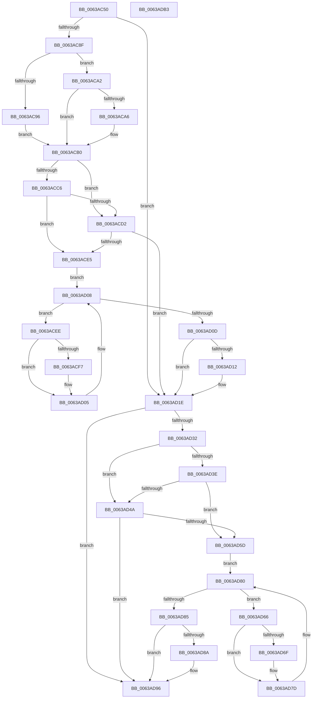

# DifPsSetCreateProcessNotifyRoutineWrapper

- RVA: `0x0063AC50`–`0x0063ADB4` (길이 `356` bytes)
- VA: `0x000000014063AC50`
- 실행 섹션: `.text`
- PDB 이름 있음: `예`; PDB Function 태그: `아니요`
- unwind 정보 RVA: `0x00093E28`
- 디코드: `98`개 명령, `356/356` bytes 표시
- 미해석 바이트: `0` (있으면 어셈블리에 `.byte`로 보존)

> 이 문서는 커널 이미지의 기계어와 PDB 기호를 분석해 생성했습니다. 4번과 5번은 함수 원형과 자료형을 바이너리 사용 방식에서 추정한 C 해석이며 원본 소스 복구 결과는 아닙니다.

## 1. Dependencies

- 직접 호출 지점: **9**; 고유 호출 대상: **6**
- 직접 호출자로 확인된 함수: **0**
- RIP 상대 이미지 참조: **3**

### Outgoing calls
- `0x0063AC7E` → [DifGetAPIThunkContextById](../49/DifGetAPIThunkContextById_function_00495A34.md) (function, `0x00495A34`)
- `0x0063ACA6` → [DifGetReturnAddressForWrappers](../4D/DifGetReturnAddressForWrappers_function_004D3C08.md) (function, `0x004D3C08`)
- `0x0063ACD9` → [ExAcquireRundownProtection](../21/ExAcquireRundownProtection_function_00216620.md) (function, `0x00216620`)
- `0x0063AD00` → [guard_dispatch_icall](../6B/guard_dispatch_icall_function_006BAAD0.md) (function, `0x006BAAD0`)
- `0x0063AD19` → [ExReleaseRundownProtection](../34/ExReleaseRundownProtection_function_00349E80.md) (function, `0x00349E80`)
- `0x0063AD24` → [PsSetCreateProcessNotifyRoutine](../../page/78/PsSetCreateProcessNotifyRoutine_function_00787760.md) (function, `0x00787760`)
- `0x0063AD51` → [ExAcquireRundownProtection](../21/ExAcquireRundownProtection_function_00216620.md) (function, `0x00216620`)
- `0x0063AD78` → [guard_dispatch_icall](../6B/guard_dispatch_icall_function_006BAAD0.md) (function, `0x006BAAD0`)
- `0x0063AD91` → [ExReleaseRundownProtection](../34/ExReleaseRundownProtection_function_00349E80.md) (function, `0x00349E80`)

### Direct callers
- 이 함수 시작 RVA로 연결되는 직접 call은 확인되지 않았습니다. 간접 호출은 완전히 역산할 수 없습니다.

### Static image references
- `0x0063ACB8` → RVA `0x00F048B8` (`.data`; read)
- `0x0063ACC6` → RVA `0x00F04980` (`.data`; read)
- `0x0063ACD2` → RVA `0x00F03E80` (`.data`; read)

## 2. Other-region calls and transfers

- 다른 실행 섹션으로 향하는 call: **1**
  - `0x0063AD24` → [PsSetCreateProcessNotifyRoutine](../../page/78/PsSetCreateProcessNotifyRoutine_function_00787760.md) (`.text` → `PAGE`)
- 별도 외부 분기/꼬리 이동을 확인하지 못했습니다.

## 3. Assembly (complete function range)

```asm
0063AC50  48 8B C4                        mov rax, rsp
0063AC53  48 89 58 08                     mov qword ptr [rax + 8], rbx
0063AC57  48 89 68 10                     mov qword ptr [rax + 0x10], rbp
0063AC5B  48 89 70 18                     mov qword ptr [rax + 0x18], rsi
0063AC5F  57                              push rdi
0063AC60  41 56                           push r14
0063AC62  41 57                           push r15
0063AC64  48 83 EC 40                     sub rsp, 0x40
0063AC68  0F 57 C0                        xorps xmm0, xmm0
0063AC6B  4C 8B F9                        mov r15, rcx
0063AC6E  B9 AD 00 00 00                  mov ecx, 0xad
0063AC73  44 8A F2                        mov r14b, dl
0063AC76  0F 11 40 C8                     movups xmmword ptr [rax - 0x38], xmm0
0063AC7A  0F 11 40 D8                     movups xmmword ptr [rax - 0x28], xmm0
0063AC7E  E8 B1 AD E5 FF                  call 0x140495a34
0063AC83  48 8B F0                        mov rsi, rax
0063AC86  48 85 C0                        test rax, rax
0063AC89  0F 84 8F 00 00 00               je 0x14063ad1e
0063AC8F  8B 40 0C                        mov eax, dword ptr [rax + 0xc]
0063AC92  A8 18                           test al, 0x18
0063AC94  74 0C                           je 0x14063aca2
0063AC96  48 8B 4C 24 58                  mov rcx, qword ptr [rsp + 0x58]
0063AC9B  48 89 4C 24 20                  mov qword ptr [rsp + 0x20], rcx
0063ACA0  EB 0E                           jmp 0x14063acb0
0063ACA2  A8 04                           test al, 4
0063ACA4  74 0A                           je 0x14063acb0
0063ACA6  E8 5D 8F E9 FF                  call 0x1404d3c08
0063ACAB  48 89 44 24 20                  mov qword ptr [rsp + 0x20], rax
0063ACB0  40 32 ED                        xor bpl, bpl
0063ACB3  4C 89 7C 24 30                  mov qword ptr [rsp + 0x30], r15
0063ACB8  40 38 2D F9 9B 8C 00            cmp byte ptr [rip + 0x8c9bf9], bpl
0063ACBF  44 88 74 24 28                  mov byte ptr [rsp + 0x28], r14b
0063ACC4  75 0C                           jne 0x14063acd2
0063ACC6  F7 05 B0 9C 8C 00 00 08 00 00   test dword ptr [rip + 0x8c9cb0], 0x800
0063ACD0  74 13                           je 0x14063ace5
0063ACD2  48 8D 0D A7 91 8C 00            lea rcx, [rip + 0x8c91a7]
0063ACD9  E8 42 B9 BD FF                  call 0x140216620
0063ACDE  40 8A E8                        mov bpl, al
0063ACE1  84 C0                           test al, al
0063ACE3  74 39                           je 0x14063ad1e
0063ACE5  48 8D 7E 20                     lea rdi, [rsi + 0x20]
0063ACE9  48 8B 1F                        mov rbx, qword ptr [rdi]
0063ACEC  EB 1A                           jmp 0x14063ad08
0063ACEE  48 8D 43 F0                     lea rax, [rbx - 0x10]
0063ACF2  48 85 C0                        test rax, rax
0063ACF5  74 0E                           je 0x14063ad05
0063ACF7  48 8B 40 08                     mov rax, qword ptr [rax + 8]
0063ACFB  48 8D 4C 24 20                  lea rcx, [rsp + 0x20]
0063AD00  E8 CB FD 07 00                  call 0x1406baad0
0063AD05  48 8B 1B                        mov rbx, qword ptr [rbx]
0063AD08  48 3B DF                        cmp rbx, rdi
0063AD0B  75 E1                           jne 0x14063acee
0063AD0D  40 84 ED                        test bpl, bpl
0063AD10  74 0C                           je 0x14063ad1e
0063AD12  48 8D 0D 67 91 8C 00            lea rcx, [rip + 0x8c9167]
0063AD19  E8 62 F1 D0 FF                  call 0x140349e80
0063AD1E  41 8A D6                        mov dl, r14b
0063AD21  49 8B CF                        mov rcx, r15
0063AD24  E8 37 CA 14 00                  call 0x140787760
0063AD29  89 44 24 38                     mov dword ptr [rsp + 0x38], eax
0063AD2D  48 85 F6                        test rsi, rsi
0063AD30  74 64                           je 0x14063ad96
0063AD32  40 32 FF                        xor dil, dil
0063AD35  40 38 3D 7C 9B 8C 00            cmp byte ptr [rip + 0x8c9b7c], dil
0063AD3C  75 0C                           jne 0x14063ad4a
0063AD3E  F7 05 38 9C 8C 00 00 08 00 00   test dword ptr [rip + 0x8c9c38], 0x800
0063AD48  74 13                           je 0x14063ad5d
0063AD4A  48 8D 0D 2F 91 8C 00            lea rcx, [rip + 0x8c912f]
0063AD51  E8 CA B8 BD FF                  call 0x140216620
0063AD56  40 8A F8                        mov dil, al
0063AD59  84 C0                           test al, al
0063AD5B  74 39                           je 0x14063ad96
0063AD5D  48 83 C6 30                     add rsi, 0x30
0063AD61  48 8B 1E                        mov rbx, qword ptr [rsi]
0063AD64  EB 1A                           jmp 0x14063ad80
0063AD66  48 8D 43 F0                     lea rax, [rbx - 0x10]
0063AD6A  48 85 C0                        test rax, rax
0063AD6D  74 0E                           je 0x14063ad7d
0063AD6F  48 8B 40 08                     mov rax, qword ptr [rax + 8]
0063AD73  48 8D 4C 24 20                  lea rcx, [rsp + 0x20]
0063AD78  E8 53 FD 07 00                  call 0x1406baad0
0063AD7D  48 8B 1B                        mov rbx, qword ptr [rbx]
0063AD80  48 3B DE                        cmp rbx, rsi
0063AD83  75 E1                           jne 0x14063ad66
0063AD85  40 84 FF                        test dil, dil
0063AD88  74 0C                           je 0x14063ad96
0063AD8A  48 8D 0D EF 90 8C 00            lea rcx, [rip + 0x8c90ef]
0063AD91  E8 EA F0 D0 FF                  call 0x140349e80
0063AD96  8B 44 24 38                     mov eax, dword ptr [rsp + 0x38]
0063AD9A  48 8B 5C 24 60                  mov rbx, qword ptr [rsp + 0x60]
0063AD9F  48 8B 6C 24 68                  mov rbp, qword ptr [rsp + 0x68]
0063ADA4  48 8B 74 24 70                  mov rsi, qword ptr [rsp + 0x70]
0063ADA9  48 83 C4 40                     add rsp, 0x40
0063ADAD  41 5F                           pop r15
0063ADAF  41 5E                           pop r14
0063ADB1  5F                              pop rdi
0063ADB2  C3                              ret
0063ADB3  CC                              int3
```

## 4. C-style interpretation (structured pseudocode)

```c
__int64 __fastcall DifPsSetCreateProcessNotifyRoutineWrapper(__int64 a1, unsigned __int8 a2)
{
    __int64 result;
    __int64 v_rbp;
    __int64 v_rdi;
    __int64 v_rsi;
    __int64 v_rsp;
    unsigned int v_stack_m20;
    unsigned __int64 v_stack_m28;
    unsigned __int8 v_stack_m30;
    unsigned __int64 v_stack_m38;
    unsigned __int64 v_stack_p0;
    unsigned __int64 v_stack_p10;
    unsigned __int64 v_stack_p18;
    unsigned __int64 v_stack_p8;

    *(unsigned __int64 *)(v_rsp + 8) = v_rbx;
    *(unsigned __int64 *)(v_rsp + 16) = v_rbp;
    *(unsigned __int64 *)(v_rsp + 24) = v_rsi;
    v_rsp = (v_rsp) - (64);
    *(unsigned __int64 *)(v_rsp - 56) = v_xmm0;
    *(unsigned __int64 *)(v_rsp - 40) = v_xmm0;
    result = DifGetAPIThunkContextById(173, a2, a3, a4);
    if (result == 0) goto loc_0063AD1E;
    if ((((unsigned __int8)((unsigned int)(*(unsigned int *)(result + 12)))) & (24)) == 0) goto loc_0063ACA2;
    v_stack_m38 = v_stack_p0;
    goto loc_0063ACB0;
loc_0063ACA2:
    result = (unsigned int)(*(unsigned int *)(result + 12));
    if ((((unsigned __int8)((unsigned int)(*(unsigned int *)(result + 12)))) & (4)) != 0) {
        result = DifGetReturnAddressForWrappers(v_stack_p0, a2, a3, a4);
        v_stack_m38 = result;
    }
    v_rbp = 0;
    v_stack_m28 = a1;
    v_stack_m30 = a2;
    if ((*(unsigned __int8 *)(v_rip + 9214969)) != 0) goto loc_0063ACD2;
    if (((*(unsigned int *)(v_rip + 9215152)) & (0x800ULL)) == 0) goto loc_0063ACE5;
loc_0063ACD2:
    result = ExAcquireRundownProtection(v_rip + 9212327, a2, a3, a4);
    if ((unsigned __int8)(result) == 0) goto loc_0063AD1E;
loc_0063ACE5:
    goto loc_0063AD08;
loc_0063ACEE:
    result = *(unsigned __int64 *)(result + 32) - 16;
    if (*(unsigned __int64 *)(result + 32) - 16 != 0) {
        result = *(unsigned __int64 *)(*(unsigned __int64 *)(result + 32) - 16 + 8);
        a1 = v_stack_m38;
        result = guard_dispatch_icall(a1, a2, a3, a4);
    }
loc_0063AD08:
    if ((*(unsigned __int64 *)(*(unsigned __int64 *)(result + 32))) != (result + 32)) goto loc_0063ACEE;
    if ((unsigned __int8)((unsigned __int8)(result)) != 0) {
        a1 = v_rip + 9212263;
        result = ExReleaseRundownProtection(a1, a2, a3, a4);
    }
    result = PsSetCreateProcessNotifyRoutine(a1, a2, a3, a4);
    v_stack_m20 = (unsigned int)(result);
    if (result == 0) goto loc_0063AD96;
    v_rdi = 0;
    if ((*(unsigned __int8 *)(v_rip + 9214844)) != 0) goto loc_0063AD4A;
    if (((*(unsigned int *)(v_rip + 9215032)) & (0x800ULL)) == 0) goto loc_0063AD5D;
loc_0063AD4A:
    result = ExAcquireRundownProtection(v_rip + 9212207, a2, a3, a4);
    if ((unsigned __int8)(result) == 0) goto loc_0063AD96;
loc_0063AD5D:
    v_rsi = (result) + (48);
    goto loc_0063AD80;
loc_0063AD66:
    result = *(unsigned __int64 *)(v_rsi) - 16;
    if (*(unsigned __int64 *)(v_rsi) - 16 != 0) {
        result = *(unsigned __int64 *)(*(unsigned __int64 *)(v_rsi) - 16 + 8);
        a1 = v_stack_m38;
        result = guard_dispatch_icall(a1, a2, a3, a4);
    }
loc_0063AD80:
    if ((*(unsigned __int64 *)(*(unsigned __int64 *)(v_rsi))) != v_rsi) goto loc_0063AD66;
    if ((unsigned __int8)((unsigned __int8)(result)) != 0) {
        a1 = v_rip + 9212143;
        result = ExReleaseRundownProtection(a1, a2, a3, a4);
    }
    v_rsp = (v_rsp) + (64);
    return (unsigned int)(v_stack_m20);
}
```

## 5. (Beta) C Style

```c
int64_t DifPsSetCreateProcessNotifyRoutineWrapper(int64_t Arg1, uint8_t Arg2)
{
    int64_t result;
    int64_t local_rbp;
    int64_t local_rdi;
    int64_t local_rsi;
    int64_t local_rsp;
    uint32_t v_stack_m20;
    uint64_t v_stack_m28;
    uint8_t v_stack_m30;
    uint64_t v_stack_m38;
    uint64_t v_stack_p0;
    uint64_t v_stack_p10;
    uint64_t v_stack_p18;
    uint64_t v_stack_p8;

    *(uint64_t *)(local_rsp + 0x8) = local_rbx;
    *(uint64_t *)(local_rsp + 0x10) = local_rbp;
    *(uint64_t *)(local_rsp + 0x18) = local_rsi;
    local_rsp = (local_rsp) - (64);
    *(uint64_t *)(local_rsp - 0x38) = v_xmm0;
    *(uint64_t *)(local_rsp - 0x28) = v_xmm0;
    result = DifGetAPIThunkContextById(173, Arg2, a3, a4);
    if (result == 0) goto loc_0063AD1E;
    if ((((uint8_t)((uint32_t)(*(uint32_t *)(result + 0xC)))) & (24)) == 0) goto loc_0063ACA2;
    v_stack_m38 = v_stack_p0;
    goto loc_0063ACB0;
loc_0063ACA2:
    result = (uint32_t)(*(uint32_t *)(result + 0xC));
    if ((((uint8_t)((uint32_t)(*(uint32_t *)(result + 0xC)))) & (4)) != 0) {
        result = DifGetReturnAddressForWrappers(v_stack_p0, Arg2, a3, a4);
        v_stack_m38 = result;
    }
    local_rbp = 0;
    v_stack_m28 = Arg1;
    v_stack_m30 = Arg2;
    if ((*(uint8_t *)(v_rip + 0x8C9BF9)) != 0) goto loc_0063ACD2;
    if (((*(uint32_t *)(v_rip + 0x8C9CB0)) & (0x800ULL)) == 0) goto loc_0063ACE5;
loc_0063ACD2:
    result = ExAcquireRundownProtection(v_rip + 9212327, Arg2, a3, a4);
    if ((uint8_t)(result) == 0) goto loc_0063AD1E;
loc_0063ACE5:
    goto loc_0063AD08;
loc_0063ACEE:
    result = *(uint64_t *)(result + 0x20) - 16;
    if (*(uint64_t *)(result + 0x20) - 16 != 0) {
        result = *(uint64_t *)(*(uint64_t *)(result + 0x20) - 0x10 + 0x8);
        Arg1 = v_stack_m38;
        result = guard_dispatch_icall(Arg1, Arg2, a3, a4);
    }
loc_0063AD08:
    if ((*(uint64_t *)(*(uint64_t *)(result + 0x20))) != (result + 32)) goto loc_0063ACEE;
    if ((uint8_t)((uint8_t)(result)) != 0) {
        Arg1 = v_rip + 9212263;
        result = ExReleaseRundownProtection(Arg1, Arg2, a3, a4);
    }
    result = PsSetCreateProcessNotifyRoutine(Arg1, Arg2, a3, a4);
    v_stack_m20 = (uint32_t)(result);
    if (result == 0) goto loc_0063AD96;
    local_rdi = 0;
    if ((*(uint8_t *)(v_rip + 0x8C9B7C)) != 0) goto loc_0063AD4A;
    if (((*(uint32_t *)(v_rip + 0x8C9C38)) & (0x800ULL)) == 0) goto loc_0063AD5D;
loc_0063AD4A:
    result = ExAcquireRundownProtection(v_rip + 9212207, Arg2, a3, a4);
    if ((uint8_t)(result) == 0) goto loc_0063AD96;
loc_0063AD5D:
    local_rsi = (result) + (48);
    goto loc_0063AD80;
loc_0063AD66:
    result = *(uint64_t *)(local_rsi) - 16;
    if (*(uint64_t *)(local_rsi) - 16 != 0) {
        result = *(uint64_t *)(*(uint64_t *)(local_rsi) - 0x10 + 0x8);
        Arg1 = v_stack_m38;
        result = guard_dispatch_icall(Arg1, Arg2, a3, a4);
    }
loc_0063AD80:
    if ((*(uint64_t *)(*(uint64_t *)(local_rsi))) != local_rsi) goto loc_0063AD66;
    if ((uint8_t)((uint8_t)(result)) != 0) {
        Arg1 = v_rip + 9212143;
        result = ExReleaseRundownProtection(Arg1, Arg2, a3, a4);
    }
    local_rsp = (local_rsp) + (64);
    return (uint32_t)(v_stack_m20);
}
```

## 6. Execution-region graph

[열기: 2D/3D 그래프와 함수 탐색 컨트롤 패널](../../../control-panel.html?section=text&rva=0x0063AC50&view=graph)

- 2D 그래프는 위에서 아래로 흐르고, 3D 그래프는 빈 공간을 드래그해 회전합니다. Shift+드래그는 이동, 휠은 확대·축소, 함수 노드 선택은 대상 보고서 이동입니다.

### Static fallback


