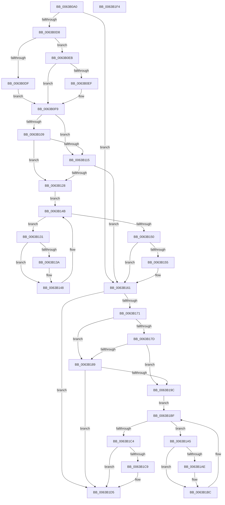

# DifPsTerminateSystemThreadWrapper

- RVA: `0x0063B0A0`–`0x0063B1F5` (길이 `341` bytes)
- VA: `0x000000014063B0A0`
- 실행 섹션: `.text`
- PDB 이름 있음: `예`; PDB Function 태그: `아니요`
- unwind 정보 RVA: `0x0005D7BC`
- 디코드: `92`개 명령, `341/341` bytes 표시
- 미해석 바이트: `0` (있으면 어셈블리에 `.byte`로 보존)

> 이 문서는 커널 이미지의 기계어와 PDB 기호를 분석해 생성했습니다. 4번과 5번은 함수 원형과 자료형을 바이너리 사용 방식에서 추정한 C 해석이며 원본 소스 복구 결과는 아닙니다.

## 1. Dependencies

- 직접 호출 지점: **9**; 고유 호출 대상: **6**
- 직접 호출자로 확인된 함수: **0**
- RIP 상대 이미지 참조: **3**

### Outgoing calls
- `0x0063B0C7` → [DifGetAPIThunkContextById](../49/DifGetAPIThunkContextById_function_00495A34.md) (function, `0x00495A34`)
- `0x0063B0EF` → [DifGetReturnAddressForWrappers](../4D/DifGetReturnAddressForWrappers_function_004D3C08.md) (function, `0x004D3C08`)
- `0x0063B11C` → [ExAcquireRundownProtection](../21/ExAcquireRundownProtection_function_00216620.md) (function, `0x00216620`)
- `0x0063B143` → [guard_dispatch_icall](../6B/guard_dispatch_icall_function_006BAAD0.md) (function, `0x006BAAD0`)
- `0x0063B15C` → [ExReleaseRundownProtection](../34/ExReleaseRundownProtection_function_00349E80.md) (function, `0x00349E80`)
- `0x0063B163` → [PsTerminateSystemThread](../../page/9B/PsTerminateSystemThread_function_009BCE50.md) (function, `0x009BCE50`)
- `0x0063B190` → [ExAcquireRundownProtection](../21/ExAcquireRundownProtection_function_00216620.md) (function, `0x00216620`)
- `0x0063B1B7` → [guard_dispatch_icall](../6B/guard_dispatch_icall_function_006BAAD0.md) (function, `0x006BAAD0`)
- `0x0063B1D0` → [ExReleaseRundownProtection](../34/ExReleaseRundownProtection_function_00349E80.md) (function, `0x00349E80`)

### Direct callers
- 이 함수 시작 RVA로 연결되는 직접 call은 확인되지 않았습니다. 간접 호출은 완전히 역산할 수 없습니다.

### Static image references
- `0x0063B100` → RVA `0x00F048B8` (`.data`; read)
- `0x0063B109` → RVA `0x00F04980` (`.data`; read)
- `0x0063B115` → RVA `0x00F03E80` (`.data`; read)

## 2. Other-region calls and transfers

- 다른 실행 섹션으로 향하는 call: **1**
  - `0x0063B163` → [PsTerminateSystemThread](../../page/9B/PsTerminateSystemThread_function_009BCE50.md) (`.text` → `PAGE`)
- 별도 외부 분기/꼬리 이동을 확인하지 못했습니다.

## 3. Assembly (complete function range)

```asm
0063B0A0  48 8B C4                        mov rax, rsp
0063B0A3  48 89 58 08                     mov qword ptr [rax + 8], rbx
0063B0A7  48 89 68 10                     mov qword ptr [rax + 0x10], rbp
0063B0AB  48 89 70 18                     mov qword ptr [rax + 0x18], rsi
0063B0AF  48 89 78 20                     mov qword ptr [rax + 0x20], rdi
0063B0B3  41 56                           push r14
0063B0B5  48 83 EC 30                     sub rsp, 0x30
0063B0B9  8B E9                           mov ebp, ecx
0063B0BB  0F 57 C0                        xorps xmm0, xmm0
0063B0BE  B9 AA 00 00 00                  mov ecx, 0xaa
0063B0C3  0F 11 40 E8                     movups xmmword ptr [rax - 0x18], xmm0
0063B0C7  E8 68 A9 E5 FF                  call 0x140495a34
0063B0CC  48 8B F0                        mov rsi, rax
0063B0CF  48 85 C0                        test rax, rax
0063B0D2  0F 84 89 00 00 00               je 0x14063b161
0063B0D8  8B 40 0C                        mov eax, dword ptr [rax + 0xc]
0063B0DB  A8 18                           test al, 0x18
0063B0DD  74 0C                           je 0x14063b0eb
0063B0DF  48 8B 4C 24 38                  mov rcx, qword ptr [rsp + 0x38]
0063B0E4  48 89 4C 24 20                  mov qword ptr [rsp + 0x20], rcx
0063B0E9  EB 0E                           jmp 0x14063b0f9
0063B0EB  A8 04                           test al, 4
0063B0ED  74 0A                           je 0x14063b0f9
0063B0EF  E8 14 8B E9 FF                  call 0x1404d3c08
0063B0F4  48 89 44 24 20                  mov qword ptr [rsp + 0x20], rax
0063B0F9  40 32 FF                        xor dil, dil
0063B0FC  89 6C 24 28                     mov dword ptr [rsp + 0x28], ebp
0063B100  40 38 3D B1 97 8C 00            cmp byte ptr [rip + 0x8c97b1], dil
0063B107  75 0C                           jne 0x14063b115
0063B109  F7 05 6D 98 8C 00 00 08 00 00   test dword ptr [rip + 0x8c986d], 0x800
0063B113  74 13                           je 0x14063b128
0063B115  48 8D 0D 64 8D 8C 00            lea rcx, [rip + 0x8c8d64]
0063B11C  E8 FF B4 BD FF                  call 0x140216620
0063B121  40 8A F8                        mov dil, al
0063B124  84 C0                           test al, al
0063B126  74 39                           je 0x14063b161
0063B128  4C 8D 76 20                     lea r14, [rsi + 0x20]
0063B12C  49 8B 1E                        mov rbx, qword ptr [r14]
0063B12F  EB 1A                           jmp 0x14063b14b
0063B131  48 8D 43 F0                     lea rax, [rbx - 0x10]
0063B135  48 85 C0                        test rax, rax
0063B138  74 0E                           je 0x14063b148
0063B13A  48 8B 40 08                     mov rax, qword ptr [rax + 8]
0063B13E  48 8D 4C 24 20                  lea rcx, [rsp + 0x20]
0063B143  E8 88 F9 07 00                  call 0x1406baad0
0063B148  48 8B 1B                        mov rbx, qword ptr [rbx]
0063B14B  49 3B DE                        cmp rbx, r14
0063B14E  75 E1                           jne 0x14063b131
0063B150  40 84 FF                        test dil, dil
0063B153  74 0C                           je 0x14063b161
0063B155  48 8D 0D 24 8D 8C 00            lea rcx, [rip + 0x8c8d24]
0063B15C  E8 1F ED D0 FF                  call 0x140349e80
0063B161  8B CD                           mov ecx, ebp
0063B163  E8 E8 1C 38 00                  call 0x1409bce50
0063B168  89 44 24 2C                     mov dword ptr [rsp + 0x2c], eax
0063B16C  48 85 F6                        test rsi, rsi
0063B16F  74 64                           je 0x14063b1d5
0063B171  40 32 FF                        xor dil, dil
0063B174  40 38 3D 3D 97 8C 00            cmp byte ptr [rip + 0x8c973d], dil
0063B17B  75 0C                           jne 0x14063b189
0063B17D  F7 05 F9 97 8C 00 00 08 00 00   test dword ptr [rip + 0x8c97f9], 0x800
0063B187  74 13                           je 0x14063b19c
0063B189  48 8D 0D F0 8C 8C 00            lea rcx, [rip + 0x8c8cf0]
0063B190  E8 8B B4 BD FF                  call 0x140216620
0063B195  40 8A F8                        mov dil, al
0063B198  84 C0                           test al, al
0063B19A  74 39                           je 0x14063b1d5
0063B19C  48 83 C6 30                     add rsi, 0x30
0063B1A0  48 8B 1E                        mov rbx, qword ptr [rsi]
0063B1A3  EB 1A                           jmp 0x14063b1bf
0063B1A5  48 8D 43 F0                     lea rax, [rbx - 0x10]
0063B1A9  48 85 C0                        test rax, rax
0063B1AC  74 0E                           je 0x14063b1bc
0063B1AE  48 8B 40 08                     mov rax, qword ptr [rax + 8]
0063B1B2  48 8D 4C 24 20                  lea rcx, [rsp + 0x20]
0063B1B7  E8 14 F9 07 00                  call 0x1406baad0
0063B1BC  48 8B 1B                        mov rbx, qword ptr [rbx]
0063B1BF  48 3B DE                        cmp rbx, rsi
0063B1C2  75 E1                           jne 0x14063b1a5
0063B1C4  40 84 FF                        test dil, dil
0063B1C7  74 0C                           je 0x14063b1d5
0063B1C9  48 8D 0D B0 8C 8C 00            lea rcx, [rip + 0x8c8cb0]
0063B1D0  E8 AB EC D0 FF                  call 0x140349e80
0063B1D5  8B 44 24 2C                     mov eax, dword ptr [rsp + 0x2c]
0063B1D9  48 8B 5C 24 40                  mov rbx, qword ptr [rsp + 0x40]
0063B1DE  48 8B 6C 24 48                  mov rbp, qword ptr [rsp + 0x48]
0063B1E3  48 8B 74 24 50                  mov rsi, qword ptr [rsp + 0x50]
0063B1E8  48 8B 7C 24 58                  mov rdi, qword ptr [rsp + 0x58]
0063B1ED  48 83 C4 30                     add rsp, 0x30
0063B1F1  41 5E                           pop r14
0063B1F3  C3                              ret
0063B1F4  CC                              int3
```

## 4. C-style interpretation (structured pseudocode)

```c
__int64 __fastcall DifPsTerminateSystemThreadWrapper(int a1)
{
    __int64 result;
    __int64 v_rdi;
    __int64 v_rsi;
    __int64 v_rsp;
    unsigned int v_stack_m10;
    unsigned __int64 v_stack_m18;
    unsigned int v_stack_mC;
    unsigned __int64 v_stack_p0;
    unsigned __int64 v_stack_p10;
    unsigned __int64 v_stack_p18;
    unsigned __int64 v_stack_p20;
    unsigned __int64 v_stack_p8;

    *(unsigned __int64 *)(v_rsp + 8) = v_rbx;
    *(unsigned __int64 *)(v_rsp + 16) = v_rbp;
    *(unsigned __int64 *)(v_rsp + 24) = v_rsi;
    *(unsigned __int64 *)(v_rsp + 32) = v_rdi;
    v_rsp = (v_rsp) - (48);
    *(unsigned __int64 *)(v_rsp - 24) = v_xmm0;
    result = DifGetAPIThunkContextById(170, a2, a3, a4);
    if (result == 0) goto loc_0063B161;
    if ((((unsigned __int8)((unsigned int)(*(unsigned int *)(result + 12)))) & (24)) == 0) goto loc_0063B0EB;
    v_stack_m18 = v_stack_p0;
    goto loc_0063B0F9;
loc_0063B0EB:
    result = (unsigned int)(*(unsigned int *)(result + 12));
    if ((((unsigned __int8)((unsigned int)(*(unsigned int *)(result + 12)))) & (4)) != 0) {
        result = DifGetReturnAddressForWrappers(v_stack_p0, a2, a3, a4);
        v_stack_m18 = result;
    }
    v_rdi = 0;
    v_stack_m10 = (unsigned int)((unsigned int)(a1));
    if ((*(unsigned __int8 *)(v_rip + 9213873)) != 0) goto loc_0063B115;
    if (((*(unsigned int *)(v_rip + 9214061)) & (0x800ULL)) == 0) goto loc_0063B128;
loc_0063B115:
    result = ExAcquireRundownProtection(v_rip + 9211236, a2, a3, a4);
    if ((unsigned __int8)(result) == 0) goto loc_0063B161;
loc_0063B128:
    goto loc_0063B14B;
loc_0063B131:
    result = *(unsigned __int64 *)(result + 32) - 16;
    if (*(unsigned __int64 *)(result + 32) - 16 != 0) {
        result = *(unsigned __int64 *)(*(unsigned __int64 *)(result + 32) - 16 + 8);
        a1 = v_stack_m18;
        result = guard_dispatch_icall(a1, a2, a3, a4);
    }
loc_0063B14B:
    if ((*(unsigned __int64 *)(*(unsigned __int64 *)(result + 32))) != (result + 32)) goto loc_0063B131;
    if ((unsigned __int8)((unsigned __int8)(result)) != 0) {
        a1 = v_rip + 9211172;
        result = ExReleaseRundownProtection(a1, a2, a3, a4);
    }
    result = PsTerminateSystemThread((unsigned int)((unsigned int)((unsigned int)(a1))), a2, a3, a4);
    v_stack_mC = (unsigned int)(result);
    if (result == 0) goto loc_0063B1D5;
    v_rdi = 0;
    if ((*(unsigned __int8 *)(v_rip + 9213757)) != 0) goto loc_0063B189;
    if (((*(unsigned int *)(v_rip + 9213945)) & (0x800ULL)) == 0) goto loc_0063B19C;
loc_0063B189:
    result = ExAcquireRundownProtection(v_rip + 9211120, a2, a3, a4);
    if ((unsigned __int8)(result) == 0) goto loc_0063B1D5;
loc_0063B19C:
    v_rsi = (result) + (48);
    goto loc_0063B1BF;
loc_0063B1A5:
    result = *(unsigned __int64 *)(v_rsi) - 16;
    if (*(unsigned __int64 *)(v_rsi) - 16 != 0) {
        result = *(unsigned __int64 *)(*(unsigned __int64 *)(v_rsi) - 16 + 8);
        a1 = v_stack_m18;
        result = guard_dispatch_icall(a1, a2, a3, a4);
    }
loc_0063B1BF:
    if ((*(unsigned __int64 *)(*(unsigned __int64 *)(v_rsi))) != v_rsi) goto loc_0063B1A5;
    if ((unsigned __int8)((unsigned __int8)(result)) != 0) {
        a1 = v_rip + 9211056;
        result = ExReleaseRundownProtection(a1, a2, a3, a4);
    }
    v_rsp = (v_rsp) + (48);
    return (unsigned int)(v_stack_mC);
}
```

## 5. (Beta) C Style

```c
int64_t DifPsTerminateSystemThreadWrapper(int32_t Arg1)
{
    int64_t result;
    int64_t local_rdi;
    int64_t local_rsi;
    int64_t local_rsp;
    uint32_t v_stack_m10;
    uint64_t v_stack_m18;
    uint32_t v_stack_mC;
    uint64_t v_stack_p0;
    uint64_t v_stack_p10;
    uint64_t v_stack_p18;
    uint64_t v_stack_p20;
    uint64_t v_stack_p8;

    *(uint64_t *)(local_rsp + 0x8) = local_rbx;
    *(uint64_t *)(local_rsp + 0x10) = local_rbp;
    *(uint64_t *)(local_rsp + 0x18) = local_rsi;
    *(uint64_t *)(local_rsp + 0x20) = local_rdi;
    local_rsp = (local_rsp) - (48);
    *(uint64_t *)(local_rsp - 0x18) = v_xmm0;
    result = DifGetAPIThunkContextById(170, a2, a3, a4);
    if (result == 0) goto loc_0063B161;
    if ((((uint8_t)((uint32_t)(*(uint32_t *)(result + 0xC)))) & (24)) == 0) goto loc_0063B0EB;
    v_stack_m18 = v_stack_p0;
    goto loc_0063B0F9;
loc_0063B0EB:
    result = (uint32_t)(*(uint32_t *)(result + 0xC));
    if ((((uint8_t)((uint32_t)(*(uint32_t *)(result + 0xC)))) & (4)) != 0) {
        result = DifGetReturnAddressForWrappers(v_stack_p0, a2, a3, a4);
        v_stack_m18 = result;
    }
    local_rdi = 0;
    v_stack_m10 = (uint32_t)((uint32_t)(Arg1));
    if ((*(uint8_t *)(v_rip + 0x8C97B1)) != 0) goto loc_0063B115;
    if (((*(uint32_t *)(v_rip + 0x8C986D)) & (0x800ULL)) == 0) goto loc_0063B128;
loc_0063B115:
    result = ExAcquireRundownProtection(v_rip + 9211236, a2, a3, a4);
    if ((uint8_t)(result) == 0) goto loc_0063B161;
loc_0063B128:
    goto loc_0063B14B;
loc_0063B131:
    result = *(uint64_t *)(result + 0x20) - 16;
    if (*(uint64_t *)(result + 0x20) - 16 != 0) {
        result = *(uint64_t *)(*(uint64_t *)(result + 0x20) - 0x10 + 0x8);
        Arg1 = v_stack_m18;
        result = guard_dispatch_icall(Arg1, a2, a3, a4);
    }
loc_0063B14B:
    if ((*(uint64_t *)(*(uint64_t *)(result + 0x20))) != (result + 32)) goto loc_0063B131;
    if ((uint8_t)((uint8_t)(result)) != 0) {
        Arg1 = v_rip + 9211172;
        result = ExReleaseRundownProtection(Arg1, a2, a3, a4);
    }
    result = PsTerminateSystemThread((uint32_t)((uint32_t)((uint32_t)(Arg1))), a2, a3, a4);
    v_stack_mC = (uint32_t)(result);
    if (result == 0) goto loc_0063B1D5;
    local_rdi = 0;
    if ((*(uint8_t *)(v_rip + 0x8C973D)) != 0) goto loc_0063B189;
    if (((*(uint32_t *)(v_rip + 0x8C97F9)) & (0x800ULL)) == 0) goto loc_0063B19C;
loc_0063B189:
    result = ExAcquireRundownProtection(v_rip + 9211120, a2, a3, a4);
    if ((uint8_t)(result) == 0) goto loc_0063B1D5;
loc_0063B19C:
    local_rsi = (result) + (48);
    goto loc_0063B1BF;
loc_0063B1A5:
    result = *(uint64_t *)(local_rsi) - 16;
    if (*(uint64_t *)(local_rsi) - 16 != 0) {
        result = *(uint64_t *)(*(uint64_t *)(local_rsi) - 0x10 + 0x8);
        Arg1 = v_stack_m18;
        result = guard_dispatch_icall(Arg1, a2, a3, a4);
    }
loc_0063B1BF:
    if ((*(uint64_t *)(*(uint64_t *)(local_rsi))) != local_rsi) goto loc_0063B1A5;
    if ((uint8_t)((uint8_t)(result)) != 0) {
        Arg1 = v_rip + 9211056;
        result = ExReleaseRundownProtection(Arg1, a2, a3, a4);
    }
    local_rsp = (local_rsp) + (48);
    return (uint32_t)(v_stack_mC);
}
```

## 6. Execution-region graph

[열기: 2D/3D 그래프와 함수 탐색 컨트롤 패널](../../../control-panel.html?section=text&rva=0x0063B0A0&view=graph)

- 2D 그래프는 위에서 아래로 흐르고, 3D 그래프는 빈 공간을 드래그해 회전합니다. Shift+드래그는 이동, 휠은 확대·축소, 함수 노드 선택은 대상 보고서 이동입니다.

### Static fallback


