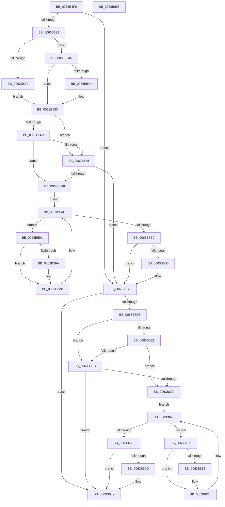

# DifRtlCreateRegistryKeyWrapper

- RVA: `0x0063B4F0`–`0x0063B657` (길이 `359` bytes)
- VA: `0x000000014063B4F0`
- 실행 섹션: `.text`
- PDB 이름 있음: `예`; PDB Function 태그: `아니요`
- unwind 정보 RVA: `0x00093E28`
- 디코드: `99`개 명령, `359/359` bytes 표시
- 미해석 바이트: `0` (있으면 어셈블리에 `.byte`로 보존)

> 이 문서는 커널 이미지의 기계어와 PDB 기호를 분석해 생성했습니다. 4번과 5번은 함수 원형과 자료형을 바이너리 사용 방식에서 추정한 C 해석이며 원본 소스 복구 결과는 아닙니다.

## 1. Dependencies

- 직접 호출 지점: **9**; 고유 호출 대상: **6**
- 직접 호출자로 확인된 함수: **0**
- RIP 상대 이미지 참조: **3**

### Outgoing calls
- `0x0063B521` → [DifGetAPIThunkContextById](../49/DifGetAPIThunkContextById_function_00495A34.md) (function, `0x00495A34`)
- `0x0063B549` → [DifGetReturnAddressForWrappers](../4D/DifGetReturnAddressForWrappers_function_004D3C08.md) (function, `0x004D3C08`)
- `0x0063B57C` → [ExAcquireRundownProtection](../21/ExAcquireRundownProtection_function_00216620.md) (function, `0x00216620`)
- `0x0063B5A3` → [guard_dispatch_icall](../6B/guard_dispatch_icall_function_006BAAD0.md) (function, `0x006BAAD0`)
- `0x0063B5BC` → [ExReleaseRundownProtection](../34/ExReleaseRundownProtection_function_00349E80.md) (function, `0x00349E80`)
- `0x0063B5C7` → [RtlCreateRegistryKey](../../page/78/RtlCreateRegistryKey_function_0078F900.md) (function, `0x0078F900`)
- `0x0063B5F4` → [ExAcquireRundownProtection](../21/ExAcquireRundownProtection_function_00216620.md) (function, `0x00216620`)
- `0x0063B61B` → [guard_dispatch_icall](../6B/guard_dispatch_icall_function_006BAAD0.md) (function, `0x006BAAD0`)
- `0x0063B634` → [ExReleaseRundownProtection](../34/ExReleaseRundownProtection_function_00349E80.md) (function, `0x00349E80`)

### Direct callers
- 이 함수 시작 RVA로 연결되는 직접 call은 확인되지 않았습니다. 간접 호출은 완전히 역산할 수 없습니다.

### Static image references
- `0x0063B55B` → RVA `0x00F048B8` (`.data`; read)
- `0x0063B569` → RVA `0x00F04980` (`.data`; read)
- `0x0063B575` → RVA `0x00F03E80` (`.data`; read)

## 2. Other-region calls and transfers

- 다른 실행 섹션으로 향하는 call: **1**
  - `0x0063B5C7` → [RtlCreateRegistryKey](../../page/78/RtlCreateRegistryKey_function_0078F900.md) (`.text` → `PAGE`)
- 별도 외부 분기/꼬리 이동을 확인하지 못했습니다.

## 3. Assembly (complete function range)

```asm
0063B4F0  4C 8B DC                        mov r11, rsp
0063B4F3  49 89 5B 08                     mov qword ptr [r11 + 8], rbx
0063B4F7  49 89 6B 10                     mov qword ptr [r11 + 0x10], rbp
0063B4FB  49 89 73 18                     mov qword ptr [r11 + 0x18], rsi
0063B4FF  57                              push rdi
0063B500  41 56                           push r14
0063B502  41 57                           push r15
0063B504  48 83 EC 40                     sub rsp, 0x40
0063B508  33 C0                           xor eax, eax
0063B50A  0F 57 C0                        xorps xmm0, xmm0
0063B50D  0F 11 44 24 20                  movups xmmword ptr [rsp + 0x20], xmm0
0063B512  44 8B F9                        mov r15d, ecx
0063B515  49 89 43 D8                     mov qword ptr [r11 - 0x28], rax
0063B519  B9 A7 00 00 00                  mov ecx, 0xa7
0063B51E  4C 8B F2                        mov r14, rdx
0063B521  E8 0E A5 E5 FF                  call 0x140495a34
0063B526  48 8B F0                        mov rsi, rax
0063B529  48 85 C0                        test rax, rax
0063B52C  0F 84 8F 00 00 00               je 0x14063b5c1
0063B532  8B 40 0C                        mov eax, dword ptr [rax + 0xc]
0063B535  A8 18                           test al, 0x18
0063B537  74 0C                           je 0x14063b545
0063B539  48 8B 4C 24 58                  mov rcx, qword ptr [rsp + 0x58]
0063B53E  48 89 4C 24 20                  mov qword ptr [rsp + 0x20], rcx
0063B543  EB 0E                           jmp 0x14063b553
0063B545  A8 04                           test al, 4
0063B547  74 0A                           je 0x14063b553
0063B549  E8 BA 86 E9 FF                  call 0x1404d3c08
0063B54E  48 89 44 24 20                  mov qword ptr [rsp + 0x20], rax
0063B553  40 32 ED                        xor bpl, bpl
0063B556  44 89 7C 24 30                  mov dword ptr [rsp + 0x30], r15d
0063B55B  40 38 2D 56 93 8C 00            cmp byte ptr [rip + 0x8c9356], bpl
0063B562  4C 89 74 24 28                  mov qword ptr [rsp + 0x28], r14
0063B567  75 0C                           jne 0x14063b575
0063B569  F7 05 0D 94 8C 00 00 08 00 00   test dword ptr [rip + 0x8c940d], 0x800
0063B573  74 13                           je 0x14063b588
0063B575  48 8D 0D 04 89 8C 00            lea rcx, [rip + 0x8c8904]
0063B57C  E8 9F B0 BD FF                  call 0x140216620
0063B581  40 8A E8                        mov bpl, al
0063B584  84 C0                           test al, al
0063B586  74 39                           je 0x14063b5c1
0063B588  48 8D 7E 20                     lea rdi, [rsi + 0x20]
0063B58C  48 8B 1F                        mov rbx, qword ptr [rdi]
0063B58F  EB 1A                           jmp 0x14063b5ab
0063B591  48 8D 43 F0                     lea rax, [rbx - 0x10]
0063B595  48 85 C0                        test rax, rax
0063B598  74 0E                           je 0x14063b5a8
0063B59A  48 8B 40 08                     mov rax, qword ptr [rax + 8]
0063B59E  48 8D 4C 24 20                  lea rcx, [rsp + 0x20]
0063B5A3  E8 28 F5 07 00                  call 0x1406baad0
0063B5A8  48 8B 1B                        mov rbx, qword ptr [rbx]
0063B5AB  48 3B DF                        cmp rbx, rdi
0063B5AE  75 E1                           jne 0x14063b591
0063B5B0  40 84 ED                        test bpl, bpl
0063B5B3  74 0C                           je 0x14063b5c1
0063B5B5  48 8D 0D C4 88 8C 00            lea rcx, [rip + 0x8c88c4]
0063B5BC  E8 BF E8 D0 FF                  call 0x140349e80
0063B5C1  49 8B D6                        mov rdx, r14
0063B5C4  41 8B CF                        mov ecx, r15d
0063B5C7  E8 34 43 15 00                  call 0x14078f900
0063B5CC  89 44 24 34                     mov dword ptr [rsp + 0x34], eax
0063B5D0  48 85 F6                        test rsi, rsi
0063B5D3  74 64                           je 0x14063b639
0063B5D5  40 32 FF                        xor dil, dil
0063B5D8  40 38 3D D9 92 8C 00            cmp byte ptr [rip + 0x8c92d9], dil
0063B5DF  75 0C                           jne 0x14063b5ed
0063B5E1  F7 05 95 93 8C 00 00 08 00 00   test dword ptr [rip + 0x8c9395], 0x800
0063B5EB  74 13                           je 0x14063b600
0063B5ED  48 8D 0D 8C 88 8C 00            lea rcx, [rip + 0x8c888c]
0063B5F4  E8 27 B0 BD FF                  call 0x140216620
0063B5F9  40 8A F8                        mov dil, al
0063B5FC  84 C0                           test al, al
0063B5FE  74 39                           je 0x14063b639
0063B600  48 83 C6 30                     add rsi, 0x30
0063B604  48 8B 1E                        mov rbx, qword ptr [rsi]
0063B607  EB 1A                           jmp 0x14063b623
0063B609  48 8D 43 F0                     lea rax, [rbx - 0x10]
0063B60D  48 85 C0                        test rax, rax
0063B610  74 0E                           je 0x14063b620
0063B612  48 8B 40 08                     mov rax, qword ptr [rax + 8]
0063B616  48 8D 4C 24 20                  lea rcx, [rsp + 0x20]
0063B61B  E8 B0 F4 07 00                  call 0x1406baad0
0063B620  48 8B 1B                        mov rbx, qword ptr [rbx]
0063B623  48 3B DE                        cmp rbx, rsi
0063B626  75 E1                           jne 0x14063b609
0063B628  40 84 FF                        test dil, dil
0063B62B  74 0C                           je 0x14063b639
0063B62D  48 8D 0D 4C 88 8C 00            lea rcx, [rip + 0x8c884c]
0063B634  E8 47 E8 D0 FF                  call 0x140349e80
0063B639  8B 44 24 34                     mov eax, dword ptr [rsp + 0x34]
0063B63D  48 8B 5C 24 60                  mov rbx, qword ptr [rsp + 0x60]
0063B642  48 8B 6C 24 68                  mov rbp, qword ptr [rsp + 0x68]
0063B647  48 8B 74 24 70                  mov rsi, qword ptr [rsp + 0x70]
0063B64C  48 83 C4 40                     add rsp, 0x40
0063B650  41 5F                           pop r15
0063B652  41 5E                           pop r14
0063B654  5F                              pop rdi
0063B655  C3                              ret
0063B656  CC                              int3
```

## 4. C-style interpretation (structured pseudocode)

```c
__int64 __fastcall DifRtlCreateRegistryKeyWrapper(int a1, __int64 a2)
{
    __int64 result;
    __int64 v_rbp;
    __int64 v_rdi;
    __int64 v_rsi;
    __int64 v_rsp;
    unsigned int v_stack_m24;
    unsigned int v_stack_m28;
    unsigned __int64 v_stack_m30;
    unsigned __int64 v_stack_m38;
    unsigned __int64 v_stack_p0;
    unsigned __int64 v_stack_p10;
    unsigned __int64 v_stack_p18;
    unsigned __int64 v_stack_p8;

    *(unsigned __int64 *)(v_rsp + 8) = v_rbx;
    *(unsigned __int64 *)(v_rsp + 16) = v_rbp;
    *(unsigned __int64 *)(v_rsp + 24) = v_rsi;
    v_rsp = (v_rsp) - (64);
    result = 0;
    v_stack_m38 = v_xmm0;
    *(unsigned __int64 *)(v_rsp - 40) = 0;
    result = DifGetAPIThunkContextById(167, a2, a3, a4);
    if (result == 0) goto loc_0063B5C1;
    if ((((unsigned __int8)((unsigned int)(*(unsigned int *)(result + 12)))) & (24)) == 0) goto loc_0063B545;
    v_stack_m38 = v_stack_p0;
    goto loc_0063B553;
loc_0063B545:
    result = (unsigned int)(*(unsigned int *)(result + 12));
    if ((((unsigned __int8)((unsigned int)(*(unsigned int *)(result + 12)))) & (4)) != 0) {
        result = DifGetReturnAddressForWrappers(v_stack_p0, a2, a3, a4);
        v_stack_m38 = result;
    }
    v_rbp = 0;
    v_stack_m28 = (unsigned int)((unsigned int)(a1));
    v_stack_m30 = a2;
    if ((*(unsigned __int8 *)(v_rip + 9212758)) != 0) goto loc_0063B575;
    if (((*(unsigned int *)(v_rip + 9212941)) & (0x800ULL)) == 0) goto loc_0063B588;
loc_0063B575:
    result = ExAcquireRundownProtection(v_rip + 9210116, a2, a3, a4);
    if ((unsigned __int8)(result) == 0) goto loc_0063B5C1;
loc_0063B588:
    goto loc_0063B5AB;
loc_0063B591:
    result = *(unsigned __int64 *)(result + 32) - 16;
    if (*(unsigned __int64 *)(result + 32) - 16 != 0) {
        result = *(unsigned __int64 *)(*(unsigned __int64 *)(result + 32) - 16 + 8);
        a1 = v_stack_m38;
        result = guard_dispatch_icall(a1, a2, a3, a4);
    }
loc_0063B5AB:
    if ((*(unsigned __int64 *)(*(unsigned __int64 *)(result + 32))) != (result + 32)) goto loc_0063B591;
    if ((unsigned __int8)((unsigned __int8)(result)) != 0) {
        a1 = v_rip + 9210052;
        result = ExReleaseRundownProtection(a1, a2, a3, a4);
    }
    result = RtlCreateRegistryKey((unsigned int)((unsigned int)((unsigned int)(a1))), a2, a3, a4);
    v_stack_m24 = (unsigned int)(result);
    if (result == 0) goto loc_0063B639;
    v_rdi = 0;
    if ((*(unsigned __int8 *)(v_rip + 9212633)) != 0) goto loc_0063B5ED;
    if (((*(unsigned int *)(v_rip + 9212821)) & (0x800ULL)) == 0) goto loc_0063B600;
loc_0063B5ED:
    result = ExAcquireRundownProtection(v_rip + 9209996, a2, a3, a4);
    if ((unsigned __int8)(result) == 0) goto loc_0063B639;
loc_0063B600:
    v_rsi = (result) + (48);
    goto loc_0063B623;
loc_0063B609:
    result = *(unsigned __int64 *)(v_rsi) - 16;
    if (*(unsigned __int64 *)(v_rsi) - 16 != 0) {
        result = *(unsigned __int64 *)(*(unsigned __int64 *)(v_rsi) - 16 + 8);
        a1 = v_stack_m38;
        result = guard_dispatch_icall(a1, a2, a3, a4);
    }
loc_0063B623:
    if ((*(unsigned __int64 *)(*(unsigned __int64 *)(v_rsi))) != v_rsi) goto loc_0063B609;
    if ((unsigned __int8)((unsigned __int8)(result)) != 0) {
        a1 = v_rip + 9209932;
        result = ExReleaseRundownProtection(a1, a2, a3, a4);
    }
    v_rsp = (v_rsp) + (64);
    return (unsigned int)(v_stack_m24);
}
```

## 5. (Beta) C Style

```c
int64_t DifRtlCreateRegistryKeyWrapper(int32_t Arg1, int64_t Arg2)
{
    int64_t result;
    int64_t local_rbp;
    int64_t local_rdi;
    int64_t local_rsi;
    int64_t local_rsp;
    uint32_t v_stack_m24;
    uint32_t v_stack_m28;
    uint64_t v_stack_m30;
    uint64_t v_stack_m38;
    uint64_t v_stack_p0;
    uint64_t v_stack_p10;
    uint64_t v_stack_p18;
    uint64_t v_stack_p8;

    *(uint64_t *)(local_rsp + 0x8) = local_rbx;
    *(uint64_t *)(local_rsp + 0x10) = local_rbp;
    *(uint64_t *)(local_rsp + 0x18) = local_rsi;
    local_rsp = (local_rsp) - (64);
    result = 0;
    v_stack_m38 = v_xmm0;
    *(uint64_t *)(local_rsp - 0x28) = 0;
    result = DifGetAPIThunkContextById(167, Arg2, a3, a4);
    if (result == 0) goto loc_0063B5C1;
    if ((((uint8_t)((uint32_t)(*(uint32_t *)(result + 0xC)))) & (24)) == 0) goto loc_0063B545;
    v_stack_m38 = v_stack_p0;
    goto loc_0063B553;
loc_0063B545:
    result = (uint32_t)(*(uint32_t *)(result + 0xC));
    if ((((uint8_t)((uint32_t)(*(uint32_t *)(result + 0xC)))) & (4)) != 0) {
        result = DifGetReturnAddressForWrappers(v_stack_p0, Arg2, a3, a4);
        v_stack_m38 = result;
    }
    local_rbp = 0;
    v_stack_m28 = (uint32_t)((uint32_t)(Arg1));
    v_stack_m30 = Arg2;
    if ((*(uint8_t *)(v_rip + 0x8C9356)) != 0) goto loc_0063B575;
    if (((*(uint32_t *)(v_rip + 0x8C940D)) & (0x800ULL)) == 0) goto loc_0063B588;
loc_0063B575:
    result = ExAcquireRundownProtection(v_rip + 9210116, Arg2, a3, a4);
    if ((uint8_t)(result) == 0) goto loc_0063B5C1;
loc_0063B588:
    goto loc_0063B5AB;
loc_0063B591:
    result = *(uint64_t *)(result + 0x20) - 16;
    if (*(uint64_t *)(result + 0x20) - 16 != 0) {
        result = *(uint64_t *)(*(uint64_t *)(result + 0x20) - 0x10 + 0x8);
        Arg1 = v_stack_m38;
        result = guard_dispatch_icall(Arg1, Arg2, a3, a4);
    }
loc_0063B5AB:
    if ((*(uint64_t *)(*(uint64_t *)(result + 0x20))) != (result + 32)) goto loc_0063B591;
    if ((uint8_t)((uint8_t)(result)) != 0) {
        Arg1 = v_rip + 9210052;
        result = ExReleaseRundownProtection(Arg1, Arg2, a3, a4);
    }
    result = RtlCreateRegistryKey((uint32_t)((uint32_t)((uint32_t)(Arg1))), Arg2, a3, a4);
    v_stack_m24 = (uint32_t)(result);
    if (result == 0) goto loc_0063B639;
    local_rdi = 0;
    if ((*(uint8_t *)(v_rip + 0x8C92D9)) != 0) goto loc_0063B5ED;
    if (((*(uint32_t *)(v_rip + 0x8C9395)) & (0x800ULL)) == 0) goto loc_0063B600;
loc_0063B5ED:
    result = ExAcquireRundownProtection(v_rip + 9209996, Arg2, a3, a4);
    if ((uint8_t)(result) == 0) goto loc_0063B639;
loc_0063B600:
    local_rsi = (result) + (48);
    goto loc_0063B623;
loc_0063B609:
    result = *(uint64_t *)(local_rsi) - 16;
    if (*(uint64_t *)(local_rsi) - 16 != 0) {
        result = *(uint64_t *)(*(uint64_t *)(local_rsi) - 0x10 + 0x8);
        Arg1 = v_stack_m38;
        result = guard_dispatch_icall(Arg1, Arg2, a3, a4);
    }
loc_0063B623:
    if ((*(uint64_t *)(*(uint64_t *)(local_rsi))) != local_rsi) goto loc_0063B609;
    if ((uint8_t)((uint8_t)(result)) != 0) {
        Arg1 = v_rip + 9209932;
        result = ExReleaseRundownProtection(Arg1, Arg2, a3, a4);
    }
    local_rsp = (local_rsp) + (64);
    return (uint32_t)(v_stack_m24);
}
```

## 6. Execution-region graph

[열기: 2D/3D 그래프와 함수 탐색 컨트롤 패널](../../../control-panel.html?section=text&rva=0x0063B4F0&view=graph)

- 2D 그래프는 위에서 아래로 흐르고, 3D 그래프는 빈 공간을 드래그해 회전합니다. Shift+드래그는 이동, 휠은 확대·축소, 함수 노드 선택은 대상 보고서 이동입니다.

### Static fallback


