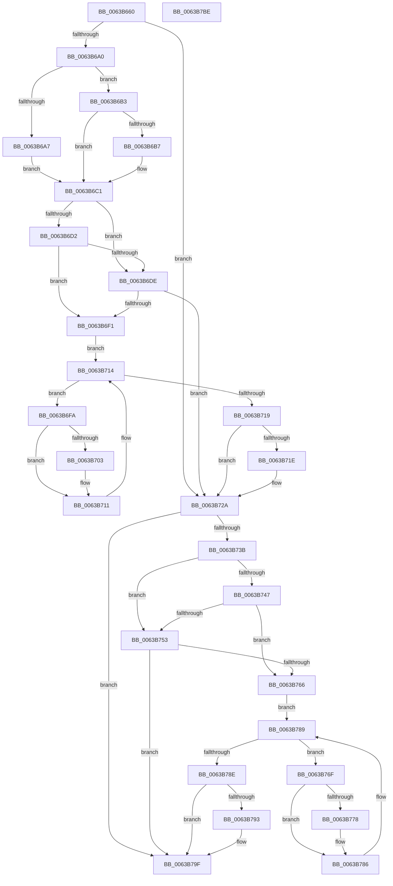

# DifRtlCreateSystemVolumeInformationFolderWrapper

- RVA: `0x0063B660`–`0x0063B7BF` (길이 `351` bytes)
- VA: `0x000000014063B660`
- 실행 섹션: `.text`
- PDB 이름 있음: `예`; PDB Function 태그: `아니요`
- unwind 정보 RVA: `0x00060130`
- 디코드: `94`개 명령, `351/351` bytes 표시
- 미해석 바이트: `0` (있으면 어셈블리에 `.byte`로 보존)

> 이 문서는 커널 이미지의 기계어와 PDB 기호를 분석해 생성했습니다. 4번과 5번은 함수 원형과 자료형을 바이너리 사용 방식에서 추정한 C 해석이며 원본 소스 복구 결과는 아닙니다.

## 1. Dependencies

- 직접 호출 지점: **9**; 고유 호출 대상: **6**
- 직접 호출자로 확인된 함수: **0**
- RIP 상대 이미지 참조: **3**

### Outgoing calls
- `0x0063B68F` → [DifGetAPIThunkContextById](../49/DifGetAPIThunkContextById_function_00495A34.md) (function, `0x00495A34`)
- `0x0063B6B7` → [DifGetReturnAddressForWrappers](../4D/DifGetReturnAddressForWrappers_function_004D3C08.md) (function, `0x004D3C08`)
- `0x0063B6E5` → [ExAcquireRundownProtection](../21/ExAcquireRundownProtection_function_00216620.md) (function, `0x00216620`)
- `0x0063B70C` → [guard_dispatch_icall](../6B/guard_dispatch_icall_function_006BAAD0.md) (function, `0x006BAAD0`)
- `0x0063B725` → [ExReleaseRundownProtection](../34/ExReleaseRundownProtection_function_00349E80.md) (function, `0x00349E80`)
- `0x0063B72D` → [RtlCreateSystemVolumeInformationFolder](../../page/79/RtlCreateSystemVolumeInformationFolder_function_00791010.md) (function, `0x00791010`)
- `0x0063B75A` → [ExAcquireRundownProtection](../21/ExAcquireRundownProtection_function_00216620.md) (function, `0x00216620`)
- `0x0063B781` → [guard_dispatch_icall](../6B/guard_dispatch_icall_function_006BAAD0.md) (function, `0x006BAAD0`)
- `0x0063B79A` → [ExReleaseRundownProtection](../34/ExReleaseRundownProtection_function_00349E80.md) (function, `0x00349E80`)

### Direct callers
- 이 함수 시작 RVA로 연결되는 직접 call은 확인되지 않았습니다. 간접 호출은 완전히 역산할 수 없습니다.

### Static image references
- `0x0063B6C9` → RVA `0x00F048B8` (`.data`; read)
- `0x0063B6D2` → RVA `0x00F04980` (`.data`; read)
- `0x0063B6DE` → RVA `0x00F03E80` (`.data`; read)

## 2. Other-region calls and transfers

- 다른 실행 섹션으로 향하는 call: **1**
  - `0x0063B72D` → [RtlCreateSystemVolumeInformationFolder](../../page/79/RtlCreateSystemVolumeInformationFolder_function_00791010.md) (`.text` → `PAGE`)
- 별도 외부 분기/꼬리 이동을 확인하지 못했습니다.

## 3. Assembly (complete function range)

```asm
0063B660  4C 8B DC                        mov r11, rsp
0063B663  49 89 5B 08                     mov qword ptr [r11 + 8], rbx
0063B667  49 89 6B 10                     mov qword ptr [r11 + 0x10], rbp
0063B66B  49 89 73 18                     mov qword ptr [r11 + 0x18], rsi
0063B66F  49 89 7B 20                     mov qword ptr [r11 + 0x20], rdi
0063B673  41 56                           push r14
0063B675  48 83 EC 40                     sub rsp, 0x40
0063B679  33 C0                           xor eax, eax
0063B67B  0F 57 C0                        xorps xmm0, xmm0
0063B67E  0F 11 44 24 20                  movups xmmword ptr [rsp + 0x20], xmm0
0063B683  48 8B E9                        mov rbp, rcx
0063B686  49 89 43 E8                     mov qword ptr [r11 - 0x18], rax
0063B68A  B9 A6 00 00 00                  mov ecx, 0xa6
0063B68F  E8 A0 A3 E5 FF                  call 0x140495a34
0063B694  48 8B F0                        mov rsi, rax
0063B697  48 85 C0                        test rax, rax
0063B69A  0F 84 8A 00 00 00               je 0x14063b72a
0063B6A0  8B 40 0C                        mov eax, dword ptr [rax + 0xc]
0063B6A3  A8 18                           test al, 0x18
0063B6A5  74 0C                           je 0x14063b6b3
0063B6A7  48 8B 4C 24 48                  mov rcx, qword ptr [rsp + 0x48]
0063B6AC  48 89 4C 24 20                  mov qword ptr [rsp + 0x20], rcx
0063B6B1  EB 0E                           jmp 0x14063b6c1
0063B6B3  A8 04                           test al, 4
0063B6B5  74 0A                           je 0x14063b6c1
0063B6B7  E8 4C 85 E9 FF                  call 0x1404d3c08
0063B6BC  48 89 44 24 20                  mov qword ptr [rsp + 0x20], rax
0063B6C1  40 32 FF                        xor dil, dil
0063B6C4  48 89 6C 24 28                  mov qword ptr [rsp + 0x28], rbp
0063B6C9  40 38 3D E8 91 8C 00            cmp byte ptr [rip + 0x8c91e8], dil
0063B6D0  75 0C                           jne 0x14063b6de
0063B6D2  F7 05 A4 92 8C 00 00 08 00 00   test dword ptr [rip + 0x8c92a4], 0x800
0063B6DC  74 13                           je 0x14063b6f1
0063B6DE  48 8D 0D 9B 87 8C 00            lea rcx, [rip + 0x8c879b]
0063B6E5  E8 36 AF BD FF                  call 0x140216620
0063B6EA  40 8A F8                        mov dil, al
0063B6ED  84 C0                           test al, al
0063B6EF  74 39                           je 0x14063b72a
0063B6F1  4C 8D 76 20                     lea r14, [rsi + 0x20]
0063B6F5  49 8B 1E                        mov rbx, qword ptr [r14]
0063B6F8  EB 1A                           jmp 0x14063b714
0063B6FA  48 8D 43 F0                     lea rax, [rbx - 0x10]
0063B6FE  48 85 C0                        test rax, rax
0063B701  74 0E                           je 0x14063b711
0063B703  48 8B 40 08                     mov rax, qword ptr [rax + 8]
0063B707  48 8D 4C 24 20                  lea rcx, [rsp + 0x20]
0063B70C  E8 BF F3 07 00                  call 0x1406baad0
0063B711  48 8B 1B                        mov rbx, qword ptr [rbx]
0063B714  49 3B DE                        cmp rbx, r14
0063B717  75 E1                           jne 0x14063b6fa
0063B719  40 84 FF                        test dil, dil
0063B71C  74 0C                           je 0x14063b72a
0063B71E  48 8D 0D 5B 87 8C 00            lea rcx, [rip + 0x8c875b]
0063B725  E8 56 E7 D0 FF                  call 0x140349e80
0063B72A  48 8B CD                        mov rcx, rbp
0063B72D  E8 DE 58 15 00                  call 0x140791010
0063B732  89 44 24 30                     mov dword ptr [rsp + 0x30], eax
0063B736  48 85 F6                        test rsi, rsi
0063B739  74 64                           je 0x14063b79f
0063B73B  40 32 FF                        xor dil, dil
0063B73E  40 38 3D 73 91 8C 00            cmp byte ptr [rip + 0x8c9173], dil
0063B745  75 0C                           jne 0x14063b753
0063B747  F7 05 2F 92 8C 00 00 08 00 00   test dword ptr [rip + 0x8c922f], 0x800
0063B751  74 13                           je 0x14063b766
0063B753  48 8D 0D 26 87 8C 00            lea rcx, [rip + 0x8c8726]
0063B75A  E8 C1 AE BD FF                  call 0x140216620
0063B75F  40 8A F8                        mov dil, al
0063B762  84 C0                           test al, al
0063B764  74 39                           je 0x14063b79f
0063B766  48 83 C6 30                     add rsi, 0x30
0063B76A  48 8B 1E                        mov rbx, qword ptr [rsi]
0063B76D  EB 1A                           jmp 0x14063b789
0063B76F  48 8D 43 F0                     lea rax, [rbx - 0x10]
0063B773  48 85 C0                        test rax, rax
0063B776  74 0E                           je 0x14063b786
0063B778  48 8B 40 08                     mov rax, qword ptr [rax + 8]
0063B77C  48 8D 4C 24 20                  lea rcx, [rsp + 0x20]
0063B781  E8 4A F3 07 00                  call 0x1406baad0
0063B786  48 8B 1B                        mov rbx, qword ptr [rbx]
0063B789  48 3B DE                        cmp rbx, rsi
0063B78C  75 E1                           jne 0x14063b76f
0063B78E  40 84 FF                        test dil, dil
0063B791  74 0C                           je 0x14063b79f
0063B793  48 8D 0D E6 86 8C 00            lea rcx, [rip + 0x8c86e6]
0063B79A  E8 E1 E6 D0 FF                  call 0x140349e80
0063B79F  8B 44 24 30                     mov eax, dword ptr [rsp + 0x30]
0063B7A3  48 8B 5C 24 50                  mov rbx, qword ptr [rsp + 0x50]
0063B7A8  48 8B 6C 24 58                  mov rbp, qword ptr [rsp + 0x58]
0063B7AD  48 8B 74 24 60                  mov rsi, qword ptr [rsp + 0x60]
0063B7B2  48 8B 7C 24 68                  mov rdi, qword ptr [rsp + 0x68]
0063B7B7  48 83 C4 40                     add rsp, 0x40
0063B7BB  41 5E                           pop r14
0063B7BD  C3                              ret
0063B7BE  CC                              int3
```

## 4. C-style interpretation (structured pseudocode)

```c
__int64 __fastcall DifRtlCreateSystemVolumeInformationFolderWrapper(__int64 a1)
{
    __int64 result;
    __int64 v_rdi;
    __int64 v_rsi;
    __int64 v_rsp;
    unsigned int v_stack_m18;
    unsigned __int64 v_stack_m20;
    unsigned __int64 v_stack_m28;
    unsigned __int64 v_stack_p0;
    unsigned __int64 v_stack_p10;
    unsigned __int64 v_stack_p18;
    unsigned __int64 v_stack_p20;
    unsigned __int64 v_stack_p8;

    *(unsigned __int64 *)(v_rsp + 8) = v_rbx;
    *(unsigned __int64 *)(v_rsp + 16) = v_rbp;
    *(unsigned __int64 *)(v_rsp + 24) = v_rsi;
    *(unsigned __int64 *)(v_rsp + 32) = v_rdi;
    v_rsp = (v_rsp) - (64);
    result = 0;
    v_stack_m28 = v_xmm0;
    *(unsigned __int64 *)(v_rsp - 24) = 0;
    result = DifGetAPIThunkContextById(166, a2, a3, a4);
    if (result == 0) goto loc_0063B72A;
    if ((((unsigned __int8)((unsigned int)(*(unsigned int *)(result + 12)))) & (24)) == 0) goto loc_0063B6B3;
    v_stack_m28 = v_stack_p0;
    goto loc_0063B6C1;
loc_0063B6B3:
    result = (unsigned int)(*(unsigned int *)(result + 12));
    if ((((unsigned __int8)((unsigned int)(*(unsigned int *)(result + 12)))) & (4)) != 0) {
        result = DifGetReturnAddressForWrappers(v_stack_p0, a2, a3, a4);
        v_stack_m28 = result;
    }
    v_rdi = 0;
    v_stack_m20 = a1;
    if ((*(unsigned __int8 *)(v_rip + 9212392)) != 0) goto loc_0063B6DE;
    if (((*(unsigned int *)(v_rip + 9212580)) & (0x800ULL)) == 0) goto loc_0063B6F1;
loc_0063B6DE:
    result = ExAcquireRundownProtection(v_rip + 9209755, a2, a3, a4);
    if ((unsigned __int8)(result) == 0) goto loc_0063B72A;
loc_0063B6F1:
    goto loc_0063B714;
loc_0063B6FA:
    result = *(unsigned __int64 *)(result + 32) - 16;
    if (*(unsigned __int64 *)(result + 32) - 16 != 0) {
        result = *(unsigned __int64 *)(*(unsigned __int64 *)(result + 32) - 16 + 8);
        a1 = v_stack_m28;
        result = guard_dispatch_icall(a1, a2, a3, a4);
    }
loc_0063B714:
    if ((*(unsigned __int64 *)(*(unsigned __int64 *)(result + 32))) != (result + 32)) goto loc_0063B6FA;
    if ((unsigned __int8)((unsigned __int8)(result)) != 0) {
        a1 = v_rip + 9209691;
        result = ExReleaseRundownProtection(a1, a2, a3, a4);
    }
    result = RtlCreateSystemVolumeInformationFolder(a1, a2, a3, a4);
    v_stack_m18 = (unsigned int)(result);
    if (result == 0) goto loc_0063B79F;
    v_rdi = 0;
    if ((*(unsigned __int8 *)(v_rip + 9212275)) != 0) goto loc_0063B753;
    if (((*(unsigned int *)(v_rip + 9212463)) & (0x800ULL)) == 0) goto loc_0063B766;
loc_0063B753:
    result = ExAcquireRundownProtection(v_rip + 9209638, a2, a3, a4);
    if ((unsigned __int8)(result) == 0) goto loc_0063B79F;
loc_0063B766:
    v_rsi = (result) + (48);
    goto loc_0063B789;
loc_0063B76F:
    result = *(unsigned __int64 *)(v_rsi) - 16;
    if (*(unsigned __int64 *)(v_rsi) - 16 != 0) {
        result = *(unsigned __int64 *)(*(unsigned __int64 *)(v_rsi) - 16 + 8);
        a1 = v_stack_m28;
        result = guard_dispatch_icall(a1, a2, a3, a4);
    }
loc_0063B789:
    if ((*(unsigned __int64 *)(*(unsigned __int64 *)(v_rsi))) != v_rsi) goto loc_0063B76F;
    if ((unsigned __int8)((unsigned __int8)(result)) != 0) {
        a1 = v_rip + 9209574;
        result = ExReleaseRundownProtection(a1, a2, a3, a4);
    }
    v_rsp = (v_rsp) + (64);
    return (unsigned int)(v_stack_m18);
}
```

## 5. (Beta) C Style

```c
int64_t DifRtlCreateSystemVolumeInformationFolderWrapper(int64_t Arg1)
{
    int64_t result;
    int64_t local_rdi;
    int64_t local_rsi;
    int64_t local_rsp;
    uint32_t v_stack_m18;
    uint64_t v_stack_m20;
    uint64_t v_stack_m28;
    uint64_t v_stack_p0;
    uint64_t v_stack_p10;
    uint64_t v_stack_p18;
    uint64_t v_stack_p20;
    uint64_t v_stack_p8;

    *(uint64_t *)(local_rsp + 0x8) = local_rbx;
    *(uint64_t *)(local_rsp + 0x10) = local_rbp;
    *(uint64_t *)(local_rsp + 0x18) = local_rsi;
    *(uint64_t *)(local_rsp + 0x20) = local_rdi;
    local_rsp = (local_rsp) - (64);
    result = 0;
    v_stack_m28 = v_xmm0;
    *(uint64_t *)(local_rsp - 0x18) = 0;
    result = DifGetAPIThunkContextById(166, a2, a3, a4);
    if (result == 0) goto loc_0063B72A;
    if ((((uint8_t)((uint32_t)(*(uint32_t *)(result + 0xC)))) & (24)) == 0) goto loc_0063B6B3;
    v_stack_m28 = v_stack_p0;
    goto loc_0063B6C1;
loc_0063B6B3:
    result = (uint32_t)(*(uint32_t *)(result + 0xC));
    if ((((uint8_t)((uint32_t)(*(uint32_t *)(result + 0xC)))) & (4)) != 0) {
        result = DifGetReturnAddressForWrappers(v_stack_p0, a2, a3, a4);
        v_stack_m28 = result;
    }
    local_rdi = 0;
    v_stack_m20 = Arg1;
    if ((*(uint8_t *)(v_rip + 0x8C91E8)) != 0) goto loc_0063B6DE;
    if (((*(uint32_t *)(v_rip + 0x8C92A4)) & (0x800ULL)) == 0) goto loc_0063B6F1;
loc_0063B6DE:
    result = ExAcquireRundownProtection(v_rip + 9209755, a2, a3, a4);
    if ((uint8_t)(result) == 0) goto loc_0063B72A;
loc_0063B6F1:
    goto loc_0063B714;
loc_0063B6FA:
    result = *(uint64_t *)(result + 0x20) - 16;
    if (*(uint64_t *)(result + 0x20) - 16 != 0) {
        result = *(uint64_t *)(*(uint64_t *)(result + 0x20) - 0x10 + 0x8);
        Arg1 = v_stack_m28;
        result = guard_dispatch_icall(Arg1, a2, a3, a4);
    }
loc_0063B714:
    if ((*(uint64_t *)(*(uint64_t *)(result + 0x20))) != (result + 32)) goto loc_0063B6FA;
    if ((uint8_t)((uint8_t)(result)) != 0) {
        Arg1 = v_rip + 9209691;
        result = ExReleaseRundownProtection(Arg1, a2, a3, a4);
    }
    result = RtlCreateSystemVolumeInformationFolder(Arg1, a2, a3, a4);
    v_stack_m18 = (uint32_t)(result);
    if (result == 0) goto loc_0063B79F;
    local_rdi = 0;
    if ((*(uint8_t *)(v_rip + 0x8C9173)) != 0) goto loc_0063B753;
    if (((*(uint32_t *)(v_rip + 0x8C922F)) & (0x800ULL)) == 0) goto loc_0063B766;
loc_0063B753:
    result = ExAcquireRundownProtection(v_rip + 9209638, a2, a3, a4);
    if ((uint8_t)(result) == 0) goto loc_0063B79F;
loc_0063B766:
    local_rsi = (result) + (48);
    goto loc_0063B789;
loc_0063B76F:
    result = *(uint64_t *)(local_rsi) - 16;
    if (*(uint64_t *)(local_rsi) - 16 != 0) {
        result = *(uint64_t *)(*(uint64_t *)(local_rsi) - 0x10 + 0x8);
        Arg1 = v_stack_m28;
        result = guard_dispatch_icall(Arg1, a2, a3, a4);
    }
loc_0063B789:
    if ((*(uint64_t *)(*(uint64_t *)(local_rsi))) != local_rsi) goto loc_0063B76F;
    if ((uint8_t)((uint8_t)(result)) != 0) {
        Arg1 = v_rip + 9209574;
        result = ExReleaseRundownProtection(Arg1, a2, a3, a4);
    }
    local_rsp = (local_rsp) + (64);
    return (uint32_t)(v_stack_m18);
}
```

## 6. Execution-region graph

[열기: 2D/3D 그래프와 함수 탐색 컨트롤 패널](../../../control-panel.html?section=text&rva=0x0063B660&view=graph)

- 2D 그래프는 위에서 아래로 흐르고, 3D 그래프는 빈 공간을 드래그해 회전합니다. Shift+드래그는 이동, 휠은 확대·축소, 함수 노드 선택은 대상 보고서 이동입니다.

### Static fallback


