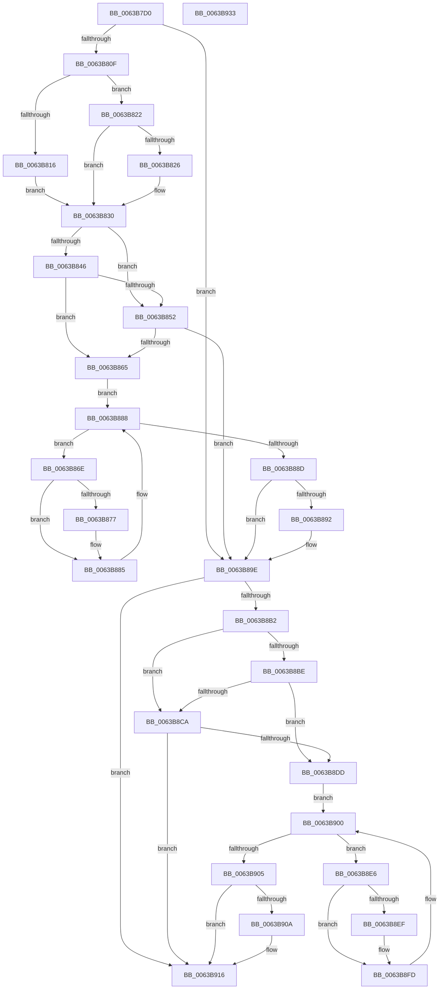

# DifRtlCreateUnicodeStringWrapper

- RVA: `0x0063B7D0`–`0x0063B934` (길이 `356` bytes)
- VA: `0x000000014063B7D0`
- 실행 섹션: `.text`
- PDB 이름 있음: `예`; PDB Function 태그: `아니요`
- unwind 정보 RVA: `0x00093E28`
- 디코드: `98`개 명령, `356/356` bytes 표시
- 미해석 바이트: `0` (있으면 어셈블리에 `.byte`로 보존)

> 이 문서는 커널 이미지의 기계어와 PDB 기호를 분석해 생성했습니다. 4번과 5번은 함수 원형과 자료형을 바이너리 사용 방식에서 추정한 C 해석이며 원본 소스 복구 결과는 아닙니다.

## 1. Dependencies

- 직접 호출 지점: **9**; 고유 호출 대상: **6**
- 직접 호출자로 확인된 함수: **0**
- RIP 상대 이미지 참조: **3**

### Outgoing calls
- `0x0063B7FE` → [DifGetAPIThunkContextById](../49/DifGetAPIThunkContextById_function_00495A34.md) (function, `0x00495A34`)
- `0x0063B826` → [DifGetReturnAddressForWrappers](../4D/DifGetReturnAddressForWrappers_function_004D3C08.md) (function, `0x004D3C08`)
- `0x0063B859` → [ExAcquireRundownProtection](../21/ExAcquireRundownProtection_function_00216620.md) (function, `0x00216620`)
- `0x0063B880` → [guard_dispatch_icall](../6B/guard_dispatch_icall_function_006BAAD0.md) (function, `0x006BAAD0`)
- `0x0063B899` → [ExReleaseRundownProtection](../34/ExReleaseRundownProtection_function_00349E80.md) (function, `0x00349E80`)
- `0x0063B8A4` → [RtlCreateUnicodeString](../../page/9B/RtlCreateUnicodeString_function_009BD860.md) (function, `0x009BD860`)
- `0x0063B8D1` → [ExAcquireRundownProtection](../21/ExAcquireRundownProtection_function_00216620.md) (function, `0x00216620`)
- `0x0063B8F8` → [guard_dispatch_icall](../6B/guard_dispatch_icall_function_006BAAD0.md) (function, `0x006BAAD0`)
- `0x0063B911` → [ExReleaseRundownProtection](../34/ExReleaseRundownProtection_function_00349E80.md) (function, `0x00349E80`)

### Direct callers
- 이 함수 시작 RVA로 연결되는 직접 call은 확인되지 않았습니다. 간접 호출은 완전히 역산할 수 없습니다.

### Static image references
- `0x0063B838` → RVA `0x00F048B8` (`.data`; read)
- `0x0063B846` → RVA `0x00F04980` (`.data`; read)
- `0x0063B852` → RVA `0x00F03E80` (`.data`; read)

## 2. Other-region calls and transfers

- 다른 실행 섹션으로 향하는 call: **1**
  - `0x0063B8A4` → [RtlCreateUnicodeString](../../page/9B/RtlCreateUnicodeString_function_009BD860.md) (`.text` → `PAGE`)
- 별도 외부 분기/꼬리 이동을 확인하지 못했습니다.

## 3. Assembly (complete function range)

```asm
0063B7D0  48 8B C4                        mov rax, rsp
0063B7D3  48 89 58 08                     mov qword ptr [rax + 8], rbx
0063B7D7  48 89 68 10                     mov qword ptr [rax + 0x10], rbp
0063B7DB  48 89 70 18                     mov qword ptr [rax + 0x18], rsi
0063B7DF  57                              push rdi
0063B7E0  41 56                           push r14
0063B7E2  41 57                           push r15
0063B7E4  48 83 EC 40                     sub rsp, 0x40
0063B7E8  0F 57 C0                        xorps xmm0, xmm0
0063B7EB  4C 8B F9                        mov r15, rcx
0063B7EE  B9 A5 00 00 00                  mov ecx, 0xa5
0063B7F3  4C 8B F2                        mov r14, rdx
0063B7F6  0F 11 40 C8                     movups xmmword ptr [rax - 0x38], xmm0
0063B7FA  0F 11 40 D8                     movups xmmword ptr [rax - 0x28], xmm0
0063B7FE  E8 31 A2 E5 FF                  call 0x140495a34
0063B803  48 8B F0                        mov rsi, rax
0063B806  48 85 C0                        test rax, rax
0063B809  0F 84 8F 00 00 00               je 0x14063b89e
0063B80F  8B 40 0C                        mov eax, dword ptr [rax + 0xc]
0063B812  A8 18                           test al, 0x18
0063B814  74 0C                           je 0x14063b822
0063B816  48 8B 4C 24 58                  mov rcx, qword ptr [rsp + 0x58]
0063B81B  48 89 4C 24 20                  mov qword ptr [rsp + 0x20], rcx
0063B820  EB 0E                           jmp 0x14063b830
0063B822  A8 04                           test al, 4
0063B824  74 0A                           je 0x14063b830
0063B826  E8 DD 83 E9 FF                  call 0x1404d3c08
0063B82B  48 89 44 24 20                  mov qword ptr [rsp + 0x20], rax
0063B830  40 32 ED                        xor bpl, bpl
0063B833  4C 89 7C 24 30                  mov qword ptr [rsp + 0x30], r15
0063B838  40 38 2D 79 90 8C 00            cmp byte ptr [rip + 0x8c9079], bpl
0063B83F  4C 89 74 24 28                  mov qword ptr [rsp + 0x28], r14
0063B844  75 0C                           jne 0x14063b852
0063B846  F7 05 30 91 8C 00 00 08 00 00   test dword ptr [rip + 0x8c9130], 0x800
0063B850  74 13                           je 0x14063b865
0063B852  48 8D 0D 27 86 8C 00            lea rcx, [rip + 0x8c8627]
0063B859  E8 C2 AD BD FF                  call 0x140216620
0063B85E  40 8A E8                        mov bpl, al
0063B861  84 C0                           test al, al
0063B863  74 39                           je 0x14063b89e
0063B865  48 8D 7E 20                     lea rdi, [rsi + 0x20]
0063B869  48 8B 1F                        mov rbx, qword ptr [rdi]
0063B86C  EB 1A                           jmp 0x14063b888
0063B86E  48 8D 43 F0                     lea rax, [rbx - 0x10]
0063B872  48 85 C0                        test rax, rax
0063B875  74 0E                           je 0x14063b885
0063B877  48 8B 40 08                     mov rax, qword ptr [rax + 8]
0063B87B  48 8D 4C 24 20                  lea rcx, [rsp + 0x20]
0063B880  E8 4B F2 07 00                  call 0x1406baad0
0063B885  48 8B 1B                        mov rbx, qword ptr [rbx]
0063B888  48 3B DF                        cmp rbx, rdi
0063B88B  75 E1                           jne 0x14063b86e
0063B88D  40 84 ED                        test bpl, bpl
0063B890  74 0C                           je 0x14063b89e
0063B892  48 8D 0D E7 85 8C 00            lea rcx, [rip + 0x8c85e7]
0063B899  E8 E2 E5 D0 FF                  call 0x140349e80
0063B89E  49 8B D6                        mov rdx, r14
0063B8A1  49 8B CF                        mov rcx, r15
0063B8A4  E8 B7 1F 38 00                  call 0x1409bd860
0063B8A9  88 44 24 38                     mov byte ptr [rsp + 0x38], al
0063B8AD  48 85 F6                        test rsi, rsi
0063B8B0  74 64                           je 0x14063b916
0063B8B2  40 32 FF                        xor dil, dil
0063B8B5  40 38 3D FC 8F 8C 00            cmp byte ptr [rip + 0x8c8ffc], dil
0063B8BC  75 0C                           jne 0x14063b8ca
0063B8BE  F7 05 B8 90 8C 00 00 08 00 00   test dword ptr [rip + 0x8c90b8], 0x800
0063B8C8  74 13                           je 0x14063b8dd
0063B8CA  48 8D 0D AF 85 8C 00            lea rcx, [rip + 0x8c85af]
0063B8D1  E8 4A AD BD FF                  call 0x140216620
0063B8D6  40 8A F8                        mov dil, al
0063B8D9  84 C0                           test al, al
0063B8DB  74 39                           je 0x14063b916
0063B8DD  48 83 C6 30                     add rsi, 0x30
0063B8E1  48 8B 1E                        mov rbx, qword ptr [rsi]
0063B8E4  EB 1A                           jmp 0x14063b900
0063B8E6  48 8D 43 F0                     lea rax, [rbx - 0x10]
0063B8EA  48 85 C0                        test rax, rax
0063B8ED  74 0E                           je 0x14063b8fd
0063B8EF  48 8B 40 08                     mov rax, qword ptr [rax + 8]
0063B8F3  48 8D 4C 24 20                  lea rcx, [rsp + 0x20]
0063B8F8  E8 D3 F1 07 00                  call 0x1406baad0
0063B8FD  48 8B 1B                        mov rbx, qword ptr [rbx]
0063B900  48 3B DE                        cmp rbx, rsi
0063B903  75 E1                           jne 0x14063b8e6
0063B905  40 84 FF                        test dil, dil
0063B908  74 0C                           je 0x14063b916
0063B90A  48 8D 0D 6F 85 8C 00            lea rcx, [rip + 0x8c856f]
0063B911  E8 6A E5 D0 FF                  call 0x140349e80
0063B916  8A 44 24 38                     mov al, byte ptr [rsp + 0x38]
0063B91A  48 8B 5C 24 60                  mov rbx, qword ptr [rsp + 0x60]
0063B91F  48 8B 6C 24 68                  mov rbp, qword ptr [rsp + 0x68]
0063B924  48 8B 74 24 70                  mov rsi, qword ptr [rsp + 0x70]
0063B929  48 83 C4 40                     add rsp, 0x40
0063B92D  41 5F                           pop r15
0063B92F  41 5E                           pop r14
0063B931  5F                              pop rdi
0063B932  C3                              ret
0063B933  CC                              int3
```

## 4. C-style interpretation (structured pseudocode)

```c
__int64 __fastcall DifRtlCreateUnicodeStringWrapper(__int64 a1, __int64 a2)
{
    __int64 result;
    __int64 v_rbp;
    __int64 v_rdi;
    __int64 v_rsi;
    __int64 v_rsp;
    unsigned __int8 v_stack_m20;
    unsigned __int64 v_stack_m28;
    unsigned __int64 v_stack_m30;
    unsigned __int64 v_stack_m38;
    unsigned __int64 v_stack_p0;
    unsigned __int64 v_stack_p10;
    unsigned __int64 v_stack_p18;
    unsigned __int64 v_stack_p8;

    *(unsigned __int64 *)(v_rsp + 8) = v_rbx;
    *(unsigned __int64 *)(v_rsp + 16) = v_rbp;
    *(unsigned __int64 *)(v_rsp + 24) = v_rsi;
    v_rsp = (v_rsp) - (64);
    *(unsigned __int64 *)(v_rsp - 56) = v_xmm0;
    *(unsigned __int64 *)(v_rsp - 40) = v_xmm0;
    result = DifGetAPIThunkContextById(165, a2, a3, a4);
    if (result == 0) goto loc_0063B89E;
    if ((((unsigned __int8)((unsigned int)(*(unsigned int *)(result + 12)))) & (24)) == 0) goto loc_0063B822;
    v_stack_m38 = v_stack_p0;
    goto loc_0063B830;
loc_0063B822:
    result = (unsigned int)(*(unsigned int *)(result + 12));
    if ((((unsigned __int8)((unsigned int)(*(unsigned int *)(result + 12)))) & (4)) != 0) {
        result = DifGetReturnAddressForWrappers(v_stack_p0, a2, a3, a4);
        v_stack_m38 = result;
    }
    v_rbp = 0;
    v_stack_m28 = a1;
    v_stack_m30 = a2;
    if ((*(unsigned __int8 *)(v_rip + 9212025)) != 0) goto loc_0063B852;
    if (((*(unsigned int *)(v_rip + 9212208)) & (0x800ULL)) == 0) goto loc_0063B865;
loc_0063B852:
    result = ExAcquireRundownProtection(v_rip + 9209383, a2, a3, a4);
    if ((unsigned __int8)(result) == 0) goto loc_0063B89E;
loc_0063B865:
    goto loc_0063B888;
loc_0063B86E:
    result = *(unsigned __int64 *)(result + 32) - 16;
    if (*(unsigned __int64 *)(result + 32) - 16 != 0) {
        result = *(unsigned __int64 *)(*(unsigned __int64 *)(result + 32) - 16 + 8);
        a1 = v_stack_m38;
        result = guard_dispatch_icall(a1, a2, a3, a4);
    }
loc_0063B888:
    if ((*(unsigned __int64 *)(*(unsigned __int64 *)(result + 32))) != (result + 32)) goto loc_0063B86E;
    if ((unsigned __int8)((unsigned __int8)(result)) != 0) {
        a1 = v_rip + 9209319;
        result = ExReleaseRundownProtection(a1, a2, a3, a4);
    }
    result = RtlCreateUnicodeString(a1, a2, a3, a4);
    v_stack_m20 = (unsigned __int8)(result);
    if (result == 0) goto loc_0063B916;
    v_rdi = 0;
    if ((*(unsigned __int8 *)(v_rip + 9211900)) != 0) goto loc_0063B8CA;
    if (((*(unsigned int *)(v_rip + 9212088)) & (0x800ULL)) == 0) goto loc_0063B8DD;
loc_0063B8CA:
    result = ExAcquireRundownProtection(v_rip + 9209263, a2, a3, a4);
    if ((unsigned __int8)(result) == 0) goto loc_0063B916;
loc_0063B8DD:
    v_rsi = (result) + (48);
    goto loc_0063B900;
loc_0063B8E6:
    result = *(unsigned __int64 *)(v_rsi) - 16;
    if (*(unsigned __int64 *)(v_rsi) - 16 != 0) {
        result = *(unsigned __int64 *)(*(unsigned __int64 *)(v_rsi) - 16 + 8);
        a1 = v_stack_m38;
        result = guard_dispatch_icall(a1, a2, a3, a4);
    }
loc_0063B900:
    if ((*(unsigned __int64 *)(*(unsigned __int64 *)(v_rsi))) != v_rsi) goto loc_0063B8E6;
    if ((unsigned __int8)((unsigned __int8)(result)) != 0) {
        a1 = v_rip + 9209199;
        result = ExReleaseRundownProtection(a1, a2, a3, a4);
    }
    v_rsp = (v_rsp) + (64);
    return v_stack_m20;
}
```

## 5. (Beta) C Style

```c
int64_t DifRtlCreateUnicodeStringWrapper(int64_t Arg1, int64_t Arg2)
{
    int64_t result;
    int64_t local_rbp;
    int64_t local_rdi;
    int64_t local_rsi;
    int64_t local_rsp;
    uint8_t v_stack_m20;
    uint64_t v_stack_m28;
    uint64_t v_stack_m30;
    uint64_t v_stack_m38;
    uint64_t v_stack_p0;
    uint64_t v_stack_p10;
    uint64_t v_stack_p18;
    uint64_t v_stack_p8;

    *(uint64_t *)(local_rsp + 0x8) = local_rbx;
    *(uint64_t *)(local_rsp + 0x10) = local_rbp;
    *(uint64_t *)(local_rsp + 0x18) = local_rsi;
    local_rsp = (local_rsp) - (64);
    *(uint64_t *)(local_rsp - 0x38) = v_xmm0;
    *(uint64_t *)(local_rsp - 0x28) = v_xmm0;
    result = DifGetAPIThunkContextById(165, Arg2, a3, a4);
    if (result == 0) goto loc_0063B89E;
    if ((((uint8_t)((uint32_t)(*(uint32_t *)(result + 0xC)))) & (24)) == 0) goto loc_0063B822;
    v_stack_m38 = v_stack_p0;
    goto loc_0063B830;
loc_0063B822:
    result = (uint32_t)(*(uint32_t *)(result + 0xC));
    if ((((uint8_t)((uint32_t)(*(uint32_t *)(result + 0xC)))) & (4)) != 0) {
        result = DifGetReturnAddressForWrappers(v_stack_p0, Arg2, a3, a4);
        v_stack_m38 = result;
    }
    local_rbp = 0;
    v_stack_m28 = Arg1;
    v_stack_m30 = Arg2;
    if ((*(uint8_t *)(v_rip + 0x8C9079)) != 0) goto loc_0063B852;
    if (((*(uint32_t *)(v_rip + 0x8C9130)) & (0x800ULL)) == 0) goto loc_0063B865;
loc_0063B852:
    result = ExAcquireRundownProtection(v_rip + 9209383, Arg2, a3, a4);
    if ((uint8_t)(result) == 0) goto loc_0063B89E;
loc_0063B865:
    goto loc_0063B888;
loc_0063B86E:
    result = *(uint64_t *)(result + 0x20) - 16;
    if (*(uint64_t *)(result + 0x20) - 16 != 0) {
        result = *(uint64_t *)(*(uint64_t *)(result + 0x20) - 0x10 + 0x8);
        Arg1 = v_stack_m38;
        result = guard_dispatch_icall(Arg1, Arg2, a3, a4);
    }
loc_0063B888:
    if ((*(uint64_t *)(*(uint64_t *)(result + 0x20))) != (result + 32)) goto loc_0063B86E;
    if ((uint8_t)((uint8_t)(result)) != 0) {
        Arg1 = v_rip + 9209319;
        result = ExReleaseRundownProtection(Arg1, Arg2, a3, a4);
    }
    result = RtlCreateUnicodeString(Arg1, Arg2, a3, a4);
    v_stack_m20 = (uint8_t)(result);
    if (result == 0) goto loc_0063B916;
    local_rdi = 0;
    if ((*(uint8_t *)(v_rip + 0x8C8FFC)) != 0) goto loc_0063B8CA;
    if (((*(uint32_t *)(v_rip + 0x8C90B8)) & (0x800ULL)) == 0) goto loc_0063B8DD;
loc_0063B8CA:
    result = ExAcquireRundownProtection(v_rip + 9209263, Arg2, a3, a4);
    if ((uint8_t)(result) == 0) goto loc_0063B916;
loc_0063B8DD:
    local_rsi = (result) + (48);
    goto loc_0063B900;
loc_0063B8E6:
    result = *(uint64_t *)(local_rsi) - 16;
    if (*(uint64_t *)(local_rsi) - 16 != 0) {
        result = *(uint64_t *)(*(uint64_t *)(local_rsi) - 0x10 + 0x8);
        Arg1 = v_stack_m38;
        result = guard_dispatch_icall(Arg1, Arg2, a3, a4);
    }
loc_0063B900:
    if ((*(uint64_t *)(*(uint64_t *)(local_rsi))) != local_rsi) goto loc_0063B8E6;
    if ((uint8_t)((uint8_t)(result)) != 0) {
        Arg1 = v_rip + 9209199;
        result = ExReleaseRundownProtection(Arg1, Arg2, a3, a4);
    }
    local_rsp = (local_rsp) + (64);
    return v_stack_m20;
}
```

## 6. Execution-region graph

[열기: 2D/3D 그래프와 함수 탐색 컨트롤 패널](../../../control-panel.html?section=text&rva=0x0063B7D0&view=graph)

- 2D 그래프는 위에서 아래로 흐르고, 3D 그래프는 빈 공간을 드래그해 회전합니다. Shift+드래그는 이동, 휠은 확대·축소, 함수 노드 선택은 대상 보고서 이동입니다.

### Static fallback


