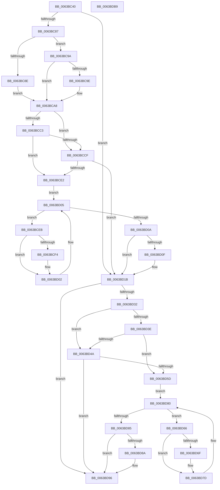

# DifRtlDuplicateUnicodeStringWrapper

- RVA: `0x0063BC40`–`0x0063BDBA` (길이 `378` bytes)
- VA: `0x000000014063BC40`
- 실행 섹션: `.text`
- PDB 이름 있음: `예`; PDB Function 태그: `아니요`
- unwind 정보 RVA: `0x0008A668`
- 디코드: `103`개 명령, `378/378` bytes 표시
- 미해석 바이트: `0` (있으면 어셈블리에 `.byte`로 보존)

> 이 문서는 커널 이미지의 기계어와 PDB 기호를 분석해 생성했습니다. 4번과 5번은 함수 원형과 자료형을 바이너리 사용 방식에서 추정한 C 해석이며 원본 소스 복구 결과는 아닙니다.

## 1. Dependencies

- 직접 호출 지점: **9**; 고유 호출 대상: **6**
- 직접 호출자로 확인된 함수: **0**
- RIP 상대 이미지 참조: **3**

### Outgoing calls
- `0x0063BC76` → [DifGetAPIThunkContextById](../49/DifGetAPIThunkContextById_function_00495A34.md) (function, `0x00495A34`)
- `0x0063BC9E` → [DifGetReturnAddressForWrappers](../4D/DifGetReturnAddressForWrappers_function_004D3C08.md) (function, `0x004D3C08`)
- `0x0063BCD6` → [ExAcquireRundownProtection](../21/ExAcquireRundownProtection_function_00216620.md) (function, `0x00216620`)
- `0x0063BCFD` → [guard_dispatch_icall](../6B/guard_dispatch_icall_function_006BAAD0.md) (function, `0x006BAAD0`)
- `0x0063BD16` → [ExReleaseRundownProtection](../34/ExReleaseRundownProtection_function_00349E80.md) (function, `0x00349E80`)
- `0x0063BD24` → [RtlDuplicateUnicodeString](../../page/93/RtlDuplicateUnicodeString_function_009321F0.md) (function, `0x009321F0`)
- `0x0063BD51` → [ExAcquireRundownProtection](../21/ExAcquireRundownProtection_function_00216620.md) (function, `0x00216620`)
- `0x0063BD78` → [guard_dispatch_icall](../6B/guard_dispatch_icall_function_006BAAD0.md) (function, `0x006BAAD0`)
- `0x0063BD91` → [ExReleaseRundownProtection](../34/ExReleaseRundownProtection_function_00349E80.md) (function, `0x00349E80`)

### Direct callers
- 이 함수 시작 RVA로 연결되는 직접 call은 확인되지 않았습니다. 간접 호출은 완전히 역산할 수 없습니다.

### Static image references
- `0x0063BCB0` → RVA `0x00F048B8` (`.data`; read)
- `0x0063BCC3` → RVA `0x00F04980` (`.data`; read)
- `0x0063BCCF` → RVA `0x00F03E80` (`.data`; read)

## 2. Other-region calls and transfers

- 다른 실행 섹션으로 향하는 call: **1**
  - `0x0063BD24` → [RtlDuplicateUnicodeString](../../page/93/RtlDuplicateUnicodeString_function_009321F0.md) (`.text` → `PAGE`)
- 별도 외부 분기/꼬리 이동을 확인하지 못했습니다.

## 3. Assembly (complete function range)

```asm
0063BC40  48 8B C4                        mov rax, rsp
0063BC43  48 89 58 08                     mov qword ptr [rax + 8], rbx
0063BC47  48 89 68 10                     mov qword ptr [rax + 0x10], rbp
0063BC4B  48 89 70 18                     mov qword ptr [rax + 0x18], rsi
0063BC4F  48 89 78 20                     mov qword ptr [rax + 0x20], rdi
0063BC53  41 54                           push r12
0063BC55  41 56                           push r14
0063BC57  41 57                           push r15
0063BC59  48 83 EC 40                     sub rsp, 0x40
0063BC5D  0F 57 C0                        xorps xmm0, xmm0
0063BC60  44 8B E1                        mov r12d, ecx
0063BC63  B9 A2 00 00 00                  mov ecx, 0xa2
0063BC68  4D 8B F0                        mov r14, r8
0063BC6B  0F 11 40 C8                     movups xmmword ptr [rax - 0x38], xmm0
0063BC6F  4C 8B FA                        mov r15, rdx
0063BC72  0F 11 40 D8                     movups xmmword ptr [rax - 0x28], xmm0
0063BC76  E8 B9 9D E5 FF                  call 0x140495a34
0063BC7B  48 8B F0                        mov rsi, rax
0063BC7E  48 85 C0                        test rax, rax
0063BC81  0F 84 94 00 00 00               je 0x14063bd1b
0063BC87  8B 40 0C                        mov eax, dword ptr [rax + 0xc]
0063BC8A  A8 18                           test al, 0x18
0063BC8C  74 0C                           je 0x14063bc9a
0063BC8E  48 8B 4C 24 58                  mov rcx, qword ptr [rsp + 0x58]
0063BC93  48 89 4C 24 20                  mov qword ptr [rsp + 0x20], rcx
0063BC98  EB 0E                           jmp 0x14063bca8
0063BC9A  A8 04                           test al, 4
0063BC9C  74 0A                           je 0x14063bca8
0063BC9E  E8 65 7F E9 FF                  call 0x1404d3c08
0063BCA3  48 89 44 24 20                  mov qword ptr [rsp + 0x20], rax
0063BCA8  40 32 ED                        xor bpl, bpl
0063BCAB  44 89 64 24 38                  mov dword ptr [rsp + 0x38], r12d
0063BCB0  40 38 2D 01 8C 8C 00            cmp byte ptr [rip + 0x8c8c01], bpl
0063BCB7  4C 89 7C 24 30                  mov qword ptr [rsp + 0x30], r15
0063BCBC  4C 89 74 24 28                  mov qword ptr [rsp + 0x28], r14
0063BCC1  75 0C                           jne 0x14063bccf
0063BCC3  F7 05 B3 8C 8C 00 00 08 00 00   test dword ptr [rip + 0x8c8cb3], 0x800
0063BCCD  74 13                           je 0x14063bce2
0063BCCF  48 8D 0D AA 81 8C 00            lea rcx, [rip + 0x8c81aa]
0063BCD6  E8 45 A9 BD FF                  call 0x140216620
0063BCDB  40 8A E8                        mov bpl, al
0063BCDE  84 C0                           test al, al
0063BCE0  74 39                           je 0x14063bd1b
0063BCE2  48 8D 7E 20                     lea rdi, [rsi + 0x20]
0063BCE6  48 8B 1F                        mov rbx, qword ptr [rdi]
0063BCE9  EB 1A                           jmp 0x14063bd05
0063BCEB  48 8D 43 F0                     lea rax, [rbx - 0x10]
0063BCEF  48 85 C0                        test rax, rax
0063BCF2  74 0E                           je 0x14063bd02
0063BCF4  48 8B 40 08                     mov rax, qword ptr [rax + 8]
0063BCF8  48 8D 4C 24 20                  lea rcx, [rsp + 0x20]
0063BCFD  E8 CE ED 07 00                  call 0x1406baad0
0063BD02  48 8B 1B                        mov rbx, qword ptr [rbx]
0063BD05  48 3B DF                        cmp rbx, rdi
0063BD08  75 E1                           jne 0x14063bceb
0063BD0A  40 84 ED                        test bpl, bpl
0063BD0D  74 0C                           je 0x14063bd1b
0063BD0F  48 8D 0D 6A 81 8C 00            lea rcx, [rip + 0x8c816a]
0063BD16  E8 65 E1 D0 FF                  call 0x140349e80
0063BD1B  4D 8B C6                        mov r8, r14
0063BD1E  49 8B D7                        mov rdx, r15
0063BD21  41 8B CC                        mov ecx, r12d
0063BD24  E8 C7 64 2F 00                  call 0x1409321f0
0063BD29  89 44 24 3C                     mov dword ptr [rsp + 0x3c], eax
0063BD2D  48 85 F6                        test rsi, rsi
0063BD30  74 64                           je 0x14063bd96
0063BD32  40 32 FF                        xor dil, dil
0063BD35  40 38 3D 7C 8B 8C 00            cmp byte ptr [rip + 0x8c8b7c], dil
0063BD3C  75 0C                           jne 0x14063bd4a
0063BD3E  F7 05 38 8C 8C 00 00 08 00 00   test dword ptr [rip + 0x8c8c38], 0x800
0063BD48  74 13                           je 0x14063bd5d
0063BD4A  48 8D 0D 2F 81 8C 00            lea rcx, [rip + 0x8c812f]
0063BD51  E8 CA A8 BD FF                  call 0x140216620
0063BD56  40 8A F8                        mov dil, al
0063BD59  84 C0                           test al, al
0063BD5B  74 39                           je 0x14063bd96
0063BD5D  48 83 C6 30                     add rsi, 0x30
0063BD61  48 8B 1E                        mov rbx, qword ptr [rsi]
0063BD64  EB 1A                           jmp 0x14063bd80
0063BD66  48 8D 43 F0                     lea rax, [rbx - 0x10]
0063BD6A  48 85 C0                        test rax, rax
0063BD6D  74 0E                           je 0x14063bd7d
0063BD6F  48 8B 40 08                     mov rax, qword ptr [rax + 8]
0063BD73  48 8D 4C 24 20                  lea rcx, [rsp + 0x20]
0063BD78  E8 53 ED 07 00                  call 0x1406baad0
0063BD7D  48 8B 1B                        mov rbx, qword ptr [rbx]
0063BD80  48 3B DE                        cmp rbx, rsi
0063BD83  75 E1                           jne 0x14063bd66
0063BD85  40 84 FF                        test dil, dil
0063BD88  74 0C                           je 0x14063bd96
0063BD8A  48 8D 0D EF 80 8C 00            lea rcx, [rip + 0x8c80ef]
0063BD91  E8 EA E0 D0 FF                  call 0x140349e80
0063BD96  8B 44 24 3C                     mov eax, dword ptr [rsp + 0x3c]
0063BD9A  48 8B 5C 24 60                  mov rbx, qword ptr [rsp + 0x60]
0063BD9F  48 8B 6C 24 68                  mov rbp, qword ptr [rsp + 0x68]
0063BDA4  48 8B 74 24 70                  mov rsi, qword ptr [rsp + 0x70]
0063BDA9  48 8B 7C 24 78                  mov rdi, qword ptr [rsp + 0x78]
0063BDAE  48 83 C4 40                     add rsp, 0x40
0063BDB2  41 5F                           pop r15
0063BDB4  41 5E                           pop r14
0063BDB6  41 5C                           pop r12
0063BDB8  C3                              ret
0063BDB9  CC                              int3
```

## 4. C-style interpretation (structured pseudocode)

```c
__int64 __fastcall DifRtlDuplicateUnicodeStringWrapper(int a1, __int64 a2, __int64 a3)
{
    __int64 result;
    __int64 v_rbp;
    __int64 v_rdi;
    __int64 v_rsi;
    __int64 v_rsp;
    unsigned int v_stack_m1C;
    unsigned int v_stack_m20;
    unsigned __int64 v_stack_m28;
    unsigned __int64 v_stack_m30;
    unsigned __int64 v_stack_m38;
    unsigned __int64 v_stack_p0;
    unsigned __int64 v_stack_p10;
    unsigned __int64 v_stack_p18;
    unsigned __int64 v_stack_p20;
    unsigned __int64 v_stack_p8;

    *(unsigned __int64 *)(v_rsp + 8) = v_rbx;
    *(unsigned __int64 *)(v_rsp + 16) = v_rbp;
    *(unsigned __int64 *)(v_rsp + 24) = v_rsi;
    *(unsigned __int64 *)(v_rsp + 32) = v_rdi;
    v_rsp = (v_rsp) - (64);
    *(unsigned __int64 *)(v_rsp - 56) = v_xmm0;
    *(unsigned __int64 *)(v_rsp - 40) = v_xmm0;
    result = DifGetAPIThunkContextById(162, a2, a3, a4);
    if (result == 0) goto loc_0063BD1B;
    if ((((unsigned __int8)((unsigned int)(*(unsigned int *)(result + 12)))) & (24)) == 0) goto loc_0063BC9A;
    v_stack_m38 = v_stack_p0;
    goto loc_0063BCA8;
loc_0063BC9A:
    result = (unsigned int)(*(unsigned int *)(result + 12));
    if ((((unsigned __int8)((unsigned int)(*(unsigned int *)(result + 12)))) & (4)) != 0) {
        result = DifGetReturnAddressForWrappers(v_stack_p0, a2, a3, a4);
        v_stack_m38 = result;
    }
    v_rbp = 0;
    v_stack_m20 = (unsigned int)((unsigned int)(a1));
    v_stack_m28 = a2;
    v_stack_m30 = a3;
    if ((*(unsigned __int8 *)(v_rip + 9210881)) != 0) goto loc_0063BCCF;
    if (((*(unsigned int *)(v_rip + 9211059)) & (0x800ULL)) == 0) goto loc_0063BCE2;
loc_0063BCCF:
    result = ExAcquireRundownProtection(v_rip + 9208234, a2, a3, a4);
    if ((unsigned __int8)(result) == 0) goto loc_0063BD1B;
loc_0063BCE2:
    goto loc_0063BD05;
loc_0063BCEB:
    result = *(unsigned __int64 *)(result + 32) - 16;
    if (*(unsigned __int64 *)(result + 32) - 16 != 0) {
        result = *(unsigned __int64 *)(*(unsigned __int64 *)(result + 32) - 16 + 8);
        a1 = v_stack_m38;
        result = guard_dispatch_icall(a1, a2, a3, a4);
    }
loc_0063BD05:
    if ((*(unsigned __int64 *)(*(unsigned __int64 *)(result + 32))) != (result + 32)) goto loc_0063BCEB;
    if ((unsigned __int8)((unsigned __int8)(result)) != 0) {
        a1 = v_rip + 9208170;
        result = ExReleaseRundownProtection(a1, a2, a3, a4);
    }
    result = RtlDuplicateUnicodeString((unsigned int)((unsigned int)((unsigned int)(a1))), a2, a3, a4);
    v_stack_m1C = (unsigned int)(result);
    if (result == 0) goto loc_0063BD96;
    v_rdi = 0;
    if ((*(unsigned __int8 *)(v_rip + 9210748)) != 0) goto loc_0063BD4A;
    if (((*(unsigned int *)(v_rip + 9210936)) & (0x800ULL)) == 0) goto loc_0063BD5D;
loc_0063BD4A:
    result = ExAcquireRundownProtection(v_rip + 9208111, a2, a3, a4);
    if ((unsigned __int8)(result) == 0) goto loc_0063BD96;
loc_0063BD5D:
    v_rsi = (result) + (48);
    goto loc_0063BD80;
loc_0063BD66:
    result = *(unsigned __int64 *)(v_rsi) - 16;
    if (*(unsigned __int64 *)(v_rsi) - 16 != 0) {
        result = *(unsigned __int64 *)(*(unsigned __int64 *)(v_rsi) - 16 + 8);
        a1 = v_stack_m38;
        result = guard_dispatch_icall(a1, a2, a3, a4);
    }
loc_0063BD80:
    if ((*(unsigned __int64 *)(*(unsigned __int64 *)(v_rsi))) != v_rsi) goto loc_0063BD66;
    if ((unsigned __int8)((unsigned __int8)(result)) != 0) {
        a1 = v_rip + 9208047;
        result = ExReleaseRundownProtection(a1, a2, a3, a4);
    }
    v_rsp = (v_rsp) + (64);
    return (unsigned int)(v_stack_m1C);
}
```

## 5. (Beta) C Style

```c
int64_t DifRtlDuplicateUnicodeStringWrapper(int32_t Arg1, int64_t Arg2, int64_t Arg3)
{
    int64_t result;
    int64_t local_rbp;
    int64_t local_rdi;
    int64_t local_rsi;
    int64_t local_rsp;
    uint32_t v_stack_m1C;
    uint32_t v_stack_m20;
    uint64_t v_stack_m28;
    uint64_t v_stack_m30;
    uint64_t v_stack_m38;
    uint64_t v_stack_p0;
    uint64_t v_stack_p10;
    uint64_t v_stack_p18;
    uint64_t v_stack_p20;
    uint64_t v_stack_p8;

    *(uint64_t *)(local_rsp + 0x8) = local_rbx;
    *(uint64_t *)(local_rsp + 0x10) = local_rbp;
    *(uint64_t *)(local_rsp + 0x18) = local_rsi;
    *(uint64_t *)(local_rsp + 0x20) = local_rdi;
    local_rsp = (local_rsp) - (64);
    *(uint64_t *)(local_rsp - 0x38) = v_xmm0;
    *(uint64_t *)(local_rsp - 0x28) = v_xmm0;
    result = DifGetAPIThunkContextById(162, Arg2, Arg3, a4);
    if (result == 0) goto loc_0063BD1B;
    if ((((uint8_t)((uint32_t)(*(uint32_t *)(result + 0xC)))) & (24)) == 0) goto loc_0063BC9A;
    v_stack_m38 = v_stack_p0;
    goto loc_0063BCA8;
loc_0063BC9A:
    result = (uint32_t)(*(uint32_t *)(result + 0xC));
    if ((((uint8_t)((uint32_t)(*(uint32_t *)(result + 0xC)))) & (4)) != 0) {
        result = DifGetReturnAddressForWrappers(v_stack_p0, Arg2, Arg3, a4);
        v_stack_m38 = result;
    }
    local_rbp = 0;
    v_stack_m20 = (uint32_t)((uint32_t)(Arg1));
    v_stack_m28 = Arg2;
    v_stack_m30 = Arg3;
    if ((*(uint8_t *)(v_rip + 0x8C8C01)) != 0) goto loc_0063BCCF;
    if (((*(uint32_t *)(v_rip + 0x8C8CB3)) & (0x800ULL)) == 0) goto loc_0063BCE2;
loc_0063BCCF:
    result = ExAcquireRundownProtection(v_rip + 9208234, Arg2, Arg3, a4);
    if ((uint8_t)(result) == 0) goto loc_0063BD1B;
loc_0063BCE2:
    goto loc_0063BD05;
loc_0063BCEB:
    result = *(uint64_t *)(result + 0x20) - 16;
    if (*(uint64_t *)(result + 0x20) - 16 != 0) {
        result = *(uint64_t *)(*(uint64_t *)(result + 0x20) - 0x10 + 0x8);
        Arg1 = v_stack_m38;
        result = guard_dispatch_icall(Arg1, Arg2, Arg3, a4);
    }
loc_0063BD05:
    if ((*(uint64_t *)(*(uint64_t *)(result + 0x20))) != (result + 32)) goto loc_0063BCEB;
    if ((uint8_t)((uint8_t)(result)) != 0) {
        Arg1 = v_rip + 9208170;
        result = ExReleaseRundownProtection(Arg1, Arg2, Arg3, a4);
    }
    result = RtlDuplicateUnicodeString((uint32_t)((uint32_t)((uint32_t)(Arg1))), Arg2, Arg3, a4);
    v_stack_m1C = (uint32_t)(result);
    if (result == 0) goto loc_0063BD96;
    local_rdi = 0;
    if ((*(uint8_t *)(v_rip + 0x8C8B7C)) != 0) goto loc_0063BD4A;
    if (((*(uint32_t *)(v_rip + 0x8C8C38)) & (0x800ULL)) == 0) goto loc_0063BD5D;
loc_0063BD4A:
    result = ExAcquireRundownProtection(v_rip + 9208111, Arg2, Arg3, a4);
    if ((uint8_t)(result) == 0) goto loc_0063BD96;
loc_0063BD5D:
    local_rsi = (result) + (48);
    goto loc_0063BD80;
loc_0063BD66:
    result = *(uint64_t *)(local_rsi) - 16;
    if (*(uint64_t *)(local_rsi) - 16 != 0) {
        result = *(uint64_t *)(*(uint64_t *)(local_rsi) - 0x10 + 0x8);
        Arg1 = v_stack_m38;
        result = guard_dispatch_icall(Arg1, Arg2, Arg3, a4);
    }
loc_0063BD80:
    if ((*(uint64_t *)(*(uint64_t *)(local_rsi))) != local_rsi) goto loc_0063BD66;
    if ((uint8_t)((uint8_t)(result)) != 0) {
        Arg1 = v_rip + 9208047;
        result = ExReleaseRundownProtection(Arg1, Arg2, Arg3, a4);
    }
    local_rsp = (local_rsp) + (64);
    return (uint32_t)(v_stack_m1C);
}
```

## 6. Execution-region graph

[열기: 2D/3D 그래프와 함수 탐색 컨트롤 패널](../../../control-panel.html?section=text&rva=0x0063BC40&view=graph)

- 2D 그래프는 위에서 아래로 흐르고, 3D 그래프는 빈 공간을 드래그해 회전합니다. Shift+드래그는 이동, 휠은 확대·축소, 함수 노드 선택은 대상 보고서 이동입니다.

### Static fallback


