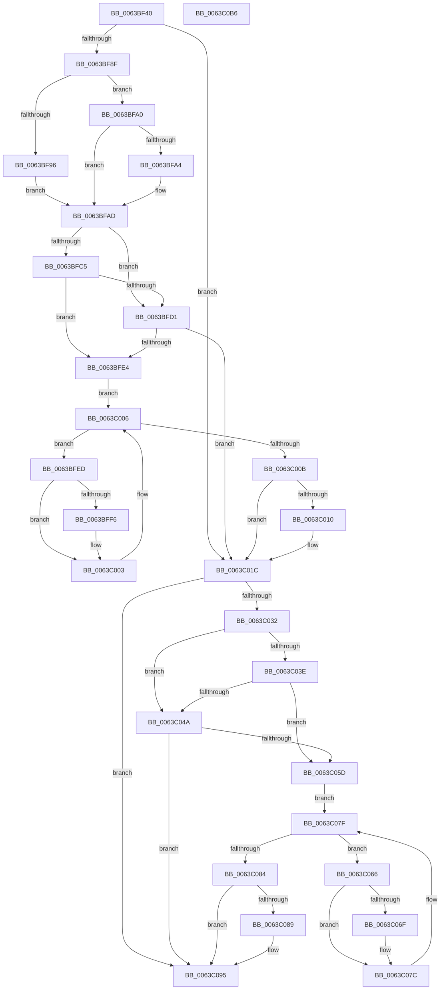

# DifRtlOemStringToUnicodeStringWrapper

- RVA: `0x0063BF40`–`0x0063C0B7` (길이 `375` bytes)
- VA: `0x000000014063BF40`
- 실행 섹션: `.text`
- PDB 이름 있음: `예`; PDB Function 태그: `아니요`
- unwind 정보 RVA: `0x000A9A64`
- 디코드: `108`개 명령, `375/375` bytes 표시
- 미해석 바이트: `0` (있으면 어셈블리에 `.byte`로 보존)

> 이 문서는 커널 이미지의 기계어와 PDB 기호를 분석해 생성했습니다. 4번과 5번은 함수 원형과 자료형을 바이너리 사용 방식에서 추정한 C 해석이며 원본 소스 복구 결과는 아닙니다.

## 1. Dependencies

- 직접 호출 지점: **9**; 고유 호출 대상: **6**
- 직접 호출자로 확인된 함수: **0**
- RIP 상대 이미지 참조: **3**

### Outgoing calls
- `0x0063BF7E` → [DifGetAPIThunkContextById](../49/DifGetAPIThunkContextById_function_00495A34.md) (function, `0x00495A34`)
- `0x0063BFA4` → [DifGetReturnAddressForWrappers](../4D/DifGetReturnAddressForWrappers_function_004D3C08.md) (function, `0x004D3C08`)
- `0x0063BFD8` → [ExAcquireRundownProtection](../21/ExAcquireRundownProtection_function_00216620.md) (function, `0x00216620`)
- `0x0063BFFE` → [guard_dispatch_icall](../6B/guard_dispatch_icall_function_006BAAD0.md) (function, `0x006BAAD0`)
- `0x0063C017` → [ExReleaseRundownProtection](../34/ExReleaseRundownProtection_function_00349E80.md) (function, `0x00349E80`)
- `0x0063C025` → [RtlOemStringToUnicodeString](../../page/90/RtlOemStringToUnicodeString_function_0090F6C0.md) (function, `0x0090F6C0`)
- `0x0063C051` → [ExAcquireRundownProtection](../21/ExAcquireRundownProtection_function_00216620.md) (function, `0x00216620`)
- `0x0063C077` → [guard_dispatch_icall](../6B/guard_dispatch_icall_function_006BAAD0.md) (function, `0x006BAAD0`)
- `0x0063C090` → [ExReleaseRundownProtection](../34/ExReleaseRundownProtection_function_00349E80.md) (function, `0x00349E80`)

### Direct callers
- 이 함수 시작 RVA로 연결되는 직접 call은 확인되지 않았습니다. 간접 호출은 완전히 역산할 수 없습니다.

### Static image references
- `0x0063BFB4` → RVA `0x00F048B8` (`.data`; read)
- `0x0063BFC5` → RVA `0x00F04980` (`.data`; read)
- `0x0063BFD1` → RVA `0x00F03E80` (`.data`; read)

## 2. Other-region calls and transfers

- 다른 실행 섹션으로 향하는 call: **1**
  - `0x0063C025` → [RtlOemStringToUnicodeString](../../page/90/RtlOemStringToUnicodeString_function_0090F6C0.md) (`.text` → `PAGE`)
- 별도 외부 분기/꼬리 이동을 확인하지 못했습니다.

## 3. Assembly (complete function range)

```asm
0063BF40  48 89 5C 24 08                  mov qword ptr [rsp + 8], rbx
0063BF45  48 89 74 24 10                  mov qword ptr [rsp + 0x10], rsi
0063BF4A  48 89 7C 24 18                  mov qword ptr [rsp + 0x18], rdi
0063BF4F  55                              push rbp
0063BF50  41 54                           push r12
0063BF52  41 55                           push r13
0063BF54  41 56                           push r14
0063BF56  41 57                           push r15
0063BF58  48 8B EC                        mov rbp, rsp
0063BF5B  48 83 EC 50                     sub rsp, 0x50
0063BF5F  0F 57 C0                        xorps xmm0, xmm0
0063BF62  33 C0                           xor eax, eax
0063BF64  4C 8B E9                        mov r13, rcx
0063BF67  48 89 45 F0                     mov qword ptr [rbp - 0x10], rax
0063BF6B  B9 A0 00 00 00                  mov ecx, 0xa0
0063BF70  45 8A F8                        mov r15b, r8b
0063BF73  0F 11 45 D0                     movups xmmword ptr [rbp - 0x30], xmm0
0063BF77  4C 8B E2                        mov r12, rdx
0063BF7A  0F 11 45 E0                     movups xmmword ptr [rbp - 0x20], xmm0
0063BF7E  E8 B1 9A E5 FF                  call 0x140495a34
0063BF83  48 8B F0                        mov rsi, rax
0063BF86  48 85 C0                        test rax, rax
0063BF89  0F 84 8D 00 00 00               je 0x14063c01c
0063BF8F  8B 40 0C                        mov eax, dword ptr [rax + 0xc]
0063BF92  A8 18                           test al, 0x18
0063BF94  74 0A                           je 0x14063bfa0
0063BF96  48 8B 4D 28                     mov rcx, qword ptr [rbp + 0x28]
0063BF9A  48 89 4D D0                     mov qword ptr [rbp - 0x30], rcx
0063BF9E  EB 0D                           jmp 0x14063bfad
0063BFA0  A8 04                           test al, 4
0063BFA2  74 09                           je 0x14063bfad
0063BFA4  E8 5F 7C E9 FF                  call 0x1404d3c08
0063BFA9  48 89 45 D0                     mov qword ptr [rbp - 0x30], rax
0063BFAD  45 32 F6                        xor r14b, r14b
0063BFB0  4C 89 6D E8                     mov qword ptr [rbp - 0x18], r13
0063BFB4  44 38 35 FD 88 8C 00            cmp byte ptr [rip + 0x8c88fd], r14b
0063BFBB  4C 89 65 E0                     mov qword ptr [rbp - 0x20], r12
0063BFBF  44 88 7D D8                     mov byte ptr [rbp - 0x28], r15b
0063BFC3  75 0C                           jne 0x14063bfd1
0063BFC5  F7 05 B1 89 8C 00 00 08 00 00   test dword ptr [rip + 0x8c89b1], 0x800
0063BFCF  74 13                           je 0x14063bfe4
0063BFD1  48 8D 0D A8 7E 8C 00            lea rcx, [rip + 0x8c7ea8]
0063BFD8  E8 43 A6 BD FF                  call 0x140216620
0063BFDD  44 8A F0                        mov r14b, al
0063BFE0  84 C0                           test al, al
0063BFE2  74 38                           je 0x14063c01c
0063BFE4  48 8D 7E 20                     lea rdi, [rsi + 0x20]
0063BFE8  48 8B 1F                        mov rbx, qword ptr [rdi]
0063BFEB  EB 19                           jmp 0x14063c006
0063BFED  48 8D 43 F0                     lea rax, [rbx - 0x10]
0063BFF1  48 85 C0                        test rax, rax
0063BFF4  74 0D                           je 0x14063c003
0063BFF6  48 8B 40 08                     mov rax, qword ptr [rax + 8]
0063BFFA  48 8D 4D D0                     lea rcx, [rbp - 0x30]
0063BFFE  E8 CD EA 07 00                  call 0x1406baad0
0063C003  48 8B 1B                        mov rbx, qword ptr [rbx]
0063C006  48 3B DF                        cmp rbx, rdi
0063C009  75 E2                           jne 0x14063bfed
0063C00B  45 84 F6                        test r14b, r14b
0063C00E  74 0C                           je 0x14063c01c
0063C010  48 8D 0D 69 7E 8C 00            lea rcx, [rip + 0x8c7e69]
0063C017  E8 64 DE D0 FF                  call 0x140349e80
0063C01C  45 8A C7                        mov r8b, r15b
0063C01F  49 8B D4                        mov rdx, r12
0063C022  49 8B CD                        mov rcx, r13
0063C025  E8 96 36 2D 00                  call 0x14090f6c0
0063C02A  89 45 F0                        mov dword ptr [rbp - 0x10], eax
0063C02D  48 85 F6                        test rsi, rsi
0063C030  74 63                           je 0x14063c095
0063C032  40 32 FF                        xor dil, dil
0063C035  40 38 3D 7C 88 8C 00            cmp byte ptr [rip + 0x8c887c], dil
0063C03C  75 0C                           jne 0x14063c04a
0063C03E  F7 05 38 89 8C 00 00 08 00 00   test dword ptr [rip + 0x8c8938], 0x800
0063C048  74 13                           je 0x14063c05d
0063C04A  48 8D 0D 2F 7E 8C 00            lea rcx, [rip + 0x8c7e2f]
0063C051  E8 CA A5 BD FF                  call 0x140216620
0063C056  40 8A F8                        mov dil, al
0063C059  84 C0                           test al, al
0063C05B  74 38                           je 0x14063c095
0063C05D  48 83 C6 30                     add rsi, 0x30
0063C061  48 8B 1E                        mov rbx, qword ptr [rsi]
0063C064  EB 19                           jmp 0x14063c07f
0063C066  48 8D 43 F0                     lea rax, [rbx - 0x10]
0063C06A  48 85 C0                        test rax, rax
0063C06D  74 0D                           je 0x14063c07c
0063C06F  48 8B 40 08                     mov rax, qword ptr [rax + 8]
0063C073  48 8D 4D D0                     lea rcx, [rbp - 0x30]
0063C077  E8 54 EA 07 00                  call 0x1406baad0
0063C07C  48 8B 1B                        mov rbx, qword ptr [rbx]
0063C07F  48 3B DE                        cmp rbx, rsi
0063C082  75 E2                           jne 0x14063c066
0063C084  40 84 FF                        test dil, dil
0063C087  74 0C                           je 0x14063c095
0063C089  48 8D 0D F0 7D 8C 00            lea rcx, [rip + 0x8c7df0]
0063C090  E8 EB DD D0 FF                  call 0x140349e80
0063C095  8B 45 F0                        mov eax, dword ptr [rbp - 0x10]
0063C098  4C 8D 5C 24 50                  lea r11, [rsp + 0x50]
0063C09D  49 8B 5B 30                     mov rbx, qword ptr [r11 + 0x30]
0063C0A1  49 8B 73 38                     mov rsi, qword ptr [r11 + 0x38]
0063C0A5  49 8B 7B 40                     mov rdi, qword ptr [r11 + 0x40]
0063C0A9  49 8B E3                        mov rsp, r11
0063C0AC  41 5F                           pop r15
0063C0AE  41 5E                           pop r14
0063C0B0  41 5D                           pop r13
0063C0B2  41 5C                           pop r12
0063C0B4  5D                              pop rbp
0063C0B5  C3                              ret
0063C0B6  CC                              int3
```

## 4. C-style interpretation (structured pseudocode)

```c
__int64 __fastcall DifRtlOemStringToUnicodeStringWrapper(__int64 a1, __int64 a2, unsigned __int8 a3)
{
    __int64 result;
    __int64 v_r14;
    __int64 v_rdi;
    __int64 v_rsi;
    __int64 v_rsp;
    unsigned __int64 v_stack_m28;
    unsigned __int64 v_stack_m38;
    unsigned __int64 v_stack_m40;
    unsigned __int64 v_stack_m48;
    unsigned __int8 v_stack_m50;
    unsigned __int64 v_stack_m58;
    unsigned __int64 v_stack_p0;
    unsigned __int64 v_stack_p10;
    unsigned __int64 v_stack_p18;
    unsigned __int64 v_stack_p8;

    v_stack_p8 = v_rbx;
    v_stack_p10 = v_rsi;
    v_stack_p18 = v_rdi;
    v_rsp = (v_rsp) - (80);
    result = 0;
    v_stack_m38 = 0;
    v_stack_m58 = v_xmm0;
    v_stack_m48 = v_xmm0;
    result = DifGetAPIThunkContextById(160, a2, a3, a4);
    if (result == 0) goto loc_0063C01C;
    if ((((unsigned __int8)((unsigned int)(*(unsigned int *)(result + 12)))) & (24)) == 0) goto loc_0063BFA0;
    v_stack_m58 = v_stack_p0;
    goto loc_0063BFAD;
loc_0063BFA0:
    result = (unsigned int)(*(unsigned int *)(result + 12));
    if ((((unsigned __int8)((unsigned int)(*(unsigned int *)(result + 12)))) & (4)) != 0) {
        result = DifGetReturnAddressForWrappers(v_stack_p0, a2, a3, a4);
        v_stack_m58 = result;
    }
    v_r14 = 0;
    v_stack_m40 = a1;
    v_stack_m48 = a2;
    v_stack_m50 = a3;
    if ((*(unsigned __int8 *)(v_rip + 9210109)) != 0) goto loc_0063BFD1;
    if (((*(unsigned int *)(v_rip + 9210289)) & (0x800ULL)) == 0) goto loc_0063BFE4;
loc_0063BFD1:
    result = ExAcquireRundownProtection(v_rip + 9207464, a2, a3, a4);
    if ((unsigned __int8)(result) == 0) goto loc_0063C01C;
loc_0063BFE4:
    goto loc_0063C006;
loc_0063BFED:
    result = *(unsigned __int64 *)(result + 32) - 16;
    if (*(unsigned __int64 *)(result + 32) - 16 != 0) {
        result = *(unsigned __int64 *)(*(unsigned __int64 *)(result + 32) - 16 + 8);
        a1 = v_stack_m58;
        result = guard_dispatch_icall(a1, a2, a3, a4);
    }
loc_0063C006:
    if ((*(unsigned __int64 *)(*(unsigned __int64 *)(result + 32))) != (result + 32)) goto loc_0063BFED;
    if ((unsigned __int8)((unsigned __int8)(result)) != 0) {
        a1 = v_rip + 9207401;
        result = ExReleaseRundownProtection(a1, a2, a3, a4);
    }
    result = RtlOemStringToUnicodeString(a1, a2, a3, a4);
    v_stack_m38 = (unsigned int)(result);
    if (result == 0) goto loc_0063C095;
    v_rdi = 0;
    if ((*(unsigned __int8 *)(v_rip + 9209980)) != 0) goto loc_0063C04A;
    if (((*(unsigned int *)(v_rip + 9210168)) & (0x800ULL)) == 0) goto loc_0063C05D;
loc_0063C04A:
    result = ExAcquireRundownProtection(v_rip + 9207343, a2, a3, a4);
    if ((unsigned __int8)(result) == 0) goto loc_0063C095;
loc_0063C05D:
    v_rsi = (result) + (48);
    goto loc_0063C07F;
loc_0063C066:
    result = *(unsigned __int64 *)(v_rsi) - 16;
    if (*(unsigned __int64 *)(v_rsi) - 16 != 0) {
        result = *(unsigned __int64 *)(*(unsigned __int64 *)(v_rsi) - 16 + 8);
        a1 = v_stack_m58;
        result = guard_dispatch_icall(a1, a2, a3, a4);
    }
loc_0063C07F:
    if ((*(unsigned __int64 *)(*(unsigned __int64 *)(v_rsi))) != v_rsi) goto loc_0063C066;
    if ((unsigned __int8)((unsigned __int8)(result)) != 0) {
        a1 = v_rip + 9207280;
        result = ExReleaseRundownProtection(a1, a2, a3, a4);
    }
    return (unsigned int)(v_stack_m38);
}
```

## 5. (Beta) C Style

```c
int64_t DifRtlOemStringToUnicodeStringWrapper(int64_t Arg1, int64_t Arg2, uint8_t Arg3)
{
    int64_t result;
    int64_t local_r14;
    int64_t local_rdi;
    int64_t local_rsi;
    int64_t local_rsp;
    uint64_t v_stack_m28;
    uint64_t v_stack_m38;
    uint64_t v_stack_m40;
    uint64_t v_stack_m48;
    uint8_t v_stack_m50;
    uint64_t v_stack_m58;
    uint64_t v_stack_p0;
    uint64_t v_stack_p10;
    uint64_t v_stack_p18;
    uint64_t v_stack_p8;

    v_stack_p8 = local_rbx;
    v_stack_p10 = local_rsi;
    v_stack_p18 = local_rdi;
    local_rsp = (local_rsp) - (80);
    result = 0;
    v_stack_m38 = 0;
    v_stack_m58 = v_xmm0;
    v_stack_m48 = v_xmm0;
    result = DifGetAPIThunkContextById(160, Arg2, Arg3, a4);
    if (result == 0) goto loc_0063C01C;
    if ((((uint8_t)((uint32_t)(*(uint32_t *)(result + 0xC)))) & (24)) == 0) goto loc_0063BFA0;
    v_stack_m58 = v_stack_p0;
    goto loc_0063BFAD;
loc_0063BFA0:
    result = (uint32_t)(*(uint32_t *)(result + 0xC));
    if ((((uint8_t)((uint32_t)(*(uint32_t *)(result + 0xC)))) & (4)) != 0) {
        result = DifGetReturnAddressForWrappers(v_stack_p0, Arg2, Arg3, a4);
        v_stack_m58 = result;
    }
    local_r14 = 0;
    v_stack_m40 = Arg1;
    v_stack_m48 = Arg2;
    v_stack_m50 = Arg3;
    if ((*(uint8_t *)(v_rip + 0x8C88FD)) != 0) goto loc_0063BFD1;
    if (((*(uint32_t *)(v_rip + 0x8C89B1)) & (0x800ULL)) == 0) goto loc_0063BFE4;
loc_0063BFD1:
    result = ExAcquireRundownProtection(v_rip + 9207464, Arg2, Arg3, a4);
    if ((uint8_t)(result) == 0) goto loc_0063C01C;
loc_0063BFE4:
    goto loc_0063C006;
loc_0063BFED:
    result = *(uint64_t *)(result + 0x20) - 16;
    if (*(uint64_t *)(result + 0x20) - 16 != 0) {
        result = *(uint64_t *)(*(uint64_t *)(result + 0x20) - 0x10 + 0x8);
        Arg1 = v_stack_m58;
        result = guard_dispatch_icall(Arg1, Arg2, Arg3, a4);
    }
loc_0063C006:
    if ((*(uint64_t *)(*(uint64_t *)(result + 0x20))) != (result + 32)) goto loc_0063BFED;
    if ((uint8_t)((uint8_t)(result)) != 0) {
        Arg1 = v_rip + 9207401;
        result = ExReleaseRundownProtection(Arg1, Arg2, Arg3, a4);
    }
    result = RtlOemStringToUnicodeString(Arg1, Arg2, Arg3, a4);
    v_stack_m38 = (uint32_t)(result);
    if (result == 0) goto loc_0063C095;
    local_rdi = 0;
    if ((*(uint8_t *)(v_rip + 0x8C887C)) != 0) goto loc_0063C04A;
    if (((*(uint32_t *)(v_rip + 0x8C8938)) & (0x800ULL)) == 0) goto loc_0063C05D;
loc_0063C04A:
    result = ExAcquireRundownProtection(v_rip + 9207343, Arg2, Arg3, a4);
    if ((uint8_t)(result) == 0) goto loc_0063C095;
loc_0063C05D:
    local_rsi = (result) + (48);
    goto loc_0063C07F;
loc_0063C066:
    result = *(uint64_t *)(local_rsi) - 16;
    if (*(uint64_t *)(local_rsi) - 16 != 0) {
        result = *(uint64_t *)(*(uint64_t *)(local_rsi) - 0x10 + 0x8);
        Arg1 = v_stack_m58;
        result = guard_dispatch_icall(Arg1, Arg2, Arg3, a4);
    }
loc_0063C07F:
    if ((*(uint64_t *)(*(uint64_t *)(local_rsi))) != local_rsi) goto loc_0063C066;
    if ((uint8_t)((uint8_t)(result)) != 0) {
        Arg1 = v_rip + 9207280;
        result = ExReleaseRundownProtection(Arg1, Arg2, Arg3, a4);
    }
    return (uint32_t)(v_stack_m38);
}
```

## 6. Execution-region graph

[열기: 2D/3D 그래프와 함수 탐색 컨트롤 패널](../../../control-panel.html?section=text&rva=0x0063BF40&view=graph)

- 2D 그래프는 위에서 아래로 흐르고, 3D 그래프는 빈 공간을 드래그해 회전합니다. Shift+드래그는 이동, 휠은 확대·축소, 함수 노드 선택은 대상 보고서 이동입니다.

### Static fallback


