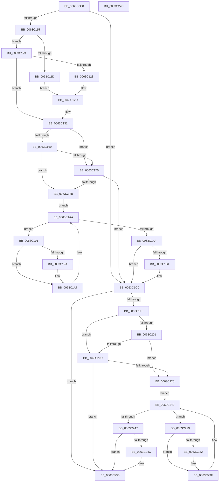

# DifRtlQueryRegistryValueWithFallbackWrapper

- RVA: `0x0063C0C0`–`0x0063C27D` (길이 `445` bytes)
- VA: `0x000000014063C0C0`
- 실행 섹션: `.text`
- PDB 이름 있음: `예`; PDB Function 태그: `아니요`
- unwind 정보 RVA: `0x000D2C00`
- 디코드: `123`개 명령, `445/445` bytes 표시
- 미해석 바이트: `0` (있으면 어셈블리에 `.byte`로 보존)

> 이 문서는 커널 이미지의 기계어와 PDB 기호를 분석해 생성했습니다. 4번과 5번은 함수 원형과 자료형을 바이너리 사용 방식에서 추정한 C 해석이며 원본 소스 복구 결과는 아닙니다.

## 1. Dependencies

- 직접 호출 지점: **10**; 고유 호출 대상: **7**
- 직접 호출자로 확인된 함수: **0**
- RIP 상대 이미지 참조: **3**

### Outgoing calls
- `0x0063C0FA` → [memset](../6C/memset_function_006C6C40.md) (function, `0x006C6C40`)
- `0x0063C104` → [DifGetAPIThunkContextById](../49/DifGetAPIThunkContextById_function_00495A34.md) (function, `0x00495A34`)
- `0x0063C128` → [DifGetReturnAddressForWrappers](../4D/DifGetReturnAddressForWrappers_function_004D3C08.md) (function, `0x004D3C08`)
- `0x0063C17C` → [ExAcquireRundownProtection](../21/ExAcquireRundownProtection_function_00216620.md) (function, `0x00216620`)
- `0x0063C1A2` → [guard_dispatch_icall](../6B/guard_dispatch_icall_function_006BAAD0.md) (function, `0x006BAAD0`)
- `0x0063C1BB` → [ExReleaseRundownProtection](../34/ExReleaseRundownProtection_function_00349E80.md) (function, `0x00349E80`)
- `0x0063C1E8` → [RtlQueryRegistryValueWithFallback](../../page/9F/RtlQueryRegistryValueWithFallback_function_009F7780.md) (function, `0x009F7780`)
- `0x0063C214` → [ExAcquireRundownProtection](../21/ExAcquireRundownProtection_function_00216620.md) (function, `0x00216620`)
- `0x0063C23A` → [guard_dispatch_icall](../6B/guard_dispatch_icall_function_006BAAD0.md) (function, `0x006BAAD0`)
- `0x0063C253` → [ExReleaseRundownProtection](../34/ExReleaseRundownProtection_function_00349E80.md) (function, `0x00349E80`)

### Direct callers
- 이 함수 시작 RVA로 연결되는 직접 call은 확인되지 않았습니다. 간접 호출은 완전히 역산할 수 없습니다.

### Static image references
- `0x0063C138` → RVA `0x00F048B8` (`.data`; read)
- `0x0063C169` → RVA `0x00F04980` (`.data`; read)
- `0x0063C175` → RVA `0x00F03E80` (`.data`; read)

## 2. Other-region calls and transfers

- 다른 실행 섹션으로 향하는 call: **1**
  - `0x0063C1E8` → [RtlQueryRegistryValueWithFallback](../../page/9F/RtlQueryRegistryValueWithFallback_function_009F7780.md) (`.text` → `PAGE`)
- 별도 외부 분기/꼬리 이동을 확인하지 못했습니다.

## 3. Assembly (complete function range)

```asm
0063C0C0  48 8B C4                        mov rax, rsp
0063C0C3  48 89 58 10                     mov qword ptr [rax + 0x10], rbx
0063C0C7  48 89 70 18                     mov qword ptr [rax + 0x18], rsi
0063C0CB  48 89 78 20                     mov qword ptr [rax + 0x20], rdi
0063C0CF  48 89 48 08                     mov qword ptr [rax + 8], rcx
0063C0D3  55                              push rbp
0063C0D4  41 54                           push r12
0063C0D6  41 55                           push r13
0063C0D8  41 56                           push r14
0063C0DA  41 57                           push r15
0063C0DC  48 8D 68 B9                     lea rbp, [rax - 0x47]
0063C0E0  48 81 EC 90 00 00 00            sub rsp, 0x90
0063C0E7  4C 8B EA                        mov r13, rdx
0063C0EA  48 8D 4D CF                     lea rcx, [rbp - 0x31]
0063C0EE  33 D2                           xor edx, edx
0063C0F0  4D 8B E0                        mov r12, r8
0063C0F3  45 8B F9                        mov r15d, r9d
0063C0F6  44 8D 42 48                     lea r8d, [rdx + 0x48]
0063C0FA  E8 41 AB 08 00                  call 0x1406c6c40
0063C0FF  B9 9F 00 00 00                  mov ecx, 0x9f
0063C104  E8 2B 99 E5 FF                  call 0x140495a34
0063C109  4C 8B F0                        mov r14, rax
0063C10C  48 85 C0                        test rax, rax
0063C10F  0F 84 AB 00 00 00               je 0x14063c1c0
0063C115  8B 48 0C                        mov ecx, dword ptr [rax + 0xc]
0063C118  F6 C1 18                        test cl, 0x18
0063C11B  74 06                           je 0x14063c123
0063C11D  48 8B 45 47                     mov rax, qword ptr [rbp + 0x47]
0063C121  EB 0A                           jmp 0x14063c12d
0063C123  F6 C1 04                        test cl, 4
0063C126  74 09                           je 0x14063c131
0063C128  E8 DB 7A E9 FF                  call 0x1404d3c08
0063C12D  48 89 45 CF                     mov qword ptr [rbp - 0x31], rax
0063C131  48 8B 45 4F                     mov rax, qword ptr [rbp + 0x4f]
0063C135  40 32 F6                        xor sil, sil
0063C138  40 38 35 79 87 8C 00            cmp byte ptr [rip + 0x8c8779], sil
0063C13F  48 89 45 07                     mov qword ptr [rbp + 7], rax
0063C143  48 8B 45 6F                     mov rax, qword ptr [rbp + 0x6f]
0063C147  48 89 45 E7                     mov qword ptr [rbp - 0x19], rax
0063C14B  48 8B 45 77                     mov rax, qword ptr [rbp + 0x77]
0063C14F  48 89 45 DF                     mov qword ptr [rbp - 0x21], rax
0063C153  48 8B 45 7F                     mov rax, qword ptr [rbp + 0x7f]
0063C157  48 89 45 D7                     mov qword ptr [rbp - 0x29], rax
0063C15B  4C 89 6D FF                     mov qword ptr [rbp - 1], r13
0063C15F  4C 89 65 F7                     mov qword ptr [rbp - 9], r12
0063C163  44 89 7D EF                     mov dword ptr [rbp - 0x11], r15d
0063C167  75 0C                           jne 0x14063c175
0063C169  F7 05 0D 88 8C 00 00 08 00 00   test dword ptr [rip + 0x8c880d], 0x800
0063C173  74 13                           je 0x14063c188
0063C175  48 8D 0D 04 7D 8C 00            lea rcx, [rip + 0x8c7d04]
0063C17C  E8 9F A4 BD FF                  call 0x140216620
0063C181  40 8A F0                        mov sil, al
0063C184  84 C0                           test al, al
0063C186  74 38                           je 0x14063c1c0
0063C188  49 8D 7E 20                     lea rdi, [r14 + 0x20]
0063C18C  48 8B 1F                        mov rbx, qword ptr [rdi]
0063C18F  EB 19                           jmp 0x14063c1aa
0063C191  48 8D 43 F0                     lea rax, [rbx - 0x10]
0063C195  48 85 C0                        test rax, rax
0063C198  74 0D                           je 0x14063c1a7
0063C19A  48 8B 40 08                     mov rax, qword ptr [rax + 8]
0063C19E  48 8D 4D CF                     lea rcx, [rbp - 0x31]
0063C1A2  E8 29 E9 07 00                  call 0x1406baad0
0063C1A7  48 8B 1B                        mov rbx, qword ptr [rbx]
0063C1AA  48 3B DF                        cmp rbx, rdi
0063C1AD  75 E2                           jne 0x14063c191
0063C1AF  40 84 F6                        test sil, sil
0063C1B2  74 0C                           je 0x14063c1c0
0063C1B4  48 8D 0D C5 7C 8C 00            lea rcx, [rip + 0x8c7cc5]
0063C1BB  E8 C0 DC D0 FF                  call 0x140349e80
0063C1C0  48 8B 45 7F                     mov rax, qword ptr [rbp + 0x7f]
0063C1C4  45 8B CF                        mov r9d, r15d
0063C1C7  48 8B 4D 4F                     mov rcx, qword ptr [rbp + 0x4f]
0063C1CB  4D 8B C4                        mov r8, r12
0063C1CE  48 89 44 24 30                  mov qword ptr [rsp + 0x30], rax
0063C1D3  49 8B D5                        mov rdx, r13
0063C1D6  48 8B 45 77                     mov rax, qword ptr [rbp + 0x77]
0063C1DA  48 89 44 24 28                  mov qword ptr [rsp + 0x28], rax
0063C1DF  48 8B 45 6F                     mov rax, qword ptr [rbp + 0x6f]
0063C1E3  48 89 44 24 20                  mov qword ptr [rsp + 0x20], rax
0063C1E8  E8 93 B5 3B 00                  call 0x1409f7780
0063C1ED  89 45 0F                        mov dword ptr [rbp + 0xf], eax
0063C1F0  4D 85 F6                        test r14, r14
0063C1F3  74 63                           je 0x14063c258
0063C1F5  40 32 FF                        xor dil, dil
0063C1F8  40 38 3D B9 86 8C 00            cmp byte ptr [rip + 0x8c86b9], dil
0063C1FF  75 0C                           jne 0x14063c20d
0063C201  F7 05 75 87 8C 00 00 08 00 00   test dword ptr [rip + 0x8c8775], 0x800
0063C20B  74 13                           je 0x14063c220
0063C20D  48 8D 0D 6C 7C 8C 00            lea rcx, [rip + 0x8c7c6c]
0063C214  E8 07 A4 BD FF                  call 0x140216620
0063C219  40 8A F8                        mov dil, al
0063C21C  84 C0                           test al, al
0063C21E  74 38                           je 0x14063c258
0063C220  49 8D 76 30                     lea rsi, [r14 + 0x30]
0063C224  48 8B 1E                        mov rbx, qword ptr [rsi]
0063C227  EB 19                           jmp 0x14063c242
0063C229  48 8D 43 F0                     lea rax, [rbx - 0x10]
0063C22D  48 85 C0                        test rax, rax
0063C230  74 0D                           je 0x14063c23f
0063C232  48 8B 40 08                     mov rax, qword ptr [rax + 8]
0063C236  48 8D 4D CF                     lea rcx, [rbp - 0x31]
0063C23A  E8 91 E8 07 00                  call 0x1406baad0
0063C23F  48 8B 1B                        mov rbx, qword ptr [rbx]
0063C242  48 3B DE                        cmp rbx, rsi
0063C245  75 E2                           jne 0x14063c229
0063C247  40 84 FF                        test dil, dil
0063C24A  74 0C                           je 0x14063c258
0063C24C  48 8D 0D 2D 7C 8C 00            lea rcx, [rip + 0x8c7c2d]
0063C253  E8 28 DC D0 FF                  call 0x140349e80
0063C258  8B 45 0F                        mov eax, dword ptr [rbp + 0xf]
0063C25B  4C 8D 9C 24 90 00 00 00         lea r11, [rsp + 0x90]
0063C263  49 8B 5B 38                     mov rbx, qword ptr [r11 + 0x38]
0063C267  49 8B 73 40                     mov rsi, qword ptr [r11 + 0x40]
0063C26B  49 8B 7B 48                     mov rdi, qword ptr [r11 + 0x48]
0063C26F  49 8B E3                        mov rsp, r11
0063C272  41 5F                           pop r15
0063C274  41 5E                           pop r14
0063C276  41 5D                           pop r13
0063C278  41 5C                           pop r12
0063C27A  5D                              pop rbp
0063C27B  C3                              ret
0063C27C  CC                              int3
```

## 4. C-style interpretation (structured pseudocode)

```c
__int64 __fastcall DifRtlQueryRegistryValueWithFallbackWrapper(__int64 a1, __int64 a2, __int64 a3, int a4)
{
    __int64 result;
    __int64 v_rdi;
    __int64 v_rsi;
    __int64 v_rsp;
    unsigned __int64 v_stack_m28;
    unsigned __int64 v_stack_m88;
    unsigned __int64 v_stack_m90;
    unsigned __int64 v_stack_m98;

    *(unsigned __int64 *)(v_rsp + 16) = v_rbx;
    *(unsigned __int64 *)(v_rsp + 24) = v_rsi;
    *(unsigned __int64 *)(v_rsp + 32) = v_rdi;
    *(unsigned __int64 *)(v_rsp + 8) = a1;
    v_rsp = (v_rsp) - (144);
    a2 = 0;
    result = memset(v_rsp - 71 - 49, a2, a2 + 72, a4);
    result = DifGetAPIThunkContextById(159, a2, a2 + 72, a4);
    if (result == 0) goto loc_0063C1C0;
    if ((((unsigned __int8)((unsigned int)(*(unsigned int *)(result + 12)))) & (24)) == 0) goto loc_0063C123;
    goto loc_0063C12D;
loc_0063C123:
    if ((((unsigned __int8)((unsigned int)(*(unsigned int *)(result + 12)))) & (4)) == 0) goto loc_0063C131;
    result = DifGetReturnAddressForWrappers((unsigned int)(*(unsigned int *)(result + 12)), a2, a2 + 72, a4);
loc_0063C12D:
    *(unsigned __int64 *)(v_rsp - 71 - 49) = result;
loc_0063C131:
    v_rsi = 0;
    *(unsigned __int64 *)(v_rsp - 71 + 7) = *(unsigned __int64 *)(v_rsp - 71 + 79);
    *(unsigned __int64 *)(v_rsp - 71 - 25) = *(unsigned __int64 *)(v_rsp - 71 + 111);
    *(unsigned __int64 *)(v_rsp - 71 - 33) = *(unsigned __int64 *)(v_rsp - 71 + 119);
    *(unsigned __int64 *)(v_rsp - 71 - 41) = *(unsigned __int64 *)(v_rsp - 71 + 127);
    *(unsigned __int64 *)(v_rsp - 71 - 1) = 0;
    *(unsigned __int64 *)(v_rsp - 71 - 9) = a3;
    *(unsigned int *)(v_rsp - 71 - 17) = (unsigned int)((unsigned int)(a4));
    if ((*(unsigned __int8 *)(v_rip + 9209721)) != 0) goto loc_0063C175;
    if (((*(unsigned int *)(v_rip + 9209869)) & (0x800ULL)) == 0) goto loc_0063C188;
loc_0063C175:
    result = ExAcquireRundownProtection(v_rip + 9207044, a2, a2 + 72, a4);
    if ((unsigned __int8)(result) == 0) goto loc_0063C1C0;
loc_0063C188:
    goto loc_0063C1AA;
loc_0063C191:
    result = *(unsigned __int64 *)(result + 32) - 16;
    if (*(unsigned __int64 *)(result + 32) - 16 != 0) {
        result = *(unsigned __int64 *)(*(unsigned __int64 *)(result + 32) - 16 + 8);
        a1 = v_rsp - 71 - 49;
        result = guard_dispatch_icall(a1, a2, a2 + 72, a4);
    }
loc_0063C1AA:
    if ((*(unsigned __int64 *)(*(unsigned __int64 *)(result + 32))) != (result + 32)) goto loc_0063C191;
    if ((unsigned __int8)((unsigned __int8)(result)) != 0) {
        a1 = v_rip + 9206981;
        result = ExReleaseRundownProtection(a1, a2, a2 + 72, a4);
    }
    v_stack_m88 = *(unsigned __int64 *)(v_rsp - 71 + 127);
    v_stack_m90 = *(unsigned __int64 *)(v_rsp - 71 + 119);
    v_stack_m98 = *(unsigned __int64 *)(v_rsp - 71 + 111);
    result = RtlQueryRegistryValueWithFallback(*(unsigned __int64 *)(v_rsp - 71 + 79), 0, a3, (unsigned int)((unsigned int)((unsigned int)(a4))));
    *(unsigned int *)(v_rsp - 71 + 15) = (unsigned int)(result);
    if (result == 0) goto loc_0063C258;
    v_rdi = 0;
    if ((*(unsigned __int8 *)(v_rip + 9209529)) != 0) goto loc_0063C20D;
    if (((*(unsigned int *)(v_rip + 9209717)) & (0x800ULL)) == 0) goto loc_0063C220;
loc_0063C20D:
    result = ExAcquireRundownProtection(v_rip + 9206892, 0, a3, (unsigned int)((unsigned int)((unsigned int)(a4))));
    if ((unsigned __int8)(result) == 0) goto loc_0063C258;
loc_0063C220:
    goto loc_0063C242;
loc_0063C229:
    result = *(unsigned __int64 *)(result + 48) - 16;
    if (*(unsigned __int64 *)(result + 48) - 16 != 0) {
        result = *(unsigned __int64 *)(*(unsigned __int64 *)(result + 48) - 16 + 8);
        a1 = v_rsp - 71 - 49;
        result = guard_dispatch_icall(a1, 0, a3, (unsigned int)((unsigned int)((unsigned int)(a4))));
    }
loc_0063C242:
    if ((*(unsigned __int64 *)(*(unsigned __int64 *)(result + 48))) != (result + 48)) goto loc_0063C229;
    if ((unsigned __int8)((unsigned __int8)(result)) != 0) {
        a1 = v_rip + 9206829;
        result = ExReleaseRundownProtection(a1, 0, a3, (unsigned int)((unsigned int)((unsigned int)(a4))));
    }
    return (unsigned int)(*(unsigned int *)(v_rsp - 71 + 15));
}
```

## 5. (Beta) C Style

```c
int64_t DifRtlQueryRegistryValueWithFallbackWrapper(int64_t Arg1, int64_t Arg2, int64_t Arg3, int32_t Arg4)
{
    int64_t result;
    int64_t local_rdi;
    int64_t local_rsi;
    int64_t local_rsp;
    uint64_t v_stack_m28;
    uint64_t v_stack_m88;
    uint64_t v_stack_m90;
    uint64_t v_stack_m98;

    *(uint64_t *)(local_rsp + 0x10) = local_rbx;
    *(uint64_t *)(local_rsp + 0x18) = local_rsi;
    *(uint64_t *)(local_rsp + 0x20) = local_rdi;
    *(uint64_t *)(local_rsp + 0x8) = Arg1;
    local_rsp = (local_rsp) - (144);
    Arg2 = 0;
    result = memset(local_rsp - 71 - 49, Arg2, Arg2 + 72, Arg4);
    result = DifGetAPIThunkContextById(159, Arg2, Arg2 + 72, Arg4);
    if (result == 0) goto loc_0063C1C0;
    if ((((uint8_t)((uint32_t)(*(uint32_t *)(result + 0xC)))) & (24)) == 0) goto loc_0063C123;
    goto loc_0063C12D;
loc_0063C123:
    if ((((uint8_t)((uint32_t)(*(uint32_t *)(result + 0xC)))) & (4)) == 0) goto loc_0063C131;
    result = DifGetReturnAddressForWrappers((uint32_t)(*(uint32_t *)(result + 0xC)), Arg2, Arg2 + 72, Arg4);
loc_0063C12D:
    *(uint64_t *)(local_rsp - 0x47 - 0x31) = result;
loc_0063C131:
    local_rsi = 0;
    *(uint64_t *)(local_rsp - 0x47 + 0x7) = *(uint64_t *)(local_rsp - 0x47 + 0x4F);
    *(uint64_t *)(local_rsp - 0x47 - 0x19) = *(uint64_t *)(local_rsp - 0x47 + 0x6F);
    *(uint64_t *)(local_rsp - 0x47 - 0x21) = *(uint64_t *)(local_rsp - 0x47 + 0x77);
    *(uint64_t *)(local_rsp - 0x47 - 0x29) = *(uint64_t *)(local_rsp - 0x47 + 0x7F);
    *(uint64_t *)(local_rsp - 0x47 - 0x1) = 0;
    *(uint64_t *)(local_rsp - 0x47 - 0x9) = Arg3;
    *(uint32_t *)(local_rsp - 0x47 - 0x11) = (uint32_t)((uint32_t)(Arg4));
    if ((*(uint8_t *)(v_rip + 0x8C8779)) != 0) goto loc_0063C175;
    if (((*(uint32_t *)(v_rip + 0x8C880D)) & (0x800ULL)) == 0) goto loc_0063C188;
loc_0063C175:
    result = ExAcquireRundownProtection(v_rip + 9207044, Arg2, Arg2 + 72, Arg4);
    if ((uint8_t)(result) == 0) goto loc_0063C1C0;
loc_0063C188:
    goto loc_0063C1AA;
loc_0063C191:
    result = *(uint64_t *)(result + 0x20) - 16;
    if (*(uint64_t *)(result + 0x20) - 16 != 0) {
        result = *(uint64_t *)(*(uint64_t *)(result + 0x20) - 0x10 + 0x8);
        Arg1 = local_rsp - 71 - 49;
        result = guard_dispatch_icall(Arg1, Arg2, Arg2 + 72, Arg4);
    }
loc_0063C1AA:
    if ((*(uint64_t *)(*(uint64_t *)(result + 0x20))) != (result + 32)) goto loc_0063C191;
    if ((uint8_t)((uint8_t)(result)) != 0) {
        Arg1 = v_rip + 9206981;
        result = ExReleaseRundownProtection(Arg1, Arg2, Arg2 + 72, Arg4);
    }
    v_stack_m88 = *(uint64_t *)(local_rsp - 0x47 + 0x7F);
    v_stack_m90 = *(uint64_t *)(local_rsp - 0x47 + 0x77);
    v_stack_m98 = *(uint64_t *)(local_rsp - 0x47 + 0x6F);
    result = RtlQueryRegistryValueWithFallback(*(uint64_t *)(local_rsp - 0x47 + 0x4F), 0, Arg3, (uint32_t)((uint32_t)((uint32_t)(Arg4))));
    *(uint32_t *)(local_rsp - 0x47 + 0xF) = (uint32_t)(result);
    if (result == 0) goto loc_0063C258;
    local_rdi = 0;
    if ((*(uint8_t *)(v_rip + 0x8C86B9)) != 0) goto loc_0063C20D;
    if (((*(uint32_t *)(v_rip + 0x8C8775)) & (0x800ULL)) == 0) goto loc_0063C220;
loc_0063C20D:
    result = ExAcquireRundownProtection(v_rip + 9206892, 0, Arg3, (uint32_t)((uint32_t)((uint32_t)(Arg4))));
    if ((uint8_t)(result) == 0) goto loc_0063C258;
loc_0063C220:
    goto loc_0063C242;
loc_0063C229:
    result = *(uint64_t *)(result + 0x30) - 16;
    if (*(uint64_t *)(result + 0x30) - 16 != 0) {
        result = *(uint64_t *)(*(uint64_t *)(result + 0x30) - 0x10 + 0x8);
        Arg1 = local_rsp - 71 - 49;
        result = guard_dispatch_icall(Arg1, 0, Arg3, (uint32_t)((uint32_t)((uint32_t)(Arg4))));
    }
loc_0063C242:
    if ((*(uint64_t *)(*(uint64_t *)(result + 0x30))) != (result + 48)) goto loc_0063C229;
    if ((uint8_t)((uint8_t)(result)) != 0) {
        Arg1 = v_rip + 9206829;
        result = ExReleaseRundownProtection(Arg1, 0, Arg3, (uint32_t)((uint32_t)((uint32_t)(Arg4))));
    }
    return (uint32_t)(*(uint32_t *)(local_rsp - 0x47 + 0xF));
}
```

## 6. Execution-region graph

[열기: 2D/3D 그래프와 함수 탐색 컨트롤 패널](../../../control-panel.html?section=text&rva=0x0063C0C0&view=graph)

- 2D 그래프는 위에서 아래로 흐르고, 3D 그래프는 빈 공간을 드래그해 회전합니다. Shift+드래그는 이동, 휠은 확대·축소, 함수 노드 선택은 대상 보고서 이동입니다.

### Static fallback


