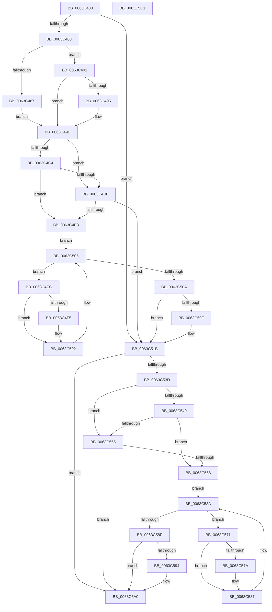

# DifRtlQueryRegistryValuesWrapper

- RVA: `0x0063C430`–`0x0063C5C2` (길이 `402` bytes)
- VA: `0x000000014063C430`
- 실행 섹션: `.text`
- PDB 이름 있음: `예`; PDB Function 태그: `아니요`
- unwind 정보 RVA: `0x000D2C24`
- 디코드: `116`개 명령, `402/402` bytes 표시
- 미해석 바이트: `0` (있으면 어셈블리에 `.byte`로 보존)

> 이 문서는 커널 이미지의 기계어와 PDB 기호를 분석해 생성했습니다. 4번과 5번은 함수 원형과 자료형을 바이너리 사용 방식에서 추정한 C 해석이며 원본 소스 복구 결과는 아닙니다.

## 1. Dependencies

- 직접 호출 지점: **9**; 고유 호출 대상: **6**
- 직접 호출자로 확인된 함수: **0**
- RIP 상대 이미지 참조: **3**

### Outgoing calls
- `0x0063C46F` → [DifGetAPIThunkContextById](../49/DifGetAPIThunkContextById_function_00495A34.md) (function, `0x00495A34`)
- `0x0063C495` → [DifGetReturnAddressForWrappers](../4D/DifGetReturnAddressForWrappers_function_004D3C08.md) (function, `0x004D3C08`)
- `0x0063C4D7` → [ExAcquireRundownProtection](../21/ExAcquireRundownProtection_function_00216620.md) (function, `0x00216620`)
- `0x0063C4FD` → [guard_dispatch_icall](../6B/guard_dispatch_icall_function_006BAAD0.md) (function, `0x006BAAD0`)
- `0x0063C516` → [ExReleaseRundownProtection](../34/ExReleaseRundownProtection_function_00349E80.md) (function, `0x00349E80`)
- `0x0063C530` → [RtlQueryRegistryValuesEx](../../page/8C/RtlQueryRegistryValuesEx_function_008C8FF0.md) (function, `0x008C8FF0`)
- `0x0063C55C` → [ExAcquireRundownProtection](../21/ExAcquireRundownProtection_function_00216620.md) (function, `0x00216620`)
- `0x0063C582` → [guard_dispatch_icall](../6B/guard_dispatch_icall_function_006BAAD0.md) (function, `0x006BAAD0`)
- `0x0063C59B` → [ExReleaseRundownProtection](../34/ExReleaseRundownProtection_function_00349E80.md) (function, `0x00349E80`)

### Direct callers
- 이 함수 시작 RVA로 연결되는 직접 call은 확인되지 않았습니다. 간접 호출은 완전히 역산할 수 없습니다.

### Static image references
- `0x0063C4A4` → RVA `0x00F048B8` (`.data`; read)
- `0x0063C4C4` → RVA `0x00F04980` (`.data`; read)
- `0x0063C4D0` → RVA `0x00F03E80` (`.data`; read)

## 2. Other-region calls and transfers

- 다른 실행 섹션으로 향하는 call: **1**
  - `0x0063C530` → [RtlQueryRegistryValuesEx](../../page/8C/RtlQueryRegistryValuesEx_function_008C8FF0.md) (`.text` → `PAGE`)
- 별도 외부 분기/꼬리 이동을 확인하지 못했습니다.

## 3. Assembly (complete function range)

```asm
0063C430  48 8B C4                        mov rax, rsp
0063C433  48 89 58 10                     mov qword ptr [rax + 0x10], rbx
0063C437  48 89 70 18                     mov qword ptr [rax + 0x18], rsi
0063C43B  48 89 78 20                     mov qword ptr [rax + 0x20], rdi
0063C43F  89 48 08                        mov dword ptr [rax + 8], ecx
0063C442  55                              push rbp
0063C443  41 54                           push r12
0063C445  41 55                           push r13
0063C447  41 56                           push r14
0063C449  41 57                           push r15
0063C44B  48 8B EC                        mov rbp, rsp
0063C44E  48 83 EC 60                     sub rsp, 0x60
0063C452  0F 57 C0                        xorps xmm0, xmm0
0063C455  B9 9E 00 00 00                  mov ecx, 0x9e
0063C45A  0F 11 45 D0                     movups xmmword ptr [rbp - 0x30], xmm0
0063C45E  4D 8B F9                        mov r15, r9
0063C461  4D 8B E0                        mov r12, r8
0063C464  0F 11 45 E0                     movups xmmword ptr [rbp - 0x20], xmm0
0063C468  4C 8B EA                        mov r13, rdx
0063C46B  0F 11 45 F0                     movups xmmword ptr [rbp - 0x10], xmm0
0063C46F  E8 C0 95 E5 FF                  call 0x140495a34
0063C474  48 8B F0                        mov rsi, rax
0063C477  48 85 C0                        test rax, rax
0063C47A  0F 84 9B 00 00 00               je 0x14063c51b
0063C480  8B 40 0C                        mov eax, dword ptr [rax + 0xc]
0063C483  A8 18                           test al, 0x18
0063C485  74 0A                           je 0x14063c491
0063C487  48 8B 4D 28                     mov rcx, qword ptr [rbp + 0x28]
0063C48B  48 89 4D D0                     mov qword ptr [rbp - 0x30], rcx
0063C48F  EB 0D                           jmp 0x14063c49e
0063C491  A8 04                           test al, 4
0063C493  74 09                           je 0x14063c49e
0063C495  E8 6E 77 E9 FF                  call 0x1404d3c08
0063C49A  48 89 45 D0                     mov qword ptr [rbp - 0x30], rax
0063C49E  8B 45 30                        mov eax, dword ptr [rbp + 0x30]
0063C4A1  45 32 F6                        xor r14b, r14b
0063C4A4  44 38 35 0D 84 8C 00            cmp byte ptr [rip + 0x8c840d], r14b
0063C4AB  89 45 F8                        mov dword ptr [rbp - 8], eax
0063C4AE  48 8B 45 50                     mov rax, qword ptr [rbp + 0x50]
0063C4B2  48 89 45 D8                     mov qword ptr [rbp - 0x28], rax
0063C4B6  4C 89 6D F0                     mov qword ptr [rbp - 0x10], r13
0063C4BA  4C 89 65 E8                     mov qword ptr [rbp - 0x18], r12
0063C4BE  4C 89 7D E0                     mov qword ptr [rbp - 0x20], r15
0063C4C2  75 0C                           jne 0x14063c4d0
0063C4C4  F7 05 B2 84 8C 00 00 08 00 00   test dword ptr [rip + 0x8c84b2], 0x800
0063C4CE  74 13                           je 0x14063c4e3
0063C4D0  48 8D 0D A9 79 8C 00            lea rcx, [rip + 0x8c79a9]
0063C4D7  E8 44 A1 BD FF                  call 0x140216620
0063C4DC  44 8A F0                        mov r14b, al
0063C4DF  84 C0                           test al, al
0063C4E1  74 38                           je 0x14063c51b
0063C4E3  48 8D 7E 20                     lea rdi, [rsi + 0x20]
0063C4E7  48 8B 1F                        mov rbx, qword ptr [rdi]
0063C4EA  EB 19                           jmp 0x14063c505
0063C4EC  48 8D 43 F0                     lea rax, [rbx - 0x10]
0063C4F0  48 85 C0                        test rax, rax
0063C4F3  74 0D                           je 0x14063c502
0063C4F5  48 8B 40 08                     mov rax, qword ptr [rax + 8]
0063C4F9  48 8D 4D D0                     lea rcx, [rbp - 0x30]
0063C4FD  E8 CE E5 07 00                  call 0x1406baad0
0063C502  48 8B 1B                        mov rbx, qword ptr [rbx]
0063C505  48 3B DF                        cmp rbx, rdi
0063C508  75 E2                           jne 0x14063c4ec
0063C50A  45 84 F6                        test r14b, r14b
0063C50D  74 0C                           je 0x14063c51b
0063C50F  48 8D 0D 6A 79 8C 00            lea rcx, [rip + 0x8c796a]
0063C516  E8 65 D9 D0 FF                  call 0x140349e80
0063C51B  48 8B 45 50                     mov rax, qword ptr [rbp + 0x50]
0063C51F  4D 8B CF                        mov r9, r15
0063C522  8B 4D 30                        mov ecx, dword ptr [rbp + 0x30]
0063C525  4D 8B C4                        mov r8, r12
0063C528  49 8B D5                        mov rdx, r13
0063C52B  48 89 44 24 20                  mov qword ptr [rsp + 0x20], rax
0063C530  E8 BB CA 28 00                  call 0x1408c8ff0
0063C535  89 45 FC                        mov dword ptr [rbp - 4], eax
0063C538  48 85 F6                        test rsi, rsi
0063C53B  74 63                           je 0x14063c5a0
0063C53D  40 32 FF                        xor dil, dil
0063C540  40 38 3D 71 83 8C 00            cmp byte ptr [rip + 0x8c8371], dil
0063C547  75 0C                           jne 0x14063c555
0063C549  F7 05 2D 84 8C 00 00 08 00 00   test dword ptr [rip + 0x8c842d], 0x800
0063C553  74 13                           je 0x14063c568
0063C555  48 8D 0D 24 79 8C 00            lea rcx, [rip + 0x8c7924]
0063C55C  E8 BF A0 BD FF                  call 0x140216620
0063C561  40 8A F8                        mov dil, al
0063C564  84 C0                           test al, al
0063C566  74 38                           je 0x14063c5a0
0063C568  48 83 C6 30                     add rsi, 0x30
0063C56C  48 8B 1E                        mov rbx, qword ptr [rsi]
0063C56F  EB 19                           jmp 0x14063c58a
0063C571  48 8D 43 F0                     lea rax, [rbx - 0x10]
0063C575  48 85 C0                        test rax, rax
0063C578  74 0D                           je 0x14063c587
0063C57A  48 8B 40 08                     mov rax, qword ptr [rax + 8]
0063C57E  48 8D 4D D0                     lea rcx, [rbp - 0x30]
0063C582  E8 49 E5 07 00                  call 0x1406baad0
0063C587  48 8B 1B                        mov rbx, qword ptr [rbx]
0063C58A  48 3B DE                        cmp rbx, rsi
0063C58D  75 E2                           jne 0x14063c571
0063C58F  40 84 FF                        test dil, dil
0063C592  74 0C                           je 0x14063c5a0
0063C594  48 8D 0D E5 78 8C 00            lea rcx, [rip + 0x8c78e5]
0063C59B  E8 E0 D8 D0 FF                  call 0x140349e80
0063C5A0  8B 45 FC                        mov eax, dword ptr [rbp - 4]
0063C5A3  4C 8D 5C 24 60                  lea r11, [rsp + 0x60]
0063C5A8  49 8B 5B 38                     mov rbx, qword ptr [r11 + 0x38]
0063C5AC  49 8B 73 40                     mov rsi, qword ptr [r11 + 0x40]
0063C5B0  49 8B 7B 48                     mov rdi, qword ptr [r11 + 0x48]
0063C5B4  49 8B E3                        mov rsp, r11
0063C5B7  41 5F                           pop r15
0063C5B9  41 5E                           pop r14
0063C5BB  41 5D                           pop r13
0063C5BD  41 5C                           pop r12
0063C5BF  5D                              pop rbp
0063C5C0  C3                              ret
0063C5C1  CC                              int3
```

## 4. C-style interpretation (structured pseudocode)

```c
__int64 __fastcall DifRtlQueryRegistryValuesWrapper(int a1, __int64 a2, __int64 a3, __int64 a4, __int64 a5)
{
    __int64 result;
    __int64 v_r14;
    __int64 v_rdi;
    __int64 v_rsi;
    __int64 v_rsp;
    unsigned __int64 v_stack_m28;
    unsigned int v_stack_m2C;
    unsigned int v_stack_m30;
    unsigned __int64 v_stack_m38;
    unsigned __int64 v_stack_m40;
    unsigned __int64 v_stack_m48;
    unsigned __int64 v_stack_m50;
    unsigned __int64 v_stack_m58;
    unsigned __int64 v_stack_m68;
    unsigned __int64 v_stack_p0;
    unsigned int v_stack_p8;

    *(unsigned __int64 *)(v_rsp + 16) = v_rbx;
    *(unsigned __int64 *)(v_rsp + 24) = v_rsi;
    *(unsigned __int64 *)(v_rsp + 32) = v_rdi;
    *(unsigned int *)(v_rsp + 8) = a1;
    v_rsp = (v_rsp) - (96);
    v_stack_m58 = v_xmm0;
    v_stack_m48 = v_xmm0;
    v_stack_m38 = v_xmm0;
    result = DifGetAPIThunkContextById(158, a2, a3, a4);
    if (result == 0) goto loc_0063C51B;
    if ((((unsigned __int8)((unsigned int)(*(unsigned int *)(result + 12)))) & (24)) == 0) goto loc_0063C491;
    v_stack_m58 = v_stack_p0;
    goto loc_0063C49E;
loc_0063C491:
    result = (unsigned int)(*(unsigned int *)(result + 12));
    if ((((unsigned __int8)((unsigned int)(*(unsigned int *)(result + 12)))) & (4)) != 0) {
        result = DifGetReturnAddressForWrappers(v_stack_p0, a2, a3, a4);
        v_stack_m58 = result;
    }
    v_r14 = 0;
    v_stack_m30 = (unsigned int)((unsigned int)(v_stack_p8));
    v_stack_m50 = a5;
    v_stack_m38 = a2;
    v_stack_m40 = a3;
    v_stack_m48 = a4;
    if ((*(unsigned __int8 *)(v_rip + 9208845)) != 0) goto loc_0063C4D0;
    if (((*(unsigned int *)(v_rip + 9209010)) & (0x800ULL)) == 0) goto loc_0063C4E3;
loc_0063C4D0:
    result = ExAcquireRundownProtection(v_rip + 9206185, a2, a3, a4);
    if ((unsigned __int8)(result) == 0) goto loc_0063C51B;
loc_0063C4E3:
    goto loc_0063C505;
loc_0063C4EC:
    result = *(unsigned __int64 *)(result + 32) - 16;
    if (*(unsigned __int64 *)(result + 32) - 16 != 0) {
        result = *(unsigned __int64 *)(*(unsigned __int64 *)(result + 32) - 16 + 8);
        a1 = v_stack_m58;
        result = guard_dispatch_icall(a1, a2, a3, a4);
    }
loc_0063C505:
    if ((*(unsigned __int64 *)(*(unsigned __int64 *)(result + 32))) != (result + 32)) goto loc_0063C4EC;
    if ((unsigned __int8)((unsigned __int8)(result)) != 0) {
        a1 = v_rip + 9206122;
        result = ExReleaseRundownProtection(a1, a2, a3, a4);
    }
    v_stack_m68 = a5;
    result = RtlQueryRegistryValuesEx((unsigned int)(v_stack_p8), a2, a3, a4);
    v_stack_m2C = (unsigned int)(result);
    if (result == 0) goto loc_0063C5A0;
    v_rdi = 0;
    if ((*(unsigned __int8 *)(v_rip + 9208689)) != 0) goto loc_0063C555;
    if (((*(unsigned int *)(v_rip + 9208877)) & (0x800ULL)) == 0) goto loc_0063C568;
loc_0063C555:
    result = ExAcquireRundownProtection(v_rip + 9206052, a2, a3, a4);
    if ((unsigned __int8)(result) == 0) goto loc_0063C5A0;
loc_0063C568:
    v_rsi = (result) + (48);
    goto loc_0063C58A;
loc_0063C571:
    result = *(unsigned __int64 *)(v_rsi) - 16;
    if (*(unsigned __int64 *)(v_rsi) - 16 != 0) {
        result = *(unsigned __int64 *)(*(unsigned __int64 *)(v_rsi) - 16 + 8);
        a1 = v_stack_m58;
        result = guard_dispatch_icall(a1, a2, a3, a4);
    }
loc_0063C58A:
    if ((*(unsigned __int64 *)(*(unsigned __int64 *)(v_rsi))) != v_rsi) goto loc_0063C571;
    if ((unsigned __int8)((unsigned __int8)(result)) != 0) {
        a1 = v_rip + 9205989;
        result = ExReleaseRundownProtection(a1, a2, a3, a4);
    }
    return (unsigned int)(v_stack_m2C);
}
```

## 5. (Beta) C Style

```c
int64_t DifRtlQueryRegistryValuesWrapper(int32_t Arg1, int64_t Arg2, int64_t Arg3, int64_t Arg4, int64_t Arg5)
{
    int64_t result;
    int64_t local_r14;
    int64_t local_rdi;
    int64_t local_rsi;
    int64_t local_rsp;
    uint64_t v_stack_m28;
    uint32_t v_stack_m2C;
    uint32_t v_stack_m30;
    uint64_t v_stack_m38;
    uint64_t v_stack_m40;
    uint64_t v_stack_m48;
    uint64_t v_stack_m50;
    uint64_t v_stack_m58;
    uint64_t v_stack_m68;
    uint64_t v_stack_p0;
    uint32_t v_stack_p8;

    *(uint64_t *)(local_rsp + 0x10) = local_rbx;
    *(uint64_t *)(local_rsp + 0x18) = local_rsi;
    *(uint64_t *)(local_rsp + 0x20) = local_rdi;
    *(uint32_t *)(local_rsp + 0x8) = Arg1;
    local_rsp = (local_rsp) - (96);
    v_stack_m58 = v_xmm0;
    v_stack_m48 = v_xmm0;
    v_stack_m38 = v_xmm0;
    result = DifGetAPIThunkContextById(158, Arg2, Arg3, Arg4);
    if (result == 0) goto loc_0063C51B;
    if ((((uint8_t)((uint32_t)(*(uint32_t *)(result + 0xC)))) & (24)) == 0) goto loc_0063C491;
    v_stack_m58 = v_stack_p0;
    goto loc_0063C49E;
loc_0063C491:
    result = (uint32_t)(*(uint32_t *)(result + 0xC));
    if ((((uint8_t)((uint32_t)(*(uint32_t *)(result + 0xC)))) & (4)) != 0) {
        result = DifGetReturnAddressForWrappers(v_stack_p0, Arg2, Arg3, Arg4);
        v_stack_m58 = result;
    }
    local_r14 = 0;
    v_stack_m30 = (uint32_t)((uint32_t)(v_stack_p8));
    v_stack_m50 = Arg5;
    v_stack_m38 = Arg2;
    v_stack_m40 = Arg3;
    v_stack_m48 = Arg4;
    if ((*(uint8_t *)(v_rip + 0x8C840D)) != 0) goto loc_0063C4D0;
    if (((*(uint32_t *)(v_rip + 0x8C84B2)) & (0x800ULL)) == 0) goto loc_0063C4E3;
loc_0063C4D0:
    result = ExAcquireRundownProtection(v_rip + 9206185, Arg2, Arg3, Arg4);
    if ((uint8_t)(result) == 0) goto loc_0063C51B;
loc_0063C4E3:
    goto loc_0063C505;
loc_0063C4EC:
    result = *(uint64_t *)(result + 0x20) - 16;
    if (*(uint64_t *)(result + 0x20) - 16 != 0) {
        result = *(uint64_t *)(*(uint64_t *)(result + 0x20) - 0x10 + 0x8);
        Arg1 = v_stack_m58;
        result = guard_dispatch_icall(Arg1, Arg2, Arg3, Arg4);
    }
loc_0063C505:
    if ((*(uint64_t *)(*(uint64_t *)(result + 0x20))) != (result + 32)) goto loc_0063C4EC;
    if ((uint8_t)((uint8_t)(result)) != 0) {
        Arg1 = v_rip + 9206122;
        result = ExReleaseRundownProtection(Arg1, Arg2, Arg3, Arg4);
    }
    v_stack_m68 = Arg5;
    result = RtlQueryRegistryValuesEx((uint32_t)(v_stack_p8), Arg2, Arg3, Arg4);
    v_stack_m2C = (uint32_t)(result);
    if (result == 0) goto loc_0063C5A0;
    local_rdi = 0;
    if ((*(uint8_t *)(v_rip + 0x8C8371)) != 0) goto loc_0063C555;
    if (((*(uint32_t *)(v_rip + 0x8C842D)) & (0x800ULL)) == 0) goto loc_0063C568;
loc_0063C555:
    result = ExAcquireRundownProtection(v_rip + 9206052, Arg2, Arg3, Arg4);
    if ((uint8_t)(result) == 0) goto loc_0063C5A0;
loc_0063C568:
    local_rsi = (result) + (48);
    goto loc_0063C58A;
loc_0063C571:
    result = *(uint64_t *)(local_rsi) - 16;
    if (*(uint64_t *)(local_rsi) - 16 != 0) {
        result = *(uint64_t *)(*(uint64_t *)(local_rsi) - 0x10 + 0x8);
        Arg1 = v_stack_m58;
        result = guard_dispatch_icall(Arg1, Arg2, Arg3, Arg4);
    }
loc_0063C58A:
    if ((*(uint64_t *)(*(uint64_t *)(local_rsi))) != local_rsi) goto loc_0063C571;
    if ((uint8_t)((uint8_t)(result)) != 0) {
        Arg1 = v_rip + 9205989;
        result = ExReleaseRundownProtection(Arg1, Arg2, Arg3, Arg4);
    }
    return (uint32_t)(v_stack_m2C);
}
```

## 6. Execution-region graph

[열기: 2D/3D 그래프와 함수 탐색 컨트롤 패널](../../../control-panel.html?section=text&rva=0x0063C430&view=graph)

- 2D 그래프는 위에서 아래로 흐르고, 3D 그래프는 빈 공간을 드래그해 회전합니다. Shift+드래그는 이동, 휠은 확대·축소, 함수 노드 선택은 대상 보고서 이동입니다.

### Static fallback


