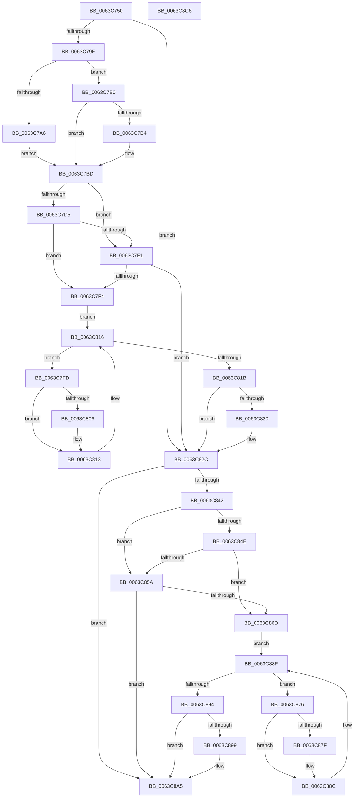

# DifRtlUnicodeStringToCountedOemStringWrapper

- RVA: `0x0063C750`–`0x0063C8C7` (길이 `375` bytes)
- VA: `0x000000014063C750`
- 실행 섹션: `.text`
- PDB 이름 있음: `예`; PDB Function 태그: `아니요`
- unwind 정보 RVA: `0x000A9A64`
- 디코드: `108`개 명령, `375/375` bytes 표시
- 미해석 바이트: `0` (있으면 어셈블리에 `.byte`로 보존)

> 이 문서는 커널 이미지의 기계어와 PDB 기호를 분석해 생성했습니다. 4번과 5번은 함수 원형과 자료형을 바이너리 사용 방식에서 추정한 C 해석이며 원본 소스 복구 결과는 아닙니다.

## 1. Dependencies

- 직접 호출 지점: **9**; 고유 호출 대상: **6**
- 직접 호출자로 확인된 함수: **0**
- RIP 상대 이미지 참조: **3**

### Outgoing calls
- `0x0063C78E` → [DifGetAPIThunkContextById](../49/DifGetAPIThunkContextById_function_00495A34.md) (function, `0x00495A34`)
- `0x0063C7B4` → [DifGetReturnAddressForWrappers](../4D/DifGetReturnAddressForWrappers_function_004D3C08.md) (function, `0x004D3C08`)
- `0x0063C7E8` → [ExAcquireRundownProtection](../21/ExAcquireRundownProtection_function_00216620.md) (function, `0x00216620`)
- `0x0063C80E` → [guard_dispatch_icall](../6B/guard_dispatch_icall_function_006BAAD0.md) (function, `0x006BAAD0`)
- `0x0063C827` → [ExReleaseRundownProtection](../34/ExReleaseRundownProtection_function_00349E80.md) (function, `0x00349E80`)
- `0x0063C835` → [RtlUnicodeStringToCountedOemString](../../page/90/RtlUnicodeStringToCountedOemString_function_0090F1A0.md) (function, `0x0090F1A0`)
- `0x0063C861` → [ExAcquireRundownProtection](../21/ExAcquireRundownProtection_function_00216620.md) (function, `0x00216620`)
- `0x0063C887` → [guard_dispatch_icall](../6B/guard_dispatch_icall_function_006BAAD0.md) (function, `0x006BAAD0`)
- `0x0063C8A0` → [ExReleaseRundownProtection](../34/ExReleaseRundownProtection_function_00349E80.md) (function, `0x00349E80`)

### Direct callers
- 이 함수 시작 RVA로 연결되는 직접 call은 확인되지 않았습니다. 간접 호출은 완전히 역산할 수 없습니다.

### Static image references
- `0x0063C7C4` → RVA `0x00F048B8` (`.data`; read)
- `0x0063C7D5` → RVA `0x00F04980` (`.data`; read)
- `0x0063C7E1` → RVA `0x00F03E80` (`.data`; read)

## 2. Other-region calls and transfers

- 다른 실행 섹션으로 향하는 call: **1**
  - `0x0063C835` → [RtlUnicodeStringToCountedOemString](../../page/90/RtlUnicodeStringToCountedOemString_function_0090F1A0.md) (`.text` → `PAGE`)
- 별도 외부 분기/꼬리 이동을 확인하지 못했습니다.

## 3. Assembly (complete function range)

```asm
0063C750  48 89 5C 24 08                  mov qword ptr [rsp + 8], rbx
0063C755  48 89 74 24 10                  mov qword ptr [rsp + 0x10], rsi
0063C75A  48 89 7C 24 18                  mov qword ptr [rsp + 0x18], rdi
0063C75F  55                              push rbp
0063C760  41 54                           push r12
0063C762  41 55                           push r13
0063C764  41 56                           push r14
0063C766  41 57                           push r15
0063C768  48 8B EC                        mov rbp, rsp
0063C76B  48 83 EC 50                     sub rsp, 0x50
0063C76F  0F 57 C0                        xorps xmm0, xmm0
0063C772  33 C0                           xor eax, eax
0063C774  4C 8B E9                        mov r13, rcx
0063C777  48 89 45 F0                     mov qword ptr [rbp - 0x10], rax
0063C77B  B9 9B 00 00 00                  mov ecx, 0x9b
0063C780  45 8A F8                        mov r15b, r8b
0063C783  0F 11 45 D0                     movups xmmword ptr [rbp - 0x30], xmm0
0063C787  4C 8B E2                        mov r12, rdx
0063C78A  0F 11 45 E0                     movups xmmword ptr [rbp - 0x20], xmm0
0063C78E  E8 A1 92 E5 FF                  call 0x140495a34
0063C793  48 8B F0                        mov rsi, rax
0063C796  48 85 C0                        test rax, rax
0063C799  0F 84 8D 00 00 00               je 0x14063c82c
0063C79F  8B 40 0C                        mov eax, dword ptr [rax + 0xc]
0063C7A2  A8 18                           test al, 0x18
0063C7A4  74 0A                           je 0x14063c7b0
0063C7A6  48 8B 4D 28                     mov rcx, qword ptr [rbp + 0x28]
0063C7AA  48 89 4D D0                     mov qword ptr [rbp - 0x30], rcx
0063C7AE  EB 0D                           jmp 0x14063c7bd
0063C7B0  A8 04                           test al, 4
0063C7B2  74 09                           je 0x14063c7bd
0063C7B4  E8 4F 74 E9 FF                  call 0x1404d3c08
0063C7B9  48 89 45 D0                     mov qword ptr [rbp - 0x30], rax
0063C7BD  45 32 F6                        xor r14b, r14b
0063C7C0  4C 89 6D E8                     mov qword ptr [rbp - 0x18], r13
0063C7C4  44 38 35 ED 80 8C 00            cmp byte ptr [rip + 0x8c80ed], r14b
0063C7CB  4C 89 65 E0                     mov qword ptr [rbp - 0x20], r12
0063C7CF  44 88 7D D8                     mov byte ptr [rbp - 0x28], r15b
0063C7D3  75 0C                           jne 0x14063c7e1
0063C7D5  F7 05 A1 81 8C 00 00 08 00 00   test dword ptr [rip + 0x8c81a1], 0x800
0063C7DF  74 13                           je 0x14063c7f4
0063C7E1  48 8D 0D 98 76 8C 00            lea rcx, [rip + 0x8c7698]
0063C7E8  E8 33 9E BD FF                  call 0x140216620
0063C7ED  44 8A F0                        mov r14b, al
0063C7F0  84 C0                           test al, al
0063C7F2  74 38                           je 0x14063c82c
0063C7F4  48 8D 7E 20                     lea rdi, [rsi + 0x20]
0063C7F8  48 8B 1F                        mov rbx, qword ptr [rdi]
0063C7FB  EB 19                           jmp 0x14063c816
0063C7FD  48 8D 43 F0                     lea rax, [rbx - 0x10]
0063C801  48 85 C0                        test rax, rax
0063C804  74 0D                           je 0x14063c813
0063C806  48 8B 40 08                     mov rax, qword ptr [rax + 8]
0063C80A  48 8D 4D D0                     lea rcx, [rbp - 0x30]
0063C80E  E8 BD E2 07 00                  call 0x1406baad0
0063C813  48 8B 1B                        mov rbx, qword ptr [rbx]
0063C816  48 3B DF                        cmp rbx, rdi
0063C819  75 E2                           jne 0x14063c7fd
0063C81B  45 84 F6                        test r14b, r14b
0063C81E  74 0C                           je 0x14063c82c
0063C820  48 8D 0D 59 76 8C 00            lea rcx, [rip + 0x8c7659]
0063C827  E8 54 D6 D0 FF                  call 0x140349e80
0063C82C  45 8A C7                        mov r8b, r15b
0063C82F  49 8B D4                        mov rdx, r12
0063C832  49 8B CD                        mov rcx, r13
0063C835  E8 66 29 2D 00                  call 0x14090f1a0
0063C83A  89 45 F0                        mov dword ptr [rbp - 0x10], eax
0063C83D  48 85 F6                        test rsi, rsi
0063C840  74 63                           je 0x14063c8a5
0063C842  40 32 FF                        xor dil, dil
0063C845  40 38 3D 6C 80 8C 00            cmp byte ptr [rip + 0x8c806c], dil
0063C84C  75 0C                           jne 0x14063c85a
0063C84E  F7 05 28 81 8C 00 00 08 00 00   test dword ptr [rip + 0x8c8128], 0x800
0063C858  74 13                           je 0x14063c86d
0063C85A  48 8D 0D 1F 76 8C 00            lea rcx, [rip + 0x8c761f]
0063C861  E8 BA 9D BD FF                  call 0x140216620
0063C866  40 8A F8                        mov dil, al
0063C869  84 C0                           test al, al
0063C86B  74 38                           je 0x14063c8a5
0063C86D  48 83 C6 30                     add rsi, 0x30
0063C871  48 8B 1E                        mov rbx, qword ptr [rsi]
0063C874  EB 19                           jmp 0x14063c88f
0063C876  48 8D 43 F0                     lea rax, [rbx - 0x10]
0063C87A  48 85 C0                        test rax, rax
0063C87D  74 0D                           je 0x14063c88c
0063C87F  48 8B 40 08                     mov rax, qword ptr [rax + 8]
0063C883  48 8D 4D D0                     lea rcx, [rbp - 0x30]
0063C887  E8 44 E2 07 00                  call 0x1406baad0
0063C88C  48 8B 1B                        mov rbx, qword ptr [rbx]
0063C88F  48 3B DE                        cmp rbx, rsi
0063C892  75 E2                           jne 0x14063c876
0063C894  40 84 FF                        test dil, dil
0063C897  74 0C                           je 0x14063c8a5
0063C899  48 8D 0D E0 75 8C 00            lea rcx, [rip + 0x8c75e0]
0063C8A0  E8 DB D5 D0 FF                  call 0x140349e80
0063C8A5  8B 45 F0                        mov eax, dword ptr [rbp - 0x10]
0063C8A8  4C 8D 5C 24 50                  lea r11, [rsp + 0x50]
0063C8AD  49 8B 5B 30                     mov rbx, qword ptr [r11 + 0x30]
0063C8B1  49 8B 73 38                     mov rsi, qword ptr [r11 + 0x38]
0063C8B5  49 8B 7B 40                     mov rdi, qword ptr [r11 + 0x40]
0063C8B9  49 8B E3                        mov rsp, r11
0063C8BC  41 5F                           pop r15
0063C8BE  41 5E                           pop r14
0063C8C0  41 5D                           pop r13
0063C8C2  41 5C                           pop r12
0063C8C4  5D                              pop rbp
0063C8C5  C3                              ret
0063C8C6  CC                              int3
```

## 4. C-style interpretation (structured pseudocode)

```c
__int64 __fastcall DifRtlUnicodeStringToCountedOemStringWrapper(__int64 a1, __int64 a2, unsigned __int8 a3)
{
    __int64 result;
    __int64 v_r14;
    __int64 v_rdi;
    __int64 v_rsi;
    __int64 v_rsp;
    unsigned __int64 v_stack_m28;
    unsigned __int64 v_stack_m38;
    unsigned __int64 v_stack_m40;
    unsigned __int64 v_stack_m48;
    unsigned __int8 v_stack_m50;
    unsigned __int64 v_stack_m58;
    unsigned __int64 v_stack_p0;
    unsigned __int64 v_stack_p10;
    unsigned __int64 v_stack_p18;
    unsigned __int64 v_stack_p8;

    v_stack_p8 = v_rbx;
    v_stack_p10 = v_rsi;
    v_stack_p18 = v_rdi;
    v_rsp = (v_rsp) - (80);
    result = 0;
    v_stack_m38 = 0;
    v_stack_m58 = v_xmm0;
    v_stack_m48 = v_xmm0;
    result = DifGetAPIThunkContextById(155, a2, a3, a4);
    if (result == 0) goto loc_0063C82C;
    if ((((unsigned __int8)((unsigned int)(*(unsigned int *)(result + 12)))) & (24)) == 0) goto loc_0063C7B0;
    v_stack_m58 = v_stack_p0;
    goto loc_0063C7BD;
loc_0063C7B0:
    result = (unsigned int)(*(unsigned int *)(result + 12));
    if ((((unsigned __int8)((unsigned int)(*(unsigned int *)(result + 12)))) & (4)) != 0) {
        result = DifGetReturnAddressForWrappers(v_stack_p0, a2, a3, a4);
        v_stack_m58 = result;
    }
    v_r14 = 0;
    v_stack_m40 = a1;
    v_stack_m48 = a2;
    v_stack_m50 = a3;
    if ((*(unsigned __int8 *)(v_rip + 9208045)) != 0) goto loc_0063C7E1;
    if (((*(unsigned int *)(v_rip + 9208225)) & (0x800ULL)) == 0) goto loc_0063C7F4;
loc_0063C7E1:
    result = ExAcquireRundownProtection(v_rip + 9205400, a2, a3, a4);
    if ((unsigned __int8)(result) == 0) goto loc_0063C82C;
loc_0063C7F4:
    goto loc_0063C816;
loc_0063C7FD:
    result = *(unsigned __int64 *)(result + 32) - 16;
    if (*(unsigned __int64 *)(result + 32) - 16 != 0) {
        result = *(unsigned __int64 *)(*(unsigned __int64 *)(result + 32) - 16 + 8);
        a1 = v_stack_m58;
        result = guard_dispatch_icall(a1, a2, a3, a4);
    }
loc_0063C816:
    if ((*(unsigned __int64 *)(*(unsigned __int64 *)(result + 32))) != (result + 32)) goto loc_0063C7FD;
    if ((unsigned __int8)((unsigned __int8)(result)) != 0) {
        a1 = v_rip + 9205337;
        result = ExReleaseRundownProtection(a1, a2, a3, a4);
    }
    result = RtlUnicodeStringToCountedOemString(a1, a2, a3, a4);
    v_stack_m38 = (unsigned int)(result);
    if (result == 0) goto loc_0063C8A5;
    v_rdi = 0;
    if ((*(unsigned __int8 *)(v_rip + 9207916)) != 0) goto loc_0063C85A;
    if (((*(unsigned int *)(v_rip + 9208104)) & (0x800ULL)) == 0) goto loc_0063C86D;
loc_0063C85A:
    result = ExAcquireRundownProtection(v_rip + 9205279, a2, a3, a4);
    if ((unsigned __int8)(result) == 0) goto loc_0063C8A5;
loc_0063C86D:
    v_rsi = (result) + (48);
    goto loc_0063C88F;
loc_0063C876:
    result = *(unsigned __int64 *)(v_rsi) - 16;
    if (*(unsigned __int64 *)(v_rsi) - 16 != 0) {
        result = *(unsigned __int64 *)(*(unsigned __int64 *)(v_rsi) - 16 + 8);
        a1 = v_stack_m58;
        result = guard_dispatch_icall(a1, a2, a3, a4);
    }
loc_0063C88F:
    if ((*(unsigned __int64 *)(*(unsigned __int64 *)(v_rsi))) != v_rsi) goto loc_0063C876;
    if ((unsigned __int8)((unsigned __int8)(result)) != 0) {
        a1 = v_rip + 9205216;
        result = ExReleaseRundownProtection(a1, a2, a3, a4);
    }
    return (unsigned int)(v_stack_m38);
}
```

## 5. (Beta) C Style

```c
int64_t DifRtlUnicodeStringToCountedOemStringWrapper(int64_t Arg1, int64_t Arg2, uint8_t Arg3)
{
    int64_t result;
    int64_t local_r14;
    int64_t local_rdi;
    int64_t local_rsi;
    int64_t local_rsp;
    uint64_t v_stack_m28;
    uint64_t v_stack_m38;
    uint64_t v_stack_m40;
    uint64_t v_stack_m48;
    uint8_t v_stack_m50;
    uint64_t v_stack_m58;
    uint64_t v_stack_p0;
    uint64_t v_stack_p10;
    uint64_t v_stack_p18;
    uint64_t v_stack_p8;

    v_stack_p8 = local_rbx;
    v_stack_p10 = local_rsi;
    v_stack_p18 = local_rdi;
    local_rsp = (local_rsp) - (80);
    result = 0;
    v_stack_m38 = 0;
    v_stack_m58 = v_xmm0;
    v_stack_m48 = v_xmm0;
    result = DifGetAPIThunkContextById(155, Arg2, Arg3, a4);
    if (result == 0) goto loc_0063C82C;
    if ((((uint8_t)((uint32_t)(*(uint32_t *)(result + 0xC)))) & (24)) == 0) goto loc_0063C7B0;
    v_stack_m58 = v_stack_p0;
    goto loc_0063C7BD;
loc_0063C7B0:
    result = (uint32_t)(*(uint32_t *)(result + 0xC));
    if ((((uint8_t)((uint32_t)(*(uint32_t *)(result + 0xC)))) & (4)) != 0) {
        result = DifGetReturnAddressForWrappers(v_stack_p0, Arg2, Arg3, a4);
        v_stack_m58 = result;
    }
    local_r14 = 0;
    v_stack_m40 = Arg1;
    v_stack_m48 = Arg2;
    v_stack_m50 = Arg3;
    if ((*(uint8_t *)(v_rip + 0x8C80ED)) != 0) goto loc_0063C7E1;
    if (((*(uint32_t *)(v_rip + 0x8C81A1)) & (0x800ULL)) == 0) goto loc_0063C7F4;
loc_0063C7E1:
    result = ExAcquireRundownProtection(v_rip + 9205400, Arg2, Arg3, a4);
    if ((uint8_t)(result) == 0) goto loc_0063C82C;
loc_0063C7F4:
    goto loc_0063C816;
loc_0063C7FD:
    result = *(uint64_t *)(result + 0x20) - 16;
    if (*(uint64_t *)(result + 0x20) - 16 != 0) {
        result = *(uint64_t *)(*(uint64_t *)(result + 0x20) - 0x10 + 0x8);
        Arg1 = v_stack_m58;
        result = guard_dispatch_icall(Arg1, Arg2, Arg3, a4);
    }
loc_0063C816:
    if ((*(uint64_t *)(*(uint64_t *)(result + 0x20))) != (result + 32)) goto loc_0063C7FD;
    if ((uint8_t)((uint8_t)(result)) != 0) {
        Arg1 = v_rip + 9205337;
        result = ExReleaseRundownProtection(Arg1, Arg2, Arg3, a4);
    }
    result = RtlUnicodeStringToCountedOemString(Arg1, Arg2, Arg3, a4);
    v_stack_m38 = (uint32_t)(result);
    if (result == 0) goto loc_0063C8A5;
    local_rdi = 0;
    if ((*(uint8_t *)(v_rip + 0x8C806C)) != 0) goto loc_0063C85A;
    if (((*(uint32_t *)(v_rip + 0x8C8128)) & (0x800ULL)) == 0) goto loc_0063C86D;
loc_0063C85A:
    result = ExAcquireRundownProtection(v_rip + 9205279, Arg2, Arg3, a4);
    if ((uint8_t)(result) == 0) goto loc_0063C8A5;
loc_0063C86D:
    local_rsi = (result) + (48);
    goto loc_0063C88F;
loc_0063C876:
    result = *(uint64_t *)(local_rsi) - 16;
    if (*(uint64_t *)(local_rsi) - 16 != 0) {
        result = *(uint64_t *)(*(uint64_t *)(local_rsi) - 0x10 + 0x8);
        Arg1 = v_stack_m58;
        result = guard_dispatch_icall(Arg1, Arg2, Arg3, a4);
    }
loc_0063C88F:
    if ((*(uint64_t *)(*(uint64_t *)(local_rsi))) != local_rsi) goto loc_0063C876;
    if ((uint8_t)((uint8_t)(result)) != 0) {
        Arg1 = v_rip + 9205216;
        result = ExReleaseRundownProtection(Arg1, Arg2, Arg3, a4);
    }
    return (uint32_t)(v_stack_m38);
}
```

## 6. Execution-region graph

[열기: 2D/3D 그래프와 함수 탐색 컨트롤 패널](../../../control-panel.html?section=text&rva=0x0063C750&view=graph)

- 2D 그래프는 위에서 아래로 흐르고, 3D 그래프는 빈 공간을 드래그해 회전합니다. Shift+드래그는 이동, 휠은 확대·축소, 함수 노드 선택은 대상 보고서 이동입니다.

### Static fallback


