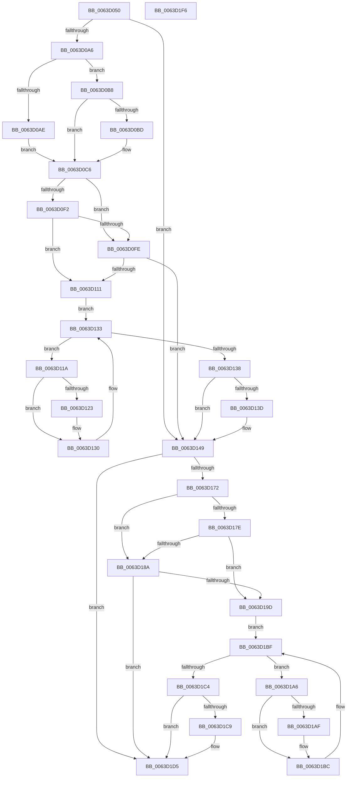

# DifRtlWriteRegistryValueWrapper

- RVA: `0x0063D050`–`0x0063D1F7` (길이 `423` bytes)
- VA: `0x000000014063D050`
- 실행 섹션: `.text`
- PDB 이름 있음: `예`; PDB Function 태그: `아니요`
- unwind 정보 RVA: `0x000D2D8C`
- 디코드: `122`개 명령, `423/423` bytes 표시
- 미해석 바이트: `0` (있으면 어셈블리에 `.byte`로 보존)

> 이 문서는 커널 이미지의 기계어와 PDB 기호를 분석해 생성했습니다. 4번과 5번은 함수 원형과 자료형을 바이너리 사용 방식에서 추정한 C 해석이며 원본 소스 복구 결과는 아닙니다.

## 1. Dependencies

- 직접 호출 지점: **9**; 고유 호출 대상: **6**
- 직접 호출자로 확인된 함수: **0**
- RIP 상대 이미지 참조: **3**

### Outgoing calls
- `0x0063D095` → [DifGetAPIThunkContextById](../49/DifGetAPIThunkContextById_function_00495A34.md) (function, `0x00495A34`)
- `0x0063D0BD` → [DifGetReturnAddressForWrappers](../4D/DifGetReturnAddressForWrappers_function_004D3C08.md) (function, `0x004D3C08`)
- `0x0063D105` → [ExAcquireRundownProtection](../21/ExAcquireRundownProtection_function_00216620.md) (function, `0x00216620`)
- `0x0063D12B` → [guard_dispatch_icall](../6B/guard_dispatch_icall_function_006BAAD0.md) (function, `0x006BAAD0`)
- `0x0063D144` → [ExReleaseRundownProtection](../34/ExReleaseRundownProtection_function_00349E80.md) (function, `0x00349E80`)
- `0x0063D165` → [RtlWriteRegistryValue](../../page/A6/RtlWriteRegistryValue_function_00A6C620.md) (function, `0x00A6C620`)
- `0x0063D191` → [ExAcquireRundownProtection](../21/ExAcquireRundownProtection_function_00216620.md) (function, `0x00216620`)
- `0x0063D1B7` → [guard_dispatch_icall](../6B/guard_dispatch_icall_function_006BAAD0.md) (function, `0x006BAAD0`)
- `0x0063D1D0` → [ExReleaseRundownProtection](../34/ExReleaseRundownProtection_function_00349E80.md) (function, `0x00349E80`)

### Direct callers
- 이 함수 시작 RVA로 연결되는 직접 call은 확인되지 않았습니다. 간접 호출은 완전히 역산할 수 없습니다.

### Static image references
- `0x0063D0CC` → RVA `0x00F048B8` (`.data`; read)
- `0x0063D0F2` → RVA `0x00F04980` (`.data`; read)
- `0x0063D0FE` → RVA `0x00F03E80` (`.data`; read)

## 2. Other-region calls and transfers

- 다른 실행 섹션으로 향하는 call: **1**
  - `0x0063D165` → [RtlWriteRegistryValue](../../page/A6/RtlWriteRegistryValue_function_00A6C620.md) (`.text` → `PAGE`)
- 별도 외부 분기/꼬리 이동을 확인하지 못했습니다.

## 3. Assembly (complete function range)

```asm
0063D050  48 8B C4                        mov rax, rsp
0063D053  48 89 58 10                     mov qword ptr [rax + 0x10], rbx
0063D057  48 89 70 18                     mov qword ptr [rax + 0x18], rsi
0063D05B  48 89 78 20                     mov qword ptr [rax + 0x20], rdi
0063D05F  89 48 08                        mov dword ptr [rax + 8], ecx
0063D062  55                              push rbp
0063D063  41 54                           push r12
0063D065  41 55                           push r13
0063D067  41 56                           push r14
0063D069  41 57                           push r15
0063D06B  48 8B EC                        mov rbp, rsp
0063D06E  48 83 EC 70                     sub rsp, 0x70
0063D072  0F 57 C0                        xorps xmm0, xmm0
0063D075  33 C0                           xor eax, eax
0063D077  B9 95 00 00 00                  mov ecx, 0x95
0063D07C  48 89 45 F0                     mov qword ptr [rbp - 0x10], rax
0063D080  0F 11 45 C0                     movups xmmword ptr [rbp - 0x40], xmm0
0063D084  45 8B F9                        mov r15d, r9d
0063D087  4D 8B E0                        mov r12, r8
0063D08A  0F 11 45 D0                     movups xmmword ptr [rbp - 0x30], xmm0
0063D08E  4C 8B EA                        mov r13, rdx
0063D091  0F 11 45 E0                     movups xmmword ptr [rbp - 0x20], xmm0
0063D095  E8 9A 89 E5 FF                  call 0x140495a34
0063D09A  4C 8B F0                        mov r14, rax
0063D09D  48 85 C0                        test rax, rax
0063D0A0  0F 84 A3 00 00 00               je 0x14063d149
0063D0A6  8B 48 0C                        mov ecx, dword ptr [rax + 0xc]
0063D0A9  F6 C1 18                        test cl, 0x18
0063D0AC  74 0A                           je 0x14063d0b8
0063D0AE  48 8B 4D 28                     mov rcx, qword ptr [rbp + 0x28]
0063D0B2  48 89 4D C0                     mov qword ptr [rbp - 0x40], rcx
0063D0B6  EB 0E                           jmp 0x14063d0c6
0063D0B8  F6 C1 04                        test cl, 4
0063D0BB  74 09                           je 0x14063d0c6
0063D0BD  E8 46 6B E9 FF                  call 0x1404d3c08
0063D0C2  48 89 45 C0                     mov qword ptr [rbp - 0x40], rax
0063D0C6  8B 45 30                        mov eax, dword ptr [rbp + 0x30]
0063D0C9  40 32 F6                        xor sil, sil
0063D0CC  40 38 35 E5 77 8C 00            cmp byte ptr [rip + 0x8c77e5], sil
0063D0D3  89 45 F0                        mov dword ptr [rbp - 0x10], eax
0063D0D6  48 8B 45 50                     mov rax, qword ptr [rbp + 0x50]
0063D0DA  48 89 45 D0                     mov qword ptr [rbp - 0x30], rax
0063D0DE  8B 45 58                        mov eax, dword ptr [rbp + 0x58]
0063D0E1  89 45 C8                        mov dword ptr [rbp - 0x38], eax
0063D0E4  4C 89 6D E8                     mov qword ptr [rbp - 0x18], r13
0063D0E8  4C 89 65 E0                     mov qword ptr [rbp - 0x20], r12
0063D0EC  44 89 7D D8                     mov dword ptr [rbp - 0x28], r15d
0063D0F0  75 0C                           jne 0x14063d0fe
0063D0F2  F7 05 84 78 8C 00 00 08 00 00   test dword ptr [rip + 0x8c7884], 0x800
0063D0FC  74 13                           je 0x14063d111
0063D0FE  48 8D 0D 7B 6D 8C 00            lea rcx, [rip + 0x8c6d7b]
0063D105  E8 16 95 BD FF                  call 0x140216620
0063D10A  40 8A F0                        mov sil, al
0063D10D  84 C0                           test al, al
0063D10F  74 38                           je 0x14063d149
0063D111  49 8D 7E 20                     lea rdi, [r14 + 0x20]
0063D115  48 8B 1F                        mov rbx, qword ptr [rdi]
0063D118  EB 19                           jmp 0x14063d133
0063D11A  48 8D 43 F0                     lea rax, [rbx - 0x10]
0063D11E  48 85 C0                        test rax, rax
0063D121  74 0D                           je 0x14063d130
0063D123  48 8B 40 08                     mov rax, qword ptr [rax + 8]
0063D127  48 8D 4D C0                     lea rcx, [rbp - 0x40]
0063D12B  E8 A0 D9 07 00                  call 0x1406baad0
0063D130  48 8B 1B                        mov rbx, qword ptr [rbx]
0063D133  48 3B DF                        cmp rbx, rdi
0063D136  75 E2                           jne 0x14063d11a
0063D138  40 84 F6                        test sil, sil
0063D13B  74 0C                           je 0x14063d149
0063D13D  48 8D 0D 3C 6D 8C 00            lea rcx, [rip + 0x8c6d3c]
0063D144  E8 37 CD D0 FF                  call 0x140349e80
0063D149  8B 45 58                        mov eax, dword ptr [rbp + 0x58]
0063D14C  45 8B CF                        mov r9d, r15d
0063D14F  8B 4D 30                        mov ecx, dword ptr [rbp + 0x30]
0063D152  4D 8B C4                        mov r8, r12
0063D155  89 44 24 28                     mov dword ptr [rsp + 0x28], eax
0063D159  49 8B D5                        mov rdx, r13
0063D15C  48 8B 45 50                     mov rax, qword ptr [rbp + 0x50]
0063D160  48 89 44 24 20                  mov qword ptr [rsp + 0x20], rax
0063D165  E8 B6 F4 42 00                  call 0x140a6c620
0063D16A  89 45 F4                        mov dword ptr [rbp - 0xc], eax
0063D16D  4D 85 F6                        test r14, r14
0063D170  74 63                           je 0x14063d1d5
0063D172  40 32 FF                        xor dil, dil
0063D175  40 38 3D 3C 77 8C 00            cmp byte ptr [rip + 0x8c773c], dil
0063D17C  75 0C                           jne 0x14063d18a
0063D17E  F7 05 F8 77 8C 00 00 08 00 00   test dword ptr [rip + 0x8c77f8], 0x800
0063D188  74 13                           je 0x14063d19d
0063D18A  48 8D 0D EF 6C 8C 00            lea rcx, [rip + 0x8c6cef]
0063D191  E8 8A 94 BD FF                  call 0x140216620
0063D196  40 8A F8                        mov dil, al
0063D199  84 C0                           test al, al
0063D19B  74 38                           je 0x14063d1d5
0063D19D  49 8D 76 30                     lea rsi, [r14 + 0x30]
0063D1A1  48 8B 1E                        mov rbx, qword ptr [rsi]
0063D1A4  EB 19                           jmp 0x14063d1bf
0063D1A6  48 8D 43 F0                     lea rax, [rbx - 0x10]
0063D1AA  48 85 C0                        test rax, rax
0063D1AD  74 0D                           je 0x14063d1bc
0063D1AF  48 8B 40 08                     mov rax, qword ptr [rax + 8]
0063D1B3  48 8D 4D C0                     lea rcx, [rbp - 0x40]
0063D1B7  E8 14 D9 07 00                  call 0x1406baad0
0063D1BC  48 8B 1B                        mov rbx, qword ptr [rbx]
0063D1BF  48 3B DE                        cmp rbx, rsi
0063D1C2  75 E2                           jne 0x14063d1a6
0063D1C4  40 84 FF                        test dil, dil
0063D1C7  74 0C                           je 0x14063d1d5
0063D1C9  48 8D 0D B0 6C 8C 00            lea rcx, [rip + 0x8c6cb0]
0063D1D0  E8 AB CC D0 FF                  call 0x140349e80
0063D1D5  8B 45 F4                        mov eax, dword ptr [rbp - 0xc]
0063D1D8  4C 8D 5C 24 70                  lea r11, [rsp + 0x70]
0063D1DD  49 8B 5B 38                     mov rbx, qword ptr [r11 + 0x38]
0063D1E1  49 8B 73 40                     mov rsi, qword ptr [r11 + 0x40]
0063D1E5  49 8B 7B 48                     mov rdi, qword ptr [r11 + 0x48]
0063D1E9  49 8B E3                        mov rsp, r11
0063D1EC  41 5F                           pop r15
0063D1EE  41 5E                           pop r14
0063D1F0  41 5D                           pop r13
0063D1F2  41 5C                           pop r12
0063D1F4  5D                              pop rbp
0063D1F5  C3                              ret
0063D1F6  CC                              int3
```

## 4. C-style interpretation (structured pseudocode)

```c
__int64 __fastcall DifRtlWriteRegistryValueWrapper(int a1, __int64 a2, __int64 a3, int a4, __int64 a5, unsigned int a6)
{
    __int64 result;
    __int64 v_rdi;
    __int64 v_rsi;
    __int64 v_rsp;
    unsigned __int64 v_stack_m28;
    unsigned int v_stack_m34;
    unsigned __int64 v_stack_m38;
    unsigned __int64 v_stack_m40;
    unsigned __int64 v_stack_m48;
    unsigned int v_stack_m50;
    unsigned __int64 v_stack_m58;
    unsigned int v_stack_m60;
    unsigned __int64 v_stack_m68;
    unsigned int v_stack_m70;
    unsigned __int64 v_stack_m78;
    unsigned __int64 v_stack_p0;
    unsigned int v_stack_p8;

    *(unsigned __int64 *)(v_rsp + 16) = v_rbx;
    *(unsigned __int64 *)(v_rsp + 24) = v_rsi;
    *(unsigned __int64 *)(v_rsp + 32) = v_rdi;
    *(unsigned int *)(v_rsp + 8) = a1;
    v_rsp = (v_rsp) - (112);
    result = 0;
    v_stack_m38 = 0;
    v_stack_m68 = v_xmm0;
    v_stack_m58 = v_xmm0;
    v_stack_m48 = v_xmm0;
    result = DifGetAPIThunkContextById(149, a2, a3, a4);
    if (result == 0) goto loc_0063D149;
    if ((((unsigned __int8)((unsigned int)(*(unsigned int *)(result + 12)))) & (24)) == 0) goto loc_0063D0B8;
    v_stack_m68 = v_stack_p0;
    goto loc_0063D0C6;
loc_0063D0B8:
    if ((((unsigned __int8)(v_stack_p0)) & (4)) != 0) {
        result = DifGetReturnAddressForWrappers(v_stack_p0, a2, a3, a4);
        v_stack_m68 = result;
    }
    v_rsi = 0;
    v_stack_m38 = (unsigned int)((unsigned int)(v_stack_p8));
    v_stack_m58 = a5;
    v_stack_m60 = (unsigned int)((unsigned int)(a6));
    v_stack_m40 = a2;
    v_stack_m48 = a3;
    v_stack_m50 = (unsigned int)((unsigned int)(a4));
    if ((*(unsigned __int8 *)(v_rip + 9205733)) != 0) goto loc_0063D0FE;
    if (((*(unsigned int *)(v_rip + 9205892)) & (0x800ULL)) == 0) goto loc_0063D111;
loc_0063D0FE:
    result = ExAcquireRundownProtection(v_rip + 9203067, a2, a3, a4);
    if ((unsigned __int8)(result) == 0) goto loc_0063D149;
loc_0063D111:
    goto loc_0063D133;
loc_0063D11A:
    result = *(unsigned __int64 *)(result + 32) - 16;
    if (*(unsigned __int64 *)(result + 32) - 16 != 0) {
        result = *(unsigned __int64 *)(*(unsigned __int64 *)(result + 32) - 16 + 8);
        a1 = v_stack_m68;
        result = guard_dispatch_icall(a1, a2, a3, a4);
    }
loc_0063D133:
    if ((*(unsigned __int64 *)(*(unsigned __int64 *)(result + 32))) != (result + 32)) goto loc_0063D11A;
    if ((unsigned __int8)((unsigned __int8)(result)) != 0) {
        a1 = v_rip + 9203004;
        result = ExReleaseRundownProtection(a1, a2, a3, a4);
    }
    v_stack_m70 = (unsigned int)((unsigned int)(a6));
    v_stack_m78 = a5;
    result = RtlWriteRegistryValue((unsigned int)(v_stack_p8), a2, a3, (unsigned int)((unsigned int)((unsigned int)(a4))));
    v_stack_m34 = (unsigned int)(result);
    if (result == 0) goto loc_0063D1D5;
    v_rdi = 0;
    if ((*(unsigned __int8 *)(v_rip + 9205564)) != 0) goto loc_0063D18A;
    if (((*(unsigned int *)(v_rip + 9205752)) & (0x800ULL)) == 0) goto loc_0063D19D;
loc_0063D18A:
    result = ExAcquireRundownProtection(v_rip + 9202927, a2, a3, (unsigned int)((unsigned int)((unsigned int)(a4))));
    if ((unsigned __int8)(result) == 0) goto loc_0063D1D5;
loc_0063D19D:
    goto loc_0063D1BF;
loc_0063D1A6:
    result = *(unsigned __int64 *)(result + 48) - 16;
    if (*(unsigned __int64 *)(result + 48) - 16 != 0) {
        result = *(unsigned __int64 *)(*(unsigned __int64 *)(result + 48) - 16 + 8);
        a1 = v_stack_m68;
        result = guard_dispatch_icall(a1, a2, a3, (unsigned int)((unsigned int)((unsigned int)(a4))));
    }
loc_0063D1BF:
    if ((*(unsigned __int64 *)(*(unsigned __int64 *)(result + 48))) != (result + 48)) goto loc_0063D1A6;
    if ((unsigned __int8)((unsigned __int8)(result)) != 0) {
        a1 = v_rip + 9202864;
        result = ExReleaseRundownProtection(a1, a2, a3, (unsigned int)((unsigned int)((unsigned int)(a4))));
    }
    return (unsigned int)(v_stack_m34);
}
```

## 5. (Beta) C Style

```c
int64_t DifRtlWriteRegistryValueWrapper(int32_t Arg1, int64_t Arg2, int64_t Arg3, int32_t Arg4, int64_t Arg5, uint32_t Arg6)
{
    int64_t result;
    int64_t local_rdi;
    int64_t local_rsi;
    int64_t local_rsp;
    uint64_t v_stack_m28;
    uint32_t v_stack_m34;
    uint64_t v_stack_m38;
    uint64_t v_stack_m40;
    uint64_t v_stack_m48;
    uint32_t v_stack_m50;
    uint64_t v_stack_m58;
    uint32_t v_stack_m60;
    uint64_t v_stack_m68;
    uint32_t v_stack_m70;
    uint64_t v_stack_m78;
    uint64_t v_stack_p0;
    uint32_t v_stack_p8;

    *(uint64_t *)(local_rsp + 0x10) = local_rbx;
    *(uint64_t *)(local_rsp + 0x18) = local_rsi;
    *(uint64_t *)(local_rsp + 0x20) = local_rdi;
    *(uint32_t *)(local_rsp + 0x8) = Arg1;
    local_rsp = (local_rsp) - (112);
    result = 0;
    v_stack_m38 = 0;
    v_stack_m68 = v_xmm0;
    v_stack_m58 = v_xmm0;
    v_stack_m48 = v_xmm0;
    result = DifGetAPIThunkContextById(149, Arg2, Arg3, Arg4);
    if (result == 0) goto loc_0063D149;
    if ((((uint8_t)((uint32_t)(*(uint32_t *)(result + 0xC)))) & (24)) == 0) goto loc_0063D0B8;
    v_stack_m68 = v_stack_p0;
    goto loc_0063D0C6;
loc_0063D0B8:
    if ((((uint8_t)(v_stack_p0)) & (4)) != 0) {
        result = DifGetReturnAddressForWrappers(v_stack_p0, Arg2, Arg3, Arg4);
        v_stack_m68 = result;
    }
    local_rsi = 0;
    v_stack_m38 = (uint32_t)((uint32_t)(v_stack_p8));
    v_stack_m58 = Arg5;
    v_stack_m60 = (uint32_t)((uint32_t)(Arg6));
    v_stack_m40 = Arg2;
    v_stack_m48 = Arg3;
    v_stack_m50 = (uint32_t)((uint32_t)(Arg4));
    if ((*(uint8_t *)(v_rip + 0x8C77E5)) != 0) goto loc_0063D0FE;
    if (((*(uint32_t *)(v_rip + 0x8C7884)) & (0x800ULL)) == 0) goto loc_0063D111;
loc_0063D0FE:
    result = ExAcquireRundownProtection(v_rip + 9203067, Arg2, Arg3, Arg4);
    if ((uint8_t)(result) == 0) goto loc_0063D149;
loc_0063D111:
    goto loc_0063D133;
loc_0063D11A:
    result = *(uint64_t *)(result + 0x20) - 16;
    if (*(uint64_t *)(result + 0x20) - 16 != 0) {
        result = *(uint64_t *)(*(uint64_t *)(result + 0x20) - 0x10 + 0x8);
        Arg1 = v_stack_m68;
        result = guard_dispatch_icall(Arg1, Arg2, Arg3, Arg4);
    }
loc_0063D133:
    if ((*(uint64_t *)(*(uint64_t *)(result + 0x20))) != (result + 32)) goto loc_0063D11A;
    if ((uint8_t)((uint8_t)(result)) != 0) {
        Arg1 = v_rip + 9203004;
        result = ExReleaseRundownProtection(Arg1, Arg2, Arg3, Arg4);
    }
    v_stack_m70 = (uint32_t)((uint32_t)(Arg6));
    v_stack_m78 = Arg5;
    result = RtlWriteRegistryValue((uint32_t)(v_stack_p8), Arg2, Arg3, (uint32_t)((uint32_t)((uint32_t)(Arg4))));
    v_stack_m34 = (uint32_t)(result);
    if (result == 0) goto loc_0063D1D5;
    local_rdi = 0;
    if ((*(uint8_t *)(v_rip + 0x8C773C)) != 0) goto loc_0063D18A;
    if (((*(uint32_t *)(v_rip + 0x8C77F8)) & (0x800ULL)) == 0) goto loc_0063D19D;
loc_0063D18A:
    result = ExAcquireRundownProtection(v_rip + 9202927, Arg2, Arg3, (uint32_t)((uint32_t)((uint32_t)(Arg4))));
    if ((uint8_t)(result) == 0) goto loc_0063D1D5;
loc_0063D19D:
    goto loc_0063D1BF;
loc_0063D1A6:
    result = *(uint64_t *)(result + 0x30) - 16;
    if (*(uint64_t *)(result + 0x30) - 16 != 0) {
        result = *(uint64_t *)(*(uint64_t *)(result + 0x30) - 0x10 + 0x8);
        Arg1 = v_stack_m68;
        result = guard_dispatch_icall(Arg1, Arg2, Arg3, (uint32_t)((uint32_t)((uint32_t)(Arg4))));
    }
loc_0063D1BF:
    if ((*(uint64_t *)(*(uint64_t *)(result + 0x30))) != (result + 48)) goto loc_0063D1A6;
    if ((uint8_t)((uint8_t)(result)) != 0) {
        Arg1 = v_rip + 9202864;
        result = ExReleaseRundownProtection(Arg1, Arg2, Arg3, (uint32_t)((uint32_t)((uint32_t)(Arg4))));
    }
    return (uint32_t)(v_stack_m34);
}
```

## 6. Execution-region graph

[열기: 2D/3D 그래프와 함수 탐색 컨트롤 패널](../../../control-panel.html?section=text&rva=0x0063D050&view=graph)

- 2D 그래프는 위에서 아래로 흐르고, 3D 그래프는 빈 공간을 드래그해 회전합니다. Shift+드래그는 이동, 휠은 확대·축소, 함수 노드 선택은 대상 보고서 이동입니다.

### Static fallback


