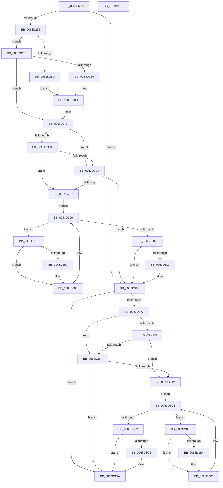

# DifZwAccessCheckAndAuditAlarmWrapper

- RVA: `0x0063D200`–`0x0063D3FF` (길이 `511` bytes)
- VA: `0x000000014063D200`
- 실행 섹션: `.text`
- PDB 이름 있음: `예`; PDB Function 태그: `아니요`
- unwind 정보 RVA: `0x000D2C44`
- 디코드: `139`개 명령, `511/511` bytes 표시
- 미해석 바이트: `0` (있으면 어셈블리에 `.byte`로 보존)

> 이 문서는 커널 이미지의 기계어와 PDB 기호를 분석해 생성했습니다. 4번과 5번은 함수 원형과 자료형을 바이너리 사용 방식에서 추정한 C 해석이며 원본 소스 복구 결과는 아닙니다.

## 1. Dependencies

- 직접 호출 지점: **10**; 고유 호출 대상: **7**
- 직접 호출자로 확인된 함수: **0**
- RIP 상대 이미지 참조: **3**

### Outgoing calls
- `0x0063D23A` → [memset](../6C/memset_function_006C6C40.md) (function, `0x006C6C40`)
- `0x0063D244` → [DifGetAPIThunkContextById](../49/DifGetAPIThunkContextById_function_00495A34.md) (function, `0x00495A34`)
- `0x0063D268` → [DifGetReturnAddressForWrappers](../4D/DifGetReturnAddressForWrappers_function_004D3C08.md) (function, `0x004D3C08`)
- `0x0063D2DB` → [ExAcquireRundownProtection](../21/ExAcquireRundownProtection_function_00216620.md) (function, `0x00216620`)
- `0x0063D301` → [guard_dispatch_icall](../6B/guard_dispatch_icall_function_006BAAD0.md) (function, `0x006BAAD0`)
- `0x0063D31A` → [ExReleaseRundownProtection](../34/ExReleaseRundownProtection_function_00349E80.md) (function, `0x00349E80`)
- `0x0063D36A` → [ZwAccessCheckAndAuditAlarm](../6A/ZwAccessCheckAndAuditAlarm_function_006AD5F0.md) (function, `0x006AD5F0`)
- `0x0063D396` → [ExAcquireRundownProtection](../21/ExAcquireRundownProtection_function_00216620.md) (function, `0x00216620`)
- `0x0063D3BC` → [guard_dispatch_icall](../6B/guard_dispatch_icall_function_006BAAD0.md) (function, `0x006BAAD0`)
- `0x0063D3D5` → [ExReleaseRundownProtection](../34/ExReleaseRundownProtection_function_00349E80.md) (function, `0x00349E80`)

### Direct callers
- 이 함수 시작 RVA로 연결되는 직접 call은 확인되지 않았습니다. 간접 호출은 완전히 역산할 수 없습니다.

### Static image references
- `0x0063D278` → RVA `0x00F048B8` (`.data`; read)
- `0x0063D2C8` → RVA `0x00F04980` (`.data`; read)
- `0x0063D2D4` → RVA `0x00F03E80` (`.data`; read)

## 2. Other-region calls and transfers

- 다른 실행 섹션으로 향하는 call: **0**
- 별도 외부 분기/꼬리 이동을 확인하지 못했습니다.

## 3. Assembly (complete function range)

```asm
0063D200  48 8B C4                        mov rax, rsp
0063D203  48 89 58 10                     mov qword ptr [rax + 0x10], rbx
0063D207  48 89 70 18                     mov qword ptr [rax + 0x18], rsi
0063D20B  48 89 78 20                     mov qword ptr [rax + 0x20], rdi
0063D20F  48 89 48 08                     mov qword ptr [rax + 8], rcx
0063D213  55                              push rbp
0063D214  41 54                           push r12
0063D216  41 55                           push r13
0063D218  41 56                           push r14
0063D21A  41 57                           push r15
0063D21C  48 8D 68 D1                     lea rbp, [rax - 0x2f]
0063D220  48 81 EC D0 00 00 00            sub rsp, 0xd0
0063D227  4C 8B EA                        mov r13, rdx
0063D22A  48 8D 4D 97                     lea rcx, [rbp - 0x69]
0063D22E  33 D2                           xor edx, edx
0063D230  4D 8B E0                        mov r12, r8
0063D233  4D 8B F9                        mov r15, r9
0063D236  44 8D 42 68                     lea r8d, [rdx + 0x68]
0063D23A  E8 01 9A 08 00                  call 0x1406c6c40
0063D23F  B9 94 00 00 00                  mov ecx, 0x94
0063D244  E8 EB 87 E5 FF                  call 0x140495a34
0063D249  48 8B F0                        mov rsi, rax
0063D24C  48 85 C0                        test rax, rax
0063D24F  0F 84 CA 00 00 00               je 0x14063d31f
0063D255  8B 48 0C                        mov ecx, dword ptr [rax + 0xc]
0063D258  F6 C1 18                        test cl, 0x18
0063D25B  74 06                           je 0x14063d263
0063D25D  48 8B 45 2F                     mov rax, qword ptr [rbp + 0x2f]
0063D261  EB 0A                           jmp 0x14063d26d
0063D263  F6 C1 04                        test cl, 4
0063D266  74 09                           je 0x14063d271
0063D268  E8 9B 69 E9 FF                  call 0x1404d3c08
0063D26D  48 89 45 97                     mov qword ptr [rbp - 0x69], rax
0063D271  48 8B 45 37                     mov rax, qword ptr [rbp + 0x37]
0063D275  45 32 F6                        xor r14b, r14b
0063D278  44 38 35 39 76 8C 00            cmp byte ptr [rip + 0x8c7639], r14b
0063D27F  48 89 45 EF                     mov qword ptr [rbp - 0x11], rax
0063D283  48 8B 45 57                     mov rax, qword ptr [rbp + 0x57]
0063D287  48 89 45 CF                     mov qword ptr [rbp - 0x31], rax
0063D28B  8B 45 5F                        mov eax, dword ptr [rbp + 0x5f]
0063D28E  89 45 C7                        mov dword ptr [rbp - 0x39], eax
0063D291  48 8B 45 67                     mov rax, qword ptr [rbp + 0x67]
0063D295  48 89 45 BF                     mov qword ptr [rbp - 0x41], rax
0063D299  8A 45 6F                        mov al, byte ptr [rbp + 0x6f]
0063D29C  88 45 B7                        mov byte ptr [rbp - 0x49], al
0063D29F  48 8B 45 77                     mov rax, qword ptr [rbp + 0x77]
0063D2A3  48 89 45 AF                     mov qword ptr [rbp - 0x51], rax
0063D2A7  48 8B 45 7F                     mov rax, qword ptr [rbp + 0x7f]
0063D2AB  48 89 45 A7                     mov qword ptr [rbp - 0x59], rax
0063D2AF  48 8B 85 87 00 00 00            mov rax, qword ptr [rbp + 0x87]
0063D2B6  48 89 45 9F                     mov qword ptr [rbp - 0x61], rax
0063D2BA  4C 89 6D E7                     mov qword ptr [rbp - 0x19], r13
0063D2BE  4C 89 65 DF                     mov qword ptr [rbp - 0x21], r12
0063D2C2  4C 89 7D D7                     mov qword ptr [rbp - 0x29], r15
0063D2C6  75 0C                           jne 0x14063d2d4
0063D2C8  F7 05 AE 76 8C 00 00 08 00 00   test dword ptr [rip + 0x8c76ae], 0x800
0063D2D2  74 13                           je 0x14063d2e7
0063D2D4  48 8D 0D A5 6B 8C 00            lea rcx, [rip + 0x8c6ba5]
0063D2DB  E8 40 93 BD FF                  call 0x140216620
0063D2E0  44 8A F0                        mov r14b, al
0063D2E3  84 C0                           test al, al
0063D2E5  74 38                           je 0x14063d31f
0063D2E7  48 8D 7E 20                     lea rdi, [rsi + 0x20]
0063D2EB  48 8B 1F                        mov rbx, qword ptr [rdi]
0063D2EE  EB 19                           jmp 0x14063d309
0063D2F0  48 8D 43 F0                     lea rax, [rbx - 0x10]
0063D2F4  48 85 C0                        test rax, rax
0063D2F7  74 0D                           je 0x14063d306
0063D2F9  48 8B 40 08                     mov rax, qword ptr [rax + 8]
0063D2FD  48 8D 4D 97                     lea rcx, [rbp - 0x69]
0063D301  E8 CA D7 07 00                  call 0x1406baad0
0063D306  48 8B 1B                        mov rbx, qword ptr [rbx]
0063D309  48 3B DF                        cmp rbx, rdi
0063D30C  75 E2                           jne 0x14063d2f0
0063D30E  45 84 F6                        test r14b, r14b
0063D311  74 0C                           je 0x14063d31f
0063D313  48 8D 0D 66 6B 8C 00            lea rcx, [rip + 0x8c6b66]
0063D31A  E8 61 CB D0 FF                  call 0x140349e80
0063D31F  48 8B 85 87 00 00 00            mov rax, qword ptr [rbp + 0x87]
0063D326  4D 8B CF                        mov r9, r15
0063D329  48 8B 4D 37                     mov rcx, qword ptr [rbp + 0x37]
0063D32D  4D 8B C4                        mov r8, r12
0063D330  48 89 44 24 50                  mov qword ptr [rsp + 0x50], rax
0063D335  49 8B D5                        mov rdx, r13
0063D338  48 8B 45 7F                     mov rax, qword ptr [rbp + 0x7f]
0063D33C  48 89 44 24 48                  mov qword ptr [rsp + 0x48], rax
0063D341  48 8B 45 77                     mov rax, qword ptr [rbp + 0x77]
0063D345  48 89 44 24 40                  mov qword ptr [rsp + 0x40], rax
0063D34A  8A 45 6F                        mov al, byte ptr [rbp + 0x6f]
0063D34D  88 44 24 38                     mov byte ptr [rsp + 0x38], al
0063D351  48 8B 45 67                     mov rax, qword ptr [rbp + 0x67]
0063D355  48 89 44 24 30                  mov qword ptr [rsp + 0x30], rax
0063D35A  8B 45 5F                        mov eax, dword ptr [rbp + 0x5f]
0063D35D  89 44 24 28                     mov dword ptr [rsp + 0x28], eax
0063D361  48 8B 45 57                     mov rax, qword ptr [rbp + 0x57]
0063D365  48 89 44 24 20                  mov qword ptr [rsp + 0x20], rax
0063D36A  E8 81 02 07 00                  call 0x1406ad5f0
0063D36F  89 45 F7                        mov dword ptr [rbp - 9], eax
0063D372  48 85 F6                        test rsi, rsi
0063D375  74 63                           je 0x14063d3da
0063D377  40 32 FF                        xor dil, dil
0063D37A  40 38 3D 37 75 8C 00            cmp byte ptr [rip + 0x8c7537], dil
0063D381  75 0C                           jne 0x14063d38f
0063D383  F7 05 F3 75 8C 00 00 08 00 00   test dword ptr [rip + 0x8c75f3], 0x800
0063D38D  74 13                           je 0x14063d3a2
0063D38F  48 8D 0D EA 6A 8C 00            lea rcx, [rip + 0x8c6aea]
0063D396  E8 85 92 BD FF                  call 0x140216620
0063D39B  40 8A F8                        mov dil, al
0063D39E  84 C0                           test al, al
0063D3A0  74 38                           je 0x14063d3da
0063D3A2  48 83 C6 30                     add rsi, 0x30
0063D3A6  48 8B 1E                        mov rbx, qword ptr [rsi]
0063D3A9  EB 19                           jmp 0x14063d3c4
0063D3AB  48 8D 43 F0                     lea rax, [rbx - 0x10]
0063D3AF  48 85 C0                        test rax, rax
0063D3B2  74 0D                           je 0x14063d3c1
0063D3B4  48 8B 40 08                     mov rax, qword ptr [rax + 8]
0063D3B8  48 8D 4D 97                     lea rcx, [rbp - 0x69]
0063D3BC  E8 0F D7 07 00                  call 0x1406baad0
0063D3C1  48 8B 1B                        mov rbx, qword ptr [rbx]
0063D3C4  48 3B DE                        cmp rbx, rsi
0063D3C7  75 E2                           jne 0x14063d3ab
0063D3C9  40 84 FF                        test dil, dil
0063D3CC  74 0C                           je 0x14063d3da
0063D3CE  48 8D 0D AB 6A 8C 00            lea rcx, [rip + 0x8c6aab]
0063D3D5  E8 A6 CA D0 FF                  call 0x140349e80
0063D3DA  8B 45 F7                        mov eax, dword ptr [rbp - 9]
0063D3DD  4C 8D 9C 24 D0 00 00 00         lea r11, [rsp + 0xd0]
0063D3E5  49 8B 5B 38                     mov rbx, qword ptr [r11 + 0x38]
0063D3E9  49 8B 73 40                     mov rsi, qword ptr [r11 + 0x40]
0063D3ED  49 8B 7B 48                     mov rdi, qword ptr [r11 + 0x48]
0063D3F1  49 8B E3                        mov rsp, r11
0063D3F4  41 5F                           pop r15
0063D3F6  41 5E                           pop r14
0063D3F8  41 5D                           pop r13
0063D3FA  41 5C                           pop r12
0063D3FC  5D                              pop rbp
0063D3FD  C3                              ret
0063D3FE  CC                              int3
```

## 4. C-style interpretation (structured pseudocode)

```c
__int64 __fastcall DifZwAccessCheckAndAuditAlarmWrapper(__int64 a1, __int64 a2, __int64 a3, __int64 a4)
{
    __int64 result;
    __int64 v_r14;
    __int64 v_rdi;
    __int64 v_rsi;
    __int64 v_rsp;
    unsigned __int64 v_stack_m28;
    unsigned __int64 v_stack_mA8;
    unsigned __int64 v_stack_mB0;
    unsigned __int64 v_stack_mB8;
    unsigned __int8 v_stack_mC0;
    unsigned __int64 v_stack_mC8;
    unsigned int v_stack_mD0;
    unsigned __int64 v_stack_mD8;

    *(unsigned __int64 *)(v_rsp + 16) = v_rbx;
    *(unsigned __int64 *)(v_rsp + 24) = v_rsi;
    *(unsigned __int64 *)(v_rsp + 32) = v_rdi;
    *(unsigned __int64 *)(v_rsp + 8) = a1;
    v_rsp = (v_rsp) - (208);
    a2 = 0;
    result = memset(v_rsp - 47 - 105, a2, a2 + 104, a4);
    result = DifGetAPIThunkContextById(148, a2, a2 + 104, a4);
    if (result == 0) goto loc_0063D31F;
    if ((((unsigned __int8)((unsigned int)(*(unsigned int *)(result + 12)))) & (24)) == 0) goto loc_0063D263;
    goto loc_0063D26D;
loc_0063D263:
    if ((((unsigned __int8)((unsigned int)(*(unsigned int *)(result + 12)))) & (4)) == 0) goto loc_0063D271;
    result = DifGetReturnAddressForWrappers((unsigned int)(*(unsigned int *)(result + 12)), a2, a2 + 104, a4);
loc_0063D26D:
    *(unsigned __int64 *)(v_rsp - 47 - 105) = result;
loc_0063D271:
    v_r14 = 0;
    *(unsigned __int64 *)(v_rsp - 47 - 17) = *(unsigned __int64 *)(v_rsp - 47 + 55);
    *(unsigned __int64 *)(v_rsp - 47 - 49) = *(unsigned __int64 *)(v_rsp - 47 + 87);
    *(unsigned int *)(v_rsp - 47 - 57) = (unsigned int)((unsigned int)(*(unsigned int *)(v_rsp - 47 + 95)));
    *(unsigned __int64 *)(v_rsp - 47 - 65) = *(unsigned __int64 *)(v_rsp - 47 + 103);
    *(unsigned __int8 *)(v_rsp - 47 - 73) = (unsigned __int8)(*(unsigned __int8 *)(v_rsp - 47 + 111));
    *(unsigned __int64 *)(v_rsp - 47 - 81) = *(unsigned __int64 *)(v_rsp - 47 + 119);
    *(unsigned __int64 *)(v_rsp - 47 - 89) = *(unsigned __int64 *)(v_rsp - 47 + 127);
    *(unsigned __int64 *)(v_rsp - 47 - 97) = *(unsigned __int64 *)(v_rsp - 47 + 135);
    *(unsigned __int64 *)(v_rsp - 47 - 25) = 0;
    *(unsigned __int64 *)(v_rsp - 47 - 33) = a3;
    *(unsigned __int64 *)(v_rsp - 47 - 41) = a4;
    if ((*(unsigned __int8 *)(v_rip + 9205305)) != 0) goto loc_0063D2D4;
    if (((*(unsigned int *)(v_rip + 9205422)) & (0x800ULL)) == 0) goto loc_0063D2E7;
loc_0063D2D4:
    result = ExAcquireRundownProtection(v_rip + 9202597, a2, a2 + 104, a4);
    if ((unsigned __int8)(result) == 0) goto loc_0063D31F;
loc_0063D2E7:
    goto loc_0063D309;
loc_0063D2F0:
    result = *(unsigned __int64 *)(result + 32) - 16;
    if (*(unsigned __int64 *)(result + 32) - 16 != 0) {
        result = *(unsigned __int64 *)(*(unsigned __int64 *)(result + 32) - 16 + 8);
        a1 = v_rsp - 47 - 105;
        result = guard_dispatch_icall(a1, a2, a2 + 104, a4);
    }
loc_0063D309:
    if ((*(unsigned __int64 *)(*(unsigned __int64 *)(result + 32))) != (result + 32)) goto loc_0063D2F0;
    if ((unsigned __int8)((unsigned __int8)(result)) != 0) {
        a1 = v_rip + 9202534;
        result = ExReleaseRundownProtection(a1, a2, a2 + 104, a4);
    }
    v_stack_mA8 = *(unsigned __int64 *)(v_rsp - 47 + 135);
    v_stack_mB0 = *(unsigned __int64 *)(v_rsp - 47 + 127);
    v_stack_mB8 = *(unsigned __int64 *)(v_rsp - 47 + 119);
    v_stack_mC0 = (unsigned __int8)(*(unsigned __int8 *)(v_rsp - 47 + 111));
    v_stack_mC8 = *(unsigned __int64 *)(v_rsp - 47 + 103);
    v_stack_mD0 = (unsigned int)((unsigned int)(*(unsigned int *)(v_rsp - 47 + 95)));
    v_stack_mD8 = *(unsigned __int64 *)(v_rsp - 47 + 87);
    result = ZwAccessCheckAndAuditAlarm(*(unsigned __int64 *)(v_rsp - 47 + 55), 0, a3, a4);
    *(unsigned int *)(v_rsp - 47 - 9) = (unsigned int)(result);
    if (result == 0) goto loc_0063D3DA;
    v_rdi = 0;
    if ((*(unsigned __int8 *)(v_rip + 9205047)) != 0) goto loc_0063D38F;
    if (((*(unsigned int *)(v_rip + 9205235)) & (0x800ULL)) == 0) goto loc_0063D3A2;
loc_0063D38F:
    result = ExAcquireRundownProtection(v_rip + 9202410, 0, a3, a4);
    if ((unsigned __int8)(result) == 0) goto loc_0063D3DA;
loc_0063D3A2:
    v_rsi = (result) + (48);
    goto loc_0063D3C4;
loc_0063D3AB:
    result = *(unsigned __int64 *)(v_rsi) - 16;
    if (*(unsigned __int64 *)(v_rsi) - 16 != 0) {
        result = *(unsigned __int64 *)(*(unsigned __int64 *)(v_rsi) - 16 + 8);
        a1 = v_rsp - 47 - 105;
        result = guard_dispatch_icall(a1, 0, a3, a4);
    }
loc_0063D3C4:
    if ((*(unsigned __int64 *)(*(unsigned __int64 *)(v_rsi))) != v_rsi) goto loc_0063D3AB;
    if ((unsigned __int8)((unsigned __int8)(result)) != 0) {
        a1 = v_rip + 9202347;
        result = ExReleaseRundownProtection(a1, 0, a3, a4);
    }
    return (unsigned int)(*(unsigned int *)(v_rsp - 47 - 9));
}
```

## 5. (Beta) C Style

```c
int64_t DifZwAccessCheckAndAuditAlarmWrapper(int64_t Arg1, int64_t Arg2, int64_t Arg3, int64_t Arg4)
{
    int64_t result;
    int64_t local_r14;
    int64_t local_rdi;
    int64_t local_rsi;
    int64_t local_rsp;
    uint64_t v_stack_m28;
    uint64_t v_stack_mA8;
    uint64_t v_stack_mB0;
    uint64_t v_stack_mB8;
    uint8_t v_stack_mC0;
    uint64_t v_stack_mC8;
    uint32_t v_stack_mD0;
    uint64_t v_stack_mD8;

    *(uint64_t *)(local_rsp + 0x10) = local_rbx;
    *(uint64_t *)(local_rsp + 0x18) = local_rsi;
    *(uint64_t *)(local_rsp + 0x20) = local_rdi;
    *(uint64_t *)(local_rsp + 0x8) = Arg1;
    local_rsp = (local_rsp) - (208);
    Arg2 = 0;
    result = memset(local_rsp - 47 - 105, Arg2, Arg2 + 104, Arg4);
    result = DifGetAPIThunkContextById(148, Arg2, Arg2 + 104, Arg4);
    if (result == 0) goto loc_0063D31F;
    if ((((uint8_t)((uint32_t)(*(uint32_t *)(result + 0xC)))) & (24)) == 0) goto loc_0063D263;
    goto loc_0063D26D;
loc_0063D263:
    if ((((uint8_t)((uint32_t)(*(uint32_t *)(result + 0xC)))) & (4)) == 0) goto loc_0063D271;
    result = DifGetReturnAddressForWrappers((uint32_t)(*(uint32_t *)(result + 0xC)), Arg2, Arg2 + 104, Arg4);
loc_0063D26D:
    *(uint64_t *)(local_rsp - 0x2F - 0x69) = result;
loc_0063D271:
    local_r14 = 0;
    *(uint64_t *)(local_rsp - 0x2F - 0x11) = *(uint64_t *)(local_rsp - 0x2F + 0x37);
    *(uint64_t *)(local_rsp - 0x2F - 0x31) = *(uint64_t *)(local_rsp - 0x2F + 0x57);
    *(uint32_t *)(local_rsp - 0x2F - 0x39) = (uint32_t)((uint32_t)(*(uint32_t *)(local_rsp - 0x2F + 0x5F)));
    *(uint64_t *)(local_rsp - 0x2F - 0x41) = *(uint64_t *)(local_rsp - 0x2F + 0x67);
    *(uint8_t *)(local_rsp - 0x2F - 0x49) = (uint8_t)(*(uint8_t *)(local_rsp - 0x2F + 0x6F));
    *(uint64_t *)(local_rsp - 0x2F - 0x51) = *(uint64_t *)(local_rsp - 0x2F + 0x77);
    *(uint64_t *)(local_rsp - 0x2F - 0x59) = *(uint64_t *)(local_rsp - 0x2F + 0x7F);
    *(uint64_t *)(local_rsp - 0x2F - 0x61) = *(uint64_t *)(local_rsp - 0x2F + 0x87);
    *(uint64_t *)(local_rsp - 0x2F - 0x19) = 0;
    *(uint64_t *)(local_rsp - 0x2F - 0x21) = Arg3;
    *(uint64_t *)(local_rsp - 0x2F - 0x29) = Arg4;
    if ((*(uint8_t *)(v_rip + 0x8C7639)) != 0) goto loc_0063D2D4;
    if (((*(uint32_t *)(v_rip + 0x8C76AE)) & (0x800ULL)) == 0) goto loc_0063D2E7;
loc_0063D2D4:
    result = ExAcquireRundownProtection(v_rip + 9202597, Arg2, Arg2 + 104, Arg4);
    if ((uint8_t)(result) == 0) goto loc_0063D31F;
loc_0063D2E7:
    goto loc_0063D309;
loc_0063D2F0:
    result = *(uint64_t *)(result + 0x20) - 16;
    if (*(uint64_t *)(result + 0x20) - 16 != 0) {
        result = *(uint64_t *)(*(uint64_t *)(result + 0x20) - 0x10 + 0x8);
        Arg1 = local_rsp - 47 - 105;
        result = guard_dispatch_icall(Arg1, Arg2, Arg2 + 104, Arg4);
    }
loc_0063D309:
    if ((*(uint64_t *)(*(uint64_t *)(result + 0x20))) != (result + 32)) goto loc_0063D2F0;
    if ((uint8_t)((uint8_t)(result)) != 0) {
        Arg1 = v_rip + 9202534;
        result = ExReleaseRundownProtection(Arg1, Arg2, Arg2 + 104, Arg4);
    }
    v_stack_mA8 = *(uint64_t *)(local_rsp - 0x2F + 0x87);
    v_stack_mB0 = *(uint64_t *)(local_rsp - 0x2F + 0x7F);
    v_stack_mB8 = *(uint64_t *)(local_rsp - 0x2F + 0x77);
    v_stack_mC0 = (uint8_t)(*(uint8_t *)(local_rsp - 0x2F + 0x6F));
    v_stack_mC8 = *(uint64_t *)(local_rsp - 0x2F + 0x67);
    v_stack_mD0 = (uint32_t)((uint32_t)(*(uint32_t *)(local_rsp - 0x2F + 0x5F)));
    v_stack_mD8 = *(uint64_t *)(local_rsp - 0x2F + 0x57);
    result = ZwAccessCheckAndAuditAlarm(*(uint64_t *)(local_rsp - 0x2F + 0x37), 0, Arg3, Arg4);
    *(uint32_t *)(local_rsp - 0x2F - 0x9) = (uint32_t)(result);
    if (result == 0) goto loc_0063D3DA;
    local_rdi = 0;
    if ((*(uint8_t *)(v_rip + 0x8C7537)) != 0) goto loc_0063D38F;
    if (((*(uint32_t *)(v_rip + 0x8C75F3)) & (0x800ULL)) == 0) goto loc_0063D3A2;
loc_0063D38F:
    result = ExAcquireRundownProtection(v_rip + 9202410, 0, Arg3, Arg4);
    if ((uint8_t)(result) == 0) goto loc_0063D3DA;
loc_0063D3A2:
    local_rsi = (result) + (48);
    goto loc_0063D3C4;
loc_0063D3AB:
    result = *(uint64_t *)(local_rsi) - 16;
    if (*(uint64_t *)(local_rsi) - 16 != 0) {
        result = *(uint64_t *)(*(uint64_t *)(local_rsi) - 0x10 + 0x8);
        Arg1 = local_rsp - 47 - 105;
        result = guard_dispatch_icall(Arg1, 0, Arg3, Arg4);
    }
loc_0063D3C4:
    if ((*(uint64_t *)(*(uint64_t *)(local_rsi))) != local_rsi) goto loc_0063D3AB;
    if ((uint8_t)((uint8_t)(result)) != 0) {
        Arg1 = v_rip + 9202347;
        result = ExReleaseRundownProtection(Arg1, 0, Arg3, Arg4);
    }
    return (uint32_t)(*(uint32_t *)(local_rsp - 0x2F - 0x9));
}
```

## 6. Execution-region graph

[열기: 2D/3D 그래프와 함수 탐색 컨트롤 패널](../../../control-panel.html?section=text&rva=0x0063D200&view=graph)

- 2D 그래프는 위에서 아래로 흐르고, 3D 그래프는 빈 공간을 드래그해 회전합니다. Shift+드래그는 이동, 휠은 확대·축소, 함수 노드 선택은 대상 보고서 이동입니다.

### Static fallback


