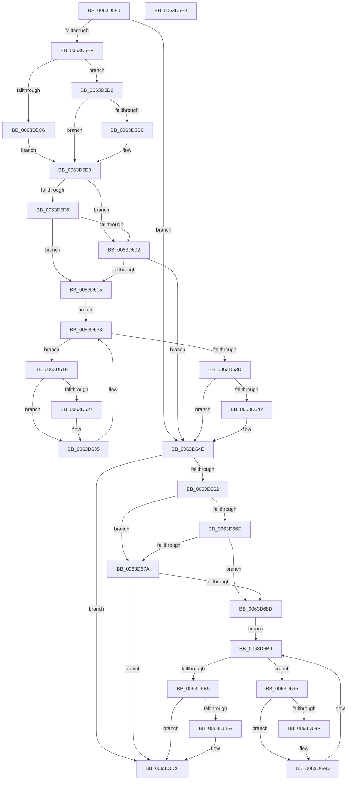

# DifZwAddDriverEntryWrapper

- RVA: `0x0063D580`–`0x0063D6E4` (길이 `356` bytes)
- VA: `0x000000014063D580`
- 실행 섹션: `.text`
- PDB 이름 있음: `예`; PDB Function 태그: `아니요`
- unwind 정보 RVA: `0x00093E28`
- 디코드: `98`개 명령, `356/356` bytes 표시
- 미해석 바이트: `0` (있으면 어셈블리에 `.byte`로 보존)

> 이 문서는 커널 이미지의 기계어와 PDB 기호를 분석해 생성했습니다. 4번과 5번은 함수 원형과 자료형을 바이너리 사용 방식에서 추정한 C 해석이며 원본 소스 복구 결과는 아닙니다.

## 1. Dependencies

- 직접 호출 지점: **9**; 고유 호출 대상: **6**
- 직접 호출자로 확인된 함수: **0**
- RIP 상대 이미지 참조: **3**

### Outgoing calls
- `0x0063D5AE` → [DifGetAPIThunkContextById](../49/DifGetAPIThunkContextById_function_00495A34.md) (function, `0x00495A34`)
- `0x0063D5D6` → [DifGetReturnAddressForWrappers](../4D/DifGetReturnAddressForWrappers_function_004D3C08.md) (function, `0x004D3C08`)
- `0x0063D609` → [ExAcquireRundownProtection](../21/ExAcquireRundownProtection_function_00216620.md) (function, `0x00216620`)
- `0x0063D630` → [guard_dispatch_icall](../6B/guard_dispatch_icall_function_006BAAD0.md) (function, `0x006BAAD0`)
- `0x0063D649` → [ExReleaseRundownProtection](../34/ExReleaseRundownProtection_function_00349E80.md) (function, `0x00349E80`)
- `0x0063D654` → [ZwAddDriverEntry](../6A/ZwAddDriverEntry_function_006ADE30.md) (function, `0x006ADE30`)
- `0x0063D681` → [ExAcquireRundownProtection](../21/ExAcquireRundownProtection_function_00216620.md) (function, `0x00216620`)
- `0x0063D6A8` → [guard_dispatch_icall](../6B/guard_dispatch_icall_function_006BAAD0.md) (function, `0x006BAAD0`)
- `0x0063D6C1` → [ExReleaseRundownProtection](../34/ExReleaseRundownProtection_function_00349E80.md) (function, `0x00349E80`)

### Direct callers
- 이 함수 시작 RVA로 연결되는 직접 call은 확인되지 않았습니다. 간접 호출은 완전히 역산할 수 없습니다.

### Static image references
- `0x0063D5E8` → RVA `0x00F048B8` (`.data`; read)
- `0x0063D5F6` → RVA `0x00F04980` (`.data`; read)
- `0x0063D602` → RVA `0x00F03E80` (`.data`; read)

## 2. Other-region calls and transfers

- 다른 실행 섹션으로 향하는 call: **0**
- 별도 외부 분기/꼬리 이동을 확인하지 못했습니다.

## 3. Assembly (complete function range)

```asm
0063D580  48 8B C4                        mov rax, rsp
0063D583  48 89 58 08                     mov qword ptr [rax + 8], rbx
0063D587  48 89 68 10                     mov qword ptr [rax + 0x10], rbp
0063D58B  48 89 70 18                     mov qword ptr [rax + 0x18], rsi
0063D58F  57                              push rdi
0063D590  41 56                           push r14
0063D592  41 57                           push r15
0063D594  48 83 EC 40                     sub rsp, 0x40
0063D598  0F 57 C0                        xorps xmm0, xmm0
0063D59B  4C 8B F9                        mov r15, rcx
0063D59E  B9 92 00 00 00                  mov ecx, 0x92
0063D5A3  4C 8B F2                        mov r14, rdx
0063D5A6  0F 11 40 C8                     movups xmmword ptr [rax - 0x38], xmm0
0063D5AA  0F 11 40 D8                     movups xmmword ptr [rax - 0x28], xmm0
0063D5AE  E8 81 84 E5 FF                  call 0x140495a34
0063D5B3  48 8B F0                        mov rsi, rax
0063D5B6  48 85 C0                        test rax, rax
0063D5B9  0F 84 8F 00 00 00               je 0x14063d64e
0063D5BF  8B 40 0C                        mov eax, dword ptr [rax + 0xc]
0063D5C2  A8 18                           test al, 0x18
0063D5C4  74 0C                           je 0x14063d5d2
0063D5C6  48 8B 4C 24 58                  mov rcx, qword ptr [rsp + 0x58]
0063D5CB  48 89 4C 24 20                  mov qword ptr [rsp + 0x20], rcx
0063D5D0  EB 0E                           jmp 0x14063d5e0
0063D5D2  A8 04                           test al, 4
0063D5D4  74 0A                           je 0x14063d5e0
0063D5D6  E8 2D 66 E9 FF                  call 0x1404d3c08
0063D5DB  48 89 44 24 20                  mov qword ptr [rsp + 0x20], rax
0063D5E0  40 32 ED                        xor bpl, bpl
0063D5E3  4C 89 7C 24 30                  mov qword ptr [rsp + 0x30], r15
0063D5E8  40 38 2D C9 72 8C 00            cmp byte ptr [rip + 0x8c72c9], bpl
0063D5EF  4C 89 74 24 28                  mov qword ptr [rsp + 0x28], r14
0063D5F4  75 0C                           jne 0x14063d602
0063D5F6  F7 05 80 73 8C 00 00 08 00 00   test dword ptr [rip + 0x8c7380], 0x800
0063D600  74 13                           je 0x14063d615
0063D602  48 8D 0D 77 68 8C 00            lea rcx, [rip + 0x8c6877]
0063D609  E8 12 90 BD FF                  call 0x140216620
0063D60E  40 8A E8                        mov bpl, al
0063D611  84 C0                           test al, al
0063D613  74 39                           je 0x14063d64e
0063D615  48 8D 7E 20                     lea rdi, [rsi + 0x20]
0063D619  48 8B 1F                        mov rbx, qword ptr [rdi]
0063D61C  EB 1A                           jmp 0x14063d638
0063D61E  48 8D 43 F0                     lea rax, [rbx - 0x10]
0063D622  48 85 C0                        test rax, rax
0063D625  74 0E                           je 0x14063d635
0063D627  48 8B 40 08                     mov rax, qword ptr [rax + 8]
0063D62B  48 8D 4C 24 20                  lea rcx, [rsp + 0x20]
0063D630  E8 9B D4 07 00                  call 0x1406baad0
0063D635  48 8B 1B                        mov rbx, qword ptr [rbx]
0063D638  48 3B DF                        cmp rbx, rdi
0063D63B  75 E1                           jne 0x14063d61e
0063D63D  40 84 ED                        test bpl, bpl
0063D640  74 0C                           je 0x14063d64e
0063D642  48 8D 0D 37 68 8C 00            lea rcx, [rip + 0x8c6837]
0063D649  E8 32 C8 D0 FF                  call 0x140349e80
0063D64E  49 8B D6                        mov rdx, r14
0063D651  49 8B CF                        mov rcx, r15
0063D654  E8 D7 07 07 00                  call 0x1406ade30
0063D659  89 44 24 38                     mov dword ptr [rsp + 0x38], eax
0063D65D  48 85 F6                        test rsi, rsi
0063D660  74 64                           je 0x14063d6c6
0063D662  40 32 FF                        xor dil, dil
0063D665  40 38 3D 4C 72 8C 00            cmp byte ptr [rip + 0x8c724c], dil
0063D66C  75 0C                           jne 0x14063d67a
0063D66E  F7 05 08 73 8C 00 00 08 00 00   test dword ptr [rip + 0x8c7308], 0x800
0063D678  74 13                           je 0x14063d68d
0063D67A  48 8D 0D FF 67 8C 00            lea rcx, [rip + 0x8c67ff]
0063D681  E8 9A 8F BD FF                  call 0x140216620
0063D686  40 8A F8                        mov dil, al
0063D689  84 C0                           test al, al
0063D68B  74 39                           je 0x14063d6c6
0063D68D  48 83 C6 30                     add rsi, 0x30
0063D691  48 8B 1E                        mov rbx, qword ptr [rsi]
0063D694  EB 1A                           jmp 0x14063d6b0
0063D696  48 8D 43 F0                     lea rax, [rbx - 0x10]
0063D69A  48 85 C0                        test rax, rax
0063D69D  74 0E                           je 0x14063d6ad
0063D69F  48 8B 40 08                     mov rax, qword ptr [rax + 8]
0063D6A3  48 8D 4C 24 20                  lea rcx, [rsp + 0x20]
0063D6A8  E8 23 D4 07 00                  call 0x1406baad0
0063D6AD  48 8B 1B                        mov rbx, qword ptr [rbx]
0063D6B0  48 3B DE                        cmp rbx, rsi
0063D6B3  75 E1                           jne 0x14063d696
0063D6B5  40 84 FF                        test dil, dil
0063D6B8  74 0C                           je 0x14063d6c6
0063D6BA  48 8D 0D BF 67 8C 00            lea rcx, [rip + 0x8c67bf]
0063D6C1  E8 BA C7 D0 FF                  call 0x140349e80
0063D6C6  8B 44 24 38                     mov eax, dword ptr [rsp + 0x38]
0063D6CA  48 8B 5C 24 60                  mov rbx, qword ptr [rsp + 0x60]
0063D6CF  48 8B 6C 24 68                  mov rbp, qword ptr [rsp + 0x68]
0063D6D4  48 8B 74 24 70                  mov rsi, qword ptr [rsp + 0x70]
0063D6D9  48 83 C4 40                     add rsp, 0x40
0063D6DD  41 5F                           pop r15
0063D6DF  41 5E                           pop r14
0063D6E1  5F                              pop rdi
0063D6E2  C3                              ret
0063D6E3  CC                              int3
```

## 4. C-style interpretation (structured pseudocode)

```c
__int64 __fastcall DifZwAddDriverEntryWrapper(__int64 a1, __int64 a2)
{
    __int64 result;
    __int64 v_rbp;
    __int64 v_rdi;
    __int64 v_rsi;
    __int64 v_rsp;
    unsigned int v_stack_m20;
    unsigned __int64 v_stack_m28;
    unsigned __int64 v_stack_m30;
    unsigned __int64 v_stack_m38;
    unsigned __int64 v_stack_p0;
    unsigned __int64 v_stack_p10;
    unsigned __int64 v_stack_p18;
    unsigned __int64 v_stack_p8;

    *(unsigned __int64 *)(v_rsp + 8) = v_rbx;
    *(unsigned __int64 *)(v_rsp + 16) = v_rbp;
    *(unsigned __int64 *)(v_rsp + 24) = v_rsi;
    v_rsp = (v_rsp) - (64);
    *(unsigned __int64 *)(v_rsp - 56) = v_xmm0;
    *(unsigned __int64 *)(v_rsp - 40) = v_xmm0;
    result = DifGetAPIThunkContextById(146, a2, a3, a4);
    if (result == 0) goto loc_0063D64E;
    if ((((unsigned __int8)((unsigned int)(*(unsigned int *)(result + 12)))) & (24)) == 0) goto loc_0063D5D2;
    v_stack_m38 = v_stack_p0;
    goto loc_0063D5E0;
loc_0063D5D2:
    result = (unsigned int)(*(unsigned int *)(result + 12));
    if ((((unsigned __int8)((unsigned int)(*(unsigned int *)(result + 12)))) & (4)) != 0) {
        result = DifGetReturnAddressForWrappers(v_stack_p0, a2, a3, a4);
        v_stack_m38 = result;
    }
    v_rbp = 0;
    v_stack_m28 = a1;
    v_stack_m30 = a2;
    if ((*(unsigned __int8 *)(v_rip + 9204425)) != 0) goto loc_0063D602;
    if (((*(unsigned int *)(v_rip + 9204608)) & (0x800ULL)) == 0) goto loc_0063D615;
loc_0063D602:
    result = ExAcquireRundownProtection(v_rip + 9201783, a2, a3, a4);
    if ((unsigned __int8)(result) == 0) goto loc_0063D64E;
loc_0063D615:
    goto loc_0063D638;
loc_0063D61E:
    result = *(unsigned __int64 *)(result + 32) - 16;
    if (*(unsigned __int64 *)(result + 32) - 16 != 0) {
        result = *(unsigned __int64 *)(*(unsigned __int64 *)(result + 32) - 16 + 8);
        a1 = v_stack_m38;
        result = guard_dispatch_icall(a1, a2, a3, a4);
    }
loc_0063D638:
    if ((*(unsigned __int64 *)(*(unsigned __int64 *)(result + 32))) != (result + 32)) goto loc_0063D61E;
    if ((unsigned __int8)((unsigned __int8)(result)) != 0) {
        a1 = v_rip + 9201719;
        result = ExReleaseRundownProtection(a1, a2, a3, a4);
    }
    result = ZwAddDriverEntry(a1, a2, a3, a4);
    v_stack_m20 = (unsigned int)(result);
    if (result == 0) goto loc_0063D6C6;
    v_rdi = 0;
    if ((*(unsigned __int8 *)(v_rip + 9204300)) != 0) goto loc_0063D67A;
    if (((*(unsigned int *)(v_rip + 9204488)) & (0x800ULL)) == 0) goto loc_0063D68D;
loc_0063D67A:
    result = ExAcquireRundownProtection(v_rip + 9201663, a2, a3, a4);
    if ((unsigned __int8)(result) == 0) goto loc_0063D6C6;
loc_0063D68D:
    v_rsi = (result) + (48);
    goto loc_0063D6B0;
loc_0063D696:
    result = *(unsigned __int64 *)(v_rsi) - 16;
    if (*(unsigned __int64 *)(v_rsi) - 16 != 0) {
        result = *(unsigned __int64 *)(*(unsigned __int64 *)(v_rsi) - 16 + 8);
        a1 = v_stack_m38;
        result = guard_dispatch_icall(a1, a2, a3, a4);
    }
loc_0063D6B0:
    if ((*(unsigned __int64 *)(*(unsigned __int64 *)(v_rsi))) != v_rsi) goto loc_0063D696;
    if ((unsigned __int8)((unsigned __int8)(result)) != 0) {
        a1 = v_rip + 9201599;
        result = ExReleaseRundownProtection(a1, a2, a3, a4);
    }
    v_rsp = (v_rsp) + (64);
    return (unsigned int)(v_stack_m20);
}
```

## 5. (Beta) C Style

```c
int64_t DifZwAddDriverEntryWrapper(int64_t Arg1, int64_t Arg2)
{
    int64_t result;
    int64_t local_rbp;
    int64_t local_rdi;
    int64_t local_rsi;
    int64_t local_rsp;
    uint32_t v_stack_m20;
    uint64_t v_stack_m28;
    uint64_t v_stack_m30;
    uint64_t v_stack_m38;
    uint64_t v_stack_p0;
    uint64_t v_stack_p10;
    uint64_t v_stack_p18;
    uint64_t v_stack_p8;

    *(uint64_t *)(local_rsp + 0x8) = local_rbx;
    *(uint64_t *)(local_rsp + 0x10) = local_rbp;
    *(uint64_t *)(local_rsp + 0x18) = local_rsi;
    local_rsp = (local_rsp) - (64);
    *(uint64_t *)(local_rsp - 0x38) = v_xmm0;
    *(uint64_t *)(local_rsp - 0x28) = v_xmm0;
    result = DifGetAPIThunkContextById(146, Arg2, a3, a4);
    if (result == 0) goto loc_0063D64E;
    if ((((uint8_t)((uint32_t)(*(uint32_t *)(result + 0xC)))) & (24)) == 0) goto loc_0063D5D2;
    v_stack_m38 = v_stack_p0;
    goto loc_0063D5E0;
loc_0063D5D2:
    result = (uint32_t)(*(uint32_t *)(result + 0xC));
    if ((((uint8_t)((uint32_t)(*(uint32_t *)(result + 0xC)))) & (4)) != 0) {
        result = DifGetReturnAddressForWrappers(v_stack_p0, Arg2, a3, a4);
        v_stack_m38 = result;
    }
    local_rbp = 0;
    v_stack_m28 = Arg1;
    v_stack_m30 = Arg2;
    if ((*(uint8_t *)(v_rip + 0x8C72C9)) != 0) goto loc_0063D602;
    if (((*(uint32_t *)(v_rip + 0x8C7380)) & (0x800ULL)) == 0) goto loc_0063D615;
loc_0063D602:
    result = ExAcquireRundownProtection(v_rip + 9201783, Arg2, a3, a4);
    if ((uint8_t)(result) == 0) goto loc_0063D64E;
loc_0063D615:
    goto loc_0063D638;
loc_0063D61E:
    result = *(uint64_t *)(result + 0x20) - 16;
    if (*(uint64_t *)(result + 0x20) - 16 != 0) {
        result = *(uint64_t *)(*(uint64_t *)(result + 0x20) - 0x10 + 0x8);
        Arg1 = v_stack_m38;
        result = guard_dispatch_icall(Arg1, Arg2, a3, a4);
    }
loc_0063D638:
    if ((*(uint64_t *)(*(uint64_t *)(result + 0x20))) != (result + 32)) goto loc_0063D61E;
    if ((uint8_t)((uint8_t)(result)) != 0) {
        Arg1 = v_rip + 9201719;
        result = ExReleaseRundownProtection(Arg1, Arg2, a3, a4);
    }
    result = ZwAddDriverEntry(Arg1, Arg2, a3, a4);
    v_stack_m20 = (uint32_t)(result);
    if (result == 0) goto loc_0063D6C6;
    local_rdi = 0;
    if ((*(uint8_t *)(v_rip + 0x8C724C)) != 0) goto loc_0063D67A;
    if (((*(uint32_t *)(v_rip + 0x8C7308)) & (0x800ULL)) == 0) goto loc_0063D68D;
loc_0063D67A:
    result = ExAcquireRundownProtection(v_rip + 9201663, Arg2, a3, a4);
    if ((uint8_t)(result) == 0) goto loc_0063D6C6;
loc_0063D68D:
    local_rsi = (result) + (48);
    goto loc_0063D6B0;
loc_0063D696:
    result = *(uint64_t *)(local_rsi) - 16;
    if (*(uint64_t *)(local_rsi) - 16 != 0) {
        result = *(uint64_t *)(*(uint64_t *)(local_rsi) - 0x10 + 0x8);
        Arg1 = v_stack_m38;
        result = guard_dispatch_icall(Arg1, Arg2, a3, a4);
    }
loc_0063D6B0:
    if ((*(uint64_t *)(*(uint64_t *)(local_rsi))) != local_rsi) goto loc_0063D696;
    if ((uint8_t)((uint8_t)(result)) != 0) {
        Arg1 = v_rip + 9201599;
        result = ExReleaseRundownProtection(Arg1, Arg2, a3, a4);
    }
    local_rsp = (local_rsp) + (64);
    return (uint32_t)(v_stack_m20);
}
```

## 6. Execution-region graph

[열기: 2D/3D 그래프와 함수 탐색 컨트롤 패널](../../../control-panel.html?section=text&rva=0x0063D580&view=graph)

- 2D 그래프는 위에서 아래로 흐르고, 3D 그래프는 빈 공간을 드래그해 회전합니다. Shift+드래그는 이동, 휠은 확대·축소, 함수 노드 선택은 대상 보고서 이동입니다.

### Static fallback


