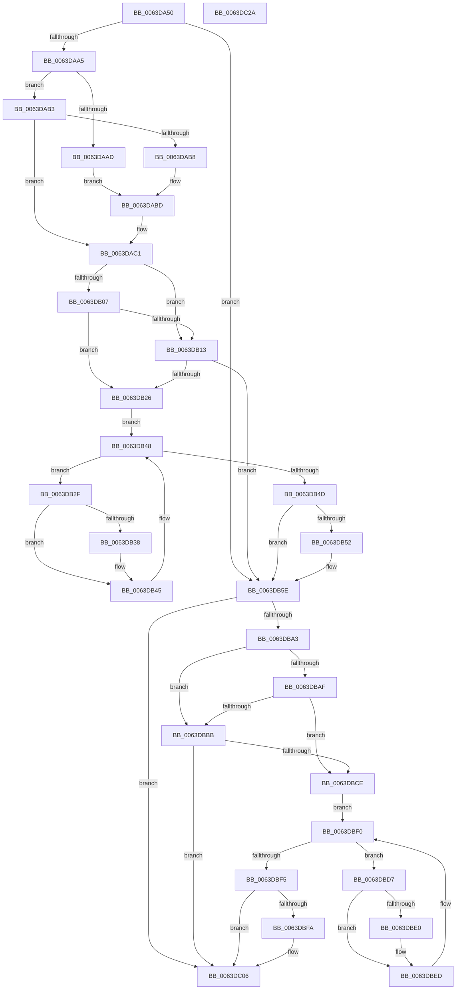

# DifZwAlpcAcceptConnectPortWrapper

- RVA: `0x0063DA50`–`0x0063DC2B` (길이 `475` bytes)
- VA: `0x000000014063DA50`
- 실행 섹션: `.text`
- PDB 이름 있음: `예`; PDB Function 태그: `아니요`
- unwind 정보 RVA: `0x000D2BDC`
- 디코드: `131`개 명령, `475/475` bytes 표시
- 미해석 바이트: `0` (있으면 어셈블리에 `.byte`로 보존)

> 이 문서는 커널 이미지의 기계어와 PDB 기호를 분석해 생성했습니다. 4번과 5번은 함수 원형과 자료형을 바이너리 사용 방식에서 추정한 C 해석이며 원본 소스 복구 결과는 아닙니다.

## 1. Dependencies

- 직접 호출 지점: **10**; 고유 호출 대상: **7**
- 직접 호출자로 확인된 함수: **0**
- RIP 상대 이미지 참조: **3**

### Outgoing calls
- `0x0063DA8A` → [memset](../6C/memset_function_006C6C40.md) (function, `0x006C6C40`)
- `0x0063DA94` → [DifGetAPIThunkContextById](../49/DifGetAPIThunkContextById_function_00495A34.md) (function, `0x00495A34`)
- `0x0063DAB8` → [DifGetReturnAddressForWrappers](../4D/DifGetReturnAddressForWrappers_function_004D3C08.md) (function, `0x004D3C08`)
- `0x0063DB1A` → [ExAcquireRundownProtection](../21/ExAcquireRundownProtection_function_00216620.md) (function, `0x00216620`)
- `0x0063DB40` → [guard_dispatch_icall](../6B/guard_dispatch_icall_function_006BAAD0.md) (function, `0x006BAAD0`)
- `0x0063DB59` → [ExReleaseRundownProtection](../34/ExReleaseRundownProtection_function_00349E80.md) (function, `0x00349E80`)
- `0x0063DB96` → [ZwAlpcAcceptConnectPort](../6A/ZwAlpcAcceptConnectPort_function_006ADFF0.md) (function, `0x006ADFF0`)
- `0x0063DBC2` → [ExAcquireRundownProtection](../21/ExAcquireRundownProtection_function_00216620.md) (function, `0x00216620`)
- `0x0063DBE8` → [guard_dispatch_icall](../6B/guard_dispatch_icall_function_006BAAD0.md) (function, `0x006BAAD0`)
- `0x0063DC01` → [ExReleaseRundownProtection](../34/ExReleaseRundownProtection_function_00349E80.md) (function, `0x00349E80`)

### Direct callers
- 이 함수 시작 RVA로 연결되는 직접 call은 확인되지 않았습니다. 간접 호출은 완전히 역산할 수 없습니다.

### Static image references
- `0x0063DAC8` → RVA `0x00F048B8` (`.data`; read)
- `0x0063DB07` → RVA `0x00F04980` (`.data`; read)
- `0x0063DB13` → RVA `0x00F03E80` (`.data`; read)

## 2. Other-region calls and transfers

- 다른 실행 섹션으로 향하는 call: **0**
- 별도 외부 분기/꼬리 이동을 확인하지 못했습니다.

## 3. Assembly (complete function range)

```asm
0063DA50  48 8B C4                        mov rax, rsp
0063DA53  48 89 58 10                     mov qword ptr [rax + 0x10], rbx
0063DA57  48 89 70 18                     mov qword ptr [rax + 0x18], rsi
0063DA5B  48 89 78 20                     mov qword ptr [rax + 0x20], rdi
0063DA5F  48 89 48 08                     mov qword ptr [rax + 8], rcx
0063DA63  55                              push rbp
0063DA64  41 54                           push r12
0063DA66  41 55                           push r13
0063DA68  41 56                           push r14
0063DA6A  41 57                           push r15
0063DA6C  48 8D 68 C9                     lea rbp, [rax - 0x37]
0063DA70  48 81 EC B0 00 00 00            sub rsp, 0xb0
0063DA77  4C 8B EA                        mov r13, rdx
0063DA7A  48 8D 4D AF                     lea rcx, [rbp - 0x51]
0063DA7E  33 D2                           xor edx, edx
0063DA80  45 8B E0                        mov r12d, r8d
0063DA83  4D 8B F9                        mov r15, r9
0063DA86  44 8D 42 58                     lea r8d, [rdx + 0x58]
0063DA8A  E8 B1 91 08 00                  call 0x1406c6c40
0063DA8F  B9 8F 00 00 00                  mov ecx, 0x8f
0063DA94  E8 9B 7F E5 FF                  call 0x140495a34
0063DA99  48 8B F0                        mov rsi, rax
0063DA9C  48 85 C0                        test rax, rax
0063DA9F  0F 84 B9 00 00 00               je 0x14063db5e
0063DAA5  8B 48 0C                        mov ecx, dword ptr [rax + 0xc]
0063DAA8  F6 C1 18                        test cl, 0x18
0063DAAB  74 06                           je 0x14063dab3
0063DAAD  48 8B 45 37                     mov rax, qword ptr [rbp + 0x37]
0063DAB1  EB 0A                           jmp 0x14063dabd
0063DAB3  F6 C1 04                        test cl, 4
0063DAB6  74 09                           je 0x14063dac1
0063DAB8  E8 4B 61 E9 FF                  call 0x1404d3c08
0063DABD  48 89 45 AF                     mov qword ptr [rbp - 0x51], rax
0063DAC1  48 8B 45 3F                     mov rax, qword ptr [rbp + 0x3f]
0063DAC5  45 32 F6                        xor r14b, r14b
0063DAC8  44 38 35 E9 6D 8C 00            cmp byte ptr [rip + 0x8c6de9], r14b
0063DACF  48 89 45 F7                     mov qword ptr [rbp - 9], rax
0063DAD3  48 8B 45 5F                     mov rax, qword ptr [rbp + 0x5f]
0063DAD7  48 89 45 D7                     mov qword ptr [rbp - 0x29], rax
0063DADB  48 8B 45 67                     mov rax, qword ptr [rbp + 0x67]
0063DADF  48 89 45 CF                     mov qword ptr [rbp - 0x31], rax
0063DAE3  48 8B 45 6F                     mov rax, qword ptr [rbp + 0x6f]
0063DAE7  48 89 45 C7                     mov qword ptr [rbp - 0x39], rax
0063DAEB  48 8B 45 77                     mov rax, qword ptr [rbp + 0x77]
0063DAEF  48 89 45 BF                     mov qword ptr [rbp - 0x41], rax
0063DAF3  8A 45 7F                        mov al, byte ptr [rbp + 0x7f]
0063DAF6  88 45 B7                        mov byte ptr [rbp - 0x49], al
0063DAF9  4C 89 6D EF                     mov qword ptr [rbp - 0x11], r13
0063DAFD  44 89 65 E7                     mov dword ptr [rbp - 0x19], r12d
0063DB01  4C 89 7D DF                     mov qword ptr [rbp - 0x21], r15
0063DB05  75 0C                           jne 0x14063db13
0063DB07  F7 05 6F 6E 8C 00 00 08 00 00   test dword ptr [rip + 0x8c6e6f], 0x800
0063DB11  74 13                           je 0x14063db26
0063DB13  48 8D 0D 66 63 8C 00            lea rcx, [rip + 0x8c6366]
0063DB1A  E8 01 8B BD FF                  call 0x140216620
0063DB1F  44 8A F0                        mov r14b, al
0063DB22  84 C0                           test al, al
0063DB24  74 38                           je 0x14063db5e
0063DB26  48 8D 7E 20                     lea rdi, [rsi + 0x20]
0063DB2A  48 8B 1F                        mov rbx, qword ptr [rdi]
0063DB2D  EB 19                           jmp 0x14063db48
0063DB2F  48 8D 43 F0                     lea rax, [rbx - 0x10]
0063DB33  48 85 C0                        test rax, rax
0063DB36  74 0D                           je 0x14063db45
0063DB38  48 8B 40 08                     mov rax, qword ptr [rax + 8]
0063DB3C  48 8D 4D AF                     lea rcx, [rbp - 0x51]
0063DB40  E8 8B CF 07 00                  call 0x1406baad0
0063DB45  48 8B 1B                        mov rbx, qword ptr [rbx]
0063DB48  48 3B DF                        cmp rbx, rdi
0063DB4B  75 E2                           jne 0x14063db2f
0063DB4D  45 84 F6                        test r14b, r14b
0063DB50  74 0C                           je 0x14063db5e
0063DB52  48 8D 0D 27 63 8C 00            lea rcx, [rip + 0x8c6327]
0063DB59  E8 22 C3 D0 FF                  call 0x140349e80
0063DB5E  8A 45 7F                        mov al, byte ptr [rbp + 0x7f]
0063DB61  4D 8B CF                        mov r9, r15
0063DB64  48 8B 4D 3F                     mov rcx, qword ptr [rbp + 0x3f]
0063DB68  45 8B C4                        mov r8d, r12d
0063DB6B  88 44 24 40                     mov byte ptr [rsp + 0x40], al
0063DB6F  49 8B D5                        mov rdx, r13
0063DB72  48 8B 45 77                     mov rax, qword ptr [rbp + 0x77]
0063DB76  48 89 44 24 38                  mov qword ptr [rsp + 0x38], rax
0063DB7B  48 8B 45 6F                     mov rax, qword ptr [rbp + 0x6f]
0063DB7F  48 89 44 24 30                  mov qword ptr [rsp + 0x30], rax
0063DB84  48 8B 45 67                     mov rax, qword ptr [rbp + 0x67]
0063DB88  48 89 44 24 28                  mov qword ptr [rsp + 0x28], rax
0063DB8D  48 8B 45 5F                     mov rax, qword ptr [rbp + 0x5f]
0063DB91  48 89 44 24 20                  mov qword ptr [rsp + 0x20], rax
0063DB96  E8 55 04 07 00                  call 0x1406adff0
0063DB9B  89 45 FF                        mov dword ptr [rbp - 1], eax
0063DB9E  48 85 F6                        test rsi, rsi
0063DBA1  74 63                           je 0x14063dc06
0063DBA3  40 32 FF                        xor dil, dil
0063DBA6  40 38 3D 0B 6D 8C 00            cmp byte ptr [rip + 0x8c6d0b], dil
0063DBAD  75 0C                           jne 0x14063dbbb
0063DBAF  F7 05 C7 6D 8C 00 00 08 00 00   test dword ptr [rip + 0x8c6dc7], 0x800
0063DBB9  74 13                           je 0x14063dbce
0063DBBB  48 8D 0D BE 62 8C 00            lea rcx, [rip + 0x8c62be]
0063DBC2  E8 59 8A BD FF                  call 0x140216620
0063DBC7  40 8A F8                        mov dil, al
0063DBCA  84 C0                           test al, al
0063DBCC  74 38                           je 0x14063dc06
0063DBCE  48 83 C6 30                     add rsi, 0x30
0063DBD2  48 8B 1E                        mov rbx, qword ptr [rsi]
0063DBD5  EB 19                           jmp 0x14063dbf0
0063DBD7  48 8D 43 F0                     lea rax, [rbx - 0x10]
0063DBDB  48 85 C0                        test rax, rax
0063DBDE  74 0D                           je 0x14063dbed
0063DBE0  48 8B 40 08                     mov rax, qword ptr [rax + 8]
0063DBE4  48 8D 4D AF                     lea rcx, [rbp - 0x51]
0063DBE8  E8 E3 CE 07 00                  call 0x1406baad0
0063DBED  48 8B 1B                        mov rbx, qword ptr [rbx]
0063DBF0  48 3B DE                        cmp rbx, rsi
0063DBF3  75 E2                           jne 0x14063dbd7
0063DBF5  40 84 FF                        test dil, dil
0063DBF8  74 0C                           je 0x14063dc06
0063DBFA  48 8D 0D 7F 62 8C 00            lea rcx, [rip + 0x8c627f]
0063DC01  E8 7A C2 D0 FF                  call 0x140349e80
0063DC06  8B 45 FF                        mov eax, dword ptr [rbp - 1]
0063DC09  4C 8D 9C 24 B0 00 00 00         lea r11, [rsp + 0xb0]
0063DC11  49 8B 5B 38                     mov rbx, qword ptr [r11 + 0x38]
0063DC15  49 8B 73 40                     mov rsi, qword ptr [r11 + 0x40]
0063DC19  49 8B 7B 48                     mov rdi, qword ptr [r11 + 0x48]
0063DC1D  49 8B E3                        mov rsp, r11
0063DC20  41 5F                           pop r15
0063DC22  41 5E                           pop r14
0063DC24  41 5D                           pop r13
0063DC26  41 5C                           pop r12
0063DC28  5D                              pop rbp
0063DC29  C3                              ret
0063DC2A  CC                              int3
```

## 4. C-style interpretation (structured pseudocode)

```c
__int64 __fastcall DifZwAlpcAcceptConnectPortWrapper(__int64 a1, __int64 a2, int a3, __int64 a4)
{
    __int64 result;
    __int64 v_r14;
    __int64 v_rdi;
    __int64 v_rsi;
    __int64 v_rsp;
    unsigned __int64 v_stack_m28;
    unsigned __int8 v_stack_m98;
    unsigned __int64 v_stack_mA0;
    unsigned __int64 v_stack_mA8;
    unsigned __int64 v_stack_mB0;
    unsigned __int64 v_stack_mB8;

    *(unsigned __int64 *)(v_rsp + 16) = v_rbx;
    *(unsigned __int64 *)(v_rsp + 24) = v_rsi;
    *(unsigned __int64 *)(v_rsp + 32) = v_rdi;
    *(unsigned __int64 *)(v_rsp + 8) = a1;
    v_rsp = (v_rsp) - (176);
    a2 = 0;
    result = memset(v_rsp - 55 - 81, a2, a2 + 88, a4);
    result = DifGetAPIThunkContextById(143, a2, a2 + 88, a4);
    if (result == 0) goto loc_0063DB5E;
    if ((((unsigned __int8)((unsigned int)(*(unsigned int *)(result + 12)))) & (24)) == 0) goto loc_0063DAB3;
    goto loc_0063DABD;
loc_0063DAB3:
    if ((((unsigned __int8)((unsigned int)(*(unsigned int *)(result + 12)))) & (4)) == 0) goto loc_0063DAC1;
    result = DifGetReturnAddressForWrappers((unsigned int)(*(unsigned int *)(result + 12)), a2, a2 + 88, a4);
loc_0063DABD:
    *(unsigned __int64 *)(v_rsp - 55 - 81) = result;
loc_0063DAC1:
    v_r14 = 0;
    *(unsigned __int64 *)(v_rsp - 55 - 9) = *(unsigned __int64 *)(v_rsp - 55 + 63);
    *(unsigned __int64 *)(v_rsp - 55 - 41) = *(unsigned __int64 *)(v_rsp - 55 + 95);
    *(unsigned __int64 *)(v_rsp - 55 - 49) = *(unsigned __int64 *)(v_rsp - 55 + 103);
    *(unsigned __int64 *)(v_rsp - 55 - 57) = *(unsigned __int64 *)(v_rsp - 55 + 111);
    *(unsigned __int64 *)(v_rsp - 55 - 65) = *(unsigned __int64 *)(v_rsp - 55 + 119);
    *(unsigned __int8 *)(v_rsp - 55 - 73) = (unsigned __int8)(*(unsigned __int8 *)(v_rsp - 55 + 127));
    *(unsigned __int64 *)(v_rsp - 55 - 17) = 0;
    *(unsigned int *)(v_rsp - 55 - 25) = (unsigned int)((unsigned int)(a3));
    *(unsigned __int64 *)(v_rsp - 55 - 33) = a4;
    if ((*(unsigned __int8 *)(v_rip + 9203177)) != 0) goto loc_0063DB13;
    if (((*(unsigned int *)(v_rip + 9203311)) & (0x800ULL)) == 0) goto loc_0063DB26;
loc_0063DB13:
    result = ExAcquireRundownProtection(v_rip + 9200486, a2, a2 + 88, a4);
    if ((unsigned __int8)(result) == 0) goto loc_0063DB5E;
loc_0063DB26:
    goto loc_0063DB48;
loc_0063DB2F:
    result = *(unsigned __int64 *)(result + 32) - 16;
    if (*(unsigned __int64 *)(result + 32) - 16 != 0) {
        result = *(unsigned __int64 *)(*(unsigned __int64 *)(result + 32) - 16 + 8);
        a1 = v_rsp - 55 - 81;
        result = guard_dispatch_icall(a1, a2, a2 + 88, a4);
    }
loc_0063DB48:
    if ((*(unsigned __int64 *)(*(unsigned __int64 *)(result + 32))) != (result + 32)) goto loc_0063DB2F;
    if ((unsigned __int8)((unsigned __int8)(result)) != 0) {
        a1 = v_rip + 9200423;
        result = ExReleaseRundownProtection(a1, a2, a2 + 88, a4);
    }
    v_stack_m98 = (unsigned __int8)(*(unsigned __int8 *)(v_rsp - 55 + 127));
    v_stack_mA0 = *(unsigned __int64 *)(v_rsp - 55 + 119);
    v_stack_mA8 = *(unsigned __int64 *)(v_rsp - 55 + 111);
    v_stack_mB0 = *(unsigned __int64 *)(v_rsp - 55 + 103);
    v_stack_mB8 = *(unsigned __int64 *)(v_rsp - 55 + 95);
    result = ZwAlpcAcceptConnectPort(*(unsigned __int64 *)(v_rsp - 55 + 63), 0, (unsigned int)((unsigned int)((unsigned int)(a3))), a4);
    *(unsigned int *)(v_rsp - 55 - 1) = (unsigned int)(result);
    if (result == 0) goto loc_0063DC06;
    v_rdi = 0;
    if ((*(unsigned __int8 *)(v_rip + 9202955)) != 0) goto loc_0063DBBB;
    if (((*(unsigned int *)(v_rip + 9203143)) & (0x800ULL)) == 0) goto loc_0063DBCE;
loc_0063DBBB:
    result = ExAcquireRundownProtection(v_rip + 9200318, 0, (unsigned int)((unsigned int)((unsigned int)(a3))), a4);
    if ((unsigned __int8)(result) == 0) goto loc_0063DC06;
loc_0063DBCE:
    v_rsi = (result) + (48);
    goto loc_0063DBF0;
loc_0063DBD7:
    result = *(unsigned __int64 *)(v_rsi) - 16;
    if (*(unsigned __int64 *)(v_rsi) - 16 != 0) {
        result = *(unsigned __int64 *)(*(unsigned __int64 *)(v_rsi) - 16 + 8);
        a1 = v_rsp - 55 - 81;
        result = guard_dispatch_icall(a1, 0, (unsigned int)((unsigned int)((unsigned int)(a3))), a4);
    }
loc_0063DBF0:
    if ((*(unsigned __int64 *)(*(unsigned __int64 *)(v_rsi))) != v_rsi) goto loc_0063DBD7;
    if ((unsigned __int8)((unsigned __int8)(result)) != 0) {
        a1 = v_rip + 9200255;
        result = ExReleaseRundownProtection(a1, 0, (unsigned int)((unsigned int)((unsigned int)(a3))), a4);
    }
    return (unsigned int)(*(unsigned int *)(v_rsp - 55 - 1));
}
```

## 5. (Beta) C Style

```c
int64_t DifZwAlpcAcceptConnectPortWrapper(int64_t Arg1, int64_t Arg2, int32_t Arg3, int64_t Arg4)
{
    int64_t result;
    int64_t local_r14;
    int64_t local_rdi;
    int64_t local_rsi;
    int64_t local_rsp;
    uint64_t v_stack_m28;
    uint8_t v_stack_m98;
    uint64_t v_stack_mA0;
    uint64_t v_stack_mA8;
    uint64_t v_stack_mB0;
    uint64_t v_stack_mB8;

    *(uint64_t *)(local_rsp + 0x10) = local_rbx;
    *(uint64_t *)(local_rsp + 0x18) = local_rsi;
    *(uint64_t *)(local_rsp + 0x20) = local_rdi;
    *(uint64_t *)(local_rsp + 0x8) = Arg1;
    local_rsp = (local_rsp) - (176);
    Arg2 = 0;
    result = memset(local_rsp - 55 - 81, Arg2, Arg2 + 88, Arg4);
    result = DifGetAPIThunkContextById(143, Arg2, Arg2 + 88, Arg4);
    if (result == 0) goto loc_0063DB5E;
    if ((((uint8_t)((uint32_t)(*(uint32_t *)(result + 0xC)))) & (24)) == 0) goto loc_0063DAB3;
    goto loc_0063DABD;
loc_0063DAB3:
    if ((((uint8_t)((uint32_t)(*(uint32_t *)(result + 0xC)))) & (4)) == 0) goto loc_0063DAC1;
    result = DifGetReturnAddressForWrappers((uint32_t)(*(uint32_t *)(result + 0xC)), Arg2, Arg2 + 88, Arg4);
loc_0063DABD:
    *(uint64_t *)(local_rsp - 0x37 - 0x51) = result;
loc_0063DAC1:
    local_r14 = 0;
    *(uint64_t *)(local_rsp - 0x37 - 0x9) = *(uint64_t *)(local_rsp - 0x37 + 0x3F);
    *(uint64_t *)(local_rsp - 0x37 - 0x29) = *(uint64_t *)(local_rsp - 0x37 + 0x5F);
    *(uint64_t *)(local_rsp - 0x37 - 0x31) = *(uint64_t *)(local_rsp - 0x37 + 0x67);
    *(uint64_t *)(local_rsp - 0x37 - 0x39) = *(uint64_t *)(local_rsp - 0x37 + 0x6F);
    *(uint64_t *)(local_rsp - 0x37 - 0x41) = *(uint64_t *)(local_rsp - 0x37 + 0x77);
    *(uint8_t *)(local_rsp - 0x37 - 0x49) = (uint8_t)(*(uint8_t *)(local_rsp - 0x37 + 0x7F));
    *(uint64_t *)(local_rsp - 0x37 - 0x11) = 0;
    *(uint32_t *)(local_rsp - 0x37 - 0x19) = (uint32_t)((uint32_t)(Arg3));
    *(uint64_t *)(local_rsp - 0x37 - 0x21) = Arg4;
    if ((*(uint8_t *)(v_rip + 0x8C6DE9)) != 0) goto loc_0063DB13;
    if (((*(uint32_t *)(v_rip + 0x8C6E6F)) & (0x800ULL)) == 0) goto loc_0063DB26;
loc_0063DB13:
    result = ExAcquireRundownProtection(v_rip + 9200486, Arg2, Arg2 + 88, Arg4);
    if ((uint8_t)(result) == 0) goto loc_0063DB5E;
loc_0063DB26:
    goto loc_0063DB48;
loc_0063DB2F:
    result = *(uint64_t *)(result + 0x20) - 16;
    if (*(uint64_t *)(result + 0x20) - 16 != 0) {
        result = *(uint64_t *)(*(uint64_t *)(result + 0x20) - 0x10 + 0x8);
        Arg1 = local_rsp - 55 - 81;
        result = guard_dispatch_icall(Arg1, Arg2, Arg2 + 88, Arg4);
    }
loc_0063DB48:
    if ((*(uint64_t *)(*(uint64_t *)(result + 0x20))) != (result + 32)) goto loc_0063DB2F;
    if ((uint8_t)((uint8_t)(result)) != 0) {
        Arg1 = v_rip + 9200423;
        result = ExReleaseRundownProtection(Arg1, Arg2, Arg2 + 88, Arg4);
    }
    v_stack_m98 = (uint8_t)(*(uint8_t *)(local_rsp - 0x37 + 0x7F));
    v_stack_mA0 = *(uint64_t *)(local_rsp - 0x37 + 0x77);
    v_stack_mA8 = *(uint64_t *)(local_rsp - 0x37 + 0x6F);
    v_stack_mB0 = *(uint64_t *)(local_rsp - 0x37 + 0x67);
    v_stack_mB8 = *(uint64_t *)(local_rsp - 0x37 + 0x5F);
    result = ZwAlpcAcceptConnectPort(*(uint64_t *)(local_rsp - 0x37 + 0x3F), 0, (uint32_t)((uint32_t)((uint32_t)(Arg3))), Arg4);
    *(uint32_t *)(local_rsp - 0x37 - 0x1) = (uint32_t)(result);
    if (result == 0) goto loc_0063DC06;
    local_rdi = 0;
    if ((*(uint8_t *)(v_rip + 0x8C6D0B)) != 0) goto loc_0063DBBB;
    if (((*(uint32_t *)(v_rip + 0x8C6DC7)) & (0x800ULL)) == 0) goto loc_0063DBCE;
loc_0063DBBB:
    result = ExAcquireRundownProtection(v_rip + 9200318, 0, (uint32_t)((uint32_t)((uint32_t)(Arg3))), Arg4);
    if ((uint8_t)(result) == 0) goto loc_0063DC06;
loc_0063DBCE:
    local_rsi = (result) + (48);
    goto loc_0063DBF0;
loc_0063DBD7:
    result = *(uint64_t *)(local_rsi) - 16;
    if (*(uint64_t *)(local_rsi) - 16 != 0) {
        result = *(uint64_t *)(*(uint64_t *)(local_rsi) - 0x10 + 0x8);
        Arg1 = local_rsp - 55 - 81;
        result = guard_dispatch_icall(Arg1, 0, (uint32_t)((uint32_t)((uint32_t)(Arg3))), Arg4);
    }
loc_0063DBF0:
    if ((*(uint64_t *)(*(uint64_t *)(local_rsi))) != local_rsi) goto loc_0063DBD7;
    if ((uint8_t)((uint8_t)(result)) != 0) {
        Arg1 = v_rip + 9200255;
        result = ExReleaseRundownProtection(Arg1, 0, (uint32_t)((uint32_t)((uint32_t)(Arg3))), Arg4);
    }
    return (uint32_t)(*(uint32_t *)(local_rsp - 0x37 - 0x1));
}
```

## 6. Execution-region graph

[열기: 2D/3D 그래프와 함수 탐색 컨트롤 패널](../../../control-panel.html?section=text&rva=0x0063DA50&view=graph)

- 2D 그래프는 위에서 아래로 흐르고, 3D 그래프는 빈 공간을 드래그해 회전합니다. Shift+드래그는 이동, 휠은 확대·축소, 함수 노드 선택은 대상 보고서 이동입니다.

### Static fallback


