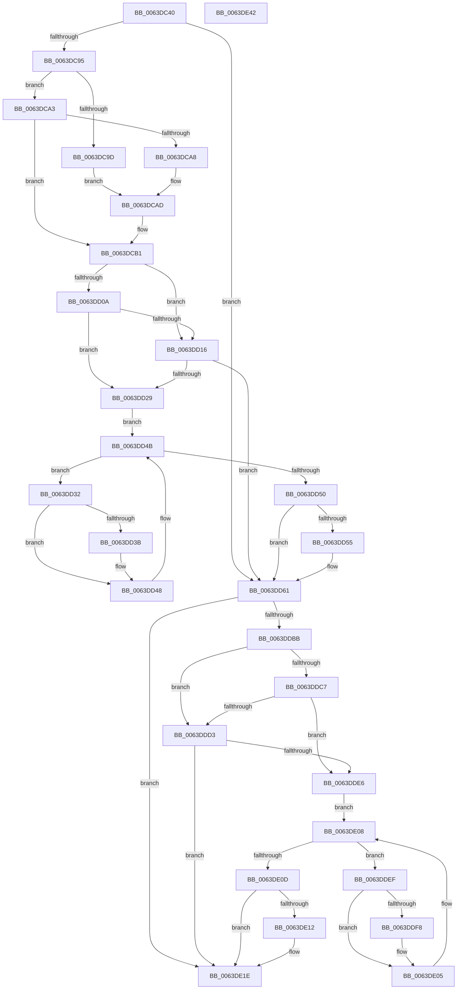

# DifZwAlpcConnectPortWrapper

- RVA: `0x0063DC40`–`0x0063DE43` (길이 `515` bytes)
- VA: `0x000000014063DC40`
- 실행 섹션: `.text`
- PDB 이름 있음: `예`; PDB Function 태그: `아니요`
- unwind 정보 RVA: `0x000D2C44`
- 디코드: `139`개 명령, `515/515` bytes 표시
- 미해석 바이트: `0` (있으면 어셈블리에 `.byte`로 보존)

> 이 문서는 커널 이미지의 기계어와 PDB 기호를 분석해 생성했습니다. 4번과 5번은 함수 원형과 자료형을 바이너리 사용 방식에서 추정한 C 해석이며 원본 소스 복구 결과는 아닙니다.

## 1. Dependencies

- 직접 호출 지점: **10**; 고유 호출 대상: **7**
- 직접 호출자로 확인된 함수: **0**
- RIP 상대 이미지 참조: **3**

### Outgoing calls
- `0x0063DC7A` → [memset](../6C/memset_function_006C6C40.md) (function, `0x006C6C40`)
- `0x0063DC84` → [DifGetAPIThunkContextById](../49/DifGetAPIThunkContextById_function_00495A34.md) (function, `0x00495A34`)
- `0x0063DCA8` → [DifGetReturnAddressForWrappers](../4D/DifGetReturnAddressForWrappers_function_004D3C08.md) (function, `0x004D3C08`)
- `0x0063DD1D` → [ExAcquireRundownProtection](../21/ExAcquireRundownProtection_function_00216620.md) (function, `0x00216620`)
- `0x0063DD43` → [guard_dispatch_icall](../6B/guard_dispatch_icall_function_006BAAD0.md) (function, `0x006BAAD0`)
- `0x0063DD5C` → [ExReleaseRundownProtection](../34/ExReleaseRundownProtection_function_00349E80.md) (function, `0x00349E80`)
- `0x0063DDAE` → [ZwAlpcConnectPort](../6A/ZwAlpcConnectPort_function_006AE030.md) (function, `0x006AE030`)
- `0x0063DDDA` → [ExAcquireRundownProtection](../21/ExAcquireRundownProtection_function_00216620.md) (function, `0x00216620`)
- `0x0063DE00` → [guard_dispatch_icall](../6B/guard_dispatch_icall_function_006BAAD0.md) (function, `0x006BAAD0`)
- `0x0063DE19` → [ExReleaseRundownProtection](../34/ExReleaseRundownProtection_function_00349E80.md) (function, `0x00349E80`)

### Direct callers
- 이 함수 시작 RVA로 연결되는 직접 call은 확인되지 않았습니다. 간접 호출은 완전히 역산할 수 없습니다.

### Static image references
- `0x0063DCB8` → RVA `0x00F048B8` (`.data`; read)
- `0x0063DD0A` → RVA `0x00F04980` (`.data`; read)
- `0x0063DD16` → RVA `0x00F03E80` (`.data`; read)

## 2. Other-region calls and transfers

- 다른 실행 섹션으로 향하는 call: **0**
- 별도 외부 분기/꼬리 이동을 확인하지 못했습니다.

## 3. Assembly (complete function range)

```asm
0063DC40  48 8B C4                        mov rax, rsp
0063DC43  48 89 58 10                     mov qword ptr [rax + 0x10], rbx
0063DC47  48 89 70 18                     mov qword ptr [rax + 0x18], rsi
0063DC4B  48 89 78 20                     mov qword ptr [rax + 0x20], rdi
0063DC4F  48 89 48 08                     mov qword ptr [rax + 8], rcx
0063DC53  55                              push rbp
0063DC54  41 54                           push r12
0063DC56  41 55                           push r13
0063DC58  41 56                           push r14
0063DC5A  41 57                           push r15
0063DC5C  48 8D 68 D1                     lea rbp, [rax - 0x2f]
0063DC60  48 81 EC D0 00 00 00            sub rsp, 0xd0
0063DC67  4C 8B EA                        mov r13, rdx
0063DC6A  48 8D 4D 97                     lea rcx, [rbp - 0x69]
0063DC6E  33 D2                           xor edx, edx
0063DC70  4D 8B E0                        mov r12, r8
0063DC73  4D 8B F9                        mov r15, r9
0063DC76  44 8D 42 68                     lea r8d, [rdx + 0x68]
0063DC7A  E8 C1 8F 08 00                  call 0x1406c6c40
0063DC7F  B9 8E 00 00 00                  mov ecx, 0x8e
0063DC84  E8 AB 7D E5 FF                  call 0x140495a34
0063DC89  48 8B F0                        mov rsi, rax
0063DC8C  48 85 C0                        test rax, rax
0063DC8F  0F 84 CC 00 00 00               je 0x14063dd61
0063DC95  8B 48 0C                        mov ecx, dword ptr [rax + 0xc]
0063DC98  F6 C1 18                        test cl, 0x18
0063DC9B  74 06                           je 0x14063dca3
0063DC9D  48 8B 45 2F                     mov rax, qword ptr [rbp + 0x2f]
0063DCA1  EB 0A                           jmp 0x14063dcad
0063DCA3  F6 C1 04                        test cl, 4
0063DCA6  74 09                           je 0x14063dcb1
0063DCA8  E8 5B 5F E9 FF                  call 0x1404d3c08
0063DCAD  48 89 45 97                     mov qword ptr [rbp - 0x69], rax
0063DCB1  48 8B 45 37                     mov rax, qword ptr [rbp + 0x37]
0063DCB5  45 32 F6                        xor r14b, r14b
0063DCB8  44 38 35 F9 6B 8C 00            cmp byte ptr [rip + 0x8c6bf9], r14b
0063DCBF  48 89 45 EF                     mov qword ptr [rbp - 0x11], rax
0063DCC3  8B 45 57                        mov eax, dword ptr [rbp + 0x57]
0063DCC6  89 45 CF                        mov dword ptr [rbp - 0x31], eax
0063DCC9  48 8B 45 5F                     mov rax, qword ptr [rbp + 0x5f]
0063DCCD  48 89 45 C7                     mov qword ptr [rbp - 0x39], rax
0063DCD1  48 8B 45 67                     mov rax, qword ptr [rbp + 0x67]
0063DCD5  48 89 45 BF                     mov qword ptr [rbp - 0x41], rax
0063DCD9  48 8B 45 6F                     mov rax, qword ptr [rbp + 0x6f]
0063DCDD  48 89 45 B7                     mov qword ptr [rbp - 0x49], rax
0063DCE1  48 8B 45 77                     mov rax, qword ptr [rbp + 0x77]
0063DCE5  48 89 45 AF                     mov qword ptr [rbp - 0x51], rax
0063DCE9  48 8B 45 7F                     mov rax, qword ptr [rbp + 0x7f]
0063DCED  48 89 45 A7                     mov qword ptr [rbp - 0x59], rax
0063DCF1  48 8B 85 87 00 00 00            mov rax, qword ptr [rbp + 0x87]
0063DCF8  48 89 45 9F                     mov qword ptr [rbp - 0x61], rax
0063DCFC  4C 89 6D E7                     mov qword ptr [rbp - 0x19], r13
0063DD00  4C 89 65 DF                     mov qword ptr [rbp - 0x21], r12
0063DD04  4C 89 7D D7                     mov qword ptr [rbp - 0x29], r15
0063DD08  75 0C                           jne 0x14063dd16
0063DD0A  F7 05 6C 6C 8C 00 00 08 00 00   test dword ptr [rip + 0x8c6c6c], 0x800
0063DD14  74 13                           je 0x14063dd29
0063DD16  48 8D 0D 63 61 8C 00            lea rcx, [rip + 0x8c6163]
0063DD1D  E8 FE 88 BD FF                  call 0x140216620
0063DD22  44 8A F0                        mov r14b, al
0063DD25  84 C0                           test al, al
0063DD27  74 38                           je 0x14063dd61
0063DD29  48 8D 7E 20                     lea rdi, [rsi + 0x20]
0063DD2D  48 8B 1F                        mov rbx, qword ptr [rdi]
0063DD30  EB 19                           jmp 0x14063dd4b
0063DD32  48 8D 43 F0                     lea rax, [rbx - 0x10]
0063DD36  48 85 C0                        test rax, rax
0063DD39  74 0D                           je 0x14063dd48
0063DD3B  48 8B 40 08                     mov rax, qword ptr [rax + 8]
0063DD3F  48 8D 4D 97                     lea rcx, [rbp - 0x69]
0063DD43  E8 88 CD 07 00                  call 0x1406baad0
0063DD48  48 8B 1B                        mov rbx, qword ptr [rbx]
0063DD4B  48 3B DF                        cmp rbx, rdi
0063DD4E  75 E2                           jne 0x14063dd32
0063DD50  45 84 F6                        test r14b, r14b
0063DD53  74 0C                           je 0x14063dd61
0063DD55  48 8D 0D 24 61 8C 00            lea rcx, [rip + 0x8c6124]
0063DD5C  E8 1F C1 D0 FF                  call 0x140349e80
0063DD61  48 8B 85 87 00 00 00            mov rax, qword ptr [rbp + 0x87]
0063DD68  4D 8B CF                        mov r9, r15
0063DD6B  48 8B 4D 37                     mov rcx, qword ptr [rbp + 0x37]
0063DD6F  4D 8B C4                        mov r8, r12
0063DD72  48 89 44 24 50                  mov qword ptr [rsp + 0x50], rax
0063DD77  49 8B D5                        mov rdx, r13
0063DD7A  48 8B 45 7F                     mov rax, qword ptr [rbp + 0x7f]
0063DD7E  48 89 44 24 48                  mov qword ptr [rsp + 0x48], rax
0063DD83  48 8B 45 77                     mov rax, qword ptr [rbp + 0x77]
0063DD87  48 89 44 24 40                  mov qword ptr [rsp + 0x40], rax
0063DD8C  48 8B 45 6F                     mov rax, qword ptr [rbp + 0x6f]
0063DD90  48 89 44 24 38                  mov qword ptr [rsp + 0x38], rax
0063DD95  48 8B 45 67                     mov rax, qword ptr [rbp + 0x67]
0063DD99  48 89 44 24 30                  mov qword ptr [rsp + 0x30], rax
0063DD9E  48 8B 45 5F                     mov rax, qword ptr [rbp + 0x5f]
0063DDA2  48 89 44 24 28                  mov qword ptr [rsp + 0x28], rax
0063DDA7  8B 45 57                        mov eax, dword ptr [rbp + 0x57]
0063DDAA  89 44 24 20                     mov dword ptr [rsp + 0x20], eax
0063DDAE  E8 7D 02 07 00                  call 0x1406ae030
0063DDB3  89 45 F7                        mov dword ptr [rbp - 9], eax
0063DDB6  48 85 F6                        test rsi, rsi
0063DDB9  74 63                           je 0x14063de1e
0063DDBB  40 32 FF                        xor dil, dil
0063DDBE  40 38 3D F3 6A 8C 00            cmp byte ptr [rip + 0x8c6af3], dil
0063DDC5  75 0C                           jne 0x14063ddd3
0063DDC7  F7 05 AF 6B 8C 00 00 08 00 00   test dword ptr [rip + 0x8c6baf], 0x800
0063DDD1  74 13                           je 0x14063dde6
0063DDD3  48 8D 0D A6 60 8C 00            lea rcx, [rip + 0x8c60a6]
0063DDDA  E8 41 88 BD FF                  call 0x140216620
0063DDDF  40 8A F8                        mov dil, al
0063DDE2  84 C0                           test al, al
0063DDE4  74 38                           je 0x14063de1e
0063DDE6  48 83 C6 30                     add rsi, 0x30
0063DDEA  48 8B 1E                        mov rbx, qword ptr [rsi]
0063DDED  EB 19                           jmp 0x14063de08
0063DDEF  48 8D 43 F0                     lea rax, [rbx - 0x10]
0063DDF3  48 85 C0                        test rax, rax
0063DDF6  74 0D                           je 0x14063de05
0063DDF8  48 8B 40 08                     mov rax, qword ptr [rax + 8]
0063DDFC  48 8D 4D 97                     lea rcx, [rbp - 0x69]
0063DE00  E8 CB CC 07 00                  call 0x1406baad0
0063DE05  48 8B 1B                        mov rbx, qword ptr [rbx]
0063DE08  48 3B DE                        cmp rbx, rsi
0063DE0B  75 E2                           jne 0x14063ddef
0063DE0D  40 84 FF                        test dil, dil
0063DE10  74 0C                           je 0x14063de1e
0063DE12  48 8D 0D 67 60 8C 00            lea rcx, [rip + 0x8c6067]
0063DE19  E8 62 C0 D0 FF                  call 0x140349e80
0063DE1E  8B 45 F7                        mov eax, dword ptr [rbp - 9]
0063DE21  4C 8D 9C 24 D0 00 00 00         lea r11, [rsp + 0xd0]
0063DE29  49 8B 5B 38                     mov rbx, qword ptr [r11 + 0x38]
0063DE2D  49 8B 73 40                     mov rsi, qword ptr [r11 + 0x40]
0063DE31  49 8B 7B 48                     mov rdi, qword ptr [r11 + 0x48]
0063DE35  49 8B E3                        mov rsp, r11
0063DE38  41 5F                           pop r15
0063DE3A  41 5E                           pop r14
0063DE3C  41 5D                           pop r13
0063DE3E  41 5C                           pop r12
0063DE40  5D                              pop rbp
0063DE41  C3                              ret
0063DE42  CC                              int3
```

## 4. C-style interpretation (structured pseudocode)

```c
__int64 __fastcall DifZwAlpcConnectPortWrapper(__int64 a1, __int64 a2, __int64 a3, __int64 a4)
{
    __int64 result;
    __int64 v_r14;
    __int64 v_rdi;
    __int64 v_rsi;
    __int64 v_rsp;
    unsigned __int64 v_stack_m28;
    unsigned __int64 v_stack_mA8;
    unsigned __int64 v_stack_mB0;
    unsigned __int64 v_stack_mB8;
    unsigned __int64 v_stack_mC0;
    unsigned __int64 v_stack_mC8;
    unsigned __int64 v_stack_mD0;
    unsigned int v_stack_mD8;

    *(unsigned __int64 *)(v_rsp + 16) = v_rbx;
    *(unsigned __int64 *)(v_rsp + 24) = v_rsi;
    *(unsigned __int64 *)(v_rsp + 32) = v_rdi;
    *(unsigned __int64 *)(v_rsp + 8) = a1;
    v_rsp = (v_rsp) - (208);
    a2 = 0;
    result = memset(v_rsp - 47 - 105, a2, a2 + 104, a4);
    result = DifGetAPIThunkContextById(142, a2, a2 + 104, a4);
    if (result == 0) goto loc_0063DD61;
    if ((((unsigned __int8)((unsigned int)(*(unsigned int *)(result + 12)))) & (24)) == 0) goto loc_0063DCA3;
    goto loc_0063DCAD;
loc_0063DCA3:
    if ((((unsigned __int8)((unsigned int)(*(unsigned int *)(result + 12)))) & (4)) == 0) goto loc_0063DCB1;
    result = DifGetReturnAddressForWrappers((unsigned int)(*(unsigned int *)(result + 12)), a2, a2 + 104, a4);
loc_0063DCAD:
    *(unsigned __int64 *)(v_rsp - 47 - 105) = result;
loc_0063DCB1:
    v_r14 = 0;
    *(unsigned __int64 *)(v_rsp - 47 - 17) = *(unsigned __int64 *)(v_rsp - 47 + 55);
    *(unsigned int *)(v_rsp - 47 - 49) = (unsigned int)((unsigned int)(*(unsigned int *)(v_rsp - 47 + 87)));
    *(unsigned __int64 *)(v_rsp - 47 - 57) = *(unsigned __int64 *)(v_rsp - 47 + 95);
    *(unsigned __int64 *)(v_rsp - 47 - 65) = *(unsigned __int64 *)(v_rsp - 47 + 103);
    *(unsigned __int64 *)(v_rsp - 47 - 73) = *(unsigned __int64 *)(v_rsp - 47 + 111);
    *(unsigned __int64 *)(v_rsp - 47 - 81) = *(unsigned __int64 *)(v_rsp - 47 + 119);
    *(unsigned __int64 *)(v_rsp - 47 - 89) = *(unsigned __int64 *)(v_rsp - 47 + 127);
    *(unsigned __int64 *)(v_rsp - 47 - 97) = *(unsigned __int64 *)(v_rsp - 47 + 135);
    *(unsigned __int64 *)(v_rsp - 47 - 25) = 0;
    *(unsigned __int64 *)(v_rsp - 47 - 33) = a3;
    *(unsigned __int64 *)(v_rsp - 47 - 41) = a4;
    if ((*(unsigned __int8 *)(v_rip + 9202681)) != 0) goto loc_0063DD16;
    if (((*(unsigned int *)(v_rip + 9202796)) & (0x800ULL)) == 0) goto loc_0063DD29;
loc_0063DD16:
    result = ExAcquireRundownProtection(v_rip + 9199971, a2, a2 + 104, a4);
    if ((unsigned __int8)(result) == 0) goto loc_0063DD61;
loc_0063DD29:
    goto loc_0063DD4B;
loc_0063DD32:
    result = *(unsigned __int64 *)(result + 32) - 16;
    if (*(unsigned __int64 *)(result + 32) - 16 != 0) {
        result = *(unsigned __int64 *)(*(unsigned __int64 *)(result + 32) - 16 + 8);
        a1 = v_rsp - 47 - 105;
        result = guard_dispatch_icall(a1, a2, a2 + 104, a4);
    }
loc_0063DD4B:
    if ((*(unsigned __int64 *)(*(unsigned __int64 *)(result + 32))) != (result + 32)) goto loc_0063DD32;
    if ((unsigned __int8)((unsigned __int8)(result)) != 0) {
        a1 = v_rip + 9199908;
        result = ExReleaseRundownProtection(a1, a2, a2 + 104, a4);
    }
    v_stack_mA8 = *(unsigned __int64 *)(v_rsp - 47 + 135);
    v_stack_mB0 = *(unsigned __int64 *)(v_rsp - 47 + 127);
    v_stack_mB8 = *(unsigned __int64 *)(v_rsp - 47 + 119);
    v_stack_mC0 = *(unsigned __int64 *)(v_rsp - 47 + 111);
    v_stack_mC8 = *(unsigned __int64 *)(v_rsp - 47 + 103);
    v_stack_mD0 = *(unsigned __int64 *)(v_rsp - 47 + 95);
    v_stack_mD8 = (unsigned int)((unsigned int)(*(unsigned int *)(v_rsp - 47 + 87)));
    result = ZwAlpcConnectPort(*(unsigned __int64 *)(v_rsp - 47 + 55), 0, a3, a4);
    *(unsigned int *)(v_rsp - 47 - 9) = (unsigned int)(result);
    if (result == 0) goto loc_0063DE1E;
    v_rdi = 0;
    if ((*(unsigned __int8 *)(v_rip + 9202419)) != 0) goto loc_0063DDD3;
    if (((*(unsigned int *)(v_rip + 9202607)) & (0x800ULL)) == 0) goto loc_0063DDE6;
loc_0063DDD3:
    result = ExAcquireRundownProtection(v_rip + 9199782, 0, a3, a4);
    if ((unsigned __int8)(result) == 0) goto loc_0063DE1E;
loc_0063DDE6:
    v_rsi = (result) + (48);
    goto loc_0063DE08;
loc_0063DDEF:
    result = *(unsigned __int64 *)(v_rsi) - 16;
    if (*(unsigned __int64 *)(v_rsi) - 16 != 0) {
        result = *(unsigned __int64 *)(*(unsigned __int64 *)(v_rsi) - 16 + 8);
        a1 = v_rsp - 47 - 105;
        result = guard_dispatch_icall(a1, 0, a3, a4);
    }
loc_0063DE08:
    if ((*(unsigned __int64 *)(*(unsigned __int64 *)(v_rsi))) != v_rsi) goto loc_0063DDEF;
    if ((unsigned __int8)((unsigned __int8)(result)) != 0) {
        a1 = v_rip + 9199719;
        result = ExReleaseRundownProtection(a1, 0, a3, a4);
    }
    return (unsigned int)(*(unsigned int *)(v_rsp - 47 - 9));
}
```

## 5. (Beta) C Style

```c
int64_t DifZwAlpcConnectPortWrapper(int64_t Arg1, int64_t Arg2, int64_t Arg3, int64_t Arg4)
{
    int64_t result;
    int64_t local_r14;
    int64_t local_rdi;
    int64_t local_rsi;
    int64_t local_rsp;
    uint64_t v_stack_m28;
    uint64_t v_stack_mA8;
    uint64_t v_stack_mB0;
    uint64_t v_stack_mB8;
    uint64_t v_stack_mC0;
    uint64_t v_stack_mC8;
    uint64_t v_stack_mD0;
    uint32_t v_stack_mD8;

    *(uint64_t *)(local_rsp + 0x10) = local_rbx;
    *(uint64_t *)(local_rsp + 0x18) = local_rsi;
    *(uint64_t *)(local_rsp + 0x20) = local_rdi;
    *(uint64_t *)(local_rsp + 0x8) = Arg1;
    local_rsp = (local_rsp) - (208);
    Arg2 = 0;
    result = memset(local_rsp - 47 - 105, Arg2, Arg2 + 104, Arg4);
    result = DifGetAPIThunkContextById(142, Arg2, Arg2 + 104, Arg4);
    if (result == 0) goto loc_0063DD61;
    if ((((uint8_t)((uint32_t)(*(uint32_t *)(result + 0xC)))) & (24)) == 0) goto loc_0063DCA3;
    goto loc_0063DCAD;
loc_0063DCA3:
    if ((((uint8_t)((uint32_t)(*(uint32_t *)(result + 0xC)))) & (4)) == 0) goto loc_0063DCB1;
    result = DifGetReturnAddressForWrappers((uint32_t)(*(uint32_t *)(result + 0xC)), Arg2, Arg2 + 104, Arg4);
loc_0063DCAD:
    *(uint64_t *)(local_rsp - 0x2F - 0x69) = result;
loc_0063DCB1:
    local_r14 = 0;
    *(uint64_t *)(local_rsp - 0x2F - 0x11) = *(uint64_t *)(local_rsp - 0x2F + 0x37);
    *(uint32_t *)(local_rsp - 0x2F - 0x31) = (uint32_t)((uint32_t)(*(uint32_t *)(local_rsp - 0x2F + 0x57)));
    *(uint64_t *)(local_rsp - 0x2F - 0x39) = *(uint64_t *)(local_rsp - 0x2F + 0x5F);
    *(uint64_t *)(local_rsp - 0x2F - 0x41) = *(uint64_t *)(local_rsp - 0x2F + 0x67);
    *(uint64_t *)(local_rsp - 0x2F - 0x49) = *(uint64_t *)(local_rsp - 0x2F + 0x6F);
    *(uint64_t *)(local_rsp - 0x2F - 0x51) = *(uint64_t *)(local_rsp - 0x2F + 0x77);
    *(uint64_t *)(local_rsp - 0x2F - 0x59) = *(uint64_t *)(local_rsp - 0x2F + 0x7F);
    *(uint64_t *)(local_rsp - 0x2F - 0x61) = *(uint64_t *)(local_rsp - 0x2F + 0x87);
    *(uint64_t *)(local_rsp - 0x2F - 0x19) = 0;
    *(uint64_t *)(local_rsp - 0x2F - 0x21) = Arg3;
    *(uint64_t *)(local_rsp - 0x2F - 0x29) = Arg4;
    if ((*(uint8_t *)(v_rip + 0x8C6BF9)) != 0) goto loc_0063DD16;
    if (((*(uint32_t *)(v_rip + 0x8C6C6C)) & (0x800ULL)) == 0) goto loc_0063DD29;
loc_0063DD16:
    result = ExAcquireRundownProtection(v_rip + 9199971, Arg2, Arg2 + 104, Arg4);
    if ((uint8_t)(result) == 0) goto loc_0063DD61;
loc_0063DD29:
    goto loc_0063DD4B;
loc_0063DD32:
    result = *(uint64_t *)(result + 0x20) - 16;
    if (*(uint64_t *)(result + 0x20) - 16 != 0) {
        result = *(uint64_t *)(*(uint64_t *)(result + 0x20) - 0x10 + 0x8);
        Arg1 = local_rsp - 47 - 105;
        result = guard_dispatch_icall(Arg1, Arg2, Arg2 + 104, Arg4);
    }
loc_0063DD4B:
    if ((*(uint64_t *)(*(uint64_t *)(result + 0x20))) != (result + 32)) goto loc_0063DD32;
    if ((uint8_t)((uint8_t)(result)) != 0) {
        Arg1 = v_rip + 9199908;
        result = ExReleaseRundownProtection(Arg1, Arg2, Arg2 + 104, Arg4);
    }
    v_stack_mA8 = *(uint64_t *)(local_rsp - 0x2F + 0x87);
    v_stack_mB0 = *(uint64_t *)(local_rsp - 0x2F + 0x7F);
    v_stack_mB8 = *(uint64_t *)(local_rsp - 0x2F + 0x77);
    v_stack_mC0 = *(uint64_t *)(local_rsp - 0x2F + 0x6F);
    v_stack_mC8 = *(uint64_t *)(local_rsp - 0x2F + 0x67);
    v_stack_mD0 = *(uint64_t *)(local_rsp - 0x2F + 0x5F);
    v_stack_mD8 = (uint32_t)((uint32_t)(*(uint32_t *)(local_rsp - 0x2F + 0x57)));
    result = ZwAlpcConnectPort(*(uint64_t *)(local_rsp - 0x2F + 0x37), 0, Arg3, Arg4);
    *(uint32_t *)(local_rsp - 0x2F - 0x9) = (uint32_t)(result);
    if (result == 0) goto loc_0063DE1E;
    local_rdi = 0;
    if ((*(uint8_t *)(v_rip + 0x8C6AF3)) != 0) goto loc_0063DDD3;
    if (((*(uint32_t *)(v_rip + 0x8C6BAF)) & (0x800ULL)) == 0) goto loc_0063DDE6;
loc_0063DDD3:
    result = ExAcquireRundownProtection(v_rip + 9199782, 0, Arg3, Arg4);
    if ((uint8_t)(result) == 0) goto loc_0063DE1E;
loc_0063DDE6:
    local_rsi = (result) + (48);
    goto loc_0063DE08;
loc_0063DDEF:
    result = *(uint64_t *)(local_rsi) - 16;
    if (*(uint64_t *)(local_rsi) - 16 != 0) {
        result = *(uint64_t *)(*(uint64_t *)(local_rsi) - 0x10 + 0x8);
        Arg1 = local_rsp - 47 - 105;
        result = guard_dispatch_icall(Arg1, 0, Arg3, Arg4);
    }
loc_0063DE08:
    if ((*(uint64_t *)(*(uint64_t *)(local_rsi))) != local_rsi) goto loc_0063DDEF;
    if ((uint8_t)((uint8_t)(result)) != 0) {
        Arg1 = v_rip + 9199719;
        result = ExReleaseRundownProtection(Arg1, 0, Arg3, Arg4);
    }
    return (uint32_t)(*(uint32_t *)(local_rsp - 0x2F - 0x9));
}
```

## 6. Execution-region graph

[열기: 2D/3D 그래프와 함수 탐색 컨트롤 패널](../../../control-panel.html?section=text&rva=0x0063DC40&view=graph)

- 2D 그래프는 위에서 아래로 흐르고, 3D 그래프는 빈 공간을 드래그해 회전합니다. Shift+드래그는 이동, 휠은 확대·축소, 함수 노드 선택은 대상 보고서 이동입니다.

### Static fallback


