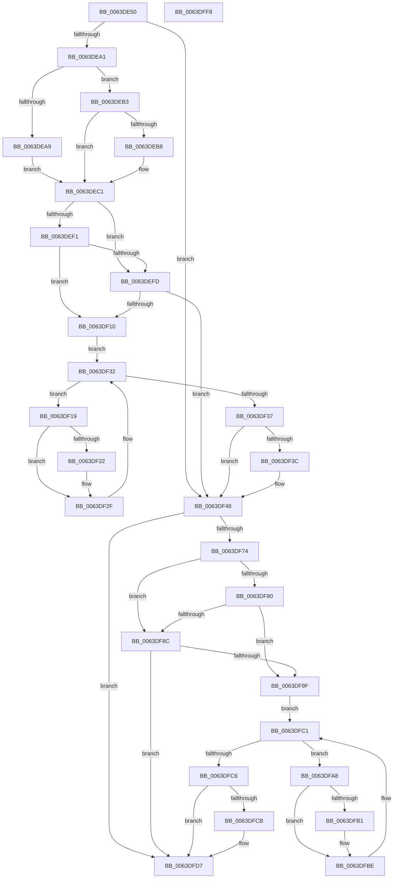

# DifZwAlpcCreatePortSectionWrapper

- RVA: `0x0063DE50`–`0x0063DFF9` (길이 `425` bytes)
- VA: `0x000000014063DE50`
- 실행 섹션: `.text`
- PDB 이름 있음: `예`; PDB Function 태그: `아니요`
- unwind 정보 RVA: `0x000BD780`
- 디코드: `120`개 명령, `425/425` bytes 표시
- 미해석 바이트: `0` (있으면 어셈블리에 `.byte`로 보존)

> 이 문서는 커널 이미지의 기계어와 PDB 기호를 분석해 생성했습니다. 4번과 5번은 함수 원형과 자료형을 바이너리 사용 방식에서 추정한 C 해석이며 원본 소스 복구 결과는 아닙니다.

## 1. Dependencies

- 직접 호출 지점: **10**; 고유 호출 대상: **7**
- 직접 호출자로 확인된 함수: **0**
- RIP 상대 이미지 참조: **3**

### Outgoing calls
- `0x0063DE86` → [memset](../6C/memset_function_006C6C40.md) (function, `0x006C6C40`)
- `0x0063DE90` → [DifGetAPIThunkContextById](../49/DifGetAPIThunkContextById_function_00495A34.md) (function, `0x00495A34`)
- `0x0063DEB8` → [DifGetReturnAddressForWrappers](../4D/DifGetReturnAddressForWrappers_function_004D3C08.md) (function, `0x004D3C08`)
- `0x0063DF04` → [ExAcquireRundownProtection](../21/ExAcquireRundownProtection_function_00216620.md) (function, `0x00216620`)
- `0x0063DF2A` → [guard_dispatch_icall](../6B/guard_dispatch_icall_function_006BAAD0.md) (function, `0x006BAAD0`)
- `0x0063DF43` → [ExReleaseRundownProtection](../34/ExReleaseRundownProtection_function_00349E80.md) (function, `0x00349E80`)
- `0x0063DF67` → [ZwAlpcCreatePortSection](../6A/ZwAlpcCreatePortSection_function_006AE090.md) (function, `0x006AE090`)
- `0x0063DF93` → [ExAcquireRundownProtection](../21/ExAcquireRundownProtection_function_00216620.md) (function, `0x00216620`)
- `0x0063DFB9` → [guard_dispatch_icall](../6B/guard_dispatch_icall_function_006BAAD0.md) (function, `0x006BAAD0`)
- `0x0063DFD2` → [ExReleaseRundownProtection](../34/ExReleaseRundownProtection_function_00349E80.md) (function, `0x00349E80`)

### Direct callers
- 이 함수 시작 RVA로 연결되는 직접 call은 확인되지 않았습니다. 간접 호출은 완전히 역산할 수 없습니다.

### Static image references
- `0x0063DEC8` → RVA `0x00F048B8` (`.data`; read)
- `0x0063DEF1` → RVA `0x00F04980` (`.data`; read)
- `0x0063DEFD` → RVA `0x00F03E80` (`.data`; read)

## 2. Other-region calls and transfers

- 다른 실행 섹션으로 향하는 call: **0**
- 별도 외부 분기/꼬리 이동을 확인하지 못했습니다.

## 3. Assembly (complete function range)

```asm
0063DE50  48 8B C4                        mov rax, rsp
0063DE53  48 89 58 10                     mov qword ptr [rax + 0x10], rbx
0063DE57  48 89 70 18                     mov qword ptr [rax + 0x18], rsi
0063DE5B  48 89 78 20                     mov qword ptr [rax + 0x20], rdi
0063DE5F  48 89 48 08                     mov qword ptr [rax + 8], rcx
0063DE63  55                              push rbp
0063DE64  41 54                           push r12
0063DE66  41 55                           push r13
0063DE68  41 56                           push r14
0063DE6A  41 57                           push r15
0063DE6C  48 8B EC                        mov rbp, rsp
0063DE6F  48 83 EC 70                     sub rsp, 0x70
0063DE73  44 8B EA                        mov r13d, edx
0063DE76  48 8D 4D C0                     lea rcx, [rbp - 0x40]
0063DE7A  33 D2                           xor edx, edx
0063DE7C  4D 8B E0                        mov r12, r8
0063DE7F  4D 8B F9                        mov r15, r9
0063DE82  44 8D 42 40                     lea r8d, [rdx + 0x40]
0063DE86  E8 B5 8D 08 00                  call 0x1406c6c40
0063DE8B  B9 8C 00 00 00                  mov ecx, 0x8c
0063DE90  E8 9F 7B E5 FF                  call 0x140495a34
0063DE95  4C 8B F0                        mov r14, rax
0063DE98  48 85 C0                        test rax, rax
0063DE9B  0F 84 A7 00 00 00               je 0x14063df48
0063DEA1  8B 48 0C                        mov ecx, dword ptr [rax + 0xc]
0063DEA4  F6 C1 18                        test cl, 0x18
0063DEA7  74 0A                           je 0x14063deb3
0063DEA9  48 8B 4D 28                     mov rcx, qword ptr [rbp + 0x28]
0063DEAD  48 89 4D C0                     mov qword ptr [rbp - 0x40], rcx
0063DEB1  EB 0E                           jmp 0x14063dec1
0063DEB3  F6 C1 04                        test cl, 4
0063DEB6  74 09                           je 0x14063dec1
0063DEB8  E8 4B 5D E9 FF                  call 0x1404d3c08
0063DEBD  48 89 45 C0                     mov qword ptr [rbp - 0x40], rax
0063DEC1  48 8B 45 30                     mov rax, qword ptr [rbp + 0x30]
0063DEC5  40 32 F6                        xor sil, sil
0063DEC8  40 38 35 E9 69 8C 00            cmp byte ptr [rip + 0x8c69e9], sil
0063DECF  48 89 45 F0                     mov qword ptr [rbp - 0x10], rax
0063DED3  48 8B 45 50                     mov rax, qword ptr [rbp + 0x50]
0063DED7  48 89 45 D0                     mov qword ptr [rbp - 0x30], rax
0063DEDB  48 8B 45 58                     mov rax, qword ptr [rbp + 0x58]
0063DEDF  48 89 45 C8                     mov qword ptr [rbp - 0x38], rax
0063DEE3  44 89 6D E8                     mov dword ptr [rbp - 0x18], r13d
0063DEE7  4C 89 65 E0                     mov qword ptr [rbp - 0x20], r12
0063DEEB  4C 89 7D D8                     mov qword ptr [rbp - 0x28], r15
0063DEEF  75 0C                           jne 0x14063defd
0063DEF1  F7 05 85 6A 8C 00 00 08 00 00   test dword ptr [rip + 0x8c6a85], 0x800
0063DEFB  74 13                           je 0x14063df10
0063DEFD  48 8D 0D 7C 5F 8C 00            lea rcx, [rip + 0x8c5f7c]
0063DF04  E8 17 87 BD FF                  call 0x140216620
0063DF09  40 8A F0                        mov sil, al
0063DF0C  84 C0                           test al, al
0063DF0E  74 38                           je 0x14063df48
0063DF10  49 8D 7E 20                     lea rdi, [r14 + 0x20]
0063DF14  48 8B 1F                        mov rbx, qword ptr [rdi]
0063DF17  EB 19                           jmp 0x14063df32
0063DF19  48 8D 43 F0                     lea rax, [rbx - 0x10]
0063DF1D  48 85 C0                        test rax, rax
0063DF20  74 0D                           je 0x14063df2f
0063DF22  48 8B 40 08                     mov rax, qword ptr [rax + 8]
0063DF26  48 8D 4D C0                     lea rcx, [rbp - 0x40]
0063DF2A  E8 A1 CB 07 00                  call 0x1406baad0
0063DF2F  48 8B 1B                        mov rbx, qword ptr [rbx]
0063DF32  48 3B DF                        cmp rbx, rdi
0063DF35  75 E2                           jne 0x14063df19
0063DF37  40 84 F6                        test sil, sil
0063DF3A  74 0C                           je 0x14063df48
0063DF3C  48 8D 0D 3D 5F 8C 00            lea rcx, [rip + 0x8c5f3d]
0063DF43  E8 38 BF D0 FF                  call 0x140349e80
0063DF48  48 8B 45 58                     mov rax, qword ptr [rbp + 0x58]
0063DF4C  4D 8B CF                        mov r9, r15
0063DF4F  48 8B 4D 30                     mov rcx, qword ptr [rbp + 0x30]
0063DF53  4D 8B C4                        mov r8, r12
0063DF56  48 89 44 24 28                  mov qword ptr [rsp + 0x28], rax
0063DF5B  41 8B D5                        mov edx, r13d
0063DF5E  48 8B 45 50                     mov rax, qword ptr [rbp + 0x50]
0063DF62  48 89 44 24 20                  mov qword ptr [rsp + 0x20], rax
0063DF67  E8 24 01 07 00                  call 0x1406ae090
0063DF6C  89 45 F8                        mov dword ptr [rbp - 8], eax
0063DF6F  4D 85 F6                        test r14, r14
0063DF72  74 63                           je 0x14063dfd7
0063DF74  40 32 FF                        xor dil, dil
0063DF77  40 38 3D 3A 69 8C 00            cmp byte ptr [rip + 0x8c693a], dil
0063DF7E  75 0C                           jne 0x14063df8c
0063DF80  F7 05 F6 69 8C 00 00 08 00 00   test dword ptr [rip + 0x8c69f6], 0x800
0063DF8A  74 13                           je 0x14063df9f
0063DF8C  48 8D 0D ED 5E 8C 00            lea rcx, [rip + 0x8c5eed]
0063DF93  E8 88 86 BD FF                  call 0x140216620
0063DF98  40 8A F8                        mov dil, al
0063DF9B  84 C0                           test al, al
0063DF9D  74 38                           je 0x14063dfd7
0063DF9F  49 8D 76 30                     lea rsi, [r14 + 0x30]
0063DFA3  48 8B 1E                        mov rbx, qword ptr [rsi]
0063DFA6  EB 19                           jmp 0x14063dfc1
0063DFA8  48 8D 43 F0                     lea rax, [rbx - 0x10]
0063DFAC  48 85 C0                        test rax, rax
0063DFAF  74 0D                           je 0x14063dfbe
0063DFB1  48 8B 40 08                     mov rax, qword ptr [rax + 8]
0063DFB5  48 8D 4D C0                     lea rcx, [rbp - 0x40]
0063DFB9  E8 12 CB 07 00                  call 0x1406baad0
0063DFBE  48 8B 1B                        mov rbx, qword ptr [rbx]
0063DFC1  48 3B DE                        cmp rbx, rsi
0063DFC4  75 E2                           jne 0x14063dfa8
0063DFC6  40 84 FF                        test dil, dil
0063DFC9  74 0C                           je 0x14063dfd7
0063DFCB  48 8D 0D AE 5E 8C 00            lea rcx, [rip + 0x8c5eae]
0063DFD2  E8 A9 BE D0 FF                  call 0x140349e80
0063DFD7  8B 45 F8                        mov eax, dword ptr [rbp - 8]
0063DFDA  4C 8D 5C 24 70                  lea r11, [rsp + 0x70]
0063DFDF  49 8B 5B 38                     mov rbx, qword ptr [r11 + 0x38]
0063DFE3  49 8B 73 40                     mov rsi, qword ptr [r11 + 0x40]
0063DFE7  49 8B 7B 48                     mov rdi, qword ptr [r11 + 0x48]
0063DFEB  49 8B E3                        mov rsp, r11
0063DFEE  41 5F                           pop r15
0063DFF0  41 5E                           pop r14
0063DFF2  41 5D                           pop r13
0063DFF4  41 5C                           pop r12
0063DFF6  5D                              pop rbp
0063DFF7  C3                              ret
0063DFF8  CC                              int3
```

## 4. C-style interpretation (structured pseudocode)

```c
__int64 __fastcall DifZwAlpcCreatePortSectionWrapper(__int64 a1, int a2, __int64 a3, __int64 a4, __int64 a5, __int64 a6)
{
    __int64 result;
    __int64 v_rdi;
    __int64 v_rsi;
    __int64 v_rsp;
    unsigned __int64 v_stack_m28;
    unsigned int v_stack_m30;
    unsigned __int64 v_stack_m38;
    unsigned int v_stack_m40;
    unsigned __int64 v_stack_m48;
    unsigned __int64 v_stack_m50;
    unsigned __int64 v_stack_m58;
    unsigned __int64 v_stack_m60;
    unsigned __int64 v_stack_m68;
    unsigned __int64 v_stack_m70;
    unsigned __int64 v_stack_m78;
    unsigned __int64 v_stack_p0;
    unsigned __int64 v_stack_p8;

    *(unsigned __int64 *)(v_rsp + 16) = v_rbx;
    *(unsigned __int64 *)(v_rsp + 24) = v_rsi;
    *(unsigned __int64 *)(v_rsp + 32) = v_rdi;
    *(unsigned __int64 *)(v_rsp + 8) = a1;
    v_rsp = (v_rsp) - (112);
    a2 = 0;
    result = memset(v_stack_m68, a2, a2 + 64, a4);
    result = DifGetAPIThunkContextById(140, a2, a2 + 64, a4);
    if (result == 0) goto loc_0063DF48;
    if ((((unsigned __int8)((unsigned int)(*(unsigned int *)(result + 12)))) & (24)) == 0) goto loc_0063DEB3;
    v_stack_m68 = v_stack_p0;
    goto loc_0063DEC1;
loc_0063DEB3:
    if ((((unsigned __int8)(v_stack_p0)) & (4)) != 0) {
        result = DifGetReturnAddressForWrappers(v_stack_p0, a2, a2 + 64, a4);
        v_stack_m68 = result;
    }
    v_rsi = 0;
    v_stack_m38 = v_stack_p8;
    v_stack_m58 = a5;
    v_stack_m60 = a6;
    v_stack_m40 = (unsigned int)((unsigned int)(a2));
    v_stack_m48 = a3;
    v_stack_m50 = a4;
    if ((*(unsigned __int8 *)(v_rip + 9202153)) != 0) goto loc_0063DEFD;
    if (((*(unsigned int *)(v_rip + 9202309)) & (0x800ULL)) == 0) goto loc_0063DF10;
loc_0063DEFD:
    result = ExAcquireRundownProtection(v_rip + 9199484, a2, a2 + 64, a4);
    if ((unsigned __int8)(result) == 0) goto loc_0063DF48;
loc_0063DF10:
    goto loc_0063DF32;
loc_0063DF19:
    result = *(unsigned __int64 *)(result + 32) - 16;
    if (*(unsigned __int64 *)(result + 32) - 16 != 0) {
        result = *(unsigned __int64 *)(*(unsigned __int64 *)(result + 32) - 16 + 8);
        a1 = v_stack_m68;
        result = guard_dispatch_icall(a1, a2, a2 + 64, a4);
    }
loc_0063DF32:
    if ((*(unsigned __int64 *)(*(unsigned __int64 *)(result + 32))) != (result + 32)) goto loc_0063DF19;
    if ((unsigned __int8)((unsigned __int8)(result)) != 0) {
        a1 = v_rip + 9199421;
        result = ExReleaseRundownProtection(a1, a2, a2 + 64, a4);
    }
    v_stack_m70 = a6;
    v_stack_m78 = a5;
    result = ZwAlpcCreatePortSection(v_stack_p8, (unsigned int)((unsigned int)((unsigned int)(a2))), a3, a4);
    v_stack_m30 = (unsigned int)(result);
    if (result == 0) goto loc_0063DFD7;
    v_rdi = 0;
    if ((*(unsigned __int8 *)(v_rip + 9201978)) != 0) goto loc_0063DF8C;
    if (((*(unsigned int *)(v_rip + 9202166)) & (0x800ULL)) == 0) goto loc_0063DF9F;
loc_0063DF8C:
    result = ExAcquireRundownProtection(v_rip + 9199341, (unsigned int)((unsigned int)((unsigned int)(a2))), a3, a4);
    if ((unsigned __int8)(result) == 0) goto loc_0063DFD7;
loc_0063DF9F:
    goto loc_0063DFC1;
loc_0063DFA8:
    result = *(unsigned __int64 *)(result + 48) - 16;
    if (*(unsigned __int64 *)(result + 48) - 16 != 0) {
        result = *(unsigned __int64 *)(*(unsigned __int64 *)(result + 48) - 16 + 8);
        a1 = v_stack_m68;
        result = guard_dispatch_icall(a1, (unsigned int)((unsigned int)((unsigned int)(a2))), a3, a4);
    }
loc_0063DFC1:
    if ((*(unsigned __int64 *)(*(unsigned __int64 *)(result + 48))) != (result + 48)) goto loc_0063DFA8;
    if ((unsigned __int8)((unsigned __int8)(result)) != 0) {
        a1 = v_rip + 9199278;
        result = ExReleaseRundownProtection(a1, (unsigned int)((unsigned int)((unsigned int)(a2))), a3, a4);
    }
    return (unsigned int)(v_stack_m30);
}
```

## 5. (Beta) C Style

```c
int64_t DifZwAlpcCreatePortSectionWrapper(int64_t Arg1, int32_t Arg2, int64_t Arg3, int64_t Arg4, int64_t Arg5, int64_t Arg6)
{
    int64_t result;
    int64_t local_rdi;
    int64_t local_rsi;
    int64_t local_rsp;
    uint64_t v_stack_m28;
    uint32_t v_stack_m30;
    uint64_t v_stack_m38;
    uint32_t v_stack_m40;
    uint64_t v_stack_m48;
    uint64_t v_stack_m50;
    uint64_t v_stack_m58;
    uint64_t v_stack_m60;
    uint64_t v_stack_m68;
    uint64_t v_stack_m70;
    uint64_t v_stack_m78;
    uint64_t v_stack_p0;
    uint64_t v_stack_p8;

    *(uint64_t *)(local_rsp + 0x10) = local_rbx;
    *(uint64_t *)(local_rsp + 0x18) = local_rsi;
    *(uint64_t *)(local_rsp + 0x20) = local_rdi;
    *(uint64_t *)(local_rsp + 0x8) = Arg1;
    local_rsp = (local_rsp) - (112);
    Arg2 = 0;
    result = memset(v_stack_m68, Arg2, Arg2 + 64, Arg4);
    result = DifGetAPIThunkContextById(140, Arg2, Arg2 + 64, Arg4);
    if (result == 0) goto loc_0063DF48;
    if ((((uint8_t)((uint32_t)(*(uint32_t *)(result + 0xC)))) & (24)) == 0) goto loc_0063DEB3;
    v_stack_m68 = v_stack_p0;
    goto loc_0063DEC1;
loc_0063DEB3:
    if ((((uint8_t)(v_stack_p0)) & (4)) != 0) {
        result = DifGetReturnAddressForWrappers(v_stack_p0, Arg2, Arg2 + 64, Arg4);
        v_stack_m68 = result;
    }
    local_rsi = 0;
    v_stack_m38 = v_stack_p8;
    v_stack_m58 = Arg5;
    v_stack_m60 = Arg6;
    v_stack_m40 = (uint32_t)((uint32_t)(Arg2));
    v_stack_m48 = Arg3;
    v_stack_m50 = Arg4;
    if ((*(uint8_t *)(v_rip + 0x8C69E9)) != 0) goto loc_0063DEFD;
    if (((*(uint32_t *)(v_rip + 0x8C6A85)) & (0x800ULL)) == 0) goto loc_0063DF10;
loc_0063DEFD:
    result = ExAcquireRundownProtection(v_rip + 9199484, Arg2, Arg2 + 64, Arg4);
    if ((uint8_t)(result) == 0) goto loc_0063DF48;
loc_0063DF10:
    goto loc_0063DF32;
loc_0063DF19:
    result = *(uint64_t *)(result + 0x20) - 16;
    if (*(uint64_t *)(result + 0x20) - 16 != 0) {
        result = *(uint64_t *)(*(uint64_t *)(result + 0x20) - 0x10 + 0x8);
        Arg1 = v_stack_m68;
        result = guard_dispatch_icall(Arg1, Arg2, Arg2 + 64, Arg4);
    }
loc_0063DF32:
    if ((*(uint64_t *)(*(uint64_t *)(result + 0x20))) != (result + 32)) goto loc_0063DF19;
    if ((uint8_t)((uint8_t)(result)) != 0) {
        Arg1 = v_rip + 9199421;
        result = ExReleaseRundownProtection(Arg1, Arg2, Arg2 + 64, Arg4);
    }
    v_stack_m70 = Arg6;
    v_stack_m78 = Arg5;
    result = ZwAlpcCreatePortSection(v_stack_p8, (uint32_t)((uint32_t)((uint32_t)(Arg2))), Arg3, Arg4);
    v_stack_m30 = (uint32_t)(result);
    if (result == 0) goto loc_0063DFD7;
    local_rdi = 0;
    if ((*(uint8_t *)(v_rip + 0x8C693A)) != 0) goto loc_0063DF8C;
    if (((*(uint32_t *)(v_rip + 0x8C69F6)) & (0x800ULL)) == 0) goto loc_0063DF9F;
loc_0063DF8C:
    result = ExAcquireRundownProtection(v_rip + 9199341, (uint32_t)((uint32_t)((uint32_t)(Arg2))), Arg3, Arg4);
    if ((uint8_t)(result) == 0) goto loc_0063DFD7;
loc_0063DF9F:
    goto loc_0063DFC1;
loc_0063DFA8:
    result = *(uint64_t *)(result + 0x30) - 16;
    if (*(uint64_t *)(result + 0x30) - 16 != 0) {
        result = *(uint64_t *)(*(uint64_t *)(result + 0x30) - 0x10 + 0x8);
        Arg1 = v_stack_m68;
        result = guard_dispatch_icall(Arg1, (uint32_t)((uint32_t)((uint32_t)(Arg2))), Arg3, Arg4);
    }
loc_0063DFC1:
    if ((*(uint64_t *)(*(uint64_t *)(result + 0x30))) != (result + 48)) goto loc_0063DFA8;
    if ((uint8_t)((uint8_t)(result)) != 0) {
        Arg1 = v_rip + 9199278;
        result = ExReleaseRundownProtection(Arg1, (uint32_t)((uint32_t)((uint32_t)(Arg2))), Arg3, Arg4);
    }
    return (uint32_t)(v_stack_m30);
}
```

## 6. Execution-region graph

[열기: 2D/3D 그래프와 함수 탐색 컨트롤 패널](../../../control-panel.html?section=text&rva=0x0063DE50&view=graph)

- 2D 그래프는 위에서 아래로 흐르고, 3D 그래프는 빈 공간을 드래그해 회전합니다. Shift+드래그는 이동, 휠은 확대·축소, 함수 노드 선택은 대상 보고서 이동입니다.

### Static fallback


