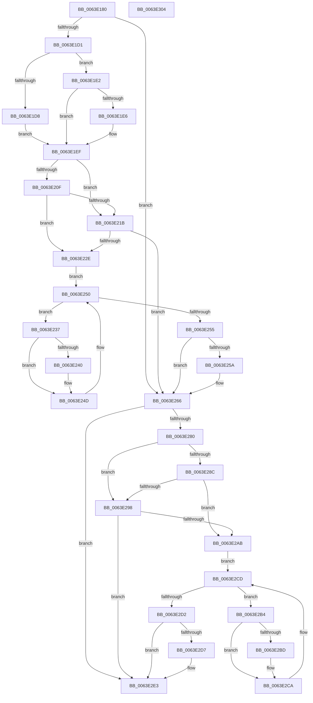

# DifZwAlpcCreateResourceReserveWrapper

- RVA: `0x0063E180`–`0x0063E305` (길이 `389` bytes)
- VA: `0x000000014063E180`
- 실행 섹션: `.text`
- PDB 이름 있음: `예`; PDB Function 태그: `아니요`
- unwind 정보 RVA: `0x000D2B7C`
- 디코드: `112`개 명령, `389/389` bytes 표시
- 미해석 바이트: `0` (있으면 어셈블리에 `.byte`로 보존)

> 이 문서는 커널 이미지의 기계어와 PDB 기호를 분석해 생성했습니다. 4번과 5번은 함수 원형과 자료형을 바이너리 사용 방식에서 추정한 C 해석이며 원본 소스 복구 결과는 아닙니다.

## 1. Dependencies

- 직접 호출 지점: **9**; 고유 호출 대상: **6**
- 직접 호출자로 확인된 함수: **0**
- RIP 상대 이미지 참조: **3**

### Outgoing calls
- `0x0063E1C0` → [DifGetAPIThunkContextById](../49/DifGetAPIThunkContextById_function_00495A34.md) (function, `0x00495A34`)
- `0x0063E1E6` → [DifGetReturnAddressForWrappers](../4D/DifGetReturnAddressForWrappers_function_004D3C08.md) (function, `0x004D3C08`)
- `0x0063E222` → [ExAcquireRundownProtection](../21/ExAcquireRundownProtection_function_00216620.md) (function, `0x00216620`)
- `0x0063E248` → [guard_dispatch_icall](../6B/guard_dispatch_icall_function_006BAAD0.md) (function, `0x006BAAD0`)
- `0x0063E261` → [ExReleaseRundownProtection](../34/ExReleaseRundownProtection_function_00349E80.md) (function, `0x00349E80`)
- `0x0063E273` → [ZwAlpcCreateResourceReserve](../6A/ZwAlpcCreateResourceReserve_function_006AE0B0.md) (function, `0x006AE0B0`)
- `0x0063E29F` → [ExAcquireRundownProtection](../21/ExAcquireRundownProtection_function_00216620.md) (function, `0x00216620`)
- `0x0063E2C5` → [guard_dispatch_icall](../6B/guard_dispatch_icall_function_006BAAD0.md) (function, `0x006BAAD0`)
- `0x0063E2DE` → [ExReleaseRundownProtection](../34/ExReleaseRundownProtection_function_00349E80.md) (function, `0x00349E80`)

### Direct callers
- 이 함수 시작 RVA로 연결되는 직접 call은 확인되지 않았습니다. 간접 호출은 완전히 역산할 수 없습니다.

### Static image references
- `0x0063E1F6` → RVA `0x00F048B8` (`.data`; read)
- `0x0063E20F` → RVA `0x00F04980` (`.data`; read)
- `0x0063E21B` → RVA `0x00F03E80` (`.data`; read)

## 2. Other-region calls and transfers

- 다른 실행 섹션으로 향하는 call: **0**
- 별도 외부 분기/꼬리 이동을 확인하지 못했습니다.

## 3. Assembly (complete function range)

```asm
0063E180  48 8B C4                        mov rax, rsp
0063E183  48 89 58 10                     mov qword ptr [rax + 0x10], rbx
0063E187  48 89 70 18                     mov qword ptr [rax + 0x18], rsi
0063E18B  48 89 78 20                     mov qword ptr [rax + 0x20], rdi
0063E18F  48 89 48 08                     mov qword ptr [rax + 8], rcx
0063E193  55                              push rbp
0063E194  41 54                           push r12
0063E196  41 55                           push r13
0063E198  41 56                           push r14
0063E19A  41 57                           push r15
0063E19C  48 8B EC                        mov rbp, rsp
0063E19F  48 83 EC 50                     sub rsp, 0x50
0063E1A3  0F 57 C0                        xorps xmm0, xmm0
0063E1A6  B9 8B 00 00 00                  mov ecx, 0x8b
0063E1AB  0F 11 45 D0                     movups xmmword ptr [rbp - 0x30], xmm0
0063E1AF  4D 8B F9                        mov r15, r9
0063E1B2  4D 8B E0                        mov r12, r8
0063E1B5  0F 11 45 E0                     movups xmmword ptr [rbp - 0x20], xmm0
0063E1B9  44 8B EA                        mov r13d, edx
0063E1BC  0F 11 45 F0                     movups xmmword ptr [rbp - 0x10], xmm0
0063E1C0  E8 6F 78 E5 FF                  call 0x140495a34
0063E1C5  48 8B F0                        mov rsi, rax
0063E1C8  48 85 C0                        test rax, rax
0063E1CB  0F 84 95 00 00 00               je 0x14063e266
0063E1D1  8B 40 0C                        mov eax, dword ptr [rax + 0xc]
0063E1D4  A8 18                           test al, 0x18
0063E1D6  74 0A                           je 0x14063e1e2
0063E1D8  48 8B 4D 28                     mov rcx, qword ptr [rbp + 0x28]
0063E1DC  48 89 4D D0                     mov qword ptr [rbp - 0x30], rcx
0063E1E0  EB 0D                           jmp 0x14063e1ef
0063E1E2  A8 04                           test al, 4
0063E1E4  74 09                           je 0x14063e1ef
0063E1E6  E8 1D 5A E9 FF                  call 0x1404d3c08
0063E1EB  48 89 45 D0                     mov qword ptr [rbp - 0x30], rax
0063E1EF  48 8B 45 30                     mov rax, qword ptr [rbp + 0x30]
0063E1F3  45 32 F6                        xor r14b, r14b
0063E1F6  44 38 35 BB 66 8C 00            cmp byte ptr [rip + 0x8c66bb], r14b
0063E1FD  48 89 45 F0                     mov qword ptr [rbp - 0x10], rax
0063E201  44 89 6D E8                     mov dword ptr [rbp - 0x18], r13d
0063E205  4C 89 65 E0                     mov qword ptr [rbp - 0x20], r12
0063E209  4C 89 7D D8                     mov qword ptr [rbp - 0x28], r15
0063E20D  75 0C                           jne 0x14063e21b
0063E20F  F7 05 67 67 8C 00 00 08 00 00   test dword ptr [rip + 0x8c6767], 0x800
0063E219  74 13                           je 0x14063e22e
0063E21B  48 8D 0D 5E 5C 8C 00            lea rcx, [rip + 0x8c5c5e]
0063E222  E8 F9 83 BD FF                  call 0x140216620
0063E227  44 8A F0                        mov r14b, al
0063E22A  84 C0                           test al, al
0063E22C  74 38                           je 0x14063e266
0063E22E  48 8D 7E 20                     lea rdi, [rsi + 0x20]
0063E232  48 8B 1F                        mov rbx, qword ptr [rdi]
0063E235  EB 19                           jmp 0x14063e250
0063E237  48 8D 43 F0                     lea rax, [rbx - 0x10]
0063E23B  48 85 C0                        test rax, rax
0063E23E  74 0D                           je 0x14063e24d
0063E240  48 8B 40 08                     mov rax, qword ptr [rax + 8]
0063E244  48 8D 4D D0                     lea rcx, [rbp - 0x30]
0063E248  E8 83 C8 07 00                  call 0x1406baad0
0063E24D  48 8B 1B                        mov rbx, qword ptr [rbx]
0063E250  48 3B DF                        cmp rbx, rdi
0063E253  75 E2                           jne 0x14063e237
0063E255  45 84 F6                        test r14b, r14b
0063E258  74 0C                           je 0x14063e266
0063E25A  48 8D 0D 1F 5C 8C 00            lea rcx, [rip + 0x8c5c1f]
0063E261  E8 1A BC D0 FF                  call 0x140349e80
0063E266  48 8B 4D 30                     mov rcx, qword ptr [rbp + 0x30]
0063E26A  4D 8B CF                        mov r9, r15
0063E26D  4D 8B C4                        mov r8, r12
0063E270  41 8B D5                        mov edx, r13d
0063E273  E8 38 FE 06 00                  call 0x1406ae0b0
0063E278  89 45 F8                        mov dword ptr [rbp - 8], eax
0063E27B  48 85 F6                        test rsi, rsi
0063E27E  74 63                           je 0x14063e2e3
0063E280  40 32 FF                        xor dil, dil
0063E283  40 38 3D 2E 66 8C 00            cmp byte ptr [rip + 0x8c662e], dil
0063E28A  75 0C                           jne 0x14063e298
0063E28C  F7 05 EA 66 8C 00 00 08 00 00   test dword ptr [rip + 0x8c66ea], 0x800
0063E296  74 13                           je 0x14063e2ab
0063E298  48 8D 0D E1 5B 8C 00            lea rcx, [rip + 0x8c5be1]
0063E29F  E8 7C 83 BD FF                  call 0x140216620
0063E2A4  40 8A F8                        mov dil, al
0063E2A7  84 C0                           test al, al
0063E2A9  74 38                           je 0x14063e2e3
0063E2AB  48 83 C6 30                     add rsi, 0x30
0063E2AF  48 8B 1E                        mov rbx, qword ptr [rsi]
0063E2B2  EB 19                           jmp 0x14063e2cd
0063E2B4  48 8D 43 F0                     lea rax, [rbx - 0x10]
0063E2B8  48 85 C0                        test rax, rax
0063E2BB  74 0D                           je 0x14063e2ca
0063E2BD  48 8B 40 08                     mov rax, qword ptr [rax + 8]
0063E2C1  48 8D 4D D0                     lea rcx, [rbp - 0x30]
0063E2C5  E8 06 C8 07 00                  call 0x1406baad0
0063E2CA  48 8B 1B                        mov rbx, qword ptr [rbx]
0063E2CD  48 3B DE                        cmp rbx, rsi
0063E2D0  75 E2                           jne 0x14063e2b4
0063E2D2  40 84 FF                        test dil, dil
0063E2D5  74 0C                           je 0x14063e2e3
0063E2D7  48 8D 0D A2 5B 8C 00            lea rcx, [rip + 0x8c5ba2]
0063E2DE  E8 9D BB D0 FF                  call 0x140349e80
0063E2E3  8B 45 F8                        mov eax, dword ptr [rbp - 8]
0063E2E6  4C 8D 5C 24 50                  lea r11, [rsp + 0x50]
0063E2EB  49 8B 5B 38                     mov rbx, qword ptr [r11 + 0x38]
0063E2EF  49 8B 73 40                     mov rsi, qword ptr [r11 + 0x40]
0063E2F3  49 8B 7B 48                     mov rdi, qword ptr [r11 + 0x48]
0063E2F7  49 8B E3                        mov rsp, r11
0063E2FA  41 5F                           pop r15
0063E2FC  41 5E                           pop r14
0063E2FE  41 5D                           pop r13
0063E300  41 5C                           pop r12
0063E302  5D                              pop rbp
0063E303  C3                              ret
0063E304  CC                              int3
```

## 4. C-style interpretation (structured pseudocode)

```c
__int64 __fastcall DifZwAlpcCreateResourceReserveWrapper(__int64 a1, int a2, __int64 a3, __int64 a4)
{
    __int64 result;
    __int64 v_r14;
    __int64 v_rdi;
    __int64 v_rsi;
    __int64 v_rsp;
    unsigned __int64 v_stack_m28;
    unsigned int v_stack_m30;
    unsigned __int64 v_stack_m38;
    unsigned int v_stack_m40;
    unsigned __int64 v_stack_m48;
    unsigned __int64 v_stack_m50;
    unsigned __int64 v_stack_m58;
    unsigned __int64 v_stack_p0;
    unsigned __int64 v_stack_p8;

    *(unsigned __int64 *)(v_rsp + 16) = v_rbx;
    *(unsigned __int64 *)(v_rsp + 24) = v_rsi;
    *(unsigned __int64 *)(v_rsp + 32) = v_rdi;
    *(unsigned __int64 *)(v_rsp + 8) = a1;
    v_rsp = (v_rsp) - (80);
    v_stack_m58 = v_xmm0;
    v_stack_m48 = v_xmm0;
    v_stack_m38 = v_xmm0;
    result = DifGetAPIThunkContextById(139, a2, a3, a4);
    if (result == 0) goto loc_0063E266;
    if ((((unsigned __int8)((unsigned int)(*(unsigned int *)(result + 12)))) & (24)) == 0) goto loc_0063E1E2;
    v_stack_m58 = v_stack_p0;
    goto loc_0063E1EF;
loc_0063E1E2:
    result = (unsigned int)(*(unsigned int *)(result + 12));
    if ((((unsigned __int8)((unsigned int)(*(unsigned int *)(result + 12)))) & (4)) != 0) {
        result = DifGetReturnAddressForWrappers(v_stack_p0, a2, a3, a4);
        v_stack_m58 = result;
    }
    v_r14 = 0;
    v_stack_m38 = v_stack_p8;
    v_stack_m40 = (unsigned int)((unsigned int)(a2));
    v_stack_m48 = a3;
    v_stack_m50 = a4;
    if ((*(unsigned __int8 *)(v_rip + 9201339)) != 0) goto loc_0063E21B;
    if (((*(unsigned int *)(v_rip + 9201511)) & (0x800ULL)) == 0) goto loc_0063E22E;
loc_0063E21B:
    result = ExAcquireRundownProtection(v_rip + 9198686, a2, a3, a4);
    if ((unsigned __int8)(result) == 0) goto loc_0063E266;
loc_0063E22E:
    goto loc_0063E250;
loc_0063E237:
    result = *(unsigned __int64 *)(result + 32) - 16;
    if (*(unsigned __int64 *)(result + 32) - 16 != 0) {
        result = *(unsigned __int64 *)(*(unsigned __int64 *)(result + 32) - 16 + 8);
        a1 = v_stack_m58;
        result = guard_dispatch_icall(a1, a2, a3, a4);
    }
loc_0063E250:
    if ((*(unsigned __int64 *)(*(unsigned __int64 *)(result + 32))) != (result + 32)) goto loc_0063E237;
    if ((unsigned __int8)((unsigned __int8)(result)) != 0) {
        a1 = v_rip + 9198623;
        result = ExReleaseRundownProtection(a1, a2, a3, a4);
    }
    result = ZwAlpcCreateResourceReserve(v_stack_p8, (unsigned int)((unsigned int)((unsigned int)(a2))), a3, a4);
    v_stack_m30 = (unsigned int)(result);
    if (result == 0) goto loc_0063E2E3;
    v_rdi = 0;
    if ((*(unsigned __int8 *)(v_rip + 9201198)) != 0) goto loc_0063E298;
    if (((*(unsigned int *)(v_rip + 9201386)) & (0x800ULL)) == 0) goto loc_0063E2AB;
loc_0063E298:
    result = ExAcquireRundownProtection(v_rip + 9198561, (unsigned int)((unsigned int)((unsigned int)(a2))), a3, a4);
    if ((unsigned __int8)(result) == 0) goto loc_0063E2E3;
loc_0063E2AB:
    v_rsi = (result) + (48);
    goto loc_0063E2CD;
loc_0063E2B4:
    result = *(unsigned __int64 *)(v_rsi) - 16;
    if (*(unsigned __int64 *)(v_rsi) - 16 != 0) {
        result = *(unsigned __int64 *)(*(unsigned __int64 *)(v_rsi) - 16 + 8);
        a1 = v_stack_m58;
        result = guard_dispatch_icall(a1, (unsigned int)((unsigned int)((unsigned int)(a2))), a3, a4);
    }
loc_0063E2CD:
    if ((*(unsigned __int64 *)(*(unsigned __int64 *)(v_rsi))) != v_rsi) goto loc_0063E2B4;
    if ((unsigned __int8)((unsigned __int8)(result)) != 0) {
        a1 = v_rip + 9198498;
        result = ExReleaseRundownProtection(a1, (unsigned int)((unsigned int)((unsigned int)(a2))), a3, a4);
    }
    return (unsigned int)(v_stack_m30);
}
```

## 5. (Beta) C Style

```c
int64_t DifZwAlpcCreateResourceReserveWrapper(int64_t Arg1, int32_t Arg2, int64_t Arg3, int64_t Arg4)
{
    int64_t result;
    int64_t local_r14;
    int64_t local_rdi;
    int64_t local_rsi;
    int64_t local_rsp;
    uint64_t v_stack_m28;
    uint32_t v_stack_m30;
    uint64_t v_stack_m38;
    uint32_t v_stack_m40;
    uint64_t v_stack_m48;
    uint64_t v_stack_m50;
    uint64_t v_stack_m58;
    uint64_t v_stack_p0;
    uint64_t v_stack_p8;

    *(uint64_t *)(local_rsp + 0x10) = local_rbx;
    *(uint64_t *)(local_rsp + 0x18) = local_rsi;
    *(uint64_t *)(local_rsp + 0x20) = local_rdi;
    *(uint64_t *)(local_rsp + 0x8) = Arg1;
    local_rsp = (local_rsp) - (80);
    v_stack_m58 = v_xmm0;
    v_stack_m48 = v_xmm0;
    v_stack_m38 = v_xmm0;
    result = DifGetAPIThunkContextById(139, Arg2, Arg3, Arg4);
    if (result == 0) goto loc_0063E266;
    if ((((uint8_t)((uint32_t)(*(uint32_t *)(result + 0xC)))) & (24)) == 0) goto loc_0063E1E2;
    v_stack_m58 = v_stack_p0;
    goto loc_0063E1EF;
loc_0063E1E2:
    result = (uint32_t)(*(uint32_t *)(result + 0xC));
    if ((((uint8_t)((uint32_t)(*(uint32_t *)(result + 0xC)))) & (4)) != 0) {
        result = DifGetReturnAddressForWrappers(v_stack_p0, Arg2, Arg3, Arg4);
        v_stack_m58 = result;
    }
    local_r14 = 0;
    v_stack_m38 = v_stack_p8;
    v_stack_m40 = (uint32_t)((uint32_t)(Arg2));
    v_stack_m48 = Arg3;
    v_stack_m50 = Arg4;
    if ((*(uint8_t *)(v_rip + 0x8C66BB)) != 0) goto loc_0063E21B;
    if (((*(uint32_t *)(v_rip + 0x8C6767)) & (0x800ULL)) == 0) goto loc_0063E22E;
loc_0063E21B:
    result = ExAcquireRundownProtection(v_rip + 9198686, Arg2, Arg3, Arg4);
    if ((uint8_t)(result) == 0) goto loc_0063E266;
loc_0063E22E:
    goto loc_0063E250;
loc_0063E237:
    result = *(uint64_t *)(result + 0x20) - 16;
    if (*(uint64_t *)(result + 0x20) - 16 != 0) {
        result = *(uint64_t *)(*(uint64_t *)(result + 0x20) - 0x10 + 0x8);
        Arg1 = v_stack_m58;
        result = guard_dispatch_icall(Arg1, Arg2, Arg3, Arg4);
    }
loc_0063E250:
    if ((*(uint64_t *)(*(uint64_t *)(result + 0x20))) != (result + 32)) goto loc_0063E237;
    if ((uint8_t)((uint8_t)(result)) != 0) {
        Arg1 = v_rip + 9198623;
        result = ExReleaseRundownProtection(Arg1, Arg2, Arg3, Arg4);
    }
    result = ZwAlpcCreateResourceReserve(v_stack_p8, (uint32_t)((uint32_t)((uint32_t)(Arg2))), Arg3, Arg4);
    v_stack_m30 = (uint32_t)(result);
    if (result == 0) goto loc_0063E2E3;
    local_rdi = 0;
    if ((*(uint8_t *)(v_rip + 0x8C662E)) != 0) goto loc_0063E298;
    if (((*(uint32_t *)(v_rip + 0x8C66EA)) & (0x800ULL)) == 0) goto loc_0063E2AB;
loc_0063E298:
    result = ExAcquireRundownProtection(v_rip + 9198561, (uint32_t)((uint32_t)((uint32_t)(Arg2))), Arg3, Arg4);
    if ((uint8_t)(result) == 0) goto loc_0063E2E3;
loc_0063E2AB:
    local_rsi = (result) + (48);
    goto loc_0063E2CD;
loc_0063E2B4:
    result = *(uint64_t *)(local_rsi) - 16;
    if (*(uint64_t *)(local_rsi) - 16 != 0) {
        result = *(uint64_t *)(*(uint64_t *)(local_rsi) - 0x10 + 0x8);
        Arg1 = v_stack_m58;
        result = guard_dispatch_icall(Arg1, (uint32_t)((uint32_t)((uint32_t)(Arg2))), Arg3, Arg4);
    }
loc_0063E2CD:
    if ((*(uint64_t *)(*(uint64_t *)(local_rsi))) != local_rsi) goto loc_0063E2B4;
    if ((uint8_t)((uint8_t)(result)) != 0) {
        Arg1 = v_rip + 9198498;
        result = ExReleaseRundownProtection(Arg1, (uint32_t)((uint32_t)((uint32_t)(Arg2))), Arg3, Arg4);
    }
    return (uint32_t)(v_stack_m30);
}
```

## 6. Execution-region graph

[열기: 2D/3D 그래프와 함수 탐색 컨트롤 패널](../../../control-panel.html?section=text&rva=0x0063E180&view=graph)

- 2D 그래프는 위에서 아래로 흐르고, 3D 그래프는 빈 공간을 드래그해 회전합니다. Shift+드래그는 이동, 휠은 확대·축소, 함수 노드 선택은 대상 보고서 이동입니다.

### Static fallback


