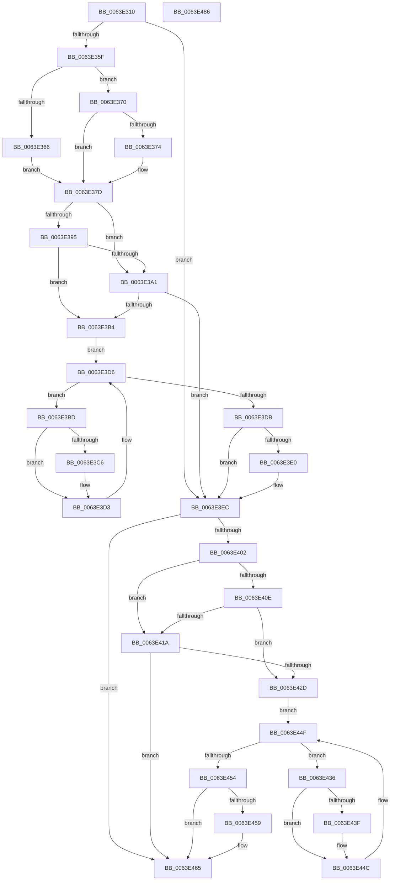

# DifZwAlpcCreateSectionViewWrapper

- RVA: `0x0063E310`–`0x0063E487` (길이 `375` bytes)
- VA: `0x000000014063E310`
- 실행 섹션: `.text`
- PDB 이름 있음: `예`; PDB Function 태그: `아니요`
- unwind 정보 RVA: `0x000A9A64`
- 디코드: `108`개 명령, `375/375` bytes 표시
- 미해석 바이트: `0` (있으면 어셈블리에 `.byte`로 보존)

> 이 문서는 커널 이미지의 기계어와 PDB 기호를 분석해 생성했습니다. 4번과 5번은 함수 원형과 자료형을 바이너리 사용 방식에서 추정한 C 해석이며 원본 소스 복구 결과는 아닙니다.

## 1. Dependencies

- 직접 호출 지점: **9**; 고유 호출 대상: **6**
- 직접 호출자로 확인된 함수: **0**
- RIP 상대 이미지 참조: **3**

### Outgoing calls
- `0x0063E34E` → [DifGetAPIThunkContextById](../49/DifGetAPIThunkContextById_function_00495A34.md) (function, `0x00495A34`)
- `0x0063E374` → [DifGetReturnAddressForWrappers](../4D/DifGetReturnAddressForWrappers_function_004D3C08.md) (function, `0x004D3C08`)
- `0x0063E3A8` → [ExAcquireRundownProtection](../21/ExAcquireRundownProtection_function_00216620.md) (function, `0x00216620`)
- `0x0063E3CE` → [guard_dispatch_icall](../6B/guard_dispatch_icall_function_006BAAD0.md) (function, `0x006BAAD0`)
- `0x0063E3E7` → [ExReleaseRundownProtection](../34/ExReleaseRundownProtection_function_00349E80.md) (function, `0x00349E80`)
- `0x0063E3F5` → [ZwAlpcCreateSectionView](../6A/ZwAlpcCreateSectionView_function_006AE0D0.md) (function, `0x006AE0D0`)
- `0x0063E421` → [ExAcquireRundownProtection](../21/ExAcquireRundownProtection_function_00216620.md) (function, `0x00216620`)
- `0x0063E447` → [guard_dispatch_icall](../6B/guard_dispatch_icall_function_006BAAD0.md) (function, `0x006BAAD0`)
- `0x0063E460` → [ExReleaseRundownProtection](../34/ExReleaseRundownProtection_function_00349E80.md) (function, `0x00349E80`)

### Direct callers
- 이 함수 시작 RVA로 연결되는 직접 call은 확인되지 않았습니다. 간접 호출은 완전히 역산할 수 없습니다.

### Static image references
- `0x0063E384` → RVA `0x00F048B8` (`.data`; read)
- `0x0063E395` → RVA `0x00F04980` (`.data`; read)
- `0x0063E3A1` → RVA `0x00F03E80` (`.data`; read)

## 2. Other-region calls and transfers

- 다른 실행 섹션으로 향하는 call: **0**
- 별도 외부 분기/꼬리 이동을 확인하지 못했습니다.

## 3. Assembly (complete function range)

```asm
0063E310  48 89 5C 24 08                  mov qword ptr [rsp + 8], rbx
0063E315  48 89 74 24 10                  mov qword ptr [rsp + 0x10], rsi
0063E31A  48 89 7C 24 18                  mov qword ptr [rsp + 0x18], rdi
0063E31F  55                              push rbp
0063E320  41 54                           push r12
0063E322  41 55                           push r13
0063E324  41 56                           push r14
0063E326  41 57                           push r15
0063E328  48 8B EC                        mov rbp, rsp
0063E32B  48 83 EC 50                     sub rsp, 0x50
0063E32F  0F 57 C0                        xorps xmm0, xmm0
0063E332  33 C0                           xor eax, eax
0063E334  4C 8B E9                        mov r13, rcx
0063E337  48 89 45 F0                     mov qword ptr [rbp - 0x10], rax
0063E33B  B9 8A 00 00 00                  mov ecx, 0x8a
0063E340  4D 8B F8                        mov r15, r8
0063E343  0F 11 45 D0                     movups xmmword ptr [rbp - 0x30], xmm0
0063E347  44 8B E2                        mov r12d, edx
0063E34A  0F 11 45 E0                     movups xmmword ptr [rbp - 0x20], xmm0
0063E34E  E8 E1 76 E5 FF                  call 0x140495a34
0063E353  48 8B F0                        mov rsi, rax
0063E356  48 85 C0                        test rax, rax
0063E359  0F 84 8D 00 00 00               je 0x14063e3ec
0063E35F  8B 40 0C                        mov eax, dword ptr [rax + 0xc]
0063E362  A8 18                           test al, 0x18
0063E364  74 0A                           je 0x14063e370
0063E366  48 8B 4D 28                     mov rcx, qword ptr [rbp + 0x28]
0063E36A  48 89 4D D0                     mov qword ptr [rbp - 0x30], rcx
0063E36E  EB 0D                           jmp 0x14063e37d
0063E370  A8 04                           test al, 4
0063E372  74 09                           je 0x14063e37d
0063E374  E8 8F 58 E9 FF                  call 0x1404d3c08
0063E379  48 89 45 D0                     mov qword ptr [rbp - 0x30], rax
0063E37D  45 32 F6                        xor r14b, r14b
0063E380  4C 89 6D E8                     mov qword ptr [rbp - 0x18], r13
0063E384  44 38 35 2D 65 8C 00            cmp byte ptr [rip + 0x8c652d], r14b
0063E38B  44 89 65 E0                     mov dword ptr [rbp - 0x20], r12d
0063E38F  4C 89 7D D8                     mov qword ptr [rbp - 0x28], r15
0063E393  75 0C                           jne 0x14063e3a1
0063E395  F7 05 E1 65 8C 00 00 08 00 00   test dword ptr [rip + 0x8c65e1], 0x800
0063E39F  74 13                           je 0x14063e3b4
0063E3A1  48 8D 0D D8 5A 8C 00            lea rcx, [rip + 0x8c5ad8]
0063E3A8  E8 73 82 BD FF                  call 0x140216620
0063E3AD  44 8A F0                        mov r14b, al
0063E3B0  84 C0                           test al, al
0063E3B2  74 38                           je 0x14063e3ec
0063E3B4  48 8D 7E 20                     lea rdi, [rsi + 0x20]
0063E3B8  48 8B 1F                        mov rbx, qword ptr [rdi]
0063E3BB  EB 19                           jmp 0x14063e3d6
0063E3BD  48 8D 43 F0                     lea rax, [rbx - 0x10]
0063E3C1  48 85 C0                        test rax, rax
0063E3C4  74 0D                           je 0x14063e3d3
0063E3C6  48 8B 40 08                     mov rax, qword ptr [rax + 8]
0063E3CA  48 8D 4D D0                     lea rcx, [rbp - 0x30]
0063E3CE  E8 FD C6 07 00                  call 0x1406baad0
0063E3D3  48 8B 1B                        mov rbx, qword ptr [rbx]
0063E3D6  48 3B DF                        cmp rbx, rdi
0063E3D9  75 E2                           jne 0x14063e3bd
0063E3DB  45 84 F6                        test r14b, r14b
0063E3DE  74 0C                           je 0x14063e3ec
0063E3E0  48 8D 0D 99 5A 8C 00            lea rcx, [rip + 0x8c5a99]
0063E3E7  E8 94 BA D0 FF                  call 0x140349e80
0063E3EC  4D 8B C7                        mov r8, r15
0063E3EF  41 8B D4                        mov edx, r12d
0063E3F2  49 8B CD                        mov rcx, r13
0063E3F5  E8 D6 FC 06 00                  call 0x1406ae0d0
0063E3FA  89 45 F0                        mov dword ptr [rbp - 0x10], eax
0063E3FD  48 85 F6                        test rsi, rsi
0063E400  74 63                           je 0x14063e465
0063E402  40 32 FF                        xor dil, dil
0063E405  40 38 3D AC 64 8C 00            cmp byte ptr [rip + 0x8c64ac], dil
0063E40C  75 0C                           jne 0x14063e41a
0063E40E  F7 05 68 65 8C 00 00 08 00 00   test dword ptr [rip + 0x8c6568], 0x800
0063E418  74 13                           je 0x14063e42d
0063E41A  48 8D 0D 5F 5A 8C 00            lea rcx, [rip + 0x8c5a5f]
0063E421  E8 FA 81 BD FF                  call 0x140216620
0063E426  40 8A F8                        mov dil, al
0063E429  84 C0                           test al, al
0063E42B  74 38                           je 0x14063e465
0063E42D  48 83 C6 30                     add rsi, 0x30
0063E431  48 8B 1E                        mov rbx, qword ptr [rsi]
0063E434  EB 19                           jmp 0x14063e44f
0063E436  48 8D 43 F0                     lea rax, [rbx - 0x10]
0063E43A  48 85 C0                        test rax, rax
0063E43D  74 0D                           je 0x14063e44c
0063E43F  48 8B 40 08                     mov rax, qword ptr [rax + 8]
0063E443  48 8D 4D D0                     lea rcx, [rbp - 0x30]
0063E447  E8 84 C6 07 00                  call 0x1406baad0
0063E44C  48 8B 1B                        mov rbx, qword ptr [rbx]
0063E44F  48 3B DE                        cmp rbx, rsi
0063E452  75 E2                           jne 0x14063e436
0063E454  40 84 FF                        test dil, dil
0063E457  74 0C                           je 0x14063e465
0063E459  48 8D 0D 20 5A 8C 00            lea rcx, [rip + 0x8c5a20]
0063E460  E8 1B BA D0 FF                  call 0x140349e80
0063E465  8B 45 F0                        mov eax, dword ptr [rbp - 0x10]
0063E468  4C 8D 5C 24 50                  lea r11, [rsp + 0x50]
0063E46D  49 8B 5B 30                     mov rbx, qword ptr [r11 + 0x30]
0063E471  49 8B 73 38                     mov rsi, qword ptr [r11 + 0x38]
0063E475  49 8B 7B 40                     mov rdi, qword ptr [r11 + 0x40]
0063E479  49 8B E3                        mov rsp, r11
0063E47C  41 5F                           pop r15
0063E47E  41 5E                           pop r14
0063E480  41 5D                           pop r13
0063E482  41 5C                           pop r12
0063E484  5D                              pop rbp
0063E485  C3                              ret
0063E486  CC                              int3
```

## 4. C-style interpretation (structured pseudocode)

```c
__int64 __fastcall DifZwAlpcCreateSectionViewWrapper(__int64 a1, int a2, __int64 a3)
{
    __int64 result;
    __int64 v_r14;
    __int64 v_rdi;
    __int64 v_rsi;
    __int64 v_rsp;
    unsigned __int64 v_stack_m28;
    unsigned __int64 v_stack_m38;
    unsigned __int64 v_stack_m40;
    unsigned __int64 v_stack_m48;
    unsigned __int64 v_stack_m50;
    unsigned __int64 v_stack_m58;
    unsigned __int64 v_stack_p0;
    unsigned __int64 v_stack_p10;
    unsigned __int64 v_stack_p18;
    unsigned __int64 v_stack_p8;

    v_stack_p8 = v_rbx;
    v_stack_p10 = v_rsi;
    v_stack_p18 = v_rdi;
    v_rsp = (v_rsp) - (80);
    result = 0;
    v_stack_m38 = 0;
    v_stack_m58 = v_xmm0;
    v_stack_m48 = v_xmm0;
    result = DifGetAPIThunkContextById(138, a2, a3, a4);
    if (result == 0) goto loc_0063E3EC;
    if ((((unsigned __int8)((unsigned int)(*(unsigned int *)(result + 12)))) & (24)) == 0) goto loc_0063E370;
    v_stack_m58 = v_stack_p0;
    goto loc_0063E37D;
loc_0063E370:
    result = (unsigned int)(*(unsigned int *)(result + 12));
    if ((((unsigned __int8)((unsigned int)(*(unsigned int *)(result + 12)))) & (4)) != 0) {
        result = DifGetReturnAddressForWrappers(v_stack_p0, a2, a3, a4);
        v_stack_m58 = result;
    }
    v_r14 = 0;
    v_stack_m40 = a1;
    v_stack_m48 = (unsigned int)((unsigned int)(a2));
    v_stack_m50 = a3;
    if ((*(unsigned __int8 *)(v_rip + 9200941)) != 0) goto loc_0063E3A1;
    if (((*(unsigned int *)(v_rip + 9201121)) & (0x800ULL)) == 0) goto loc_0063E3B4;
loc_0063E3A1:
    result = ExAcquireRundownProtection(v_rip + 9198296, a2, a3, a4);
    if ((unsigned __int8)(result) == 0) goto loc_0063E3EC;
loc_0063E3B4:
    goto loc_0063E3D6;
loc_0063E3BD:
    result = *(unsigned __int64 *)(result + 32) - 16;
    if (*(unsigned __int64 *)(result + 32) - 16 != 0) {
        result = *(unsigned __int64 *)(*(unsigned __int64 *)(result + 32) - 16 + 8);
        a1 = v_stack_m58;
        result = guard_dispatch_icall(a1, a2, a3, a4);
    }
loc_0063E3D6:
    if ((*(unsigned __int64 *)(*(unsigned __int64 *)(result + 32))) != (result + 32)) goto loc_0063E3BD;
    if ((unsigned __int8)((unsigned __int8)(result)) != 0) {
        a1 = v_rip + 9198233;
        result = ExReleaseRundownProtection(a1, a2, a3, a4);
    }
    result = ZwAlpcCreateSectionView(a1, (unsigned int)((unsigned int)((unsigned int)(a2))), a3, a4);
    v_stack_m38 = (unsigned int)(result);
    if (result == 0) goto loc_0063E465;
    v_rdi = 0;
    if ((*(unsigned __int8 *)(v_rip + 9200812)) != 0) goto loc_0063E41A;
    if (((*(unsigned int *)(v_rip + 9201000)) & (0x800ULL)) == 0) goto loc_0063E42D;
loc_0063E41A:
    result = ExAcquireRundownProtection(v_rip + 9198175, (unsigned int)((unsigned int)((unsigned int)(a2))), a3, a4);
    if ((unsigned __int8)(result) == 0) goto loc_0063E465;
loc_0063E42D:
    v_rsi = (result) + (48);
    goto loc_0063E44F;
loc_0063E436:
    result = *(unsigned __int64 *)(v_rsi) - 16;
    if (*(unsigned __int64 *)(v_rsi) - 16 != 0) {
        result = *(unsigned __int64 *)(*(unsigned __int64 *)(v_rsi) - 16 + 8);
        a1 = v_stack_m58;
        result = guard_dispatch_icall(a1, (unsigned int)((unsigned int)((unsigned int)(a2))), a3, a4);
    }
loc_0063E44F:
    if ((*(unsigned __int64 *)(*(unsigned __int64 *)(v_rsi))) != v_rsi) goto loc_0063E436;
    if ((unsigned __int8)((unsigned __int8)(result)) != 0) {
        a1 = v_rip + 9198112;
        result = ExReleaseRundownProtection(a1, (unsigned int)((unsigned int)((unsigned int)(a2))), a3, a4);
    }
    return (unsigned int)(v_stack_m38);
}
```

## 5. (Beta) C Style

```c
int64_t DifZwAlpcCreateSectionViewWrapper(int64_t Arg1, int32_t Arg2, int64_t Arg3)
{
    int64_t result;
    int64_t local_r14;
    int64_t local_rdi;
    int64_t local_rsi;
    int64_t local_rsp;
    uint64_t v_stack_m28;
    uint64_t v_stack_m38;
    uint64_t v_stack_m40;
    uint64_t v_stack_m48;
    uint64_t v_stack_m50;
    uint64_t v_stack_m58;
    uint64_t v_stack_p0;
    uint64_t v_stack_p10;
    uint64_t v_stack_p18;
    uint64_t v_stack_p8;

    v_stack_p8 = local_rbx;
    v_stack_p10 = local_rsi;
    v_stack_p18 = local_rdi;
    local_rsp = (local_rsp) - (80);
    result = 0;
    v_stack_m38 = 0;
    v_stack_m58 = v_xmm0;
    v_stack_m48 = v_xmm0;
    result = DifGetAPIThunkContextById(138, Arg2, Arg3, a4);
    if (result == 0) goto loc_0063E3EC;
    if ((((uint8_t)((uint32_t)(*(uint32_t *)(result + 0xC)))) & (24)) == 0) goto loc_0063E370;
    v_stack_m58 = v_stack_p0;
    goto loc_0063E37D;
loc_0063E370:
    result = (uint32_t)(*(uint32_t *)(result + 0xC));
    if ((((uint8_t)((uint32_t)(*(uint32_t *)(result + 0xC)))) & (4)) != 0) {
        result = DifGetReturnAddressForWrappers(v_stack_p0, Arg2, Arg3, a4);
        v_stack_m58 = result;
    }
    local_r14 = 0;
    v_stack_m40 = Arg1;
    v_stack_m48 = (uint32_t)((uint32_t)(Arg2));
    v_stack_m50 = Arg3;
    if ((*(uint8_t *)(v_rip + 0x8C652D)) != 0) goto loc_0063E3A1;
    if (((*(uint32_t *)(v_rip + 0x8C65E1)) & (0x800ULL)) == 0) goto loc_0063E3B4;
loc_0063E3A1:
    result = ExAcquireRundownProtection(v_rip + 9198296, Arg2, Arg3, a4);
    if ((uint8_t)(result) == 0) goto loc_0063E3EC;
loc_0063E3B4:
    goto loc_0063E3D6;
loc_0063E3BD:
    result = *(uint64_t *)(result + 0x20) - 16;
    if (*(uint64_t *)(result + 0x20) - 16 != 0) {
        result = *(uint64_t *)(*(uint64_t *)(result + 0x20) - 0x10 + 0x8);
        Arg1 = v_stack_m58;
        result = guard_dispatch_icall(Arg1, Arg2, Arg3, a4);
    }
loc_0063E3D6:
    if ((*(uint64_t *)(*(uint64_t *)(result + 0x20))) != (result + 32)) goto loc_0063E3BD;
    if ((uint8_t)((uint8_t)(result)) != 0) {
        Arg1 = v_rip + 9198233;
        result = ExReleaseRundownProtection(Arg1, Arg2, Arg3, a4);
    }
    result = ZwAlpcCreateSectionView(Arg1, (uint32_t)((uint32_t)((uint32_t)(Arg2))), Arg3, a4);
    v_stack_m38 = (uint32_t)(result);
    if (result == 0) goto loc_0063E465;
    local_rdi = 0;
    if ((*(uint8_t *)(v_rip + 0x8C64AC)) != 0) goto loc_0063E41A;
    if (((*(uint32_t *)(v_rip + 0x8C6568)) & (0x800ULL)) == 0) goto loc_0063E42D;
loc_0063E41A:
    result = ExAcquireRundownProtection(v_rip + 9198175, (uint32_t)((uint32_t)((uint32_t)(Arg2))), Arg3, a4);
    if ((uint8_t)(result) == 0) goto loc_0063E465;
loc_0063E42D:
    local_rsi = (result) + (48);
    goto loc_0063E44F;
loc_0063E436:
    result = *(uint64_t *)(local_rsi) - 16;
    if (*(uint64_t *)(local_rsi) - 16 != 0) {
        result = *(uint64_t *)(*(uint64_t *)(local_rsi) - 0x10 + 0x8);
        Arg1 = v_stack_m58;
        result = guard_dispatch_icall(Arg1, (uint32_t)((uint32_t)((uint32_t)(Arg2))), Arg3, a4);
    }
loc_0063E44F:
    if ((*(uint64_t *)(*(uint64_t *)(local_rsi))) != local_rsi) goto loc_0063E436;
    if ((uint8_t)((uint8_t)(result)) != 0) {
        Arg1 = v_rip + 9198112;
        result = ExReleaseRundownProtection(Arg1, (uint32_t)((uint32_t)((uint32_t)(Arg2))), Arg3, a4);
    }
    return (uint32_t)(v_stack_m38);
}
```

## 6. Execution-region graph

[열기: 2D/3D 그래프와 함수 탐색 컨트롤 패널](../../../control-panel.html?section=text&rva=0x0063E310&view=graph)

- 2D 그래프는 위에서 아래로 흐르고, 3D 그래프는 빈 공간을 드래그해 회전합니다. Shift+드래그는 이동, 휠은 확대·축소, 함수 노드 선택은 대상 보고서 이동입니다.

### Static fallback


