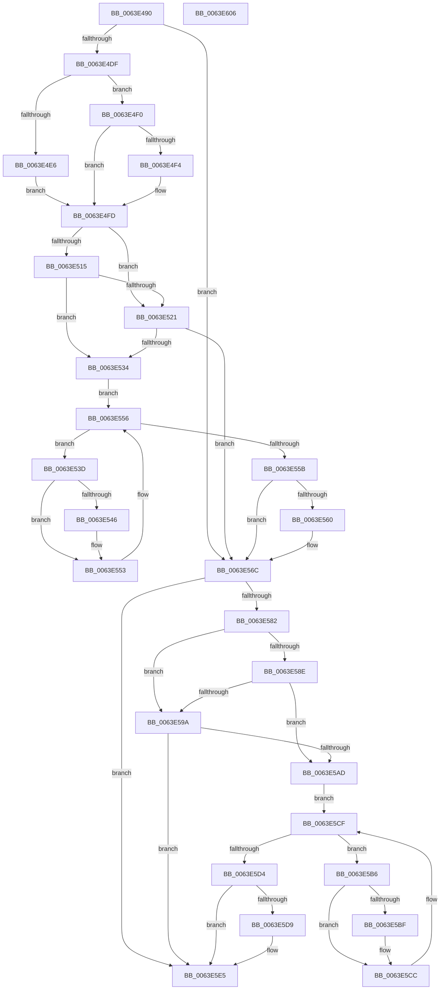

# DifZwAlpcCreateSecurityContextWrapper

- RVA: `0x0063E490`–`0x0063E607` (길이 `375` bytes)
- VA: `0x000000014063E490`
- 실행 섹션: `.text`
- PDB 이름 있음: `예`; PDB Function 태그: `아니요`
- unwind 정보 RVA: `0x000A9A64`
- 디코드: `108`개 명령, `375/375` bytes 표시
- 미해석 바이트: `0` (있으면 어셈블리에 `.byte`로 보존)

> 이 문서는 커널 이미지의 기계어와 PDB 기호를 분석해 생성했습니다. 4번과 5번은 함수 원형과 자료형을 바이너리 사용 방식에서 추정한 C 해석이며 원본 소스 복구 결과는 아닙니다.

## 1. Dependencies

- 직접 호출 지점: **9**; 고유 호출 대상: **6**
- 직접 호출자로 확인된 함수: **0**
- RIP 상대 이미지 참조: **3**

### Outgoing calls
- `0x0063E4CE` → [DifGetAPIThunkContextById](../49/DifGetAPIThunkContextById_function_00495A34.md) (function, `0x00495A34`)
- `0x0063E4F4` → [DifGetReturnAddressForWrappers](../4D/DifGetReturnAddressForWrappers_function_004D3C08.md) (function, `0x004D3C08`)
- `0x0063E528` → [ExAcquireRundownProtection](../21/ExAcquireRundownProtection_function_00216620.md) (function, `0x00216620`)
- `0x0063E54E` → [guard_dispatch_icall](../6B/guard_dispatch_icall_function_006BAAD0.md) (function, `0x006BAAD0`)
- `0x0063E567` → [ExReleaseRundownProtection](../34/ExReleaseRundownProtection_function_00349E80.md) (function, `0x00349E80`)
- `0x0063E575` → [ZwAlpcCreateSecurityContext](../6A/ZwAlpcCreateSecurityContext_function_006AE0F0.md) (function, `0x006AE0F0`)
- `0x0063E5A1` → [ExAcquireRundownProtection](../21/ExAcquireRundownProtection_function_00216620.md) (function, `0x00216620`)
- `0x0063E5C7` → [guard_dispatch_icall](../6B/guard_dispatch_icall_function_006BAAD0.md) (function, `0x006BAAD0`)
- `0x0063E5E0` → [ExReleaseRundownProtection](../34/ExReleaseRundownProtection_function_00349E80.md) (function, `0x00349E80`)

### Direct callers
- 이 함수 시작 RVA로 연결되는 직접 call은 확인되지 않았습니다. 간접 호출은 완전히 역산할 수 없습니다.

### Static image references
- `0x0063E504` → RVA `0x00F048B8` (`.data`; read)
- `0x0063E515` → RVA `0x00F04980` (`.data`; read)
- `0x0063E521` → RVA `0x00F03E80` (`.data`; read)

## 2. Other-region calls and transfers

- 다른 실행 섹션으로 향하는 call: **0**
- 별도 외부 분기/꼬리 이동을 확인하지 못했습니다.

## 3. Assembly (complete function range)

```asm
0063E490  48 89 5C 24 08                  mov qword ptr [rsp + 8], rbx
0063E495  48 89 74 24 10                  mov qword ptr [rsp + 0x10], rsi
0063E49A  48 89 7C 24 18                  mov qword ptr [rsp + 0x18], rdi
0063E49F  55                              push rbp
0063E4A0  41 54                           push r12
0063E4A2  41 55                           push r13
0063E4A4  41 56                           push r14
0063E4A6  41 57                           push r15
0063E4A8  48 8B EC                        mov rbp, rsp
0063E4AB  48 83 EC 50                     sub rsp, 0x50
0063E4AF  0F 57 C0                        xorps xmm0, xmm0
0063E4B2  33 C0                           xor eax, eax
0063E4B4  4C 8B E9                        mov r13, rcx
0063E4B7  48 89 45 F0                     mov qword ptr [rbp - 0x10], rax
0063E4BB  B9 89 00 00 00                  mov ecx, 0x89
0063E4C0  4D 8B F8                        mov r15, r8
0063E4C3  0F 11 45 D0                     movups xmmword ptr [rbp - 0x30], xmm0
0063E4C7  44 8B E2                        mov r12d, edx
0063E4CA  0F 11 45 E0                     movups xmmword ptr [rbp - 0x20], xmm0
0063E4CE  E8 61 75 E5 FF                  call 0x140495a34
0063E4D3  48 8B F0                        mov rsi, rax
0063E4D6  48 85 C0                        test rax, rax
0063E4D9  0F 84 8D 00 00 00               je 0x14063e56c
0063E4DF  8B 40 0C                        mov eax, dword ptr [rax + 0xc]
0063E4E2  A8 18                           test al, 0x18
0063E4E4  74 0A                           je 0x14063e4f0
0063E4E6  48 8B 4D 28                     mov rcx, qword ptr [rbp + 0x28]
0063E4EA  48 89 4D D0                     mov qword ptr [rbp - 0x30], rcx
0063E4EE  EB 0D                           jmp 0x14063e4fd
0063E4F0  A8 04                           test al, 4
0063E4F2  74 09                           je 0x14063e4fd
0063E4F4  E8 0F 57 E9 FF                  call 0x1404d3c08
0063E4F9  48 89 45 D0                     mov qword ptr [rbp - 0x30], rax
0063E4FD  45 32 F6                        xor r14b, r14b
0063E500  4C 89 6D E8                     mov qword ptr [rbp - 0x18], r13
0063E504  44 38 35 AD 63 8C 00            cmp byte ptr [rip + 0x8c63ad], r14b
0063E50B  44 89 65 E0                     mov dword ptr [rbp - 0x20], r12d
0063E50F  4C 89 7D D8                     mov qword ptr [rbp - 0x28], r15
0063E513  75 0C                           jne 0x14063e521
0063E515  F7 05 61 64 8C 00 00 08 00 00   test dword ptr [rip + 0x8c6461], 0x800
0063E51F  74 13                           je 0x14063e534
0063E521  48 8D 0D 58 59 8C 00            lea rcx, [rip + 0x8c5958]
0063E528  E8 F3 80 BD FF                  call 0x140216620
0063E52D  44 8A F0                        mov r14b, al
0063E530  84 C0                           test al, al
0063E532  74 38                           je 0x14063e56c
0063E534  48 8D 7E 20                     lea rdi, [rsi + 0x20]
0063E538  48 8B 1F                        mov rbx, qword ptr [rdi]
0063E53B  EB 19                           jmp 0x14063e556
0063E53D  48 8D 43 F0                     lea rax, [rbx - 0x10]
0063E541  48 85 C0                        test rax, rax
0063E544  74 0D                           je 0x14063e553
0063E546  48 8B 40 08                     mov rax, qword ptr [rax + 8]
0063E54A  48 8D 4D D0                     lea rcx, [rbp - 0x30]
0063E54E  E8 7D C5 07 00                  call 0x1406baad0
0063E553  48 8B 1B                        mov rbx, qword ptr [rbx]
0063E556  48 3B DF                        cmp rbx, rdi
0063E559  75 E2                           jne 0x14063e53d
0063E55B  45 84 F6                        test r14b, r14b
0063E55E  74 0C                           je 0x14063e56c
0063E560  48 8D 0D 19 59 8C 00            lea rcx, [rip + 0x8c5919]
0063E567  E8 14 B9 D0 FF                  call 0x140349e80
0063E56C  4D 8B C7                        mov r8, r15
0063E56F  41 8B D4                        mov edx, r12d
0063E572  49 8B CD                        mov rcx, r13
0063E575  E8 76 FB 06 00                  call 0x1406ae0f0
0063E57A  89 45 F0                        mov dword ptr [rbp - 0x10], eax
0063E57D  48 85 F6                        test rsi, rsi
0063E580  74 63                           je 0x14063e5e5
0063E582  40 32 FF                        xor dil, dil
0063E585  40 38 3D 2C 63 8C 00            cmp byte ptr [rip + 0x8c632c], dil
0063E58C  75 0C                           jne 0x14063e59a
0063E58E  F7 05 E8 63 8C 00 00 08 00 00   test dword ptr [rip + 0x8c63e8], 0x800
0063E598  74 13                           je 0x14063e5ad
0063E59A  48 8D 0D DF 58 8C 00            lea rcx, [rip + 0x8c58df]
0063E5A1  E8 7A 80 BD FF                  call 0x140216620
0063E5A6  40 8A F8                        mov dil, al
0063E5A9  84 C0                           test al, al
0063E5AB  74 38                           je 0x14063e5e5
0063E5AD  48 83 C6 30                     add rsi, 0x30
0063E5B1  48 8B 1E                        mov rbx, qword ptr [rsi]
0063E5B4  EB 19                           jmp 0x14063e5cf
0063E5B6  48 8D 43 F0                     lea rax, [rbx - 0x10]
0063E5BA  48 85 C0                        test rax, rax
0063E5BD  74 0D                           je 0x14063e5cc
0063E5BF  48 8B 40 08                     mov rax, qword ptr [rax + 8]
0063E5C3  48 8D 4D D0                     lea rcx, [rbp - 0x30]
0063E5C7  E8 04 C5 07 00                  call 0x1406baad0
0063E5CC  48 8B 1B                        mov rbx, qword ptr [rbx]
0063E5CF  48 3B DE                        cmp rbx, rsi
0063E5D2  75 E2                           jne 0x14063e5b6
0063E5D4  40 84 FF                        test dil, dil
0063E5D7  74 0C                           je 0x14063e5e5
0063E5D9  48 8D 0D A0 58 8C 00            lea rcx, [rip + 0x8c58a0]
0063E5E0  E8 9B B8 D0 FF                  call 0x140349e80
0063E5E5  8B 45 F0                        mov eax, dword ptr [rbp - 0x10]
0063E5E8  4C 8D 5C 24 50                  lea r11, [rsp + 0x50]
0063E5ED  49 8B 5B 30                     mov rbx, qword ptr [r11 + 0x30]
0063E5F1  49 8B 73 38                     mov rsi, qword ptr [r11 + 0x38]
0063E5F5  49 8B 7B 40                     mov rdi, qword ptr [r11 + 0x40]
0063E5F9  49 8B E3                        mov rsp, r11
0063E5FC  41 5F                           pop r15
0063E5FE  41 5E                           pop r14
0063E600  41 5D                           pop r13
0063E602  41 5C                           pop r12
0063E604  5D                              pop rbp
0063E605  C3                              ret
0063E606  CC                              int3
```

## 4. C-style interpretation (structured pseudocode)

```c
__int64 __fastcall DifZwAlpcCreateSecurityContextWrapper(__int64 a1, int a2, __int64 a3)
{
    __int64 result;
    __int64 v_r14;
    __int64 v_rdi;
    __int64 v_rsi;
    __int64 v_rsp;
    unsigned __int64 v_stack_m28;
    unsigned __int64 v_stack_m38;
    unsigned __int64 v_stack_m40;
    unsigned __int64 v_stack_m48;
    unsigned __int64 v_stack_m50;
    unsigned __int64 v_stack_m58;
    unsigned __int64 v_stack_p0;
    unsigned __int64 v_stack_p10;
    unsigned __int64 v_stack_p18;
    unsigned __int64 v_stack_p8;

    v_stack_p8 = v_rbx;
    v_stack_p10 = v_rsi;
    v_stack_p18 = v_rdi;
    v_rsp = (v_rsp) - (80);
    result = 0;
    v_stack_m38 = 0;
    v_stack_m58 = v_xmm0;
    v_stack_m48 = v_xmm0;
    result = DifGetAPIThunkContextById(137, a2, a3, a4);
    if (result == 0) goto loc_0063E56C;
    if ((((unsigned __int8)((unsigned int)(*(unsigned int *)(result + 12)))) & (24)) == 0) goto loc_0063E4F0;
    v_stack_m58 = v_stack_p0;
    goto loc_0063E4FD;
loc_0063E4F0:
    result = (unsigned int)(*(unsigned int *)(result + 12));
    if ((((unsigned __int8)((unsigned int)(*(unsigned int *)(result + 12)))) & (4)) != 0) {
        result = DifGetReturnAddressForWrappers(v_stack_p0, a2, a3, a4);
        v_stack_m58 = result;
    }
    v_r14 = 0;
    v_stack_m40 = a1;
    v_stack_m48 = (unsigned int)((unsigned int)(a2));
    v_stack_m50 = a3;
    if ((*(unsigned __int8 *)(v_rip + 9200557)) != 0) goto loc_0063E521;
    if (((*(unsigned int *)(v_rip + 9200737)) & (0x800ULL)) == 0) goto loc_0063E534;
loc_0063E521:
    result = ExAcquireRundownProtection(v_rip + 9197912, a2, a3, a4);
    if ((unsigned __int8)(result) == 0) goto loc_0063E56C;
loc_0063E534:
    goto loc_0063E556;
loc_0063E53D:
    result = *(unsigned __int64 *)(result + 32) - 16;
    if (*(unsigned __int64 *)(result + 32) - 16 != 0) {
        result = *(unsigned __int64 *)(*(unsigned __int64 *)(result + 32) - 16 + 8);
        a1 = v_stack_m58;
        result = guard_dispatch_icall(a1, a2, a3, a4);
    }
loc_0063E556:
    if ((*(unsigned __int64 *)(*(unsigned __int64 *)(result + 32))) != (result + 32)) goto loc_0063E53D;
    if ((unsigned __int8)((unsigned __int8)(result)) != 0) {
        a1 = v_rip + 9197849;
        result = ExReleaseRundownProtection(a1, a2, a3, a4);
    }
    result = ZwAlpcCreateSecurityContext(a1, (unsigned int)((unsigned int)((unsigned int)(a2))), a3, a4);
    v_stack_m38 = (unsigned int)(result);
    if (result == 0) goto loc_0063E5E5;
    v_rdi = 0;
    if ((*(unsigned __int8 *)(v_rip + 9200428)) != 0) goto loc_0063E59A;
    if (((*(unsigned int *)(v_rip + 9200616)) & (0x800ULL)) == 0) goto loc_0063E5AD;
loc_0063E59A:
    result = ExAcquireRundownProtection(v_rip + 9197791, (unsigned int)((unsigned int)((unsigned int)(a2))), a3, a4);
    if ((unsigned __int8)(result) == 0) goto loc_0063E5E5;
loc_0063E5AD:
    v_rsi = (result) + (48);
    goto loc_0063E5CF;
loc_0063E5B6:
    result = *(unsigned __int64 *)(v_rsi) - 16;
    if (*(unsigned __int64 *)(v_rsi) - 16 != 0) {
        result = *(unsigned __int64 *)(*(unsigned __int64 *)(v_rsi) - 16 + 8);
        a1 = v_stack_m58;
        result = guard_dispatch_icall(a1, (unsigned int)((unsigned int)((unsigned int)(a2))), a3, a4);
    }
loc_0063E5CF:
    if ((*(unsigned __int64 *)(*(unsigned __int64 *)(v_rsi))) != v_rsi) goto loc_0063E5B6;
    if ((unsigned __int8)((unsigned __int8)(result)) != 0) {
        a1 = v_rip + 9197728;
        result = ExReleaseRundownProtection(a1, (unsigned int)((unsigned int)((unsigned int)(a2))), a3, a4);
    }
    return (unsigned int)(v_stack_m38);
}
```

## 5. (Beta) C Style

```c
int64_t DifZwAlpcCreateSecurityContextWrapper(int64_t Arg1, int32_t Arg2, int64_t Arg3)
{
    int64_t result;
    int64_t local_r14;
    int64_t local_rdi;
    int64_t local_rsi;
    int64_t local_rsp;
    uint64_t v_stack_m28;
    uint64_t v_stack_m38;
    uint64_t v_stack_m40;
    uint64_t v_stack_m48;
    uint64_t v_stack_m50;
    uint64_t v_stack_m58;
    uint64_t v_stack_p0;
    uint64_t v_stack_p10;
    uint64_t v_stack_p18;
    uint64_t v_stack_p8;

    v_stack_p8 = local_rbx;
    v_stack_p10 = local_rsi;
    v_stack_p18 = local_rdi;
    local_rsp = (local_rsp) - (80);
    result = 0;
    v_stack_m38 = 0;
    v_stack_m58 = v_xmm0;
    v_stack_m48 = v_xmm0;
    result = DifGetAPIThunkContextById(137, Arg2, Arg3, a4);
    if (result == 0) goto loc_0063E56C;
    if ((((uint8_t)((uint32_t)(*(uint32_t *)(result + 0xC)))) & (24)) == 0) goto loc_0063E4F0;
    v_stack_m58 = v_stack_p0;
    goto loc_0063E4FD;
loc_0063E4F0:
    result = (uint32_t)(*(uint32_t *)(result + 0xC));
    if ((((uint8_t)((uint32_t)(*(uint32_t *)(result + 0xC)))) & (4)) != 0) {
        result = DifGetReturnAddressForWrappers(v_stack_p0, Arg2, Arg3, a4);
        v_stack_m58 = result;
    }
    local_r14 = 0;
    v_stack_m40 = Arg1;
    v_stack_m48 = (uint32_t)((uint32_t)(Arg2));
    v_stack_m50 = Arg3;
    if ((*(uint8_t *)(v_rip + 0x8C63AD)) != 0) goto loc_0063E521;
    if (((*(uint32_t *)(v_rip + 0x8C6461)) & (0x800ULL)) == 0) goto loc_0063E534;
loc_0063E521:
    result = ExAcquireRundownProtection(v_rip + 9197912, Arg2, Arg3, a4);
    if ((uint8_t)(result) == 0) goto loc_0063E56C;
loc_0063E534:
    goto loc_0063E556;
loc_0063E53D:
    result = *(uint64_t *)(result + 0x20) - 16;
    if (*(uint64_t *)(result + 0x20) - 16 != 0) {
        result = *(uint64_t *)(*(uint64_t *)(result + 0x20) - 0x10 + 0x8);
        Arg1 = v_stack_m58;
        result = guard_dispatch_icall(Arg1, Arg2, Arg3, a4);
    }
loc_0063E556:
    if ((*(uint64_t *)(*(uint64_t *)(result + 0x20))) != (result + 32)) goto loc_0063E53D;
    if ((uint8_t)((uint8_t)(result)) != 0) {
        Arg1 = v_rip + 9197849;
        result = ExReleaseRundownProtection(Arg1, Arg2, Arg3, a4);
    }
    result = ZwAlpcCreateSecurityContext(Arg1, (uint32_t)((uint32_t)((uint32_t)(Arg2))), Arg3, a4);
    v_stack_m38 = (uint32_t)(result);
    if (result == 0) goto loc_0063E5E5;
    local_rdi = 0;
    if ((*(uint8_t *)(v_rip + 0x8C632C)) != 0) goto loc_0063E59A;
    if (((*(uint32_t *)(v_rip + 0x8C63E8)) & (0x800ULL)) == 0) goto loc_0063E5AD;
loc_0063E59A:
    result = ExAcquireRundownProtection(v_rip + 9197791, (uint32_t)((uint32_t)((uint32_t)(Arg2))), Arg3, a4);
    if ((uint8_t)(result) == 0) goto loc_0063E5E5;
loc_0063E5AD:
    local_rsi = (result) + (48);
    goto loc_0063E5CF;
loc_0063E5B6:
    result = *(uint64_t *)(local_rsi) - 16;
    if (*(uint64_t *)(local_rsi) - 16 != 0) {
        result = *(uint64_t *)(*(uint64_t *)(local_rsi) - 0x10 + 0x8);
        Arg1 = v_stack_m58;
        result = guard_dispatch_icall(Arg1, (uint32_t)((uint32_t)((uint32_t)(Arg2))), Arg3, a4);
    }
loc_0063E5CF:
    if ((*(uint64_t *)(*(uint64_t *)(local_rsi))) != local_rsi) goto loc_0063E5B6;
    if ((uint8_t)((uint8_t)(result)) != 0) {
        Arg1 = v_rip + 9197728;
        result = ExReleaseRundownProtection(Arg1, (uint32_t)((uint32_t)((uint32_t)(Arg2))), Arg3, a4);
    }
    return (uint32_t)(v_stack_m38);
}
```

## 6. Execution-region graph

[열기: 2D/3D 그래프와 함수 탐색 컨트롤 패널](../../../control-panel.html?section=text&rva=0x0063E490&view=graph)

- 2D 그래프는 위에서 아래로 흐르고, 3D 그래프는 빈 공간을 드래그해 회전합니다. Shift+드래그는 이동, 휠은 확대·축소, 함수 노드 선택은 대상 보고서 이동입니다.

### Static fallback


