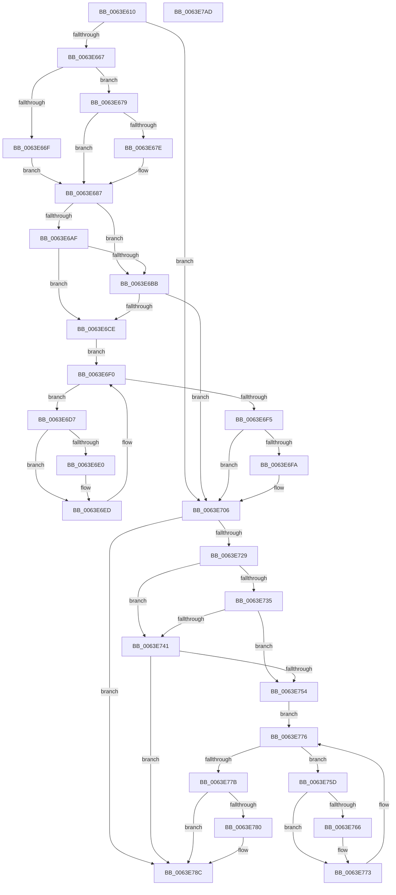

# DifZwAlpcQueryInformationWrapper

- RVA: `0x0063E610`–`0x0063E7AE` (길이 `414` bytes)
- VA: `0x000000014063E610`
- 실행 섹션: `.text`
- PDB 이름 있음: `예`; PDB Function 태그: `아니요`
- unwind 정보 RVA: `0x000BD780`
- 디코드: `118`개 명령, `414/414` bytes 표시
- 미해석 바이트: `0` (있으면 어셈블리에 `.byte`로 보존)

> 이 문서는 커널 이미지의 기계어와 PDB 기호를 분석해 생성했습니다. 4번과 5번은 함수 원형과 자료형을 바이너리 사용 방식에서 추정한 C 해석이며 원본 소스 복구 결과는 아닙니다.

## 1. Dependencies

- 직접 호출 지점: **9**; 고유 호출 대상: **6**
- 직접 호출자로 확인된 함수: **0**
- RIP 상대 이미지 참조: **3**

### Outgoing calls
- `0x0063E656` → [DifGetAPIThunkContextById](../49/DifGetAPIThunkContextById_function_00495A34.md) (function, `0x00495A34`)
- `0x0063E67E` → [DifGetReturnAddressForWrappers](../4D/DifGetReturnAddressForWrappers_function_004D3C08.md) (function, `0x004D3C08`)
- `0x0063E6C2` → [ExAcquireRundownProtection](../21/ExAcquireRundownProtection_function_00216620.md) (function, `0x00216620`)
- `0x0063E6E8` → [guard_dispatch_icall](../6B/guard_dispatch_icall_function_006BAAD0.md) (function, `0x006BAAD0`)
- `0x0063E701` → [ExReleaseRundownProtection](../34/ExReleaseRundownProtection_function_00349E80.md) (function, `0x00349E80`)
- `0x0063E71C` → [ZwAlpcQueryInformation](../6A/ZwAlpcQueryInformation_function_006AE230.md) (function, `0x006AE230`)
- `0x0063E748` → [ExAcquireRundownProtection](../21/ExAcquireRundownProtection_function_00216620.md) (function, `0x00216620`)
- `0x0063E76E` → [guard_dispatch_icall](../6B/guard_dispatch_icall_function_006BAAD0.md) (function, `0x006BAAD0`)
- `0x0063E787` → [ExReleaseRundownProtection](../34/ExReleaseRundownProtection_function_00349E80.md) (function, `0x00349E80`)

### Direct callers
- 이 함수 시작 RVA로 연결되는 직접 call은 확인되지 않았습니다. 간접 호출은 완전히 역산할 수 없습니다.

### Static image references
- `0x0063E68E` → RVA `0x00F048B8` (`.data`; read)
- `0x0063E6AF` → RVA `0x00F04980` (`.data`; read)
- `0x0063E6BB` → RVA `0x00F03E80` (`.data`; read)

## 2. Other-region calls and transfers

- 다른 실행 섹션으로 향하는 call: **0**
- 별도 외부 분기/꼬리 이동을 확인하지 못했습니다.

## 3. Assembly (complete function range)

```asm
0063E610  48 8B C4                        mov rax, rsp
0063E613  48 89 58 10                     mov qword ptr [rax + 0x10], rbx
0063E617  48 89 70 18                     mov qword ptr [rax + 0x18], rsi
0063E61B  48 89 78 20                     mov qword ptr [rax + 0x20], rdi
0063E61F  48 89 48 08                     mov qword ptr [rax + 8], rcx
0063E623  55                              push rbp
0063E624  41 54                           push r12
0063E626  41 55                           push r13
0063E628  41 56                           push r14
0063E62A  41 57                           push r15
0063E62C  48 8B EC                        mov rbp, rsp
0063E62F  48 83 EC 70                     sub rsp, 0x70
0063E633  0F 57 C0                        xorps xmm0, xmm0
0063E636  33 C0                           xor eax, eax
0063E638  B9 88 00 00 00                  mov ecx, 0x88
0063E63D  48 89 45 F0                     mov qword ptr [rbp - 0x10], rax
0063E641  0F 11 45 C0                     movups xmmword ptr [rbp - 0x40], xmm0
0063E645  45 8B F9                        mov r15d, r9d
0063E648  4D 8B E0                        mov r12, r8
0063E64B  0F 11 45 D0                     movups xmmword ptr [rbp - 0x30], xmm0
0063E64F  44 8B EA                        mov r13d, edx
0063E652  0F 11 45 E0                     movups xmmword ptr [rbp - 0x20], xmm0
0063E656  E8 D9 73 E5 FF                  call 0x140495a34
0063E65B  4C 8B F0                        mov r14, rax
0063E65E  48 85 C0                        test rax, rax
0063E661  0F 84 9F 00 00 00               je 0x14063e706
0063E667  8B 48 0C                        mov ecx, dword ptr [rax + 0xc]
0063E66A  F6 C1 18                        test cl, 0x18
0063E66D  74 0A                           je 0x14063e679
0063E66F  48 8B 4D 28                     mov rcx, qword ptr [rbp + 0x28]
0063E673  48 89 4D C0                     mov qword ptr [rbp - 0x40], rcx
0063E677  EB 0E                           jmp 0x14063e687
0063E679  F6 C1 04                        test cl, 4
0063E67C  74 09                           je 0x14063e687
0063E67E  E8 85 55 E9 FF                  call 0x1404d3c08
0063E683  48 89 45 C0                     mov qword ptr [rbp - 0x40], rax
0063E687  48 8B 45 30                     mov rax, qword ptr [rbp + 0x30]
0063E68B  40 32 F6                        xor sil, sil
0063E68E  40 38 35 23 62 8C 00            cmp byte ptr [rip + 0x8c6223], sil
0063E695  48 89 45 E8                     mov qword ptr [rbp - 0x18], rax
0063E699  48 8B 45 50                     mov rax, qword ptr [rbp + 0x50]
0063E69D  48 89 45 C8                     mov qword ptr [rbp - 0x38], rax
0063E6A1  44 89 6D E0                     mov dword ptr [rbp - 0x20], r13d
0063E6A5  4C 89 65 D8                     mov qword ptr [rbp - 0x28], r12
0063E6A9  44 89 7D D0                     mov dword ptr [rbp - 0x30], r15d
0063E6AD  75 0C                           jne 0x14063e6bb
0063E6AF  F7 05 C7 62 8C 00 00 08 00 00   test dword ptr [rip + 0x8c62c7], 0x800
0063E6B9  74 13                           je 0x14063e6ce
0063E6BB  48 8D 0D BE 57 8C 00            lea rcx, [rip + 0x8c57be]
0063E6C2  E8 59 7F BD FF                  call 0x140216620
0063E6C7  40 8A F0                        mov sil, al
0063E6CA  84 C0                           test al, al
0063E6CC  74 38                           je 0x14063e706
0063E6CE  49 8D 7E 20                     lea rdi, [r14 + 0x20]
0063E6D2  48 8B 1F                        mov rbx, qword ptr [rdi]
0063E6D5  EB 19                           jmp 0x14063e6f0
0063E6D7  48 8D 43 F0                     lea rax, [rbx - 0x10]
0063E6DB  48 85 C0                        test rax, rax
0063E6DE  74 0D                           je 0x14063e6ed
0063E6E0  48 8B 40 08                     mov rax, qword ptr [rax + 8]
0063E6E4  48 8D 4D C0                     lea rcx, [rbp - 0x40]
0063E6E8  E8 E3 C3 07 00                  call 0x1406baad0
0063E6ED  48 8B 1B                        mov rbx, qword ptr [rbx]
0063E6F0  48 3B DF                        cmp rbx, rdi
0063E6F3  75 E2                           jne 0x14063e6d7
0063E6F5  40 84 F6                        test sil, sil
0063E6F8  74 0C                           je 0x14063e706
0063E6FA  48 8D 0D 7F 57 8C 00            lea rcx, [rip + 0x8c577f]
0063E701  E8 7A B7 D0 FF                  call 0x140349e80
0063E706  48 8B 45 50                     mov rax, qword ptr [rbp + 0x50]
0063E70A  45 8B CF                        mov r9d, r15d
0063E70D  48 8B 4D 30                     mov rcx, qword ptr [rbp + 0x30]
0063E711  4D 8B C4                        mov r8, r12
0063E714  41 8B D5                        mov edx, r13d
0063E717  48 89 44 24 20                  mov qword ptr [rsp + 0x20], rax
0063E71C  E8 0F FB 06 00                  call 0x1406ae230
0063E721  89 45 F0                        mov dword ptr [rbp - 0x10], eax
0063E724  4D 85 F6                        test r14, r14
0063E727  74 63                           je 0x14063e78c
0063E729  40 32 FF                        xor dil, dil
0063E72C  40 38 3D 85 61 8C 00            cmp byte ptr [rip + 0x8c6185], dil
0063E733  75 0C                           jne 0x14063e741
0063E735  F7 05 41 62 8C 00 00 08 00 00   test dword ptr [rip + 0x8c6241], 0x800
0063E73F  74 13                           je 0x14063e754
0063E741  48 8D 0D 38 57 8C 00            lea rcx, [rip + 0x8c5738]
0063E748  E8 D3 7E BD FF                  call 0x140216620
0063E74D  40 8A F8                        mov dil, al
0063E750  84 C0                           test al, al
0063E752  74 38                           je 0x14063e78c
0063E754  49 8D 76 30                     lea rsi, [r14 + 0x30]
0063E758  48 8B 1E                        mov rbx, qword ptr [rsi]
0063E75B  EB 19                           jmp 0x14063e776
0063E75D  48 8D 43 F0                     lea rax, [rbx - 0x10]
0063E761  48 85 C0                        test rax, rax
0063E764  74 0D                           je 0x14063e773
0063E766  48 8B 40 08                     mov rax, qword ptr [rax + 8]
0063E76A  48 8D 4D C0                     lea rcx, [rbp - 0x40]
0063E76E  E8 5D C3 07 00                  call 0x1406baad0
0063E773  48 8B 1B                        mov rbx, qword ptr [rbx]
0063E776  48 3B DE                        cmp rbx, rsi
0063E779  75 E2                           jne 0x14063e75d
0063E77B  40 84 FF                        test dil, dil
0063E77E  74 0C                           je 0x14063e78c
0063E780  48 8D 0D F9 56 8C 00            lea rcx, [rip + 0x8c56f9]
0063E787  E8 F4 B6 D0 FF                  call 0x140349e80
0063E78C  8B 45 F0                        mov eax, dword ptr [rbp - 0x10]
0063E78F  4C 8D 5C 24 70                  lea r11, [rsp + 0x70]
0063E794  49 8B 5B 38                     mov rbx, qword ptr [r11 + 0x38]
0063E798  49 8B 73 40                     mov rsi, qword ptr [r11 + 0x40]
0063E79C  49 8B 7B 48                     mov rdi, qword ptr [r11 + 0x48]
0063E7A0  49 8B E3                        mov rsp, r11
0063E7A3  41 5F                           pop r15
0063E7A5  41 5E                           pop r14
0063E7A7  41 5D                           pop r13
0063E7A9  41 5C                           pop r12
0063E7AB  5D                              pop rbp
0063E7AC  C3                              ret
0063E7AD  CC                              int3
```

## 4. C-style interpretation (structured pseudocode)

```c
__int64 __fastcall DifZwAlpcQueryInformationWrapper(__int64 a1, int a2, __int64 a3, int a4, __int64 a5)
{
    __int64 result;
    __int64 v_rdi;
    __int64 v_rsi;
    __int64 v_rsp;
    unsigned __int64 v_stack_m28;
    unsigned __int64 v_stack_m38;
    unsigned __int64 v_stack_m40;
    unsigned __int64 v_stack_m48;
    unsigned __int64 v_stack_m50;
    unsigned __int64 v_stack_m58;
    unsigned __int64 v_stack_m60;
    unsigned __int64 v_stack_m68;
    unsigned __int64 v_stack_m78;
    unsigned __int64 v_stack_p0;
    unsigned __int64 v_stack_p8;

    *(unsigned __int64 *)(v_rsp + 16) = v_rbx;
    *(unsigned __int64 *)(v_rsp + 24) = v_rsi;
    *(unsigned __int64 *)(v_rsp + 32) = v_rdi;
    *(unsigned __int64 *)(v_rsp + 8) = a1;
    v_rsp = (v_rsp) - (112);
    result = 0;
    v_stack_m38 = 0;
    v_stack_m68 = v_xmm0;
    v_stack_m58 = v_xmm0;
    v_stack_m48 = v_xmm0;
    result = DifGetAPIThunkContextById(136, a2, a3, a4);
    if (result == 0) goto loc_0063E706;
    if ((((unsigned __int8)((unsigned int)(*(unsigned int *)(result + 12)))) & (24)) == 0) goto loc_0063E679;
    v_stack_m68 = v_stack_p0;
    goto loc_0063E687;
loc_0063E679:
    if ((((unsigned __int8)(v_stack_p0)) & (4)) != 0) {
        result = DifGetReturnAddressForWrappers(v_stack_p0, a2, a3, a4);
        v_stack_m68 = result;
    }
    v_rsi = 0;
    v_stack_m40 = v_stack_p8;
    v_stack_m60 = a5;
    v_stack_m48 = (unsigned int)((unsigned int)(a2));
    v_stack_m50 = a3;
    v_stack_m58 = (unsigned int)((unsigned int)(a4));
    if ((*(unsigned __int8 *)(v_rip + 9200163)) != 0) goto loc_0063E6BB;
    if (((*(unsigned int *)(v_rip + 9200327)) & (0x800ULL)) == 0) goto loc_0063E6CE;
loc_0063E6BB:
    result = ExAcquireRundownProtection(v_rip + 9197502, a2, a3, a4);
    if ((unsigned __int8)(result) == 0) goto loc_0063E706;
loc_0063E6CE:
    goto loc_0063E6F0;
loc_0063E6D7:
    result = *(unsigned __int64 *)(result + 32) - 16;
    if (*(unsigned __int64 *)(result + 32) - 16 != 0) {
        result = *(unsigned __int64 *)(*(unsigned __int64 *)(result + 32) - 16 + 8);
        a1 = v_stack_m68;
        result = guard_dispatch_icall(a1, a2, a3, a4);
    }
loc_0063E6F0:
    if ((*(unsigned __int64 *)(*(unsigned __int64 *)(result + 32))) != (result + 32)) goto loc_0063E6D7;
    if ((unsigned __int8)((unsigned __int8)(result)) != 0) {
        a1 = v_rip + 9197439;
        result = ExReleaseRundownProtection(a1, a2, a3, a4);
    }
    v_stack_m78 = a5;
    result = ZwAlpcQueryInformation(v_stack_p8, (unsigned int)((unsigned int)((unsigned int)(a2))), a3, (unsigned int)((unsigned int)((unsigned int)(a4))));
    v_stack_m38 = (unsigned int)(result);
    if (result == 0) goto loc_0063E78C;
    v_rdi = 0;
    if ((*(unsigned __int8 *)(v_rip + 9200005)) != 0) goto loc_0063E741;
    if (((*(unsigned int *)(v_rip + 9200193)) & (0x800ULL)) == 0) goto loc_0063E754;
loc_0063E741:
    result = ExAcquireRundownProtection(v_rip + 9197368, (unsigned int)((unsigned int)((unsigned int)(a2))), a3, (unsigned int)((unsigned int)((unsigned int)(a4))));
    if ((unsigned __int8)(result) == 0) goto loc_0063E78C;
loc_0063E754:
    goto loc_0063E776;
loc_0063E75D:
    result = *(unsigned __int64 *)(result + 48) - 16;
    if (*(unsigned __int64 *)(result + 48) - 16 != 0) {
        result = *(unsigned __int64 *)(*(unsigned __int64 *)(result + 48) - 16 + 8);
        a1 = v_stack_m68;
        result = guard_dispatch_icall(a1, (unsigned int)((unsigned int)((unsigned int)(a2))), a3, (unsigned int)((unsigned int)((unsigned int)(a4))));
    }
loc_0063E776:
    if ((*(unsigned __int64 *)(*(unsigned __int64 *)(result + 48))) != (result + 48)) goto loc_0063E75D;
    if ((unsigned __int8)((unsigned __int8)(result)) != 0) {
        a1 = v_rip + 9197305;
        result = ExReleaseRundownProtection(a1, (unsigned int)((unsigned int)((unsigned int)(a2))), a3, (unsigned int)((unsigned int)((unsigned int)(a4))));
    }
    return (unsigned int)(v_stack_m38);
}
```

## 5. (Beta) C Style

```c
int64_t DifZwAlpcQueryInformationWrapper(int64_t Arg1, int32_t Arg2, int64_t Arg3, int32_t Arg4, int64_t Arg5)
{
    int64_t result;
    int64_t local_rdi;
    int64_t local_rsi;
    int64_t local_rsp;
    uint64_t v_stack_m28;
    uint64_t v_stack_m38;
    uint64_t v_stack_m40;
    uint64_t v_stack_m48;
    uint64_t v_stack_m50;
    uint64_t v_stack_m58;
    uint64_t v_stack_m60;
    uint64_t v_stack_m68;
    uint64_t v_stack_m78;
    uint64_t v_stack_p0;
    uint64_t v_stack_p8;

    *(uint64_t *)(local_rsp + 0x10) = local_rbx;
    *(uint64_t *)(local_rsp + 0x18) = local_rsi;
    *(uint64_t *)(local_rsp + 0x20) = local_rdi;
    *(uint64_t *)(local_rsp + 0x8) = Arg1;
    local_rsp = (local_rsp) - (112);
    result = 0;
    v_stack_m38 = 0;
    v_stack_m68 = v_xmm0;
    v_stack_m58 = v_xmm0;
    v_stack_m48 = v_xmm0;
    result = DifGetAPIThunkContextById(136, Arg2, Arg3, Arg4);
    if (result == 0) goto loc_0063E706;
    if ((((uint8_t)((uint32_t)(*(uint32_t *)(result + 0xC)))) & (24)) == 0) goto loc_0063E679;
    v_stack_m68 = v_stack_p0;
    goto loc_0063E687;
loc_0063E679:
    if ((((uint8_t)(v_stack_p0)) & (4)) != 0) {
        result = DifGetReturnAddressForWrappers(v_stack_p0, Arg2, Arg3, Arg4);
        v_stack_m68 = result;
    }
    local_rsi = 0;
    v_stack_m40 = v_stack_p8;
    v_stack_m60 = Arg5;
    v_stack_m48 = (uint32_t)((uint32_t)(Arg2));
    v_stack_m50 = Arg3;
    v_stack_m58 = (uint32_t)((uint32_t)(Arg4));
    if ((*(uint8_t *)(v_rip + 0x8C6223)) != 0) goto loc_0063E6BB;
    if (((*(uint32_t *)(v_rip + 0x8C62C7)) & (0x800ULL)) == 0) goto loc_0063E6CE;
loc_0063E6BB:
    result = ExAcquireRundownProtection(v_rip + 9197502, Arg2, Arg3, Arg4);
    if ((uint8_t)(result) == 0) goto loc_0063E706;
loc_0063E6CE:
    goto loc_0063E6F0;
loc_0063E6D7:
    result = *(uint64_t *)(result + 0x20) - 16;
    if (*(uint64_t *)(result + 0x20) - 16 != 0) {
        result = *(uint64_t *)(*(uint64_t *)(result + 0x20) - 0x10 + 0x8);
        Arg1 = v_stack_m68;
        result = guard_dispatch_icall(Arg1, Arg2, Arg3, Arg4);
    }
loc_0063E6F0:
    if ((*(uint64_t *)(*(uint64_t *)(result + 0x20))) != (result + 32)) goto loc_0063E6D7;
    if ((uint8_t)((uint8_t)(result)) != 0) {
        Arg1 = v_rip + 9197439;
        result = ExReleaseRundownProtection(Arg1, Arg2, Arg3, Arg4);
    }
    v_stack_m78 = Arg5;
    result = ZwAlpcQueryInformation(v_stack_p8, (uint32_t)((uint32_t)((uint32_t)(Arg2))), Arg3, (uint32_t)((uint32_t)((uint32_t)(Arg4))));
    v_stack_m38 = (uint32_t)(result);
    if (result == 0) goto loc_0063E78C;
    local_rdi = 0;
    if ((*(uint8_t *)(v_rip + 0x8C6185)) != 0) goto loc_0063E741;
    if (((*(uint32_t *)(v_rip + 0x8C6241)) & (0x800ULL)) == 0) goto loc_0063E754;
loc_0063E741:
    result = ExAcquireRundownProtection(v_rip + 9197368, (uint32_t)((uint32_t)((uint32_t)(Arg2))), Arg3, (uint32_t)((uint32_t)((uint32_t)(Arg4))));
    if ((uint8_t)(result) == 0) goto loc_0063E78C;
loc_0063E754:
    goto loc_0063E776;
loc_0063E75D:
    result = *(uint64_t *)(result + 0x30) - 16;
    if (*(uint64_t *)(result + 0x30) - 16 != 0) {
        result = *(uint64_t *)(*(uint64_t *)(result + 0x30) - 0x10 + 0x8);
        Arg1 = v_stack_m68;
        result = guard_dispatch_icall(Arg1, (uint32_t)((uint32_t)((uint32_t)(Arg2))), Arg3, (uint32_t)((uint32_t)((uint32_t)(Arg4))));
    }
loc_0063E776:
    if ((*(uint64_t *)(*(uint64_t *)(result + 0x30))) != (result + 48)) goto loc_0063E75D;
    if ((uint8_t)((uint8_t)(result)) != 0) {
        Arg1 = v_rip + 9197305;
        result = ExReleaseRundownProtection(Arg1, (uint32_t)((uint32_t)((uint32_t)(Arg2))), Arg3, (uint32_t)((uint32_t)((uint32_t)(Arg4))));
    }
    return (uint32_t)(v_stack_m38);
}
```

## 6. Execution-region graph

[열기: 2D/3D 그래프와 함수 탐색 컨트롤 패널](../../../control-panel.html?section=text&rva=0x0063E610&view=graph)

- 2D 그래프는 위에서 아래로 흐르고, 3D 그래프는 빈 공간을 드래그해 회전합니다. Shift+드래그는 이동, 휠은 확대·축소, 함수 노드 선택은 대상 보고서 이동입니다.

### Static fallback


