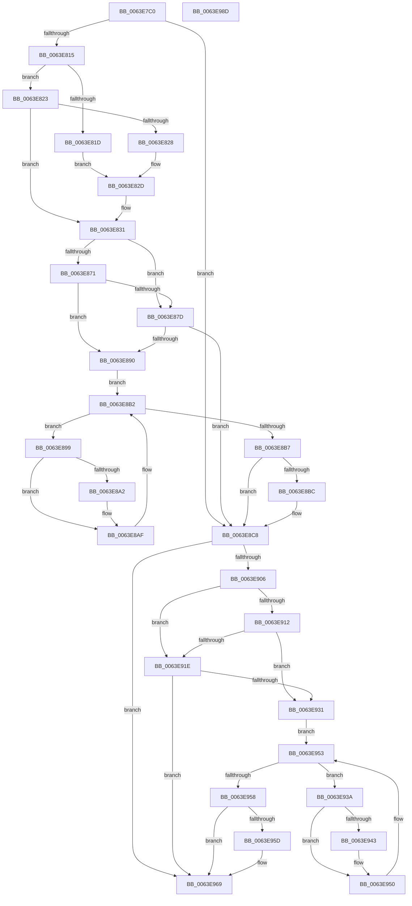

# DifZwAlpcSendWaitReceivePortWrapper

- RVA: `0x0063E7C0`–`0x0063E98E` (길이 `462` bytes)
- VA: `0x000000014063E7C0`
- 실행 섹션: `.text`
- PDB 이름 있음: `예`; PDB Function 태그: `아니요`
- unwind 정보 RVA: `0x000D2C00`
- 디코드: `127`개 명령, `462/462` bytes 표시
- 미해석 바이트: `0` (있으면 어셈블리에 `.byte`로 보존)

> 이 문서는 커널 이미지의 기계어와 PDB 기호를 분석해 생성했습니다. 4번과 5번은 함수 원형과 자료형을 바이너리 사용 방식에서 추정한 C 해석이며 원본 소스 복구 결과는 아닙니다.

## 1. Dependencies

- 직접 호출 지점: **10**; 고유 호출 대상: **7**
- 직접 호출자로 확인된 함수: **0**
- RIP 상대 이미지 참조: **3**

### Outgoing calls
- `0x0063E7FA` → [memset](../6C/memset_function_006C6C40.md) (function, `0x006C6C40`)
- `0x0063E804` → [DifGetAPIThunkContextById](../49/DifGetAPIThunkContextById_function_00495A34.md) (function, `0x00495A34`)
- `0x0063E828` → [DifGetReturnAddressForWrappers](../4D/DifGetReturnAddressForWrappers_function_004D3C08.md) (function, `0x004D3C08`)
- `0x0063E884` → [ExAcquireRundownProtection](../21/ExAcquireRundownProtection_function_00216620.md) (function, `0x00216620`)
- `0x0063E8AA` → [guard_dispatch_icall](../6B/guard_dispatch_icall_function_006BAAD0.md) (function, `0x006BAAD0`)
- `0x0063E8C3` → [ExReleaseRundownProtection](../34/ExReleaseRundownProtection_function_00349E80.md) (function, `0x00349E80`)
- `0x0063E8F9` → [ZwAlpcSendWaitReceivePort](../6A/ZwAlpcSendWaitReceivePort_function_006AE290.md) (function, `0x006AE290`)
- `0x0063E925` → [ExAcquireRundownProtection](../21/ExAcquireRundownProtection_function_00216620.md) (function, `0x00216620`)
- `0x0063E94B` → [guard_dispatch_icall](../6B/guard_dispatch_icall_function_006BAAD0.md) (function, `0x006BAAD0`)
- `0x0063E964` → [ExReleaseRundownProtection](../34/ExReleaseRundownProtection_function_00349E80.md) (function, `0x00349E80`)

### Direct callers
- 이 함수 시작 RVA로 연결되는 직접 call은 확인되지 않았습니다. 간접 호출은 완전히 역산할 수 없습니다.

### Static image references
- `0x0063E838` → RVA `0x00F048B8` (`.data`; read)
- `0x0063E871` → RVA `0x00F04980` (`.data`; read)
- `0x0063E87D` → RVA `0x00F03E80` (`.data`; read)

## 2. Other-region calls and transfers

- 다른 실행 섹션으로 향하는 call: **0**
- 별도 외부 분기/꼬리 이동을 확인하지 못했습니다.

## 3. Assembly (complete function range)

```asm
0063E7C0  48 8B C4                        mov rax, rsp
0063E7C3  48 89 58 10                     mov qword ptr [rax + 0x10], rbx
0063E7C7  48 89 70 18                     mov qword ptr [rax + 0x18], rsi
0063E7CB  48 89 78 20                     mov qword ptr [rax + 0x20], rdi
0063E7CF  48 89 48 08                     mov qword ptr [rax + 8], rcx
0063E7D3  55                              push rbp
0063E7D4  41 54                           push r12
0063E7D6  41 55                           push r13
0063E7D8  41 56                           push r14
0063E7DA  41 57                           push r15
0063E7DC  48 8D 68 C1                     lea rbp, [rax - 0x3f]
0063E7E0  48 81 EC 90 00 00 00            sub rsp, 0x90
0063E7E7  44 8B EA                        mov r13d, edx
0063E7EA  48 8D 4D C7                     lea rcx, [rbp - 0x39]
0063E7EE  33 D2                           xor edx, edx
0063E7F0  4D 8B E0                        mov r12, r8
0063E7F3  4D 8B F9                        mov r15, r9
0063E7F6  44 8D 42 50                     lea r8d, [rdx + 0x50]
0063E7FA  E8 41 84 08 00                  call 0x1406c6c40
0063E7FF  B9 87 00 00 00                  mov ecx, 0x87
0063E804  E8 2B 72 E5 FF                  call 0x140495a34
0063E809  48 8B F0                        mov rsi, rax
0063E80C  48 85 C0                        test rax, rax
0063E80F  0F 84 B3 00 00 00               je 0x14063e8c8
0063E815  8B 48 0C                        mov ecx, dword ptr [rax + 0xc]
0063E818  F6 C1 18                        test cl, 0x18
0063E81B  74 06                           je 0x14063e823
0063E81D  48 8B 45 3F                     mov rax, qword ptr [rbp + 0x3f]
0063E821  EB 0A                           jmp 0x14063e82d
0063E823  F6 C1 04                        test cl, 4
0063E826  74 09                           je 0x14063e831
0063E828  E8 DB 53 E9 FF                  call 0x1404d3c08
0063E82D  48 89 45 C7                     mov qword ptr [rbp - 0x39], rax
0063E831  48 8B 45 47                     mov rax, qword ptr [rbp + 0x47]
0063E835  45 32 F6                        xor r14b, r14b
0063E838  44 38 35 79 60 8C 00            cmp byte ptr [rip + 0x8c6079], r14b
0063E83F  48 89 45 07                     mov qword ptr [rbp + 7], rax
0063E843  48 8B 45 67                     mov rax, qword ptr [rbp + 0x67]
0063E847  48 89 45 E7                     mov qword ptr [rbp - 0x19], rax
0063E84B  48 8B 45 6F                     mov rax, qword ptr [rbp + 0x6f]
0063E84F  48 89 45 DF                     mov qword ptr [rbp - 0x21], rax
0063E853  48 8B 45 77                     mov rax, qword ptr [rbp + 0x77]
0063E857  48 89 45 D7                     mov qword ptr [rbp - 0x29], rax
0063E85B  48 8B 45 7F                     mov rax, qword ptr [rbp + 0x7f]
0063E85F  48 89 45 CF                     mov qword ptr [rbp - 0x31], rax
0063E863  44 89 6D FF                     mov dword ptr [rbp - 1], r13d
0063E867  4C 89 65 F7                     mov qword ptr [rbp - 9], r12
0063E86B  4C 89 7D EF                     mov qword ptr [rbp - 0x11], r15
0063E86F  75 0C                           jne 0x14063e87d
0063E871  F7 05 05 61 8C 00 00 08 00 00   test dword ptr [rip + 0x8c6105], 0x800
0063E87B  74 13                           je 0x14063e890
0063E87D  48 8D 0D FC 55 8C 00            lea rcx, [rip + 0x8c55fc]
0063E884  E8 97 7D BD FF                  call 0x140216620
0063E889  44 8A F0                        mov r14b, al
0063E88C  84 C0                           test al, al
0063E88E  74 38                           je 0x14063e8c8
0063E890  48 8D 7E 20                     lea rdi, [rsi + 0x20]
0063E894  48 8B 1F                        mov rbx, qword ptr [rdi]
0063E897  EB 19                           jmp 0x14063e8b2
0063E899  48 8D 43 F0                     lea rax, [rbx - 0x10]
0063E89D  48 85 C0                        test rax, rax
0063E8A0  74 0D                           je 0x14063e8af
0063E8A2  48 8B 40 08                     mov rax, qword ptr [rax + 8]
0063E8A6  48 8D 4D C7                     lea rcx, [rbp - 0x39]
0063E8AA  E8 21 C2 07 00                  call 0x1406baad0
0063E8AF  48 8B 1B                        mov rbx, qword ptr [rbx]
0063E8B2  48 3B DF                        cmp rbx, rdi
0063E8B5  75 E2                           jne 0x14063e899
0063E8B7  45 84 F6                        test r14b, r14b
0063E8BA  74 0C                           je 0x14063e8c8
0063E8BC  48 8D 0D BD 55 8C 00            lea rcx, [rip + 0x8c55bd]
0063E8C3  E8 B8 B5 D0 FF                  call 0x140349e80
0063E8C8  48 8B 45 7F                     mov rax, qword ptr [rbp + 0x7f]
0063E8CC  4D 8B CF                        mov r9, r15
0063E8CF  48 8B 4D 47                     mov rcx, qword ptr [rbp + 0x47]
0063E8D3  4D 8B C4                        mov r8, r12
0063E8D6  48 89 44 24 38                  mov qword ptr [rsp + 0x38], rax
0063E8DB  41 8B D5                        mov edx, r13d
0063E8DE  48 8B 45 77                     mov rax, qword ptr [rbp + 0x77]
0063E8E2  48 89 44 24 30                  mov qword ptr [rsp + 0x30], rax
0063E8E7  48 8B 45 6F                     mov rax, qword ptr [rbp + 0x6f]
0063E8EB  48 89 44 24 28                  mov qword ptr [rsp + 0x28], rax
0063E8F0  48 8B 45 67                     mov rax, qword ptr [rbp + 0x67]
0063E8F4  48 89 44 24 20                  mov qword ptr [rsp + 0x20], rax
0063E8F9  E8 92 F9 06 00                  call 0x1406ae290
0063E8FE  89 45 0F                        mov dword ptr [rbp + 0xf], eax
0063E901  48 85 F6                        test rsi, rsi
0063E904  74 63                           je 0x14063e969
0063E906  40 32 FF                        xor dil, dil
0063E909  40 38 3D A8 5F 8C 00            cmp byte ptr [rip + 0x8c5fa8], dil
0063E910  75 0C                           jne 0x14063e91e
0063E912  F7 05 64 60 8C 00 00 08 00 00   test dword ptr [rip + 0x8c6064], 0x800
0063E91C  74 13                           je 0x14063e931
0063E91E  48 8D 0D 5B 55 8C 00            lea rcx, [rip + 0x8c555b]
0063E925  E8 F6 7C BD FF                  call 0x140216620
0063E92A  40 8A F8                        mov dil, al
0063E92D  84 C0                           test al, al
0063E92F  74 38                           je 0x14063e969
0063E931  48 83 C6 30                     add rsi, 0x30
0063E935  48 8B 1E                        mov rbx, qword ptr [rsi]
0063E938  EB 19                           jmp 0x14063e953
0063E93A  48 8D 43 F0                     lea rax, [rbx - 0x10]
0063E93E  48 85 C0                        test rax, rax
0063E941  74 0D                           je 0x14063e950
0063E943  48 8B 40 08                     mov rax, qword ptr [rax + 8]
0063E947  48 8D 4D C7                     lea rcx, [rbp - 0x39]
0063E94B  E8 80 C1 07 00                  call 0x1406baad0
0063E950  48 8B 1B                        mov rbx, qword ptr [rbx]
0063E953  48 3B DE                        cmp rbx, rsi
0063E956  75 E2                           jne 0x14063e93a
0063E958  40 84 FF                        test dil, dil
0063E95B  74 0C                           je 0x14063e969
0063E95D  48 8D 0D 1C 55 8C 00            lea rcx, [rip + 0x8c551c]
0063E964  E8 17 B5 D0 FF                  call 0x140349e80
0063E969  8B 45 0F                        mov eax, dword ptr [rbp + 0xf]
0063E96C  4C 8D 9C 24 90 00 00 00         lea r11, [rsp + 0x90]
0063E974  49 8B 5B 38                     mov rbx, qword ptr [r11 + 0x38]
0063E978  49 8B 73 40                     mov rsi, qword ptr [r11 + 0x40]
0063E97C  49 8B 7B 48                     mov rdi, qword ptr [r11 + 0x48]
0063E980  49 8B E3                        mov rsp, r11
0063E983  41 5F                           pop r15
0063E985  41 5E                           pop r14
0063E987  41 5D                           pop r13
0063E989  41 5C                           pop r12
0063E98B  5D                              pop rbp
0063E98C  C3                              ret
0063E98D  CC                              int3
```

## 4. C-style interpretation (structured pseudocode)

```c
__int64 __fastcall DifZwAlpcSendWaitReceivePortWrapper(__int64 a1, int a2, __int64 a3, __int64 a4)
{
    __int64 result;
    __int64 v_r14;
    __int64 v_rdi;
    __int64 v_rsi;
    __int64 v_rsp;
    unsigned __int64 v_stack_m28;
    unsigned __int64 v_stack_m80;
    unsigned __int64 v_stack_m88;
    unsigned __int64 v_stack_m90;
    unsigned __int64 v_stack_m98;

    *(unsigned __int64 *)(v_rsp + 16) = v_rbx;
    *(unsigned __int64 *)(v_rsp + 24) = v_rsi;
    *(unsigned __int64 *)(v_rsp + 32) = v_rdi;
    *(unsigned __int64 *)(v_rsp + 8) = a1;
    v_rsp = (v_rsp) - (144);
    a2 = 0;
    result = memset(v_rsp - 63 - 57, a2, a2 + 80, a4);
    result = DifGetAPIThunkContextById(135, a2, a2 + 80, a4);
    if (result == 0) goto loc_0063E8C8;
    if ((((unsigned __int8)((unsigned int)(*(unsigned int *)(result + 12)))) & (24)) == 0) goto loc_0063E823;
    goto loc_0063E82D;
loc_0063E823:
    if ((((unsigned __int8)((unsigned int)(*(unsigned int *)(result + 12)))) & (4)) == 0) goto loc_0063E831;
    result = DifGetReturnAddressForWrappers((unsigned int)(*(unsigned int *)(result + 12)), a2, a2 + 80, a4);
loc_0063E82D:
    *(unsigned __int64 *)(v_rsp - 63 - 57) = result;
loc_0063E831:
    v_r14 = 0;
    *(unsigned __int64 *)(v_rsp - 63 + 7) = *(unsigned __int64 *)(v_rsp - 63 + 71);
    *(unsigned __int64 *)(v_rsp - 63 - 25) = *(unsigned __int64 *)(v_rsp - 63 + 103);
    *(unsigned __int64 *)(v_rsp - 63 - 33) = *(unsigned __int64 *)(v_rsp - 63 + 111);
    *(unsigned __int64 *)(v_rsp - 63 - 41) = *(unsigned __int64 *)(v_rsp - 63 + 119);
    *(unsigned __int64 *)(v_rsp - 63 - 49) = *(unsigned __int64 *)(v_rsp - 63 + 127);
    *(unsigned int *)(v_rsp - 63 - 1) = (unsigned int)((unsigned int)(a2));
    *(unsigned __int64 *)(v_rsp - 63 - 9) = a3;
    *(unsigned __int64 *)(v_rsp - 63 - 17) = a4;
    if ((*(unsigned __int8 *)(v_rip + 9199737)) != 0) goto loc_0063E87D;
    if (((*(unsigned int *)(v_rip + 9199877)) & (0x800ULL)) == 0) goto loc_0063E890;
loc_0063E87D:
    result = ExAcquireRundownProtection(v_rip + 9197052, a2, a2 + 80, a4);
    if ((unsigned __int8)(result) == 0) goto loc_0063E8C8;
loc_0063E890:
    goto loc_0063E8B2;
loc_0063E899:
    result = *(unsigned __int64 *)(result + 32) - 16;
    if (*(unsigned __int64 *)(result + 32) - 16 != 0) {
        result = *(unsigned __int64 *)(*(unsigned __int64 *)(result + 32) - 16 + 8);
        a1 = v_rsp - 63 - 57;
        result = guard_dispatch_icall(a1, a2, a2 + 80, a4);
    }
loc_0063E8B2:
    if ((*(unsigned __int64 *)(*(unsigned __int64 *)(result + 32))) != (result + 32)) goto loc_0063E899;
    if ((unsigned __int8)((unsigned __int8)(result)) != 0) {
        a1 = v_rip + 9196989;
        result = ExReleaseRundownProtection(a1, a2, a2 + 80, a4);
    }
    v_stack_m80 = *(unsigned __int64 *)(v_rsp - 63 + 127);
    v_stack_m88 = *(unsigned __int64 *)(v_rsp - 63 + 119);
    v_stack_m90 = *(unsigned __int64 *)(v_rsp - 63 + 111);
    v_stack_m98 = *(unsigned __int64 *)(v_rsp - 63 + 103);
    result = ZwAlpcSendWaitReceivePort(*(unsigned __int64 *)(v_rsp - 63 + 71), (unsigned int)((unsigned int)((unsigned int)(a2))), a3, a4);
    *(unsigned int *)(v_rsp - 63 + 15) = (unsigned int)(result);
    if (result == 0) goto loc_0063E969;
    v_rdi = 0;
    if ((*(unsigned __int8 *)(v_rip + 9199528)) != 0) goto loc_0063E91E;
    if (((*(unsigned int *)(v_rip + 9199716)) & (0x800ULL)) == 0) goto loc_0063E931;
loc_0063E91E:
    result = ExAcquireRundownProtection(v_rip + 9196891, (unsigned int)((unsigned int)((unsigned int)(a2))), a3, a4);
    if ((unsigned __int8)(result) == 0) goto loc_0063E969;
loc_0063E931:
    v_rsi = (result) + (48);
    goto loc_0063E953;
loc_0063E93A:
    result = *(unsigned __int64 *)(v_rsi) - 16;
    if (*(unsigned __int64 *)(v_rsi) - 16 != 0) {
        result = *(unsigned __int64 *)(*(unsigned __int64 *)(v_rsi) - 16 + 8);
        a1 = v_rsp - 63 - 57;
        result = guard_dispatch_icall(a1, (unsigned int)((unsigned int)((unsigned int)(a2))), a3, a4);
    }
loc_0063E953:
    if ((*(unsigned __int64 *)(*(unsigned __int64 *)(v_rsi))) != v_rsi) goto loc_0063E93A;
    if ((unsigned __int8)((unsigned __int8)(result)) != 0) {
        a1 = v_rip + 9196828;
        result = ExReleaseRundownProtection(a1, (unsigned int)((unsigned int)((unsigned int)(a2))), a3, a4);
    }
    return (unsigned int)(*(unsigned int *)(v_rsp - 63 + 15));
}
```

## 5. (Beta) C Style

```c
int64_t DifZwAlpcSendWaitReceivePortWrapper(int64_t Arg1, int32_t Arg2, int64_t Arg3, int64_t Arg4)
{
    int64_t result;
    int64_t local_r14;
    int64_t local_rdi;
    int64_t local_rsi;
    int64_t local_rsp;
    uint64_t v_stack_m28;
    uint64_t v_stack_m80;
    uint64_t v_stack_m88;
    uint64_t v_stack_m90;
    uint64_t v_stack_m98;

    *(uint64_t *)(local_rsp + 0x10) = local_rbx;
    *(uint64_t *)(local_rsp + 0x18) = local_rsi;
    *(uint64_t *)(local_rsp + 0x20) = local_rdi;
    *(uint64_t *)(local_rsp + 0x8) = Arg1;
    local_rsp = (local_rsp) - (144);
    Arg2 = 0;
    result = memset(local_rsp - 63 - 57, Arg2, Arg2 + 80, Arg4);
    result = DifGetAPIThunkContextById(135, Arg2, Arg2 + 80, Arg4);
    if (result == 0) goto loc_0063E8C8;
    if ((((uint8_t)((uint32_t)(*(uint32_t *)(result + 0xC)))) & (24)) == 0) goto loc_0063E823;
    goto loc_0063E82D;
loc_0063E823:
    if ((((uint8_t)((uint32_t)(*(uint32_t *)(result + 0xC)))) & (4)) == 0) goto loc_0063E831;
    result = DifGetReturnAddressForWrappers((uint32_t)(*(uint32_t *)(result + 0xC)), Arg2, Arg2 + 80, Arg4);
loc_0063E82D:
    *(uint64_t *)(local_rsp - 0x3F - 0x39) = result;
loc_0063E831:
    local_r14 = 0;
    *(uint64_t *)(local_rsp - 0x3F + 0x7) = *(uint64_t *)(local_rsp - 0x3F + 0x47);
    *(uint64_t *)(local_rsp - 0x3F - 0x19) = *(uint64_t *)(local_rsp - 0x3F + 0x67);
    *(uint64_t *)(local_rsp - 0x3F - 0x21) = *(uint64_t *)(local_rsp - 0x3F + 0x6F);
    *(uint64_t *)(local_rsp - 0x3F - 0x29) = *(uint64_t *)(local_rsp - 0x3F + 0x77);
    *(uint64_t *)(local_rsp - 0x3F - 0x31) = *(uint64_t *)(local_rsp - 0x3F + 0x7F);
    *(uint32_t *)(local_rsp - 0x3F - 0x1) = (uint32_t)((uint32_t)(Arg2));
    *(uint64_t *)(local_rsp - 0x3F - 0x9) = Arg3;
    *(uint64_t *)(local_rsp - 0x3F - 0x11) = Arg4;
    if ((*(uint8_t *)(v_rip + 0x8C6079)) != 0) goto loc_0063E87D;
    if (((*(uint32_t *)(v_rip + 0x8C6105)) & (0x800ULL)) == 0) goto loc_0063E890;
loc_0063E87D:
    result = ExAcquireRundownProtection(v_rip + 9197052, Arg2, Arg2 + 80, Arg4);
    if ((uint8_t)(result) == 0) goto loc_0063E8C8;
loc_0063E890:
    goto loc_0063E8B2;
loc_0063E899:
    result = *(uint64_t *)(result + 0x20) - 16;
    if (*(uint64_t *)(result + 0x20) - 16 != 0) {
        result = *(uint64_t *)(*(uint64_t *)(result + 0x20) - 0x10 + 0x8);
        Arg1 = local_rsp - 63 - 57;
        result = guard_dispatch_icall(Arg1, Arg2, Arg2 + 80, Arg4);
    }
loc_0063E8B2:
    if ((*(uint64_t *)(*(uint64_t *)(result + 0x20))) != (result + 32)) goto loc_0063E899;
    if ((uint8_t)((uint8_t)(result)) != 0) {
        Arg1 = v_rip + 9196989;
        result = ExReleaseRundownProtection(Arg1, Arg2, Arg2 + 80, Arg4);
    }
    v_stack_m80 = *(uint64_t *)(local_rsp - 0x3F + 0x7F);
    v_stack_m88 = *(uint64_t *)(local_rsp - 0x3F + 0x77);
    v_stack_m90 = *(uint64_t *)(local_rsp - 0x3F + 0x6F);
    v_stack_m98 = *(uint64_t *)(local_rsp - 0x3F + 0x67);
    result = ZwAlpcSendWaitReceivePort(*(uint64_t *)(local_rsp - 0x3F + 0x47), (uint32_t)((uint32_t)((uint32_t)(Arg2))), Arg3, Arg4);
    *(uint32_t *)(local_rsp - 0x3F + 0xF) = (uint32_t)(result);
    if (result == 0) goto loc_0063E969;
    local_rdi = 0;
    if ((*(uint8_t *)(v_rip + 0x8C5FA8)) != 0) goto loc_0063E91E;
    if (((*(uint32_t *)(v_rip + 0x8C6064)) & (0x800ULL)) == 0) goto loc_0063E931;
loc_0063E91E:
    result = ExAcquireRundownProtection(v_rip + 9196891, (uint32_t)((uint32_t)((uint32_t)(Arg2))), Arg3, Arg4);
    if ((uint8_t)(result) == 0) goto loc_0063E969;
loc_0063E931:
    local_rsi = (result) + (48);
    goto loc_0063E953;
loc_0063E93A:
    result = *(uint64_t *)(local_rsi) - 16;
    if (*(uint64_t *)(local_rsi) - 16 != 0) {
        result = *(uint64_t *)(*(uint64_t *)(local_rsi) - 0x10 + 0x8);
        Arg1 = local_rsp - 63 - 57;
        result = guard_dispatch_icall(Arg1, (uint32_t)((uint32_t)((uint32_t)(Arg2))), Arg3, Arg4);
    }
loc_0063E953:
    if ((*(uint64_t *)(*(uint64_t *)(local_rsi))) != local_rsi) goto loc_0063E93A;
    if ((uint8_t)((uint8_t)(result)) != 0) {
        Arg1 = v_rip + 9196828;
        result = ExReleaseRundownProtection(Arg1, (uint32_t)((uint32_t)((uint32_t)(Arg2))), Arg3, Arg4);
    }
    return (uint32_t)(*(uint32_t *)(local_rsp - 0x3F + 0xF));
}
```

## 6. Execution-region graph

[열기: 2D/3D 그래프와 함수 탐색 컨트롤 패널](../../../control-panel.html?section=text&rva=0x0063E7C0&view=graph)

- 2D 그래프는 위에서 아래로 흐르고, 3D 그래프는 빈 공간을 드래그해 회전합니다. Shift+드래그는 이동, 휠은 확대·축소, 함수 노드 선택은 대상 보고서 이동입니다.

### Static fallback


