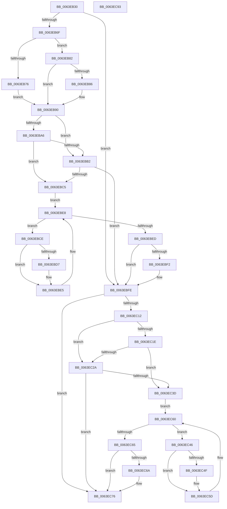

# DifZwCancelIoFileWrapper

- RVA: `0x0063EB30`–`0x0063EC94` (길이 `356` bytes)
- VA: `0x000000014063EB30`
- 실행 섹션: `.text`
- PDB 이름 있음: `예`; PDB Function 태그: `아니요`
- unwind 정보 RVA: `0x00093E28`
- 디코드: `98`개 명령, `356/356` bytes 표시
- 미해석 바이트: `0` (있으면 어셈블리에 `.byte`로 보존)

> 이 문서는 커널 이미지의 기계어와 PDB 기호를 분석해 생성했습니다. 4번과 5번은 함수 원형과 자료형을 바이너리 사용 방식에서 추정한 C 해석이며 원본 소스 복구 결과는 아닙니다.

## 1. Dependencies

- 직접 호출 지점: **9**; 고유 호출 대상: **6**
- 직접 호출자로 확인된 함수: **0**
- RIP 상대 이미지 참조: **3**

### Outgoing calls
- `0x0063EB5E` → [DifGetAPIThunkContextById](../49/DifGetAPIThunkContextById_function_00495A34.md) (function, `0x00495A34`)
- `0x0063EB86` → [DifGetReturnAddressForWrappers](../4D/DifGetReturnAddressForWrappers_function_004D3C08.md) (function, `0x004D3C08`)
- `0x0063EBB9` → [ExAcquireRundownProtection](../21/ExAcquireRundownProtection_function_00216620.md) (function, `0x00216620`)
- `0x0063EBE0` → [guard_dispatch_icall](../6B/guard_dispatch_icall_function_006BAAD0.md) (function, `0x006BAAD0`)
- `0x0063EBF9` → [ExReleaseRundownProtection](../34/ExReleaseRundownProtection_function_00349E80.md) (function, `0x00349E80`)
- `0x0063EC04` → [ZwCancelIoFile](../6A/ZwCancelIoFile_function_006ADC70.md) (function, `0x006ADC70`)
- `0x0063EC31` → [ExAcquireRundownProtection](../21/ExAcquireRundownProtection_function_00216620.md) (function, `0x00216620`)
- `0x0063EC58` → [guard_dispatch_icall](../6B/guard_dispatch_icall_function_006BAAD0.md) (function, `0x006BAAD0`)
- `0x0063EC71` → [ExReleaseRundownProtection](../34/ExReleaseRundownProtection_function_00349E80.md) (function, `0x00349E80`)

### Direct callers
- 이 함수 시작 RVA로 연결되는 직접 call은 확인되지 않았습니다. 간접 호출은 완전히 역산할 수 없습니다.

### Static image references
- `0x0063EB98` → RVA `0x00F048B8` (`.data`; read)
- `0x0063EBA6` → RVA `0x00F04980` (`.data`; read)
- `0x0063EBB2` → RVA `0x00F03E80` (`.data`; read)

## 2. Other-region calls and transfers

- 다른 실행 섹션으로 향하는 call: **0**
- 별도 외부 분기/꼬리 이동을 확인하지 못했습니다.

## 3. Assembly (complete function range)

```asm
0063EB30  48 8B C4                        mov rax, rsp
0063EB33  48 89 58 08                     mov qword ptr [rax + 8], rbx
0063EB37  48 89 68 10                     mov qword ptr [rax + 0x10], rbp
0063EB3B  48 89 70 18                     mov qword ptr [rax + 0x18], rsi
0063EB3F  57                              push rdi
0063EB40  41 56                           push r14
0063EB42  41 57                           push r15
0063EB44  48 83 EC 40                     sub rsp, 0x40
0063EB48  0F 57 C0                        xorps xmm0, xmm0
0063EB4B  4C 8B F9                        mov r15, rcx
0063EB4E  B9 85 00 00 00                  mov ecx, 0x85
0063EB53  4C 8B F2                        mov r14, rdx
0063EB56  0F 11 40 C8                     movups xmmword ptr [rax - 0x38], xmm0
0063EB5A  0F 11 40 D8                     movups xmmword ptr [rax - 0x28], xmm0
0063EB5E  E8 D1 6E E5 FF                  call 0x140495a34
0063EB63  48 8B F0                        mov rsi, rax
0063EB66  48 85 C0                        test rax, rax
0063EB69  0F 84 8F 00 00 00               je 0x14063ebfe
0063EB6F  8B 40 0C                        mov eax, dword ptr [rax + 0xc]
0063EB72  A8 18                           test al, 0x18
0063EB74  74 0C                           je 0x14063eb82
0063EB76  48 8B 4C 24 58                  mov rcx, qword ptr [rsp + 0x58]
0063EB7B  48 89 4C 24 20                  mov qword ptr [rsp + 0x20], rcx
0063EB80  EB 0E                           jmp 0x14063eb90
0063EB82  A8 04                           test al, 4
0063EB84  74 0A                           je 0x14063eb90
0063EB86  E8 7D 50 E9 FF                  call 0x1404d3c08
0063EB8B  48 89 44 24 20                  mov qword ptr [rsp + 0x20], rax
0063EB90  40 32 ED                        xor bpl, bpl
0063EB93  4C 89 7C 24 30                  mov qword ptr [rsp + 0x30], r15
0063EB98  40 38 2D 19 5D 8C 00            cmp byte ptr [rip + 0x8c5d19], bpl
0063EB9F  4C 89 74 24 28                  mov qword ptr [rsp + 0x28], r14
0063EBA4  75 0C                           jne 0x14063ebb2
0063EBA6  F7 05 D0 5D 8C 00 00 08 00 00   test dword ptr [rip + 0x8c5dd0], 0x800
0063EBB0  74 13                           je 0x14063ebc5
0063EBB2  48 8D 0D C7 52 8C 00            lea rcx, [rip + 0x8c52c7]
0063EBB9  E8 62 7A BD FF                  call 0x140216620
0063EBBE  40 8A E8                        mov bpl, al
0063EBC1  84 C0                           test al, al
0063EBC3  74 39                           je 0x14063ebfe
0063EBC5  48 8D 7E 20                     lea rdi, [rsi + 0x20]
0063EBC9  48 8B 1F                        mov rbx, qword ptr [rdi]
0063EBCC  EB 1A                           jmp 0x14063ebe8
0063EBCE  48 8D 43 F0                     lea rax, [rbx - 0x10]
0063EBD2  48 85 C0                        test rax, rax
0063EBD5  74 0E                           je 0x14063ebe5
0063EBD7  48 8B 40 08                     mov rax, qword ptr [rax + 8]
0063EBDB  48 8D 4C 24 20                  lea rcx, [rsp + 0x20]
0063EBE0  E8 EB BE 07 00                  call 0x1406baad0
0063EBE5  48 8B 1B                        mov rbx, qword ptr [rbx]
0063EBE8  48 3B DF                        cmp rbx, rdi
0063EBEB  75 E1                           jne 0x14063ebce
0063EBED  40 84 ED                        test bpl, bpl
0063EBF0  74 0C                           je 0x14063ebfe
0063EBF2  48 8D 0D 87 52 8C 00            lea rcx, [rip + 0x8c5287]
0063EBF9  E8 82 B2 D0 FF                  call 0x140349e80
0063EBFE  49 8B D6                        mov rdx, r14
0063EC01  49 8B CF                        mov rcx, r15
0063EC04  E8 67 F0 06 00                  call 0x1406adc70
0063EC09  89 44 24 38                     mov dword ptr [rsp + 0x38], eax
0063EC0D  48 85 F6                        test rsi, rsi
0063EC10  74 64                           je 0x14063ec76
0063EC12  40 32 FF                        xor dil, dil
0063EC15  40 38 3D 9C 5C 8C 00            cmp byte ptr [rip + 0x8c5c9c], dil
0063EC1C  75 0C                           jne 0x14063ec2a
0063EC1E  F7 05 58 5D 8C 00 00 08 00 00   test dword ptr [rip + 0x8c5d58], 0x800
0063EC28  74 13                           je 0x14063ec3d
0063EC2A  48 8D 0D 4F 52 8C 00            lea rcx, [rip + 0x8c524f]
0063EC31  E8 EA 79 BD FF                  call 0x140216620
0063EC36  40 8A F8                        mov dil, al
0063EC39  84 C0                           test al, al
0063EC3B  74 39                           je 0x14063ec76
0063EC3D  48 83 C6 30                     add rsi, 0x30
0063EC41  48 8B 1E                        mov rbx, qword ptr [rsi]
0063EC44  EB 1A                           jmp 0x14063ec60
0063EC46  48 8D 43 F0                     lea rax, [rbx - 0x10]
0063EC4A  48 85 C0                        test rax, rax
0063EC4D  74 0E                           je 0x14063ec5d
0063EC4F  48 8B 40 08                     mov rax, qword ptr [rax + 8]
0063EC53  48 8D 4C 24 20                  lea rcx, [rsp + 0x20]
0063EC58  E8 73 BE 07 00                  call 0x1406baad0
0063EC5D  48 8B 1B                        mov rbx, qword ptr [rbx]
0063EC60  48 3B DE                        cmp rbx, rsi
0063EC63  75 E1                           jne 0x14063ec46
0063EC65  40 84 FF                        test dil, dil
0063EC68  74 0C                           je 0x14063ec76
0063EC6A  48 8D 0D 0F 52 8C 00            lea rcx, [rip + 0x8c520f]
0063EC71  E8 0A B2 D0 FF                  call 0x140349e80
0063EC76  8B 44 24 38                     mov eax, dword ptr [rsp + 0x38]
0063EC7A  48 8B 5C 24 60                  mov rbx, qword ptr [rsp + 0x60]
0063EC7F  48 8B 6C 24 68                  mov rbp, qword ptr [rsp + 0x68]
0063EC84  48 8B 74 24 70                  mov rsi, qword ptr [rsp + 0x70]
0063EC89  48 83 C4 40                     add rsp, 0x40
0063EC8D  41 5F                           pop r15
0063EC8F  41 5E                           pop r14
0063EC91  5F                              pop rdi
0063EC92  C3                              ret
0063EC93  CC                              int3
```

## 4. C-style interpretation (structured pseudocode)

```c
__int64 __fastcall DifZwCancelIoFileWrapper(__int64 a1, __int64 a2)
{
    __int64 result;
    __int64 v_rbp;
    __int64 v_rdi;
    __int64 v_rsi;
    __int64 v_rsp;
    unsigned int v_stack_m20;
    unsigned __int64 v_stack_m28;
    unsigned __int64 v_stack_m30;
    unsigned __int64 v_stack_m38;
    unsigned __int64 v_stack_p0;
    unsigned __int64 v_stack_p10;
    unsigned __int64 v_stack_p18;
    unsigned __int64 v_stack_p8;

    *(unsigned __int64 *)(v_rsp + 8) = v_rbx;
    *(unsigned __int64 *)(v_rsp + 16) = v_rbp;
    *(unsigned __int64 *)(v_rsp + 24) = v_rsi;
    v_rsp = (v_rsp) - (64);
    *(unsigned __int64 *)(v_rsp - 56) = v_xmm0;
    *(unsigned __int64 *)(v_rsp - 40) = v_xmm0;
    result = DifGetAPIThunkContextById(133, a2, a3, a4);
    if (result == 0) goto loc_0063EBFE;
    if ((((unsigned __int8)((unsigned int)(*(unsigned int *)(result + 12)))) & (24)) == 0) goto loc_0063EB82;
    v_stack_m38 = v_stack_p0;
    goto loc_0063EB90;
loc_0063EB82:
    result = (unsigned int)(*(unsigned int *)(result + 12));
    if ((((unsigned __int8)((unsigned int)(*(unsigned int *)(result + 12)))) & (4)) != 0) {
        result = DifGetReturnAddressForWrappers(v_stack_p0, a2, a3, a4);
        v_stack_m38 = result;
    }
    v_rbp = 0;
    v_stack_m28 = a1;
    v_stack_m30 = a2;
    if ((*(unsigned __int8 *)(v_rip + 9198873)) != 0) goto loc_0063EBB2;
    if (((*(unsigned int *)(v_rip + 9199056)) & (0x800ULL)) == 0) goto loc_0063EBC5;
loc_0063EBB2:
    result = ExAcquireRundownProtection(v_rip + 9196231, a2, a3, a4);
    if ((unsigned __int8)(result) == 0) goto loc_0063EBFE;
loc_0063EBC5:
    goto loc_0063EBE8;
loc_0063EBCE:
    result = *(unsigned __int64 *)(result + 32) - 16;
    if (*(unsigned __int64 *)(result + 32) - 16 != 0) {
        result = *(unsigned __int64 *)(*(unsigned __int64 *)(result + 32) - 16 + 8);
        a1 = v_stack_m38;
        result = guard_dispatch_icall(a1, a2, a3, a4);
    }
loc_0063EBE8:
    if ((*(unsigned __int64 *)(*(unsigned __int64 *)(result + 32))) != (result + 32)) goto loc_0063EBCE;
    if ((unsigned __int8)((unsigned __int8)(result)) != 0) {
        a1 = v_rip + 9196167;
        result = ExReleaseRundownProtection(a1, a2, a3, a4);
    }
    result = ZwCancelIoFile(a1, a2, a3, a4);
    v_stack_m20 = (unsigned int)(result);
    if (result == 0) goto loc_0063EC76;
    v_rdi = 0;
    if ((*(unsigned __int8 *)(v_rip + 9198748)) != 0) goto loc_0063EC2A;
    if (((*(unsigned int *)(v_rip + 9198936)) & (0x800ULL)) == 0) goto loc_0063EC3D;
loc_0063EC2A:
    result = ExAcquireRundownProtection(v_rip + 9196111, a2, a3, a4);
    if ((unsigned __int8)(result) == 0) goto loc_0063EC76;
loc_0063EC3D:
    v_rsi = (result) + (48);
    goto loc_0063EC60;
loc_0063EC46:
    result = *(unsigned __int64 *)(v_rsi) - 16;
    if (*(unsigned __int64 *)(v_rsi) - 16 != 0) {
        result = *(unsigned __int64 *)(*(unsigned __int64 *)(v_rsi) - 16 + 8);
        a1 = v_stack_m38;
        result = guard_dispatch_icall(a1, a2, a3, a4);
    }
loc_0063EC60:
    if ((*(unsigned __int64 *)(*(unsigned __int64 *)(v_rsi))) != v_rsi) goto loc_0063EC46;
    if ((unsigned __int8)((unsigned __int8)(result)) != 0) {
        a1 = v_rip + 9196047;
        result = ExReleaseRundownProtection(a1, a2, a3, a4);
    }
    v_rsp = (v_rsp) + (64);
    return (unsigned int)(v_stack_m20);
}
```

## 5. (Beta) C Style

```c
int64_t DifZwCancelIoFileWrapper(int64_t Arg1, int64_t Arg2)
{
    int64_t result;
    int64_t local_rbp;
    int64_t local_rdi;
    int64_t local_rsi;
    int64_t local_rsp;
    uint32_t v_stack_m20;
    uint64_t v_stack_m28;
    uint64_t v_stack_m30;
    uint64_t v_stack_m38;
    uint64_t v_stack_p0;
    uint64_t v_stack_p10;
    uint64_t v_stack_p18;
    uint64_t v_stack_p8;

    *(uint64_t *)(local_rsp + 0x8) = local_rbx;
    *(uint64_t *)(local_rsp + 0x10) = local_rbp;
    *(uint64_t *)(local_rsp + 0x18) = local_rsi;
    local_rsp = (local_rsp) - (64);
    *(uint64_t *)(local_rsp - 0x38) = v_xmm0;
    *(uint64_t *)(local_rsp - 0x28) = v_xmm0;
    result = DifGetAPIThunkContextById(133, Arg2, a3, a4);
    if (result == 0) goto loc_0063EBFE;
    if ((((uint8_t)((uint32_t)(*(uint32_t *)(result + 0xC)))) & (24)) == 0) goto loc_0063EB82;
    v_stack_m38 = v_stack_p0;
    goto loc_0063EB90;
loc_0063EB82:
    result = (uint32_t)(*(uint32_t *)(result + 0xC));
    if ((((uint8_t)((uint32_t)(*(uint32_t *)(result + 0xC)))) & (4)) != 0) {
        result = DifGetReturnAddressForWrappers(v_stack_p0, Arg2, a3, a4);
        v_stack_m38 = result;
    }
    local_rbp = 0;
    v_stack_m28 = Arg1;
    v_stack_m30 = Arg2;
    if ((*(uint8_t *)(v_rip + 0x8C5D19)) != 0) goto loc_0063EBB2;
    if (((*(uint32_t *)(v_rip + 0x8C5DD0)) & (0x800ULL)) == 0) goto loc_0063EBC5;
loc_0063EBB2:
    result = ExAcquireRundownProtection(v_rip + 9196231, Arg2, a3, a4);
    if ((uint8_t)(result) == 0) goto loc_0063EBFE;
loc_0063EBC5:
    goto loc_0063EBE8;
loc_0063EBCE:
    result = *(uint64_t *)(result + 0x20) - 16;
    if (*(uint64_t *)(result + 0x20) - 16 != 0) {
        result = *(uint64_t *)(*(uint64_t *)(result + 0x20) - 0x10 + 0x8);
        Arg1 = v_stack_m38;
        result = guard_dispatch_icall(Arg1, Arg2, a3, a4);
    }
loc_0063EBE8:
    if ((*(uint64_t *)(*(uint64_t *)(result + 0x20))) != (result + 32)) goto loc_0063EBCE;
    if ((uint8_t)((uint8_t)(result)) != 0) {
        Arg1 = v_rip + 9196167;
        result = ExReleaseRundownProtection(Arg1, Arg2, a3, a4);
    }
    result = ZwCancelIoFile(Arg1, Arg2, a3, a4);
    v_stack_m20 = (uint32_t)(result);
    if (result == 0) goto loc_0063EC76;
    local_rdi = 0;
    if ((*(uint8_t *)(v_rip + 0x8C5C9C)) != 0) goto loc_0063EC2A;
    if (((*(uint32_t *)(v_rip + 0x8C5D58)) & (0x800ULL)) == 0) goto loc_0063EC3D;
loc_0063EC2A:
    result = ExAcquireRundownProtection(v_rip + 9196111, Arg2, a3, a4);
    if ((uint8_t)(result) == 0) goto loc_0063EC76;
loc_0063EC3D:
    local_rsi = (result) + (48);
    goto loc_0063EC60;
loc_0063EC46:
    result = *(uint64_t *)(local_rsi) - 16;
    if (*(uint64_t *)(local_rsi) - 16 != 0) {
        result = *(uint64_t *)(*(uint64_t *)(local_rsi) - 0x10 + 0x8);
        Arg1 = v_stack_m38;
        result = guard_dispatch_icall(Arg1, Arg2, a3, a4);
    }
loc_0063EC60:
    if ((*(uint64_t *)(*(uint64_t *)(local_rsi))) != local_rsi) goto loc_0063EC46;
    if ((uint8_t)((uint8_t)(result)) != 0) {
        Arg1 = v_rip + 9196047;
        result = ExReleaseRundownProtection(Arg1, Arg2, a3, a4);
    }
    local_rsp = (local_rsp) + (64);
    return (uint32_t)(v_stack_m20);
}
```

## 6. Execution-region graph

[열기: 2D/3D 그래프와 함수 탐색 컨트롤 패널](../../../control-panel.html?section=text&rva=0x0063EB30&view=graph)

- 2D 그래프는 위에서 아래로 흐르고, 3D 그래프는 빈 공간을 드래그해 회전합니다. Shift+드래그는 이동, 휠은 확대·축소, 함수 노드 선택은 대상 보고서 이동입니다.

### Static fallback


