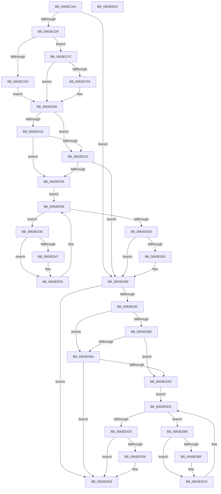

# DifZwCancelTimerWrapper

- RVA: `0x0063ECA0`–`0x0063EE04` (길이 `356` bytes)
- VA: `0x000000014063ECA0`
- 실행 섹션: `.text`
- PDB 이름 있음: `예`; PDB Function 태그: `아니요`
- unwind 정보 RVA: `0x00093E28`
- 디코드: `98`개 명령, `356/356` bytes 표시
- 미해석 바이트: `0` (있으면 어셈블리에 `.byte`로 보존)

> 이 문서는 커널 이미지의 기계어와 PDB 기호를 분석해 생성했습니다. 4번과 5번은 함수 원형과 자료형을 바이너리 사용 방식에서 추정한 C 해석이며 원본 소스 복구 결과는 아닙니다.

## 1. Dependencies

- 직접 호출 지점: **9**; 고유 호출 대상: **6**
- 직접 호출자로 확인된 함수: **0**
- RIP 상대 이미지 참조: **3**

### Outgoing calls
- `0x0063ECCE` → [DifGetAPIThunkContextById](../49/DifGetAPIThunkContextById_function_00495A34.md) (function, `0x00495A34`)
- `0x0063ECF6` → [DifGetReturnAddressForWrappers](../4D/DifGetReturnAddressForWrappers_function_004D3C08.md) (function, `0x004D3C08`)
- `0x0063ED29` → [ExAcquireRundownProtection](../21/ExAcquireRundownProtection_function_00216620.md) (function, `0x00216620`)
- `0x0063ED50` → [guard_dispatch_icall](../6B/guard_dispatch_icall_function_006BAAD0.md) (function, `0x006BAAD0`)
- `0x0063ED69` → [ExReleaseRundownProtection](../34/ExReleaseRundownProtection_function_00349E80.md) (function, `0x00349E80`)
- `0x0063ED74` → [ZwCancelTimer](../6A/ZwCancelTimer_function_006ADCF0.md) (function, `0x006ADCF0`)
- `0x0063EDA1` → [ExAcquireRundownProtection](../21/ExAcquireRundownProtection_function_00216620.md) (function, `0x00216620`)
- `0x0063EDC8` → [guard_dispatch_icall](../6B/guard_dispatch_icall_function_006BAAD0.md) (function, `0x006BAAD0`)
- `0x0063EDE1` → [ExReleaseRundownProtection](../34/ExReleaseRundownProtection_function_00349E80.md) (function, `0x00349E80`)

### Direct callers
- 이 함수 시작 RVA로 연결되는 직접 call은 확인되지 않았습니다. 간접 호출은 완전히 역산할 수 없습니다.

### Static image references
- `0x0063ED08` → RVA `0x00F048B8` (`.data`; read)
- `0x0063ED16` → RVA `0x00F04980` (`.data`; read)
- `0x0063ED22` → RVA `0x00F03E80` (`.data`; read)

## 2. Other-region calls and transfers

- 다른 실행 섹션으로 향하는 call: **0**
- 별도 외부 분기/꼬리 이동을 확인하지 못했습니다.

## 3. Assembly (complete function range)

```asm
0063ECA0  48 8B C4                        mov rax, rsp
0063ECA3  48 89 58 08                     mov qword ptr [rax + 8], rbx
0063ECA7  48 89 68 10                     mov qword ptr [rax + 0x10], rbp
0063ECAB  48 89 70 18                     mov qword ptr [rax + 0x18], rsi
0063ECAF  57                              push rdi
0063ECB0  41 56                           push r14
0063ECB2  41 57                           push r15
0063ECB4  48 83 EC 40                     sub rsp, 0x40
0063ECB8  0F 57 C0                        xorps xmm0, xmm0
0063ECBB  4C 8B F9                        mov r15, rcx
0063ECBE  B9 84 00 00 00                  mov ecx, 0x84
0063ECC3  4C 8B F2                        mov r14, rdx
0063ECC6  0F 11 40 C8                     movups xmmword ptr [rax - 0x38], xmm0
0063ECCA  0F 11 40 D8                     movups xmmword ptr [rax - 0x28], xmm0
0063ECCE  E8 61 6D E5 FF                  call 0x140495a34
0063ECD3  48 8B F0                        mov rsi, rax
0063ECD6  48 85 C0                        test rax, rax
0063ECD9  0F 84 8F 00 00 00               je 0x14063ed6e
0063ECDF  8B 40 0C                        mov eax, dword ptr [rax + 0xc]
0063ECE2  A8 18                           test al, 0x18
0063ECE4  74 0C                           je 0x14063ecf2
0063ECE6  48 8B 4C 24 58                  mov rcx, qword ptr [rsp + 0x58]
0063ECEB  48 89 4C 24 20                  mov qword ptr [rsp + 0x20], rcx
0063ECF0  EB 0E                           jmp 0x14063ed00
0063ECF2  A8 04                           test al, 4
0063ECF4  74 0A                           je 0x14063ed00
0063ECF6  E8 0D 4F E9 FF                  call 0x1404d3c08
0063ECFB  48 89 44 24 20                  mov qword ptr [rsp + 0x20], rax
0063ED00  40 32 ED                        xor bpl, bpl
0063ED03  4C 89 7C 24 30                  mov qword ptr [rsp + 0x30], r15
0063ED08  40 38 2D A9 5B 8C 00            cmp byte ptr [rip + 0x8c5ba9], bpl
0063ED0F  4C 89 74 24 28                  mov qword ptr [rsp + 0x28], r14
0063ED14  75 0C                           jne 0x14063ed22
0063ED16  F7 05 60 5C 8C 00 00 08 00 00   test dword ptr [rip + 0x8c5c60], 0x800
0063ED20  74 13                           je 0x14063ed35
0063ED22  48 8D 0D 57 51 8C 00            lea rcx, [rip + 0x8c5157]
0063ED29  E8 F2 78 BD FF                  call 0x140216620
0063ED2E  40 8A E8                        mov bpl, al
0063ED31  84 C0                           test al, al
0063ED33  74 39                           je 0x14063ed6e
0063ED35  48 8D 7E 20                     lea rdi, [rsi + 0x20]
0063ED39  48 8B 1F                        mov rbx, qword ptr [rdi]
0063ED3C  EB 1A                           jmp 0x14063ed58
0063ED3E  48 8D 43 F0                     lea rax, [rbx - 0x10]
0063ED42  48 85 C0                        test rax, rax
0063ED45  74 0E                           je 0x14063ed55
0063ED47  48 8B 40 08                     mov rax, qword ptr [rax + 8]
0063ED4B  48 8D 4C 24 20                  lea rcx, [rsp + 0x20]
0063ED50  E8 7B BD 07 00                  call 0x1406baad0
0063ED55  48 8B 1B                        mov rbx, qword ptr [rbx]
0063ED58  48 3B DF                        cmp rbx, rdi
0063ED5B  75 E1                           jne 0x14063ed3e
0063ED5D  40 84 ED                        test bpl, bpl
0063ED60  74 0C                           je 0x14063ed6e
0063ED62  48 8D 0D 17 51 8C 00            lea rcx, [rip + 0x8c5117]
0063ED69  E8 12 B1 D0 FF                  call 0x140349e80
0063ED6E  49 8B D6                        mov rdx, r14
0063ED71  49 8B CF                        mov rcx, r15
0063ED74  E8 77 EF 06 00                  call 0x1406adcf0
0063ED79  89 44 24 38                     mov dword ptr [rsp + 0x38], eax
0063ED7D  48 85 F6                        test rsi, rsi
0063ED80  74 64                           je 0x14063ede6
0063ED82  40 32 FF                        xor dil, dil
0063ED85  40 38 3D 2C 5B 8C 00            cmp byte ptr [rip + 0x8c5b2c], dil
0063ED8C  75 0C                           jne 0x14063ed9a
0063ED8E  F7 05 E8 5B 8C 00 00 08 00 00   test dword ptr [rip + 0x8c5be8], 0x800
0063ED98  74 13                           je 0x14063edad
0063ED9A  48 8D 0D DF 50 8C 00            lea rcx, [rip + 0x8c50df]
0063EDA1  E8 7A 78 BD FF                  call 0x140216620
0063EDA6  40 8A F8                        mov dil, al
0063EDA9  84 C0                           test al, al
0063EDAB  74 39                           je 0x14063ede6
0063EDAD  48 83 C6 30                     add rsi, 0x30
0063EDB1  48 8B 1E                        mov rbx, qword ptr [rsi]
0063EDB4  EB 1A                           jmp 0x14063edd0
0063EDB6  48 8D 43 F0                     lea rax, [rbx - 0x10]
0063EDBA  48 85 C0                        test rax, rax
0063EDBD  74 0E                           je 0x14063edcd
0063EDBF  48 8B 40 08                     mov rax, qword ptr [rax + 8]
0063EDC3  48 8D 4C 24 20                  lea rcx, [rsp + 0x20]
0063EDC8  E8 03 BD 07 00                  call 0x1406baad0
0063EDCD  48 8B 1B                        mov rbx, qword ptr [rbx]
0063EDD0  48 3B DE                        cmp rbx, rsi
0063EDD3  75 E1                           jne 0x14063edb6
0063EDD5  40 84 FF                        test dil, dil
0063EDD8  74 0C                           je 0x14063ede6
0063EDDA  48 8D 0D 9F 50 8C 00            lea rcx, [rip + 0x8c509f]
0063EDE1  E8 9A B0 D0 FF                  call 0x140349e80
0063EDE6  8B 44 24 38                     mov eax, dword ptr [rsp + 0x38]
0063EDEA  48 8B 5C 24 60                  mov rbx, qword ptr [rsp + 0x60]
0063EDEF  48 8B 6C 24 68                  mov rbp, qword ptr [rsp + 0x68]
0063EDF4  48 8B 74 24 70                  mov rsi, qword ptr [rsp + 0x70]
0063EDF9  48 83 C4 40                     add rsp, 0x40
0063EDFD  41 5F                           pop r15
0063EDFF  41 5E                           pop r14
0063EE01  5F                              pop rdi
0063EE02  C3                              ret
0063EE03  CC                              int3
```

## 4. C-style interpretation (structured pseudocode)

```c
__int64 __fastcall DifZwCancelTimerWrapper(__int64 a1, __int64 a2)
{
    __int64 result;
    __int64 v_rbp;
    __int64 v_rdi;
    __int64 v_rsi;
    __int64 v_rsp;
    unsigned int v_stack_m20;
    unsigned __int64 v_stack_m28;
    unsigned __int64 v_stack_m30;
    unsigned __int64 v_stack_m38;
    unsigned __int64 v_stack_p0;
    unsigned __int64 v_stack_p10;
    unsigned __int64 v_stack_p18;
    unsigned __int64 v_stack_p8;

    *(unsigned __int64 *)(v_rsp + 8) = v_rbx;
    *(unsigned __int64 *)(v_rsp + 16) = v_rbp;
    *(unsigned __int64 *)(v_rsp + 24) = v_rsi;
    v_rsp = (v_rsp) - (64);
    *(unsigned __int64 *)(v_rsp - 56) = v_xmm0;
    *(unsigned __int64 *)(v_rsp - 40) = v_xmm0;
    result = DifGetAPIThunkContextById(132, a2, a3, a4);
    if (result == 0) goto loc_0063ED6E;
    if ((((unsigned __int8)((unsigned int)(*(unsigned int *)(result + 12)))) & (24)) == 0) goto loc_0063ECF2;
    v_stack_m38 = v_stack_p0;
    goto loc_0063ED00;
loc_0063ECF2:
    result = (unsigned int)(*(unsigned int *)(result + 12));
    if ((((unsigned __int8)((unsigned int)(*(unsigned int *)(result + 12)))) & (4)) != 0) {
        result = DifGetReturnAddressForWrappers(v_stack_p0, a2, a3, a4);
        v_stack_m38 = result;
    }
    v_rbp = 0;
    v_stack_m28 = a1;
    v_stack_m30 = a2;
    if ((*(unsigned __int8 *)(v_rip + 9198505)) != 0) goto loc_0063ED22;
    if (((*(unsigned int *)(v_rip + 9198688)) & (0x800ULL)) == 0) goto loc_0063ED35;
loc_0063ED22:
    result = ExAcquireRundownProtection(v_rip + 9195863, a2, a3, a4);
    if ((unsigned __int8)(result) == 0) goto loc_0063ED6E;
loc_0063ED35:
    goto loc_0063ED58;
loc_0063ED3E:
    result = *(unsigned __int64 *)(result + 32) - 16;
    if (*(unsigned __int64 *)(result + 32) - 16 != 0) {
        result = *(unsigned __int64 *)(*(unsigned __int64 *)(result + 32) - 16 + 8);
        a1 = v_stack_m38;
        result = guard_dispatch_icall(a1, a2, a3, a4);
    }
loc_0063ED58:
    if ((*(unsigned __int64 *)(*(unsigned __int64 *)(result + 32))) != (result + 32)) goto loc_0063ED3E;
    if ((unsigned __int8)((unsigned __int8)(result)) != 0) {
        a1 = v_rip + 9195799;
        result = ExReleaseRundownProtection(a1, a2, a3, a4);
    }
    result = ZwCancelTimer(a1, a2, a3, a4);
    v_stack_m20 = (unsigned int)(result);
    if (result == 0) goto loc_0063EDE6;
    v_rdi = 0;
    if ((*(unsigned __int8 *)(v_rip + 9198380)) != 0) goto loc_0063ED9A;
    if (((*(unsigned int *)(v_rip + 9198568)) & (0x800ULL)) == 0) goto loc_0063EDAD;
loc_0063ED9A:
    result = ExAcquireRundownProtection(v_rip + 9195743, a2, a3, a4);
    if ((unsigned __int8)(result) == 0) goto loc_0063EDE6;
loc_0063EDAD:
    v_rsi = (result) + (48);
    goto loc_0063EDD0;
loc_0063EDB6:
    result = *(unsigned __int64 *)(v_rsi) - 16;
    if (*(unsigned __int64 *)(v_rsi) - 16 != 0) {
        result = *(unsigned __int64 *)(*(unsigned __int64 *)(v_rsi) - 16 + 8);
        a1 = v_stack_m38;
        result = guard_dispatch_icall(a1, a2, a3, a4);
    }
loc_0063EDD0:
    if ((*(unsigned __int64 *)(*(unsigned __int64 *)(v_rsi))) != v_rsi) goto loc_0063EDB6;
    if ((unsigned __int8)((unsigned __int8)(result)) != 0) {
        a1 = v_rip + 9195679;
        result = ExReleaseRundownProtection(a1, a2, a3, a4);
    }
    v_rsp = (v_rsp) + (64);
    return (unsigned int)(v_stack_m20);
}
```

## 5. (Beta) C Style

```c
int64_t DifZwCancelTimerWrapper(int64_t Arg1, int64_t Arg2)
{
    int64_t result;
    int64_t local_rbp;
    int64_t local_rdi;
    int64_t local_rsi;
    int64_t local_rsp;
    uint32_t v_stack_m20;
    uint64_t v_stack_m28;
    uint64_t v_stack_m30;
    uint64_t v_stack_m38;
    uint64_t v_stack_p0;
    uint64_t v_stack_p10;
    uint64_t v_stack_p18;
    uint64_t v_stack_p8;

    *(uint64_t *)(local_rsp + 0x8) = local_rbx;
    *(uint64_t *)(local_rsp + 0x10) = local_rbp;
    *(uint64_t *)(local_rsp + 0x18) = local_rsi;
    local_rsp = (local_rsp) - (64);
    *(uint64_t *)(local_rsp - 0x38) = v_xmm0;
    *(uint64_t *)(local_rsp - 0x28) = v_xmm0;
    result = DifGetAPIThunkContextById(132, Arg2, a3, a4);
    if (result == 0) goto loc_0063ED6E;
    if ((((uint8_t)((uint32_t)(*(uint32_t *)(result + 0xC)))) & (24)) == 0) goto loc_0063ECF2;
    v_stack_m38 = v_stack_p0;
    goto loc_0063ED00;
loc_0063ECF2:
    result = (uint32_t)(*(uint32_t *)(result + 0xC));
    if ((((uint8_t)((uint32_t)(*(uint32_t *)(result + 0xC)))) & (4)) != 0) {
        result = DifGetReturnAddressForWrappers(v_stack_p0, Arg2, a3, a4);
        v_stack_m38 = result;
    }
    local_rbp = 0;
    v_stack_m28 = Arg1;
    v_stack_m30 = Arg2;
    if ((*(uint8_t *)(v_rip + 0x8C5BA9)) != 0) goto loc_0063ED22;
    if (((*(uint32_t *)(v_rip + 0x8C5C60)) & (0x800ULL)) == 0) goto loc_0063ED35;
loc_0063ED22:
    result = ExAcquireRundownProtection(v_rip + 9195863, Arg2, a3, a4);
    if ((uint8_t)(result) == 0) goto loc_0063ED6E;
loc_0063ED35:
    goto loc_0063ED58;
loc_0063ED3E:
    result = *(uint64_t *)(result + 0x20) - 16;
    if (*(uint64_t *)(result + 0x20) - 16 != 0) {
        result = *(uint64_t *)(*(uint64_t *)(result + 0x20) - 0x10 + 0x8);
        Arg1 = v_stack_m38;
        result = guard_dispatch_icall(Arg1, Arg2, a3, a4);
    }
loc_0063ED58:
    if ((*(uint64_t *)(*(uint64_t *)(result + 0x20))) != (result + 32)) goto loc_0063ED3E;
    if ((uint8_t)((uint8_t)(result)) != 0) {
        Arg1 = v_rip + 9195799;
        result = ExReleaseRundownProtection(Arg1, Arg2, a3, a4);
    }
    result = ZwCancelTimer(Arg1, Arg2, a3, a4);
    v_stack_m20 = (uint32_t)(result);
    if (result == 0) goto loc_0063EDE6;
    local_rdi = 0;
    if ((*(uint8_t *)(v_rip + 0x8C5B2C)) != 0) goto loc_0063ED9A;
    if (((*(uint32_t *)(v_rip + 0x8C5BE8)) & (0x800ULL)) == 0) goto loc_0063EDAD;
loc_0063ED9A:
    result = ExAcquireRundownProtection(v_rip + 9195743, Arg2, a3, a4);
    if ((uint8_t)(result) == 0) goto loc_0063EDE6;
loc_0063EDAD:
    local_rsi = (result) + (48);
    goto loc_0063EDD0;
loc_0063EDB6:
    result = *(uint64_t *)(local_rsi) - 16;
    if (*(uint64_t *)(local_rsi) - 16 != 0) {
        result = *(uint64_t *)(*(uint64_t *)(local_rsi) - 0x10 + 0x8);
        Arg1 = v_stack_m38;
        result = guard_dispatch_icall(Arg1, Arg2, a3, a4);
    }
loc_0063EDD0:
    if ((*(uint64_t *)(*(uint64_t *)(local_rsi))) != local_rsi) goto loc_0063EDB6;
    if ((uint8_t)((uint8_t)(result)) != 0) {
        Arg1 = v_rip + 9195679;
        result = ExReleaseRundownProtection(Arg1, Arg2, a3, a4);
    }
    local_rsp = (local_rsp) + (64);
    return (uint32_t)(v_stack_m20);
}
```

## 6. Execution-region graph

[열기: 2D/3D 그래프와 함수 탐색 컨트롤 패널](../../../control-panel.html?section=text&rva=0x0063ECA0&view=graph)

- 2D 그래프는 위에서 아래로 흐르고, 3D 그래프는 빈 공간을 드래그해 회전합니다. Shift+드래그는 이동, 휠은 확대·축소, 함수 노드 선택은 대상 보고서 이동입니다.

### Static fallback


