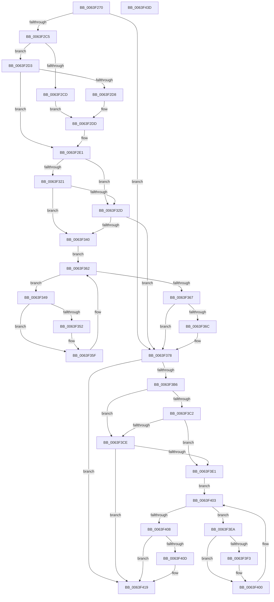

# DifZwConnectPortWrapper

- RVA: `0x0063F270`–`0x0063F43E` (길이 `462` bytes)
- VA: `0x000000014063F270`
- 실행 섹션: `.text`
- PDB 이름 있음: `예`; PDB Function 태그: `아니요`
- unwind 정보 RVA: `0x000D2C00`
- 디코드: `127`개 명령, `462/462` bytes 표시
- 미해석 바이트: `0` (있으면 어셈블리에 `.byte`로 보존)

> 이 문서는 커널 이미지의 기계어와 PDB 기호를 분석해 생성했습니다. 4번과 5번은 함수 원형과 자료형을 바이너리 사용 방식에서 추정한 C 해석이며 원본 소스 복구 결과는 아닙니다.

## 1. Dependencies

- 직접 호출 지점: **10**; 고유 호출 대상: **7**
- 직접 호출자로 확인된 함수: **0**
- RIP 상대 이미지 참조: **3**

### Outgoing calls
- `0x0063F2AA` → [memset](../6C/memset_function_006C6C40.md) (function, `0x006C6C40`)
- `0x0063F2B4` → [DifGetAPIThunkContextById](../49/DifGetAPIThunkContextById_function_00495A34.md) (function, `0x00495A34`)
- `0x0063F2D8` → [DifGetReturnAddressForWrappers](../4D/DifGetReturnAddressForWrappers_function_004D3C08.md) (function, `0x004D3C08`)
- `0x0063F334` → [ExAcquireRundownProtection](../21/ExAcquireRundownProtection_function_00216620.md) (function, `0x00216620`)
- `0x0063F35A` → [guard_dispatch_icall](../6B/guard_dispatch_icall_function_006BAAD0.md) (function, `0x006BAAD0`)
- `0x0063F373` → [ExReleaseRundownProtection](../34/ExReleaseRundownProtection_function_00349E80.md) (function, `0x00349E80`)
- `0x0063F3A9` → [ZwConnectPort](../6A/ZwConnectPort_function_006AE550.md) (function, `0x006AE550`)
- `0x0063F3D5` → [ExAcquireRundownProtection](../21/ExAcquireRundownProtection_function_00216620.md) (function, `0x00216620`)
- `0x0063F3FB` → [guard_dispatch_icall](../6B/guard_dispatch_icall_function_006BAAD0.md) (function, `0x006BAAD0`)
- `0x0063F414` → [ExReleaseRundownProtection](../34/ExReleaseRundownProtection_function_00349E80.md) (function, `0x00349E80`)

### Direct callers
- 이 함수 시작 RVA로 연결되는 직접 call은 확인되지 않았습니다. 간접 호출은 완전히 역산할 수 없습니다.

### Static image references
- `0x0063F2E8` → RVA `0x00F048B8` (`.data`; read)
- `0x0063F321` → RVA `0x00F04980` (`.data`; read)
- `0x0063F32D` → RVA `0x00F03E80` (`.data`; read)

## 2. Other-region calls and transfers

- 다른 실행 섹션으로 향하는 call: **0**
- 별도 외부 분기/꼬리 이동을 확인하지 못했습니다.

## 3. Assembly (complete function range)

```asm
0063F270  48 8B C4                        mov rax, rsp
0063F273  48 89 58 10                     mov qword ptr [rax + 0x10], rbx
0063F277  48 89 70 18                     mov qword ptr [rax + 0x18], rsi
0063F27B  48 89 78 20                     mov qword ptr [rax + 0x20], rdi
0063F27F  48 89 48 08                     mov qword ptr [rax + 8], rcx
0063F283  55                              push rbp
0063F284  41 54                           push r12
0063F286  41 55                           push r13
0063F288  41 56                           push r14
0063F28A  41 57                           push r15
0063F28C  48 8D 68 C1                     lea rbp, [rax - 0x3f]
0063F290  48 81 EC 90 00 00 00            sub rsp, 0x90
0063F297  4C 8B EA                        mov r13, rdx
0063F29A  48 8D 4D C7                     lea rcx, [rbp - 0x39]
0063F29E  33 D2                           xor edx, edx
0063F2A0  4D 8B E0                        mov r12, r8
0063F2A3  4D 8B F9                        mov r15, r9
0063F2A6  44 8D 42 50                     lea r8d, [rdx + 0x50]
0063F2AA  E8 91 79 08 00                  call 0x1406c6c40
0063F2AF  B9 80 00 00 00                  mov ecx, 0x80
0063F2B4  E8 7B 67 E5 FF                  call 0x140495a34
0063F2B9  48 8B F0                        mov rsi, rax
0063F2BC  48 85 C0                        test rax, rax
0063F2BF  0F 84 B3 00 00 00               je 0x14063f378
0063F2C5  8B 48 0C                        mov ecx, dword ptr [rax + 0xc]
0063F2C8  F6 C1 18                        test cl, 0x18
0063F2CB  74 06                           je 0x14063f2d3
0063F2CD  48 8B 45 3F                     mov rax, qword ptr [rbp + 0x3f]
0063F2D1  EB 0A                           jmp 0x14063f2dd
0063F2D3  F6 C1 04                        test cl, 4
0063F2D6  74 09                           je 0x14063f2e1
0063F2D8  E8 2B 49 E9 FF                  call 0x1404d3c08
0063F2DD  48 89 45 C7                     mov qword ptr [rbp - 0x39], rax
0063F2E1  48 8B 45 47                     mov rax, qword ptr [rbp + 0x47]
0063F2E5  45 32 F6                        xor r14b, r14b
0063F2E8  44 38 35 C9 55 8C 00            cmp byte ptr [rip + 0x8c55c9], r14b
0063F2EF  48 89 45 07                     mov qword ptr [rbp + 7], rax
0063F2F3  48 8B 45 67                     mov rax, qword ptr [rbp + 0x67]
0063F2F7  48 89 45 E7                     mov qword ptr [rbp - 0x19], rax
0063F2FB  48 8B 45 6F                     mov rax, qword ptr [rbp + 0x6f]
0063F2FF  48 89 45 DF                     mov qword ptr [rbp - 0x21], rax
0063F303  48 8B 45 77                     mov rax, qword ptr [rbp + 0x77]
0063F307  48 89 45 D7                     mov qword ptr [rbp - 0x29], rax
0063F30B  48 8B 45 7F                     mov rax, qword ptr [rbp + 0x7f]
0063F30F  48 89 45 CF                     mov qword ptr [rbp - 0x31], rax
0063F313  4C 89 6D FF                     mov qword ptr [rbp - 1], r13
0063F317  4C 89 65 F7                     mov qword ptr [rbp - 9], r12
0063F31B  4C 89 7D EF                     mov qword ptr [rbp - 0x11], r15
0063F31F  75 0C                           jne 0x14063f32d
0063F321  F7 05 55 56 8C 00 00 08 00 00   test dword ptr [rip + 0x8c5655], 0x800
0063F32B  74 13                           je 0x14063f340
0063F32D  48 8D 0D 4C 4B 8C 00            lea rcx, [rip + 0x8c4b4c]
0063F334  E8 E7 72 BD FF                  call 0x140216620
0063F339  44 8A F0                        mov r14b, al
0063F33C  84 C0                           test al, al
0063F33E  74 38                           je 0x14063f378
0063F340  48 8D 7E 20                     lea rdi, [rsi + 0x20]
0063F344  48 8B 1F                        mov rbx, qword ptr [rdi]
0063F347  EB 19                           jmp 0x14063f362
0063F349  48 8D 43 F0                     lea rax, [rbx - 0x10]
0063F34D  48 85 C0                        test rax, rax
0063F350  74 0D                           je 0x14063f35f
0063F352  48 8B 40 08                     mov rax, qword ptr [rax + 8]
0063F356  48 8D 4D C7                     lea rcx, [rbp - 0x39]
0063F35A  E8 71 B7 07 00                  call 0x1406baad0
0063F35F  48 8B 1B                        mov rbx, qword ptr [rbx]
0063F362  48 3B DF                        cmp rbx, rdi
0063F365  75 E2                           jne 0x14063f349
0063F367  45 84 F6                        test r14b, r14b
0063F36A  74 0C                           je 0x14063f378
0063F36C  48 8D 0D 0D 4B 8C 00            lea rcx, [rip + 0x8c4b0d]
0063F373  E8 08 AB D0 FF                  call 0x140349e80
0063F378  48 8B 45 7F                     mov rax, qword ptr [rbp + 0x7f]
0063F37C  4D 8B CF                        mov r9, r15
0063F37F  48 8B 4D 47                     mov rcx, qword ptr [rbp + 0x47]
0063F383  4D 8B C4                        mov r8, r12
0063F386  48 89 44 24 38                  mov qword ptr [rsp + 0x38], rax
0063F38B  49 8B D5                        mov rdx, r13
0063F38E  48 8B 45 77                     mov rax, qword ptr [rbp + 0x77]
0063F392  48 89 44 24 30                  mov qword ptr [rsp + 0x30], rax
0063F397  48 8B 45 6F                     mov rax, qword ptr [rbp + 0x6f]
0063F39B  48 89 44 24 28                  mov qword ptr [rsp + 0x28], rax
0063F3A0  48 8B 45 67                     mov rax, qword ptr [rbp + 0x67]
0063F3A4  48 89 44 24 20                  mov qword ptr [rsp + 0x20], rax
0063F3A9  E8 A2 F1 06 00                  call 0x1406ae550
0063F3AE  89 45 0F                        mov dword ptr [rbp + 0xf], eax
0063F3B1  48 85 F6                        test rsi, rsi
0063F3B4  74 63                           je 0x14063f419
0063F3B6  40 32 FF                        xor dil, dil
0063F3B9  40 38 3D F8 54 8C 00            cmp byte ptr [rip + 0x8c54f8], dil
0063F3C0  75 0C                           jne 0x14063f3ce
0063F3C2  F7 05 B4 55 8C 00 00 08 00 00   test dword ptr [rip + 0x8c55b4], 0x800
0063F3CC  74 13                           je 0x14063f3e1
0063F3CE  48 8D 0D AB 4A 8C 00            lea rcx, [rip + 0x8c4aab]
0063F3D5  E8 46 72 BD FF                  call 0x140216620
0063F3DA  40 8A F8                        mov dil, al
0063F3DD  84 C0                           test al, al
0063F3DF  74 38                           je 0x14063f419
0063F3E1  48 83 C6 30                     add rsi, 0x30
0063F3E5  48 8B 1E                        mov rbx, qword ptr [rsi]
0063F3E8  EB 19                           jmp 0x14063f403
0063F3EA  48 8D 43 F0                     lea rax, [rbx - 0x10]
0063F3EE  48 85 C0                        test rax, rax
0063F3F1  74 0D                           je 0x14063f400
0063F3F3  48 8B 40 08                     mov rax, qword ptr [rax + 8]
0063F3F7  48 8D 4D C7                     lea rcx, [rbp - 0x39]
0063F3FB  E8 D0 B6 07 00                  call 0x1406baad0
0063F400  48 8B 1B                        mov rbx, qword ptr [rbx]
0063F403  48 3B DE                        cmp rbx, rsi
0063F406  75 E2                           jne 0x14063f3ea
0063F408  40 84 FF                        test dil, dil
0063F40B  74 0C                           je 0x14063f419
0063F40D  48 8D 0D 6C 4A 8C 00            lea rcx, [rip + 0x8c4a6c]
0063F414  E8 67 AA D0 FF                  call 0x140349e80
0063F419  8B 45 0F                        mov eax, dword ptr [rbp + 0xf]
0063F41C  4C 8D 9C 24 90 00 00 00         lea r11, [rsp + 0x90]
0063F424  49 8B 5B 38                     mov rbx, qword ptr [r11 + 0x38]
0063F428  49 8B 73 40                     mov rsi, qword ptr [r11 + 0x40]
0063F42C  49 8B 7B 48                     mov rdi, qword ptr [r11 + 0x48]
0063F430  49 8B E3                        mov rsp, r11
0063F433  41 5F                           pop r15
0063F435  41 5E                           pop r14
0063F437  41 5D                           pop r13
0063F439  41 5C                           pop r12
0063F43B  5D                              pop rbp
0063F43C  C3                              ret
0063F43D  CC                              int3
```

## 4. C-style interpretation (structured pseudocode)

```c
__int64 __fastcall DifZwConnectPortWrapper(__int64 a1, __int64 a2, __int64 a3, __int64 a4)
{
    __int64 result;
    __int64 v_r14;
    __int64 v_rdi;
    __int64 v_rsi;
    __int64 v_rsp;
    unsigned __int64 v_stack_m28;
    unsigned __int64 v_stack_m80;
    unsigned __int64 v_stack_m88;
    unsigned __int64 v_stack_m90;
    unsigned __int64 v_stack_m98;

    *(unsigned __int64 *)(v_rsp + 16) = v_rbx;
    *(unsigned __int64 *)(v_rsp + 24) = v_rsi;
    *(unsigned __int64 *)(v_rsp + 32) = v_rdi;
    *(unsigned __int64 *)(v_rsp + 8) = a1;
    v_rsp = (v_rsp) - (144);
    a2 = 0;
    result = memset(v_rsp - 63 - 57, a2, a2 + 80, a4);
    result = DifGetAPIThunkContextById(128, a2, a2 + 80, a4);
    if (result == 0) goto loc_0063F378;
    if ((((unsigned __int8)((unsigned int)(*(unsigned int *)(result + 12)))) & (24)) == 0) goto loc_0063F2D3;
    goto loc_0063F2DD;
loc_0063F2D3:
    if ((((unsigned __int8)((unsigned int)(*(unsigned int *)(result + 12)))) & (4)) == 0) goto loc_0063F2E1;
    result = DifGetReturnAddressForWrappers((unsigned int)(*(unsigned int *)(result + 12)), a2, a2 + 80, a4);
loc_0063F2DD:
    *(unsigned __int64 *)(v_rsp - 63 - 57) = result;
loc_0063F2E1:
    v_r14 = 0;
    *(unsigned __int64 *)(v_rsp - 63 + 7) = *(unsigned __int64 *)(v_rsp - 63 + 71);
    *(unsigned __int64 *)(v_rsp - 63 - 25) = *(unsigned __int64 *)(v_rsp - 63 + 103);
    *(unsigned __int64 *)(v_rsp - 63 - 33) = *(unsigned __int64 *)(v_rsp - 63 + 111);
    *(unsigned __int64 *)(v_rsp - 63 - 41) = *(unsigned __int64 *)(v_rsp - 63 + 119);
    *(unsigned __int64 *)(v_rsp - 63 - 49) = *(unsigned __int64 *)(v_rsp - 63 + 127);
    *(unsigned __int64 *)(v_rsp - 63 - 1) = 0;
    *(unsigned __int64 *)(v_rsp - 63 - 9) = a3;
    *(unsigned __int64 *)(v_rsp - 63 - 17) = a4;
    if ((*(unsigned __int8 *)(v_rip + 9197001)) != 0) goto loc_0063F32D;
    if (((*(unsigned int *)(v_rip + 9197141)) & (0x800ULL)) == 0) goto loc_0063F340;
loc_0063F32D:
    result = ExAcquireRundownProtection(v_rip + 9194316, a2, a2 + 80, a4);
    if ((unsigned __int8)(result) == 0) goto loc_0063F378;
loc_0063F340:
    goto loc_0063F362;
loc_0063F349:
    result = *(unsigned __int64 *)(result + 32) - 16;
    if (*(unsigned __int64 *)(result + 32) - 16 != 0) {
        result = *(unsigned __int64 *)(*(unsigned __int64 *)(result + 32) - 16 + 8);
        a1 = v_rsp - 63 - 57;
        result = guard_dispatch_icall(a1, a2, a2 + 80, a4);
    }
loc_0063F362:
    if ((*(unsigned __int64 *)(*(unsigned __int64 *)(result + 32))) != (result + 32)) goto loc_0063F349;
    if ((unsigned __int8)((unsigned __int8)(result)) != 0) {
        a1 = v_rip + 9194253;
        result = ExReleaseRundownProtection(a1, a2, a2 + 80, a4);
    }
    v_stack_m80 = *(unsigned __int64 *)(v_rsp - 63 + 127);
    v_stack_m88 = *(unsigned __int64 *)(v_rsp - 63 + 119);
    v_stack_m90 = *(unsigned __int64 *)(v_rsp - 63 + 111);
    v_stack_m98 = *(unsigned __int64 *)(v_rsp - 63 + 103);
    result = ZwConnectPort(*(unsigned __int64 *)(v_rsp - 63 + 71), 0, a3, a4);
    *(unsigned int *)(v_rsp - 63 + 15) = (unsigned int)(result);
    if (result == 0) goto loc_0063F419;
    v_rdi = 0;
    if ((*(unsigned __int8 *)(v_rip + 9196792)) != 0) goto loc_0063F3CE;
    if (((*(unsigned int *)(v_rip + 9196980)) & (0x800ULL)) == 0) goto loc_0063F3E1;
loc_0063F3CE:
    result = ExAcquireRundownProtection(v_rip + 9194155, 0, a3, a4);
    if ((unsigned __int8)(result) == 0) goto loc_0063F419;
loc_0063F3E1:
    v_rsi = (result) + (48);
    goto loc_0063F403;
loc_0063F3EA:
    result = *(unsigned __int64 *)(v_rsi) - 16;
    if (*(unsigned __int64 *)(v_rsi) - 16 != 0) {
        result = *(unsigned __int64 *)(*(unsigned __int64 *)(v_rsi) - 16 + 8);
        a1 = v_rsp - 63 - 57;
        result = guard_dispatch_icall(a1, 0, a3, a4);
    }
loc_0063F403:
    if ((*(unsigned __int64 *)(*(unsigned __int64 *)(v_rsi))) != v_rsi) goto loc_0063F3EA;
    if ((unsigned __int8)((unsigned __int8)(result)) != 0) {
        a1 = v_rip + 9194092;
        result = ExReleaseRundownProtection(a1, 0, a3, a4);
    }
    return (unsigned int)(*(unsigned int *)(v_rsp - 63 + 15));
}
```

## 5. (Beta) C Style

```c
int64_t DifZwConnectPortWrapper(int64_t Arg1, int64_t Arg2, int64_t Arg3, int64_t Arg4)
{
    int64_t result;
    int64_t local_r14;
    int64_t local_rdi;
    int64_t local_rsi;
    int64_t local_rsp;
    uint64_t v_stack_m28;
    uint64_t v_stack_m80;
    uint64_t v_stack_m88;
    uint64_t v_stack_m90;
    uint64_t v_stack_m98;

    *(uint64_t *)(local_rsp + 0x10) = local_rbx;
    *(uint64_t *)(local_rsp + 0x18) = local_rsi;
    *(uint64_t *)(local_rsp + 0x20) = local_rdi;
    *(uint64_t *)(local_rsp + 0x8) = Arg1;
    local_rsp = (local_rsp) - (144);
    Arg2 = 0;
    result = memset(local_rsp - 63 - 57, Arg2, Arg2 + 80, Arg4);
    result = DifGetAPIThunkContextById(128, Arg2, Arg2 + 80, Arg4);
    if (result == 0) goto loc_0063F378;
    if ((((uint8_t)((uint32_t)(*(uint32_t *)(result + 0xC)))) & (24)) == 0) goto loc_0063F2D3;
    goto loc_0063F2DD;
loc_0063F2D3:
    if ((((uint8_t)((uint32_t)(*(uint32_t *)(result + 0xC)))) & (4)) == 0) goto loc_0063F2E1;
    result = DifGetReturnAddressForWrappers((uint32_t)(*(uint32_t *)(result + 0xC)), Arg2, Arg2 + 80, Arg4);
loc_0063F2DD:
    *(uint64_t *)(local_rsp - 0x3F - 0x39) = result;
loc_0063F2E1:
    local_r14 = 0;
    *(uint64_t *)(local_rsp - 0x3F + 0x7) = *(uint64_t *)(local_rsp - 0x3F + 0x47);
    *(uint64_t *)(local_rsp - 0x3F - 0x19) = *(uint64_t *)(local_rsp - 0x3F + 0x67);
    *(uint64_t *)(local_rsp - 0x3F - 0x21) = *(uint64_t *)(local_rsp - 0x3F + 0x6F);
    *(uint64_t *)(local_rsp - 0x3F - 0x29) = *(uint64_t *)(local_rsp - 0x3F + 0x77);
    *(uint64_t *)(local_rsp - 0x3F - 0x31) = *(uint64_t *)(local_rsp - 0x3F + 0x7F);
    *(uint64_t *)(local_rsp - 0x3F - 0x1) = 0;
    *(uint64_t *)(local_rsp - 0x3F - 0x9) = Arg3;
    *(uint64_t *)(local_rsp - 0x3F - 0x11) = Arg4;
    if ((*(uint8_t *)(v_rip + 0x8C55C9)) != 0) goto loc_0063F32D;
    if (((*(uint32_t *)(v_rip + 0x8C5655)) & (0x800ULL)) == 0) goto loc_0063F340;
loc_0063F32D:
    result = ExAcquireRundownProtection(v_rip + 9194316, Arg2, Arg2 + 80, Arg4);
    if ((uint8_t)(result) == 0) goto loc_0063F378;
loc_0063F340:
    goto loc_0063F362;
loc_0063F349:
    result = *(uint64_t *)(result + 0x20) - 16;
    if (*(uint64_t *)(result + 0x20) - 16 != 0) {
        result = *(uint64_t *)(*(uint64_t *)(result + 0x20) - 0x10 + 0x8);
        Arg1 = local_rsp - 63 - 57;
        result = guard_dispatch_icall(Arg1, Arg2, Arg2 + 80, Arg4);
    }
loc_0063F362:
    if ((*(uint64_t *)(*(uint64_t *)(result + 0x20))) != (result + 32)) goto loc_0063F349;
    if ((uint8_t)((uint8_t)(result)) != 0) {
        Arg1 = v_rip + 9194253;
        result = ExReleaseRundownProtection(Arg1, Arg2, Arg2 + 80, Arg4);
    }
    v_stack_m80 = *(uint64_t *)(local_rsp - 0x3F + 0x7F);
    v_stack_m88 = *(uint64_t *)(local_rsp - 0x3F + 0x77);
    v_stack_m90 = *(uint64_t *)(local_rsp - 0x3F + 0x6F);
    v_stack_m98 = *(uint64_t *)(local_rsp - 0x3F + 0x67);
    result = ZwConnectPort(*(uint64_t *)(local_rsp - 0x3F + 0x47), 0, Arg3, Arg4);
    *(uint32_t *)(local_rsp - 0x3F + 0xF) = (uint32_t)(result);
    if (result == 0) goto loc_0063F419;
    local_rdi = 0;
    if ((*(uint8_t *)(v_rip + 0x8C54F8)) != 0) goto loc_0063F3CE;
    if (((*(uint32_t *)(v_rip + 0x8C55B4)) & (0x800ULL)) == 0) goto loc_0063F3E1;
loc_0063F3CE:
    result = ExAcquireRundownProtection(v_rip + 9194155, 0, Arg3, Arg4);
    if ((uint8_t)(result) == 0) goto loc_0063F419;
loc_0063F3E1:
    local_rsi = (result) + (48);
    goto loc_0063F403;
loc_0063F3EA:
    result = *(uint64_t *)(local_rsi) - 16;
    if (*(uint64_t *)(local_rsi) - 16 != 0) {
        result = *(uint64_t *)(*(uint64_t *)(local_rsi) - 0x10 + 0x8);
        Arg1 = local_rsp - 63 - 57;
        result = guard_dispatch_icall(Arg1, 0, Arg3, Arg4);
    }
loc_0063F403:
    if ((*(uint64_t *)(*(uint64_t *)(local_rsi))) != local_rsi) goto loc_0063F3EA;
    if ((uint8_t)((uint8_t)(result)) != 0) {
        Arg1 = v_rip + 9194092;
        result = ExReleaseRundownProtection(Arg1, 0, Arg3, Arg4);
    }
    return (uint32_t)(*(uint32_t *)(local_rsp - 0x3F + 0xF));
}
```

## 6. Execution-region graph

[열기: 2D/3D 그래프와 함수 탐색 컨트롤 패널](../../../control-panel.html?section=text&rva=0x0063F270&view=graph)

- 2D 그래프는 위에서 아래로 흐르고, 3D 그래프는 빈 공간을 드래그해 회전합니다. Shift+드래그는 이동, 휠은 확대·축소, 함수 노드 선택은 대상 보고서 이동입니다.

### Static fallback


