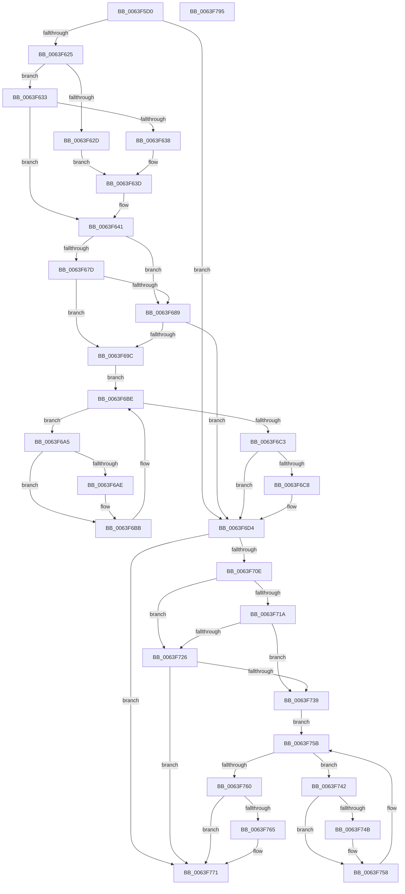

# DifZwCreateEnlistmentWrapper

- RVA: `0x0063F5D0`–`0x0063F796` (길이 `454` bytes)
- VA: `0x000000014063F5D0`
- 실행 섹션: `.text`
- PDB 이름 있음: `예`; PDB Function 태그: `아니요`
- unwind 정보 RVA: `0x000D2C00`
- 디코드: `127`개 명령, `454/454` bytes 표시
- 미해석 바이트: `0` (있으면 어셈블리에 `.byte`로 보존)

> 이 문서는 커널 이미지의 기계어와 PDB 기호를 분석해 생성했습니다. 4번과 5번은 함수 원형과 자료형을 바이너리 사용 방식에서 추정한 C 해석이며 원본 소스 복구 결과는 아닙니다.

## 1. Dependencies

- 직접 호출 지점: **10**; 고유 호출 대상: **7**
- 직접 호출자로 확인된 함수: **0**
- RIP 상대 이미지 참조: **3**

### Outgoing calls
- `0x0063F60A` → [memset](../6C/memset_function_006C6C40.md) (function, `0x006C6C40`)
- `0x0063F614` → [DifGetAPIThunkContextById](../49/DifGetAPIThunkContextById_function_00495A34.md) (function, `0x00495A34`)
- `0x0063F638` → [DifGetReturnAddressForWrappers](../4D/DifGetReturnAddressForWrappers_function_004D3C08.md) (function, `0x004D3C08`)
- `0x0063F690` → [ExAcquireRundownProtection](../21/ExAcquireRundownProtection_function_00216620.md) (function, `0x00216620`)
- `0x0063F6B6` → [guard_dispatch_icall](../6B/guard_dispatch_icall_function_006BAAD0.md) (function, `0x006BAAD0`)
- `0x0063F6CF` → [ExReleaseRundownProtection](../34/ExReleaseRundownProtection_function_00349E80.md) (function, `0x00349E80`)
- `0x0063F701` → [ZwCreateEnlistment](../6A/ZwCreateEnlistment_function_006AE6B0.md) (function, `0x006AE6B0`)
- `0x0063F72D` → [ExAcquireRundownProtection](../21/ExAcquireRundownProtection_function_00216620.md) (function, `0x00216620`)
- `0x0063F753` → [guard_dispatch_icall](../6B/guard_dispatch_icall_function_006BAAD0.md) (function, `0x006BAAD0`)
- `0x0063F76C` → [ExReleaseRundownProtection](../34/ExReleaseRundownProtection_function_00349E80.md) (function, `0x00349E80`)

### Direct callers
- 이 함수 시작 RVA로 연결되는 직접 call은 확인되지 않았습니다. 간접 호출은 완전히 역산할 수 없습니다.

### Static image references
- `0x0063F648` → RVA `0x00F048B8` (`.data`; read)
- `0x0063F67D` → RVA `0x00F04980` (`.data`; read)
- `0x0063F689` → RVA `0x00F03E80` (`.data`; read)

## 2. Other-region calls and transfers

- 다른 실행 섹션으로 향하는 call: **0**
- 별도 외부 분기/꼬리 이동을 확인하지 못했습니다.

## 3. Assembly (complete function range)

```asm
0063F5D0  48 8B C4                        mov rax, rsp
0063F5D3  48 89 58 10                     mov qword ptr [rax + 0x10], rbx
0063F5D7  48 89 70 18                     mov qword ptr [rax + 0x18], rsi
0063F5DB  48 89 78 20                     mov qword ptr [rax + 0x20], rdi
0063F5DF  48 89 48 08                     mov qword ptr [rax + 8], rcx
0063F5E3  55                              push rbp
0063F5E4  41 54                           push r12
0063F5E6  41 55                           push r13
0063F5E8  41 56                           push r14
0063F5EA  41 57                           push r15
0063F5EC  48 8D 68 C1                     lea rbp, [rax - 0x3f]
0063F5F0  48 81 EC 90 00 00 00            sub rsp, 0x90
0063F5F7  44 8B EA                        mov r13d, edx
0063F5FA  48 8D 4D C7                     lea rcx, [rbp - 0x39]
0063F5FE  33 D2                           xor edx, edx
0063F600  4D 8B E0                        mov r12, r8
0063F603  4D 8B F9                        mov r15, r9
0063F606  44 8D 42 48                     lea r8d, [rdx + 0x48]
0063F60A  E8 31 76 08 00                  call 0x1406c6c40
0063F60F  B9 7E 00 00 00                  mov ecx, 0x7e
0063F614  E8 1B 64 E5 FF                  call 0x140495a34
0063F619  48 8B F0                        mov rsi, rax
0063F61C  48 85 C0                        test rax, rax
0063F61F  0F 84 AF 00 00 00               je 0x14063f6d4
0063F625  8B 48 0C                        mov ecx, dword ptr [rax + 0xc]
0063F628  F6 C1 18                        test cl, 0x18
0063F62B  74 06                           je 0x14063f633
0063F62D  48 8B 45 3F                     mov rax, qword ptr [rbp + 0x3f]
0063F631  EB 0A                           jmp 0x14063f63d
0063F633  F6 C1 04                        test cl, 4
0063F636  74 09                           je 0x14063f641
0063F638  E8 CB 45 E9 FF                  call 0x1404d3c08
0063F63D  48 89 45 C7                     mov qword ptr [rbp - 0x39], rax
0063F641  48 8B 45 47                     mov rax, qword ptr [rbp + 0x47]
0063F645  45 32 F6                        xor r14b, r14b
0063F648  44 38 35 69 52 8C 00            cmp byte ptr [rip + 0x8c5269], r14b
0063F64F  48 89 45 FF                     mov qword ptr [rbp - 1], rax
0063F653  48 8B 45 67                     mov rax, qword ptr [rbp + 0x67]
0063F657  48 89 45 DF                     mov qword ptr [rbp - 0x21], rax
0063F65B  8B 45 6F                        mov eax, dword ptr [rbp + 0x6f]
0063F65E  89 45 DB                        mov dword ptr [rbp - 0x25], eax
0063F661  8B 45 77                        mov eax, dword ptr [rbp + 0x77]
0063F664  89 45 D7                        mov dword ptr [rbp - 0x29], eax
0063F667  48 8B 45 7F                     mov rax, qword ptr [rbp + 0x7f]
0063F66B  48 89 45 CF                     mov qword ptr [rbp - 0x31], rax
0063F66F  44 89 6D F7                     mov dword ptr [rbp - 9], r13d
0063F673  4C 89 65 EF                     mov qword ptr [rbp - 0x11], r12
0063F677  4C 89 7D E7                     mov qword ptr [rbp - 0x19], r15
0063F67B  75 0C                           jne 0x14063f689
0063F67D  F7 05 F9 52 8C 00 00 08 00 00   test dword ptr [rip + 0x8c52f9], 0x800
0063F687  74 13                           je 0x14063f69c
0063F689  48 8D 0D F0 47 8C 00            lea rcx, [rip + 0x8c47f0]
0063F690  E8 8B 6F BD FF                  call 0x140216620
0063F695  44 8A F0                        mov r14b, al
0063F698  84 C0                           test al, al
0063F69A  74 38                           je 0x14063f6d4
0063F69C  48 8D 7E 20                     lea rdi, [rsi + 0x20]
0063F6A0  48 8B 1F                        mov rbx, qword ptr [rdi]
0063F6A3  EB 19                           jmp 0x14063f6be
0063F6A5  48 8D 43 F0                     lea rax, [rbx - 0x10]
0063F6A9  48 85 C0                        test rax, rax
0063F6AC  74 0D                           je 0x14063f6bb
0063F6AE  48 8B 40 08                     mov rax, qword ptr [rax + 8]
0063F6B2  48 8D 4D C7                     lea rcx, [rbp - 0x39]
0063F6B6  E8 15 B4 07 00                  call 0x1406baad0
0063F6BB  48 8B 1B                        mov rbx, qword ptr [rbx]
0063F6BE  48 3B DF                        cmp rbx, rdi
0063F6C1  75 E2                           jne 0x14063f6a5
0063F6C3  45 84 F6                        test r14b, r14b
0063F6C6  74 0C                           je 0x14063f6d4
0063F6C8  48 8D 0D B1 47 8C 00            lea rcx, [rip + 0x8c47b1]
0063F6CF  E8 AC A7 D0 FF                  call 0x140349e80
0063F6D4  48 8B 45 7F                     mov rax, qword ptr [rbp + 0x7f]
0063F6D8  4D 8B CF                        mov r9, r15
0063F6DB  48 8B 4D 47                     mov rcx, qword ptr [rbp + 0x47]
0063F6DF  4D 8B C4                        mov r8, r12
0063F6E2  48 89 44 24 38                  mov qword ptr [rsp + 0x38], rax
0063F6E7  41 8B D5                        mov edx, r13d
0063F6EA  8B 45 77                        mov eax, dword ptr [rbp + 0x77]
0063F6ED  89 44 24 30                     mov dword ptr [rsp + 0x30], eax
0063F6F1  8B 45 6F                        mov eax, dword ptr [rbp + 0x6f]
0063F6F4  89 44 24 28                     mov dword ptr [rsp + 0x28], eax
0063F6F8  48 8B 45 67                     mov rax, qword ptr [rbp + 0x67]
0063F6FC  48 89 44 24 20                  mov qword ptr [rsp + 0x20], rax
0063F701  E8 AA EF 06 00                  call 0x1406ae6b0
0063F706  89 45 07                        mov dword ptr [rbp + 7], eax
0063F709  48 85 F6                        test rsi, rsi
0063F70C  74 63                           je 0x14063f771
0063F70E  40 32 FF                        xor dil, dil
0063F711  40 38 3D A0 51 8C 00            cmp byte ptr [rip + 0x8c51a0], dil
0063F718  75 0C                           jne 0x14063f726
0063F71A  F7 05 5C 52 8C 00 00 08 00 00   test dword ptr [rip + 0x8c525c], 0x800
0063F724  74 13                           je 0x14063f739
0063F726  48 8D 0D 53 47 8C 00            lea rcx, [rip + 0x8c4753]
0063F72D  E8 EE 6E BD FF                  call 0x140216620
0063F732  40 8A F8                        mov dil, al
0063F735  84 C0                           test al, al
0063F737  74 38                           je 0x14063f771
0063F739  48 83 C6 30                     add rsi, 0x30
0063F73D  48 8B 1E                        mov rbx, qword ptr [rsi]
0063F740  EB 19                           jmp 0x14063f75b
0063F742  48 8D 43 F0                     lea rax, [rbx - 0x10]
0063F746  48 85 C0                        test rax, rax
0063F749  74 0D                           je 0x14063f758
0063F74B  48 8B 40 08                     mov rax, qword ptr [rax + 8]
0063F74F  48 8D 4D C7                     lea rcx, [rbp - 0x39]
0063F753  E8 78 B3 07 00                  call 0x1406baad0
0063F758  48 8B 1B                        mov rbx, qword ptr [rbx]
0063F75B  48 3B DE                        cmp rbx, rsi
0063F75E  75 E2                           jne 0x14063f742
0063F760  40 84 FF                        test dil, dil
0063F763  74 0C                           je 0x14063f771
0063F765  48 8D 0D 14 47 8C 00            lea rcx, [rip + 0x8c4714]
0063F76C  E8 0F A7 D0 FF                  call 0x140349e80
0063F771  8B 45 07                        mov eax, dword ptr [rbp + 7]
0063F774  4C 8D 9C 24 90 00 00 00         lea r11, [rsp + 0x90]
0063F77C  49 8B 5B 38                     mov rbx, qword ptr [r11 + 0x38]
0063F780  49 8B 73 40                     mov rsi, qword ptr [r11 + 0x40]
0063F784  49 8B 7B 48                     mov rdi, qword ptr [r11 + 0x48]
0063F788  49 8B E3                        mov rsp, r11
0063F78B  41 5F                           pop r15
0063F78D  41 5E                           pop r14
0063F78F  41 5D                           pop r13
0063F791  41 5C                           pop r12
0063F793  5D                              pop rbp
0063F794  C3                              ret
0063F795  CC                              int3
```

## 4. C-style interpretation (structured pseudocode)

```c
__int64 __fastcall DifZwCreateEnlistmentWrapper(__int64 a1, int a2, __int64 a3, __int64 a4)
{
    __int64 result;
    __int64 v_r14;
    __int64 v_rdi;
    __int64 v_rsi;
    __int64 v_rsp;
    unsigned __int64 v_stack_m28;
    unsigned __int64 v_stack_m80;
    unsigned int v_stack_m88;
    unsigned int v_stack_m90;
    unsigned __int64 v_stack_m98;

    *(unsigned __int64 *)(v_rsp + 16) = v_rbx;
    *(unsigned __int64 *)(v_rsp + 24) = v_rsi;
    *(unsigned __int64 *)(v_rsp + 32) = v_rdi;
    *(unsigned __int64 *)(v_rsp + 8) = a1;
    v_rsp = (v_rsp) - (144);
    a2 = 0;
    result = memset(v_rsp - 63 - 57, a2, a2 + 72, a4);
    result = DifGetAPIThunkContextById(126, a2, a2 + 72, a4);
    if (result == 0) goto loc_0063F6D4;
    if ((((unsigned __int8)((unsigned int)(*(unsigned int *)(result + 12)))) & (24)) == 0) goto loc_0063F633;
    goto loc_0063F63D;
loc_0063F633:
    if ((((unsigned __int8)((unsigned int)(*(unsigned int *)(result + 12)))) & (4)) == 0) goto loc_0063F641;
    result = DifGetReturnAddressForWrappers((unsigned int)(*(unsigned int *)(result + 12)), a2, a2 + 72, a4);
loc_0063F63D:
    *(unsigned __int64 *)(v_rsp - 63 - 57) = result;
loc_0063F641:
    v_r14 = 0;
    *(unsigned __int64 *)(v_rsp - 63 - 1) = *(unsigned __int64 *)(v_rsp - 63 + 71);
    *(unsigned __int64 *)(v_rsp - 63 - 33) = *(unsigned __int64 *)(v_rsp - 63 + 103);
    *(unsigned int *)(v_rsp - 63 - 37) = (unsigned int)((unsigned int)(*(unsigned int *)(v_rsp - 63 + 111)));
    *(unsigned int *)(v_rsp - 63 - 41) = (unsigned int)((unsigned int)(*(unsigned int *)(v_rsp - 63 + 119)));
    *(unsigned __int64 *)(v_rsp - 63 - 49) = *(unsigned __int64 *)(v_rsp - 63 + 127);
    *(unsigned int *)(v_rsp - 63 - 9) = (unsigned int)((unsigned int)(a2));
    *(unsigned __int64 *)(v_rsp - 63 - 17) = a3;
    *(unsigned __int64 *)(v_rsp - 63 - 25) = a4;
    if ((*(unsigned __int8 *)(v_rip + 9196137)) != 0) goto loc_0063F689;
    if (((*(unsigned int *)(v_rip + 9196281)) & (0x800ULL)) == 0) goto loc_0063F69C;
loc_0063F689:
    result = ExAcquireRundownProtection(v_rip + 9193456, a2, a2 + 72, a4);
    if ((unsigned __int8)(result) == 0) goto loc_0063F6D4;
loc_0063F69C:
    goto loc_0063F6BE;
loc_0063F6A5:
    result = *(unsigned __int64 *)(result + 32) - 16;
    if (*(unsigned __int64 *)(result + 32) - 16 != 0) {
        result = *(unsigned __int64 *)(*(unsigned __int64 *)(result + 32) - 16 + 8);
        a1 = v_rsp - 63 - 57;
        result = guard_dispatch_icall(a1, a2, a2 + 72, a4);
    }
loc_0063F6BE:
    if ((*(unsigned __int64 *)(*(unsigned __int64 *)(result + 32))) != (result + 32)) goto loc_0063F6A5;
    if ((unsigned __int8)((unsigned __int8)(result)) != 0) {
        a1 = v_rip + 9193393;
        result = ExReleaseRundownProtection(a1, a2, a2 + 72, a4);
    }
    v_stack_m80 = *(unsigned __int64 *)(v_rsp - 63 + 127);
    v_stack_m88 = (unsigned int)((unsigned int)(*(unsigned int *)(v_rsp - 63 + 119)));
    v_stack_m90 = (unsigned int)((unsigned int)(*(unsigned int *)(v_rsp - 63 + 111)));
    v_stack_m98 = *(unsigned __int64 *)(v_rsp - 63 + 103);
    result = ZwCreateEnlistment(*(unsigned __int64 *)(v_rsp - 63 + 71), (unsigned int)((unsigned int)((unsigned int)(a2))), a3, a4);
    *(unsigned int *)(v_rsp - 63 + 7) = (unsigned int)(result);
    if (result == 0) goto loc_0063F771;
    v_rdi = 0;
    if ((*(unsigned __int8 *)(v_rip + 9195936)) != 0) goto loc_0063F726;
    if (((*(unsigned int *)(v_rip + 9196124)) & (0x800ULL)) == 0) goto loc_0063F739;
loc_0063F726:
    result = ExAcquireRundownProtection(v_rip + 9193299, (unsigned int)((unsigned int)((unsigned int)(a2))), a3, a4);
    if ((unsigned __int8)(result) == 0) goto loc_0063F771;
loc_0063F739:
    v_rsi = (result) + (48);
    goto loc_0063F75B;
loc_0063F742:
    result = *(unsigned __int64 *)(v_rsi) - 16;
    if (*(unsigned __int64 *)(v_rsi) - 16 != 0) {
        result = *(unsigned __int64 *)(*(unsigned __int64 *)(v_rsi) - 16 + 8);
        a1 = v_rsp - 63 - 57;
        result = guard_dispatch_icall(a1, (unsigned int)((unsigned int)((unsigned int)(a2))), a3, a4);
    }
loc_0063F75B:
    if ((*(unsigned __int64 *)(*(unsigned __int64 *)(v_rsi))) != v_rsi) goto loc_0063F742;
    if ((unsigned __int8)((unsigned __int8)(result)) != 0) {
        a1 = v_rip + 9193236;
        result = ExReleaseRundownProtection(a1, (unsigned int)((unsigned int)((unsigned int)(a2))), a3, a4);
    }
    return (unsigned int)(*(unsigned int *)(v_rsp - 63 + 7));
}
```

## 5. (Beta) C Style

```c
int64_t DifZwCreateEnlistmentWrapper(int64_t Arg1, int32_t Arg2, int64_t Arg3, int64_t Arg4)
{
    int64_t result;
    int64_t local_r14;
    int64_t local_rdi;
    int64_t local_rsi;
    int64_t local_rsp;
    uint64_t v_stack_m28;
    uint64_t v_stack_m80;
    uint32_t v_stack_m88;
    uint32_t v_stack_m90;
    uint64_t v_stack_m98;

    *(uint64_t *)(local_rsp + 0x10) = local_rbx;
    *(uint64_t *)(local_rsp + 0x18) = local_rsi;
    *(uint64_t *)(local_rsp + 0x20) = local_rdi;
    *(uint64_t *)(local_rsp + 0x8) = Arg1;
    local_rsp = (local_rsp) - (144);
    Arg2 = 0;
    result = memset(local_rsp - 63 - 57, Arg2, Arg2 + 72, Arg4);
    result = DifGetAPIThunkContextById(126, Arg2, Arg2 + 72, Arg4);
    if (result == 0) goto loc_0063F6D4;
    if ((((uint8_t)((uint32_t)(*(uint32_t *)(result + 0xC)))) & (24)) == 0) goto loc_0063F633;
    goto loc_0063F63D;
loc_0063F633:
    if ((((uint8_t)((uint32_t)(*(uint32_t *)(result + 0xC)))) & (4)) == 0) goto loc_0063F641;
    result = DifGetReturnAddressForWrappers((uint32_t)(*(uint32_t *)(result + 0xC)), Arg2, Arg2 + 72, Arg4);
loc_0063F63D:
    *(uint64_t *)(local_rsp - 0x3F - 0x39) = result;
loc_0063F641:
    local_r14 = 0;
    *(uint64_t *)(local_rsp - 0x3F - 0x1) = *(uint64_t *)(local_rsp - 0x3F + 0x47);
    *(uint64_t *)(local_rsp - 0x3F - 0x21) = *(uint64_t *)(local_rsp - 0x3F + 0x67);
    *(uint32_t *)(local_rsp - 0x3F - 0x25) = (uint32_t)((uint32_t)(*(uint32_t *)(local_rsp - 0x3F + 0x6F)));
    *(uint32_t *)(local_rsp - 0x3F - 0x29) = (uint32_t)((uint32_t)(*(uint32_t *)(local_rsp - 0x3F + 0x77)));
    *(uint64_t *)(local_rsp - 0x3F - 0x31) = *(uint64_t *)(local_rsp - 0x3F + 0x7F);
    *(uint32_t *)(local_rsp - 0x3F - 0x9) = (uint32_t)((uint32_t)(Arg2));
    *(uint64_t *)(local_rsp - 0x3F - 0x11) = Arg3;
    *(uint64_t *)(local_rsp - 0x3F - 0x19) = Arg4;
    if ((*(uint8_t *)(v_rip + 0x8C5269)) != 0) goto loc_0063F689;
    if (((*(uint32_t *)(v_rip + 0x8C52F9)) & (0x800ULL)) == 0) goto loc_0063F69C;
loc_0063F689:
    result = ExAcquireRundownProtection(v_rip + 9193456, Arg2, Arg2 + 72, Arg4);
    if ((uint8_t)(result) == 0) goto loc_0063F6D4;
loc_0063F69C:
    goto loc_0063F6BE;
loc_0063F6A5:
    result = *(uint64_t *)(result + 0x20) - 16;
    if (*(uint64_t *)(result + 0x20) - 16 != 0) {
        result = *(uint64_t *)(*(uint64_t *)(result + 0x20) - 0x10 + 0x8);
        Arg1 = local_rsp - 63 - 57;
        result = guard_dispatch_icall(Arg1, Arg2, Arg2 + 72, Arg4);
    }
loc_0063F6BE:
    if ((*(uint64_t *)(*(uint64_t *)(result + 0x20))) != (result + 32)) goto loc_0063F6A5;
    if ((uint8_t)((uint8_t)(result)) != 0) {
        Arg1 = v_rip + 9193393;
        result = ExReleaseRundownProtection(Arg1, Arg2, Arg2 + 72, Arg4);
    }
    v_stack_m80 = *(uint64_t *)(local_rsp - 0x3F + 0x7F);
    v_stack_m88 = (uint32_t)((uint32_t)(*(uint32_t *)(local_rsp - 0x3F + 0x77)));
    v_stack_m90 = (uint32_t)((uint32_t)(*(uint32_t *)(local_rsp - 0x3F + 0x6F)));
    v_stack_m98 = *(uint64_t *)(local_rsp - 0x3F + 0x67);
    result = ZwCreateEnlistment(*(uint64_t *)(local_rsp - 0x3F + 0x47), (uint32_t)((uint32_t)((uint32_t)(Arg2))), Arg3, Arg4);
    *(uint32_t *)(local_rsp - 0x3F + 0x7) = (uint32_t)(result);
    if (result == 0) goto loc_0063F771;
    local_rdi = 0;
    if ((*(uint8_t *)(v_rip + 0x8C51A0)) != 0) goto loc_0063F726;
    if (((*(uint32_t *)(v_rip + 0x8C525C)) & (0x800ULL)) == 0) goto loc_0063F739;
loc_0063F726:
    result = ExAcquireRundownProtection(v_rip + 9193299, (uint32_t)((uint32_t)((uint32_t)(Arg2))), Arg3, Arg4);
    if ((uint8_t)(result) == 0) goto loc_0063F771;
loc_0063F739:
    local_rsi = (result) + (48);
    goto loc_0063F75B;
loc_0063F742:
    result = *(uint64_t *)(local_rsi) - 16;
    if (*(uint64_t *)(local_rsi) - 16 != 0) {
        result = *(uint64_t *)(*(uint64_t *)(local_rsi) - 0x10 + 0x8);
        Arg1 = local_rsp - 63 - 57;
        result = guard_dispatch_icall(Arg1, (uint32_t)((uint32_t)((uint32_t)(Arg2))), Arg3, Arg4);
    }
loc_0063F75B:
    if ((*(uint64_t *)(*(uint64_t *)(local_rsi))) != local_rsi) goto loc_0063F742;
    if ((uint8_t)((uint8_t)(result)) != 0) {
        Arg1 = v_rip + 9193236;
        result = ExReleaseRundownProtection(Arg1, (uint32_t)((uint32_t)((uint32_t)(Arg2))), Arg3, Arg4);
    }
    return (uint32_t)(*(uint32_t *)(local_rsp - 0x3F + 0x7));
}
```

## 6. Execution-region graph

[열기: 2D/3D 그래프와 함수 탐색 컨트롤 패널](../../../control-panel.html?section=text&rva=0x0063F5D0&view=graph)

- 2D 그래프는 위에서 아래로 흐르고, 3D 그래프는 빈 공간을 드래그해 회전합니다. Shift+드래그는 이동, 휠은 확대·축소, 함수 노드 선택은 대상 보고서 이동입니다.

### Static fallback


