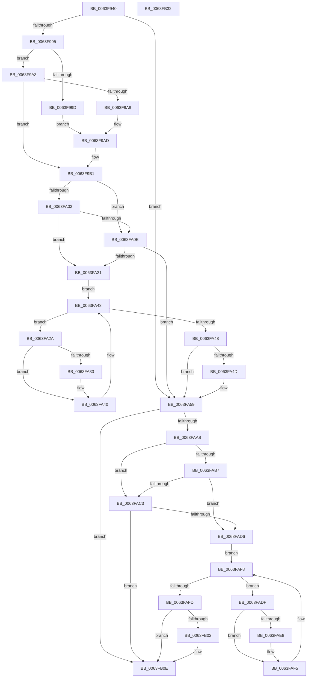

# DifZwCreateFileWrapper

- RVA: `0x0063F940`–`0x0063FB33` (길이 `499` bytes)
- VA: `0x000000014063F940`
- 실행 섹션: `.text`
- PDB 이름 있음: `예`; PDB Function 태그: `아니요`
- unwind 정보 RVA: `0x000D2D24`
- 디코드: `139`개 명령, `499/499` bytes 표시
- 미해석 바이트: `0` (있으면 어셈블리에 `.byte`로 보존)

> 이 문서는 커널 이미지의 기계어와 PDB 기호를 분석해 생성했습니다. 4번과 5번은 함수 원형과 자료형을 바이너리 사용 방식에서 추정한 C 해석이며 원본 소스 복구 결과는 아닙니다.

## 1. Dependencies

- 직접 호출 지점: **10**; 고유 호출 대상: **7**
- 직접 호출자로 확인된 함수: **0**
- RIP 상대 이미지 참조: **3**

### Outgoing calls
- `0x0063F97A` → [memset](../6C/memset_function_006C6C40.md) (function, `0x006C6C40`)
- `0x0063F984` → [DifGetAPIThunkContextById](../49/DifGetAPIThunkContextById_function_00495A34.md) (function, `0x00495A34`)
- `0x0063F9A8` → [DifGetReturnAddressForWrappers](../4D/DifGetReturnAddressForWrappers_function_004D3C08.md) (function, `0x004D3C08`)
- `0x0063FA15` → [ExAcquireRundownProtection](../21/ExAcquireRundownProtection_function_00216620.md) (function, `0x00216620`)
- `0x0063FA3B` → [guard_dispatch_icall](../6B/guard_dispatch_icall_function_006BAAD0.md) (function, `0x006BAAD0`)
- `0x0063FA54` → [ExReleaseRundownProtection](../34/ExReleaseRundownProtection_function_00349E80.md) (function, `0x00349E80`)
- `0x0063FA9E` → [ZwCreateFile](../6A/ZwCreateFile_function_006ADB70.md) (function, `0x006ADB70`)
- `0x0063FACA` → [ExAcquireRundownProtection](../21/ExAcquireRundownProtection_function_00216620.md) (function, `0x00216620`)
- `0x0063FAF0` → [guard_dispatch_icall](../6B/guard_dispatch_icall_function_006BAAD0.md) (function, `0x006BAAD0`)
- `0x0063FB09` → [ExReleaseRundownProtection](../34/ExReleaseRundownProtection_function_00349E80.md) (function, `0x00349E80`)

### Direct callers
- 이 함수 시작 RVA로 연결되는 직접 call은 확인되지 않았습니다. 간접 호출은 완전히 역산할 수 없습니다.

### Static image references
- `0x0063F9B8` → RVA `0x00F048B8` (`.data`; read)
- `0x0063FA02` → RVA `0x00F04980` (`.data`; read)
- `0x0063FA0E` → RVA `0x00F03E80` (`.data`; read)

## 2. Other-region calls and transfers

- 다른 실행 섹션으로 향하는 call: **0**
- 별도 외부 분기/꼬리 이동을 확인하지 못했습니다.

## 3. Assembly (complete function range)

```asm
0063F940  48 8B C4                        mov rax, rsp
0063F943  48 89 58 10                     mov qword ptr [rax + 0x10], rbx
0063F947  48 89 70 18                     mov qword ptr [rax + 0x18], rsi
0063F94B  48 89 78 20                     mov qword ptr [rax + 0x20], rdi
0063F94F  48 89 48 08                     mov qword ptr [rax + 8], rcx
0063F953  55                              push rbp
0063F954  41 54                           push r12
0063F956  41 55                           push r13
0063F958  41 56                           push r14
0063F95A  41 57                           push r15
0063F95C  48 8D 68 D1                     lea rbp, [rax - 0x2f]
0063F960  48 81 EC C0 00 00 00            sub rsp, 0xc0
0063F967  44 8B EA                        mov r13d, edx
0063F96A  48 8D 4D A7                     lea rcx, [rbp - 0x59]
0063F96E  33 D2                           xor edx, edx
0063F970  4D 8B E0                        mov r12, r8
0063F973  4D 8B F9                        mov r15, r9
0063F976  44 8D 42 58                     lea r8d, [rdx + 0x58]
0063F97A  E8 C1 72 08 00                  call 0x1406c6c40
0063F97F  B9 7C 00 00 00                  mov ecx, 0x7c
0063F984  E8 AB 60 E5 FF                  call 0x140495a34
0063F989  48 8B F0                        mov rsi, rax
0063F98C  48 85 C0                        test rax, rax
0063F98F  0F 84 C4 00 00 00               je 0x14063fa59
0063F995  8B 48 0C                        mov ecx, dword ptr [rax + 0xc]
0063F998  F6 C1 18                        test cl, 0x18
0063F99B  74 06                           je 0x14063f9a3
0063F99D  48 8B 45 2F                     mov rax, qword ptr [rbp + 0x2f]
0063F9A1  EB 0A                           jmp 0x14063f9ad
0063F9A3  F6 C1 04                        test cl, 4
0063F9A6  74 09                           je 0x14063f9b1
0063F9A8  E8 5B 42 E9 FF                  call 0x1404d3c08
0063F9AD  48 89 45 A7                     mov qword ptr [rbp - 0x59], rax
0063F9B1  48 8B 45 37                     mov rax, qword ptr [rbp + 0x37]
0063F9B5  45 32 F6                        xor r14b, r14b
0063F9B8  44 38 35 F9 4E 8C 00            cmp byte ptr [rip + 0x8c4ef9], r14b
0063F9BF  48 89 45 EF                     mov qword ptr [rbp - 0x11], rax
0063F9C3  48 8B 45 57                     mov rax, qword ptr [rbp + 0x57]
0063F9C7  48 89 45 CF                     mov qword ptr [rbp - 0x31], rax
0063F9CB  8B 45 5F                        mov eax, dword ptr [rbp + 0x5f]
0063F9CE  89 45 CB                        mov dword ptr [rbp - 0x35], eax
0063F9D1  8B 45 67                        mov eax, dword ptr [rbp + 0x67]
0063F9D4  89 45 C7                        mov dword ptr [rbp - 0x39], eax
0063F9D7  8B 45 6F                        mov eax, dword ptr [rbp + 0x6f]
0063F9DA  89 45 C3                        mov dword ptr [rbp - 0x3d], eax
0063F9DD  8B 45 77                        mov eax, dword ptr [rbp + 0x77]
0063F9E0  89 45 BF                        mov dword ptr [rbp - 0x41], eax
0063F9E3  48 8B 45 7F                     mov rax, qword ptr [rbp + 0x7f]
0063F9E7  48 89 45 B7                     mov qword ptr [rbp - 0x49], rax
0063F9EB  8B 85 87 00 00 00               mov eax, dword ptr [rbp + 0x87]
0063F9F1  89 45 AF                        mov dword ptr [rbp - 0x51], eax
0063F9F4  44 89 6D E7                     mov dword ptr [rbp - 0x19], r13d
0063F9F8  4C 89 65 DF                     mov qword ptr [rbp - 0x21], r12
0063F9FC  4C 89 7D D7                     mov qword ptr [rbp - 0x29], r15
0063FA00  75 0C                           jne 0x14063fa0e
0063FA02  F7 05 74 4F 8C 00 00 08 00 00   test dword ptr [rip + 0x8c4f74], 0x800
0063FA0C  74 13                           je 0x14063fa21
0063FA0E  48 8D 0D 6B 44 8C 00            lea rcx, [rip + 0x8c446b]
0063FA15  E8 06 6C BD FF                  call 0x140216620
0063FA1A  44 8A F0                        mov r14b, al
0063FA1D  84 C0                           test al, al
0063FA1F  74 38                           je 0x14063fa59
0063FA21  48 8D 7E 20                     lea rdi, [rsi + 0x20]
0063FA25  48 8B 1F                        mov rbx, qword ptr [rdi]
0063FA28  EB 19                           jmp 0x14063fa43
0063FA2A  48 8D 43 F0                     lea rax, [rbx - 0x10]
0063FA2E  48 85 C0                        test rax, rax
0063FA31  74 0D                           je 0x14063fa40
0063FA33  48 8B 40 08                     mov rax, qword ptr [rax + 8]
0063FA37  48 8D 4D A7                     lea rcx, [rbp - 0x59]
0063FA3B  E8 90 B0 07 00                  call 0x1406baad0
0063FA40  48 8B 1B                        mov rbx, qword ptr [rbx]
0063FA43  48 3B DF                        cmp rbx, rdi
0063FA46  75 E2                           jne 0x14063fa2a
0063FA48  45 84 F6                        test r14b, r14b
0063FA4B  74 0C                           je 0x14063fa59
0063FA4D  48 8D 0D 2C 44 8C 00            lea rcx, [rip + 0x8c442c]
0063FA54  E8 27 A4 D0 FF                  call 0x140349e80
0063FA59  8B 85 87 00 00 00               mov eax, dword ptr [rbp + 0x87]
0063FA5F  4D 8B CF                        mov r9, r15
0063FA62  48 8B 4D 37                     mov rcx, qword ptr [rbp + 0x37]
0063FA66  4D 8B C4                        mov r8, r12
0063FA69  89 44 24 50                     mov dword ptr [rsp + 0x50], eax
0063FA6D  41 8B D5                        mov edx, r13d
0063FA70  48 8B 45 7F                     mov rax, qword ptr [rbp + 0x7f]
0063FA74  48 89 44 24 48                  mov qword ptr [rsp + 0x48], rax
0063FA79  8B 45 77                        mov eax, dword ptr [rbp + 0x77]
0063FA7C  89 44 24 40                     mov dword ptr [rsp + 0x40], eax
0063FA80  8B 45 6F                        mov eax, dword ptr [rbp + 0x6f]
0063FA83  89 44 24 38                     mov dword ptr [rsp + 0x38], eax
0063FA87  8B 45 67                        mov eax, dword ptr [rbp + 0x67]
0063FA8A  89 44 24 30                     mov dword ptr [rsp + 0x30], eax
0063FA8E  8B 45 5F                        mov eax, dword ptr [rbp + 0x5f]
0063FA91  89 44 24 28                     mov dword ptr [rsp + 0x28], eax
0063FA95  48 8B 45 57                     mov rax, qword ptr [rbp + 0x57]
0063FA99  48 89 44 24 20                  mov qword ptr [rsp + 0x20], rax
0063FA9E  E8 CD E0 06 00                  call 0x1406adb70
0063FAA3  89 45 F7                        mov dword ptr [rbp - 9], eax
0063FAA6  48 85 F6                        test rsi, rsi
0063FAA9  74 63                           je 0x14063fb0e
0063FAAB  40 32 FF                        xor dil, dil
0063FAAE  40 38 3D 03 4E 8C 00            cmp byte ptr [rip + 0x8c4e03], dil
0063FAB5  75 0C                           jne 0x14063fac3
0063FAB7  F7 05 BF 4E 8C 00 00 08 00 00   test dword ptr [rip + 0x8c4ebf], 0x800
0063FAC1  74 13                           je 0x14063fad6
0063FAC3  48 8D 0D B6 43 8C 00            lea rcx, [rip + 0x8c43b6]
0063FACA  E8 51 6B BD FF                  call 0x140216620
0063FACF  40 8A F8                        mov dil, al
0063FAD2  84 C0                           test al, al
0063FAD4  74 38                           je 0x14063fb0e
0063FAD6  48 83 C6 30                     add rsi, 0x30
0063FADA  48 8B 1E                        mov rbx, qword ptr [rsi]
0063FADD  EB 19                           jmp 0x14063faf8
0063FADF  48 8D 43 F0                     lea rax, [rbx - 0x10]
0063FAE3  48 85 C0                        test rax, rax
0063FAE6  74 0D                           je 0x14063faf5
0063FAE8  48 8B 40 08                     mov rax, qword ptr [rax + 8]
0063FAEC  48 8D 4D A7                     lea rcx, [rbp - 0x59]
0063FAF0  E8 DB AF 07 00                  call 0x1406baad0
0063FAF5  48 8B 1B                        mov rbx, qword ptr [rbx]
0063FAF8  48 3B DE                        cmp rbx, rsi
0063FAFB  75 E2                           jne 0x14063fadf
0063FAFD  40 84 FF                        test dil, dil
0063FB00  74 0C                           je 0x14063fb0e
0063FB02  48 8D 0D 77 43 8C 00            lea rcx, [rip + 0x8c4377]
0063FB09  E8 72 A3 D0 FF                  call 0x140349e80
0063FB0E  8B 45 F7                        mov eax, dword ptr [rbp - 9]
0063FB11  4C 8D 9C 24 C0 00 00 00         lea r11, [rsp + 0xc0]
0063FB19  49 8B 5B 38                     mov rbx, qword ptr [r11 + 0x38]
0063FB1D  49 8B 73 40                     mov rsi, qword ptr [r11 + 0x40]
0063FB21  49 8B 7B 48                     mov rdi, qword ptr [r11 + 0x48]
0063FB25  49 8B E3                        mov rsp, r11
0063FB28  41 5F                           pop r15
0063FB2A  41 5E                           pop r14
0063FB2C  41 5D                           pop r13
0063FB2E  41 5C                           pop r12
0063FB30  5D                              pop rbp
0063FB31  C3                              ret
0063FB32  CC                              int3
```

## 4. C-style interpretation (structured pseudocode)

```c
__int64 __fastcall DifZwCreateFileWrapper(__int64 a1, int a2, __int64 a3, __int64 a4)
{
    __int64 result;
    __int64 v_r14;
    __int64 v_rdi;
    __int64 v_rsi;
    __int64 v_rsp;
    unsigned __int64 v_stack_m28;
    unsigned int v_stack_m98;
    unsigned __int64 v_stack_mA0;
    unsigned int v_stack_mA8;
    unsigned int v_stack_mB0;
    unsigned int v_stack_mB8;
    unsigned int v_stack_mC0;
    unsigned __int64 v_stack_mC8;

    *(unsigned __int64 *)(v_rsp + 16) = v_rbx;
    *(unsigned __int64 *)(v_rsp + 24) = v_rsi;
    *(unsigned __int64 *)(v_rsp + 32) = v_rdi;
    *(unsigned __int64 *)(v_rsp + 8) = a1;
    v_rsp = (v_rsp) - (192);
    a2 = 0;
    result = memset(v_rsp - 47 - 89, a2, a2 + 88, a4);
    result = DifGetAPIThunkContextById(124, a2, a2 + 88, a4);
    if (result == 0) goto loc_0063FA59;
    if ((((unsigned __int8)((unsigned int)(*(unsigned int *)(result + 12)))) & (24)) == 0) goto loc_0063F9A3;
    goto loc_0063F9AD;
loc_0063F9A3:
    if ((((unsigned __int8)((unsigned int)(*(unsigned int *)(result + 12)))) & (4)) == 0) goto loc_0063F9B1;
    result = DifGetReturnAddressForWrappers((unsigned int)(*(unsigned int *)(result + 12)), a2, a2 + 88, a4);
loc_0063F9AD:
    *(unsigned __int64 *)(v_rsp - 47 - 89) = result;
loc_0063F9B1:
    v_r14 = 0;
    *(unsigned __int64 *)(v_rsp - 47 - 17) = *(unsigned __int64 *)(v_rsp - 47 + 55);
    *(unsigned __int64 *)(v_rsp - 47 - 49) = *(unsigned __int64 *)(v_rsp - 47 + 87);
    *(unsigned int *)(v_rsp - 47 - 53) = (unsigned int)((unsigned int)(*(unsigned int *)(v_rsp - 47 + 95)));
    *(unsigned int *)(v_rsp - 47 - 57) = (unsigned int)((unsigned int)(*(unsigned int *)(v_rsp - 47 + 103)));
    *(unsigned int *)(v_rsp - 47 - 61) = (unsigned int)((unsigned int)(*(unsigned int *)(v_rsp - 47 + 111)));
    *(unsigned int *)(v_rsp - 47 - 65) = (unsigned int)((unsigned int)(*(unsigned int *)(v_rsp - 47 + 119)));
    *(unsigned __int64 *)(v_rsp - 47 - 73) = *(unsigned __int64 *)(v_rsp - 47 + 127);
    *(unsigned int *)(v_rsp - 47 - 81) = (unsigned int)((unsigned int)(*(unsigned int *)(v_rsp - 47 + 135)));
    *(unsigned int *)(v_rsp - 47 - 25) = (unsigned int)((unsigned int)(a2));
    *(unsigned __int64 *)(v_rsp - 47 - 33) = a3;
    *(unsigned __int64 *)(v_rsp - 47 - 41) = a4;
    if ((*(unsigned __int8 *)(v_rip + 9195257)) != 0) goto loc_0063FA0E;
    if (((*(unsigned int *)(v_rip + 9195380)) & (0x800ULL)) == 0) goto loc_0063FA21;
loc_0063FA0E:
    result = ExAcquireRundownProtection(v_rip + 9192555, a2, a2 + 88, a4);
    if ((unsigned __int8)(result) == 0) goto loc_0063FA59;
loc_0063FA21:
    goto loc_0063FA43;
loc_0063FA2A:
    result = *(unsigned __int64 *)(result + 32) - 16;
    if (*(unsigned __int64 *)(result + 32) - 16 != 0) {
        result = *(unsigned __int64 *)(*(unsigned __int64 *)(result + 32) - 16 + 8);
        a1 = v_rsp - 47 - 89;
        result = guard_dispatch_icall(a1, a2, a2 + 88, a4);
    }
loc_0063FA43:
    if ((*(unsigned __int64 *)(*(unsigned __int64 *)(result + 32))) != (result + 32)) goto loc_0063FA2A;
    if ((unsigned __int8)((unsigned __int8)(result)) != 0) {
        a1 = v_rip + 9192492;
        result = ExReleaseRundownProtection(a1, a2, a2 + 88, a4);
    }
    v_stack_m98 = (unsigned int)((unsigned int)(*(unsigned int *)(v_rsp - 47 + 135)));
    v_stack_mA0 = *(unsigned __int64 *)(v_rsp - 47 + 127);
    v_stack_mA8 = (unsigned int)((unsigned int)(*(unsigned int *)(v_rsp - 47 + 119)));
    v_stack_mB0 = (unsigned int)((unsigned int)(*(unsigned int *)(v_rsp - 47 + 111)));
    v_stack_mB8 = (unsigned int)((unsigned int)(*(unsigned int *)(v_rsp - 47 + 103)));
    v_stack_mC0 = (unsigned int)((unsigned int)(*(unsigned int *)(v_rsp - 47 + 95)));
    v_stack_mC8 = *(unsigned __int64 *)(v_rsp - 47 + 87);
    result = ZwCreateFile(*(unsigned __int64 *)(v_rsp - 47 + 55), (unsigned int)((unsigned int)((unsigned int)(a2))), a3, a4);
    *(unsigned int *)(v_rsp - 47 - 9) = (unsigned int)(result);
    if (result == 0) goto loc_0063FB0E;
    v_rdi = 0;
    if ((*(unsigned __int8 *)(v_rip + 9195011)) != 0) goto loc_0063FAC3;
    if (((*(unsigned int *)(v_rip + 9195199)) & (0x800ULL)) == 0) goto loc_0063FAD6;
loc_0063FAC3:
    result = ExAcquireRundownProtection(v_rip + 9192374, (unsigned int)((unsigned int)((unsigned int)(a2))), a3, a4);
    if ((unsigned __int8)(result) == 0) goto loc_0063FB0E;
loc_0063FAD6:
    v_rsi = (result) + (48);
    goto loc_0063FAF8;
loc_0063FADF:
    result = *(unsigned __int64 *)(v_rsi) - 16;
    if (*(unsigned __int64 *)(v_rsi) - 16 != 0) {
        result = *(unsigned __int64 *)(*(unsigned __int64 *)(v_rsi) - 16 + 8);
        a1 = v_rsp - 47 - 89;
        result = guard_dispatch_icall(a1, (unsigned int)((unsigned int)((unsigned int)(a2))), a3, a4);
    }
loc_0063FAF8:
    if ((*(unsigned __int64 *)(*(unsigned __int64 *)(v_rsi))) != v_rsi) goto loc_0063FADF;
    if ((unsigned __int8)((unsigned __int8)(result)) != 0) {
        a1 = v_rip + 9192311;
        result = ExReleaseRundownProtection(a1, (unsigned int)((unsigned int)((unsigned int)(a2))), a3, a4);
    }
    return (unsigned int)(*(unsigned int *)(v_rsp - 47 - 9));
}
```

## 5. (Beta) C Style

```c
int64_t DifZwCreateFileWrapper(int64_t Arg1, int32_t Arg2, int64_t Arg3, int64_t Arg4)
{
    int64_t result;
    int64_t local_r14;
    int64_t local_rdi;
    int64_t local_rsi;
    int64_t local_rsp;
    uint64_t v_stack_m28;
    uint32_t v_stack_m98;
    uint64_t v_stack_mA0;
    uint32_t v_stack_mA8;
    uint32_t v_stack_mB0;
    uint32_t v_stack_mB8;
    uint32_t v_stack_mC0;
    uint64_t v_stack_mC8;

    *(uint64_t *)(local_rsp + 0x10) = local_rbx;
    *(uint64_t *)(local_rsp + 0x18) = local_rsi;
    *(uint64_t *)(local_rsp + 0x20) = local_rdi;
    *(uint64_t *)(local_rsp + 0x8) = Arg1;
    local_rsp = (local_rsp) - (192);
    Arg2 = 0;
    result = memset(local_rsp - 47 - 89, Arg2, Arg2 + 88, Arg4);
    result = DifGetAPIThunkContextById(124, Arg2, Arg2 + 88, Arg4);
    if (result == 0) goto loc_0063FA59;
    if ((((uint8_t)((uint32_t)(*(uint32_t *)(result + 0xC)))) & (24)) == 0) goto loc_0063F9A3;
    goto loc_0063F9AD;
loc_0063F9A3:
    if ((((uint8_t)((uint32_t)(*(uint32_t *)(result + 0xC)))) & (4)) == 0) goto loc_0063F9B1;
    result = DifGetReturnAddressForWrappers((uint32_t)(*(uint32_t *)(result + 0xC)), Arg2, Arg2 + 88, Arg4);
loc_0063F9AD:
    *(uint64_t *)(local_rsp - 0x2F - 0x59) = result;
loc_0063F9B1:
    local_r14 = 0;
    *(uint64_t *)(local_rsp - 0x2F - 0x11) = *(uint64_t *)(local_rsp - 0x2F + 0x37);
    *(uint64_t *)(local_rsp - 0x2F - 0x31) = *(uint64_t *)(local_rsp - 0x2F + 0x57);
    *(uint32_t *)(local_rsp - 0x2F - 0x35) = (uint32_t)((uint32_t)(*(uint32_t *)(local_rsp - 0x2F + 0x5F)));
    *(uint32_t *)(local_rsp - 0x2F - 0x39) = (uint32_t)((uint32_t)(*(uint32_t *)(local_rsp - 0x2F + 0x67)));
    *(uint32_t *)(local_rsp - 0x2F - 0x3D) = (uint32_t)((uint32_t)(*(uint32_t *)(local_rsp - 0x2F + 0x6F)));
    *(uint32_t *)(local_rsp - 0x2F - 0x41) = (uint32_t)((uint32_t)(*(uint32_t *)(local_rsp - 0x2F + 0x77)));
    *(uint64_t *)(local_rsp - 0x2F - 0x49) = *(uint64_t *)(local_rsp - 0x2F + 0x7F);
    *(uint32_t *)(local_rsp - 0x2F - 0x51) = (uint32_t)((uint32_t)(*(uint32_t *)(local_rsp - 0x2F + 0x87)));
    *(uint32_t *)(local_rsp - 0x2F - 0x19) = (uint32_t)((uint32_t)(Arg2));
    *(uint64_t *)(local_rsp - 0x2F - 0x21) = Arg3;
    *(uint64_t *)(local_rsp - 0x2F - 0x29) = Arg4;
    if ((*(uint8_t *)(v_rip + 0x8C4EF9)) != 0) goto loc_0063FA0E;
    if (((*(uint32_t *)(v_rip + 0x8C4F74)) & (0x800ULL)) == 0) goto loc_0063FA21;
loc_0063FA0E:
    result = ExAcquireRundownProtection(v_rip + 9192555, Arg2, Arg2 + 88, Arg4);
    if ((uint8_t)(result) == 0) goto loc_0063FA59;
loc_0063FA21:
    goto loc_0063FA43;
loc_0063FA2A:
    result = *(uint64_t *)(result + 0x20) - 16;
    if (*(uint64_t *)(result + 0x20) - 16 != 0) {
        result = *(uint64_t *)(*(uint64_t *)(result + 0x20) - 0x10 + 0x8);
        Arg1 = local_rsp - 47 - 89;
        result = guard_dispatch_icall(Arg1, Arg2, Arg2 + 88, Arg4);
    }
loc_0063FA43:
    if ((*(uint64_t *)(*(uint64_t *)(result + 0x20))) != (result + 32)) goto loc_0063FA2A;
    if ((uint8_t)((uint8_t)(result)) != 0) {
        Arg1 = v_rip + 9192492;
        result = ExReleaseRundownProtection(Arg1, Arg2, Arg2 + 88, Arg4);
    }
    v_stack_m98 = (uint32_t)((uint32_t)(*(uint32_t *)(local_rsp - 0x2F + 0x87)));
    v_stack_mA0 = *(uint64_t *)(local_rsp - 0x2F + 0x7F);
    v_stack_mA8 = (uint32_t)((uint32_t)(*(uint32_t *)(local_rsp - 0x2F + 0x77)));
    v_stack_mB0 = (uint32_t)((uint32_t)(*(uint32_t *)(local_rsp - 0x2F + 0x6F)));
    v_stack_mB8 = (uint32_t)((uint32_t)(*(uint32_t *)(local_rsp - 0x2F + 0x67)));
    v_stack_mC0 = (uint32_t)((uint32_t)(*(uint32_t *)(local_rsp - 0x2F + 0x5F)));
    v_stack_mC8 = *(uint64_t *)(local_rsp - 0x2F + 0x57);
    result = ZwCreateFile(*(uint64_t *)(local_rsp - 0x2F + 0x37), (uint32_t)((uint32_t)((uint32_t)(Arg2))), Arg3, Arg4);
    *(uint32_t *)(local_rsp - 0x2F - 0x9) = (uint32_t)(result);
    if (result == 0) goto loc_0063FB0E;
    local_rdi = 0;
    if ((*(uint8_t *)(v_rip + 0x8C4E03)) != 0) goto loc_0063FAC3;
    if (((*(uint32_t *)(v_rip + 0x8C4EBF)) & (0x800ULL)) == 0) goto loc_0063FAD6;
loc_0063FAC3:
    result = ExAcquireRundownProtection(v_rip + 9192374, (uint32_t)((uint32_t)((uint32_t)(Arg2))), Arg3, Arg4);
    if ((uint8_t)(result) == 0) goto loc_0063FB0E;
loc_0063FAD6:
    local_rsi = (result) + (48);
    goto loc_0063FAF8;
loc_0063FADF:
    result = *(uint64_t *)(local_rsi) - 16;
    if (*(uint64_t *)(local_rsi) - 16 != 0) {
        result = *(uint64_t *)(*(uint64_t *)(local_rsi) - 0x10 + 0x8);
        Arg1 = local_rsp - 47 - 89;
        result = guard_dispatch_icall(Arg1, (uint32_t)((uint32_t)((uint32_t)(Arg2))), Arg3, Arg4);
    }
loc_0063FAF8:
    if ((*(uint64_t *)(*(uint64_t *)(local_rsi))) != local_rsi) goto loc_0063FADF;
    if ((uint8_t)((uint8_t)(result)) != 0) {
        Arg1 = v_rip + 9192311;
        result = ExReleaseRundownProtection(Arg1, (uint32_t)((uint32_t)((uint32_t)(Arg2))), Arg3, Arg4);
    }
    return (uint32_t)(*(uint32_t *)(local_rsp - 0x2F - 0x9));
}
```

## 6. Execution-region graph

[열기: 2D/3D 그래프와 함수 탐색 컨트롤 패널](../../../control-panel.html?section=text&rva=0x0063F940&view=graph)

- 2D 그래프는 위에서 아래로 흐르고, 3D 그래프는 빈 공간을 드래그해 회전합니다. Shift+드래그는 이동, 휠은 확대·축소, 함수 노드 선택은 대상 보고서 이동입니다.

### Static fallback


