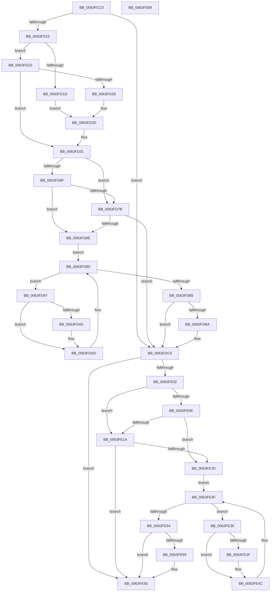

# DifZwCreateKeyTransactedWrapper

- RVA: `0x0063FCC0`–`0x0063FE8A` (길이 `458` bytes)
- VA: `0x000000014063FCC0`
- 실행 섹션: `.text`
- PDB 이름 있음: `예`; PDB Function 태그: `아니요`
- unwind 정보 RVA: `0x000D2C00`
- 디코드: `127`개 명령, `458/458` bytes 표시
- 미해석 바이트: `0` (있으면 어셈블리에 `.byte`로 보존)

> 이 문서는 커널 이미지의 기계어와 PDB 기호를 분석해 생성했습니다. 4번과 5번은 함수 원형과 자료형을 바이너리 사용 방식에서 추정한 C 해석이며 원본 소스 복구 결과는 아닙니다.

## 1. Dependencies

- 직접 호출 지점: **10**; 고유 호출 대상: **7**
- 직접 호출자로 확인된 함수: **0**
- RIP 상대 이미지 참조: **3**

### Outgoing calls
- `0x0063FCFA` → [memset](../6C/memset_function_006C6C40.md) (function, `0x006C6C40`)
- `0x0063FD04` → [DifGetAPIThunkContextById](../49/DifGetAPIThunkContextById_function_00495A34.md) (function, `0x00495A34`)
- `0x0063FD28` → [DifGetReturnAddressForWrappers](../4D/DifGetReturnAddressForWrappers_function_004D3C08.md) (function, `0x004D3C08`)
- `0x0063FD82` → [ExAcquireRundownProtection](../21/ExAcquireRundownProtection_function_00216620.md) (function, `0x00216620`)
- `0x0063FDA8` → [guard_dispatch_icall](../6B/guard_dispatch_icall_function_006BAAD0.md) (function, `0x006BAAD0`)
- `0x0063FDC1` → [ExReleaseRundownProtection](../34/ExReleaseRundownProtection_function_00349E80.md) (function, `0x00349E80`)
- `0x0063FDF5` → [ZwCreateKeyTransacted](../6A/ZwCreateKeyTransacted_function_006AE790.md) (function, `0x006AE790`)
- `0x0063FE21` → [ExAcquireRundownProtection](../21/ExAcquireRundownProtection_function_00216620.md) (function, `0x00216620`)
- `0x0063FE47` → [guard_dispatch_icall](../6B/guard_dispatch_icall_function_006BAAD0.md) (function, `0x006BAAD0`)
- `0x0063FE60` → [ExReleaseRundownProtection](../34/ExReleaseRundownProtection_function_00349E80.md) (function, `0x00349E80`)

### Direct callers
- 이 함수 시작 RVA로 연결되는 직접 call은 확인되지 않았습니다. 간접 호출은 완전히 역산할 수 없습니다.

### Static image references
- `0x0063FD38` → RVA `0x00F048B8` (`.data`; read)
- `0x0063FD6F` → RVA `0x00F04980` (`.data`; read)
- `0x0063FD7B` → RVA `0x00F03E80` (`.data`; read)

## 2. Other-region calls and transfers

- 다른 실행 섹션으로 향하는 call: **0**
- 별도 외부 분기/꼬리 이동을 확인하지 못했습니다.

## 3. Assembly (complete function range)

```asm
0063FCC0  48 8B C4                        mov rax, rsp
0063FCC3  48 89 58 10                     mov qword ptr [rax + 0x10], rbx
0063FCC7  48 89 70 18                     mov qword ptr [rax + 0x18], rsi
0063FCCB  48 89 78 20                     mov qword ptr [rax + 0x20], rdi
0063FCCF  48 89 48 08                     mov qword ptr [rax + 8], rcx
0063FCD3  55                              push rbp
0063FCD4  41 54                           push r12
0063FCD6  41 55                           push r13
0063FCD8  41 56                           push r14
0063FCDA  41 57                           push r15
0063FCDC  48 8D 68 C1                     lea rbp, [rax - 0x3f]
0063FCE0  48 81 EC 90 00 00 00            sub rsp, 0x90
0063FCE7  44 8B EA                        mov r13d, edx
0063FCEA  48 8D 4D C7                     lea rcx, [rbp - 0x39]
0063FCEE  33 D2                           xor edx, edx
0063FCF0  4D 8B E0                        mov r12, r8
0063FCF3  45 8B F9                        mov r15d, r9d
0063FCF6  44 8D 42 50                     lea r8d, [rdx + 0x50]
0063FCFA  E8 41 6F 08 00                  call 0x1406c6c40
0063FCFF  B9 79 00 00 00                  mov ecx, 0x79
0063FD04  E8 2B 5D E5 FF                  call 0x140495a34
0063FD09  48 8B F0                        mov rsi, rax
0063FD0C  48 85 C0                        test rax, rax
0063FD0F  0F 84 B1 00 00 00               je 0x14063fdc6
0063FD15  8B 48 0C                        mov ecx, dword ptr [rax + 0xc]
0063FD18  F6 C1 18                        test cl, 0x18
0063FD1B  74 06                           je 0x14063fd23
0063FD1D  48 8B 45 3F                     mov rax, qword ptr [rbp + 0x3f]
0063FD21  EB 0A                           jmp 0x14063fd2d
0063FD23  F6 C1 04                        test cl, 4
0063FD26  74 09                           je 0x14063fd31
0063FD28  E8 DB 3E E9 FF                  call 0x1404d3c08
0063FD2D  48 89 45 C7                     mov qword ptr [rbp - 0x39], rax
0063FD31  48 8B 45 47                     mov rax, qword ptr [rbp + 0x47]
0063FD35  45 32 F6                        xor r14b, r14b
0063FD38  44 38 35 79 4B 8C 00            cmp byte ptr [rip + 0x8c4b79], r14b
0063FD3F  48 89 45 07                     mov qword ptr [rbp + 7], rax
0063FD43  48 8B 45 67                     mov rax, qword ptr [rbp + 0x67]
0063FD47  48 89 45 E7                     mov qword ptr [rbp - 0x19], rax
0063FD4B  8B 45 6F                        mov eax, dword ptr [rbp + 0x6f]
0063FD4E  89 45 DF                        mov dword ptr [rbp - 0x21], eax
0063FD51  48 8B 45 77                     mov rax, qword ptr [rbp + 0x77]
0063FD55  48 89 45 D7                     mov qword ptr [rbp - 0x29], rax
0063FD59  48 8B 45 7F                     mov rax, qword ptr [rbp + 0x7f]
0063FD5D  48 89 45 CF                     mov qword ptr [rbp - 0x31], rax
0063FD61  44 89 6D FF                     mov dword ptr [rbp - 1], r13d
0063FD65  4C 89 65 F7                     mov qword ptr [rbp - 9], r12
0063FD69  44 89 7D EF                     mov dword ptr [rbp - 0x11], r15d
0063FD6D  75 0C                           jne 0x14063fd7b
0063FD6F  F7 05 07 4C 8C 00 00 08 00 00   test dword ptr [rip + 0x8c4c07], 0x800
0063FD79  74 13                           je 0x14063fd8e
0063FD7B  48 8D 0D FE 40 8C 00            lea rcx, [rip + 0x8c40fe]
0063FD82  E8 99 68 BD FF                  call 0x140216620
0063FD87  44 8A F0                        mov r14b, al
0063FD8A  84 C0                           test al, al
0063FD8C  74 38                           je 0x14063fdc6
0063FD8E  48 8D 7E 20                     lea rdi, [rsi + 0x20]
0063FD92  48 8B 1F                        mov rbx, qword ptr [rdi]
0063FD95  EB 19                           jmp 0x14063fdb0
0063FD97  48 8D 43 F0                     lea rax, [rbx - 0x10]
0063FD9B  48 85 C0                        test rax, rax
0063FD9E  74 0D                           je 0x14063fdad
0063FDA0  48 8B 40 08                     mov rax, qword ptr [rax + 8]
0063FDA4  48 8D 4D C7                     lea rcx, [rbp - 0x39]
0063FDA8  E8 23 AD 07 00                  call 0x1406baad0
0063FDAD  48 8B 1B                        mov rbx, qword ptr [rbx]
0063FDB0  48 3B DF                        cmp rbx, rdi
0063FDB3  75 E2                           jne 0x14063fd97
0063FDB5  45 84 F6                        test r14b, r14b
0063FDB8  74 0C                           je 0x14063fdc6
0063FDBA  48 8D 0D BF 40 8C 00            lea rcx, [rip + 0x8c40bf]
0063FDC1  E8 BA A0 D0 FF                  call 0x140349e80
0063FDC6  48 8B 45 7F                     mov rax, qword ptr [rbp + 0x7f]
0063FDCA  45 8B CF                        mov r9d, r15d
0063FDCD  48 8B 4D 47                     mov rcx, qword ptr [rbp + 0x47]
0063FDD1  4D 8B C4                        mov r8, r12
0063FDD4  48 89 44 24 38                  mov qword ptr [rsp + 0x38], rax
0063FDD9  41 8B D5                        mov edx, r13d
0063FDDC  48 8B 45 77                     mov rax, qword ptr [rbp + 0x77]
0063FDE0  48 89 44 24 30                  mov qword ptr [rsp + 0x30], rax
0063FDE5  8B 45 6F                        mov eax, dword ptr [rbp + 0x6f]
0063FDE8  89 44 24 28                     mov dword ptr [rsp + 0x28], eax
0063FDEC  48 8B 45 67                     mov rax, qword ptr [rbp + 0x67]
0063FDF0  48 89 44 24 20                  mov qword ptr [rsp + 0x20], rax
0063FDF5  E8 96 E9 06 00                  call 0x1406ae790
0063FDFA  89 45 0F                        mov dword ptr [rbp + 0xf], eax
0063FDFD  48 85 F6                        test rsi, rsi
0063FE00  74 63                           je 0x14063fe65
0063FE02  40 32 FF                        xor dil, dil
0063FE05  40 38 3D AC 4A 8C 00            cmp byte ptr [rip + 0x8c4aac], dil
0063FE0C  75 0C                           jne 0x14063fe1a
0063FE0E  F7 05 68 4B 8C 00 00 08 00 00   test dword ptr [rip + 0x8c4b68], 0x800
0063FE18  74 13                           je 0x14063fe2d
0063FE1A  48 8D 0D 5F 40 8C 00            lea rcx, [rip + 0x8c405f]
0063FE21  E8 FA 67 BD FF                  call 0x140216620
0063FE26  40 8A F8                        mov dil, al
0063FE29  84 C0                           test al, al
0063FE2B  74 38                           je 0x14063fe65
0063FE2D  48 83 C6 30                     add rsi, 0x30
0063FE31  48 8B 1E                        mov rbx, qword ptr [rsi]
0063FE34  EB 19                           jmp 0x14063fe4f
0063FE36  48 8D 43 F0                     lea rax, [rbx - 0x10]
0063FE3A  48 85 C0                        test rax, rax
0063FE3D  74 0D                           je 0x14063fe4c
0063FE3F  48 8B 40 08                     mov rax, qword ptr [rax + 8]
0063FE43  48 8D 4D C7                     lea rcx, [rbp - 0x39]
0063FE47  E8 84 AC 07 00                  call 0x1406baad0
0063FE4C  48 8B 1B                        mov rbx, qword ptr [rbx]
0063FE4F  48 3B DE                        cmp rbx, rsi
0063FE52  75 E2                           jne 0x14063fe36
0063FE54  40 84 FF                        test dil, dil
0063FE57  74 0C                           je 0x14063fe65
0063FE59  48 8D 0D 20 40 8C 00            lea rcx, [rip + 0x8c4020]
0063FE60  E8 1B A0 D0 FF                  call 0x140349e80
0063FE65  8B 45 0F                        mov eax, dword ptr [rbp + 0xf]
0063FE68  4C 8D 9C 24 90 00 00 00         lea r11, [rsp + 0x90]
0063FE70  49 8B 5B 38                     mov rbx, qword ptr [r11 + 0x38]
0063FE74  49 8B 73 40                     mov rsi, qword ptr [r11 + 0x40]
0063FE78  49 8B 7B 48                     mov rdi, qword ptr [r11 + 0x48]
0063FE7C  49 8B E3                        mov rsp, r11
0063FE7F  41 5F                           pop r15
0063FE81  41 5E                           pop r14
0063FE83  41 5D                           pop r13
0063FE85  41 5C                           pop r12
0063FE87  5D                              pop rbp
0063FE88  C3                              ret
0063FE89  CC                              int3
```

## 4. C-style interpretation (structured pseudocode)

```c
__int64 __fastcall DifZwCreateKeyTransactedWrapper(__int64 a1, int a2, __int64 a3, int a4)
{
    __int64 result;
    __int64 v_r14;
    __int64 v_rdi;
    __int64 v_rsi;
    __int64 v_rsp;
    unsigned __int64 v_stack_m28;
    unsigned __int64 v_stack_m80;
    unsigned __int64 v_stack_m88;
    unsigned int v_stack_m90;
    unsigned __int64 v_stack_m98;

    *(unsigned __int64 *)(v_rsp + 16) = v_rbx;
    *(unsigned __int64 *)(v_rsp + 24) = v_rsi;
    *(unsigned __int64 *)(v_rsp + 32) = v_rdi;
    *(unsigned __int64 *)(v_rsp + 8) = a1;
    v_rsp = (v_rsp) - (144);
    a2 = 0;
    result = memset(v_rsp - 63 - 57, a2, a2 + 80, a4);
    result = DifGetAPIThunkContextById(121, a2, a2 + 80, a4);
    if (result == 0) goto loc_0063FDC6;
    if ((((unsigned __int8)((unsigned int)(*(unsigned int *)(result + 12)))) & (24)) == 0) goto loc_0063FD23;
    goto loc_0063FD2D;
loc_0063FD23:
    if ((((unsigned __int8)((unsigned int)(*(unsigned int *)(result + 12)))) & (4)) == 0) goto loc_0063FD31;
    result = DifGetReturnAddressForWrappers((unsigned int)(*(unsigned int *)(result + 12)), a2, a2 + 80, a4);
loc_0063FD2D:
    *(unsigned __int64 *)(v_rsp - 63 - 57) = result;
loc_0063FD31:
    v_r14 = 0;
    *(unsigned __int64 *)(v_rsp - 63 + 7) = *(unsigned __int64 *)(v_rsp - 63 + 71);
    *(unsigned __int64 *)(v_rsp - 63 - 25) = *(unsigned __int64 *)(v_rsp - 63 + 103);
    *(unsigned int *)(v_rsp - 63 - 33) = (unsigned int)((unsigned int)(*(unsigned int *)(v_rsp - 63 + 111)));
    *(unsigned __int64 *)(v_rsp - 63 - 41) = *(unsigned __int64 *)(v_rsp - 63 + 119);
    *(unsigned __int64 *)(v_rsp - 63 - 49) = *(unsigned __int64 *)(v_rsp - 63 + 127);
    *(unsigned int *)(v_rsp - 63 - 1) = (unsigned int)((unsigned int)(a2));
    *(unsigned __int64 *)(v_rsp - 63 - 9) = a3;
    *(unsigned int *)(v_rsp - 63 - 17) = (unsigned int)((unsigned int)(a4));
    if ((*(unsigned __int8 *)(v_rip + 9194361)) != 0) goto loc_0063FD7B;
    if (((*(unsigned int *)(v_rip + 9194503)) & (0x800ULL)) == 0) goto loc_0063FD8E;
loc_0063FD7B:
    result = ExAcquireRundownProtection(v_rip + 9191678, a2, a2 + 80, a4);
    if ((unsigned __int8)(result) == 0) goto loc_0063FDC6;
loc_0063FD8E:
    goto loc_0063FDB0;
loc_0063FD97:
    result = *(unsigned __int64 *)(result + 32) - 16;
    if (*(unsigned __int64 *)(result + 32) - 16 != 0) {
        result = *(unsigned __int64 *)(*(unsigned __int64 *)(result + 32) - 16 + 8);
        a1 = v_rsp - 63 - 57;
        result = guard_dispatch_icall(a1, a2, a2 + 80, a4);
    }
loc_0063FDB0:
    if ((*(unsigned __int64 *)(*(unsigned __int64 *)(result + 32))) != (result + 32)) goto loc_0063FD97;
    if ((unsigned __int8)((unsigned __int8)(result)) != 0) {
        a1 = v_rip + 9191615;
        result = ExReleaseRundownProtection(a1, a2, a2 + 80, a4);
    }
    v_stack_m80 = *(unsigned __int64 *)(v_rsp - 63 + 127);
    v_stack_m88 = *(unsigned __int64 *)(v_rsp - 63 + 119);
    v_stack_m90 = (unsigned int)((unsigned int)(*(unsigned int *)(v_rsp - 63 + 111)));
    v_stack_m98 = *(unsigned __int64 *)(v_rsp - 63 + 103);
    result = ZwCreateKeyTransacted(*(unsigned __int64 *)(v_rsp - 63 + 71), (unsigned int)((unsigned int)((unsigned int)(a2))), a3, (unsigned int)((unsigned int)((unsigned int)(a4))));
    *(unsigned int *)(v_rsp - 63 + 15) = (unsigned int)(result);
    if (result == 0) goto loc_0063FE65;
    v_rdi = 0;
    if ((*(unsigned __int8 *)(v_rip + 9194156)) != 0) goto loc_0063FE1A;
    if (((*(unsigned int *)(v_rip + 9194344)) & (0x800ULL)) == 0) goto loc_0063FE2D;
loc_0063FE1A:
    result = ExAcquireRundownProtection(v_rip + 9191519, (unsigned int)((unsigned int)((unsigned int)(a2))), a3, (unsigned int)((unsigned int)((unsigned int)(a4))));
    if ((unsigned __int8)(result) == 0) goto loc_0063FE65;
loc_0063FE2D:
    v_rsi = (result) + (48);
    goto loc_0063FE4F;
loc_0063FE36:
    result = *(unsigned __int64 *)(v_rsi) - 16;
    if (*(unsigned __int64 *)(v_rsi) - 16 != 0) {
        result = *(unsigned __int64 *)(*(unsigned __int64 *)(v_rsi) - 16 + 8);
        a1 = v_rsp - 63 - 57;
        result = guard_dispatch_icall(a1, (unsigned int)((unsigned int)((unsigned int)(a2))), a3, (unsigned int)((unsigned int)((unsigned int)(a4))));
    }
loc_0063FE4F:
    if ((*(unsigned __int64 *)(*(unsigned __int64 *)(v_rsi))) != v_rsi) goto loc_0063FE36;
    if ((unsigned __int8)((unsigned __int8)(result)) != 0) {
        a1 = v_rip + 9191456;
        result = ExReleaseRundownProtection(a1, (unsigned int)((unsigned int)((unsigned int)(a2))), a3, (unsigned int)((unsigned int)((unsigned int)(a4))));
    }
    return (unsigned int)(*(unsigned int *)(v_rsp - 63 + 15));
}
```

## 5. (Beta) C Style

```c
int64_t DifZwCreateKeyTransactedWrapper(int64_t Arg1, int32_t Arg2, int64_t Arg3, int32_t Arg4)
{
    int64_t result;
    int64_t local_r14;
    int64_t local_rdi;
    int64_t local_rsi;
    int64_t local_rsp;
    uint64_t v_stack_m28;
    uint64_t v_stack_m80;
    uint64_t v_stack_m88;
    uint32_t v_stack_m90;
    uint64_t v_stack_m98;

    *(uint64_t *)(local_rsp + 0x10) = local_rbx;
    *(uint64_t *)(local_rsp + 0x18) = local_rsi;
    *(uint64_t *)(local_rsp + 0x20) = local_rdi;
    *(uint64_t *)(local_rsp + 0x8) = Arg1;
    local_rsp = (local_rsp) - (144);
    Arg2 = 0;
    result = memset(local_rsp - 63 - 57, Arg2, Arg2 + 80, Arg4);
    result = DifGetAPIThunkContextById(121, Arg2, Arg2 + 80, Arg4);
    if (result == 0) goto loc_0063FDC6;
    if ((((uint8_t)((uint32_t)(*(uint32_t *)(result + 0xC)))) & (24)) == 0) goto loc_0063FD23;
    goto loc_0063FD2D;
loc_0063FD23:
    if ((((uint8_t)((uint32_t)(*(uint32_t *)(result + 0xC)))) & (4)) == 0) goto loc_0063FD31;
    result = DifGetReturnAddressForWrappers((uint32_t)(*(uint32_t *)(result + 0xC)), Arg2, Arg2 + 80, Arg4);
loc_0063FD2D:
    *(uint64_t *)(local_rsp - 0x3F - 0x39) = result;
loc_0063FD31:
    local_r14 = 0;
    *(uint64_t *)(local_rsp - 0x3F + 0x7) = *(uint64_t *)(local_rsp - 0x3F + 0x47);
    *(uint64_t *)(local_rsp - 0x3F - 0x19) = *(uint64_t *)(local_rsp - 0x3F + 0x67);
    *(uint32_t *)(local_rsp - 0x3F - 0x21) = (uint32_t)((uint32_t)(*(uint32_t *)(local_rsp - 0x3F + 0x6F)));
    *(uint64_t *)(local_rsp - 0x3F - 0x29) = *(uint64_t *)(local_rsp - 0x3F + 0x77);
    *(uint64_t *)(local_rsp - 0x3F - 0x31) = *(uint64_t *)(local_rsp - 0x3F + 0x7F);
    *(uint32_t *)(local_rsp - 0x3F - 0x1) = (uint32_t)((uint32_t)(Arg2));
    *(uint64_t *)(local_rsp - 0x3F - 0x9) = Arg3;
    *(uint32_t *)(local_rsp - 0x3F - 0x11) = (uint32_t)((uint32_t)(Arg4));
    if ((*(uint8_t *)(v_rip + 0x8C4B79)) != 0) goto loc_0063FD7B;
    if (((*(uint32_t *)(v_rip + 0x8C4C07)) & (0x800ULL)) == 0) goto loc_0063FD8E;
loc_0063FD7B:
    result = ExAcquireRundownProtection(v_rip + 9191678, Arg2, Arg2 + 80, Arg4);
    if ((uint8_t)(result) == 0) goto loc_0063FDC6;
loc_0063FD8E:
    goto loc_0063FDB0;
loc_0063FD97:
    result = *(uint64_t *)(result + 0x20) - 16;
    if (*(uint64_t *)(result + 0x20) - 16 != 0) {
        result = *(uint64_t *)(*(uint64_t *)(result + 0x20) - 0x10 + 0x8);
        Arg1 = local_rsp - 63 - 57;
        result = guard_dispatch_icall(Arg1, Arg2, Arg2 + 80, Arg4);
    }
loc_0063FDB0:
    if ((*(uint64_t *)(*(uint64_t *)(result + 0x20))) != (result + 32)) goto loc_0063FD97;
    if ((uint8_t)((uint8_t)(result)) != 0) {
        Arg1 = v_rip + 9191615;
        result = ExReleaseRundownProtection(Arg1, Arg2, Arg2 + 80, Arg4);
    }
    v_stack_m80 = *(uint64_t *)(local_rsp - 0x3F + 0x7F);
    v_stack_m88 = *(uint64_t *)(local_rsp - 0x3F + 0x77);
    v_stack_m90 = (uint32_t)((uint32_t)(*(uint32_t *)(local_rsp - 0x3F + 0x6F)));
    v_stack_m98 = *(uint64_t *)(local_rsp - 0x3F + 0x67);
    result = ZwCreateKeyTransacted(*(uint64_t *)(local_rsp - 0x3F + 0x47), (uint32_t)((uint32_t)((uint32_t)(Arg2))), Arg3, (uint32_t)((uint32_t)((uint32_t)(Arg4))));
    *(uint32_t *)(local_rsp - 0x3F + 0xF) = (uint32_t)(result);
    if (result == 0) goto loc_0063FE65;
    local_rdi = 0;
    if ((*(uint8_t *)(v_rip + 0x8C4AAC)) != 0) goto loc_0063FE1A;
    if (((*(uint32_t *)(v_rip + 0x8C4B68)) & (0x800ULL)) == 0) goto loc_0063FE2D;
loc_0063FE1A:
    result = ExAcquireRundownProtection(v_rip + 9191519, (uint32_t)((uint32_t)((uint32_t)(Arg2))), Arg3, (uint32_t)((uint32_t)((uint32_t)(Arg4))));
    if ((uint8_t)(result) == 0) goto loc_0063FE65;
loc_0063FE2D:
    local_rsi = (result) + (48);
    goto loc_0063FE4F;
loc_0063FE36:
    result = *(uint64_t *)(local_rsi) - 16;
    if (*(uint64_t *)(local_rsi) - 16 != 0) {
        result = *(uint64_t *)(*(uint64_t *)(local_rsi) - 0x10 + 0x8);
        Arg1 = local_rsp - 63 - 57;
        result = guard_dispatch_icall(Arg1, (uint32_t)((uint32_t)((uint32_t)(Arg2))), Arg3, (uint32_t)((uint32_t)((uint32_t)(Arg4))));
    }
loc_0063FE4F:
    if ((*(uint64_t *)(*(uint64_t *)(local_rsi))) != local_rsi) goto loc_0063FE36;
    if ((uint8_t)((uint8_t)(result)) != 0) {
        Arg1 = v_rip + 9191456;
        result = ExReleaseRundownProtection(Arg1, (uint32_t)((uint32_t)((uint32_t)(Arg2))), Arg3, (uint32_t)((uint32_t)((uint32_t)(Arg4))));
    }
    return (uint32_t)(*(uint32_t *)(local_rsp - 0x3F + 0xF));
}
```

## 6. Execution-region graph

[열기: 2D/3D 그래프와 함수 탐색 컨트롤 패널](../../../control-panel.html?section=text&rva=0x0063FCC0&view=graph)

- 2D 그래프는 위에서 아래로 흐르고, 3D 그래프는 빈 공간을 드래그해 회전합니다. Shift+드래그는 이동, 휠은 확대·축소, 함수 노드 선택은 대상 보고서 이동입니다.

### Static fallback


