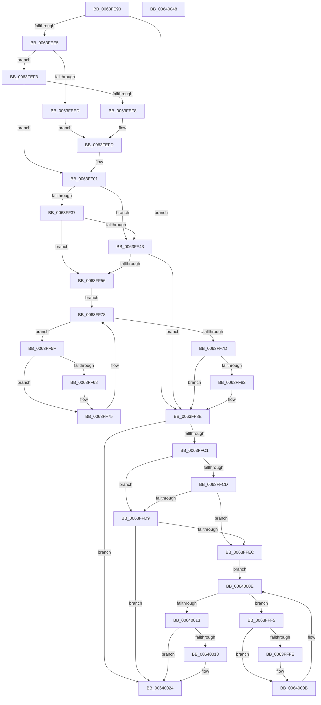

# DifZwCreateKeyWrapper

- RVA: `0x0063FE90`–`0x00640049` (길이 `441` bytes)
- VA: `0x000000014063FE90`
- 실행 섹션: `.text`
- PDB 이름 있음: `예`; PDB Function 태그: `아니요`
- unwind 정보 RVA: `0x000D2C00`
- 디코드: `123`개 명령, `441/441` bytes 표시
- 미해석 바이트: `0` (있으면 어셈블리에 `.byte`로 보존)

> 이 문서는 커널 이미지의 기계어와 PDB 기호를 분석해 생성했습니다. 4번과 5번은 함수 원형과 자료형을 바이너리 사용 방식에서 추정한 C 해석이며 원본 소스 복구 결과는 아닙니다.

## 1. Dependencies

- 직접 호출 지점: **10**; 고유 호출 대상: **7**
- 직접 호출자로 확인된 함수: **0**
- RIP 상대 이미지 참조: **3**

### Outgoing calls
- `0x0063FECA` → [memset](../6C/memset_function_006C6C40.md) (function, `0x006C6C40`)
- `0x0063FED4` → [DifGetAPIThunkContextById](../49/DifGetAPIThunkContextById_function_00495A34.md) (function, `0x00495A34`)
- `0x0063FEF8` → [DifGetReturnAddressForWrappers](../4D/DifGetReturnAddressForWrappers_function_004D3C08.md) (function, `0x004D3C08`)
- `0x0063FF4A` → [ExAcquireRundownProtection](../21/ExAcquireRundownProtection_function_00216620.md) (function, `0x00216620`)
- `0x0063FF70` → [guard_dispatch_icall](../6B/guard_dispatch_icall_function_006BAAD0.md) (function, `0x006BAAD0`)
- `0x0063FF89` → [ExReleaseRundownProtection](../34/ExReleaseRundownProtection_function_00349E80.md) (function, `0x00349E80`)
- `0x0063FFB4` → [ZwCreateKey](../6A/ZwCreateKey_function_006AD470.md) (function, `0x006AD470`)
- `0x0063FFE0` → [ExAcquireRundownProtection](../21/ExAcquireRundownProtection_function_00216620.md) (function, `0x00216620`)
- `0x00640006` → [guard_dispatch_icall](../6B/guard_dispatch_icall_function_006BAAD0.md) (function, `0x006BAAD0`)
- `0x0064001F` → [ExReleaseRundownProtection](../34/ExReleaseRundownProtection_function_00349E80.md) (function, `0x00349E80`)

### Direct callers
- 이 함수 시작 RVA로 연결되는 직접 call은 확인되지 않았습니다. 간접 호출은 완전히 역산할 수 없습니다.

### Static image references
- `0x0063FF08` → RVA `0x00F048B8` (`.data`; read)
- `0x0063FF37` → RVA `0x00F04980` (`.data`; read)
- `0x0063FF43` → RVA `0x00F03E80` (`.data`; read)

## 2. Other-region calls and transfers

- 다른 실행 섹션으로 향하는 call: **0**
- 별도 외부 분기/꼬리 이동을 확인하지 못했습니다.

## 3. Assembly (complete function range)

```asm
0063FE90  48 8B C4                        mov rax, rsp
0063FE93  48 89 58 10                     mov qword ptr [rax + 0x10], rbx
0063FE97  48 89 70 18                     mov qword ptr [rax + 0x18], rsi
0063FE9B  48 89 78 20                     mov qword ptr [rax + 0x20], rdi
0063FE9F  48 89 48 08                     mov qword ptr [rax + 8], rcx
0063FEA3  55                              push rbp
0063FEA4  41 54                           push r12
0063FEA6  41 55                           push r13
0063FEA8  41 56                           push r14
0063FEAA  41 57                           push r15
0063FEAC  48 8D 68 B9                     lea rbp, [rax - 0x47]
0063FEB0  48 81 EC 90 00 00 00            sub rsp, 0x90
0063FEB7  44 8B EA                        mov r13d, edx
0063FEBA  48 8D 4D CF                     lea rcx, [rbp - 0x31]
0063FEBE  33 D2                           xor edx, edx
0063FEC0  4D 8B E0                        mov r12, r8
0063FEC3  45 8B F9                        mov r15d, r9d
0063FEC6  44 8D 42 48                     lea r8d, [rdx + 0x48]
0063FECA  E8 71 6D 08 00                  call 0x1406c6c40
0063FECF  B9 7A 00 00 00                  mov ecx, 0x7a
0063FED4  E8 5B 5B E5 FF                  call 0x140495a34
0063FED9  4C 8B F0                        mov r14, rax
0063FEDC  48 85 C0                        test rax, rax
0063FEDF  0F 84 A9 00 00 00               je 0x14063ff8e
0063FEE5  8B 48 0C                        mov ecx, dword ptr [rax + 0xc]
0063FEE8  F6 C1 18                        test cl, 0x18
0063FEEB  74 06                           je 0x14063fef3
0063FEED  48 8B 45 47                     mov rax, qword ptr [rbp + 0x47]
0063FEF1  EB 0A                           jmp 0x14063fefd
0063FEF3  F6 C1 04                        test cl, 4
0063FEF6  74 09                           je 0x14063ff01
0063FEF8  E8 0B 3D E9 FF                  call 0x1404d3c08
0063FEFD  48 89 45 CF                     mov qword ptr [rbp - 0x31], rax
0063FF01  48 8B 45 4F                     mov rax, qword ptr [rbp + 0x4f]
0063FF05  40 32 F6                        xor sil, sil
0063FF08  40 38 35 A9 49 8C 00            cmp byte ptr [rip + 0x8c49a9], sil
0063FF0F  48 89 45 07                     mov qword ptr [rbp + 7], rax
0063FF13  48 8B 45 6F                     mov rax, qword ptr [rbp + 0x6f]
0063FF17  48 89 45 E7                     mov qword ptr [rbp - 0x19], rax
0063FF1B  8B 45 77                        mov eax, dword ptr [rbp + 0x77]
0063FF1E  89 45 DF                        mov dword ptr [rbp - 0x21], eax
0063FF21  48 8B 45 7F                     mov rax, qword ptr [rbp + 0x7f]
0063FF25  48 89 45 D7                     mov qword ptr [rbp - 0x29], rax
0063FF29  44 89 6D FF                     mov dword ptr [rbp - 1], r13d
0063FF2D  4C 89 65 F7                     mov qword ptr [rbp - 9], r12
0063FF31  44 89 7D EF                     mov dword ptr [rbp - 0x11], r15d
0063FF35  75 0C                           jne 0x14063ff43
0063FF37  F7 05 3F 4A 8C 00 00 08 00 00   test dword ptr [rip + 0x8c4a3f], 0x800
0063FF41  74 13                           je 0x14063ff56
0063FF43  48 8D 0D 36 3F 8C 00            lea rcx, [rip + 0x8c3f36]
0063FF4A  E8 D1 66 BD FF                  call 0x140216620
0063FF4F  40 8A F0                        mov sil, al
0063FF52  84 C0                           test al, al
0063FF54  74 38                           je 0x14063ff8e
0063FF56  49 8D 7E 20                     lea rdi, [r14 + 0x20]
0063FF5A  48 8B 1F                        mov rbx, qword ptr [rdi]
0063FF5D  EB 19                           jmp 0x14063ff78
0063FF5F  48 8D 43 F0                     lea rax, [rbx - 0x10]
0063FF63  48 85 C0                        test rax, rax
0063FF66  74 0D                           je 0x14063ff75
0063FF68  48 8B 40 08                     mov rax, qword ptr [rax + 8]
0063FF6C  48 8D 4D CF                     lea rcx, [rbp - 0x31]
0063FF70  E8 5B AB 07 00                  call 0x1406baad0
0063FF75  48 8B 1B                        mov rbx, qword ptr [rbx]
0063FF78  48 3B DF                        cmp rbx, rdi
0063FF7B  75 E2                           jne 0x14063ff5f
0063FF7D  40 84 F6                        test sil, sil
0063FF80  74 0C                           je 0x14063ff8e
0063FF82  48 8D 0D F7 3E 8C 00            lea rcx, [rip + 0x8c3ef7]
0063FF89  E8 F2 9E D0 FF                  call 0x140349e80
0063FF8E  48 8B 45 7F                     mov rax, qword ptr [rbp + 0x7f]
0063FF92  45 8B CF                        mov r9d, r15d
0063FF95  48 8B 4D 4F                     mov rcx, qword ptr [rbp + 0x4f]
0063FF99  4D 8B C4                        mov r8, r12
0063FF9C  48 89 44 24 30                  mov qword ptr [rsp + 0x30], rax
0063FFA1  41 8B D5                        mov edx, r13d
0063FFA4  8B 45 77                        mov eax, dword ptr [rbp + 0x77]
0063FFA7  89 44 24 28                     mov dword ptr [rsp + 0x28], eax
0063FFAB  48 8B 45 6F                     mov rax, qword ptr [rbp + 0x6f]
0063FFAF  48 89 44 24 20                  mov qword ptr [rsp + 0x20], rax
0063FFB4  E8 B7 D4 06 00                  call 0x1406ad470
0063FFB9  89 45 0F                        mov dword ptr [rbp + 0xf], eax
0063FFBC  4D 85 F6                        test r14, r14
0063FFBF  74 63                           je 0x140640024
0063FFC1  40 32 FF                        xor dil, dil
0063FFC4  40 38 3D ED 48 8C 00            cmp byte ptr [rip + 0x8c48ed], dil
0063FFCB  75 0C                           jne 0x14063ffd9
0063FFCD  F7 05 A9 49 8C 00 00 08 00 00   test dword ptr [rip + 0x8c49a9], 0x800
0063FFD7  74 13                           je 0x14063ffec
0063FFD9  48 8D 0D A0 3E 8C 00            lea rcx, [rip + 0x8c3ea0]
0063FFE0  E8 3B 66 BD FF                  call 0x140216620
0063FFE5  40 8A F8                        mov dil, al
0063FFE8  84 C0                           test al, al
0063FFEA  74 38                           je 0x140640024
0063FFEC  49 8D 76 30                     lea rsi, [r14 + 0x30]
0063FFF0  48 8B 1E                        mov rbx, qword ptr [rsi]
0063FFF3  EB 19                           jmp 0x14064000e
0063FFF5  48 8D 43 F0                     lea rax, [rbx - 0x10]
0063FFF9  48 85 C0                        test rax, rax
0063FFFC  74 0D                           je 0x14064000b
0063FFFE  48 8B 40 08                     mov rax, qword ptr [rax + 8]
00640002  48 8D 4D CF                     lea rcx, [rbp - 0x31]
00640006  E8 C5 AA 07 00                  call 0x1406baad0
0064000B  48 8B 1B                        mov rbx, qword ptr [rbx]
0064000E  48 3B DE                        cmp rbx, rsi
00640011  75 E2                           jne 0x14063fff5
00640013  40 84 FF                        test dil, dil
00640016  74 0C                           je 0x140640024
00640018  48 8D 0D 61 3E 8C 00            lea rcx, [rip + 0x8c3e61]
0064001F  E8 5C 9E D0 FF                  call 0x140349e80
00640024  8B 45 0F                        mov eax, dword ptr [rbp + 0xf]
00640027  4C 8D 9C 24 90 00 00 00         lea r11, [rsp + 0x90]
0064002F  49 8B 5B 38                     mov rbx, qword ptr [r11 + 0x38]
00640033  49 8B 73 40                     mov rsi, qword ptr [r11 + 0x40]
00640037  49 8B 7B 48                     mov rdi, qword ptr [r11 + 0x48]
0064003B  49 8B E3                        mov rsp, r11
0064003E  41 5F                           pop r15
00640040  41 5E                           pop r14
00640042  41 5D                           pop r13
00640044  41 5C                           pop r12
00640046  5D                              pop rbp
00640047  C3                              ret
00640048  CC                              int3
```

## 4. C-style interpretation (structured pseudocode)

```c
__int64 __fastcall DifZwCreateKeyWrapper(__int64 a1, int a2, __int64 a3, int a4)
{
    __int64 result;
    __int64 v_rdi;
    __int64 v_rsi;
    __int64 v_rsp;
    unsigned __int64 v_stack_m28;
    unsigned __int64 v_stack_m88;
    unsigned int v_stack_m90;
    unsigned __int64 v_stack_m98;

    *(unsigned __int64 *)(v_rsp + 16) = v_rbx;
    *(unsigned __int64 *)(v_rsp + 24) = v_rsi;
    *(unsigned __int64 *)(v_rsp + 32) = v_rdi;
    *(unsigned __int64 *)(v_rsp + 8) = a1;
    v_rsp = (v_rsp) - (144);
    a2 = 0;
    result = memset(v_rsp - 71 - 49, a2, a2 + 72, a4);
    result = DifGetAPIThunkContextById(122, a2, a2 + 72, a4);
    if (result == 0) goto loc_0063FF8E;
    if ((((unsigned __int8)((unsigned int)(*(unsigned int *)(result + 12)))) & (24)) == 0) goto loc_0063FEF3;
    goto loc_0063FEFD;
loc_0063FEF3:
    if ((((unsigned __int8)((unsigned int)(*(unsigned int *)(result + 12)))) & (4)) == 0) goto loc_0063FF01;
    result = DifGetReturnAddressForWrappers((unsigned int)(*(unsigned int *)(result + 12)), a2, a2 + 72, a4);
loc_0063FEFD:
    *(unsigned __int64 *)(v_rsp - 71 - 49) = result;
loc_0063FF01:
    v_rsi = 0;
    *(unsigned __int64 *)(v_rsp - 71 + 7) = *(unsigned __int64 *)(v_rsp - 71 + 79);
    *(unsigned __int64 *)(v_rsp - 71 - 25) = *(unsigned __int64 *)(v_rsp - 71 + 111);
    *(unsigned int *)(v_rsp - 71 - 33) = (unsigned int)((unsigned int)(*(unsigned int *)(v_rsp - 71 + 119)));
    *(unsigned __int64 *)(v_rsp - 71 - 41) = *(unsigned __int64 *)(v_rsp - 71 + 127);
    *(unsigned int *)(v_rsp - 71 - 1) = (unsigned int)((unsigned int)(a2));
    *(unsigned __int64 *)(v_rsp - 71 - 9) = a3;
    *(unsigned int *)(v_rsp - 71 - 17) = (unsigned int)((unsigned int)(a4));
    if ((*(unsigned __int8 *)(v_rip + 9193897)) != 0) goto loc_0063FF43;
    if (((*(unsigned int *)(v_rip + 9194047)) & (0x800ULL)) == 0) goto loc_0063FF56;
loc_0063FF43:
    result = ExAcquireRundownProtection(v_rip + 9191222, a2, a2 + 72, a4);
    if ((unsigned __int8)(result) == 0) goto loc_0063FF8E;
loc_0063FF56:
    goto loc_0063FF78;
loc_0063FF5F:
    result = *(unsigned __int64 *)(result + 32) - 16;
    if (*(unsigned __int64 *)(result + 32) - 16 != 0) {
        result = *(unsigned __int64 *)(*(unsigned __int64 *)(result + 32) - 16 + 8);
        a1 = v_rsp - 71 - 49;
        result = guard_dispatch_icall(a1, a2, a2 + 72, a4);
    }
loc_0063FF78:
    if ((*(unsigned __int64 *)(*(unsigned __int64 *)(result + 32))) != (result + 32)) goto loc_0063FF5F;
    if ((unsigned __int8)((unsigned __int8)(result)) != 0) {
        a1 = v_rip + 9191159;
        result = ExReleaseRundownProtection(a1, a2, a2 + 72, a4);
    }
    v_stack_m88 = *(unsigned __int64 *)(v_rsp - 71 + 127);
    v_stack_m90 = (unsigned int)((unsigned int)(*(unsigned int *)(v_rsp - 71 + 119)));
    v_stack_m98 = *(unsigned __int64 *)(v_rsp - 71 + 111);
    result = ZwCreateKey(*(unsigned __int64 *)(v_rsp - 71 + 79), (unsigned int)((unsigned int)((unsigned int)(a2))), a3, (unsigned int)((unsigned int)((unsigned int)(a4))));
    *(unsigned int *)(v_rsp - 71 + 15) = (unsigned int)(result);
    if (result == 0) goto loc_00640024;
    v_rdi = 0;
    if ((*(unsigned __int8 *)(v_rip + 9193709)) != 0) goto loc_0063FFD9;
    if (((*(unsigned int *)(v_rip + 9193897)) & (0x800ULL)) == 0) goto loc_0063FFEC;
loc_0063FFD9:
    result = ExAcquireRundownProtection(v_rip + 9191072, (unsigned int)((unsigned int)((unsigned int)(a2))), a3, (unsigned int)((unsigned int)((unsigned int)(a4))));
    if ((unsigned __int8)(result) == 0) goto loc_00640024;
loc_0063FFEC:
    goto loc_0064000E;
loc_0063FFF5:
    result = *(unsigned __int64 *)(result + 48) - 16;
    if (*(unsigned __int64 *)(result + 48) - 16 != 0) {
        result = *(unsigned __int64 *)(*(unsigned __int64 *)(result + 48) - 16 + 8);
        a1 = v_rsp - 71 - 49;
        result = guard_dispatch_icall(a1, (unsigned int)((unsigned int)((unsigned int)(a2))), a3, (unsigned int)((unsigned int)((unsigned int)(a4))));
    }
loc_0064000E:
    if ((*(unsigned __int64 *)(*(unsigned __int64 *)(result + 48))) != (result + 48)) goto loc_0063FFF5;
    if ((unsigned __int8)((unsigned __int8)(result)) != 0) {
        a1 = v_rip + 9191009;
        result = ExReleaseRundownProtection(a1, (unsigned int)((unsigned int)((unsigned int)(a2))), a3, (unsigned int)((unsigned int)((unsigned int)(a4))));
    }
    return (unsigned int)(*(unsigned int *)(v_rsp - 71 + 15));
}
```

## 5. (Beta) C Style

```c
int64_t DifZwCreateKeyWrapper(int64_t Arg1, int32_t Arg2, int64_t Arg3, int32_t Arg4)
{
    int64_t result;
    int64_t local_rdi;
    int64_t local_rsi;
    int64_t local_rsp;
    uint64_t v_stack_m28;
    uint64_t v_stack_m88;
    uint32_t v_stack_m90;
    uint64_t v_stack_m98;

    *(uint64_t *)(local_rsp + 0x10) = local_rbx;
    *(uint64_t *)(local_rsp + 0x18) = local_rsi;
    *(uint64_t *)(local_rsp + 0x20) = local_rdi;
    *(uint64_t *)(local_rsp + 0x8) = Arg1;
    local_rsp = (local_rsp) - (144);
    Arg2 = 0;
    result = memset(local_rsp - 71 - 49, Arg2, Arg2 + 72, Arg4);
    result = DifGetAPIThunkContextById(122, Arg2, Arg2 + 72, Arg4);
    if (result == 0) goto loc_0063FF8E;
    if ((((uint8_t)((uint32_t)(*(uint32_t *)(result + 0xC)))) & (24)) == 0) goto loc_0063FEF3;
    goto loc_0063FEFD;
loc_0063FEF3:
    if ((((uint8_t)((uint32_t)(*(uint32_t *)(result + 0xC)))) & (4)) == 0) goto loc_0063FF01;
    result = DifGetReturnAddressForWrappers((uint32_t)(*(uint32_t *)(result + 0xC)), Arg2, Arg2 + 72, Arg4);
loc_0063FEFD:
    *(uint64_t *)(local_rsp - 0x47 - 0x31) = result;
loc_0063FF01:
    local_rsi = 0;
    *(uint64_t *)(local_rsp - 0x47 + 0x7) = *(uint64_t *)(local_rsp - 0x47 + 0x4F);
    *(uint64_t *)(local_rsp - 0x47 - 0x19) = *(uint64_t *)(local_rsp - 0x47 + 0x6F);
    *(uint32_t *)(local_rsp - 0x47 - 0x21) = (uint32_t)((uint32_t)(*(uint32_t *)(local_rsp - 0x47 + 0x77)));
    *(uint64_t *)(local_rsp - 0x47 - 0x29) = *(uint64_t *)(local_rsp - 0x47 + 0x7F);
    *(uint32_t *)(local_rsp - 0x47 - 0x1) = (uint32_t)((uint32_t)(Arg2));
    *(uint64_t *)(local_rsp - 0x47 - 0x9) = Arg3;
    *(uint32_t *)(local_rsp - 0x47 - 0x11) = (uint32_t)((uint32_t)(Arg4));
    if ((*(uint8_t *)(v_rip + 0x8C49A9)) != 0) goto loc_0063FF43;
    if (((*(uint32_t *)(v_rip + 0x8C4A3F)) & (0x800ULL)) == 0) goto loc_0063FF56;
loc_0063FF43:
    result = ExAcquireRundownProtection(v_rip + 9191222, Arg2, Arg2 + 72, Arg4);
    if ((uint8_t)(result) == 0) goto loc_0063FF8E;
loc_0063FF56:
    goto loc_0063FF78;
loc_0063FF5F:
    result = *(uint64_t *)(result + 0x20) - 16;
    if (*(uint64_t *)(result + 0x20) - 16 != 0) {
        result = *(uint64_t *)(*(uint64_t *)(result + 0x20) - 0x10 + 0x8);
        Arg1 = local_rsp - 71 - 49;
        result = guard_dispatch_icall(Arg1, Arg2, Arg2 + 72, Arg4);
    }
loc_0063FF78:
    if ((*(uint64_t *)(*(uint64_t *)(result + 0x20))) != (result + 32)) goto loc_0063FF5F;
    if ((uint8_t)((uint8_t)(result)) != 0) {
        Arg1 = v_rip + 9191159;
        result = ExReleaseRundownProtection(Arg1, Arg2, Arg2 + 72, Arg4);
    }
    v_stack_m88 = *(uint64_t *)(local_rsp - 0x47 + 0x7F);
    v_stack_m90 = (uint32_t)((uint32_t)(*(uint32_t *)(local_rsp - 0x47 + 0x77)));
    v_stack_m98 = *(uint64_t *)(local_rsp - 0x47 + 0x6F);
    result = ZwCreateKey(*(uint64_t *)(local_rsp - 0x47 + 0x4F), (uint32_t)((uint32_t)((uint32_t)(Arg2))), Arg3, (uint32_t)((uint32_t)((uint32_t)(Arg4))));
    *(uint32_t *)(local_rsp - 0x47 + 0xF) = (uint32_t)(result);
    if (result == 0) goto loc_00640024;
    local_rdi = 0;
    if ((*(uint8_t *)(v_rip + 0x8C48ED)) != 0) goto loc_0063FFD9;
    if (((*(uint32_t *)(v_rip + 0x8C49A9)) & (0x800ULL)) == 0) goto loc_0063FFEC;
loc_0063FFD9:
    result = ExAcquireRundownProtection(v_rip + 9191072, (uint32_t)((uint32_t)((uint32_t)(Arg2))), Arg3, (uint32_t)((uint32_t)((uint32_t)(Arg4))));
    if ((uint8_t)(result) == 0) goto loc_00640024;
loc_0063FFEC:
    goto loc_0064000E;
loc_0063FFF5:
    result = *(uint64_t *)(result + 0x30) - 16;
    if (*(uint64_t *)(result + 0x30) - 16 != 0) {
        result = *(uint64_t *)(*(uint64_t *)(result + 0x30) - 0x10 + 0x8);
        Arg1 = local_rsp - 71 - 49;
        result = guard_dispatch_icall(Arg1, (uint32_t)((uint32_t)((uint32_t)(Arg2))), Arg3, (uint32_t)((uint32_t)((uint32_t)(Arg4))));
    }
loc_0064000E:
    if ((*(uint64_t *)(*(uint64_t *)(result + 0x30))) != (result + 48)) goto loc_0063FFF5;
    if ((uint8_t)((uint8_t)(result)) != 0) {
        Arg1 = v_rip + 9191009;
        result = ExReleaseRundownProtection(Arg1, (uint32_t)((uint32_t)((uint32_t)(Arg2))), Arg3, (uint32_t)((uint32_t)((uint32_t)(Arg4))));
    }
    return (uint32_t)(*(uint32_t *)(local_rsp - 0x47 + 0xF));
}
```

## 6. Execution-region graph

[열기: 2D/3D 그래프와 함수 탐색 컨트롤 패널](../../../control-panel.html?section=text&rva=0x0063FE90&view=graph)

- 2D 그래프는 위에서 아래로 흐르고, 3D 그래프는 빈 공간을 드래그해 회전합니다. Shift+드래그는 이동, 휠은 확대·축소, 함수 노드 선택은 대상 보고서 이동입니다.

### Static fallback


