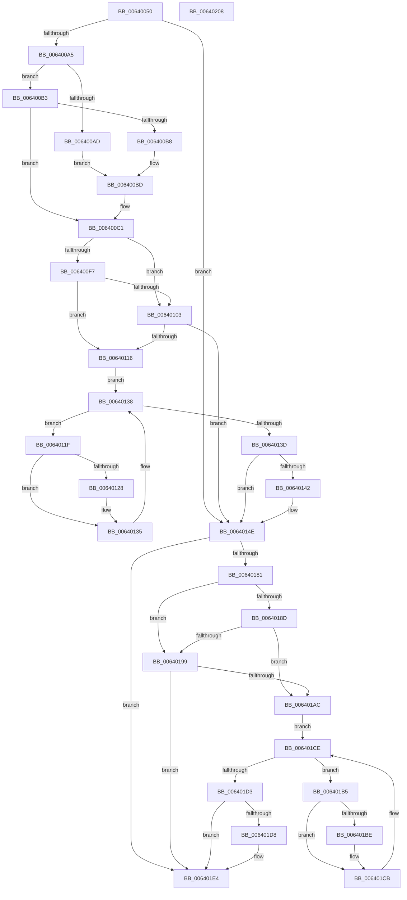

# DifZwCreateResourceManagerWrapper

- RVA: `0x00640050`–`0x00640209` (길이 `441` bytes)
- VA: `0x0000000140640050`
- 실행 섹션: `.text`
- PDB 이름 있음: `예`; PDB Function 태그: `아니요`
- unwind 정보 RVA: `0x000D2C00`
- 디코드: `123`개 명령, `441/441` bytes 표시
- 미해석 바이트: `0` (있으면 어셈블리에 `.byte`로 보존)

> 이 문서는 커널 이미지의 기계어와 PDB 기호를 분석해 생성했습니다. 4번과 5번은 함수 원형과 자료형을 바이너리 사용 방식에서 추정한 C 해석이며 원본 소스 복구 결과는 아닙니다.

## 1. Dependencies

- 직접 호출 지점: **10**; 고유 호출 대상: **7**
- 직접 호출자로 확인된 함수: **0**
- RIP 상대 이미지 참조: **3**

### Outgoing calls
- `0x0064008A` → [memset](../6C/memset_function_006C6C40.md) (function, `0x006C6C40`)
- `0x00640094` → [DifGetAPIThunkContextById](../49/DifGetAPIThunkContextById_function_00495A34.md) (function, `0x00495A34`)
- `0x006400B8` → [DifGetReturnAddressForWrappers](../4D/DifGetReturnAddressForWrappers_function_004D3C08.md) (function, `0x004D3C08`)
- `0x0064010A` → [ExAcquireRundownProtection](../21/ExAcquireRundownProtection_function_00216620.md) (function, `0x00216620`)
- `0x00640130` → [guard_dispatch_icall](../6B/guard_dispatch_icall_function_006BAAD0.md) (function, `0x006BAAD0`)
- `0x00640149` → [ExReleaseRundownProtection](../34/ExReleaseRundownProtection_function_00349E80.md) (function, `0x00349E80`)
- `0x00640174` → [ZwCreateResourceManager](../6A/ZwCreateResourceManager_function_006AE970.md) (function, `0x006AE970`)
- `0x006401A0` → [ExAcquireRundownProtection](../21/ExAcquireRundownProtection_function_00216620.md) (function, `0x00216620`)
- `0x006401C6` → [guard_dispatch_icall](../6B/guard_dispatch_icall_function_006BAAD0.md) (function, `0x006BAAD0`)
- `0x006401DF` → [ExReleaseRundownProtection](../34/ExReleaseRundownProtection_function_00349E80.md) (function, `0x00349E80`)

### Direct callers
- 이 함수 시작 RVA로 연결되는 직접 call은 확인되지 않았습니다. 간접 호출은 완전히 역산할 수 없습니다.

### Static image references
- `0x006400C8` → RVA `0x00F048B8` (`.data`; read)
- `0x006400F7` → RVA `0x00F04980` (`.data`; read)
- `0x00640103` → RVA `0x00F03E80` (`.data`; read)

## 2. Other-region calls and transfers

- 다른 실행 섹션으로 향하는 call: **0**
- 별도 외부 분기/꼬리 이동을 확인하지 못했습니다.

## 3. Assembly (complete function range)

```asm
00640050  48 8B C4                        mov rax, rsp
00640053  48 89 58 10                     mov qword ptr [rax + 0x10], rbx
00640057  48 89 70 18                     mov qword ptr [rax + 0x18], rsi
0064005B  48 89 78 20                     mov qword ptr [rax + 0x20], rdi
0064005F  48 89 48 08                     mov qword ptr [rax + 8], rcx
00640063  55                              push rbp
00640064  41 54                           push r12
00640066  41 55                           push r13
00640068  41 56                           push r14
0064006A  41 57                           push r15
0064006C  48 8D 68 B9                     lea rbp, [rax - 0x47]
00640070  48 81 EC 90 00 00 00            sub rsp, 0x90
00640077  44 8B EA                        mov r13d, edx
0064007A  48 8D 4D CF                     lea rcx, [rbp - 0x31]
0064007E  33 D2                           xor edx, edx
00640080  4D 8B E0                        mov r12, r8
00640083  4D 8B F9                        mov r15, r9
00640086  44 8D 42 48                     lea r8d, [rdx + 0x48]
0064008A  E8 B1 6B 08 00                  call 0x1406c6c40
0064008F  B9 78 00 00 00                  mov ecx, 0x78
00640094  E8 9B 59 E5 FF                  call 0x140495a34
00640099  4C 8B F0                        mov r14, rax
0064009C  48 85 C0                        test rax, rax
0064009F  0F 84 A9 00 00 00               je 0x14064014e
006400A5  8B 48 0C                        mov ecx, dword ptr [rax + 0xc]
006400A8  F6 C1 18                        test cl, 0x18
006400AB  74 06                           je 0x1406400b3
006400AD  48 8B 45 47                     mov rax, qword ptr [rbp + 0x47]
006400B1  EB 0A                           jmp 0x1406400bd
006400B3  F6 C1 04                        test cl, 4
006400B6  74 09                           je 0x1406400c1
006400B8  E8 4B 3B E9 FF                  call 0x1404d3c08
006400BD  48 89 45 CF                     mov qword ptr [rbp - 0x31], rax
006400C1  48 8B 45 4F                     mov rax, qword ptr [rbp + 0x4f]
006400C5  40 32 F6                        xor sil, sil
006400C8  40 38 35 E9 47 8C 00            cmp byte ptr [rip + 0x8c47e9], sil
006400CF  48 89 45 07                     mov qword ptr [rbp + 7], rax
006400D3  48 8B 45 6F                     mov rax, qword ptr [rbp + 0x6f]
006400D7  48 89 45 E7                     mov qword ptr [rbp - 0x19], rax
006400DB  8B 45 77                        mov eax, dword ptr [rbp + 0x77]
006400DE  89 45 DF                        mov dword ptr [rbp - 0x21], eax
006400E1  48 8B 45 7F                     mov rax, qword ptr [rbp + 0x7f]
006400E5  48 89 45 D7                     mov qword ptr [rbp - 0x29], rax
006400E9  44 89 6D FF                     mov dword ptr [rbp - 1], r13d
006400ED  4C 89 65 F7                     mov qword ptr [rbp - 9], r12
006400F1  4C 89 7D EF                     mov qword ptr [rbp - 0x11], r15
006400F5  75 0C                           jne 0x140640103
006400F7  F7 05 7F 48 8C 00 00 08 00 00   test dword ptr [rip + 0x8c487f], 0x800
00640101  74 13                           je 0x140640116
00640103  48 8D 0D 76 3D 8C 00            lea rcx, [rip + 0x8c3d76]
0064010A  E8 11 65 BD FF                  call 0x140216620
0064010F  40 8A F0                        mov sil, al
00640112  84 C0                           test al, al
00640114  74 38                           je 0x14064014e
00640116  49 8D 7E 20                     lea rdi, [r14 + 0x20]
0064011A  48 8B 1F                        mov rbx, qword ptr [rdi]
0064011D  EB 19                           jmp 0x140640138
0064011F  48 8D 43 F0                     lea rax, [rbx - 0x10]
00640123  48 85 C0                        test rax, rax
00640126  74 0D                           je 0x140640135
00640128  48 8B 40 08                     mov rax, qword ptr [rax + 8]
0064012C  48 8D 4D CF                     lea rcx, [rbp - 0x31]
00640130  E8 9B A9 07 00                  call 0x1406baad0
00640135  48 8B 1B                        mov rbx, qword ptr [rbx]
00640138  48 3B DF                        cmp rbx, rdi
0064013B  75 E2                           jne 0x14064011f
0064013D  40 84 F6                        test sil, sil
00640140  74 0C                           je 0x14064014e
00640142  48 8D 0D 37 3D 8C 00            lea rcx, [rip + 0x8c3d37]
00640149  E8 32 9D D0 FF                  call 0x140349e80
0064014E  48 8B 45 7F                     mov rax, qword ptr [rbp + 0x7f]
00640152  4D 8B CF                        mov r9, r15
00640155  48 8B 4D 4F                     mov rcx, qword ptr [rbp + 0x4f]
00640159  4D 8B C4                        mov r8, r12
0064015C  48 89 44 24 30                  mov qword ptr [rsp + 0x30], rax
00640161  41 8B D5                        mov edx, r13d
00640164  8B 45 77                        mov eax, dword ptr [rbp + 0x77]
00640167  89 44 24 28                     mov dword ptr [rsp + 0x28], eax
0064016B  48 8B 45 6F                     mov rax, qword ptr [rbp + 0x6f]
0064016F  48 89 44 24 20                  mov qword ptr [rsp + 0x20], rax
00640174  E8 F7 E7 06 00                  call 0x1406ae970
00640179  89 45 0F                        mov dword ptr [rbp + 0xf], eax
0064017C  4D 85 F6                        test r14, r14
0064017F  74 63                           je 0x1406401e4
00640181  40 32 FF                        xor dil, dil
00640184  40 38 3D 2D 47 8C 00            cmp byte ptr [rip + 0x8c472d], dil
0064018B  75 0C                           jne 0x140640199
0064018D  F7 05 E9 47 8C 00 00 08 00 00   test dword ptr [rip + 0x8c47e9], 0x800
00640197  74 13                           je 0x1406401ac
00640199  48 8D 0D E0 3C 8C 00            lea rcx, [rip + 0x8c3ce0]
006401A0  E8 7B 64 BD FF                  call 0x140216620
006401A5  40 8A F8                        mov dil, al
006401A8  84 C0                           test al, al
006401AA  74 38                           je 0x1406401e4
006401AC  49 8D 76 30                     lea rsi, [r14 + 0x30]
006401B0  48 8B 1E                        mov rbx, qword ptr [rsi]
006401B3  EB 19                           jmp 0x1406401ce
006401B5  48 8D 43 F0                     lea rax, [rbx - 0x10]
006401B9  48 85 C0                        test rax, rax
006401BC  74 0D                           je 0x1406401cb
006401BE  48 8B 40 08                     mov rax, qword ptr [rax + 8]
006401C2  48 8D 4D CF                     lea rcx, [rbp - 0x31]
006401C6  E8 05 A9 07 00                  call 0x1406baad0
006401CB  48 8B 1B                        mov rbx, qword ptr [rbx]
006401CE  48 3B DE                        cmp rbx, rsi
006401D1  75 E2                           jne 0x1406401b5
006401D3  40 84 FF                        test dil, dil
006401D6  74 0C                           je 0x1406401e4
006401D8  48 8D 0D A1 3C 8C 00            lea rcx, [rip + 0x8c3ca1]
006401DF  E8 9C 9C D0 FF                  call 0x140349e80
006401E4  8B 45 0F                        mov eax, dword ptr [rbp + 0xf]
006401E7  4C 8D 9C 24 90 00 00 00         lea r11, [rsp + 0x90]
006401EF  49 8B 5B 38                     mov rbx, qword ptr [r11 + 0x38]
006401F3  49 8B 73 40                     mov rsi, qword ptr [r11 + 0x40]
006401F7  49 8B 7B 48                     mov rdi, qword ptr [r11 + 0x48]
006401FB  49 8B E3                        mov rsp, r11
006401FE  41 5F                           pop r15
00640200  41 5E                           pop r14
00640202  41 5D                           pop r13
00640204  41 5C                           pop r12
00640206  5D                              pop rbp
00640207  C3                              ret
00640208  CC                              int3
```

## 4. C-style interpretation (structured pseudocode)

```c
__int64 __fastcall DifZwCreateResourceManagerWrapper(__int64 a1, int a2, __int64 a3, __int64 a4)
{
    __int64 result;
    __int64 v_rdi;
    __int64 v_rsi;
    __int64 v_rsp;
    unsigned __int64 v_stack_m28;
    unsigned __int64 v_stack_m88;
    unsigned int v_stack_m90;
    unsigned __int64 v_stack_m98;

    *(unsigned __int64 *)(v_rsp + 16) = v_rbx;
    *(unsigned __int64 *)(v_rsp + 24) = v_rsi;
    *(unsigned __int64 *)(v_rsp + 32) = v_rdi;
    *(unsigned __int64 *)(v_rsp + 8) = a1;
    v_rsp = (v_rsp) - (144);
    a2 = 0;
    result = memset(v_rsp - 71 - 49, a2, a2 + 72, a4);
    result = DifGetAPIThunkContextById(120, a2, a2 + 72, a4);
    if (result == 0) goto loc_0064014E;
    if ((((unsigned __int8)((unsigned int)(*(unsigned int *)(result + 12)))) & (24)) == 0) goto loc_006400B3;
    goto loc_006400BD;
loc_006400B3:
    if ((((unsigned __int8)((unsigned int)(*(unsigned int *)(result + 12)))) & (4)) == 0) goto loc_006400C1;
    result = DifGetReturnAddressForWrappers((unsigned int)(*(unsigned int *)(result + 12)), a2, a2 + 72, a4);
loc_006400BD:
    *(unsigned __int64 *)(v_rsp - 71 - 49) = result;
loc_006400C1:
    v_rsi = 0;
    *(unsigned __int64 *)(v_rsp - 71 + 7) = *(unsigned __int64 *)(v_rsp - 71 + 79);
    *(unsigned __int64 *)(v_rsp - 71 - 25) = *(unsigned __int64 *)(v_rsp - 71 + 111);
    *(unsigned int *)(v_rsp - 71 - 33) = (unsigned int)((unsigned int)(*(unsigned int *)(v_rsp - 71 + 119)));
    *(unsigned __int64 *)(v_rsp - 71 - 41) = *(unsigned __int64 *)(v_rsp - 71 + 127);
    *(unsigned int *)(v_rsp - 71 - 1) = (unsigned int)((unsigned int)(a2));
    *(unsigned __int64 *)(v_rsp - 71 - 9) = a3;
    *(unsigned __int64 *)(v_rsp - 71 - 17) = a4;
    if ((*(unsigned __int8 *)(v_rip + 9193449)) != 0) goto loc_00640103;
    if (((*(unsigned int *)(v_rip + 9193599)) & (0x800ULL)) == 0) goto loc_00640116;
loc_00640103:
    result = ExAcquireRundownProtection(v_rip + 9190774, a2, a2 + 72, a4);
    if ((unsigned __int8)(result) == 0) goto loc_0064014E;
loc_00640116:
    goto loc_00640138;
loc_0064011F:
    result = *(unsigned __int64 *)(result + 32) - 16;
    if (*(unsigned __int64 *)(result + 32) - 16 != 0) {
        result = *(unsigned __int64 *)(*(unsigned __int64 *)(result + 32) - 16 + 8);
        a1 = v_rsp - 71 - 49;
        result = guard_dispatch_icall(a1, a2, a2 + 72, a4);
    }
loc_00640138:
    if ((*(unsigned __int64 *)(*(unsigned __int64 *)(result + 32))) != (result + 32)) goto loc_0064011F;
    if ((unsigned __int8)((unsigned __int8)(result)) != 0) {
        a1 = v_rip + 9190711;
        result = ExReleaseRundownProtection(a1, a2, a2 + 72, a4);
    }
    v_stack_m88 = *(unsigned __int64 *)(v_rsp - 71 + 127);
    v_stack_m90 = (unsigned int)((unsigned int)(*(unsigned int *)(v_rsp - 71 + 119)));
    v_stack_m98 = *(unsigned __int64 *)(v_rsp - 71 + 111);
    result = ZwCreateResourceManager(*(unsigned __int64 *)(v_rsp - 71 + 79), (unsigned int)((unsigned int)((unsigned int)(a2))), a3, a4);
    *(unsigned int *)(v_rsp - 71 + 15) = (unsigned int)(result);
    if (result == 0) goto loc_006401E4;
    v_rdi = 0;
    if ((*(unsigned __int8 *)(v_rip + 9193261)) != 0) goto loc_00640199;
    if (((*(unsigned int *)(v_rip + 9193449)) & (0x800ULL)) == 0) goto loc_006401AC;
loc_00640199:
    result = ExAcquireRundownProtection(v_rip + 9190624, (unsigned int)((unsigned int)((unsigned int)(a2))), a3, a4);
    if ((unsigned __int8)(result) == 0) goto loc_006401E4;
loc_006401AC:
    goto loc_006401CE;
loc_006401B5:
    result = *(unsigned __int64 *)(result + 48) - 16;
    if (*(unsigned __int64 *)(result + 48) - 16 != 0) {
        result = *(unsigned __int64 *)(*(unsigned __int64 *)(result + 48) - 16 + 8);
        a1 = v_rsp - 71 - 49;
        result = guard_dispatch_icall(a1, (unsigned int)((unsigned int)((unsigned int)(a2))), a3, a4);
    }
loc_006401CE:
    if ((*(unsigned __int64 *)(*(unsigned __int64 *)(result + 48))) != (result + 48)) goto loc_006401B5;
    if ((unsigned __int8)((unsigned __int8)(result)) != 0) {
        a1 = v_rip + 9190561;
        result = ExReleaseRundownProtection(a1, (unsigned int)((unsigned int)((unsigned int)(a2))), a3, a4);
    }
    return (unsigned int)(*(unsigned int *)(v_rsp - 71 + 15));
}
```

## 5. (Beta) C Style

```c
int64_t DifZwCreateResourceManagerWrapper(int64_t Arg1, int32_t Arg2, int64_t Arg3, int64_t Arg4)
{
    int64_t result;
    int64_t local_rdi;
    int64_t local_rsi;
    int64_t local_rsp;
    uint64_t v_stack_m28;
    uint64_t v_stack_m88;
    uint32_t v_stack_m90;
    uint64_t v_stack_m98;

    *(uint64_t *)(local_rsp + 0x10) = local_rbx;
    *(uint64_t *)(local_rsp + 0x18) = local_rsi;
    *(uint64_t *)(local_rsp + 0x20) = local_rdi;
    *(uint64_t *)(local_rsp + 0x8) = Arg1;
    local_rsp = (local_rsp) - (144);
    Arg2 = 0;
    result = memset(local_rsp - 71 - 49, Arg2, Arg2 + 72, Arg4);
    result = DifGetAPIThunkContextById(120, Arg2, Arg2 + 72, Arg4);
    if (result == 0) goto loc_0064014E;
    if ((((uint8_t)((uint32_t)(*(uint32_t *)(result + 0xC)))) & (24)) == 0) goto loc_006400B3;
    goto loc_006400BD;
loc_006400B3:
    if ((((uint8_t)((uint32_t)(*(uint32_t *)(result + 0xC)))) & (4)) == 0) goto loc_006400C1;
    result = DifGetReturnAddressForWrappers((uint32_t)(*(uint32_t *)(result + 0xC)), Arg2, Arg2 + 72, Arg4);
loc_006400BD:
    *(uint64_t *)(local_rsp - 0x47 - 0x31) = result;
loc_006400C1:
    local_rsi = 0;
    *(uint64_t *)(local_rsp - 0x47 + 0x7) = *(uint64_t *)(local_rsp - 0x47 + 0x4F);
    *(uint64_t *)(local_rsp - 0x47 - 0x19) = *(uint64_t *)(local_rsp - 0x47 + 0x6F);
    *(uint32_t *)(local_rsp - 0x47 - 0x21) = (uint32_t)((uint32_t)(*(uint32_t *)(local_rsp - 0x47 + 0x77)));
    *(uint64_t *)(local_rsp - 0x47 - 0x29) = *(uint64_t *)(local_rsp - 0x47 + 0x7F);
    *(uint32_t *)(local_rsp - 0x47 - 0x1) = (uint32_t)((uint32_t)(Arg2));
    *(uint64_t *)(local_rsp - 0x47 - 0x9) = Arg3;
    *(uint64_t *)(local_rsp - 0x47 - 0x11) = Arg4;
    if ((*(uint8_t *)(v_rip + 0x8C47E9)) != 0) goto loc_00640103;
    if (((*(uint32_t *)(v_rip + 0x8C487F)) & (0x800ULL)) == 0) goto loc_00640116;
loc_00640103:
    result = ExAcquireRundownProtection(v_rip + 9190774, Arg2, Arg2 + 72, Arg4);
    if ((uint8_t)(result) == 0) goto loc_0064014E;
loc_00640116:
    goto loc_00640138;
loc_0064011F:
    result = *(uint64_t *)(result + 0x20) - 16;
    if (*(uint64_t *)(result + 0x20) - 16 != 0) {
        result = *(uint64_t *)(*(uint64_t *)(result + 0x20) - 0x10 + 0x8);
        Arg1 = local_rsp - 71 - 49;
        result = guard_dispatch_icall(Arg1, Arg2, Arg2 + 72, Arg4);
    }
loc_00640138:
    if ((*(uint64_t *)(*(uint64_t *)(result + 0x20))) != (result + 32)) goto loc_0064011F;
    if ((uint8_t)((uint8_t)(result)) != 0) {
        Arg1 = v_rip + 9190711;
        result = ExReleaseRundownProtection(Arg1, Arg2, Arg2 + 72, Arg4);
    }
    v_stack_m88 = *(uint64_t *)(local_rsp - 0x47 + 0x7F);
    v_stack_m90 = (uint32_t)((uint32_t)(*(uint32_t *)(local_rsp - 0x47 + 0x77)));
    v_stack_m98 = *(uint64_t *)(local_rsp - 0x47 + 0x6F);
    result = ZwCreateResourceManager(*(uint64_t *)(local_rsp - 0x47 + 0x4F), (uint32_t)((uint32_t)((uint32_t)(Arg2))), Arg3, Arg4);
    *(uint32_t *)(local_rsp - 0x47 + 0xF) = (uint32_t)(result);
    if (result == 0) goto loc_006401E4;
    local_rdi = 0;
    if ((*(uint8_t *)(v_rip + 0x8C472D)) != 0) goto loc_00640199;
    if (((*(uint32_t *)(v_rip + 0x8C47E9)) & (0x800ULL)) == 0) goto loc_006401AC;
loc_00640199:
    result = ExAcquireRundownProtection(v_rip + 9190624, (uint32_t)((uint32_t)((uint32_t)(Arg2))), Arg3, Arg4);
    if ((uint8_t)(result) == 0) goto loc_006401E4;
loc_006401AC:
    goto loc_006401CE;
loc_006401B5:
    result = *(uint64_t *)(result + 0x30) - 16;
    if (*(uint64_t *)(result + 0x30) - 16 != 0) {
        result = *(uint64_t *)(*(uint64_t *)(result + 0x30) - 0x10 + 0x8);
        Arg1 = local_rsp - 71 - 49;
        result = guard_dispatch_icall(Arg1, (uint32_t)((uint32_t)((uint32_t)(Arg2))), Arg3, Arg4);
    }
loc_006401CE:
    if ((*(uint64_t *)(*(uint64_t *)(result + 0x30))) != (result + 48)) goto loc_006401B5;
    if ((uint8_t)((uint8_t)(result)) != 0) {
        Arg1 = v_rip + 9190561;
        result = ExReleaseRundownProtection(Arg1, (uint32_t)((uint32_t)((uint32_t)(Arg2))), Arg3, Arg4);
    }
    return (uint32_t)(*(uint32_t *)(local_rsp - 0x47 + 0xF));
}
```

## 6. Execution-region graph

[열기: 2D/3D 그래프와 함수 탐색 컨트롤 패널](../../../control-panel.html?section=text&rva=0x00640050&view=graph)

- 2D 그래프는 위에서 아래로 흐르고, 3D 그래프는 빈 공간을 드래그해 회전합니다. Shift+드래그는 이동, 휠은 확대·축소, 함수 노드 선택은 대상 보고서 이동입니다.

### Static fallback


