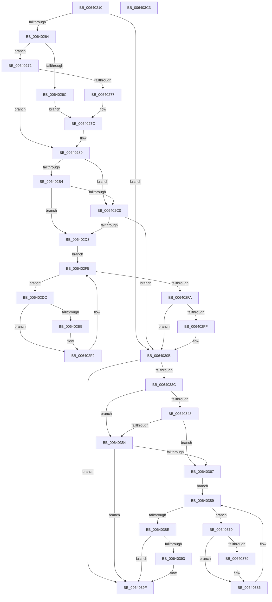

# DifZwCreateSectionWrapper

- RVA: `0x00640210`–`0x006403C4` (길이 `436` bytes)
- VA: `0x0000000140640210`
- 실행 섹션: `.text`
- PDB 이름 있음: `예`; PDB Function 태그: `아니요`
- unwind 정보 RVA: `0x000BC530`
- 디코드: `123`개 명령, `436/436` bytes 표시
- 미해석 바이트: `0` (있으면 어셈블리에 `.byte`로 보존)

> 이 문서는 커널 이미지의 기계어와 PDB 기호를 분석해 생성했습니다. 4번과 5번은 함수 원형과 자료형을 바이너리 사용 방식에서 추정한 C 해석이며 원본 소스 복구 결과는 아닙니다.

## 1. Dependencies

- 직접 호출 지점: **10**; 고유 호출 대상: **7**
- 직접 호출자로 확인된 함수: **0**
- RIP 상대 이미지 참조: **3**

### Outgoing calls
- `0x00640249` → [memset](../6C/memset_function_006C6C40.md) (function, `0x006C6C40`)
- `0x00640253` → [DifGetAPIThunkContextById](../49/DifGetAPIThunkContextById_function_00495A34.md) (function, `0x00495A34`)
- `0x00640277` → [DifGetReturnAddressForWrappers](../4D/DifGetReturnAddressForWrappers_function_004D3C08.md) (function, `0x004D3C08`)
- `0x006402C7` → [ExAcquireRundownProtection](../21/ExAcquireRundownProtection_function_00216620.md) (function, `0x00216620`)
- `0x006402ED` → [guard_dispatch_icall](../6B/guard_dispatch_icall_function_006BAAD0.md) (function, `0x006BAAD0`)
- `0x00640306` → [ExReleaseRundownProtection](../34/ExReleaseRundownProtection_function_00349E80.md) (function, `0x00349E80`)
- `0x0064032F` → [ZwCreateSection](../6A/ZwCreateSection_function_006ADA10.md) (function, `0x006ADA10`)
- `0x0064035B` → [ExAcquireRundownProtection](../21/ExAcquireRundownProtection_function_00216620.md) (function, `0x00216620`)
- `0x00640381` → [guard_dispatch_icall](../6B/guard_dispatch_icall_function_006BAAD0.md) (function, `0x006BAAD0`)
- `0x0064039A` → [ExReleaseRundownProtection](../34/ExReleaseRundownProtection_function_00349E80.md) (function, `0x00349E80`)

### Direct callers
- 이 함수 시작 RVA로 연결되는 직접 call은 확인되지 않았습니다. 간접 호출은 완전히 역산할 수 없습니다.

### Static image references
- `0x00640287` → RVA `0x00F048B8` (`.data`; read)
- `0x006402B4` → RVA `0x00F04980` (`.data`; read)
- `0x006402C0` → RVA `0x00F03E80` (`.data`; read)

## 2. Other-region calls and transfers

- 다른 실행 섹션으로 향하는 call: **0**
- 별도 외부 분기/꼬리 이동을 확인하지 못했습니다.

## 3. Assembly (complete function range)

```asm
00640210  48 8B C4                        mov rax, rsp
00640213  48 89 58 10                     mov qword ptr [rax + 0x10], rbx
00640217  48 89 70 18                     mov qword ptr [rax + 0x18], rsi
0064021B  48 89 78 20                     mov qword ptr [rax + 0x20], rdi
0064021F  48 89 48 08                     mov qword ptr [rax + 8], rcx
00640223  55                              push rbp
00640224  41 54                           push r12
00640226  41 55                           push r13
00640228  41 56                           push r14
0064022A  41 57                           push r15
0064022C  48 8B EC                        mov rbp, rsp
0064022F  48 81 EC 80 00 00 00            sub rsp, 0x80
00640236  44 8B EA                        mov r13d, edx
00640239  48 8D 4D C0                     lea rcx, [rbp - 0x40]
0064023D  33 D2                           xor edx, edx
0064023F  4D 8B E0                        mov r12, r8
00640242  4D 8B F9                        mov r15, r9
00640245  44 8D 42 40                     lea r8d, [rdx + 0x40]
00640249  E8 F2 69 08 00                  call 0x1406c6c40
0064024E  B9 77 00 00 00                  mov ecx, 0x77
00640253  E8 DC 57 E5 FF                  call 0x140495a34
00640258  4C 8B F0                        mov r14, rax
0064025B  48 85 C0                        test rax, rax
0064025E  0F 84 A7 00 00 00               je 0x14064030b
00640264  8B 48 0C                        mov ecx, dword ptr [rax + 0xc]
00640267  F6 C1 18                        test cl, 0x18
0064026A  74 06                           je 0x140640272
0064026C  48 8B 45 28                     mov rax, qword ptr [rbp + 0x28]
00640270  EB 0A                           jmp 0x14064027c
00640272  F6 C1 04                        test cl, 4
00640275  74 09                           je 0x140640280
00640277  E8 8C 39 E9 FF                  call 0x1404d3c08
0064027C  48 89 45 C0                     mov qword ptr [rbp - 0x40], rax
00640280  48 8B 45 30                     mov rax, qword ptr [rbp + 0x30]
00640284  40 32 F6                        xor sil, sil
00640287  40 38 35 2A 46 8C 00            cmp byte ptr [rip + 0x8c462a], sil
0064028E  48 89 45 F0                     mov qword ptr [rbp - 0x10], rax
00640292  8B 45 50                        mov eax, dword ptr [rbp + 0x50]
00640295  89 45 D4                        mov dword ptr [rbp - 0x2c], eax
00640298  8B 45 58                        mov eax, dword ptr [rbp + 0x58]
0064029B  89 45 D0                        mov dword ptr [rbp - 0x30], eax
0064029E  48 8B 45 60                     mov rax, qword ptr [rbp + 0x60]
006402A2  48 89 45 C8                     mov qword ptr [rbp - 0x38], rax
006402A6  44 89 6D E8                     mov dword ptr [rbp - 0x18], r13d
006402AA  4C 89 65 E0                     mov qword ptr [rbp - 0x20], r12
006402AE  4C 89 7D D8                     mov qword ptr [rbp - 0x28], r15
006402B2  75 0C                           jne 0x1406402c0
006402B4  F7 05 C2 46 8C 00 00 08 00 00   test dword ptr [rip + 0x8c46c2], 0x800
006402BE  74 13                           je 0x1406402d3
006402C0  48 8D 0D B9 3B 8C 00            lea rcx, [rip + 0x8c3bb9]
006402C7  E8 54 63 BD FF                  call 0x140216620
006402CC  40 8A F0                        mov sil, al
006402CF  84 C0                           test al, al
006402D1  74 38                           je 0x14064030b
006402D3  49 8D 7E 20                     lea rdi, [r14 + 0x20]
006402D7  48 8B 1F                        mov rbx, qword ptr [rdi]
006402DA  EB 19                           jmp 0x1406402f5
006402DC  48 8D 43 F0                     lea rax, [rbx - 0x10]
006402E0  48 85 C0                        test rax, rax
006402E3  74 0D                           je 0x1406402f2
006402E5  48 8B 40 08                     mov rax, qword ptr [rax + 8]
006402E9  48 8D 4D C0                     lea rcx, [rbp - 0x40]
006402ED  E8 DE A7 07 00                  call 0x1406baad0
006402F2  48 8B 1B                        mov rbx, qword ptr [rbx]
006402F5  48 3B DF                        cmp rbx, rdi
006402F8  75 E2                           jne 0x1406402dc
006402FA  40 84 F6                        test sil, sil
006402FD  74 0C                           je 0x14064030b
006402FF  48 8D 0D 7A 3B 8C 00            lea rcx, [rip + 0x8c3b7a]
00640306  E8 75 9B D0 FF                  call 0x140349e80
0064030B  48 8B 45 60                     mov rax, qword ptr [rbp + 0x60]
0064030F  4D 8B CF                        mov r9, r15
00640312  48 8B 4D 30                     mov rcx, qword ptr [rbp + 0x30]
00640316  4D 8B C4                        mov r8, r12
00640319  48 89 44 24 30                  mov qword ptr [rsp + 0x30], rax
0064031E  41 8B D5                        mov edx, r13d
00640321  8B 45 58                        mov eax, dword ptr [rbp + 0x58]
00640324  89 44 24 28                     mov dword ptr [rsp + 0x28], eax
00640328  8B 45 50                        mov eax, dword ptr [rbp + 0x50]
0064032B  89 44 24 20                     mov dword ptr [rsp + 0x20], eax
0064032F  E8 DC D6 06 00                  call 0x1406ada10
00640334  89 45 F8                        mov dword ptr [rbp - 8], eax
00640337  4D 85 F6                        test r14, r14
0064033A  74 63                           je 0x14064039f
0064033C  40 32 FF                        xor dil, dil
0064033F  40 38 3D 72 45 8C 00            cmp byte ptr [rip + 0x8c4572], dil
00640346  75 0C                           jne 0x140640354
00640348  F7 05 2E 46 8C 00 00 08 00 00   test dword ptr [rip + 0x8c462e], 0x800
00640352  74 13                           je 0x140640367
00640354  48 8D 0D 25 3B 8C 00            lea rcx, [rip + 0x8c3b25]
0064035B  E8 C0 62 BD FF                  call 0x140216620
00640360  40 8A F8                        mov dil, al
00640363  84 C0                           test al, al
00640365  74 38                           je 0x14064039f
00640367  49 8D 76 30                     lea rsi, [r14 + 0x30]
0064036B  48 8B 1E                        mov rbx, qword ptr [rsi]
0064036E  EB 19                           jmp 0x140640389
00640370  48 8D 43 F0                     lea rax, [rbx - 0x10]
00640374  48 85 C0                        test rax, rax
00640377  74 0D                           je 0x140640386
00640379  48 8B 40 08                     mov rax, qword ptr [rax + 8]
0064037D  48 8D 4D C0                     lea rcx, [rbp - 0x40]
00640381  E8 4A A7 07 00                  call 0x1406baad0
00640386  48 8B 1B                        mov rbx, qword ptr [rbx]
00640389  48 3B DE                        cmp rbx, rsi
0064038C  75 E2                           jne 0x140640370
0064038E  40 84 FF                        test dil, dil
00640391  74 0C                           je 0x14064039f
00640393  48 8D 0D E6 3A 8C 00            lea rcx, [rip + 0x8c3ae6]
0064039A  E8 E1 9A D0 FF                  call 0x140349e80
0064039F  8B 45 F8                        mov eax, dword ptr [rbp - 8]
006403A2  4C 8D 9C 24 80 00 00 00         lea r11, [rsp + 0x80]
006403AA  49 8B 5B 38                     mov rbx, qword ptr [r11 + 0x38]
006403AE  49 8B 73 40                     mov rsi, qword ptr [r11 + 0x40]
006403B2  49 8B 7B 48                     mov rdi, qword ptr [r11 + 0x48]
006403B6  49 8B E3                        mov rsp, r11
006403B9  41 5F                           pop r15
006403BB  41 5E                           pop r14
006403BD  41 5D                           pop r13
006403BF  41 5C                           pop r12
006403C1  5D                              pop rbp
006403C2  C3                              ret
006403C3  CC                              int3
```

## 4. C-style interpretation (structured pseudocode)

```c
__int64 __fastcall DifZwCreateSectionWrapper(__int64 a1, int a2, __int64 a3, __int64 a4, unsigned int a5, unsigned int a6, __int64 a7)
{
    __int64 result;
    __int64 v_rdi;
    __int64 v_rsi;
    __int64 v_rsp;
    unsigned __int64 v_stack_m28;
    unsigned int v_stack_m30;
    unsigned __int64 v_stack_m38;
    unsigned int v_stack_m40;
    unsigned __int64 v_stack_m48;
    unsigned __int64 v_stack_m50;
    unsigned int v_stack_m54;
    unsigned int v_stack_m58;
    unsigned __int64 v_stack_m60;
    unsigned __int64 v_stack_m68;
    unsigned __int64 v_stack_m78;
    unsigned int v_stack_m80;
    unsigned int v_stack_m88;
    unsigned __int64 v_stack_p0;
    unsigned __int64 v_stack_p8;

    *(unsigned __int64 *)(v_rsp + 16) = v_rbx;
    *(unsigned __int64 *)(v_rsp + 24) = v_rsi;
    *(unsigned __int64 *)(v_rsp + 32) = v_rdi;
    *(unsigned __int64 *)(v_rsp + 8) = a1;
    v_rsp = (v_rsp) - (128);
    a2 = 0;
    result = memset(v_stack_m68, a2, a2 + 64, a4);
    result = DifGetAPIThunkContextById(119, a2, a2 + 64, a4);
    if (result == 0) goto loc_0064030B;
    if ((((unsigned __int8)((unsigned int)(*(unsigned int *)(result + 12)))) & (24)) == 0) goto loc_00640272;
    goto loc_0064027C;
loc_00640272:
    if ((((unsigned __int8)((unsigned int)(*(unsigned int *)(result + 12)))) & (4)) == 0) goto loc_00640280;
    result = DifGetReturnAddressForWrappers((unsigned int)(*(unsigned int *)(result + 12)), a2, a2 + 64, a4);
loc_0064027C:
    v_stack_m68 = result;
loc_00640280:
    v_rsi = 0;
    v_stack_m38 = v_stack_p8;
    v_stack_m54 = (unsigned int)((unsigned int)(a5));
    v_stack_m58 = (unsigned int)((unsigned int)(a6));
    v_stack_m60 = a7;
    v_stack_m40 = (unsigned int)((unsigned int)(a2));
    v_stack_m48 = a3;
    v_stack_m50 = a4;
    if ((*(unsigned __int8 *)(v_rip + 9193002)) != 0) goto loc_006402C0;
    if (((*(unsigned int *)(v_rip + 9193154)) & (0x800ULL)) == 0) goto loc_006402D3;
loc_006402C0:
    result = ExAcquireRundownProtection(v_rip + 9190329, a2, a2 + 64, a4);
    if ((unsigned __int8)(result) == 0) goto loc_0064030B;
loc_006402D3:
    goto loc_006402F5;
loc_006402DC:
    result = *(unsigned __int64 *)(result + 32) - 16;
    if (*(unsigned __int64 *)(result + 32) - 16 != 0) {
        result = *(unsigned __int64 *)(*(unsigned __int64 *)(result + 32) - 16 + 8);
        a1 = v_stack_m68;
        result = guard_dispatch_icall(a1, a2, a2 + 64, a4);
    }
loc_006402F5:
    if ((*(unsigned __int64 *)(*(unsigned __int64 *)(result + 32))) != (result + 32)) goto loc_006402DC;
    if ((unsigned __int8)((unsigned __int8)(result)) != 0) {
        a1 = v_rip + 9190266;
        result = ExReleaseRundownProtection(a1, a2, a2 + 64, a4);
    }
    v_stack_m78 = a7;
    v_stack_m80 = (unsigned int)((unsigned int)(a6));
    v_stack_m88 = (unsigned int)((unsigned int)(a5));
    result = ZwCreateSection(v_stack_p8, (unsigned int)((unsigned int)((unsigned int)(a2))), a3, a4);
    v_stack_m30 = (unsigned int)(result);
    if (result == 0) goto loc_0064039F;
    v_rdi = 0;
    if ((*(unsigned __int8 *)(v_rip + 9192818)) != 0) goto loc_00640354;
    if (((*(unsigned int *)(v_rip + 9193006)) & (0x800ULL)) == 0) goto loc_00640367;
loc_00640354:
    result = ExAcquireRundownProtection(v_rip + 9190181, (unsigned int)((unsigned int)((unsigned int)(a2))), a3, a4);
    if ((unsigned __int8)(result) == 0) goto loc_0064039F;
loc_00640367:
    goto loc_00640389;
loc_00640370:
    result = *(unsigned __int64 *)(result + 48) - 16;
    if (*(unsigned __int64 *)(result + 48) - 16 != 0) {
        result = *(unsigned __int64 *)(*(unsigned __int64 *)(result + 48) - 16 + 8);
        a1 = v_stack_m68;
        result = guard_dispatch_icall(a1, (unsigned int)((unsigned int)((unsigned int)(a2))), a3, a4);
    }
loc_00640389:
    if ((*(unsigned __int64 *)(*(unsigned __int64 *)(result + 48))) != (result + 48)) goto loc_00640370;
    if ((unsigned __int8)((unsigned __int8)(result)) != 0) {
        a1 = v_rip + 9190118;
        result = ExReleaseRundownProtection(a1, (unsigned int)((unsigned int)((unsigned int)(a2))), a3, a4);
    }
    return (unsigned int)(v_stack_m30);
}
```

## 5. (Beta) C Style

```c
int64_t DifZwCreateSectionWrapper(int64_t Arg1, int32_t Arg2, int64_t Arg3, int64_t Arg4, uint32_t Arg5, uint32_t Arg6, int64_t Arg7)
{
    int64_t result;
    int64_t local_rdi;
    int64_t local_rsi;
    int64_t local_rsp;
    uint64_t v_stack_m28;
    uint32_t v_stack_m30;
    uint64_t v_stack_m38;
    uint32_t v_stack_m40;
    uint64_t v_stack_m48;
    uint64_t v_stack_m50;
    uint32_t v_stack_m54;
    uint32_t v_stack_m58;
    uint64_t v_stack_m60;
    uint64_t v_stack_m68;
    uint64_t v_stack_m78;
    uint32_t v_stack_m80;
    uint32_t v_stack_m88;
    uint64_t v_stack_p0;
    uint64_t v_stack_p8;

    *(uint64_t *)(local_rsp + 0x10) = local_rbx;
    *(uint64_t *)(local_rsp + 0x18) = local_rsi;
    *(uint64_t *)(local_rsp + 0x20) = local_rdi;
    *(uint64_t *)(local_rsp + 0x8) = Arg1;
    local_rsp = (local_rsp) - (128);
    Arg2 = 0;
    result = memset(v_stack_m68, Arg2, Arg2 + 64, Arg4);
    result = DifGetAPIThunkContextById(119, Arg2, Arg2 + 64, Arg4);
    if (result == 0) goto loc_0064030B;
    if ((((uint8_t)((uint32_t)(*(uint32_t *)(result + 0xC)))) & (24)) == 0) goto loc_00640272;
    goto loc_0064027C;
loc_00640272:
    if ((((uint8_t)((uint32_t)(*(uint32_t *)(result + 0xC)))) & (4)) == 0) goto loc_00640280;
    result = DifGetReturnAddressForWrappers((uint32_t)(*(uint32_t *)(result + 0xC)), Arg2, Arg2 + 64, Arg4);
loc_0064027C:
    v_stack_m68 = result;
loc_00640280:
    local_rsi = 0;
    v_stack_m38 = v_stack_p8;
    v_stack_m54 = (uint32_t)((uint32_t)(Arg5));
    v_stack_m58 = (uint32_t)((uint32_t)(Arg6));
    v_stack_m60 = Arg7;
    v_stack_m40 = (uint32_t)((uint32_t)(Arg2));
    v_stack_m48 = Arg3;
    v_stack_m50 = Arg4;
    if ((*(uint8_t *)(v_rip + 0x8C462A)) != 0) goto loc_006402C0;
    if (((*(uint32_t *)(v_rip + 0x8C46C2)) & (0x800ULL)) == 0) goto loc_006402D3;
loc_006402C0:
    result = ExAcquireRundownProtection(v_rip + 9190329, Arg2, Arg2 + 64, Arg4);
    if ((uint8_t)(result) == 0) goto loc_0064030B;
loc_006402D3:
    goto loc_006402F5;
loc_006402DC:
    result = *(uint64_t *)(result + 0x20) - 16;
    if (*(uint64_t *)(result + 0x20) - 16 != 0) {
        result = *(uint64_t *)(*(uint64_t *)(result + 0x20) - 0x10 + 0x8);
        Arg1 = v_stack_m68;
        result = guard_dispatch_icall(Arg1, Arg2, Arg2 + 64, Arg4);
    }
loc_006402F5:
    if ((*(uint64_t *)(*(uint64_t *)(result + 0x20))) != (result + 32)) goto loc_006402DC;
    if ((uint8_t)((uint8_t)(result)) != 0) {
        Arg1 = v_rip + 9190266;
        result = ExReleaseRundownProtection(Arg1, Arg2, Arg2 + 64, Arg4);
    }
    v_stack_m78 = Arg7;
    v_stack_m80 = (uint32_t)((uint32_t)(Arg6));
    v_stack_m88 = (uint32_t)((uint32_t)(Arg5));
    result = ZwCreateSection(v_stack_p8, (uint32_t)((uint32_t)((uint32_t)(Arg2))), Arg3, Arg4);
    v_stack_m30 = (uint32_t)(result);
    if (result == 0) goto loc_0064039F;
    local_rdi = 0;
    if ((*(uint8_t *)(v_rip + 0x8C4572)) != 0) goto loc_00640354;
    if (((*(uint32_t *)(v_rip + 0x8C462E)) & (0x800ULL)) == 0) goto loc_00640367;
loc_00640354:
    result = ExAcquireRundownProtection(v_rip + 9190181, (uint32_t)((uint32_t)((uint32_t)(Arg2))), Arg3, Arg4);
    if ((uint8_t)(result) == 0) goto loc_0064039F;
loc_00640367:
    goto loc_00640389;
loc_00640370:
    result = *(uint64_t *)(result + 0x30) - 16;
    if (*(uint64_t *)(result + 0x30) - 16 != 0) {
        result = *(uint64_t *)(*(uint64_t *)(result + 0x30) - 0x10 + 0x8);
        Arg1 = v_stack_m68;
        result = guard_dispatch_icall(Arg1, (uint32_t)((uint32_t)((uint32_t)(Arg2))), Arg3, Arg4);
    }
loc_00640389:
    if ((*(uint64_t *)(*(uint64_t *)(result + 0x30))) != (result + 48)) goto loc_00640370;
    if ((uint8_t)((uint8_t)(result)) != 0) {
        Arg1 = v_rip + 9190118;
        result = ExReleaseRundownProtection(Arg1, (uint32_t)((uint32_t)((uint32_t)(Arg2))), Arg3, Arg4);
    }
    return (uint32_t)(v_stack_m30);
}
```

## 6. Execution-region graph

[열기: 2D/3D 그래프와 함수 탐색 컨트롤 패널](../../../control-panel.html?section=text&rva=0x00640210&view=graph)

- 2D 그래프는 위에서 아래로 흐르고, 3D 그래프는 빈 공간을 드래그해 회전합니다. Shift+드래그는 이동, 휠은 확대·축소, 함수 노드 선택은 대상 보고서 이동입니다.

### Static fallback


