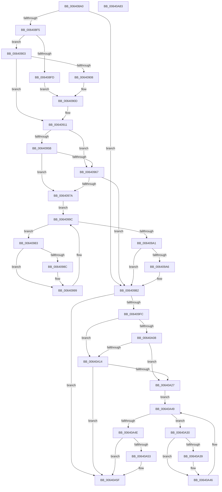

# DifZwCreateTransactionWrapper

- RVA: `0x006408A0`–`0x00640A84` (길이 `484` bytes)
- VA: `0x00000001406408A0`
- 실행 섹션: `.text`
- PDB 이름 있음: `예`; PDB Function 태그: `아니요`
- unwind 정보 RVA: `0x000D2BDC`
- 디코드: `135`개 명령, `484/484` bytes 표시
- 미해석 바이트: `0` (있으면 어셈블리에 `.byte`로 보존)

> 이 문서는 커널 이미지의 기계어와 PDB 기호를 분석해 생성했습니다. 4번과 5번은 함수 원형과 자료형을 바이너리 사용 방식에서 추정한 C 해석이며 원본 소스 복구 결과는 아닙니다.

## 1. Dependencies

- 직접 호출 지점: **10**; 고유 호출 대상: **7**
- 직접 호출자로 확인된 함수: **0**
- RIP 상대 이미지 참조: **3**

### Outgoing calls
- `0x006408DA` → [memset](../6C/memset_function_006C6C40.md) (function, `0x006C6C40`)
- `0x006408E4` → [DifGetAPIThunkContextById](../49/DifGetAPIThunkContextById_function_00495A34.md) (function, `0x00495A34`)
- `0x00640908` → [DifGetReturnAddressForWrappers](../4D/DifGetReturnAddressForWrappers_function_004D3C08.md) (function, `0x004D3C08`)
- `0x0064096E` → [ExAcquireRundownProtection](../21/ExAcquireRundownProtection_function_00216620.md) (function, `0x00216620`)
- `0x00640994` → [guard_dispatch_icall](../6B/guard_dispatch_icall_function_006BAAD0.md) (function, `0x006BAAD0`)
- `0x006409AD` → [ExReleaseRundownProtection](../34/ExReleaseRundownProtection_function_00349E80.md) (function, `0x00349E80`)
- `0x006409EF` → [ZwCreateTransaction](../6A/ZwCreateTransaction_function_006AEAB0.md) (function, `0x006AEAB0`)
- `0x00640A1B` → [ExAcquireRundownProtection](../21/ExAcquireRundownProtection_function_00216620.md) (function, `0x00216620`)
- `0x00640A41` → [guard_dispatch_icall](../6B/guard_dispatch_icall_function_006BAAD0.md) (function, `0x006BAAD0`)
- `0x00640A5A` → [ExReleaseRundownProtection](../34/ExReleaseRundownProtection_function_00349E80.md) (function, `0x00349E80`)

### Direct callers
- 이 함수 시작 RVA로 연결되는 직접 call은 확인되지 않았습니다. 간접 호출은 완전히 역산할 수 없습니다.

### Static image references
- `0x00640918` → RVA `0x00F048B8` (`.data`; read)
- `0x0064095B` → RVA `0x00F04980` (`.data`; read)
- `0x00640967` → RVA `0x00F03E80` (`.data`; read)

## 2. Other-region calls and transfers

- 다른 실행 섹션으로 향하는 call: **0**
- 별도 외부 분기/꼬리 이동을 확인하지 못했습니다.

## 3. Assembly (complete function range)

```asm
006408A0  48 8B C4                        mov rax, rsp
006408A3  48 89 58 10                     mov qword ptr [rax + 0x10], rbx
006408A7  48 89 70 18                     mov qword ptr [rax + 0x18], rsi
006408AB  48 89 78 20                     mov qword ptr [rax + 0x20], rdi
006408AF  48 89 48 08                     mov qword ptr [rax + 8], rcx
006408B3  55                              push rbp
006408B4  41 54                           push r12
006408B6  41 55                           push r13
006408B8  41 56                           push r14
006408BA  41 57                           push r15
006408BC  48 8D 68 D1                     lea rbp, [rax - 0x2f]
006408C0  48 81 EC B0 00 00 00            sub rsp, 0xb0
006408C7  44 8B EA                        mov r13d, edx
006408CA  48 8D 4D A7                     lea rcx, [rbp - 0x59]
006408CE  33 D2                           xor edx, edx
006408D0  4D 8B E0                        mov r12, r8
006408D3  4D 8B F9                        mov r15, r9
006408D6  44 8D 42 58                     lea r8d, [rdx + 0x58]
006408DA  E8 61 63 08 00                  call 0x1406c6c40
006408DF  B9 74 00 00 00                  mov ecx, 0x74
006408E4  E8 4B 51 E5 FF                  call 0x140495a34
006408E9  48 8B F0                        mov rsi, rax
006408EC  48 85 C0                        test rax, rax
006408EF  0F 84 BD 00 00 00               je 0x1406409b2
006408F5  8B 48 0C                        mov ecx, dword ptr [rax + 0xc]
006408F8  F6 C1 18                        test cl, 0x18
006408FB  74 06                           je 0x140640903
006408FD  48 8B 45 2F                     mov rax, qword ptr [rbp + 0x2f]
00640901  EB 0A                           jmp 0x14064090d
00640903  F6 C1 04                        test cl, 4
00640906  74 09                           je 0x140640911
00640908  E8 FB 32 E9 FF                  call 0x1404d3c08
0064090D  48 89 45 A7                     mov qword ptr [rbp - 0x59], rax
00640911  48 8B 45 37                     mov rax, qword ptr [rbp + 0x37]
00640915  45 32 F6                        xor r14b, r14b
00640918  44 38 35 99 3F 8C 00            cmp byte ptr [rip + 0x8c3f99], r14b
0064091F  48 89 45 EF                     mov qword ptr [rbp - 0x11], rax
00640923  48 8B 45 57                     mov rax, qword ptr [rbp + 0x57]
00640927  48 89 45 CF                     mov qword ptr [rbp - 0x31], rax
0064092B  8B 45 5F                        mov eax, dword ptr [rbp + 0x5f]
0064092E  89 45 C7                        mov dword ptr [rbp - 0x39], eax
00640931  8B 45 67                        mov eax, dword ptr [rbp + 0x67]
00640934  89 45 C3                        mov dword ptr [rbp - 0x3d], eax
00640937  8B 45 6F                        mov eax, dword ptr [rbp + 0x6f]
0064093A  89 45 BF                        mov dword ptr [rbp - 0x41], eax
0064093D  48 8B 45 77                     mov rax, qword ptr [rbp + 0x77]
00640941  48 89 45 B7                     mov qword ptr [rbp - 0x49], rax
00640945  48 8B 45 7F                     mov rax, qword ptr [rbp + 0x7f]
00640949  48 89 45 AF                     mov qword ptr [rbp - 0x51], rax
0064094D  44 89 6D E7                     mov dword ptr [rbp - 0x19], r13d
00640951  4C 89 65 DF                     mov qword ptr [rbp - 0x21], r12
00640955  4C 89 7D D7                     mov qword ptr [rbp - 0x29], r15
00640959  75 0C                           jne 0x140640967
0064095B  F7 05 1B 40 8C 00 00 08 00 00   test dword ptr [rip + 0x8c401b], 0x800
00640965  74 13                           je 0x14064097a
00640967  48 8D 0D 12 35 8C 00            lea rcx, [rip + 0x8c3512]
0064096E  E8 AD 5C BD FF                  call 0x140216620
00640973  44 8A F0                        mov r14b, al
00640976  84 C0                           test al, al
00640978  74 38                           je 0x1406409b2
0064097A  48 8D 7E 20                     lea rdi, [rsi + 0x20]
0064097E  48 8B 1F                        mov rbx, qword ptr [rdi]
00640981  EB 19                           jmp 0x14064099c
00640983  48 8D 43 F0                     lea rax, [rbx - 0x10]
00640987  48 85 C0                        test rax, rax
0064098A  74 0D                           je 0x140640999
0064098C  48 8B 40 08                     mov rax, qword ptr [rax + 8]
00640990  48 8D 4D A7                     lea rcx, [rbp - 0x59]
00640994  E8 37 A1 07 00                  call 0x1406baad0
00640999  48 8B 1B                        mov rbx, qword ptr [rbx]
0064099C  48 3B DF                        cmp rbx, rdi
0064099F  75 E2                           jne 0x140640983
006409A1  45 84 F6                        test r14b, r14b
006409A4  74 0C                           je 0x1406409b2
006409A6  48 8D 0D D3 34 8C 00            lea rcx, [rip + 0x8c34d3]
006409AD  E8 CE 94 D0 FF                  call 0x140349e80
006409B2  48 8B 45 7F                     mov rax, qword ptr [rbp + 0x7f]
006409B6  4D 8B CF                        mov r9, r15
006409B9  48 8B 4D 37                     mov rcx, qword ptr [rbp + 0x37]
006409BD  4D 8B C4                        mov r8, r12
006409C0  48 89 44 24 48                  mov qword ptr [rsp + 0x48], rax
006409C5  41 8B D5                        mov edx, r13d
006409C8  48 8B 45 77                     mov rax, qword ptr [rbp + 0x77]
006409CC  48 89 44 24 40                  mov qword ptr [rsp + 0x40], rax
006409D1  8B 45 6F                        mov eax, dword ptr [rbp + 0x6f]
006409D4  89 44 24 38                     mov dword ptr [rsp + 0x38], eax
006409D8  8B 45 67                        mov eax, dword ptr [rbp + 0x67]
006409DB  89 44 24 30                     mov dword ptr [rsp + 0x30], eax
006409DF  8B 45 5F                        mov eax, dword ptr [rbp + 0x5f]
006409E2  89 44 24 28                     mov dword ptr [rsp + 0x28], eax
006409E6  48 8B 45 57                     mov rax, qword ptr [rbp + 0x57]
006409EA  48 89 44 24 20                  mov qword ptr [rsp + 0x20], rax
006409EF  E8 BC E0 06 00                  call 0x1406aeab0
006409F4  89 45 F7                        mov dword ptr [rbp - 9], eax
006409F7  48 85 F6                        test rsi, rsi
006409FA  74 63                           je 0x140640a5f
006409FC  40 32 FF                        xor dil, dil
006409FF  40 38 3D B2 3E 8C 00            cmp byte ptr [rip + 0x8c3eb2], dil
00640A06  75 0C                           jne 0x140640a14
00640A08  F7 05 6E 3F 8C 00 00 08 00 00   test dword ptr [rip + 0x8c3f6e], 0x800
00640A12  74 13                           je 0x140640a27
00640A14  48 8D 0D 65 34 8C 00            lea rcx, [rip + 0x8c3465]
00640A1B  E8 00 5C BD FF                  call 0x140216620
00640A20  40 8A F8                        mov dil, al
00640A23  84 C0                           test al, al
00640A25  74 38                           je 0x140640a5f
00640A27  48 83 C6 30                     add rsi, 0x30
00640A2B  48 8B 1E                        mov rbx, qword ptr [rsi]
00640A2E  EB 19                           jmp 0x140640a49
00640A30  48 8D 43 F0                     lea rax, [rbx - 0x10]
00640A34  48 85 C0                        test rax, rax
00640A37  74 0D                           je 0x140640a46
00640A39  48 8B 40 08                     mov rax, qword ptr [rax + 8]
00640A3D  48 8D 4D A7                     lea rcx, [rbp - 0x59]
00640A41  E8 8A A0 07 00                  call 0x1406baad0
00640A46  48 8B 1B                        mov rbx, qword ptr [rbx]
00640A49  48 3B DE                        cmp rbx, rsi
00640A4C  75 E2                           jne 0x140640a30
00640A4E  40 84 FF                        test dil, dil
00640A51  74 0C                           je 0x140640a5f
00640A53  48 8D 0D 26 34 8C 00            lea rcx, [rip + 0x8c3426]
00640A5A  E8 21 94 D0 FF                  call 0x140349e80
00640A5F  8B 45 F7                        mov eax, dword ptr [rbp - 9]
00640A62  4C 8D 9C 24 B0 00 00 00         lea r11, [rsp + 0xb0]
00640A6A  49 8B 5B 38                     mov rbx, qword ptr [r11 + 0x38]
00640A6E  49 8B 73 40                     mov rsi, qword ptr [r11 + 0x40]
00640A72  49 8B 7B 48                     mov rdi, qword ptr [r11 + 0x48]
00640A76  49 8B E3                        mov rsp, r11
00640A79  41 5F                           pop r15
00640A7B  41 5E                           pop r14
00640A7D  41 5D                           pop r13
00640A7F  41 5C                           pop r12
00640A81  5D                              pop rbp
00640A82  C3                              ret
00640A83  CC                              int3
```

## 4. C-style interpretation (structured pseudocode)

```c
__int64 __fastcall DifZwCreateTransactionWrapper(__int64 a1, int a2, __int64 a3, __int64 a4)
{
    __int64 result;
    __int64 v_r14;
    __int64 v_rdi;
    __int64 v_rsi;
    __int64 v_rsp;
    unsigned __int64 v_stack_m28;
    unsigned __int64 v_stack_m90;
    unsigned __int64 v_stack_m98;
    unsigned int v_stack_mA0;
    unsigned int v_stack_mA8;
    unsigned int v_stack_mB0;
    unsigned __int64 v_stack_mB8;

    *(unsigned __int64 *)(v_rsp + 16) = v_rbx;
    *(unsigned __int64 *)(v_rsp + 24) = v_rsi;
    *(unsigned __int64 *)(v_rsp + 32) = v_rdi;
    *(unsigned __int64 *)(v_rsp + 8) = a1;
    v_rsp = (v_rsp) - (176);
    a2 = 0;
    result = memset(v_rsp - 47 - 89, a2, a2 + 88, a4);
    result = DifGetAPIThunkContextById(116, a2, a2 + 88, a4);
    if (result == 0) goto loc_006409B2;
    if ((((unsigned __int8)((unsigned int)(*(unsigned int *)(result + 12)))) & (24)) == 0) goto loc_00640903;
    goto loc_0064090D;
loc_00640903:
    if ((((unsigned __int8)((unsigned int)(*(unsigned int *)(result + 12)))) & (4)) == 0) goto loc_00640911;
    result = DifGetReturnAddressForWrappers((unsigned int)(*(unsigned int *)(result + 12)), a2, a2 + 88, a4);
loc_0064090D:
    *(unsigned __int64 *)(v_rsp - 47 - 89) = result;
loc_00640911:
    v_r14 = 0;
    *(unsigned __int64 *)(v_rsp - 47 - 17) = *(unsigned __int64 *)(v_rsp - 47 + 55);
    *(unsigned __int64 *)(v_rsp - 47 - 49) = *(unsigned __int64 *)(v_rsp - 47 + 87);
    *(unsigned int *)(v_rsp - 47 - 57) = (unsigned int)((unsigned int)(*(unsigned int *)(v_rsp - 47 + 95)));
    *(unsigned int *)(v_rsp - 47 - 61) = (unsigned int)((unsigned int)(*(unsigned int *)(v_rsp - 47 + 103)));
    *(unsigned int *)(v_rsp - 47 - 65) = (unsigned int)((unsigned int)(*(unsigned int *)(v_rsp - 47 + 111)));
    *(unsigned __int64 *)(v_rsp - 47 - 73) = *(unsigned __int64 *)(v_rsp - 47 + 119);
    *(unsigned __int64 *)(v_rsp - 47 - 81) = *(unsigned __int64 *)(v_rsp - 47 + 127);
    *(unsigned int *)(v_rsp - 47 - 25) = (unsigned int)((unsigned int)(a2));
    *(unsigned __int64 *)(v_rsp - 47 - 33) = a3;
    *(unsigned __int64 *)(v_rsp - 47 - 41) = a4;
    if ((*(unsigned __int8 *)(v_rip + 9191321)) != 0) goto loc_00640967;
    if (((*(unsigned int *)(v_rip + 9191451)) & (0x800ULL)) == 0) goto loc_0064097A;
loc_00640967:
    result = ExAcquireRundownProtection(v_rip + 9188626, a2, a2 + 88, a4);
    if ((unsigned __int8)(result) == 0) goto loc_006409B2;
loc_0064097A:
    goto loc_0064099C;
loc_00640983:
    result = *(unsigned __int64 *)(result + 32) - 16;
    if (*(unsigned __int64 *)(result + 32) - 16 != 0) {
        result = *(unsigned __int64 *)(*(unsigned __int64 *)(result + 32) - 16 + 8);
        a1 = v_rsp - 47 - 89;
        result = guard_dispatch_icall(a1, a2, a2 + 88, a4);
    }
loc_0064099C:
    if ((*(unsigned __int64 *)(*(unsigned __int64 *)(result + 32))) != (result + 32)) goto loc_00640983;
    if ((unsigned __int8)((unsigned __int8)(result)) != 0) {
        a1 = v_rip + 9188563;
        result = ExReleaseRundownProtection(a1, a2, a2 + 88, a4);
    }
    v_stack_m90 = *(unsigned __int64 *)(v_rsp - 47 + 127);
    v_stack_m98 = *(unsigned __int64 *)(v_rsp - 47 + 119);
    v_stack_mA0 = (unsigned int)((unsigned int)(*(unsigned int *)(v_rsp - 47 + 111)));
    v_stack_mA8 = (unsigned int)((unsigned int)(*(unsigned int *)(v_rsp - 47 + 103)));
    v_stack_mB0 = (unsigned int)((unsigned int)(*(unsigned int *)(v_rsp - 47 + 95)));
    v_stack_mB8 = *(unsigned __int64 *)(v_rsp - 47 + 87);
    result = ZwCreateTransaction(*(unsigned __int64 *)(v_rsp - 47 + 55), (unsigned int)((unsigned int)((unsigned int)(a2))), a3, a4);
    *(unsigned int *)(v_rsp - 47 - 9) = (unsigned int)(result);
    if (result == 0) goto loc_00640A5F;
    v_rdi = 0;
    if ((*(unsigned __int8 *)(v_rip + 9191090)) != 0) goto loc_00640A14;
    if (((*(unsigned int *)(v_rip + 9191278)) & (0x800ULL)) == 0) goto loc_00640A27;
loc_00640A14:
    result = ExAcquireRundownProtection(v_rip + 9188453, (unsigned int)((unsigned int)((unsigned int)(a2))), a3, a4);
    if ((unsigned __int8)(result) == 0) goto loc_00640A5F;
loc_00640A27:
    v_rsi = (result) + (48);
    goto loc_00640A49;
loc_00640A30:
    result = *(unsigned __int64 *)(v_rsi) - 16;
    if (*(unsigned __int64 *)(v_rsi) - 16 != 0) {
        result = *(unsigned __int64 *)(*(unsigned __int64 *)(v_rsi) - 16 + 8);
        a1 = v_rsp - 47 - 89;
        result = guard_dispatch_icall(a1, (unsigned int)((unsigned int)((unsigned int)(a2))), a3, a4);
    }
loc_00640A49:
    if ((*(unsigned __int64 *)(*(unsigned __int64 *)(v_rsi))) != v_rsi) goto loc_00640A30;
    if ((unsigned __int8)((unsigned __int8)(result)) != 0) {
        a1 = v_rip + 9188390;
        result = ExReleaseRundownProtection(a1, (unsigned int)((unsigned int)((unsigned int)(a2))), a3, a4);
    }
    return (unsigned int)(*(unsigned int *)(v_rsp - 47 - 9));
}
```

## 5. (Beta) C Style

```c
int64_t DifZwCreateTransactionWrapper(int64_t Arg1, int32_t Arg2, int64_t Arg3, int64_t Arg4)
{
    int64_t result;
    int64_t local_r14;
    int64_t local_rdi;
    int64_t local_rsi;
    int64_t local_rsp;
    uint64_t v_stack_m28;
    uint64_t v_stack_m90;
    uint64_t v_stack_m98;
    uint32_t v_stack_mA0;
    uint32_t v_stack_mA8;
    uint32_t v_stack_mB0;
    uint64_t v_stack_mB8;

    *(uint64_t *)(local_rsp + 0x10) = local_rbx;
    *(uint64_t *)(local_rsp + 0x18) = local_rsi;
    *(uint64_t *)(local_rsp + 0x20) = local_rdi;
    *(uint64_t *)(local_rsp + 0x8) = Arg1;
    local_rsp = (local_rsp) - (176);
    Arg2 = 0;
    result = memset(local_rsp - 47 - 89, Arg2, Arg2 + 88, Arg4);
    result = DifGetAPIThunkContextById(116, Arg2, Arg2 + 88, Arg4);
    if (result == 0) goto loc_006409B2;
    if ((((uint8_t)((uint32_t)(*(uint32_t *)(result + 0xC)))) & (24)) == 0) goto loc_00640903;
    goto loc_0064090D;
loc_00640903:
    if ((((uint8_t)((uint32_t)(*(uint32_t *)(result + 0xC)))) & (4)) == 0) goto loc_00640911;
    result = DifGetReturnAddressForWrappers((uint32_t)(*(uint32_t *)(result + 0xC)), Arg2, Arg2 + 88, Arg4);
loc_0064090D:
    *(uint64_t *)(local_rsp - 0x2F - 0x59) = result;
loc_00640911:
    local_r14 = 0;
    *(uint64_t *)(local_rsp - 0x2F - 0x11) = *(uint64_t *)(local_rsp - 0x2F + 0x37);
    *(uint64_t *)(local_rsp - 0x2F - 0x31) = *(uint64_t *)(local_rsp - 0x2F + 0x57);
    *(uint32_t *)(local_rsp - 0x2F - 0x39) = (uint32_t)((uint32_t)(*(uint32_t *)(local_rsp - 0x2F + 0x5F)));
    *(uint32_t *)(local_rsp - 0x2F - 0x3D) = (uint32_t)((uint32_t)(*(uint32_t *)(local_rsp - 0x2F + 0x67)));
    *(uint32_t *)(local_rsp - 0x2F - 0x41) = (uint32_t)((uint32_t)(*(uint32_t *)(local_rsp - 0x2F + 0x6F)));
    *(uint64_t *)(local_rsp - 0x2F - 0x49) = *(uint64_t *)(local_rsp - 0x2F + 0x77);
    *(uint64_t *)(local_rsp - 0x2F - 0x51) = *(uint64_t *)(local_rsp - 0x2F + 0x7F);
    *(uint32_t *)(local_rsp - 0x2F - 0x19) = (uint32_t)((uint32_t)(Arg2));
    *(uint64_t *)(local_rsp - 0x2F - 0x21) = Arg3;
    *(uint64_t *)(local_rsp - 0x2F - 0x29) = Arg4;
    if ((*(uint8_t *)(v_rip + 0x8C3F99)) != 0) goto loc_00640967;
    if (((*(uint32_t *)(v_rip + 0x8C401B)) & (0x800ULL)) == 0) goto loc_0064097A;
loc_00640967:
    result = ExAcquireRundownProtection(v_rip + 9188626, Arg2, Arg2 + 88, Arg4);
    if ((uint8_t)(result) == 0) goto loc_006409B2;
loc_0064097A:
    goto loc_0064099C;
loc_00640983:
    result = *(uint64_t *)(result + 0x20) - 16;
    if (*(uint64_t *)(result + 0x20) - 16 != 0) {
        result = *(uint64_t *)(*(uint64_t *)(result + 0x20) - 0x10 + 0x8);
        Arg1 = local_rsp - 47 - 89;
        result = guard_dispatch_icall(Arg1, Arg2, Arg2 + 88, Arg4);
    }
loc_0064099C:
    if ((*(uint64_t *)(*(uint64_t *)(result + 0x20))) != (result + 32)) goto loc_00640983;
    if ((uint8_t)((uint8_t)(result)) != 0) {
        Arg1 = v_rip + 9188563;
        result = ExReleaseRundownProtection(Arg1, Arg2, Arg2 + 88, Arg4);
    }
    v_stack_m90 = *(uint64_t *)(local_rsp - 0x2F + 0x7F);
    v_stack_m98 = *(uint64_t *)(local_rsp - 0x2F + 0x77);
    v_stack_mA0 = (uint32_t)((uint32_t)(*(uint32_t *)(local_rsp - 0x2F + 0x6F)));
    v_stack_mA8 = (uint32_t)((uint32_t)(*(uint32_t *)(local_rsp - 0x2F + 0x67)));
    v_stack_mB0 = (uint32_t)((uint32_t)(*(uint32_t *)(local_rsp - 0x2F + 0x5F)));
    v_stack_mB8 = *(uint64_t *)(local_rsp - 0x2F + 0x57);
    result = ZwCreateTransaction(*(uint64_t *)(local_rsp - 0x2F + 0x37), (uint32_t)((uint32_t)((uint32_t)(Arg2))), Arg3, Arg4);
    *(uint32_t *)(local_rsp - 0x2F - 0x9) = (uint32_t)(result);
    if (result == 0) goto loc_00640A5F;
    local_rdi = 0;
    if ((*(uint8_t *)(v_rip + 0x8C3EB2)) != 0) goto loc_00640A14;
    if (((*(uint32_t *)(v_rip + 0x8C3F6E)) & (0x800ULL)) == 0) goto loc_00640A27;
loc_00640A14:
    result = ExAcquireRundownProtection(v_rip + 9188453, (uint32_t)((uint32_t)((uint32_t)(Arg2))), Arg3, Arg4);
    if ((uint8_t)(result) == 0) goto loc_00640A5F;
loc_00640A27:
    local_rsi = (result) + (48);
    goto loc_00640A49;
loc_00640A30:
    result = *(uint64_t *)(local_rsi) - 16;
    if (*(uint64_t *)(local_rsi) - 16 != 0) {
        result = *(uint64_t *)(*(uint64_t *)(local_rsi) - 0x10 + 0x8);
        Arg1 = local_rsp - 47 - 89;
        result = guard_dispatch_icall(Arg1, (uint32_t)((uint32_t)((uint32_t)(Arg2))), Arg3, Arg4);
    }
loc_00640A49:
    if ((*(uint64_t *)(*(uint64_t *)(local_rsi))) != local_rsi) goto loc_00640A30;
    if ((uint8_t)((uint8_t)(result)) != 0) {
        Arg1 = v_rip + 9188390;
        result = ExReleaseRundownProtection(Arg1, (uint32_t)((uint32_t)((uint32_t)(Arg2))), Arg3, Arg4);
    }
    return (uint32_t)(*(uint32_t *)(local_rsp - 0x2F - 0x9));
}
```

## 6. Execution-region graph

[열기: 2D/3D 그래프와 함수 탐색 컨트롤 패널](../../../control-panel.html?section=text&rva=0x006408A0&view=graph)

- 2D 그래프는 위에서 아래로 흐르고, 3D 그래프는 빈 공간을 드래그해 회전합니다. Shift+드래그는 이동, 휠은 확대·축소, 함수 노드 선택은 대상 보고서 이동입니다.

### Static fallback


