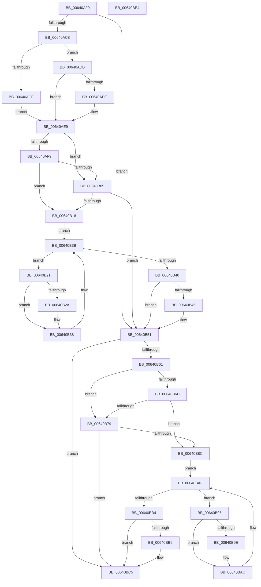

# DifZwDeleteBootEntryWrapper

- RVA: `0x00640A90`–`0x00640BE5` (길이 `341` bytes)
- VA: `0x0000000140640A90`
- 실행 섹션: `.text`
- PDB 이름 있음: `예`; PDB Function 태그: `아니요`
- unwind 정보 RVA: `0x0005D7BC`
- 디코드: `92`개 명령, `341/341` bytes 표시
- 미해석 바이트: `0` (있으면 어셈블리에 `.byte`로 보존)

> 이 문서는 커널 이미지의 기계어와 PDB 기호를 분석해 생성했습니다. 4번과 5번은 함수 원형과 자료형을 바이너리 사용 방식에서 추정한 C 해석이며 원본 소스 복구 결과는 아닙니다.

## 1. Dependencies

- 직접 호출 지점: **9**; 고유 호출 대상: **6**
- 직접 호출자로 확인된 함수: **0**
- RIP 상대 이미지 참조: **3**

### Outgoing calls
- `0x00640AB7` → [DifGetAPIThunkContextById](../49/DifGetAPIThunkContextById_function_00495A34.md) (function, `0x00495A34`)
- `0x00640ADF` → [DifGetReturnAddressForWrappers](../4D/DifGetReturnAddressForWrappers_function_004D3C08.md) (function, `0x004D3C08`)
- `0x00640B0C` → [ExAcquireRundownProtection](../21/ExAcquireRundownProtection_function_00216620.md) (function, `0x00216620`)
- `0x00640B33` → [guard_dispatch_icall](../6B/guard_dispatch_icall_function_006BAAD0.md) (function, `0x006BAAD0`)
- `0x00640B4C` → [ExReleaseRundownProtection](../34/ExReleaseRundownProtection_function_00349E80.md) (function, `0x00349E80`)
- `0x00640B53` → [ZwDeleteBootEntry](../6A/ZwDeleteBootEntry_function_006AEBF0.md) (function, `0x006AEBF0`)
- `0x00640B80` → [ExAcquireRundownProtection](../21/ExAcquireRundownProtection_function_00216620.md) (function, `0x00216620`)
- `0x00640BA7` → [guard_dispatch_icall](../6B/guard_dispatch_icall_function_006BAAD0.md) (function, `0x006BAAD0`)
- `0x00640BC0` → [ExReleaseRundownProtection](../34/ExReleaseRundownProtection_function_00349E80.md) (function, `0x00349E80`)

### Direct callers
- 이 함수 시작 RVA로 연결되는 직접 call은 확인되지 않았습니다. 간접 호출은 완전히 역산할 수 없습니다.

### Static image references
- `0x00640AF0` → RVA `0x00F048B8` (`.data`; read)
- `0x00640AF9` → RVA `0x00F04980` (`.data`; read)
- `0x00640B05` → RVA `0x00F03E80` (`.data`; read)

## 2. Other-region calls and transfers

- 다른 실행 섹션으로 향하는 call: **0**
- 별도 외부 분기/꼬리 이동을 확인하지 못했습니다.

## 3. Assembly (complete function range)

```asm
00640A90  48 8B C4                        mov rax, rsp
00640A93  48 89 58 08                     mov qword ptr [rax + 8], rbx
00640A97  48 89 68 10                     mov qword ptr [rax + 0x10], rbp
00640A9B  48 89 70 18                     mov qword ptr [rax + 0x18], rsi
00640A9F  48 89 78 20                     mov qword ptr [rax + 0x20], rdi
00640AA3  41 56                           push r14
00640AA5  48 83 EC 30                     sub rsp, 0x30
00640AA9  8B E9                           mov ebp, ecx
00640AAB  0F 57 C0                        xorps xmm0, xmm0
00640AAE  B9 72 00 00 00                  mov ecx, 0x72
00640AB3  0F 11 40 E8                     movups xmmword ptr [rax - 0x18], xmm0
00640AB7  E8 78 4F E5 FF                  call 0x140495a34
00640ABC  48 8B F0                        mov rsi, rax
00640ABF  48 85 C0                        test rax, rax
00640AC2  0F 84 89 00 00 00               je 0x140640b51
00640AC8  8B 40 0C                        mov eax, dword ptr [rax + 0xc]
00640ACB  A8 18                           test al, 0x18
00640ACD  74 0C                           je 0x140640adb
00640ACF  48 8B 4C 24 38                  mov rcx, qword ptr [rsp + 0x38]
00640AD4  48 89 4C 24 20                  mov qword ptr [rsp + 0x20], rcx
00640AD9  EB 0E                           jmp 0x140640ae9
00640ADB  A8 04                           test al, 4
00640ADD  74 0A                           je 0x140640ae9
00640ADF  E8 24 31 E9 FF                  call 0x1404d3c08
00640AE4  48 89 44 24 20                  mov qword ptr [rsp + 0x20], rax
00640AE9  40 32 FF                        xor dil, dil
00640AEC  89 6C 24 28                     mov dword ptr [rsp + 0x28], ebp
00640AF0  40 38 3D C1 3D 8C 00            cmp byte ptr [rip + 0x8c3dc1], dil
00640AF7  75 0C                           jne 0x140640b05
00640AF9  F7 05 7D 3E 8C 00 00 08 00 00   test dword ptr [rip + 0x8c3e7d], 0x800
00640B03  74 13                           je 0x140640b18
00640B05  48 8D 0D 74 33 8C 00            lea rcx, [rip + 0x8c3374]
00640B0C  E8 0F 5B BD FF                  call 0x140216620
00640B11  40 8A F8                        mov dil, al
00640B14  84 C0                           test al, al
00640B16  74 39                           je 0x140640b51
00640B18  4C 8D 76 20                     lea r14, [rsi + 0x20]
00640B1C  49 8B 1E                        mov rbx, qword ptr [r14]
00640B1F  EB 1A                           jmp 0x140640b3b
00640B21  48 8D 43 F0                     lea rax, [rbx - 0x10]
00640B25  48 85 C0                        test rax, rax
00640B28  74 0E                           je 0x140640b38
00640B2A  48 8B 40 08                     mov rax, qword ptr [rax + 8]
00640B2E  48 8D 4C 24 20                  lea rcx, [rsp + 0x20]
00640B33  E8 98 9F 07 00                  call 0x1406baad0
00640B38  48 8B 1B                        mov rbx, qword ptr [rbx]
00640B3B  49 3B DE                        cmp rbx, r14
00640B3E  75 E1                           jne 0x140640b21
00640B40  40 84 FF                        test dil, dil
00640B43  74 0C                           je 0x140640b51
00640B45  48 8D 0D 34 33 8C 00            lea rcx, [rip + 0x8c3334]
00640B4C  E8 2F 93 D0 FF                  call 0x140349e80
00640B51  8B CD                           mov ecx, ebp
00640B53  E8 98 E0 06 00                  call 0x1406aebf0
00640B58  89 44 24 2C                     mov dword ptr [rsp + 0x2c], eax
00640B5C  48 85 F6                        test rsi, rsi
00640B5F  74 64                           je 0x140640bc5
00640B61  40 32 FF                        xor dil, dil
00640B64  40 38 3D 4D 3D 8C 00            cmp byte ptr [rip + 0x8c3d4d], dil
00640B6B  75 0C                           jne 0x140640b79
00640B6D  F7 05 09 3E 8C 00 00 08 00 00   test dword ptr [rip + 0x8c3e09], 0x800
00640B77  74 13                           je 0x140640b8c
00640B79  48 8D 0D 00 33 8C 00            lea rcx, [rip + 0x8c3300]
00640B80  E8 9B 5A BD FF                  call 0x140216620
00640B85  40 8A F8                        mov dil, al
00640B88  84 C0                           test al, al
00640B8A  74 39                           je 0x140640bc5
00640B8C  48 83 C6 30                     add rsi, 0x30
00640B90  48 8B 1E                        mov rbx, qword ptr [rsi]
00640B93  EB 1A                           jmp 0x140640baf
00640B95  48 8D 43 F0                     lea rax, [rbx - 0x10]
00640B99  48 85 C0                        test rax, rax
00640B9C  74 0E                           je 0x140640bac
00640B9E  48 8B 40 08                     mov rax, qword ptr [rax + 8]
00640BA2  48 8D 4C 24 20                  lea rcx, [rsp + 0x20]
00640BA7  E8 24 9F 07 00                  call 0x1406baad0
00640BAC  48 8B 1B                        mov rbx, qword ptr [rbx]
00640BAF  48 3B DE                        cmp rbx, rsi
00640BB2  75 E1                           jne 0x140640b95
00640BB4  40 84 FF                        test dil, dil
00640BB7  74 0C                           je 0x140640bc5
00640BB9  48 8D 0D C0 32 8C 00            lea rcx, [rip + 0x8c32c0]
00640BC0  E8 BB 92 D0 FF                  call 0x140349e80
00640BC5  8B 44 24 2C                     mov eax, dword ptr [rsp + 0x2c]
00640BC9  48 8B 5C 24 40                  mov rbx, qword ptr [rsp + 0x40]
00640BCE  48 8B 6C 24 48                  mov rbp, qword ptr [rsp + 0x48]
00640BD3  48 8B 74 24 50                  mov rsi, qword ptr [rsp + 0x50]
00640BD8  48 8B 7C 24 58                  mov rdi, qword ptr [rsp + 0x58]
00640BDD  48 83 C4 30                     add rsp, 0x30
00640BE1  41 5E                           pop r14
00640BE3  C3                              ret
00640BE4  CC                              int3
```

## 4. C-style interpretation (structured pseudocode)

```c
__int64 __fastcall DifZwDeleteBootEntryWrapper(int a1)
{
    __int64 result;
    __int64 v_rdi;
    __int64 v_rsi;
    __int64 v_rsp;
    unsigned int v_stack_m10;
    unsigned __int64 v_stack_m18;
    unsigned int v_stack_mC;
    unsigned __int64 v_stack_p0;
    unsigned __int64 v_stack_p10;
    unsigned __int64 v_stack_p18;
    unsigned __int64 v_stack_p20;
    unsigned __int64 v_stack_p8;

    *(unsigned __int64 *)(v_rsp + 8) = v_rbx;
    *(unsigned __int64 *)(v_rsp + 16) = v_rbp;
    *(unsigned __int64 *)(v_rsp + 24) = v_rsi;
    *(unsigned __int64 *)(v_rsp + 32) = v_rdi;
    v_rsp = (v_rsp) - (48);
    *(unsigned __int64 *)(v_rsp - 24) = v_xmm0;
    result = DifGetAPIThunkContextById(114, a2, a3, a4);
    if (result == 0) goto loc_00640B51;
    if ((((unsigned __int8)((unsigned int)(*(unsigned int *)(result + 12)))) & (24)) == 0) goto loc_00640ADB;
    v_stack_m18 = v_stack_p0;
    goto loc_00640AE9;
loc_00640ADB:
    result = (unsigned int)(*(unsigned int *)(result + 12));
    if ((((unsigned __int8)((unsigned int)(*(unsigned int *)(result + 12)))) & (4)) != 0) {
        result = DifGetReturnAddressForWrappers(v_stack_p0, a2, a3, a4);
        v_stack_m18 = result;
    }
    v_rdi = 0;
    v_stack_m10 = (unsigned int)((unsigned int)(a1));
    if ((*(unsigned __int8 *)(v_rip + 9190849)) != 0) goto loc_00640B05;
    if (((*(unsigned int *)(v_rip + 9191037)) & (0x800ULL)) == 0) goto loc_00640B18;
loc_00640B05:
    result = ExAcquireRundownProtection(v_rip + 9188212, a2, a3, a4);
    if ((unsigned __int8)(result) == 0) goto loc_00640B51;
loc_00640B18:
    goto loc_00640B3B;
loc_00640B21:
    result = *(unsigned __int64 *)(result + 32) - 16;
    if (*(unsigned __int64 *)(result + 32) - 16 != 0) {
        result = *(unsigned __int64 *)(*(unsigned __int64 *)(result + 32) - 16 + 8);
        a1 = v_stack_m18;
        result = guard_dispatch_icall(a1, a2, a3, a4);
    }
loc_00640B3B:
    if ((*(unsigned __int64 *)(*(unsigned __int64 *)(result + 32))) != (result + 32)) goto loc_00640B21;
    if ((unsigned __int8)((unsigned __int8)(result)) != 0) {
        a1 = v_rip + 9188148;
        result = ExReleaseRundownProtection(a1, a2, a3, a4);
    }
    result = ZwDeleteBootEntry((unsigned int)((unsigned int)((unsigned int)(a1))), a2, a3, a4);
    v_stack_mC = (unsigned int)(result);
    if (result == 0) goto loc_00640BC5;
    v_rdi = 0;
    if ((*(unsigned __int8 *)(v_rip + 9190733)) != 0) goto loc_00640B79;
    if (((*(unsigned int *)(v_rip + 9190921)) & (0x800ULL)) == 0) goto loc_00640B8C;
loc_00640B79:
    result = ExAcquireRundownProtection(v_rip + 9188096, a2, a3, a4);
    if ((unsigned __int8)(result) == 0) goto loc_00640BC5;
loc_00640B8C:
    v_rsi = (result) + (48);
    goto loc_00640BAF;
loc_00640B95:
    result = *(unsigned __int64 *)(v_rsi) - 16;
    if (*(unsigned __int64 *)(v_rsi) - 16 != 0) {
        result = *(unsigned __int64 *)(*(unsigned __int64 *)(v_rsi) - 16 + 8);
        a1 = v_stack_m18;
        result = guard_dispatch_icall(a1, a2, a3, a4);
    }
loc_00640BAF:
    if ((*(unsigned __int64 *)(*(unsigned __int64 *)(v_rsi))) != v_rsi) goto loc_00640B95;
    if ((unsigned __int8)((unsigned __int8)(result)) != 0) {
        a1 = v_rip + 9188032;
        result = ExReleaseRundownProtection(a1, a2, a3, a4);
    }
    v_rsp = (v_rsp) + (48);
    return (unsigned int)(v_stack_mC);
}
```

## 5. (Beta) C Style

```c
int64_t DifZwDeleteBootEntryWrapper(int32_t Arg1)
{
    int64_t result;
    int64_t local_rdi;
    int64_t local_rsi;
    int64_t local_rsp;
    uint32_t v_stack_m10;
    uint64_t v_stack_m18;
    uint32_t v_stack_mC;
    uint64_t v_stack_p0;
    uint64_t v_stack_p10;
    uint64_t v_stack_p18;
    uint64_t v_stack_p20;
    uint64_t v_stack_p8;

    *(uint64_t *)(local_rsp + 0x8) = local_rbx;
    *(uint64_t *)(local_rsp + 0x10) = local_rbp;
    *(uint64_t *)(local_rsp + 0x18) = local_rsi;
    *(uint64_t *)(local_rsp + 0x20) = local_rdi;
    local_rsp = (local_rsp) - (48);
    *(uint64_t *)(local_rsp - 0x18) = v_xmm0;
    result = DifGetAPIThunkContextById(114, a2, a3, a4);
    if (result == 0) goto loc_00640B51;
    if ((((uint8_t)((uint32_t)(*(uint32_t *)(result + 0xC)))) & (24)) == 0) goto loc_00640ADB;
    v_stack_m18 = v_stack_p0;
    goto loc_00640AE9;
loc_00640ADB:
    result = (uint32_t)(*(uint32_t *)(result + 0xC));
    if ((((uint8_t)((uint32_t)(*(uint32_t *)(result + 0xC)))) & (4)) != 0) {
        result = DifGetReturnAddressForWrappers(v_stack_p0, a2, a3, a4);
        v_stack_m18 = result;
    }
    local_rdi = 0;
    v_stack_m10 = (uint32_t)((uint32_t)(Arg1));
    if ((*(uint8_t *)(v_rip + 0x8C3DC1)) != 0) goto loc_00640B05;
    if (((*(uint32_t *)(v_rip + 0x8C3E7D)) & (0x800ULL)) == 0) goto loc_00640B18;
loc_00640B05:
    result = ExAcquireRundownProtection(v_rip + 9188212, a2, a3, a4);
    if ((uint8_t)(result) == 0) goto loc_00640B51;
loc_00640B18:
    goto loc_00640B3B;
loc_00640B21:
    result = *(uint64_t *)(result + 0x20) - 16;
    if (*(uint64_t *)(result + 0x20) - 16 != 0) {
        result = *(uint64_t *)(*(uint64_t *)(result + 0x20) - 0x10 + 0x8);
        Arg1 = v_stack_m18;
        result = guard_dispatch_icall(Arg1, a2, a3, a4);
    }
loc_00640B3B:
    if ((*(uint64_t *)(*(uint64_t *)(result + 0x20))) != (result + 32)) goto loc_00640B21;
    if ((uint8_t)((uint8_t)(result)) != 0) {
        Arg1 = v_rip + 9188148;
        result = ExReleaseRundownProtection(Arg1, a2, a3, a4);
    }
    result = ZwDeleteBootEntry((uint32_t)((uint32_t)((uint32_t)(Arg1))), a2, a3, a4);
    v_stack_mC = (uint32_t)(result);
    if (result == 0) goto loc_00640BC5;
    local_rdi = 0;
    if ((*(uint8_t *)(v_rip + 0x8C3D4D)) != 0) goto loc_00640B79;
    if (((*(uint32_t *)(v_rip + 0x8C3E09)) & (0x800ULL)) == 0) goto loc_00640B8C;
loc_00640B79:
    result = ExAcquireRundownProtection(v_rip + 9188096, a2, a3, a4);
    if ((uint8_t)(result) == 0) goto loc_00640BC5;
loc_00640B8C:
    local_rsi = (result) + (48);
    goto loc_00640BAF;
loc_00640B95:
    result = *(uint64_t *)(local_rsi) - 16;
    if (*(uint64_t *)(local_rsi) - 16 != 0) {
        result = *(uint64_t *)(*(uint64_t *)(local_rsi) - 0x10 + 0x8);
        Arg1 = v_stack_m18;
        result = guard_dispatch_icall(Arg1, a2, a3, a4);
    }
loc_00640BAF:
    if ((*(uint64_t *)(*(uint64_t *)(local_rsi))) != local_rsi) goto loc_00640B95;
    if ((uint8_t)((uint8_t)(result)) != 0) {
        Arg1 = v_rip + 9188032;
        result = ExReleaseRundownProtection(Arg1, a2, a3, a4);
    }
    local_rsp = (local_rsp) + (48);
    return (uint32_t)(v_stack_mC);
}
```

## 6. Execution-region graph

[열기: 2D/3D 그래프와 함수 탐색 컨트롤 패널](../../../control-panel.html?section=text&rva=0x00640A90&view=graph)

- 2D 그래프는 위에서 아래로 흐르고, 3D 그래프는 빈 공간을 드래그해 회전합니다. Shift+드래그는 이동, 휠은 확대·축소, 함수 노드 선택은 대상 보고서 이동입니다.

### Static fallback


