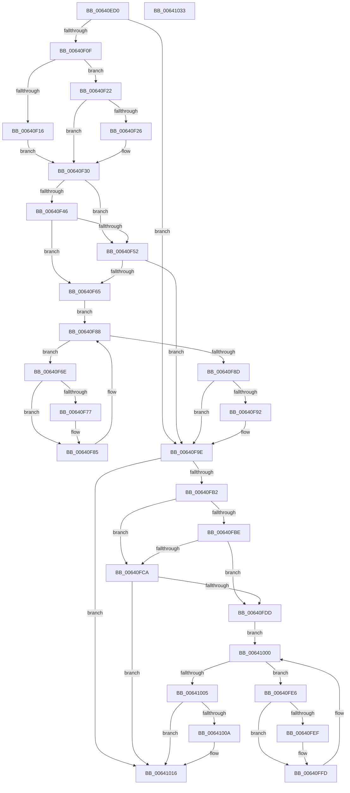

# DifZwDeleteValueKeyWrapper

- RVA: `0x00640ED0`–`0x00641034` (길이 `356` bytes)
- VA: `0x0000000140640ED0`
- 실행 섹션: `.text`
- PDB 이름 있음: `예`; PDB Function 태그: `아니요`
- unwind 정보 RVA: `0x00093E28`
- 디코드: `98`개 명령, `356/356` bytes 표시
- 미해석 바이트: `0` (있으면 어셈블리에 `.byte`로 보존)

> 이 문서는 커널 이미지의 기계어와 PDB 기호를 분석해 생성했습니다. 4번과 5번은 함수 원형과 자료형을 바이너리 사용 방식에서 추정한 C 해석이며 원본 소스 복구 결과는 아닙니다.

## 1. Dependencies

- 직접 호출 지점: **9**; 고유 호출 대상: **6**
- 직접 호출자로 확인된 함수: **0**
- RIP 상대 이미지 참조: **3**

### Outgoing calls
- `0x00640EFE` → [DifGetAPIThunkContextById](../49/DifGetAPIThunkContextById_function_00495A34.md) (function, `0x00495A34`)
- `0x00640F26` → [DifGetReturnAddressForWrappers](../4D/DifGetReturnAddressForWrappers_function_004D3C08.md) (function, `0x004D3C08`)
- `0x00640F59` → [ExAcquireRundownProtection](../21/ExAcquireRundownProtection_function_00216620.md) (function, `0x00216620`)
- `0x00640F80` → [guard_dispatch_icall](../6B/guard_dispatch_icall_function_006BAAD0.md) (function, `0x006BAAD0`)
- `0x00640F99` → [ExReleaseRundownProtection](../34/ExReleaseRundownProtection_function_00349E80.md) (function, `0x00349E80`)
- `0x00640FA4` → [ZwDeleteValueKey](../6A/ZwDeleteValueKey_function_006AECB0.md) (function, `0x006AECB0`)
- `0x00640FD1` → [ExAcquireRundownProtection](../21/ExAcquireRundownProtection_function_00216620.md) (function, `0x00216620`)
- `0x00640FF8` → [guard_dispatch_icall](../6B/guard_dispatch_icall_function_006BAAD0.md) (function, `0x006BAAD0`)
- `0x00641011` → [ExReleaseRundownProtection](../34/ExReleaseRundownProtection_function_00349E80.md) (function, `0x00349E80`)

### Direct callers
- 이 함수 시작 RVA로 연결되는 직접 call은 확인되지 않았습니다. 간접 호출은 완전히 역산할 수 없습니다.

### Static image references
- `0x00640F38` → RVA `0x00F048B8` (`.data`; read)
- `0x00640F46` → RVA `0x00F04980` (`.data`; read)
- `0x00640F52` → RVA `0x00F03E80` (`.data`; read)

## 2. Other-region calls and transfers

- 다른 실행 섹션으로 향하는 call: **0**
- 별도 외부 분기/꼬리 이동을 확인하지 못했습니다.

## 3. Assembly (complete function range)

```asm
00640ED0  48 8B C4                        mov rax, rsp
00640ED3  48 89 58 08                     mov qword ptr [rax + 8], rbx
00640ED7  48 89 68 10                     mov qword ptr [rax + 0x10], rbp
00640EDB  48 89 70 18                     mov qword ptr [rax + 0x18], rsi
00640EDF  57                              push rdi
00640EE0  41 56                           push r14
00640EE2  41 57                           push r15
00640EE4  48 83 EC 40                     sub rsp, 0x40
00640EE8  0F 57 C0                        xorps xmm0, xmm0
00640EEB  4C 8B F9                        mov r15, rcx
00640EEE  B9 6F 00 00 00                  mov ecx, 0x6f
00640EF3  4C 8B F2                        mov r14, rdx
00640EF6  0F 11 40 C8                     movups xmmword ptr [rax - 0x38], xmm0
00640EFA  0F 11 40 D8                     movups xmmword ptr [rax - 0x28], xmm0
00640EFE  E8 31 4B E5 FF                  call 0x140495a34
00640F03  48 8B F0                        mov rsi, rax
00640F06  48 85 C0                        test rax, rax
00640F09  0F 84 8F 00 00 00               je 0x140640f9e
00640F0F  8B 40 0C                        mov eax, dword ptr [rax + 0xc]
00640F12  A8 18                           test al, 0x18
00640F14  74 0C                           je 0x140640f22
00640F16  48 8B 4C 24 58                  mov rcx, qword ptr [rsp + 0x58]
00640F1B  48 89 4C 24 20                  mov qword ptr [rsp + 0x20], rcx
00640F20  EB 0E                           jmp 0x140640f30
00640F22  A8 04                           test al, 4
00640F24  74 0A                           je 0x140640f30
00640F26  E8 DD 2C E9 FF                  call 0x1404d3c08
00640F2B  48 89 44 24 20                  mov qword ptr [rsp + 0x20], rax
00640F30  40 32 ED                        xor bpl, bpl
00640F33  4C 89 7C 24 30                  mov qword ptr [rsp + 0x30], r15
00640F38  40 38 2D 79 39 8C 00            cmp byte ptr [rip + 0x8c3979], bpl
00640F3F  4C 89 74 24 28                  mov qword ptr [rsp + 0x28], r14
00640F44  75 0C                           jne 0x140640f52
00640F46  F7 05 30 3A 8C 00 00 08 00 00   test dword ptr [rip + 0x8c3a30], 0x800
00640F50  74 13                           je 0x140640f65
00640F52  48 8D 0D 27 2F 8C 00            lea rcx, [rip + 0x8c2f27]
00640F59  E8 C2 56 BD FF                  call 0x140216620
00640F5E  40 8A E8                        mov bpl, al
00640F61  84 C0                           test al, al
00640F63  74 39                           je 0x140640f9e
00640F65  48 8D 7E 20                     lea rdi, [rsi + 0x20]
00640F69  48 8B 1F                        mov rbx, qword ptr [rdi]
00640F6C  EB 1A                           jmp 0x140640f88
00640F6E  48 8D 43 F0                     lea rax, [rbx - 0x10]
00640F72  48 85 C0                        test rax, rax
00640F75  74 0E                           je 0x140640f85
00640F77  48 8B 40 08                     mov rax, qword ptr [rax + 8]
00640F7B  48 8D 4C 24 20                  lea rcx, [rsp + 0x20]
00640F80  E8 4B 9B 07 00                  call 0x1406baad0
00640F85  48 8B 1B                        mov rbx, qword ptr [rbx]
00640F88  48 3B DF                        cmp rbx, rdi
00640F8B  75 E1                           jne 0x140640f6e
00640F8D  40 84 ED                        test bpl, bpl
00640F90  74 0C                           je 0x140640f9e
00640F92  48 8D 0D E7 2E 8C 00            lea rcx, [rip + 0x8c2ee7]
00640F99  E8 E2 8E D0 FF                  call 0x140349e80
00640F9E  49 8B D6                        mov rdx, r14
00640FA1  49 8B CF                        mov rcx, r15
00640FA4  E8 07 DD 06 00                  call 0x1406aecb0
00640FA9  89 44 24 38                     mov dword ptr [rsp + 0x38], eax
00640FAD  48 85 F6                        test rsi, rsi
00640FB0  74 64                           je 0x140641016
00640FB2  40 32 FF                        xor dil, dil
00640FB5  40 38 3D FC 38 8C 00            cmp byte ptr [rip + 0x8c38fc], dil
00640FBC  75 0C                           jne 0x140640fca
00640FBE  F7 05 B8 39 8C 00 00 08 00 00   test dword ptr [rip + 0x8c39b8], 0x800
00640FC8  74 13                           je 0x140640fdd
00640FCA  48 8D 0D AF 2E 8C 00            lea rcx, [rip + 0x8c2eaf]
00640FD1  E8 4A 56 BD FF                  call 0x140216620
00640FD6  40 8A F8                        mov dil, al
00640FD9  84 C0                           test al, al
00640FDB  74 39                           je 0x140641016
00640FDD  48 83 C6 30                     add rsi, 0x30
00640FE1  48 8B 1E                        mov rbx, qword ptr [rsi]
00640FE4  EB 1A                           jmp 0x140641000
00640FE6  48 8D 43 F0                     lea rax, [rbx - 0x10]
00640FEA  48 85 C0                        test rax, rax
00640FED  74 0E                           je 0x140640ffd
00640FEF  48 8B 40 08                     mov rax, qword ptr [rax + 8]
00640FF3  48 8D 4C 24 20                  lea rcx, [rsp + 0x20]
00640FF8  E8 D3 9A 07 00                  call 0x1406baad0
00640FFD  48 8B 1B                        mov rbx, qword ptr [rbx]
00641000  48 3B DE                        cmp rbx, rsi
00641003  75 E1                           jne 0x140640fe6
00641005  40 84 FF                        test dil, dil
00641008  74 0C                           je 0x140641016
0064100A  48 8D 0D 6F 2E 8C 00            lea rcx, [rip + 0x8c2e6f]
00641011  E8 6A 8E D0 FF                  call 0x140349e80
00641016  8B 44 24 38                     mov eax, dword ptr [rsp + 0x38]
0064101A  48 8B 5C 24 60                  mov rbx, qword ptr [rsp + 0x60]
0064101F  48 8B 6C 24 68                  mov rbp, qword ptr [rsp + 0x68]
00641024  48 8B 74 24 70                  mov rsi, qword ptr [rsp + 0x70]
00641029  48 83 C4 40                     add rsp, 0x40
0064102D  41 5F                           pop r15
0064102F  41 5E                           pop r14
00641031  5F                              pop rdi
00641032  C3                              ret
00641033  CC                              int3
```

## 4. C-style interpretation (structured pseudocode)

```c
__int64 __fastcall DifZwDeleteValueKeyWrapper(__int64 a1, __int64 a2)
{
    __int64 result;
    __int64 v_rbp;
    __int64 v_rdi;
    __int64 v_rsi;
    __int64 v_rsp;
    unsigned int v_stack_m20;
    unsigned __int64 v_stack_m28;
    unsigned __int64 v_stack_m30;
    unsigned __int64 v_stack_m38;
    unsigned __int64 v_stack_p0;
    unsigned __int64 v_stack_p10;
    unsigned __int64 v_stack_p18;
    unsigned __int64 v_stack_p8;

    *(unsigned __int64 *)(v_rsp + 8) = v_rbx;
    *(unsigned __int64 *)(v_rsp + 16) = v_rbp;
    *(unsigned __int64 *)(v_rsp + 24) = v_rsi;
    v_rsp = (v_rsp) - (64);
    *(unsigned __int64 *)(v_rsp - 56) = v_xmm0;
    *(unsigned __int64 *)(v_rsp - 40) = v_xmm0;
    result = DifGetAPIThunkContextById(111, a2, a3, a4);
    if (result == 0) goto loc_00640F9E;
    if ((((unsigned __int8)((unsigned int)(*(unsigned int *)(result + 12)))) & (24)) == 0) goto loc_00640F22;
    v_stack_m38 = v_stack_p0;
    goto loc_00640F30;
loc_00640F22:
    result = (unsigned int)(*(unsigned int *)(result + 12));
    if ((((unsigned __int8)((unsigned int)(*(unsigned int *)(result + 12)))) & (4)) != 0) {
        result = DifGetReturnAddressForWrappers(v_stack_p0, a2, a3, a4);
        v_stack_m38 = result;
    }
    v_rbp = 0;
    v_stack_m28 = a1;
    v_stack_m30 = a2;
    if ((*(unsigned __int8 *)(v_rip + 9189753)) != 0) goto loc_00640F52;
    if (((*(unsigned int *)(v_rip + 9189936)) & (0x800ULL)) == 0) goto loc_00640F65;
loc_00640F52:
    result = ExAcquireRundownProtection(v_rip + 9187111, a2, a3, a4);
    if ((unsigned __int8)(result) == 0) goto loc_00640F9E;
loc_00640F65:
    goto loc_00640F88;
loc_00640F6E:
    result = *(unsigned __int64 *)(result + 32) - 16;
    if (*(unsigned __int64 *)(result + 32) - 16 != 0) {
        result = *(unsigned __int64 *)(*(unsigned __int64 *)(result + 32) - 16 + 8);
        a1 = v_stack_m38;
        result = guard_dispatch_icall(a1, a2, a3, a4);
    }
loc_00640F88:
    if ((*(unsigned __int64 *)(*(unsigned __int64 *)(result + 32))) != (result + 32)) goto loc_00640F6E;
    if ((unsigned __int8)((unsigned __int8)(result)) != 0) {
        a1 = v_rip + 9187047;
        result = ExReleaseRundownProtection(a1, a2, a3, a4);
    }
    result = ZwDeleteValueKey(a1, a2, a3, a4);
    v_stack_m20 = (unsigned int)(result);
    if (result == 0) goto loc_00641016;
    v_rdi = 0;
    if ((*(unsigned __int8 *)(v_rip + 9189628)) != 0) goto loc_00640FCA;
    if (((*(unsigned int *)(v_rip + 9189816)) & (0x800ULL)) == 0) goto loc_00640FDD;
loc_00640FCA:
    result = ExAcquireRundownProtection(v_rip + 9186991, a2, a3, a4);
    if ((unsigned __int8)(result) == 0) goto loc_00641016;
loc_00640FDD:
    v_rsi = (result) + (48);
    goto loc_00641000;
loc_00640FE6:
    result = *(unsigned __int64 *)(v_rsi) - 16;
    if (*(unsigned __int64 *)(v_rsi) - 16 != 0) {
        result = *(unsigned __int64 *)(*(unsigned __int64 *)(v_rsi) - 16 + 8);
        a1 = v_stack_m38;
        result = guard_dispatch_icall(a1, a2, a3, a4);
    }
loc_00641000:
    if ((*(unsigned __int64 *)(*(unsigned __int64 *)(v_rsi))) != v_rsi) goto loc_00640FE6;
    if ((unsigned __int8)((unsigned __int8)(result)) != 0) {
        a1 = v_rip + 9186927;
        result = ExReleaseRundownProtection(a1, a2, a3, a4);
    }
    v_rsp = (v_rsp) + (64);
    return (unsigned int)(v_stack_m20);
}
```

## 5. (Beta) C Style

```c
int64_t DifZwDeleteValueKeyWrapper(int64_t Arg1, int64_t Arg2)
{
    int64_t result;
    int64_t local_rbp;
    int64_t local_rdi;
    int64_t local_rsi;
    int64_t local_rsp;
    uint32_t v_stack_m20;
    uint64_t v_stack_m28;
    uint64_t v_stack_m30;
    uint64_t v_stack_m38;
    uint64_t v_stack_p0;
    uint64_t v_stack_p10;
    uint64_t v_stack_p18;
    uint64_t v_stack_p8;

    *(uint64_t *)(local_rsp + 0x8) = local_rbx;
    *(uint64_t *)(local_rsp + 0x10) = local_rbp;
    *(uint64_t *)(local_rsp + 0x18) = local_rsi;
    local_rsp = (local_rsp) - (64);
    *(uint64_t *)(local_rsp - 0x38) = v_xmm0;
    *(uint64_t *)(local_rsp - 0x28) = v_xmm0;
    result = DifGetAPIThunkContextById(111, Arg2, a3, a4);
    if (result == 0) goto loc_00640F9E;
    if ((((uint8_t)((uint32_t)(*(uint32_t *)(result + 0xC)))) & (24)) == 0) goto loc_00640F22;
    v_stack_m38 = v_stack_p0;
    goto loc_00640F30;
loc_00640F22:
    result = (uint32_t)(*(uint32_t *)(result + 0xC));
    if ((((uint8_t)((uint32_t)(*(uint32_t *)(result + 0xC)))) & (4)) != 0) {
        result = DifGetReturnAddressForWrappers(v_stack_p0, Arg2, a3, a4);
        v_stack_m38 = result;
    }
    local_rbp = 0;
    v_stack_m28 = Arg1;
    v_stack_m30 = Arg2;
    if ((*(uint8_t *)(v_rip + 0x8C3979)) != 0) goto loc_00640F52;
    if (((*(uint32_t *)(v_rip + 0x8C3A30)) & (0x800ULL)) == 0) goto loc_00640F65;
loc_00640F52:
    result = ExAcquireRundownProtection(v_rip + 9187111, Arg2, a3, a4);
    if ((uint8_t)(result) == 0) goto loc_00640F9E;
loc_00640F65:
    goto loc_00640F88;
loc_00640F6E:
    result = *(uint64_t *)(result + 0x20) - 16;
    if (*(uint64_t *)(result + 0x20) - 16 != 0) {
        result = *(uint64_t *)(*(uint64_t *)(result + 0x20) - 0x10 + 0x8);
        Arg1 = v_stack_m38;
        result = guard_dispatch_icall(Arg1, Arg2, a3, a4);
    }
loc_00640F88:
    if ((*(uint64_t *)(*(uint64_t *)(result + 0x20))) != (result + 32)) goto loc_00640F6E;
    if ((uint8_t)((uint8_t)(result)) != 0) {
        Arg1 = v_rip + 9187047;
        result = ExReleaseRundownProtection(Arg1, Arg2, a3, a4);
    }
    result = ZwDeleteValueKey(Arg1, Arg2, a3, a4);
    v_stack_m20 = (uint32_t)(result);
    if (result == 0) goto loc_00641016;
    local_rdi = 0;
    if ((*(uint8_t *)(v_rip + 0x8C38FC)) != 0) goto loc_00640FCA;
    if (((*(uint32_t *)(v_rip + 0x8C39B8)) & (0x800ULL)) == 0) goto loc_00640FDD;
loc_00640FCA:
    result = ExAcquireRundownProtection(v_rip + 9186991, Arg2, a3, a4);
    if ((uint8_t)(result) == 0) goto loc_00641016;
loc_00640FDD:
    local_rsi = (result) + (48);
    goto loc_00641000;
loc_00640FE6:
    result = *(uint64_t *)(local_rsi) - 16;
    if (*(uint64_t *)(local_rsi) - 16 != 0) {
        result = *(uint64_t *)(*(uint64_t *)(local_rsi) - 0x10 + 0x8);
        Arg1 = v_stack_m38;
        result = guard_dispatch_icall(Arg1, Arg2, a3, a4);
    }
loc_00641000:
    if ((*(uint64_t *)(*(uint64_t *)(local_rsi))) != local_rsi) goto loc_00640FE6;
    if ((uint8_t)((uint8_t)(result)) != 0) {
        Arg1 = v_rip + 9186927;
        result = ExReleaseRundownProtection(Arg1, Arg2, a3, a4);
    }
    local_rsp = (local_rsp) + (64);
    return (uint32_t)(v_stack_m20);
}
```

## 6. Execution-region graph

[열기: 2D/3D 그래프와 함수 탐색 컨트롤 패널](../../../control-panel.html?section=text&rva=0x00640ED0&view=graph)

- 2D 그래프는 위에서 아래로 흐르고, 3D 그래프는 빈 공간을 드래그해 회전합니다. Shift+드래그는 이동, 휠은 확대·축소, 함수 노드 선택은 대상 보고서 이동입니다.

### Static fallback


