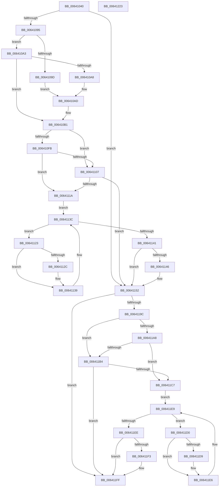

# DifZwDeviceIoControlFileWrapper

- RVA: `0x00641040`–`0x00641224` (길이 `484` bytes)
- VA: `0x0000000140641040`
- 실행 섹션: `.text`
- PDB 이름 있음: `예`; PDB Function 태그: `아니요`
- unwind 정보 RVA: `0x000D2BDC`
- 디코드: `135`개 명령, `484/484` bytes 표시
- 미해석 바이트: `0` (있으면 어셈블리에 `.byte`로 보존)

> 이 문서는 커널 이미지의 기계어와 PDB 기호를 분석해 생성했습니다. 4번과 5번은 함수 원형과 자료형을 바이너리 사용 방식에서 추정한 C 해석이며 원본 소스 복구 결과는 아닙니다.

## 1. Dependencies

- 직접 호출 지점: **10**; 고유 호출 대상: **7**
- 직접 호출자로 확인된 함수: **0**
- RIP 상대 이미지 참조: **3**

### Outgoing calls
- `0x0064107A` → [memset](../6C/memset_function_006C6C40.md) (function, `0x006C6C40`)
- `0x00641084` → [DifGetAPIThunkContextById](../49/DifGetAPIThunkContextById_function_00495A34.md) (function, `0x00495A34`)
- `0x006410A8` → [DifGetReturnAddressForWrappers](../4D/DifGetReturnAddressForWrappers_function_004D3C08.md) (function, `0x004D3C08`)
- `0x0064110E` → [ExAcquireRundownProtection](../21/ExAcquireRundownProtection_function_00216620.md) (function, `0x00216620`)
- `0x00641134` → [guard_dispatch_icall](../6B/guard_dispatch_icall_function_006BAAD0.md) (function, `0x006BAAD0`)
- `0x0064114D` → [ExReleaseRundownProtection](../34/ExReleaseRundownProtection_function_00349E80.md) (function, `0x00349E80`)
- `0x0064118F` → [ZwDeviceIoControlFile](../6A/ZwDeviceIoControlFile_function_006AD1B0.md) (function, `0x006AD1B0`)
- `0x006411BB` → [ExAcquireRundownProtection](../21/ExAcquireRundownProtection_function_00216620.md) (function, `0x00216620`)
- `0x006411E1` → [guard_dispatch_icall](../6B/guard_dispatch_icall_function_006BAAD0.md) (function, `0x006BAAD0`)
- `0x006411FA` → [ExReleaseRundownProtection](../34/ExReleaseRundownProtection_function_00349E80.md) (function, `0x00349E80`)

### Direct callers
- 이 함수 시작 RVA로 연결되는 직접 call은 확인되지 않았습니다. 간접 호출은 완전히 역산할 수 없습니다.

### Static image references
- `0x006410B8` → RVA `0x00F048B8` (`.data`; read)
- `0x006410FB` → RVA `0x00F04980` (`.data`; read)
- `0x00641107` → RVA `0x00F03E80` (`.data`; read)

## 2. Other-region calls and transfers

- 다른 실행 섹션으로 향하는 call: **0**
- 별도 외부 분기/꼬리 이동을 확인하지 못했습니다.

## 3. Assembly (complete function range)

```asm
00641040  48 8B C4                        mov rax, rsp
00641043  48 89 58 10                     mov qword ptr [rax + 0x10], rbx
00641047  48 89 70 18                     mov qword ptr [rax + 0x18], rsi
0064104B  48 89 78 20                     mov qword ptr [rax + 0x20], rdi
0064104F  48 89 48 08                     mov qword ptr [rax + 8], rcx
00641053  55                              push rbp
00641054  41 54                           push r12
00641056  41 55                           push r13
00641058  41 56                           push r14
0064105A  41 57                           push r15
0064105C  48 8D 68 D1                     lea rbp, [rax - 0x2f]
00641060  48 81 EC B0 00 00 00            sub rsp, 0xb0
00641067  4C 8B EA                        mov r13, rdx
0064106A  48 8D 4D A7                     lea rcx, [rbp - 0x59]
0064106E  33 D2                           xor edx, edx
00641070  4D 8B E0                        mov r12, r8
00641073  4D 8B F9                        mov r15, r9
00641076  44 8D 42 60                     lea r8d, [rdx + 0x60]
0064107A  E8 C1 5B 08 00                  call 0x1406c6c40
0064107F  B9 6E 00 00 00                  mov ecx, 0x6e
00641084  E8 AB 49 E5 FF                  call 0x140495a34
00641089  48 8B F0                        mov rsi, rax
0064108C  48 85 C0                        test rax, rax
0064108F  0F 84 BD 00 00 00               je 0x140641152
00641095  8B 48 0C                        mov ecx, dword ptr [rax + 0xc]
00641098  F6 C1 18                        test cl, 0x18
0064109B  74 06                           je 0x1406410a3
0064109D  48 8B 45 2F                     mov rax, qword ptr [rbp + 0x2f]
006410A1  EB 0A                           jmp 0x1406410ad
006410A3  F6 C1 04                        test cl, 4
006410A6  74 09                           je 0x1406410b1
006410A8  E8 5B 2B E9 FF                  call 0x1404d3c08
006410AD  48 89 45 A7                     mov qword ptr [rbp - 0x59], rax
006410B1  48 8B 45 37                     mov rax, qword ptr [rbp + 0x37]
006410B5  45 32 F6                        xor r14b, r14b
006410B8  44 38 35 F9 37 8C 00            cmp byte ptr [rip + 0x8c37f9], r14b
006410BF  48 89 45 F7                     mov qword ptr [rbp - 9], rax
006410C3  48 8B 45 57                     mov rax, qword ptr [rbp + 0x57]
006410C7  48 89 45 D7                     mov qword ptr [rbp - 0x29], rax
006410CB  8B 45 5F                        mov eax, dword ptr [rbp + 0x5f]
006410CE  89 45 CF                        mov dword ptr [rbp - 0x31], eax
006410D1  48 8B 45 67                     mov rax, qword ptr [rbp + 0x67]
006410D5  48 89 45 C7                     mov qword ptr [rbp - 0x39], rax
006410D9  8B 45 6F                        mov eax, dword ptr [rbp + 0x6f]
006410DC  89 45 BF                        mov dword ptr [rbp - 0x41], eax
006410DF  48 8B 45 77                     mov rax, qword ptr [rbp + 0x77]
006410E3  48 89 45 B7                     mov qword ptr [rbp - 0x49], rax
006410E7  8B 45 7F                        mov eax, dword ptr [rbp + 0x7f]
006410EA  89 45 AF                        mov dword ptr [rbp - 0x51], eax
006410ED  4C 89 6D EF                     mov qword ptr [rbp - 0x11], r13
006410F1  4C 89 65 E7                     mov qword ptr [rbp - 0x19], r12
006410F5  4C 89 7D DF                     mov qword ptr [rbp - 0x21], r15
006410F9  75 0C                           jne 0x140641107
006410FB  F7 05 7B 38 8C 00 00 08 00 00   test dword ptr [rip + 0x8c387b], 0x800
00641105  74 13                           je 0x14064111a
00641107  48 8D 0D 72 2D 8C 00            lea rcx, [rip + 0x8c2d72]
0064110E  E8 0D 55 BD FF                  call 0x140216620
00641113  44 8A F0                        mov r14b, al
00641116  84 C0                           test al, al
00641118  74 38                           je 0x140641152
0064111A  48 8D 7E 20                     lea rdi, [rsi + 0x20]
0064111E  48 8B 1F                        mov rbx, qword ptr [rdi]
00641121  EB 19                           jmp 0x14064113c
00641123  48 8D 43 F0                     lea rax, [rbx - 0x10]
00641127  48 85 C0                        test rax, rax
0064112A  74 0D                           je 0x140641139
0064112C  48 8B 40 08                     mov rax, qword ptr [rax + 8]
00641130  48 8D 4D A7                     lea rcx, [rbp - 0x59]
00641134  E8 97 99 07 00                  call 0x1406baad0
00641139  48 8B 1B                        mov rbx, qword ptr [rbx]
0064113C  48 3B DF                        cmp rbx, rdi
0064113F  75 E2                           jne 0x140641123
00641141  45 84 F6                        test r14b, r14b
00641144  74 0C                           je 0x140641152
00641146  48 8D 0D 33 2D 8C 00            lea rcx, [rip + 0x8c2d33]
0064114D  E8 2E 8D D0 FF                  call 0x140349e80
00641152  8B 45 7F                        mov eax, dword ptr [rbp + 0x7f]
00641155  4D 8B CF                        mov r9, r15
00641158  48 8B 4D 37                     mov rcx, qword ptr [rbp + 0x37]
0064115C  4D 8B C4                        mov r8, r12
0064115F  89 44 24 48                     mov dword ptr [rsp + 0x48], eax
00641163  49 8B D5                        mov rdx, r13
00641166  48 8B 45 77                     mov rax, qword ptr [rbp + 0x77]
0064116A  48 89 44 24 40                  mov qword ptr [rsp + 0x40], rax
0064116F  8B 45 6F                        mov eax, dword ptr [rbp + 0x6f]
00641172  89 44 24 38                     mov dword ptr [rsp + 0x38], eax
00641176  48 8B 45 67                     mov rax, qword ptr [rbp + 0x67]
0064117A  48 89 44 24 30                  mov qword ptr [rsp + 0x30], rax
0064117F  8B 45 5F                        mov eax, dword ptr [rbp + 0x5f]
00641182  89 44 24 28                     mov dword ptr [rsp + 0x28], eax
00641186  48 8B 45 57                     mov rax, qword ptr [rbp + 0x57]
0064118A  48 89 44 24 20                  mov qword ptr [rsp + 0x20], rax
0064118F  E8 1C C0 06 00                  call 0x1406ad1b0
00641194  89 45 FF                        mov dword ptr [rbp - 1], eax
00641197  48 85 F6                        test rsi, rsi
0064119A  74 63                           je 0x1406411ff
0064119C  40 32 FF                        xor dil, dil
0064119F  40 38 3D 12 37 8C 00            cmp byte ptr [rip + 0x8c3712], dil
006411A6  75 0C                           jne 0x1406411b4
006411A8  F7 05 CE 37 8C 00 00 08 00 00   test dword ptr [rip + 0x8c37ce], 0x800
006411B2  74 13                           je 0x1406411c7
006411B4  48 8D 0D C5 2C 8C 00            lea rcx, [rip + 0x8c2cc5]
006411BB  E8 60 54 BD FF                  call 0x140216620
006411C0  40 8A F8                        mov dil, al
006411C3  84 C0                           test al, al
006411C5  74 38                           je 0x1406411ff
006411C7  48 83 C6 30                     add rsi, 0x30
006411CB  48 8B 1E                        mov rbx, qword ptr [rsi]
006411CE  EB 19                           jmp 0x1406411e9
006411D0  48 8D 43 F0                     lea rax, [rbx - 0x10]
006411D4  48 85 C0                        test rax, rax
006411D7  74 0D                           je 0x1406411e6
006411D9  48 8B 40 08                     mov rax, qword ptr [rax + 8]
006411DD  48 8D 4D A7                     lea rcx, [rbp - 0x59]
006411E1  E8 EA 98 07 00                  call 0x1406baad0
006411E6  48 8B 1B                        mov rbx, qword ptr [rbx]
006411E9  48 3B DE                        cmp rbx, rsi
006411EC  75 E2                           jne 0x1406411d0
006411EE  40 84 FF                        test dil, dil
006411F1  74 0C                           je 0x1406411ff
006411F3  48 8D 0D 86 2C 8C 00            lea rcx, [rip + 0x8c2c86]
006411FA  E8 81 8C D0 FF                  call 0x140349e80
006411FF  8B 45 FF                        mov eax, dword ptr [rbp - 1]
00641202  4C 8D 9C 24 B0 00 00 00         lea r11, [rsp + 0xb0]
0064120A  49 8B 5B 38                     mov rbx, qword ptr [r11 + 0x38]
0064120E  49 8B 73 40                     mov rsi, qword ptr [r11 + 0x40]
00641212  49 8B 7B 48                     mov rdi, qword ptr [r11 + 0x48]
00641216  49 8B E3                        mov rsp, r11
00641219  41 5F                           pop r15
0064121B  41 5E                           pop r14
0064121D  41 5D                           pop r13
0064121F  41 5C                           pop r12
00641221  5D                              pop rbp
00641222  C3                              ret
00641223  CC                              int3
```

## 4. C-style interpretation (structured pseudocode)

```c
__int64 __fastcall DifZwDeviceIoControlFileWrapper(__int64 a1, __int64 a2, __int64 a3, __int64 a4)
{
    __int64 result;
    __int64 v_r14;
    __int64 v_rdi;
    __int64 v_rsi;
    __int64 v_rsp;
    unsigned __int64 v_stack_m28;
    unsigned int v_stack_m90;
    unsigned __int64 v_stack_m98;
    unsigned int v_stack_mA0;
    unsigned __int64 v_stack_mA8;
    unsigned int v_stack_mB0;
    unsigned __int64 v_stack_mB8;

    *(unsigned __int64 *)(v_rsp + 16) = v_rbx;
    *(unsigned __int64 *)(v_rsp + 24) = v_rsi;
    *(unsigned __int64 *)(v_rsp + 32) = v_rdi;
    *(unsigned __int64 *)(v_rsp + 8) = a1;
    v_rsp = (v_rsp) - (176);
    a2 = 0;
    result = memset(v_rsp - 47 - 89, a2, a2 + 96, a4);
    result = DifGetAPIThunkContextById(110, a2, a2 + 96, a4);
    if (result == 0) goto loc_00641152;
    if ((((unsigned __int8)((unsigned int)(*(unsigned int *)(result + 12)))) & (24)) == 0) goto loc_006410A3;
    goto loc_006410AD;
loc_006410A3:
    if ((((unsigned __int8)((unsigned int)(*(unsigned int *)(result + 12)))) & (4)) == 0) goto loc_006410B1;
    result = DifGetReturnAddressForWrappers((unsigned int)(*(unsigned int *)(result + 12)), a2, a2 + 96, a4);
loc_006410AD:
    *(unsigned __int64 *)(v_rsp - 47 - 89) = result;
loc_006410B1:
    v_r14 = 0;
    *(unsigned __int64 *)(v_rsp - 47 - 9) = *(unsigned __int64 *)(v_rsp - 47 + 55);
    *(unsigned __int64 *)(v_rsp - 47 - 41) = *(unsigned __int64 *)(v_rsp - 47 + 87);
    *(unsigned int *)(v_rsp - 47 - 49) = (unsigned int)((unsigned int)(*(unsigned int *)(v_rsp - 47 + 95)));
    *(unsigned __int64 *)(v_rsp - 47 - 57) = *(unsigned __int64 *)(v_rsp - 47 + 103);
    *(unsigned int *)(v_rsp - 47 - 65) = (unsigned int)((unsigned int)(*(unsigned int *)(v_rsp - 47 + 111)));
    *(unsigned __int64 *)(v_rsp - 47 - 73) = *(unsigned __int64 *)(v_rsp - 47 + 119);
    *(unsigned int *)(v_rsp - 47 - 81) = (unsigned int)((unsigned int)(*(unsigned int *)(v_rsp - 47 + 127)));
    *(unsigned __int64 *)(v_rsp - 47 - 17) = 0;
    *(unsigned __int64 *)(v_rsp - 47 - 25) = a3;
    *(unsigned __int64 *)(v_rsp - 47 - 33) = a4;
    if ((*(unsigned __int8 *)(v_rip + 9189369)) != 0) goto loc_00641107;
    if (((*(unsigned int *)(v_rip + 9189499)) & (0x800ULL)) == 0) goto loc_0064111A;
loc_00641107:
    result = ExAcquireRundownProtection(v_rip + 9186674, a2, a2 + 96, a4);
    if ((unsigned __int8)(result) == 0) goto loc_00641152;
loc_0064111A:
    goto loc_0064113C;
loc_00641123:
    result = *(unsigned __int64 *)(result + 32) - 16;
    if (*(unsigned __int64 *)(result + 32) - 16 != 0) {
        result = *(unsigned __int64 *)(*(unsigned __int64 *)(result + 32) - 16 + 8);
        a1 = v_rsp - 47 - 89;
        result = guard_dispatch_icall(a1, a2, a2 + 96, a4);
    }
loc_0064113C:
    if ((*(unsigned __int64 *)(*(unsigned __int64 *)(result + 32))) != (result + 32)) goto loc_00641123;
    if ((unsigned __int8)((unsigned __int8)(result)) != 0) {
        a1 = v_rip + 9186611;
        result = ExReleaseRundownProtection(a1, a2, a2 + 96, a4);
    }
    v_stack_m90 = (unsigned int)((unsigned int)(*(unsigned int *)(v_rsp - 47 + 127)));
    v_stack_m98 = *(unsigned __int64 *)(v_rsp - 47 + 119);
    v_stack_mA0 = (unsigned int)((unsigned int)(*(unsigned int *)(v_rsp - 47 + 111)));
    v_stack_mA8 = *(unsigned __int64 *)(v_rsp - 47 + 103);
    v_stack_mB0 = (unsigned int)((unsigned int)(*(unsigned int *)(v_rsp - 47 + 95)));
    v_stack_mB8 = *(unsigned __int64 *)(v_rsp - 47 + 87);
    result = ZwDeviceIoControlFile(*(unsigned __int64 *)(v_rsp - 47 + 55), 0, a3, a4);
    *(unsigned int *)(v_rsp - 47 - 1) = (unsigned int)(result);
    if (result == 0) goto loc_006411FF;
    v_rdi = 0;
    if ((*(unsigned __int8 *)(v_rip + 9189138)) != 0) goto loc_006411B4;
    if (((*(unsigned int *)(v_rip + 9189326)) & (0x800ULL)) == 0) goto loc_006411C7;
loc_006411B4:
    result = ExAcquireRundownProtection(v_rip + 9186501, 0, a3, a4);
    if ((unsigned __int8)(result) == 0) goto loc_006411FF;
loc_006411C7:
    v_rsi = (result) + (48);
    goto loc_006411E9;
loc_006411D0:
    result = *(unsigned __int64 *)(v_rsi) - 16;
    if (*(unsigned __int64 *)(v_rsi) - 16 != 0) {
        result = *(unsigned __int64 *)(*(unsigned __int64 *)(v_rsi) - 16 + 8);
        a1 = v_rsp - 47 - 89;
        result = guard_dispatch_icall(a1, 0, a3, a4);
    }
loc_006411E9:
    if ((*(unsigned __int64 *)(*(unsigned __int64 *)(v_rsi))) != v_rsi) goto loc_006411D0;
    if ((unsigned __int8)((unsigned __int8)(result)) != 0) {
        a1 = v_rip + 9186438;
        result = ExReleaseRundownProtection(a1, 0, a3, a4);
    }
    return (unsigned int)(*(unsigned int *)(v_rsp - 47 - 1));
}
```

## 5. (Beta) C Style

```c
int64_t DifZwDeviceIoControlFileWrapper(int64_t Arg1, int64_t Arg2, int64_t Arg3, int64_t Arg4)
{
    int64_t result;
    int64_t local_r14;
    int64_t local_rdi;
    int64_t local_rsi;
    int64_t local_rsp;
    uint64_t v_stack_m28;
    uint32_t v_stack_m90;
    uint64_t v_stack_m98;
    uint32_t v_stack_mA0;
    uint64_t v_stack_mA8;
    uint32_t v_stack_mB0;
    uint64_t v_stack_mB8;

    *(uint64_t *)(local_rsp + 0x10) = local_rbx;
    *(uint64_t *)(local_rsp + 0x18) = local_rsi;
    *(uint64_t *)(local_rsp + 0x20) = local_rdi;
    *(uint64_t *)(local_rsp + 0x8) = Arg1;
    local_rsp = (local_rsp) - (176);
    Arg2 = 0;
    result = memset(local_rsp - 47 - 89, Arg2, Arg2 + 96, Arg4);
    result = DifGetAPIThunkContextById(110, Arg2, Arg2 + 96, Arg4);
    if (result == 0) goto loc_00641152;
    if ((((uint8_t)((uint32_t)(*(uint32_t *)(result + 0xC)))) & (24)) == 0) goto loc_006410A3;
    goto loc_006410AD;
loc_006410A3:
    if ((((uint8_t)((uint32_t)(*(uint32_t *)(result + 0xC)))) & (4)) == 0) goto loc_006410B1;
    result = DifGetReturnAddressForWrappers((uint32_t)(*(uint32_t *)(result + 0xC)), Arg2, Arg2 + 96, Arg4);
loc_006410AD:
    *(uint64_t *)(local_rsp - 0x2F - 0x59) = result;
loc_006410B1:
    local_r14 = 0;
    *(uint64_t *)(local_rsp - 0x2F - 0x9) = *(uint64_t *)(local_rsp - 0x2F + 0x37);
    *(uint64_t *)(local_rsp - 0x2F - 0x29) = *(uint64_t *)(local_rsp - 0x2F + 0x57);
    *(uint32_t *)(local_rsp - 0x2F - 0x31) = (uint32_t)((uint32_t)(*(uint32_t *)(local_rsp - 0x2F + 0x5F)));
    *(uint64_t *)(local_rsp - 0x2F - 0x39) = *(uint64_t *)(local_rsp - 0x2F + 0x67);
    *(uint32_t *)(local_rsp - 0x2F - 0x41) = (uint32_t)((uint32_t)(*(uint32_t *)(local_rsp - 0x2F + 0x6F)));
    *(uint64_t *)(local_rsp - 0x2F - 0x49) = *(uint64_t *)(local_rsp - 0x2F + 0x77);
    *(uint32_t *)(local_rsp - 0x2F - 0x51) = (uint32_t)((uint32_t)(*(uint32_t *)(local_rsp - 0x2F + 0x7F)));
    *(uint64_t *)(local_rsp - 0x2F - 0x11) = 0;
    *(uint64_t *)(local_rsp - 0x2F - 0x19) = Arg3;
    *(uint64_t *)(local_rsp - 0x2F - 0x21) = Arg4;
    if ((*(uint8_t *)(v_rip + 0x8C37F9)) != 0) goto loc_00641107;
    if (((*(uint32_t *)(v_rip + 0x8C387B)) & (0x800ULL)) == 0) goto loc_0064111A;
loc_00641107:
    result = ExAcquireRundownProtection(v_rip + 9186674, Arg2, Arg2 + 96, Arg4);
    if ((uint8_t)(result) == 0) goto loc_00641152;
loc_0064111A:
    goto loc_0064113C;
loc_00641123:
    result = *(uint64_t *)(result + 0x20) - 16;
    if (*(uint64_t *)(result + 0x20) - 16 != 0) {
        result = *(uint64_t *)(*(uint64_t *)(result + 0x20) - 0x10 + 0x8);
        Arg1 = local_rsp - 47 - 89;
        result = guard_dispatch_icall(Arg1, Arg2, Arg2 + 96, Arg4);
    }
loc_0064113C:
    if ((*(uint64_t *)(*(uint64_t *)(result + 0x20))) != (result + 32)) goto loc_00641123;
    if ((uint8_t)((uint8_t)(result)) != 0) {
        Arg1 = v_rip + 9186611;
        result = ExReleaseRundownProtection(Arg1, Arg2, Arg2 + 96, Arg4);
    }
    v_stack_m90 = (uint32_t)((uint32_t)(*(uint32_t *)(local_rsp - 0x2F + 0x7F)));
    v_stack_m98 = *(uint64_t *)(local_rsp - 0x2F + 0x77);
    v_stack_mA0 = (uint32_t)((uint32_t)(*(uint32_t *)(local_rsp - 0x2F + 0x6F)));
    v_stack_mA8 = *(uint64_t *)(local_rsp - 0x2F + 0x67);
    v_stack_mB0 = (uint32_t)((uint32_t)(*(uint32_t *)(local_rsp - 0x2F + 0x5F)));
    v_stack_mB8 = *(uint64_t *)(local_rsp - 0x2F + 0x57);
    result = ZwDeviceIoControlFile(*(uint64_t *)(local_rsp - 0x2F + 0x37), 0, Arg3, Arg4);
    *(uint32_t *)(local_rsp - 0x2F - 0x1) = (uint32_t)(result);
    if (result == 0) goto loc_006411FF;
    local_rdi = 0;
    if ((*(uint8_t *)(v_rip + 0x8C3712)) != 0) goto loc_006411B4;
    if (((*(uint32_t *)(v_rip + 0x8C37CE)) & (0x800ULL)) == 0) goto loc_006411C7;
loc_006411B4:
    result = ExAcquireRundownProtection(v_rip + 9186501, 0, Arg3, Arg4);
    if ((uint8_t)(result) == 0) goto loc_006411FF;
loc_006411C7:
    local_rsi = (result) + (48);
    goto loc_006411E9;
loc_006411D0:
    result = *(uint64_t *)(local_rsi) - 16;
    if (*(uint64_t *)(local_rsi) - 16 != 0) {
        result = *(uint64_t *)(*(uint64_t *)(local_rsi) - 0x10 + 0x8);
        Arg1 = local_rsp - 47 - 89;
        result = guard_dispatch_icall(Arg1, 0, Arg3, Arg4);
    }
loc_006411E9:
    if ((*(uint64_t *)(*(uint64_t *)(local_rsi))) != local_rsi) goto loc_006411D0;
    if ((uint8_t)((uint8_t)(result)) != 0) {
        Arg1 = v_rip + 9186438;
        result = ExReleaseRundownProtection(Arg1, 0, Arg3, Arg4);
    }
    return (uint32_t)(*(uint32_t *)(local_rsp - 0x2F - 0x1));
}
```

## 6. Execution-region graph

[열기: 2D/3D 그래프와 함수 탐색 컨트롤 패널](../../../control-panel.html?section=text&rva=0x00641040&view=graph)

- 2D 그래프는 위에서 아래로 흐르고, 3D 그래프는 빈 공간을 드래그해 회전합니다. Shift+드래그는 이동, 휠은 확대·축소, 함수 노드 선택은 대상 보고서 이동입니다.

### Static fallback


