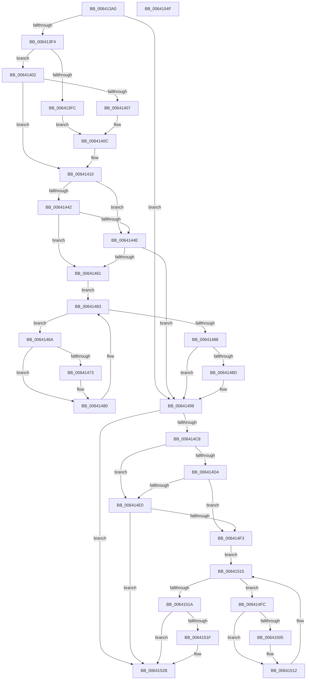

# DifZwDuplicateObjectWrapper

- RVA: `0x006413A0`–`0x00641550` (길이 `432` bytes)
- VA: `0x00000001406413A0`
- 실행 섹션: `.text`
- PDB 이름 있음: `예`; PDB Function 태그: `아니요`
- unwind 정보 RVA: `0x000BC530`
- 디코드: `123`개 명령, `432/432` bytes 표시
- 미해석 바이트: `0` (있으면 어셈블리에 `.byte`로 보존)

> 이 문서는 커널 이미지의 기계어와 PDB 기호를 분석해 생성했습니다. 4번과 5번은 함수 원형과 자료형을 바이너리 사용 방식에서 추정한 C 해석이며 원본 소스 복구 결과는 아닙니다.

## 1. Dependencies

- 직접 호출 지점: **10**; 고유 호출 대상: **7**
- 직접 호출자로 확인된 함수: **0**
- RIP 상대 이미지 참조: **3**

### Outgoing calls
- `0x006413D9` → [memset](../6C/memset_function_006C6C40.md) (function, `0x006C6C40`)
- `0x006413E3` → [DifGetAPIThunkContextById](../49/DifGetAPIThunkContextById_function_00495A34.md) (function, `0x00495A34`)
- `0x00641407` → [DifGetReturnAddressForWrappers](../4D/DifGetReturnAddressForWrappers_function_004D3C08.md) (function, `0x004D3C08`)
- `0x00641455` → [ExAcquireRundownProtection](../21/ExAcquireRundownProtection_function_00216620.md) (function, `0x00216620`)
- `0x0064147B` → [guard_dispatch_icall](../6B/guard_dispatch_icall_function_006BAAD0.md) (function, `0x006BAAD0`)
- `0x00641494` → [ExReleaseRundownProtection](../34/ExReleaseRundownProtection_function_00349E80.md) (function, `0x00349E80`)
- `0x006414BB` → [ZwDuplicateObject](../6A/ZwDuplicateObject_function_006AD850.md) (function, `0x006AD850`)
- `0x006414E7` → [ExAcquireRundownProtection](../21/ExAcquireRundownProtection_function_00216620.md) (function, `0x00216620`)
- `0x0064150D` → [guard_dispatch_icall](../6B/guard_dispatch_icall_function_006BAAD0.md) (function, `0x006BAAD0`)
- `0x00641526` → [ExReleaseRundownProtection](../34/ExReleaseRundownProtection_function_00349E80.md) (function, `0x00349E80`)

### Direct callers
- 이 함수 시작 RVA로 연결되는 직접 call은 확인되지 않았습니다. 간접 호출은 완전히 역산할 수 없습니다.

### Static image references
- `0x00641417` → RVA `0x00F048B8` (`.data`; read)
- `0x00641442` → RVA `0x00F04980` (`.data`; read)
- `0x0064144E` → RVA `0x00F03E80` (`.data`; read)

## 2. Other-region calls and transfers

- 다른 실행 섹션으로 향하는 call: **0**
- 별도 외부 분기/꼬리 이동을 확인하지 못했습니다.

## 3. Assembly (complete function range)

```asm
006413A0  48 8B C4                        mov rax, rsp
006413A3  48 89 58 10                     mov qword ptr [rax + 0x10], rbx
006413A7  48 89 70 18                     mov qword ptr [rax + 0x18], rsi
006413AB  48 89 78 20                     mov qword ptr [rax + 0x20], rdi
006413AF  48 89 48 08                     mov qword ptr [rax + 8], rcx
006413B3  55                              push rbp
006413B4  41 54                           push r12
006413B6  41 55                           push r13
006413B8  41 56                           push r14
006413BA  41 57                           push r15
006413BC  48 8B EC                        mov rbp, rsp
006413BF  48 81 EC 80 00 00 00            sub rsp, 0x80
006413C6  4C 8B EA                        mov r13, rdx
006413C9  48 8D 4D C0                     lea rcx, [rbp - 0x40]
006413CD  33 D2                           xor edx, edx
006413CF  4D 8B E0                        mov r12, r8
006413D2  4D 8B F9                        mov r15, r9
006413D5  44 8D 42 40                     lea r8d, [rdx + 0x40]
006413D9  E8 62 58 08 00                  call 0x1406c6c40
006413DE  B9 6C 00 00 00                  mov ecx, 0x6c
006413E3  E8 4C 46 E5 FF                  call 0x140495a34
006413E8  4C 8B F0                        mov r14, rax
006413EB  48 85 C0                        test rax, rax
006413EE  0F 84 A5 00 00 00               je 0x140641499
006413F4  8B 48 0C                        mov ecx, dword ptr [rax + 0xc]
006413F7  F6 C1 18                        test cl, 0x18
006413FA  74 06                           je 0x140641402
006413FC  48 8B 45 28                     mov rax, qword ptr [rbp + 0x28]
00641400  EB 0A                           jmp 0x14064140c
00641402  F6 C1 04                        test cl, 4
00641405  74 09                           je 0x140641410
00641407  E8 FC 27 E9 FF                  call 0x1404d3c08
0064140C  48 89 45 C0                     mov qword ptr [rbp - 0x40], rax
00641410  48 8B 45 30                     mov rax, qword ptr [rbp + 0x30]
00641414  40 32 F6                        xor sil, sil
00641417  40 38 35 9A 34 8C 00            cmp byte ptr [rip + 0x8c349a], sil
0064141E  48 89 45 F0                     mov qword ptr [rbp - 0x10], rax
00641422  8B 45 50                        mov eax, dword ptr [rbp + 0x50]
00641425  89 45 D0                        mov dword ptr [rbp - 0x30], eax
00641428  8B 45 58                        mov eax, dword ptr [rbp + 0x58]
0064142B  89 45 CC                        mov dword ptr [rbp - 0x34], eax
0064142E  8B 45 60                        mov eax, dword ptr [rbp + 0x60]
00641431  89 45 C8                        mov dword ptr [rbp - 0x38], eax
00641434  4C 89 6D E8                     mov qword ptr [rbp - 0x18], r13
00641438  4C 89 65 E0                     mov qword ptr [rbp - 0x20], r12
0064143C  4C 89 7D D8                     mov qword ptr [rbp - 0x28], r15
00641440  75 0C                           jne 0x14064144e
00641442  F7 05 34 35 8C 00 00 08 00 00   test dword ptr [rip + 0x8c3534], 0x800
0064144C  74 13                           je 0x140641461
0064144E  48 8D 0D 2B 2A 8C 00            lea rcx, [rip + 0x8c2a2b]
00641455  E8 C6 51 BD FF                  call 0x140216620
0064145A  40 8A F0                        mov sil, al
0064145D  84 C0                           test al, al
0064145F  74 38                           je 0x140641499
00641461  49 8D 7E 20                     lea rdi, [r14 + 0x20]
00641465  48 8B 1F                        mov rbx, qword ptr [rdi]
00641468  EB 19                           jmp 0x140641483
0064146A  48 8D 43 F0                     lea rax, [rbx - 0x10]
0064146E  48 85 C0                        test rax, rax
00641471  74 0D                           je 0x140641480
00641473  48 8B 40 08                     mov rax, qword ptr [rax + 8]
00641477  48 8D 4D C0                     lea rcx, [rbp - 0x40]
0064147B  E8 50 96 07 00                  call 0x1406baad0
00641480  48 8B 1B                        mov rbx, qword ptr [rbx]
00641483  48 3B DF                        cmp rbx, rdi
00641486  75 E2                           jne 0x14064146a
00641488  40 84 F6                        test sil, sil
0064148B  74 0C                           je 0x140641499
0064148D  48 8D 0D EC 29 8C 00            lea rcx, [rip + 0x8c29ec]
00641494  E8 E7 89 D0 FF                  call 0x140349e80
00641499  8B 45 60                        mov eax, dword ptr [rbp + 0x60]
0064149C  4D 8B CF                        mov r9, r15
0064149F  48 8B 4D 30                     mov rcx, qword ptr [rbp + 0x30]
006414A3  4D 8B C4                        mov r8, r12
006414A6  89 44 24 30                     mov dword ptr [rsp + 0x30], eax
006414AA  49 8B D5                        mov rdx, r13
006414AD  8B 45 58                        mov eax, dword ptr [rbp + 0x58]
006414B0  89 44 24 28                     mov dword ptr [rsp + 0x28], eax
006414B4  8B 45 50                        mov eax, dword ptr [rbp + 0x50]
006414B7  89 44 24 20                     mov dword ptr [rsp + 0x20], eax
006414BB  E8 90 C3 06 00                  call 0x1406ad850
006414C0  89 45 F8                        mov dword ptr [rbp - 8], eax
006414C3  4D 85 F6                        test r14, r14
006414C6  74 63                           je 0x14064152b
006414C8  40 32 FF                        xor dil, dil
006414CB  40 38 3D E6 33 8C 00            cmp byte ptr [rip + 0x8c33e6], dil
006414D2  75 0C                           jne 0x1406414e0
006414D4  F7 05 A2 34 8C 00 00 08 00 00   test dword ptr [rip + 0x8c34a2], 0x800
006414DE  74 13                           je 0x1406414f3
006414E0  48 8D 0D 99 29 8C 00            lea rcx, [rip + 0x8c2999]
006414E7  E8 34 51 BD FF                  call 0x140216620
006414EC  40 8A F8                        mov dil, al
006414EF  84 C0                           test al, al
006414F1  74 38                           je 0x14064152b
006414F3  49 8D 76 30                     lea rsi, [r14 + 0x30]
006414F7  48 8B 1E                        mov rbx, qword ptr [rsi]
006414FA  EB 19                           jmp 0x140641515
006414FC  48 8D 43 F0                     lea rax, [rbx - 0x10]
00641500  48 85 C0                        test rax, rax
00641503  74 0D                           je 0x140641512
00641505  48 8B 40 08                     mov rax, qword ptr [rax + 8]
00641509  48 8D 4D C0                     lea rcx, [rbp - 0x40]
0064150D  E8 BE 95 07 00                  call 0x1406baad0
00641512  48 8B 1B                        mov rbx, qword ptr [rbx]
00641515  48 3B DE                        cmp rbx, rsi
00641518  75 E2                           jne 0x1406414fc
0064151A  40 84 FF                        test dil, dil
0064151D  74 0C                           je 0x14064152b
0064151F  48 8D 0D 5A 29 8C 00            lea rcx, [rip + 0x8c295a]
00641526  E8 55 89 D0 FF                  call 0x140349e80
0064152B  8B 45 F8                        mov eax, dword ptr [rbp - 8]
0064152E  4C 8D 9C 24 80 00 00 00         lea r11, [rsp + 0x80]
00641536  49 8B 5B 38                     mov rbx, qword ptr [r11 + 0x38]
0064153A  49 8B 73 40                     mov rsi, qword ptr [r11 + 0x40]
0064153E  49 8B 7B 48                     mov rdi, qword ptr [r11 + 0x48]
00641542  49 8B E3                        mov rsp, r11
00641545  41 5F                           pop r15
00641547  41 5E                           pop r14
00641549  41 5D                           pop r13
0064154B  41 5C                           pop r12
0064154D  5D                              pop rbp
0064154E  C3                              ret
0064154F  CC                              int3
```

## 4. C-style interpretation (structured pseudocode)

```c
__int64 __fastcall DifZwDuplicateObjectWrapper(__int64 a1, __int64 a2, __int64 a3, __int64 a4, unsigned int a5, unsigned int a6, unsigned int a7)
{
    __int64 result;
    __int64 v_rdi;
    __int64 v_rsi;
    __int64 v_rsp;
    unsigned __int64 v_stack_m28;
    unsigned int v_stack_m30;
    unsigned __int64 v_stack_m38;
    unsigned __int64 v_stack_m40;
    unsigned __int64 v_stack_m48;
    unsigned __int64 v_stack_m50;
    unsigned int v_stack_m58;
    unsigned int v_stack_m5C;
    unsigned int v_stack_m60;
    unsigned __int64 v_stack_m68;
    unsigned int v_stack_m78;
    unsigned int v_stack_m80;
    unsigned int v_stack_m88;
    unsigned __int64 v_stack_p0;
    unsigned __int64 v_stack_p8;

    *(unsigned __int64 *)(v_rsp + 16) = v_rbx;
    *(unsigned __int64 *)(v_rsp + 24) = v_rsi;
    *(unsigned __int64 *)(v_rsp + 32) = v_rdi;
    *(unsigned __int64 *)(v_rsp + 8) = a1;
    v_rsp = (v_rsp) - (128);
    a2 = 0;
    result = memset(v_stack_m68, a2, a2 + 64, a4);
    result = DifGetAPIThunkContextById(108, a2, a2 + 64, a4);
    if (result == 0) goto loc_00641499;
    if ((((unsigned __int8)((unsigned int)(*(unsigned int *)(result + 12)))) & (24)) == 0) goto loc_00641402;
    goto loc_0064140C;
loc_00641402:
    if ((((unsigned __int8)((unsigned int)(*(unsigned int *)(result + 12)))) & (4)) == 0) goto loc_00641410;
    result = DifGetReturnAddressForWrappers((unsigned int)(*(unsigned int *)(result + 12)), a2, a2 + 64, a4);
loc_0064140C:
    v_stack_m68 = result;
loc_00641410:
    v_rsi = 0;
    v_stack_m38 = v_stack_p8;
    v_stack_m58 = (unsigned int)((unsigned int)(a5));
    v_stack_m5C = (unsigned int)((unsigned int)(a6));
    v_stack_m60 = (unsigned int)((unsigned int)(a7));
    v_stack_m40 = 0;
    v_stack_m48 = a3;
    v_stack_m50 = a4;
    if ((*(unsigned __int8 *)(v_rip + 9188506)) != 0) goto loc_0064144E;
    if (((*(unsigned int *)(v_rip + 9188660)) & (0x800ULL)) == 0) goto loc_00641461;
loc_0064144E:
    result = ExAcquireRundownProtection(v_rip + 9185835, a2, a2 + 64, a4);
    if ((unsigned __int8)(result) == 0) goto loc_00641499;
loc_00641461:
    goto loc_00641483;
loc_0064146A:
    result = *(unsigned __int64 *)(result + 32) - 16;
    if (*(unsigned __int64 *)(result + 32) - 16 != 0) {
        result = *(unsigned __int64 *)(*(unsigned __int64 *)(result + 32) - 16 + 8);
        a1 = v_stack_m68;
        result = guard_dispatch_icall(a1, a2, a2 + 64, a4);
    }
loc_00641483:
    if ((*(unsigned __int64 *)(*(unsigned __int64 *)(result + 32))) != (result + 32)) goto loc_0064146A;
    if ((unsigned __int8)((unsigned __int8)(result)) != 0) {
        a1 = v_rip + 9185772;
        result = ExReleaseRundownProtection(a1, a2, a2 + 64, a4);
    }
    v_stack_m78 = (unsigned int)((unsigned int)(a7));
    v_stack_m80 = (unsigned int)((unsigned int)(a6));
    v_stack_m88 = (unsigned int)((unsigned int)(a5));
    result = ZwDuplicateObject(v_stack_p8, 0, a3, a4);
    v_stack_m30 = (unsigned int)(result);
    if (result == 0) goto loc_0064152B;
    v_rdi = 0;
    if ((*(unsigned __int8 *)(v_rip + 9188326)) != 0) goto loc_006414E0;
    if (((*(unsigned int *)(v_rip + 9188514)) & (0x800ULL)) == 0) goto loc_006414F3;
loc_006414E0:
    result = ExAcquireRundownProtection(v_rip + 9185689, 0, a3, a4);
    if ((unsigned __int8)(result) == 0) goto loc_0064152B;
loc_006414F3:
    goto loc_00641515;
loc_006414FC:
    result = *(unsigned __int64 *)(result + 48) - 16;
    if (*(unsigned __int64 *)(result + 48) - 16 != 0) {
        result = *(unsigned __int64 *)(*(unsigned __int64 *)(result + 48) - 16 + 8);
        a1 = v_stack_m68;
        result = guard_dispatch_icall(a1, 0, a3, a4);
    }
loc_00641515:
    if ((*(unsigned __int64 *)(*(unsigned __int64 *)(result + 48))) != (result + 48)) goto loc_006414FC;
    if ((unsigned __int8)((unsigned __int8)(result)) != 0) {
        a1 = v_rip + 9185626;
        result = ExReleaseRundownProtection(a1, 0, a3, a4);
    }
    return (unsigned int)(v_stack_m30);
}
```

## 5. (Beta) C Style

```c
int64_t DifZwDuplicateObjectWrapper(int64_t Arg1, int64_t Arg2, int64_t Arg3, int64_t Arg4, uint32_t Arg5, uint32_t Arg6, uint32_t Arg7)
{
    int64_t result;
    int64_t local_rdi;
    int64_t local_rsi;
    int64_t local_rsp;
    uint64_t v_stack_m28;
    uint32_t v_stack_m30;
    uint64_t v_stack_m38;
    uint64_t v_stack_m40;
    uint64_t v_stack_m48;
    uint64_t v_stack_m50;
    uint32_t v_stack_m58;
    uint32_t v_stack_m5C;
    uint32_t v_stack_m60;
    uint64_t v_stack_m68;
    uint32_t v_stack_m78;
    uint32_t v_stack_m80;
    uint32_t v_stack_m88;
    uint64_t v_stack_p0;
    uint64_t v_stack_p8;

    *(uint64_t *)(local_rsp + 0x10) = local_rbx;
    *(uint64_t *)(local_rsp + 0x18) = local_rsi;
    *(uint64_t *)(local_rsp + 0x20) = local_rdi;
    *(uint64_t *)(local_rsp + 0x8) = Arg1;
    local_rsp = (local_rsp) - (128);
    Arg2 = 0;
    result = memset(v_stack_m68, Arg2, Arg2 + 64, Arg4);
    result = DifGetAPIThunkContextById(108, Arg2, Arg2 + 64, Arg4);
    if (result == 0) goto loc_00641499;
    if ((((uint8_t)((uint32_t)(*(uint32_t *)(result + 0xC)))) & (24)) == 0) goto loc_00641402;
    goto loc_0064140C;
loc_00641402:
    if ((((uint8_t)((uint32_t)(*(uint32_t *)(result + 0xC)))) & (4)) == 0) goto loc_00641410;
    result = DifGetReturnAddressForWrappers((uint32_t)(*(uint32_t *)(result + 0xC)), Arg2, Arg2 + 64, Arg4);
loc_0064140C:
    v_stack_m68 = result;
loc_00641410:
    local_rsi = 0;
    v_stack_m38 = v_stack_p8;
    v_stack_m58 = (uint32_t)((uint32_t)(Arg5));
    v_stack_m5C = (uint32_t)((uint32_t)(Arg6));
    v_stack_m60 = (uint32_t)((uint32_t)(Arg7));
    v_stack_m40 = 0;
    v_stack_m48 = Arg3;
    v_stack_m50 = Arg4;
    if ((*(uint8_t *)(v_rip + 0x8C349A)) != 0) goto loc_0064144E;
    if (((*(uint32_t *)(v_rip + 0x8C3534)) & (0x800ULL)) == 0) goto loc_00641461;
loc_0064144E:
    result = ExAcquireRundownProtection(v_rip + 9185835, Arg2, Arg2 + 64, Arg4);
    if ((uint8_t)(result) == 0) goto loc_00641499;
loc_00641461:
    goto loc_00641483;
loc_0064146A:
    result = *(uint64_t *)(result + 0x20) - 16;
    if (*(uint64_t *)(result + 0x20) - 16 != 0) {
        result = *(uint64_t *)(*(uint64_t *)(result + 0x20) - 0x10 + 0x8);
        Arg1 = v_stack_m68;
        result = guard_dispatch_icall(Arg1, Arg2, Arg2 + 64, Arg4);
    }
loc_00641483:
    if ((*(uint64_t *)(*(uint64_t *)(result + 0x20))) != (result + 32)) goto loc_0064146A;
    if ((uint8_t)((uint8_t)(result)) != 0) {
        Arg1 = v_rip + 9185772;
        result = ExReleaseRundownProtection(Arg1, Arg2, Arg2 + 64, Arg4);
    }
    v_stack_m78 = (uint32_t)((uint32_t)(Arg7));
    v_stack_m80 = (uint32_t)((uint32_t)(Arg6));
    v_stack_m88 = (uint32_t)((uint32_t)(Arg5));
    result = ZwDuplicateObject(v_stack_p8, 0, Arg3, Arg4);
    v_stack_m30 = (uint32_t)(result);
    if (result == 0) goto loc_0064152B;
    local_rdi = 0;
    if ((*(uint8_t *)(v_rip + 0x8C33E6)) != 0) goto loc_006414E0;
    if (((*(uint32_t *)(v_rip + 0x8C34A2)) & (0x800ULL)) == 0) goto loc_006414F3;
loc_006414E0:
    result = ExAcquireRundownProtection(v_rip + 9185689, 0, Arg3, Arg4);
    if ((uint8_t)(result) == 0) goto loc_0064152B;
loc_006414F3:
    goto loc_00641515;
loc_006414FC:
    result = *(uint64_t *)(result + 0x30) - 16;
    if (*(uint64_t *)(result + 0x30) - 16 != 0) {
        result = *(uint64_t *)(*(uint64_t *)(result + 0x30) - 0x10 + 0x8);
        Arg1 = v_stack_m68;
        result = guard_dispatch_icall(Arg1, 0, Arg3, Arg4);
    }
loc_00641515:
    if ((*(uint64_t *)(*(uint64_t *)(result + 0x30))) != (result + 48)) goto loc_006414FC;
    if ((uint8_t)((uint8_t)(result)) != 0) {
        Arg1 = v_rip + 9185626;
        result = ExReleaseRundownProtection(Arg1, 0, Arg3, Arg4);
    }
    return (uint32_t)(v_stack_m30);
}
```

## 6. Execution-region graph

[열기: 2D/3D 그래프와 함수 탐색 컨트롤 패널](../../../control-panel.html?section=text&rva=0x006413A0&view=graph)

- 2D 그래프는 위에서 아래로 흐르고, 3D 그래프는 빈 공간을 드래그해 회전합니다. Shift+드래그는 이동, 휠은 확대·축소, 함수 노드 선택은 대상 보고서 이동입니다.

### Static fallback


